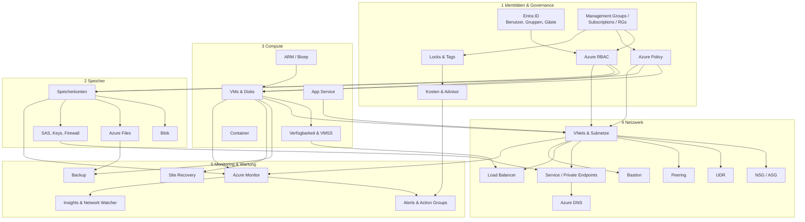

# 00 Prüfungsüberblick AZ-104

> **Prüfung:** AZ-104 – Microsoft Azure Administrator · **Zertifizierung:** Microsoft Certified: Azure Administrator Associate
> **Stand:** November 2026 – Prüfungsformat und Study Guide ändern sich regelmäßig, vor der Prüfung den [offiziellen Study Guide](https://learn.microsoft.com/credentials/certifications/resources/study-guides/az-104) prüfen.

## Inhalt

- [Prüfungsformat](#prüfungsformat)
- [Domänen und Gewichtung](#domänen-und-gewichtung)
- [Inhaltsverzeichnis aller Kapitel](#inhaltsverzeichnis-aller-kapitel)
- [Wie die Themen zusammenhängen](#wie-die-themen-zusammenhängen)
- [Lernstrategie](#lernstrategie)
- [Allgemeine Prüfungstipps](#allgemeine-prüfungstipps)
- [Die wichtigsten Fakten zum Schluss](#die-wichtigsten-fakten-zum-schluss)
- [Offizielle Ressourcen](#offizielle-ressourcen)

---

## Prüfungsformat

| Merkmal | Wert |
|---|---|
| Prüfungszeit | ca. **100 Minuten** (Gesamtzeit inkl. Einweisung und Feedback ca. 120 Minuten) |
| Anzahl Fragen | typischerweise **40–60** |
| Bestehensgrenze | **700 von 1000** Punkten (skaliert – nicht 70 % der Fragen) |
| Sprachen | u. a. Englisch und **Deutsch** |
| Durchführung | Testcenter (Pearson VUE) oder online zu Hause (OnVUE, mit Webcam und Raumcheck) |
| Hilfsmittel | **Microsoft Learn** steht während der Prüfung in einem eigenen Fenster zur Verfügung (*open book*) – kostet aber Zeit |
| Gültigkeit | **1 Jahr**; kostenlose Online-Verlängerung (*Renewal assessment*) in den letzten 6 Monaten vor Ablauf |
| Voraussetzungen | keine formalen; empfohlen: Praxis mit Azure Portal, CLI/PowerShell, ARM/Bicep, Grundlagen Netzwerk und Betriebssysteme |

**Fragetypen:**

| Typ | Beschreibung | Hinweis |
|---|---|---|
| Multiple Choice / Multiple Response | Eine bzw. mehrere richtige Antworten | Bei Mehrfachauswahl steht meist dabei, wie viele richtig sind |
| Drag and Drop | Schritte in Reihenfolge bringen oder Begriffe zuordnen | Häufig: „Welche Schritte in welcher Reihenfolge?“ |
| Hot Area | Werte in Dropdowns in einem Screenshot/Code-Ausschnitt wählen | Typisch für ARM/Bicep, KQL, CLI-Befehle |
| Ja/Nein-Serie (*Does the solution meet the goal?*) | Ein Szenario, mehrere Lösungsvorschläge nacheinander | ⚠️ **Kein Zurückspringen** möglich |
| Case Study | Längeres Szenario (Firmenumgebung, Anforderungen) mit mehreren Fragen | Eigener Abschnitt; nach Abschluss kein Zurück |
| Labs / interaktive Aufgaben | Aufgaben direkt in einer Azure-Umgebung | Kamen zeitweise vor; aktuell eher selten – trotzdem praktisch üben |

> Es gibt **keinen Punktabzug** für falsche Antworten – nie eine Frage leer lassen.

---

## Domänen und Gewichtung

| # | Domäne (englisch, wie im Study Guide) | Gewichtung | Kapitel |
|---|---|---|---|
| 1 | Manage Azure identities and governance | **20–25 %** | 7 |
| 2 | Implement and manage storage | **15–20 %** | 5 |
| 3 | Deploy and manage Azure compute resources | **20–25 %** | 6 |
| 4 | Implement and manage virtual networking | **15–20 %** | 10 |
| 5 | Monitor and maintain Azure resources | **10–15 %** | 5 |

Identitäten/Governance und Compute machen zusammen fast die Hälfte der Prüfung aus. Netzwerk hat die meisten Einzelthemen und gilt als die schwierigste Domäne.

---

## Inhaltsverzeichnis aller Kapitel

**Status:** ⬜ offen · 🟨 in Arbeit · ✅ fertig · 🔍 Fakten live gegen Microsoft Learn geprüft

### Domäne 1 – Identitäten und Governance (20–25 %)

| Kapitel | Study-Guide-Schwerpunkt | Status |
|---|---|---|
| [1.1 Microsoft Entra ID – Benutzer und Gruppen](01-identitaeten-und-governance/01-entra-id-benutzer-und-gruppen.md) | Create users and groups, manage properties | ✅ |
| [1.2 Lizenzen, externe Benutzer und SSPR](01-identitaeten-und-governance/02-lizenzen-externe-benutzer-und-sspr.md) | Licenses, external users, SSPR | ✅ |
| [1.3 Zugriffsverwaltung mit Azure RBAC](01-identitaeten-und-governance/03-rbac-zugriffsverwaltung.md) | Built-in roles, scopes, interpret access | ✅ |
| [1.4 Azure Policy](01-identitaeten-und-governance/04-azure-policy.md) | Implement and manage Azure Policy | ✅ |
| [1.5 Ressourcensperren und Tags](01-identitaeten-und-governance/05-ressourcensperren-und-tags.md) | Resource locks, tags | ✅ |
| [1.6 Ressourcengruppen, Abonnements und Verwaltungsgruppen](01-identitaeten-und-governance/06-ressourcengruppen-abonnements-verwaltungsgruppen.md) | Resource groups, subscriptions, management groups | ✅ |
| [1.7 Kostenverwaltung und Azure Advisor](01-identitaeten-und-governance/07-kostenverwaltung-und-advisor.md) | Budgets, cost alerts, Advisor | ✅ |

### Domäne 2 – Speicher (15–20 %)

| Kapitel | Study-Guide-Schwerpunkt | Status |
|---|---|---|
| [2.1 Speicherkonten und Redundanz](02-speicher/01-speicherkonten-und-redundanz.md) | Create storage accounts, redundancy | ✅ |
| [2.2 Zugriff auf Speicher und Sicherheit](02-speicher/02-speicherzugriff-und-sicherheit.md) | Firewalls, SAS, stored access policies, keys, identity-based access, encryption | ✅ |
| [2.3 Azure Blob Storage](02-speicher/03-blob-storage.md) | Containers, tiers, soft delete, versioning, lifecycle, object replication | ✅ |
| [2.4 Azure Files](02-speicher/04-azure-files.md) | File shares, snapshots, soft delete | ✅ |
| [2.5 Datenübertragung mit AzCopy und Storage Explorer](02-speicher/05-datenuebertragung-azcopy-und-storage-explorer.md) | AzCopy, Storage Explorer | ✅ |

### Domäne 3 – Compute (20–25 %)

| Kapitel | Study-Guide-Schwerpunkt | Status |
|---|---|---|
| [3.1 ARM Templates und Bicep](03-compute/01-arm-templates-und-bicep.md) | Interpret, modify, deploy, export, convert | ✅ |
| [3.2 Virtuelle Maschinen](03-compute/02-virtuelle-maschinen.md) | Create, move, resize VMs | ✅ |
| [3.3 VM-Datenträger und Verschlüsselung](03-compute/03-vm-datentraeger-und-verschluesselung.md) | Manage disks, Azure Disk Encryption | ✅ |
| [3.4 Verfügbarkeit und Virtual Machine Scale Sets](03-compute/04-verfuegbarkeit-und-scale-sets.md) | Availability zones/sets, VMSS | ✅ |
| [3.5 Container: ACR, ACI und Container Apps](03-compute/05-container-acr-aci-container-apps.md) | Registry, Container Instances, Container Apps, scaling | ✅ |
| [3.6 Azure App Service](03-compute/06-azure-app-service.md) | Plans, scaling, TLS, custom domains, backup, networking, slots | ✅ |

### Domäne 4 – Netzwerk (15–20 %)

| Kapitel | Study-Guide-Schwerpunkt | Status |
|---|---|---|
| [4.1 Virtuelle Netzwerke und Subnetze](04-netzwerk/01-virtuelle-netzwerke-und-subnetze.md) | Create and configure VNets and subnets | ✅ |
| [4.2 Virtual Network Peering](04-netzwerk/02-vnet-peering.md) | VNet peering | ✅ |
| [4.3 Öffentliche IP-Adressen](04-netzwerk/03-oeffentliche-ip-adressen.md) | Public IP addresses | ✅ |
| [4.4 Benutzerdefinierte Routen (UDR)](04-netzwerk/04-benutzerdefinierte-routen.md) | User-defined routes | ✅ |
| [4.5 NSGs und ASGs](04-netzwerk/05-nsg-und-asg.md) | NSGs, ASGs, effective security rules | ✅ |
| [4.6 Azure Bastion](04-netzwerk/06-azure-bastion.md) | Implement Azure Bastion | ✅ |
| [4.7 Service Endpoints und Private Endpoints](04-netzwerk/07-service-endpoints-und-private-endpoints.md) | Service endpoints, private endpoints | ✅ |
| [4.8 Azure DNS](04-netzwerk/08-azure-dns.md) | Configure Azure DNS | ✅ |
| [4.9 Azure Load Balancer](04-netzwerk/09-load-balancer.md) | Internal/public load balancer, troubleshooting | ✅ |
| [4.10 Netzwerk-Troubleshooting](04-netzwerk/10-netzwerk-troubleshooting.md) | Troubleshoot network connectivity | ✅ |

### Domäne 5 – Monitoring und Wartung (10–15 %)

| Kapitel | Study-Guide-Schwerpunkt | Status |
|---|---|---|
| [5.1 Azure Monitor – Metriken und Logs](05-monitoring-und-wartung/01-azure-monitor-metriken-und-logs.md) | Metrics, log settings, KQL | ✅ |
| [5.2 Warnungen und Aktionsgruppen](05-monitoring-und-wartung/02-warnungen-und-aktionsgruppen.md) | Alert rules, action groups, alert processing rules | ✅ |
| [5.3 Insights und Network Watcher](05-monitoring-und-wartung/03-insights-und-network-watcher.md) | VM/Storage/Network insights, Connection Monitor | ✅ |
| [5.4 Azure Backup](05-monitoring-und-wartung/04-azure-backup.md) | Vaults, policies, backup/restore, reports | ✅ |
| [5.5 Azure Site Recovery](05-monitoring-und-wartung/05-azure-site-recovery.md) | Configure ASR, failover | ✅ |

> Alle Kapitel sind inhaltlich vollständig, aber **noch nicht live gegen Microsoft Learn verifiziert** (kein 🔍). Besonders Limits, Stichtage (Retirements), Portal-Menübezeichnungen und einzelne Cmdlet-Parameter vor der Prüfung gegenprüfen.

---

## Wie die Themen zusammenhängen

**Rote Fäden, die sich durch viele Kapitel ziehen:**

- **Scope-Hierarchie** (Management Group → Subscription → Resource Group → Resource) gilt für RBAC, Policy, Locks, Budgets und Diagnostic settings gleichermaßen.
- **Control plane vs. Data plane:** RBAC-Rollen wie *Owner* erlauben Verwaltung, aber nicht automatisch Datenzugriff (z. B. *Storage Blob Data Reader*); Locks wirken nur auf die Control plane.
- **Managed Identities** verbinden Compute mit Speicher, Key Vault und Policy-Remediation – immer zusammen mit RBAC denken.
- **Standard-SKU-Prinzip:** Standard Public IP und Standard Load Balancer sind *secure by default* und brauchen eine NSG; Basic-SKUs sind abgekündigt.
- **„Was ist nach der Erstellung nicht mehr änderbar?“** – in fast jedem Kapitel ein eigener Prüfungsfallstrick (Region, Availability Set, hierarchischer Namespace, rollenzuweisbare Gruppe, Infrastructure encryption …).

---

## Lernstrategie

### Empfohlene Reihenfolge

1. **Domäne 1** zuerst – Identitäten, RBAC und Scopes sind die Grundlage für alles andere.
2. **Domäne 4** (Netzwerk) vor Compute – VMs, App Service und Private Endpoints setzen VNets, NSGs und DNS voraus.
3. **Domäne 2** (Speicher) und **Domäne 3** (Compute).
4. **Domäne 5** zum Schluss – Monitoring, Backup und Site Recovery bauen auf allen anderen Ressourcen auf.

### Vorschlag für einen 6-Wochen-Plan

| Woche | Inhalt | Praxis im eigenen Abo |
|---|---|---|
| 1 | Kapitel 1.1–1.4 | Benutzer/Gruppen anlegen, dynamische Gruppe, RBAC-Zuweisung, Policy *Allowed locations* |
| 2 | Kapitel 1.5–1.7, 4.1–4.3 | Lock + Tag setzen, Budget mit Alert, VNet mit Subnetzen, Public IP |
| 3 | Kapitel 4.4–4.10 | Hub-and-Spoke mit Peering und UDR, NSG-Auswertung, Bastion, Private Endpoint mit Private DNS, Load Balancer, IP flow verify |
| 4 | Kapitel 2.1–2.5 | Speicherkonto, SAS, Lifecycle-Regel, File Share einbinden, AzCopy |
| 5 | Kapitel 3.1–3.6 | VM per Bicep, Disk hinzufügen, VMSS mit Autoscale, ACI/Container App, Web App mit Slot-Swap |
| 6 | Kapitel 5.1–5.5 + Wiederholung | Diagnostic settings + KQL, Metric Alert mit Action Group, VM-Backup + Restore, ASR-Testfailover; Practice Assessment |

### Pro Kapitel

1. **Lernziele** lesen → **Überblick** und **Kernkonzepte** durcharbeiten.
2. **Azure-Portal-Pfade** im eigenen Abo nachklicken (Kostenloses Konto / Sandbox reicht für fast alles).
3. **Praxisbeispiel** nachbauen – einmal im Portal, einmal per CLI.
4. **Prüfungstipps & Fallstricke** und **Vergleichstabellen** als Wiederholungsstoff markieren.
5. **Selbsttest** ohne Nachschauen beantworten; falsche Antworten zurück ins Kapitel.

> 💡 **Kosten im Blick behalten:** Nach jeder Übung die Ressourcengruppe löschen (`az group delete -n <rg> --yes --no-wait`) und ein Budget mit Alert auf das Übungsabo setzen ([1.7](01-identitaeten-und-governance/07-kostenverwaltung-und-advisor.md)).

---

## Allgemeine Prüfungstipps

- **Zeit einteilen:** grob 1,5–2 Minuten pro Frage; Case Studies kosten mehr. Unsichere Fragen markieren (*Review*) und später zurückkehren – **außer** bei Ja/Nein-Serien und abgeschlossenen Case Studies.
- **Microsoft Learn sparsam nutzen:** Nachschlagen dauert. Nur gezielt für ein konkretes Limit oder einen Parameter verwenden.
- **Schlüsselwörter beachten:**
  - *„minimaler Verwaltungsaufwand“* → automatisierte/verwaltete Lösung (dynamische Gruppe, Policy, Managed Identity, Autoscale).
  - *„geringste Kosten“* → kleinste SKU/Tier, die die Anforderung **gerade noch** erfüllt.
  - *„Prinzip der geringsten Rechte“ / least privilege* → spezifischste Rolle auf dem kleinsten Scope.
  - *„muss auch bei Ausfall eines Rechenzentrums verfügbar sein“* → Availability Zones / ZRS; *„einer Region“* → GRS/GZRS, Site Recovery.
- **Szenarien vollständig lesen:** Die entscheidende Einschränkung (Region, SKU, Lizenz, bestehende Konfiguration) steht oft im letzten Satz.
- **Ausschlussverfahren:** Meist sind zwei Antworten offensichtlich falsch; zwischen den restlichen anhand der Einschränkung entscheiden.
- **Aktuelle Namen, alte Fragen:** *Microsoft Entra ID* = früher *Azure AD*; *Alert processing rules* = früher *Action rules*; *Azure Monitor Agent* ersetzt den *Log Analytics Agent (MMA)*.
- **Reihenfolge-Fragen:** Abhängigkeiten zuerst – z. B. Key Vault vor CMK, Vault vor Backup-Policy, Subnetz vor Bastion, Peering beidseitig vor Gateway transit.

---

## Die wichtigsten Fakten zum Schluss

Eine Auswahl häufig abgefragter Zahlen und Regeln – Details in den jeweiligen Kapiteln.

| Thema | Fakt | Kapitel |
|---|---|---|
| Gelöschte Benutzer / M365-Gruppen | 30 Tage wiederherstellbar; Security Groups nicht | [1.1](01-identitaeten-und-governance/01-entra-id-benutzer-und-gruppen.md) |
| Lizenz zuweisen | *Usage location* erforderlich | [1.2](01-identitaeten-und-governance/02-lizenzen-externe-benutzer-und-sspr.md) |
| SSPR *Selected* | genau eine Gruppe; Admins immer 2 Methoden | [1.2](01-identitaeten-und-governance/02-lizenzen-externe-benutzer-und-sspr.md) |
| RBAC | additiv; Deny assignments gehen vor | [1.3](01-identitaeten-und-governance/03-rbac-zugriffsverwaltung.md) |
| Policy auf Bestand | markiert nur als non-compliant; Korrektur per Remediation task | [1.4](01-identitaeten-und-governance/04-azure-policy.md) |
| Locks | gelten auch für Owner; restriktivster gewinnt | [1.5](01-identitaeten-und-governance/05-ressourcensperren-und-tags.md) |
| Tags | werden **nicht** vererbt | [1.5](01-identitaeten-und-governance/05-ressourcensperren-und-tags.md) |
| Management Groups | max. 6 Ebenen unter der Root | [1.6](01-identitaeten-und-governance/06-ressourcengruppen-abonnements-verwaltungsgruppen.md) |
| Budgets | alarmieren, stoppen aber nichts automatisch | [1.7](01-identitaeten-und-governance/07-kostenverwaltung-und-advisor.md) |
| Redundanz | LRS 3 Kopien, ZRS 3 Zonen, GRS 6 Kopien in 2 Regionen | [2.1](02-speicher/01-speicherkonten-und-redundanz.md) |
| User delegation SAS | Entra-signiert, nur Blob/Data Lake | [2.2](02-speicher/02-speicherzugriff-und-sicherheit.md) |
| Stored access policies | max. 5 pro Container | [2.2](02-speicher/02-speicherzugriff-und-sicherheit.md) |
| Access tiers | Mindestaufbewahrung Cool 30 / Cold 90 / Archive 180 Tage | [2.3](02-speicher/03-blob-storage.md) |
| Object replication | erfordert Versioning (beide) + Change feed (Quelle) | [2.3](02-speicher/03-blob-storage.md) |
| Azure Files SMB | Port 445 | [2.4](02-speicher/04-azure-files.md) |
| Deployment-Modus Complete | löscht nicht im Template enthaltene Ressourcen der RG | [3.1](03-compute/01-arm-templates-und-bicep.md) |
| Availability Set | nur bei Erstellung zuweisbar; max. 3 FDs, bis 20 UDs | [3.4](03-compute/04-verfuegbarkeit-und-scale-sets.md) |
| SLA | Availability Set 99,95 %, Zonen 99,99 % | [3.4](03-compute/04-verfuegbarkeit-und-scale-sets.md) |
| Deployment slots | ab Standard-Tier | [3.6](03-compute/06-azure-app-service.md) |
| Subnetze | 5 reservierte IPs pro Subnetz | [4.1](04-netzwerk/01-virtuelle-netzwerke-und-subnetze.md) |
| Peering | nicht transitiv; keine überlappenden Adressräume | [4.2](04-netzwerk/02-vnet-peering.md) |
| NSG-Priorität | 100–4096, kleinere Zahl gewinnt | [4.5](04-netzwerk/05-nsg-und-asg.md) |
| AzureBastionSubnet | mindestens /26 | [4.6](04-netzwerk/06-azure-bastion.md) |
| CNAME | nicht am Zonen-Apex → Alias record | [4.8](04-netzwerk/08-azure-dns.md) |
| Health probe Quelle | 168.63.129.16 (Service Tag *AzureLoadBalancer*) | [4.9](04-netzwerk/09-load-balancer.md) |
| Platform metrics | 93 Tage; Activity Log 90 Tage | [5.1](05-monitoring-und-wartung/01-azure-monitor-metriken-und-logs.md) |
| Alert processing rule | unterdrückt Aktionen, nicht den Alert | [5.2](05-monitoring-und-wartung/02-warnungen-und-aktionsgruppen.md) |
| VM-Backup | Vault in derselben Region wie die VM | [5.4](05-monitoring-und-wartung/04-azure-backup.md) |
| Site Recovery | Vault nicht in der Quellregion; Test failover ohne Produktionsauswirkung | [5.5](05-monitoring-und-wartung/05-azure-site-recovery.md) |

---

## Offizielle Ressourcen

- [AZ-104 Prüfungsseite](https://learn.microsoft.com/credentials/certifications/azure-administrator/)
- [AZ-104 Study Guide (Skills measured)](https://learn.microsoft.com/credentials/certifications/resources/study-guides/az-104)
- [Kostenloses Practice Assessment](https://learn.microsoft.com/credentials/certifications/practice-assessments-for-microsoft-certifications)
- [Learning Paths AZ-104](https://learn.microsoft.com/training/browse/?expanded=azure&resource_type=learning%20path&terms=AZ-104)
- [Exam Sandbox – Prüfungsoberfläche ausprobieren](https://aka.ms/examdemo)
- [Zertifizierung verlängern (Renewal)](https://learn.microsoft.com/credentials/certifications/renew-your-microsoft-certification)
- [Azure-Dokumentation](https://learn.microsoft.com/azure/)
