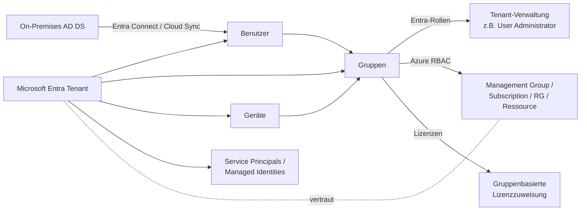

# 1.1 Microsoft Entra ID – Benutzer und Gruppen

> **Domäne:** Manage Azure identities and governance · **Gewichtung:** 20–25 %
> **Study-Guide-Punkte:** *Create users and groups* · *Manage user and group properties*
> (Lizenzen, externe Benutzer und SSPR → [Kapitel 1.2](02-lizenzen-externe-benutzer-und-sspr.md))
> **Stand:** November 2026

## Lernziele

Nach diesem Kapitel kann ich …

- erklären, was ein **Microsoft Entra Tenant** ist und wie er mit Azure-Abonnements zusammenhängt.
- Benutzer einzeln und per **Bulk-Vorgang** (CSV) im Portal, mit Azure CLI und Microsoft Graph PowerShell anlegen.
- **Security Groups** und **Microsoft 365 Groups** unterscheiden und den passenden Mitgliedschaftstyp (**Assigned**, **Dynamic User**, **Dynamic Device**) wählen.
- Regeln für dynamische Gruppen schreiben und deren Lizenzanforderung (Entra ID P1) benennen.
- gelöschte Benutzer und Gruppen wiederherstellen und die 30-Tage-Frist erklären.
- Benutzer- und Gruppeneigenschaften pflegen (z. B. *Usage location*, *Department*, *Manager*, *Block sign-in*).

## Überblick

**Microsoft Entra ID** (früher *Azure Active Directory*, Azure AD) ist der cloudbasierte Identitäts- und Zugriffsverwaltungsdienst von Microsoft. Jede Organisation erhält eine eigene Instanz, den **Tenant** (Mandanten), identifiziert durch eine *Tenant ID* (GUID) und eine Standard-Domain `<name>.onmicrosoft.com`.

Im Tenant leben alle **Identitäten**: Benutzer, Gruppen, Geräte, Anwendungen (Service Principals) und Managed Identities. Diese Identitäten werden anschließend über **Azure RBAC** ([Kapitel 1.3](03-rbac-zugriffsverwaltung.md)) berechtigt, Azure-Ressourcen zu nutzen.

Für den Administrator bedeutet das im Alltag: Benutzer anlegen, Eigenschaften pflegen, sie in Gruppen organisieren und Berechtigungen **an Gruppen statt an Einzelpersonen** vergeben. Das ist der Kern dieses Kapitels.

## Kernkonzepte

### Tenant, Verzeichnis und Abonnement

- Ein **Tenant** ist eine dedizierte Instanz von Entra ID (Verzeichnis = *Directory*).
- Ein **Azure-Abonnement** (*Subscription*) vertraut **genau einem** Tenant. Ein Tenant kann **viele** Abonnements haben.
- Ein Abonnement kann in einen anderen Tenant verschoben werden (*Change directory*) – dabei gehen **alle RBAC-Rollenzuweisungen verloren**.
- Entra ID ist **kein** Active Directory Domain Services (AD DS): kein Kerberos/LDAP, keine OUs, keine GPOs. Kommunikation über HTTPS, OAuth 2.0, OpenID Connect, SAML.

### Editionen (Lizenzstufen)

| Edition | Wichtige Funktionen für AZ-104 |
|---|---|
| **Free** | Benutzer/Gruppen, Basis-Rollen, SSO, Bulk-Vorgänge, Synchronisation mit On-Premises |
| **P1** | **Dynamische Gruppen**, gruppenbasierte Lizenzzuweisung, Conditional Access, SSPR mit Writeback, Administrative Units (für die Admins), **Role-assignable groups** |
| **P2** | alles aus P1 + **Privileged Identity Management (PIM)**, **ID Protection** (risikobasierte Richtlinien), Access Reviews |

Details zu Lizenzen → [Kapitel 1.2](02-lizenzen-externe-benutzer-und-sspr.md).

### Benutzerkonten (*Users*)

**Herkunft (Source / Identity source):**

| Typ | Beschreibung | Wo wird bearbeitet? |
|---|---|---|
| **Cloud-only** | Direkt in Entra ID erstellt | Entra ID |
| **Directory-synchronized** (*On-premises sync enabled = Yes*) | Aus AD DS per **Microsoft Entra Connect** (Sync) oder **Cloud Sync** synchronisiert | **On-Premises AD** (Source of Authority) – die meisten Attribute sind in der Cloud schreibgeschützt |
| **Guest / External** | Externe Identität per B2B-Einladung | Entra ID (Details in 1.2) |

**User type:** `Member` (interner Benutzer) oder `Guest` (externer Benutzer, standardmäßig eingeschränkte Verzeichnisrechte). Der *User type* ist unabhängig davon, woher die Identität stammt, und kann nachträglich geändert werden.

**Wichtige Eigenschaften:**

- **User principal name (UPN)** – Anmeldename im Format `name@domain`. Die Domain muss im Tenant **verifiziert** sein (Standard: `*.onmicrosoft.com` oder eine verifizierte *Custom domain*).
- **Display name**, **Mail nickname**, **First/Last name**
- **Job title**, **Department**, **Company name**, **Employee ID**, **Manager** – oft Grundlage für dynamische Gruppen
- **Usage location** – ⚠️ **Pflicht, bevor eine Lizenz zugewiesen werden kann** (Land, in dem der Dienst genutzt wird)
- **Account enabled** – `No` = **Block sign-in** (Konto bleibt bestehen, Anmeldung gesperrt)

### Gruppen (*Groups*)

**Gruppentypen (*Group type*):**

| Typ | Zweck | Mail | Mitglieder |
|---|---|---|---|
| **Security** | Zugriff auf Ressourcen (RBAC, Apps, Lizenzen, Richtlinien) | optional (*mail-enabled security* nur über Exchange) | Benutzer, Geräte, Service Principals, **andere Gruppen** (Nesting) |
| **Microsoft 365** | Zusammenarbeit: gemeinsames Postfach, Kalender, SharePoint, Teams | ja | **nur Benutzer** (kein Nesting, keine Geräte) |

**Mitgliedschaftstypen (*Membership type*):**

| Typ | Funktionsweise | Gruppentyp |
|---|---|---|
| **Assigned** | Mitglieder werden manuell hinzugefügt/entfernt | Security & M365 |
| **Dynamic User** | Mitgliedschaft wird anhand einer Regel auf Benutzerattributen automatisch berechnet | Security & M365 |
| **Dynamic Device** | Regel auf Geräteattributen | ⚠️ **nur Security** |

Weitere Gruppeneigenschaften:

- **Owners** – dürfen die Gruppe verwalten (Mitglieder, Eigenschaften), ohne Admin-Rolle. Bis zu 100 Owner.
- **Microsoft Entra roles can be assigned to the group** (*isAssignableToRole*) – macht die Gruppe **rollenzuweisbar** für Entra-Rollen. ⚠️ Nur **bei der Erstellung** setzbar, danach nicht änderbar; nur Mitgliedschaftstyp *Assigned*; erfordert P1.
- **Expiration policy** (nur M365-Gruppen) und **Naming policy** (Präfix/Suffix, gesperrte Wörter) – P1.

### Dynamische Gruppen – Regelsyntax

Regeln haben die Form `Eigenschaft Operator Wert`:

```text
user.department -eq "Sales"
user.country -eq "Germany" -and user.jobTitle -contains "Engineer"
user.accountEnabled -eq true -and user.userType -eq "Member"
device.deviceOSType -eq "Windows"
(user.department -in ["Sales","Marketing"]) -or (user.city -startsWith "Ber")
```

Wichtige Operatoren: `-eq`, `-ne`, `-startsWith`, `-notStartsWith`, `-contains`, `-notContains`, `-match` (Regex), `-in`, `-notIn`, `-and`, `-or`, `-not`.

- Regeln werden im Portal über den **Rule builder** oder den **Rule syntax**-Editor erstellt; mit **Validate Rules** lässt sich die Regel gegen einzelne Benutzer testen.
- ⚠️ Mitglieder einer dynamischen Gruppe können **nicht manuell** hinzugefügt oder entfernt werden.
- Wird eine Gruppe von *Assigned* auf *Dynamic* umgestellt, werden die bisherigen manuellen Mitglieder entfernt und durch das Regelergebnis ersetzt.
- Die Verarbeitung erfolgt asynchron (Minuten bis Stunden bei großen Tenants). Status: *Membership processing status*, *Last membership change*.
- Verarbeitung kann pausiert werden (*MembershipRuleProcessingState = Paused*).
- **Lizenz:** Jeder Benutzer, der Mitglied einer dynamischen Gruppe ist, benötigt eine **Entra ID P1**-Lizenz.

### Löschen und Wiederherstellen

| Objekt | Soft Delete | Wiederherstellbar |
|---|---|---|
| Benutzer | **30 Tage** im Container *Deleted users* | ja, innerhalb von 30 Tagen (oder sofort endgültig löschen: *Delete permanently*) |
| Microsoft 365 Group | **30 Tage** im Container *Deleted groups* | ja |
| Security Group | – | ⚠️ klassisch **nicht wiederherstellbar** – sofort endgültig gelöscht |

Beim Wiederherstellen erhält ein Benutzer seine Object ID, Gruppenmitgliedschaften und Lizenzen zurück.
Synchronisierte Benutzer werden im **On-Premises AD** gelöscht; die Löschung wird per Sync übertragen.

### Administrative Rollen für die Verwaltung

| Entra-Rolle | Darf |
|---|---|
| **Global Administrator** | alles im Tenant |
| **User Administrator** | Benutzer und Gruppen anlegen/verwalten, Passwörter zurücksetzen (für Nicht-Admins), gelöschte Benutzer wiederherstellen |
| **Groups Administrator** | Gruppen und Gruppeneinstellungen verwalten (Naming/Expiration Policy) |
| **Helpdesk Administrator** | Passwörter von Nicht-Admins zurücksetzen |
| **License Administrator** | Lizenzen zuweisen (nicht: Benutzer anlegen) |

**Administrative Units (AUs)** begrenzen den Wirkungsbereich einer Rolle auf eine Teilmenge von Benutzern/Gruppen/Geräten (z. B. „User Administrator nur für die Niederlassung München"). Ähnlich einer OU, aber **nur für Delegation**, nicht für Richtlinien.

### Standard-Benutzerberechtigungen (*User settings*)

Unter **Microsoft Entra ID > Users > User settings** und **Groups > General** lässt sich steuern, ob normale Benutzer z. B.

- Anwendungen registrieren dürfen (*Users can register applications*),
- auf das Entra-Admin-Portal zugreifen dürfen (*Restrict access to Microsoft Entra admin center*),
- Security Groups bzw. Microsoft 365 Groups erstellen dürfen.

Standardmäßig dürfen Nicht-Admins bis zu **250** Verzeichnisobjekte erstellen.

## Zusammenhänge



- **Azure RBAC** ([1.3](03-rbac-zugriffsverwaltung.md)): Rollen auf Azure-Ressourcen werden an Benutzer, **Gruppen** oder Service Principals vergeben. Best Practice: immer Gruppen verwenden.
- **Entra-Rollen vs. Azure-Rollen:** Entra-Rollen (z. B. *User Administrator*) verwalten den **Tenant**; Azure-RBAC-Rollen (z. B. *Contributor*) verwalten **Ressourcen**. Beides sind getrennte Systeme – siehe [1.3](03-rbac-zugriffsverwaltung.md).
- **Lizenzen & Gäste** ([1.2](02-lizenzen-externe-benutzer-und-sspr.md)): Gruppenbasierte Lizenzzuweisung baut auf den Gruppen aus diesem Kapitel auf; Gäste sind Benutzerobjekte mit `User type = Guest`.
- **Verwaltungsgruppen & Abonnements** ([1.6](06-ressourcengruppen-abonnements-verwaltungsgruppen.md)): Das Abonnement ist an den Tenant gebunden.
- **Managed Identities** (z. B. bei [VMs](../03-compute/02-virtuelle-maschinen.md)) sind ebenfalls Identitäten im Tenant und werden über RBAC berechtigt.
- **Azure Files** ([2.4](../02-speicher/04-azure-files.md)): Identitätsbasierter Zugriff auf Dateifreigaben nutzt Entra-/AD-Identitäten und Gruppen.

## Vergleichstabellen

### Security Group vs. Microsoft 365 Group

| Kriterium | Security Group | Microsoft 365 Group |
|---|---|---|
| Hauptzweck | Berechtigungen | Zusammenarbeit |
| RBAC-Zuweisung möglich | ✅ | ✅ (technisch möglich, aber unüblich) |
| Gruppen als Mitglieder (Nesting) | ✅ | ❌ |
| Geräte als Mitglieder | ✅ | ❌ |
| Dynamic Device | ✅ | ❌ |
| Postfach/SharePoint/Teams | ❌ | ✅ |
| Wiederherstellen nach Löschung | ❌ | ✅ (30 Tage) |
| Expiration Policy | ❌ | ✅ |

### Assigned vs. Dynamic

| Kriterium | Assigned | Dynamic |
|---|---|---|
| Pflege | manuell | automatisch per Regel |
| Lizenz | Free | **P1** pro Mitglied |
| Manuelle Ausnahmen | ✅ | ❌ |
| Rollenzuweisbar (*isAssignableToRole*) | ✅ | ❌ |
| Typischer Einsatz | kleine, stabile Teams | Abteilungen, Standorte, Gerätetypen |

## Azure Portal

Benutzer und Gruppen werden sowohl im **Azure Portal** (`portal.azure.com`) als auch im **Microsoft Entra Admin Center** (`entra.microsoft.com`) verwaltet. Die Prüfung verwendet meist die Azure-Portal-Pfade.

| Aufgabe | Pfad |
|---|---|
| Tenant-Übersicht (Tenant ID, Lizenz, Domain) | **Portal > Microsoft Entra ID > Overview** |
| Benutzer anlegen | **Portal > Microsoft Entra ID > Users > All users > + New user > Create new user** |
| Externen Benutzer einladen | **… > Users > + New user > Invite external user** |
| Bulk-Vorgänge | **… > Users > Bulk operations > Bulk create / Bulk invite / Bulk delete / Download users** |
| Gelöschte Benutzer wiederherstellen | **… > Users > Deleted users > Benutzer auswählen > Restore users** |
| Benutzer sperren | **… > Users > Benutzer > Edit properties > Settings > Account enabled** (Haken entfernen) |
| Sitzungen widerrufen | **… > Users > Benutzer > Revoke sessions** |
| Usage location setzen | **… > Users > Benutzer > Edit properties > Settings > Usage location** |
| Gruppe anlegen | **Portal > Microsoft Entra ID > Groups > All groups > + New group** |
| Dynamische Regel bearbeiten | **… > Groups > Gruppe > Dynamic membership rules** |
| Mitglieder per CSV importieren | **… > Groups > Gruppe > Members > Bulk operations > Import members** |
| Gelöschte M365-Gruppen | **… > Groups > Deleted groups** |
| Gruppeneinstellungen (Self-Service, Naming, Expiration) | **… > Groups > General / Expiration / Naming policy** |
| Benutzereinstellungen | **… > Users > User settings** |
| Administrative Units | **Portal > Microsoft Entra ID > Administrative units** |

**Wichtige Felder beim Anlegen eines Benutzers (Assistent *Create new user*):**

1. **Basics:** User principal name, Mail nickname, Display name, Password (*Auto-generate*), Account enabled
2. **Properties:** First/Last name, User type, Job title, Department, Manager, **Usage location**, …
3. **Assignments:** Gruppen, Entra-Rollen, Administrative Units direkt zuweisen
4. **Review + create**

**Wichtige Felder beim Anlegen einer Gruppe:** Group type, Group name, Group description, *Microsoft Entra roles can be assigned to the group*, **Membership type**, Owners, Members (bzw. *Add dynamic query*).

⚠️ **Nach der Erstellung nicht mehr änderbar:**
- *Microsoft Entra roles can be assigned to the group*
- **Group type** (Security ↔ Microsoft 365) – lässt sich im Portal nicht umstellen; Gruppe neu anlegen
- Object ID von Benutzern und Gruppen

## Azure CLI & PowerShell

> Die Module **AzureAD** und **MSOnline** sind eingestellt. Für Entra-Objekte verwendet man **Microsoft Graph PowerShell** (`Microsoft.Graph`) oder die Azure CLI (`az ad …`, nutzt intern Microsoft Graph).

### Azure CLI

```bash
# Benutzer anlegen (Kennwortänderung bei erster Anmeldung erzwingen)
az ad user create \
  --display-name "Anna Schmidt" \
  --user-principal-name anna.schmidt@contoso.onmicrosoft.com \
  --password "<initiales-kennwort>" \
  --force-change-password-next-sign-in true

# Benutzer auflisten / anzeigen
az ad user list --query "[].{Name:displayName, UPN:userPrincipalName}" -o table
az ad user show --id anna.schmidt@contoso.onmicrosoft.com

# Benutzer sperren (Block sign-in)
az ad user update --id anna.schmidt@contoso.onmicrosoft.com --account-enabled false

# Benutzer löschen (landet für 30 Tage in "Deleted users")
az ad user delete --id anna.schmidt@contoso.onmicrosoft.com

# Security Group anlegen
az ad group create --display-name "SG-Sales" --mail-nickname "sg-sales"

# Mitglied hinzufügen (Object ID des Benutzers ermitteln)
USER_ID=$(az ad user show --id anna.schmidt@contoso.onmicrosoft.com --query id -o tsv)
az ad group member add --group "SG-Sales" --member-id $USER_ID

# Mitgliedschaft prüfen / Mitglieder auflisten
az ad group member check --group "SG-Sales" --member-id $USER_ID
az ad group member list --group "SG-Sales" --query "[].displayName" -o tsv

# Owner hinzufügen
az ad group owner add --group "SG-Sales" --owner-object-id $USER_ID
```

### Microsoft Graph PowerShell

```powershell
# Anmelden mit den benötigten Berechtigungen
Connect-MgGraph -Scopes "User.ReadWrite.All","Group.ReadWrite.All"

# Benutzer anlegen
$pw = @{ Password = "<initiales-kennwort>"; ForceChangePasswordNextSignIn = $true }
New-MgUser -DisplayName "Anna Schmidt" `
  -UserPrincipalName "anna.schmidt@contoso.onmicrosoft.com" `
  -MailNickname "anna.schmidt" `
  -AccountEnabled `
  -PasswordProfile $pw `
  -Department "Sales" -UsageLocation "DE"

# Eigenschaften ändern
Update-MgUser -UserId "anna.schmidt@contoso.onmicrosoft.com" -JobTitle "Account Manager"

# Assigned Security Group anlegen und Mitglied hinzufügen
$grp = New-MgGroup -DisplayName "SG-Sales" -MailEnabled:$false `
  -MailNickname "sg-sales" -SecurityEnabled
$user = Get-MgUser -UserId "anna.schmidt@contoso.onmicrosoft.com"
New-MgGroupMember -GroupId $grp.Id -DirectoryObjectId $user.Id

# Dynamische Security Group anlegen
New-MgGroup -DisplayName "DYN-Sales" -MailEnabled:$false -MailNickname "dyn-sales" `
  -SecurityEnabled -GroupTypes "DynamicMembership" `
  -MembershipRule 'user.department -eq "Sales"' `
  -MembershipRuleProcessingState "On"

# Microsoft 365 Group anlegen
New-MgGroup -DisplayName "Projekt Phoenix" -MailEnabled -MailNickname "phoenix" `
  -SecurityEnabled:$false -GroupTypes "Unified"

# Gelöschte Benutzer anzeigen und wiederherstellen
Get-MgDirectoryDeletedItemAsUser
Restore-MgDirectoryDeletedItem -DirectoryObjectId "<object-id>"
```

| Ziel | CLI | Graph PowerShell |
|---|---|---|
| Benutzer anlegen | `az ad user create` | `New-MgUser` |
| Benutzer ändern | `az ad user update` | `Update-MgUser` |
| Gruppe anlegen | `az ad group create` | `New-MgGroup` |
| Mitglied hinzufügen | `az ad group member add` | `New-MgGroupMember` |
| Gelöschtes Objekt wiederherstellen | – | `Restore-MgDirectoryDeletedItem` |

## Praxisbeispiel

**Szenario:** Die Firma *Contoso* eröffnet einen Vertriebsstandort in Hamburg mit 40 neuen Mitarbeitenden. Anforderungen:

1. Alle Konten sollen schnell angelegt werden.
2. Alle Vertriebsmitarbeitenden sollen automatisch Lesezugriff auf die Ressourcengruppe `rg-sales-reports` erhalten – auch künftige.
3. Die Teamleitung Hamburg soll Kennwörter ihrer Mitarbeitenden zurücksetzen können, aber nicht die anderer Standorte.

**Umsetzung:**

1. **Bulk create:** *Microsoft Entra ID > Users > Bulk operations > Bulk create* → CSV-Vorlage herunterladen, mit Name, UPN, Initialkennwort, **Department = Sales**, **City = Hamburg**, **Usage location = DE** befüllen und hochladen. Ergebnis unter *Bulk operation results* prüfen.
2. **Dynamische Gruppe:** *Groups > New group*
   - Group type: **Security**, Name: `DYN-Sales-All`, Membership type: **Dynamic User**
   - Regel: `user.department -eq "Sales" -and user.accountEnabled -eq true`
   - Voraussetzung: **Entra ID P1** für die Mitglieder.
3. **RBAC:** Auf `rg-sales-reports` > *Access control (IAM)* > *Add role assignment* → Rolle **Reader** an die Gruppe `DYN-Sales-All` (→ [1.3](03-rbac-zugriffsverwaltung.md)). Neue Vertriebsmitarbeitende erhalten den Zugriff automatisch, sobald ihr Department gesetzt ist.
4. **Delegation:** *Administrative units > + Add* → AU `AU-Hamburg` mit **Dynamic membership** (`user.city -eq "Hamburg"`). In der AU unter *Roles and administrators* die Rolle **Helpdesk Administrator** an die Teamleitung zuweisen.

Dieselbe Gruppe per CLI:

```bash
az ad group create --display-name "DYN-Sales-All" --mail-nickname "dyn-sales-all"
# Die dynamische Regel wird per Portal oder Graph PowerShell gesetzt (siehe oben),
# az ad group create unterstützt keine Membership Rules.
```

## Limits & wichtige Zahlen

| Wert | Grenze |
|---|---|
| Soft-Delete-Frist Benutzer & M365-Gruppen | **30 Tage** |
| Verzeichnisobjekte, die ein Nicht-Admin erstellen darf | **250** |
| Objekte im Tenant (Free Edition) | **50.000** (ohne verifizierte Domain deutlich weniger) |
| Owner pro Gruppe | **100** |
| Dynamische Gruppen pro Tenant | **15.000** |
| Rollenzuweisbare Gruppen pro Tenant | **500** |
| Lizenz für dynamische Gruppen | **Entra ID P1** pro Mitglied |
| Bulk create / Bulk invite | CSV-Datei, Vorlage aus dem Portal (UTF-8) |

Limits ändern sich gelegentlich – aktuelle Werte: [Microsoft Entra service limits and restrictions](https://learn.microsoft.com/entra/identity/users/directory-service-limits-restrictions).

## Prüfungstipps & Fallstricke

- ⚠️ **Lizenz lässt sich nicht zuweisen?** → Fast immer fehlt die **Usage location**.
- ⚠️ **Geräte in eine Gruppe aufnehmen / Gruppe verschachteln** → nur mit **Security Groups**, nicht mit Microsoft 365 Groups.
- ⚠️ **Dynamic Device** gibt es nur für **Security Groups**.
- ⚠️ **Gelöschte Security Group wiederherstellen** → klassisch nicht möglich; nur **Microsoft 365 Groups** und **Benutzer** haben 30 Tage Soft Delete.
- **„Mit minimalem Verwaltungsaufwand"** + Mitgliedschaft hängt von Attributen ab → **Dynamic User Group**.
- **„Viele Benutzer aus einer Liste anlegen"** → **Bulk create** mit CSV (oder Skript). **„Viele Gäste einladen"** → **Bulk invite**.
- **Synchronisierte Benutzer** (Entra Connect) lassen sich in der Cloud nicht umbenennen/löschen → Änderung im **On-Premises AD**.
- **Benutzer darf sich sofort nicht mehr anmelden, Konto soll erhalten bleiben** → **Block sign-in** (*Account enabled = No*) + **Revoke sessions**.
- **Entra-Rolle an eine Gruppe vergeben** → Gruppe muss bei der Erstellung als *role-assignable* markiert werden.
- **Delegation auf einen Teilbereich** (Standort, Abteilung) → **Administrative Unit**, nicht eine eigene Gruppe oder ein eigener Tenant.
- Verwechslung: **Groups Administrator** verwaltet Gruppen, **User Administrator** verwaltet Benutzer **und** Gruppen.
- Ein Abonnement in einen anderen Tenant verschieben → **alle RBAC-Zuweisungen gehen verloren**.

## Selbsttest

**1.** Sie möchten Windows-Geräte automatisch in einer Gruppe sammeln, um ihnen eine Richtlinie zuzuweisen. Welchen Gruppen- und Mitgliedschaftstyp wählen Sie?

<details><summary>Lösung</summary>

**Security Group** mit **Dynamic Device** und Regel `device.deviceOSType -eq "Windows"`. Microsoft 365 Groups unterstützen keine Geräte.
</details>

**2.** Ein Administrator versucht, einem neu angelegten Benutzer eine Microsoft-365-Lizenz zuzuweisen, erhält aber einen Fehler. Was ist die wahrscheinlichste Ursache?

<details><summary>Lösung</summary>

Die Eigenschaft **Usage location** ist nicht gesetzt. Sie ist Voraussetzung für jede Lizenzzuweisung.
</details>

**3.** Eine Security Group wurde versehentlich gelöscht. Können Sie sie über *Deleted groups* wiederherstellen?

<details><summary>Lösung</summary>

**Nein.** Nur Microsoft 365 Groups landen für 30 Tage in *Deleted groups*. Die Security Group muss neu angelegt und neu berechtigt werden.
</details>

**4.** Ihr Tenant hat nur die Edition *Microsoft Entra ID Free*. Sie wollen eine Gruppe erstellen, deren Mitglieder automatisch alle Benutzer der Abteilung „HR" sind. Was ist nötig?

<details><summary>Lösung</summary>

Dynamische Gruppen erfordern **Microsoft Entra ID P1** (oder höher) für die Mitglieder. Mit Free bleibt nur eine **Assigned**-Gruppe mit manueller Pflege.
</details>

**5.** Sie haben eine Gruppe `SG-Admins` (Assigned) erstellt und möchten ihr nun die Entra-Rolle *User Administrator* zuweisen. Die Gruppe erscheint in der Auswahl nicht. Warum?

<details><summary>Lösung</summary>

Die Option **Microsoft Entra roles can be assigned to the group** wurde bei der Erstellung nicht aktiviert. Sie ist nachträglich nicht änderbar → neue, rollenzuweisbare Gruppe erstellen.
</details>

**6.** Ein Benutzer wurde vor 20 Tagen gelöscht. Kann er wiederhergestellt werden – und wenn ja, wo?

<details><summary>Lösung</summary>

Ja. **Microsoft Entra ID > Users > Deleted users > Restore users** (Frist: 30 Tage). Gruppenmitgliedschaften und Lizenzen werden mit wiederhergestellt.
</details>

**7.** Die Teamleitung in München soll Kennwörter nur für Münchner Mitarbeitende zurücksetzen können. Welche Lösung erfordert den geringsten Aufwand?

<details><summary>Lösung</summary>

Eine **Administrative Unit** „München" anlegen (ggf. mit dynamischer Mitgliedschaft über `user.city`) und der Teamleitung die Rolle **Helpdesk Administrator** (oder *Password Administrator*) **mit Scope auf diese AU** zuweisen.
</details>

**8.** Ein Benutzer wird von Entra Connect aus dem lokalen AD synchronisiert. Sie wollen seine Abteilung im Azure Portal ändern, das Feld ist ausgegraut. Warum?

<details><summary>Lösung</summary>

Bei synchronisierten Benutzern ist das **On-Premises AD die Quelle (Source of Authority)**. Die Änderung muss dort erfolgen und wird beim nächsten Sync-Zyklus übertragen.
</details>

## Weiterführende Links

- [AZ-104 Study Guide](https://learn.microsoft.com/credentials/certifications/resources/study-guides/az-104)
- [What is Microsoft Entra ID?](https://learn.microsoft.com/entra/fundamentals/whatis)
- [How to create, invite, and delete users](https://learn.microsoft.com/entra/fundamentals/how-to-create-delete-users)
- [Bulk create users](https://learn.microsoft.com/entra/identity/users/users-bulk-add)
- [Learn about groups and access rights](https://learn.microsoft.com/entra/fundamentals/concept-learn-about-groups)
- [Dynamic membership rules for groups](https://learn.microsoft.com/entra/identity/users/groups-dynamic-membership)
- [Restore a deleted Microsoft 365 group](https://learn.microsoft.com/entra/identity/users/groups-restore-deleted)
- [Administrative units](https://learn.microsoft.com/entra/identity/role-based-access-control/administrative-units)
- [Microsoft Entra service limits and restrictions](https://learn.microsoft.com/entra/identity/users/directory-service-limits-restrictions)
- Learn-Modul: [Configure Microsoft Entra ID / Configure user and group accounts](https://learn.microsoft.com/training/paths/az-104-manage-identities-governance/)
