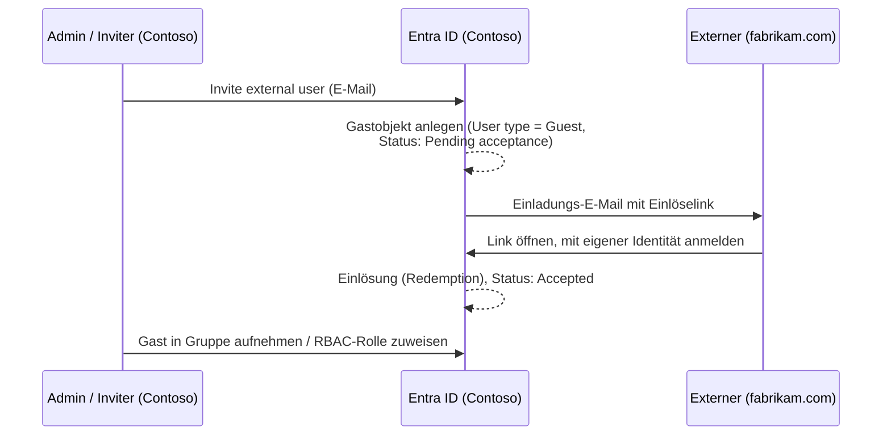
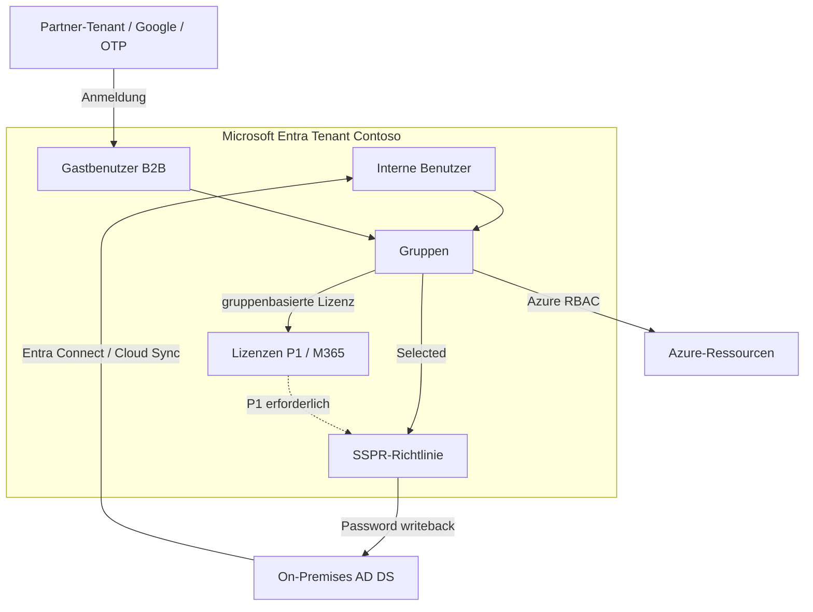

# 1.2 Lizenzen, externe Benutzer und Self-Service Password Reset

> **Domäne:** Manage Azure identities and governance · **Gewichtung:** 20–25 %
> **Study-Guide-Punkte:** *Manage licenses in Microsoft Entra ID* · *Manage external users* · *Configure self-service password reset (SSPR)*
> (Benutzer und Gruppen anlegen → [Kapitel 1.1](01-entra-id-benutzer-und-gruppen.md))
> **Stand:** November 2026

## Lernziele

Nach diesem Kapitel kann ich …

- Lizenzen **direkt** und **gruppenbasiert** zuweisen, einzelne Service Plans deaktivieren und typische Zuweisungsfehler beheben.
- externe Benutzer per **B2B Collaboration** einladen (einzeln und per Bulk invite) und den Einladungs-/Einlöseprozess erklären.
- die **External collaboration settings** (Gastzugriff, Einladungsrechte, Domain-Allow/Deny-Listen) und die **Cross-tenant access settings** konfigurieren.
- **SSPR** für alle oder eine ausgewählte Gruppe aktivieren und Authentifizierungsmethoden, Registrierung, Benachrichtigungen und **Password writeback** einstellen.
- die Unterschiede der SSPR-Regeln für normale Benutzer und **Administratoren** benennen.

## Überblick

Nachdem Benutzer und Gruppen existieren ([1.1](01-entra-id-benutzer-und-gruppen.md)), folgen drei typische Verwaltungsaufgaben:

1. **Lizenzen:** Kostenpflichtige Funktionen von Microsoft Entra ID (P1/P2) und Microsoft 365 werden pro Benutzer lizenziert. Der Admin weist sie zu – idealerweise automatisiert über Gruppen.
2. **Externe Benutzer:** Partner, Dienstleister oder Kunden sollen auf Ressourcen zugreifen, ohne dass für sie ein internes Konto mit Kennwort verwaltet wird. Das löst **Microsoft Entra B2B Collaboration** – der Externe meldet sich mit seiner eigenen Identität an und erscheint im Tenant als **Gast**.
3. **SSPR:** Benutzer setzen vergessene Kennwörter selbst zurück oder entsperren ihr Konto, ohne den Helpdesk anzurufen. Das spart Kosten und erhöht die Verfügbarkeit.

## Kernkonzepte

### Lizenzen (*Licenses*)

- Eine Lizenz (Produkt, technisch **SKU**) enthält mehrere **Service Plans** (z. B. enthält *Microsoft 365 E3* u. a. Exchange Online, SharePoint, Entra ID P1).
- Lizenzen werden auf Tenant-Ebene gekauft (Microsoft 365 Admin Center, Volumenlizenz, CSP) und erscheinen dann unter **Licenses > All products**.
- Zuweisung an **Benutzer** – entweder:
  - **direkt** (*Direct*): am Benutzerobjekt, oder
  - **gruppenbasiert** (*Inherited*): an eine Gruppe; alle Mitglieder erben die Lizenz automatisch, Austritt aus der Gruppe entfernt sie wieder.
- Pro Zuweisung lassen sich **einzelne Service Plans deaktivieren** (z. B. E3 ohne Yammer/Viva Engage).

**Voraussetzungen und Regeln:**

| Thema | Regel |
|---|---|
| **Usage location** | Muss gesetzt sein, sonst schlägt die direkte Zuweisung fehl. Bei **gruppenbasierter** Zuweisung erbt ein Benutzer ohne Usage location den Standort des Tenants. |
| **Gruppenbasierte Lizenzierung** | Erfordert **Entra ID P1** (oder ein Paket, das es enthält, z. B. Microsoft 365 E3/E5, Office 365 E3). Funktioniert mit **Security Groups** und **Microsoft 365 Groups**, auch mit **dynamischen** Gruppen und synchronisierten Gruppen. |
| **Verschachtelte Gruppen** | Gruppenbasierte Lizenzierung wird **nicht** an Mitglieder verschachtelter Gruppen vererbt – nur an direkte Mitglieder. |
| **Direkt + geerbt** | Ein Benutzer kann dieselbe Lizenz direkt **und** geerbt haben; es wird nur **eine** Lizenz verbraucht. Eine **geerbte** Lizenz kann am Benutzer nicht entfernt werden – nur durch Entfernen aus der Gruppe. |

**Typische Zuweisungsfehler** (sichtbar unter *Group > Licenses* bzw. am Benutzer, Status *Error*):

| Fehler | Ursache / Lösung |
|---|---|
| **Not enough licenses** | Alle Lizenzen verbraucht → weitere kaufen oder andere Benutzer freigeben |
| **Conflicting service plans** | Zwei Lizenzen enthalten unvereinbare Service Plans (z. B. zwei Exchange-Pläne) → Plan in einer Zuweisung deaktivieren |
| **Other products depend on this license** / fehlende Abhängigkeit | Service Plan setzt einen anderen voraus → abhängigen Plan aktivieren |
| **Usage location isn't allowed** | Service in diesem Land nicht verfügbar → Usage location prüfen |
| **Duplicate proxy addresses** | Doppelte E-Mail-Adresse im Tenant (Exchange) → Konflikt bereinigen |

Nach Behebung: **Reprocess** an der Gruppe bzw. am Benutzer.

### Externe Benutzer – Microsoft Entra External ID

**Microsoft Entra External ID** ist der Oberbegriff für alle Szenarien mit externen Identitäten:

| Szenario | Zweck | Objekt im eigenen Tenant? |
|---|---|---|
| **B2B Collaboration** | Partner greifen auf Apps/Ressourcen des eigenen Tenants zu | ✅ **Gastbenutzer** (`User type = Guest`) |
| **B2B Direct Connect** | Gegenseitiges Vertrauen zwischen zwei Entra-Tenants, v. a. Teams **Shared Channels** | ❌ kein Gastobjekt |
| **External ID für Kunden (CIAM)** | Kundenanmeldung an eigene Apps; separater **External Tenant** (Nachfolger von Azure AD B2C) | eigene Kundenkonten im External Tenant |

Für AZ-104 ist vor allem **B2B Collaboration** relevant.

#### B2B Collaboration – Ablauf



- **Einladen:** einzeln im Portal (*Invite external user*), per **Bulk invite** (CSV), per PowerShell/Graph (`New-MgInvitation`) oder durch Hinzufügen zu einer App/Gruppe/Teams.
- **Identität des Gastes:** Der Gast meldet sich bei seinem **Heim-Identitätsanbieter** an – der eigene Tenant speichert **kein Kennwort**. Mögliche Anbieter: Entra-Konto eines anderen Tenants, Microsoft-Konto (MSA), **Email one-time passcode (OTP)**, Google-Federation, SAML/WS-Fed-Identitätsanbieter.
- **UPN von Gästen:** `name_fabrikam.com#EXT#@contoso.onmicrosoft.com`
- **Einlösen:** über den Link in der Einladungs-E-Mail oder einen **direkten Link** (z. B. `https://myapps.microsoft.com/?tenantid=<tenant-id>`). Status unter *Users > Gast > Overview* (*B2B collaboration: Invitation state*).
- **Einladung erneut senden / Einlösestatus zurücksetzen** (*Reset redemption status*): z. B. wenn der Partner eine neue E-Mail-Adresse oder einen neuen Identitätsanbieter hat – Gruppenmitgliedschaften und Berechtigungen bleiben erhalten.
- **Gast ↔ Member:** Der *User type* lässt sich ändern. Ein externer Benutzer kann außerdem in einen **internen Benutzer konvertiert** werden (*Convert to internal user*), z. B. bei Übernahme eines Mitarbeiters.
- **Berechtigungen:** Gäste können wie interne Benutzer in Gruppen aufgenommen und mit **Azure RBAC** ([1.3](03-rbac-zugriffsverwaltung.md)) oder Entra-Rollen berechtigt werden.

#### External collaboration settings

Pfad: **Microsoft Entra ID > External Identities > External collaboration settings**

| Einstellung | Optionen |
|---|---|
| **Guest user access** | 1) *Guest users have the same access as members (most inclusive)* · 2) *Guest users have limited access to properties and memberships of directory objects* (**Standard**) · 3) *Guest user access is restricted to properties and memberships of their own directory objects (most restrictive)* |
| **Guest invite settings** | 1) *Anyone in the organization can invite guest users including guests and non-admins (most inclusive)* · 2) *Member users and users assigned to specific admin roles can invite guest users including guests with member permissions* · 3) *Only users assigned to specific admin roles can invite guest users* · 4) *No one in the organization can invite guest users including admins (most restrictive)* |
| **Enable guest self-service sign up via user flows** | Gäste können sich selbst über einen User Flow an einer App registrieren |
| **External user leave settings** | Dürfen Gäste die Organisation selbst verlassen? |
| **Collaboration restrictions** | *Allow invitations to be sent to any domain* (Standard) · *Deny invitations to the specified domains* (**Deny list**) · *Allow invitations only to the specified domains* (**Allow list**). ⚠️ Es gibt nur **entweder** eine Allow- **oder** eine Deny-Liste. |

Die Entra-Rolle **Guest Inviter** erlaubt das Einladen von Gästen auch dann, wenn Einladungen auf Admin-Rollen beschränkt sind.

#### Cross-tenant access settings

Pfad: **Microsoft Entra ID > External Identities > Cross-tenant access settings**

- **Default settings** gelten für alle anderen Entra-Tenants, **Organizational settings** für bestimmte Partner-Tenants (per Tenant ID oder Domain).
- Je getrennt für **Inbound** (Externe greifen auf uns zu) und **Outbound** (unsere Benutzer greifen auf andere zu) sowie für **B2B Collaboration** und **B2B Direct Connect**.
- **Trust settings (Inbound):** MFA, konforme Geräte (*compliant devices*) und *Hybrid joined devices* des Partner-Tenants vertrauen – Gäste müssen MFA dann nicht erneut im eigenen Tenant registrieren.
- Wichtig: Collaboration restrictions (Domain-Listen) und Cross-tenant access settings wirken **zusammen**; Cross-tenant-Einstellungen gelten nur für **Entra-Tenants**, Domain-Listen auch für andere Anbieter.

#### Abrechnung externer Benutzer

External ID wird nach **Monthly Active Users (MAU)** abgerechnet. Damit Gäste Premium-Funktionen (z. B. Conditional Access) nutzen können, muss der Tenant mit einem **Azure-Abonnement verknüpft** sein. Die ersten **50.000 MAU pro Monat** sind kostenlos.

### Self-Service Password Reset (SSPR)

SSPR ermöglicht Benutzern, ihr **Kennwort zurückzusetzen** (vergessen) oder ihr **Konto zu entsperren** – über die Seite `https://aka.ms/sspr` bzw. den Link *Can't access your account?* bei der Anmeldung.

> Abgrenzung: **Password change** = Benutzer kennt das alte Kennwort und ändert es (immer möglich, Free). **Password reset** = Benutzer kennt es nicht mehr und weist sich über andere Methoden aus (SSPR).

#### Lizenzierung

| Funktion | Lizenz |
|---|---|
| Kennwort ändern (Cloud-Benutzer) | Free |
| **SSPR für Cloud-Benutzer** | **Entra ID P1/P2** (bzw. Microsoft 365-Pakete, die SSPR enthalten, z. B. Business Premium, E3/E5) |
| **SSPR mit Password writeback** (hybride Benutzer) | **Entra ID P1/P2** |

#### Konfigurationsbereiche (Blade *Password reset*)

| Menüpunkt | Inhalt |
|---|---|
| **Properties** | *Self service password reset enabled*: **None** / **Selected** (⚠️ genau **eine** Gruppe) / **All** |
| **Authentication methods** | *Number of methods required to reset*: **1** oder **2**; verfügbare Methoden (siehe unten); Anzahl Sicherheitsfragen zur Registrierung/zum Zurücksetzen |
| **Registration** | *Require users to register when signing in?* (Ja/Nein) · *Number of days before users are asked to re-confirm their authentication information* (Standard **180**, `0` = nie) |
| **Notifications** | *Notify users on password resets?* · *Notify all admins when other admins reset their password?* |
| **Customization** | Eigener Helpdesk-Link bzw. E-Mail-Adresse auf der Reset-Seite |
| **On-premises integration** | **Password writeback** aktivieren, *Allow users to unlock accounts without resetting their password* |
| **Audit logs / Usage & insights** | Wer hat registriert, wer hat zurückgesetzt |

**Authentifizierungsmethoden für SSPR:**

- Mobile app notification (Microsoft Authenticator)
- Mobile app code
- Email
- Mobile phone (SMS / Anruf)
- Office phone
- Security questions

> Seit der Migration auf die zentrale **Authentication methods policy** (*Microsoft Entra ID > Security > Authentication methods > Policies*) werden die meisten Methoden dort für MFA und SSPR gemeinsam verwaltet. **Sicherheitsfragen** und die **Anzahl erforderlicher Methoden** werden weiterhin im SSPR-Blade eingestellt.

**Registrierung:** Benutzer hinterlegen ihre Methoden über die **kombinierte Registrierung** (MFA + SSPR) unter `https://aka.ms/mysecurityinfo`. Mit *Require users to register when signing in* werden sie bei der nächsten Anmeldung dazu aufgefordert.

#### Sonderregeln für Administratoren

- Für Admin-Rollen ist SSPR **immer aktiviert** – unabhängig von der Einstellung *None/Selected/All*.
- Es gilt die **Zwei-Gate-Richtlinie** (*two-gate policy*): **zwei** Methoden erforderlich.
- ⚠️ **Sicherheitsfragen** sind für Administratoren **nicht** zulässig.
- Diese Admin-Richtlinie wird von Microsoft vorgegeben und kann im SSPR-Blade nicht gelockert werden.

#### Password writeback

- Schreibt in der Cloud zurückgesetzte Kennwörter **in das lokale AD DS** zurück – Voraussetzung, damit **synchronisierte** Benutzer SSPR nutzen können.
- Erfordert **Microsoft Entra Connect** (Sync) oder **Microsoft Entra Cloud Sync** mit aktivierter Writeback-Option sowie **Entra ID P1**.
- Lokale Kennwortrichtlinien (Komplexität, Historie) werden beim Zurückschreiben **geprüft**.

## Zusammenhänge



- **Gruppen** aus [1.1](01-entra-id-benutzer-und-gruppen.md) sind die Grundlage für gruppenbasierte Lizenzierung und für SSPR im Modus *Selected*. **Dynamische Gruppen** + gruppenbasierte Lizenzen = vollautomatische Lizenzvergabe.
- **Usage location** (Benutzereigenschaft aus 1.1) ist Voraussetzung für direkte Lizenzzuweisung.
- **Gäste** werden wie interne Benutzer über **Azure RBAC** ([1.3](03-rbac-zugriffsverwaltung.md)) berechtigt – z. B. ein Dienstleister erhält *Contributor* auf eine Ressourcengruppe.
- **Kosten:** Lizenzkosten laufen über Microsoft 365/Volumenlizenz, MAU-Kosten für External ID über das verknüpfte **Azure-Abonnement** ([1.7](07-kostenverwaltung-und-advisor.md)).
- **Hybrid-Identität:** Password writeback hängt an Entra Connect/Cloud Sync – dieselbe Komponente, die Benutzer synchronisiert (1.1).

## Vergleichstabellen

### Direkte vs. gruppenbasierte Lizenzzuweisung

| Kriterium | Direkt | Gruppenbasiert |
|---|---|---|
| Voraussetzung | Usage location | Entra ID P1 (oder enthaltendes Paket) |
| Aufwand bei vielen Benutzern | hoch | gering |
| Automatisch bei Ein-/Austritt | ❌ | ✅ (besonders mit dynamischen Gruppen) |
| Entfernen am Benutzer | ✅ | ❌ (nur über Gruppe) |
| Verschachtelte Gruppen | – | ❌ nicht unterstützt |

### Guest invite settings – von offen bis restriktiv

| Stufe | Wer darf einladen? |
|---|---|
| Most inclusive | Alle, **auch Gäste** und Nicht-Admins |
| (Standard) | **Member-Benutzer** und bestimmte Admin-Rollen (inkl. Gäste mit Member-Rechten) |
| Restriktiv | Nur bestimmte Admin-Rollen (z. B. **Guest Inviter**, User Administrator) |
| Most restrictive | Niemand, auch keine Admins |

### SSPR – Benutzer vs. Administratoren

| Kriterium | Normale Benutzer | Administratoren |
|---|---|---|
| Aktivierung | None / Selected / All | immer aktiviert |
| Anzahl Methoden | 1 oder 2 (konfigurierbar) | immer **2** |
| Sicherheitsfragen | erlaubt | ❌ |
| Konfigurierbar | ja | nein (Microsoft-Vorgabe) |

### B2B Collaboration vs. B2B Direct Connect

| Kriterium | B2B Collaboration | B2B Direct Connect |
|---|---|---|
| Gastobjekt im Tenant | ✅ | ❌ |
| Partner-Identitätsanbieter | beliebig (Entra, MSA, Google, OTP, SAML) | nur Entra-Tenants |
| Konfiguration | External collaboration settings + Cross-tenant (B2B Collaboration) | nur Cross-tenant access (beidseitig) |
| Typischer Einsatz | Zugriff auf Apps, SharePoint, Azure-Ressourcen | Teams Shared Channels |

## Azure Portal

| Aufgabe | Pfad |
|---|---|
| Verfügbare Lizenzen anzeigen | **Portal > Microsoft Entra ID > Licenses > All products** |
| Lizenz an Benutzer/Gruppe zuweisen (aus Produktsicht) | **… > Licenses > All products > Produkt > + Assign** |
| Lizenz direkt am Benutzer | **Portal > Microsoft Entra ID > Users > Benutzer > Licenses > + Assignments** |
| Gruppenbasierte Lizenz | **Portal > Microsoft Entra ID > Groups > Gruppe > Licenses > + Assignments** |
| Service Plans deaktivieren | im Zuweisungsdialog: **Review license options** (Plans an/aus) |
| Lizenzfehler / Reprocess | **… > Groups > Gruppe > Licenses** (Banner/Status) bzw. **Licenses > All products > Produkt > Licensed users** |
| Externen Benutzer einladen | **Portal > Microsoft Entra ID > Users > + New user > Invite external user** |
| Gäste per CSV einladen | **… > Users > Bulk operations > Bulk invite** |
| Einladung erneut senden / Einlösung zurücksetzen | **… > Users > Gast > Overview > B2B collaboration > (Re)send invite / Reset redemption status** |
| Gast intern konvertieren | **… > Users > Gast > Overview > Convert to internal user** |
| Gastzugriff, Einladungsrechte, Domain-Listen | **Portal > Microsoft Entra ID > External Identities > External collaboration settings** |
| Partner-Tenant-Vertrauen | **… > External Identities > Cross-tenant access settings** |
| Unterstützte Identitätsanbieter (OTP, Google, SAML) | **… > External Identities > All identity providers** |
| Rolle Guest Inviter zuweisen | **Portal > Microsoft Entra ID > Roles and administrators > Guest Inviter > + Add assignments** |
| SSPR aktivieren | **Portal > Microsoft Entra ID > Password reset > Properties** |
| SSPR-Methoden / Anzahl | **… > Password reset > Authentication methods** |
| Registrierungspflicht / Re-Confirm | **… > Password reset > Registration** |
| Password writeback | **… > Password reset > On-premises integration** |
| Methoden zentral verwalten | **Portal > Microsoft Entra ID > Security > Authentication methods > Policies** |

**Felder bei *Invite external user*:** Email, Display name, *Send invite message* (Ja/Nein), *Message*, Properties (User type – standardmäßig Guest), Assignments (Gruppen, Rollen).

## Azure CLI & PowerShell

> Die Azure CLI hat **keine** eigenen Befehle für Lizenzen, Einladungen oder SSPR – hier nutzt man **Microsoft Graph PowerShell** (oder `az rest` gegen die Graph-API).

### Lizenzen

```powershell
Connect-MgGraph -Scopes "User.ReadWrite.All","Organization.Read.All","Group.ReadWrite.All"

# Verfügbare Lizenzen (SKUs) im Tenant mit Verbrauch anzeigen
Get-MgSubscribedSku | Select-Object SkuPartNumber, SkuId, ConsumedUnits,
  @{n="Enabled";e={$_.PrepaidUnits.Enabled}}

# Usage location setzen (Voraussetzung) und Lizenz direkt zuweisen
$sku = Get-MgSubscribedSku | Where-Object SkuPartNumber -eq "AAD_PREMIUM"
Update-MgUser -UserId "anna.schmidt@contoso.onmicrosoft.com" -UsageLocation "DE"
Set-MgUserLicense -UserId "anna.schmidt@contoso.onmicrosoft.com" `
  -AddLicenses @(@{ SkuId = $sku.SkuId }) -RemoveLicenses @()

# Lizenz an eine Gruppe zuweisen (gruppenbasiert)
Set-MgGroupLicense -GroupId "<group-object-id>" `
  -AddLicenses @(@{ SkuId = $sku.SkuId }) -RemoveLicenses @()

# Lizenz mit deaktiviertem Service Plan zuweisen
$plan = $sku.ServicePlans | Where-Object ServicePlanName -eq "<service-plan-name>"
Set-MgUserLicense -UserId "anna.schmidt@contoso.onmicrosoft.com" `
  -AddLicenses @(@{ SkuId = $sku.SkuId; DisabledPlans = @($plan.ServicePlanId) }) `
  -RemoveLicenses @()

# Lizenz entfernen
Set-MgUserLicense -UserId "anna.schmidt@contoso.onmicrosoft.com" `
  -AddLicenses @() -RemoveLicenses @($sku.SkuId)
```

### Externe Benutzer

```powershell
Connect-MgGraph -Scopes "User.Invite.All","User.ReadWrite.All"

# Gast einladen und Einladungs-E-Mail senden
New-MgInvitation -InvitedUserEmailAddress "max@fabrikam.com" `
  -InvitedUserDisplayName "Max Muster (Fabrikam)" `
  -InviteRedirectUrl "https://myapps.microsoft.com" `
  -SendInvitationMessage:$true

# Alle Gäste mit Einlösestatus auflisten
Get-MgUser -Filter "userType eq 'Guest'" -Property DisplayName,Mail,ExternalUserState |
  Select-Object DisplayName, Mail, ExternalUserState

# Gast zu Member machen (User type ändern)
Update-MgUser -UserId "<object-id>" -UserType "Member"
```

```bash
# Alternativ per Azure CLI über die Graph-API (az rest)
az rest --method POST \
  --url "https://graph.microsoft.com/v1.0/invitations" \
  --body '{"invitedUserEmailAddress":"max@fabrikam.com","inviteRedirectUrl":"https://myapps.microsoft.com","sendInvitationMessage":true}'
```

### SSPR

SSPR wird praktisch ausschließlich im **Portal** konfiguriert. Registrierungsstatus abfragen:

```powershell
Connect-MgGraph -Scopes "AuditLog.Read.All"
# Registrierungsdetails (SSPR-fähig, registrierte Methoden) pro Benutzer
Get-MgReportAuthenticationMethodUserRegistrationDetail |
  Select-Object UserPrincipalName, IsSsprRegistered, IsSsprEnabled, IsSsprCapable, MethodsRegistered
```

## Praxisbeispiel

**Szenario:** *Contoso* führt Microsoft Entra ID P1 ein und arbeitet mit dem Dienstleister *Fabrikam* zusammen.

**Anforderungen:**

1. Alle Mitarbeitenden der Abteilung *Vertrieb* sollen automatisch eine P1-Lizenz erhalten.
2. SSPR soll zunächst nur für eine Pilotgruppe aktiviert werden, mit zwei Methoden.
3. Fabrikam-Mitarbeitende sollen eingeladen werden können – aber nur von Fabrikam, nicht von beliebigen Domains. Einladen dürfen nur Admins und das Projektteam.
4. Fabrikam-Gäste sollen auf die Ressourcengruppe `rg-projekt-x` zugreifen.

**Umsetzung:**

1. **Lizenz:** Dynamische Gruppe `DYN-Sales` (`user.department -eq "Sales"`, siehe [1.1](01-entra-id-benutzer-und-gruppen.md)) → **Groups > DYN-Sales > Licenses > + Assignments** → *Microsoft Entra ID P1*. Unter *Licenses* prüfen, dass keine Fehler (*Not enough licenses*) auftreten.
2. **SSPR:** **Password reset > Properties** → *Selected* → Gruppe `SG-SSPR-Pilot`. **Authentication methods** → *Number of methods required to reset* = **2**, Methoden *Mobile app notification*, *Email*, *Mobile phone*. **Registration** → *Require users to register when signing in* = **Yes**. Nach erfolgreichem Pilot auf **All** umstellen.
3. **Gäste-Einschränkungen:** **External collaboration settings** →
   - *Guest invite settings*: **Only users assigned to specific admin roles can invite guest users**
   - Projektteam erhält die Rolle **Guest Inviter**
   - *Collaboration restrictions*: **Allow invitations only to the specified domains** → `fabrikam.com`
4. **Einladen und Berechtigen:** **Users > Bulk operations > Bulk invite** mit CSV der Fabrikam-Mitarbeitenden → Gäste in Gruppe `SG-Fabrikam-Guests` aufnehmen → auf `rg-projekt-x` **Access control (IAM) > Add role assignment** → *Contributor* an `SG-Fabrikam-Guests` ([1.3](03-rbac-zugriffsverwaltung.md)).
5. **Optional:** Unter **Cross-tenant access settings > Organizational settings** den Fabrikam-Tenant hinzufügen und **Inbound trust: MFA** aktivieren, damit Fabrikam-Gäste ihre heimische MFA nutzen.

## Limits & wichtige Zahlen

| Wert | Grenze / Standard |
|---|---|
| SSPR *Selected* | genau **eine** Gruppe |
| Methoden zum Zurücksetzen | **1** oder **2** (Admins immer 2) |
| Re-Confirm der Methoden | Standard **180 Tage** (`0` = nie) |
| Sicherheitsfragen | für Admins **nicht** erlaubt |
| Gruppenbasierte Lizenzierung | **P1** (oder Paket mit P1), nur direkte Mitglieder (kein Nesting) |
| External ID (MAU) | erste **50.000 MAU/Monat** kostenlos; Tenant muss mit Azure-Abonnement verknüpft sein |
| Collaboration restrictions | **entweder** Allow- **oder** Deny-Liste |
| Gast-UPN | `<mail>_<domain>#EXT#@<tenant>.onmicrosoft.com` |

## Prüfungstipps & Fallstricke

- ⚠️ **Lizenz kann nicht zugewiesen werden** → **Usage location** fehlt (direkte Zuweisung).
- ⚠️ **Lizenz an verschachtelte Gruppe** zugewiesen, Benutzer erhalten sie nicht → gruppenbasierte Lizenzierung vererbt **nicht** über verschachtelte Gruppen.
- ⚠️ **Lizenz am Benutzer lässt sich nicht entfernen** → sie ist **geerbt** (*Inherited*); Benutzer aus der Gruppe entfernen.
- **„Lizenzen automatisch nach Abteilung"** → dynamische Gruppe + gruppenbasierte Lizenzierung (beides P1).
- ⚠️ **SSPR nur für zwei bestimmte Gruppen** → im Modus *Selected* ist nur **eine** Gruppe möglich → eine gemeinsame Gruppe mit allen betroffenen Benutzern nutzen.
- ⚠️ **Admin kann Sicherheitsfragen nicht nutzen / braucht zwei Methoden** → Zwei-Gate-Richtlinie für Admins, unabhängig von der SSPR-Konfiguration.
- **Synchronisierte Benutzer sollen SSPR nutzen** → **Password writeback** (Entra Connect/Cloud Sync, P1).
- **„Gäste dürfen keine anderen Gäste einladen"** → *Guest invite settings* nicht auf *most inclusive*.
- **„Nur Benutzer der Partnerdomain X dürfen eingeladen werden"** → *Collaboration restrictions* → **Allow list**.
- **„Gäste sollen möglichst wenig im Verzeichnis sehen"** → *Guest user access* → **most restrictive**.
- **„Einladungen auf Admins beschränkt, aber Person X soll einladen"** → Rolle **Guest Inviter**.
- **Gast hat neue E-Mail-Adresse / neuen IdP** → **Reset redemption status** (Berechtigungen bleiben), nicht löschen und neu einladen.
- **Gast hat kein Microsoft-/Entra-Konto** → Einlösung per **Email one-time passcode**.
- **Gäste sollen MFA nicht doppelt durchlaufen** → **Cross-tenant access settings > Inbound trust > Trust MFA**.

## Selbsttest

**1.** Sie weisen einer Gruppe `SG-All-Staff` die Lizenz *Microsoft 365 E3* zu. `SG-All-Staff` enthält die Gruppe `SG-Hamburg` als Mitglied. Erhalten die Mitglieder von `SG-Hamburg` die Lizenz?

<details><summary>Lösung</summary>

**Nein.** Gruppenbasierte Lizenzierung gilt nur für **direkte** Mitglieder; verschachtelte Gruppen werden nicht aufgelöst.
</details>

**2.** Sie möchten SSPR für die Gruppen `SG-Vertrieb` und `SG-Marketing` aktivieren, aber nicht für alle Benutzer. Wie gehen Sie vor?

<details><summary>Lösung</summary>

Im Modus **Selected** kann nur **eine** Gruppe gewählt werden. Lösung: eine gemeinsame Gruppe (z. B. `SG-SSPR`) mit allen betroffenen Benutzern erstellen und diese auswählen – bequem als dynamische Gruppe mit `user.department -in ["Vertrieb","Marketing"]`.
</details>

**3.** SSPR ist mit einer Methode und erlaubten Sicherheitsfragen konfiguriert. Ein Global Administrator möchte sein Kennwort nur mit Sicherheitsfragen zurücksetzen. Funktioniert das?

<details><summary>Lösung</summary>

**Nein.** Für Administratoren gilt immer die **Zwei-Gate-Richtlinie** (zwei Methoden), und Sicherheitsfragen sind für Admins nicht zulässig.
</details>

**4.** Benutzer werden per Entra Connect aus dem lokalen AD synchronisiert. Nach SSPR in der Cloud funktioniert die Anmeldung am lokalen PC weiterhin nur mit dem alten Kennwort. Was fehlt?

<details><summary>Lösung</summary>

**Password writeback** ist nicht aktiviert (Entra Connect bzw. Cloud Sync + *Password reset > On-premises integration*, Lizenz P1).
</details>

**5.** Ihr Unternehmen will verhindern, dass Gäste von den Domains `gmail.com` und `outlook.com` eingeladen werden. Alle anderen Domains sind erlaubt. Welche Einstellung?

<details><summary>Lösung</summary>

**External collaboration settings > Collaboration restrictions > Deny invitations to the specified domains** mit `gmail.com` und `outlook.com`.
</details>

**6.** Einladungen sind auf Admin-Rollen beschränkt. Eine Projektleiterin ohne Admin-Rechte soll Gäste einladen können – mit minimalen Rechten. Welche Rolle?

<details><summary>Lösung</summary>

**Guest Inviter**.
</details>

**7.** Ein Gast eines Partners hat das Unternehmen gewechselt und nutzt nun eine andere E-Mail-Adresse. Er soll seine bisherigen Gruppenmitgliedschaften und RBAC-Rollen behalten. Was tun Sie?

<details><summary>Lösung</summary>

**Reset redemption status** am Gastbenutzer (mit neuer E-Mail-Adresse). Das Benutzerobjekt und alle Zuweisungen bleiben erhalten; der Gast löst die Einladung mit der neuen Identität erneut ein.
</details>

**8.** Ein Benutzer hat die Lizenz *Entra ID P1* über die Gruppe `DYN-Sales`. Ein Admin versucht, sie unter *Users > Benutzer > Licenses* zu entfernen – die Option ist nicht verfügbar. Warum?

<details><summary>Lösung</summary>

Die Lizenz ist **geerbt** (*Inherited*). Sie kann nur entfernt werden, indem der Benutzer die Gruppe verlässt (bei einer dynamischen Gruppe: Attribut ändern, z. B. *Department*) oder die Lizenz an der Gruppe entfernt wird.
</details>

**9.** Ein externer Partner besitzt weder ein Microsoft-Konto noch ein Entra-Konto noch ein Google-Konto. Wie kann er eine B2B-Einladung einlösen?

<details><summary>Lösung</summary>

Über **Email one-time passcode (OTP)**: Er erhält bei jeder Anmeldung einen Einmalcode per E-Mail.
</details>

## Weiterführende Links

- [AZ-104 Study Guide](https://learn.microsoft.com/credentials/certifications/resources/study-guides/az-104)
- [What is group-based licensing?](https://learn.microsoft.com/entra/fundamentals/concept-group-based-licensing)
- [Assign or remove licenses](https://learn.microsoft.com/entra/fundamentals/license-users-groups)
- [Identify and resolve license assignment problems](https://learn.microsoft.com/entra/identity/users/licensing-groups-resolve-problems)
- [B2B collaboration overview](https://learn.microsoft.com/entra/external-id/what-is-b2b)
- [Add B2B collaboration users in the portal](https://learn.microsoft.com/entra/external-id/add-users-administrator)
- [Configure external collaboration settings](https://learn.microsoft.com/entra/external-id/external-collaboration-settings-configure)
- [Cross-tenant access overview](https://learn.microsoft.com/entra/external-id/cross-tenant-access-overview)
- [Reset redemption status for a guest user](https://learn.microsoft.com/entra/external-id/reset-redemption-status)
- [How self-service password reset works](https://learn.microsoft.com/entra/identity/authentication/concept-sspr-howitworks)
- [Enable Microsoft Entra self-service password reset](https://learn.microsoft.com/entra/identity/authentication/tutorial-enable-sspr)
- [Administrator reset policy differences](https://learn.microsoft.com/entra/identity/authentication/concept-sspr-policy#administrator-reset-policy-differences)
- [SSPR writeback](https://learn.microsoft.com/entra/identity/authentication/concept-sspr-writeback)
- [Licensing requirements for SSPR](https://learn.microsoft.com/entra/identity/authentication/concept-sspr-licensing)
