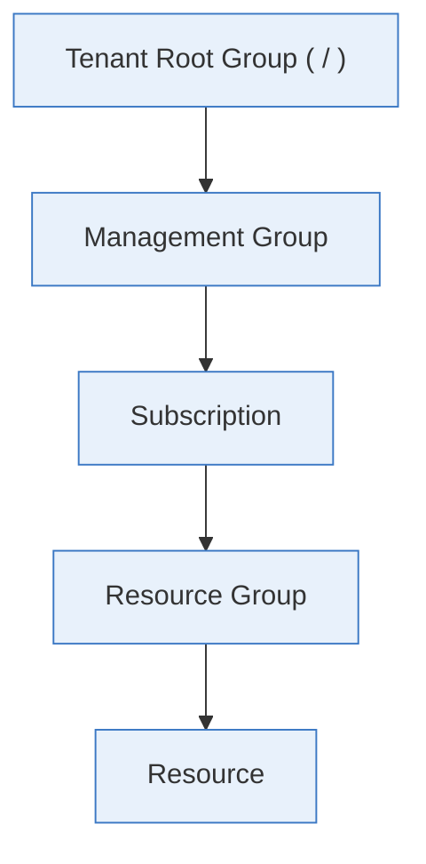
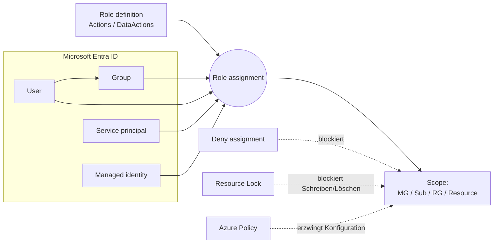

# 1.3 Zugriffsverwaltung mit Azure RBAC

> **Domäne:** Manage Azure identities and governance · **Gewichtung:** 20–25 %
> **Study-Guide-Punkte:** *Manage built-in Azure roles* · *Assign roles at different scopes* · *Interpret access assignments*
> **Stand:** November 2026

## Lernziele

Nach diesem Kapitel kann ich …

- die drei Bausteine einer Rollenzuweisung erklären: **Security principal**, **Role definition**, **Scope**.
- die wichtigsten **Built-in roles** (Owner, Contributor, Reader, User Access Administrator, Role Based Access Control Administrator und dienstspezifische Rollen) unterscheiden und für ein Szenario die Rolle mit den **geringsten Rechten** wählen.
- Rollen auf **Management Group, Subscription, Resource Group und Ressource** zuweisen und die **Vererbung** erklären.
- **Actions/NotActions** (Control Plane) und **DataActions/NotDataActions** (Data Plane) lesen und effektive Berechtigungen ableiten.
- eine **Custom role** als JSON erstellen und ihre **AssignableScopes** festlegen.
- Zugriffe mit **Check access**, **Role assignments** und **Deny assignments** interpretieren.
- Azure-RBAC-Rollen von **Microsoft Entra-Rollen** abgrenzen.

## Überblick

**Azure Role-Based Access Control (Azure RBAC)** ist das Autorisierungssystem für Azure-Ressourcen. Es beantwortet die Frage: **Wer** darf **was** **wo** tun?

Die Authentifizierung (wer bin ich?) übernimmt Microsoft Entra ID ([1.1](01-entra-id-benutzer-und-gruppen.md)); die Autorisierung (was darf ich?) übernimmt Azure RBAC auf Basis von **Rollenzuweisungen**. RBAC ist auf dem **Azure Resource Manager (ARM)** aufgebaut – jede Anfrage über Portal, CLI, PowerShell, REST oder Templates wird gegen die Rollenzuweisungen geprüft.

Grundprinzipien:

- **Least privilege** – nur die Rechte vergeben, die für die Aufgabe nötig sind, und auf dem kleinsten passenden Scope.
- **Additiv** – Berechtigungen aus mehreren Zuweisungen addieren sich.
- **Standardmäßig kein Zugriff** – ohne Rollenzuweisung keine Berechtigung (Ausnahme: der Ersteller eines Abonnements bzw. der Kontoinhaber erhält *Owner*).

## Kernkonzepte

### Die drei Bausteine einer Rollenzuweisung

```text
Role assignment = Security principal  +  Role definition  +  Scope
                  (wer?)                 (was?)              (wo?)
```

| Baustein | Beschreibung | Beispiele |
|---|---|---|
| **Security principal** | Objekt, das Zugriff erhält | **User**, **Group**, **Service principal** (App-Registrierung), **Managed identity** |
| **Role definition** | Sammlung von Berechtigungen (JSON) | *Reader*, *Contributor*, *Virtual Machine Contributor*, Custom role |
| **Scope** | Bereich, auf den die Berechtigungen wirken | Management Group, Subscription, Resource Group, Resource |

Eine Rollenzuweisung kann optional eine **Condition** enthalten (ABAC – *Attribute-based access control*), z. B. „nur Blobs mit dem Index-Tag `Project=Phoenix`" oder „darf nur die Rolle X an Gruppen vergeben".

### Rollendefinition: Actions, NotActions, DataActions, NotDataActions

| Eigenschaft | Bedeutung |
|---|---|
| **Actions** | Erlaubte **Management-Vorgänge** (Control Plane), z. B. `Microsoft.Compute/virtualMachines/start/action` |
| **NotActions** | Von *Actions* **abgezogene** Vorgänge |
| **DataActions** | Erlaubte **Datenvorgänge** (Data Plane), z. B. `Microsoft.Storage/storageAccounts/blobServices/containers/blobs/read` |
| **NotDataActions** | Von *DataActions* abgezogene Vorgänge |
| **AssignableScopes** | Scopes, auf denen die Rolle zugewiesen werden darf (bei Built-in-Rollen `/`) |

Format einer Operation: `{Resource Provider}/{Resource Type}/{Operation}` – Operation ist `read`, `write`, `delete` oder `action`. Platzhalter `*` erlaubt alles darunter.

**Effektive Berechtigung = Actions − NotActions** (bzw. DataActions − NotDataActions).

⚠️ **NotActions ist kein Deny!** Erhält ein Benutzer dieselbe Aktion über eine andere Rollenzuweisung, darf er sie ausführen. Ein echtes Verbot ist nur über **Deny assignments** möglich.

**Control Plane vs. Data Plane:**

- **Control Plane** = Ressource verwalten (Speicherkonto erstellen, konfigurieren, löschen) → *Actions*.
- **Data Plane** = Daten in der Ressource nutzen (Blob lesen, Queue-Nachricht schreiben, Key-Vault-Secret lesen) → *DataActions*.
- Beispiel: *Owner* eines Speicherkontos kann es löschen, aber **ohne Data-Rolle keine Blobs per Entra-Authentifizierung lesen**. (Er kann allerdings die **Zugriffsschlüssel** abrufen – `listKeys` ist eine *Action* – und damit indirekt auf Daten zugreifen; siehe [2.2](../02-speicher/02-speicherzugriff-und-sicherheit.md).)

### Die fundamentalen Built-in-Rollen

| Rolle | Ressourcen verwalten | Zugriff vergeben (Rollen zuweisen) |
|---|---|---|
| **Owner** | ✅ alles | ✅ |
| **Contributor** | ✅ alles | ❌ (`Microsoft.Authorization/*/Write` und `*/Delete` in NotActions) |
| **Reader** | nur lesen | ❌ |
| **User Access Administrator** | ❌ (nur lesen) | ✅ – verwaltet Benutzerzugriff auf Azure-Ressourcen |
| **Role Based Access Control Administrator** | ❌ | ✅ Rollenzuweisungen verwalten – lässt sich per **Condition** einschränken (z. B. nur bestimmte Rollen, nur an Gruppen); weniger privilegiert als User Access Administrator |

### Wichtige dienstspezifische Built-in-Rollen

| Bereich | Rolle | Darf |
|---|---|---|
| Compute | **Virtual Machine Contributor** | VMs verwalten (erstellen, starten, Datenträger …) – **nicht** Anmeldung an der VM, **kein** Verwaltungszugriff auf das VNet oder Speicherkonto, mit dem die VM verbunden ist |
| Compute | **Virtual Machine Administrator Login** / **Virtual Machine User Login** | Anmeldung an der VM mit Entra-ID (als Admin bzw. normaler Benutzer) – DataActions |
| Netzwerk | **Network Contributor** | Netzwerke verwalten (VNets, NSGs, Load Balancer …), keinen Zugriff vergeben |
| Storage | **Storage Account Contributor** | Speicherkonten verwalten **inkl. Schlüssel abrufen** |
| Storage | **Storage Blob Data Owner** | Blob-Container und Blobs voll, inkl. POSIX-ACLs (Data Lake Gen2) |
| Storage | **Storage Blob Data Contributor** | Blobs lesen, schreiben, löschen |
| Storage | **Storage Blob Data Reader** | Blobs lesen |
| Storage | **Storage Queue Data Contributor / Reader**, **Storage File Data SMB Share Contributor / Reader / Elevated Contributor** | Datenzugriff auf Queues bzw. Azure Files ([2.4](../02-speicher/04-azure-files.md)) |
| Monitoring | **Monitoring Reader** / **Monitoring Contributor** | Monitoringdaten lesen bzw. Einstellungen (Alerts, Diagnostics) verwalten |
| Backup | **Backup Contributor** / **Backup Operator** / **Backup Reader** | Backup verwalten; Operator darf **keine** Sicherungen löschen/stoppen; Reader nur lesen ([5.4](../05-monitoring-und-wartung/04-azure-backup.md)) |
| Governance | **Resource Policy Contributor** | Azure Policy erstellen/zuweisen ([1.4](04-azure-policy.md)) |
| Governance | **Tag Contributor** | Tags verwalten, ohne Zugriff auf die Ressourcen selbst ([1.5](05-ressourcensperren-und-tags.md)) |
| Kosten | **Cost Management Reader** / **Cost Management Contributor**, **Billing Reader** | Kosten anzeigen bzw. Budgets verwalten ([1.7](07-kostenverwaltung-und-advisor.md)) |
| Key Vault | **Key Vault Administrator**, **Key Vault Secrets User**, **Key Vault Crypto User** … | Data-Plane-Zugriff auf Key Vault (RBAC-Modell) |

Faustregel: Rollen mit **„Data"** im Namen gewähren **Datenzugriff** (DataActions), Rollen mit **„Contributor"** ohne „Data" verwalten die Ressource.

### Scopes und Vererbung



- Rollenzuweisungen werden **nach unten vererbt**: Eine Zuweisung auf der Subscription gilt für alle Resource Groups und Ressourcen darin.
- Eine Vererbung lässt sich **nicht** auf einer unteren Ebene „abschalten" (nur durch Deny assignments, die Kunden nicht selbst anlegen können).
- **Scope-Format:**

| Ebene | Scope-String |
|---|---|
| Management Group | `/providers/Microsoft.Management/managementGroups/<mg-id>` |
| Subscription | `/subscriptions/<subscription-id>` |
| Resource Group | `/subscriptions/<subscription-id>/resourceGroups/<rg-name>` |
| Resource | `/subscriptions/<subscription-id>/resourceGroups/<rg-name>/providers/Microsoft.Compute/virtualMachines/<vm-name>` |

Zuweisungen auf Unterressourcen (z. B. einen einzelnen Blob-Container) sind für einige Dienste möglich, etwa Storage-Data-Rollen auf Containerebene.

### Additive Berechtigungen und Deny assignments

- Hat ein Benutzer *Reader* auf der Subscription und *Contributor* auf einer Resource Group, ist er in dieser RG **Contributor**, sonst überall Reader.
- Gruppenmitgliedschaften zählen mit: Effektive Rechte = Summe aller Zuweisungen an den Benutzer **und** an alle seine Gruppen.
- **Deny assignments** blockieren Aktionen **auch dann, wenn eine Rollenzuweisung sie erlaubt** – sie haben Vorrang.
  - Werden **nicht** manuell angelegt, sondern von Azure selbst, z. B. durch **Azure Managed Applications** oder **Deployment Stacks** (*deny settings*).
  - Sichtbar im Tab **Deny assignments** unter *Access control (IAM)*.
- **Resource Locks** ([1.5](05-ressourcensperren-und-tags.md)) blockieren Änderungen bzw. Löschungen sogar für **Owner** – sie sind aber kein Teil von RBAC.

**Auswertungsreihenfolge (vereinfacht):** Deny assignment vorhanden? → Zugriff verweigert. Sonst: Gibt es eine Rollenzuweisung (inkl. Condition), deren Actions die Operation abdeckt? → erlaubt. Sonst → verweigert.

### Custom roles

Wenn keine Built-in-Rolle passt, erstellt man eine **Custom role** – am einfachsten durch **Klonen** einer bestehenden Rolle.

```json
{
  "Name": "Virtual Machine Operator (Contoso)",
  "IsCustom": true,
  "Description": "Kann VMs anzeigen, starten, neu starten und stoppen.",
  "Actions": [
    "Microsoft.Compute/*/read",
    "Microsoft.Compute/virtualMachines/start/action",
    "Microsoft.Compute/virtualMachines/restart/action",
    "Microsoft.Compute/virtualMachines/deallocate/action",
    "Microsoft.Network/*/read",
    "Microsoft.Resources/subscriptions/resourceGroups/read"
  ],
  "NotActions": [],
  "DataActions": [],
  "NotDataActions": [],
  "AssignableScopes": [
    "/subscriptions/<subscription-id>"
  ]
}
```

- **AssignableScopes** legt fest, **wo** die Rolle angezeigt und zugewiesen werden kann (Subscriptions, Resource Groups oder eine Management Group).
  - ⚠️ Pro Custom role kann **nur eine** Management Group in *AssignableScopes* stehen.
  - ⚠️ Custom roles mit **DataActions** können **nicht** auf Management-Group-Ebene zuweisbar gemacht werden.
  - `/` (Root) ist für Custom roles nicht erlaubt.
- Erstellen/Ändern erfordert `Microsoft.Authorization/roleDefinitions/write` – z. B. **Owner** oder **User Access Administrator** auf allen *AssignableScopes*.
- Custom roles werden im Verzeichnis gespeichert und können über Subscriptions im selben Tenant geteilt werden.
- Wird eine verwendete Operation geändert, wirkt das sofort auf alle Zuweisungen der Rolle.

### Microsoft Entra-Rollen vs. Azure-RBAC-Rollen

| Kriterium | Azure-RBAC-Rollen | Microsoft Entra-Rollen |
|---|---|---|
| Verwalten | **Azure-Ressourcen** (VMs, Storage, Netzwerke …) | **Entra-Objekte** (Benutzer, Gruppen, Apps, Lizenzen, Tenant-Einstellungen) |
| Beispiele | Owner, Contributor, Reader, VM Contributor | Global Administrator, User Administrator, Groups Administrator |
| Scope | Management Group, Subscription, RG, Ressource | Tenant, **Administrative Unit**, einzelnes Objekt (z. B. App) |
| Zuweisung im Portal | *Ressource > Access control (IAM)* | *Microsoft Entra ID > Roles and administrators* |
| Custom roles | ✅ | ✅ (P1) |

- ⚠️ Ein **Global Administrator** hat standardmäßig **keinen** Zugriff auf Azure-Ressourcen.
- **Elevate access:** Ein Global Administrator kann sich unter **Microsoft Entra ID > Properties > Access management for Azure resources = Yes** selbst die Rolle **User Access Administrator auf Root-Scope (`/`)** geben – damit kann er sich bzw. anderen Zugriff auf **alle** Subscriptions und Management Groups des Tenants verschaffen (z. B. wenn der einzige Owner das Unternehmen verlassen hat). Danach wieder auf *No* stellen.
- Die früheren **Classic administrators** (Account Administrator, Service Administrator, Co-Administrator) sind eingestellt; alles läuft über Azure RBAC.

### Privileged Identity Management (Ausblick)

Mit **Entra ID P2** kann eine Rolle **eligible** (berechtigt, Just-in-Time-Aktivierung mit Begründung/MFA/Genehmigung) statt **active** (dauerhaft) zugewiesen werden – für Azure- und Entra-Rollen. In *Access control (IAM) > Role assignments* gibt es dafür die Unterscheidung *Eligible assignments* / *Active assignments*.

## Zusammenhänge



- **Identitäten** stammen aus Entra ID ([1.1](01-entra-id-benutzer-und-gruppen.md), Gäste aus [1.2](02-lizenzen-externe-benutzer-und-sspr.md)). Best Practice: Rollen an **Gruppen** vergeben.
- **RBAC vs. Azure Policy** ([1.4](04-azure-policy.md)): RBAC steuert, **wer** handeln darf; Policy steuert, **wie** Ressourcen konfiguriert sein müssen (z. B. erlaubte Regionen) – unabhängig vom Benutzer. Auch ein Owner kann keine durch Policy verbotene Ressource erstellen.
- **Resource Locks** ([1.5](05-ressourcensperren-und-tags.md)) überstimmen RBAC: *CanNotDelete* verhindert Löschen auch für Owner. Um Locks zu verwalten, braucht man `Microsoft.Authorization/locks/*` (Owner oder User Access Administrator).
- **Management Groups und Subscriptions** ([1.6](06-ressourcengruppen-abonnements-verwaltungsgruppen.md)) sind die oberen Scopes; Zuweisungen auf Management Groups vererben sich auf alle Subscriptions darunter.
- **Managed Identities** von VMs, App Services usw. ([3.2](../03-compute/02-virtuelle-maschinen.md), [3.6](../03-compute/06-azure-app-service.md)) erhalten per RBAC Zugriff auf Storage, Key Vault usw. – ohne Kennwörter im Code.
- **Storage** ([2.2](../02-speicher/02-speicherzugriff-und-sicherheit.md)): Entra-Autorisierung mit *Storage Blob Data*-Rollen als sicherere Alternative zu Zugriffsschlüsseln und SAS.

## Vergleichstabellen

### Owner vs. Contributor vs. Reader vs. User Access Administrator vs. RBAC Administrator

| Fähigkeit | Owner | Contributor | Reader | User Access Admin | RBAC Admin |
|---|---|---|---|---|---|
| Ressourcen lesen | ✅ | ✅ | ✅ | ✅ | ✅ |
| Ressourcen erstellen/ändern/löschen | ✅ | ✅ | ❌ | ❌ | ❌ |
| Rollen zuweisen | ✅ | ❌ | ❌ | ✅ | ✅ (per Condition einschränkbar) |
| Resource Locks verwalten | ✅ | ❌ | ❌ | ✅ | ❌ |
| Azure Policy zuweisen | ✅ | ❌ | ❌ | ❌ | ❌ |
| Speicher-Zugriffsschlüssel abrufen | ✅ | ✅ | ❌ | ❌ | ❌ |

### Actions vs. DataActions

| | Actions (Control Plane) | DataActions (Data Plane) |
|---|---|---|
| Wirkt auf | Ressource selbst (über ARM, `management.azure.com`) | Daten in der Ressource (Dienst-Endpunkt, z. B. `*.blob.core.windows.net`) |
| Beispiel | Speicherkonto erstellen, Firewall konfigurieren | Blob hochladen, Secret lesen |
| Typische Rollen | Owner, Contributor, Storage Account Contributor | Storage Blob Data Contributor, Key Vault Secrets User |
| Auf Management Group in Custom roles | ✅ | ❌ |

### NotActions vs. Deny assignment

| | NotActions | Deny assignment |
|---|---|---|
| Teil von | Rollendefinition | eigenes Objekt am Scope |
| Wirkung | zieht Rechte **aus dieser Rolle** ab | verbietet Aktion **unabhängig von allen Rollen** |
| Durch andere Rolle überstimmbar | ✅ | ❌ |
| Selbst anlegbar | ✅ (Custom role) | ❌ (nur durch Azure, z. B. Managed Apps, Deployment Stacks) |

### Built-in vs. Custom role

| | Built-in | Custom |
|---|---|---|
| Von Microsoft gepflegt | ✅ (Änderungen automatisch) | ❌ |
| AssignableScopes | `/` (überall) | eigene Subscriptions / RGs / **eine** Management Group |
| Änderbar | ❌ | ✅ |
| Lizenz | keine | keine (für Azure-RBAC) |

## Azure Portal

Rollenzuweisungen werden **an jedem Scope** über das Menü **Access control (IAM)** verwaltet – bei Management Groups, Subscriptions, Resource Groups und Ressourcen gleich aufgebaut.

| Aufgabe | Pfad |
|---|---|
| Rolle zuweisen | **Portal > \<Scope\> (z. B. Resource groups > rg-x) > Access control (IAM) > + Add > Add role assignment** |
| Zuweisungen anzeigen (inkl. geerbter) | **… > Access control (IAM) > Role assignments** (Spalte *Scope*: *This resource* / *Inherited*) |
| Effektiven Zugriff eines Principals prüfen | **… > Access control (IAM) > Check access > Check access** (Benutzer/Gruppe/SP/MI auswählen) |
| Eigenen Zugriff prüfen | **… > Access control (IAM) > Check access > View my access** |
| Verfügbare Rollen und ihre Berechtigungen | **… > Access control (IAM) > Roles > Rolle > Details / View** (*Permissions*, *JSON*, *Assignments*) |
| Deny assignments anzeigen | **… > Access control (IAM) > Deny assignments** |
| Custom role erstellen | **Portal > Subscriptions (oder Resource Group / Management Group) > Access control (IAM) > + Add > Add custom role** |
| Rolle klonen | **… > Access control (IAM) > Roles > Rolle > … > Clone** |
| Zugriff eines Benutzers über alle Ressourcen | **Portal > Microsoft Entra ID > Users > Benutzer > Azure role assignments** |
| Elevate access (Global Admin) | **Portal > Microsoft Entra ID > Properties > Access management for Azure resources** |
| Eligible Zuweisungen (PIM) | **Portal > Microsoft Entra Privileged Identity Management > Azure resources** |
| Änderungen an Rollenzuweisungen nachvollziehen | **Portal > Monitor > Activity log** (Operation *Create role assignment*) |

**Assistent *Add role assignment*:**

1. **Role** – Tabs *Job function roles* (z. B. VM Contributor) und *Privileged administrator roles* (Owner, Contributor, User Access Administrator, RBAC Administrator)
2. **Members** – *Assign access to*: **User, group, or service principal** oder **Managed identity**; Mitglieder auswählen
3. **Conditions** (bei privilegierten Rollen bzw. Storage-Rollen) – z. B. *Allow user to only assign selected roles to selected principals*
4. **Assignment type** (bei PIM): *Eligible* / *Active*, Dauer
5. **Review + assign**

⚠️ Rollenzuweisungen können **bis zu ca. 10 Minuten** brauchen, bis sie wirksam sind (Caching); ein Ab- und Anmelden bzw. Aktualisieren hilft oft.

## Azure CLI & PowerShell

### Azure CLI

```bash
# Built-in-Rollen auflisten / Details einer Rolle anzeigen
az role definition list --query "[?roleType=='BuiltInRole'].roleName" -o tsv
az role definition list --name "Virtual Machine Contributor" -o json

# Rolle auf einer Resource Group an eine Gruppe zuweisen
GROUP_ID=$(az ad group show --group "SG-Ops" --query id -o tsv)
az role assignment create \
  --assignee-object-id $GROUP_ID --assignee-principal-type Group \
  --role "Virtual Machine Contributor" \
  --scope "/subscriptions/<subscription-id>/resourceGroups/rg-app"

# Kurzform mit --resource-group bzw. Benutzer-UPN
az role assignment create --assignee anna.schmidt@contoso.com \
  --role "Reader" --resource-group rg-app

# Rolle auf einer einzelnen Ressource zuweisen
az role assignment create --assignee anna.schmidt@contoso.com \
  --role "Storage Blob Data Reader" \
  --scope $(az storage account show -n stcontoso -g rg-app --query id -o tsv)

# Zuweisungen eines Benutzers inkl. geerbter und über Gruppen anzeigen
az role assignment list --assignee anna.schmidt@contoso.com --all \
  --include-inherited --include-groups -o table

# Zuweisung entfernen
az role assignment delete --assignee anna.schmidt@contoso.com \
  --role "Reader" --resource-group rg-app

# Custom role erstellen / aktualisieren
az role definition create --role-definition @vm-operator.json
az role definition update --role-definition @vm-operator.json
az role definition delete --name "Virtual Machine Operator (Contoso)"

# Deny assignments anzeigen (über REST)
az rest --method GET \
  --url "https://management.azure.com/subscriptions/<subscription-id>/providers/Microsoft.Authorization/denyAssignments?api-version=2022-04-01"
```

### Azure PowerShell (Az-Modul)

```powershell
Connect-AzAccount

# Rollen und Berechtigungen anzeigen
Get-AzRoleDefinition | Where-Object IsCustom -eq $false | Select-Object Name
Get-AzRoleDefinition -Name "Contributor" | Select-Object -ExpandProperty Actions
Get-AzRoleDefinition -Name "Contributor" | Select-Object -ExpandProperty NotActions
Get-AzProviderOperation "Microsoft.Compute/virtualMachines/*" | Select-Object Operation, OperationName

# Rolle zuweisen – an Benutzer auf Resource Group
New-AzRoleAssignment -SignInName "anna.schmidt@contoso.com" `
  -RoleDefinitionName "Reader" -ResourceGroupName "rg-app"

# Rolle an Gruppe auf Subscription
$grp = Get-AzADGroup -DisplayName "SG-Ops"
New-AzRoleAssignment -ObjectId $grp.Id -RoleDefinitionName "Contributor" `
  -Scope "/subscriptions/<subscription-id>"

# Rolle auf Management Group
New-AzRoleAssignment -ObjectId $grp.Id -RoleDefinitionName "Reader" `
  -Scope "/providers/Microsoft.Management/managementGroups/mg-contoso"

# Zuweisungen anzeigen (inkl. über Gruppen)
Get-AzRoleAssignment -SignInName "anna.schmidt@contoso.com" -ExpandPrincipalGroups |
  Select-Object DisplayName, RoleDefinitionName, Scope
Get-AzRoleAssignment -ResourceGroupName "rg-app"

# Zuweisung entfernen
Remove-AzRoleAssignment -SignInName "anna.schmidt@contoso.com" `
  -RoleDefinitionName "Reader" -ResourceGroupName "rg-app"

# Custom role: bestehende Rolle als Vorlage exportieren, anpassen, anlegen
Get-AzRoleDefinition -Name "Virtual Machine Contributor" |
  ConvertTo-Json | Out-File .\vm-operator.json -Encoding utf8
# JSON bearbeiten (Name, Id entfernen, IsCustom=true, Actions, AssignableScopes) …
New-AzRoleDefinition -InputFile .\vm-operator.json

# Alternativ objektbasiert
$role = Get-AzRoleDefinition -Name "Reader"
$role.Id = $null
$role.Name = "Virtual Machine Operator (Contoso)"
$role.IsCustom = $true
$role.Actions.Add("Microsoft.Compute/virtualMachines/start/action")
$role.Actions.Add("Microsoft.Compute/virtualMachines/deallocate/action")
$role.AssignableScopes.Clear()
$role.AssignableScopes.Add("/subscriptions/<subscription-id>")
New-AzRoleDefinition -Role $role

# Deny assignments anzeigen
Get-AzDenyAssignment -Scope "/subscriptions/<subscription-id>"
```

| Ziel | CLI | PowerShell |
|---|---|---|
| Rolle zuweisen | `az role assignment create` | `New-AzRoleAssignment` |
| Zuweisungen anzeigen | `az role assignment list` | `Get-AzRoleAssignment` |
| Zuweisung entfernen | `az role assignment delete` | `Remove-AzRoleAssignment` |
| Rollendefinition anzeigen | `az role definition list --name` | `Get-AzRoleDefinition` |
| Custom role erstellen | `az role definition create` | `New-AzRoleDefinition` |
| Custom role ändern | `az role definition update` | `Set-AzRoleDefinition` |
| Deny assignments | `az rest …/denyAssignments` | `Get-AzDenyAssignment` |

## Praxisbeispiel

**Szenario:** *Contoso* hat die Management Group `mg-contoso` mit den Subscriptions `sub-prod` und `sub-dev`. Anforderungen:

1. Das Security-Team soll **alle** Ressourcen im Unternehmen lesen können.
2. Das Ops-Team soll in `sub-prod` VMs verwalten, aber keine Netzwerke ändern und keinen Zugriff vergeben.
3. Das Netzwerkteam verwaltet nur die Resource Group `rg-network` in `sub-prod`.
4. Der Schichtdienst soll VMs nur **starten, neu starten und stoppen** dürfen – keine Built-in-Rolle passt.
5. Eine Web-App soll ohne gespeicherte Kennwörter Blobs aus `stcontosodata` lesen.
6. Die Teamleitung Dev soll in `sub-dev` Zugriff vergeben dürfen – aber nur die Rollen *Reader* und *Contributor*.

**Umsetzung:**

| # | Principal | Rolle | Scope |
|---|---|---|---|
| 1 | Gruppe `SG-Security` | **Reader** | Management Group `mg-contoso` (vererbt auf alle Subscriptions) |
| 2 | Gruppe `SG-Ops` | **Virtual Machine Contributor** | Subscription `sub-prod` |
| 3 | Gruppe `SG-Network` | **Network Contributor** | Resource Group `rg-network` |
| 4 | Gruppe `SG-Shift` | Custom role **Virtual Machine Operator (Contoso)** (JSON siehe oben) | Subscription `sub-prod` |
| 5 | **System-assigned managed identity** der Web-App | **Storage Blob Data Reader** | Speicherkonto `stcontosodata` |
| 6 | Benutzer Teamleitung Dev | **Role Based Access Control Administrator** mit Condition *nur Reader und Contributor zuweisen* | Subscription `sub-dev` |

**Kontrolle:** In `rg-network` > **Access control (IAM) > Check access** einen Ops-Mitarbeiter auswählen → er sieht dort nur die geerbte Rolle *Virtual Machine Contributor* (Scope *Inherited* von `sub-prod`), aber keine Netzwerkrolle. Ein Mitglied von `SG-Security` sieht *Reader* mit Scope *mg-contoso (Inherited)*.

Umsetzung von Punkt 5 per CLI:

```bash
PRINCIPAL_ID=$(az webapp identity assign -g rg-web -n app-contoso --query principalId -o tsv)
az role assignment create --assignee-object-id $PRINCIPAL_ID \
  --assignee-principal-type ServicePrincipal \
  --role "Storage Blob Data Reader" \
  --scope $(az storage account show -n stcontosodata -g rg-data --query id -o tsv)
```

## Limits & wichtige Zahlen

| Wert | Grenze |
|---|---|
| Rollenzuweisungen pro **Subscription** | **4.000** (inkl. Zuweisungen auf Subscription, RGs und Ressourcen darin) |
| Rollenzuweisungen pro **Management Group** | **500** |
| Custom roles pro Tenant | **5.000** |
| Management Groups in *AssignableScopes* einer Custom role | **1** |
| Root-Scope `/` in Custom roles | nicht erlaubt |
| Wirksamwerden einer Zuweisung | in der Regel sofort, **bis ca. 10 Minuten** (Cache) |
| Deny assignments | nur von Azure erstellt (Managed Apps, Deployment Stacks) |

Aktuelle Werte: [Azure RBAC limits](https://learn.microsoft.com/azure/role-based-access-control/troubleshoot-limits).

## Prüfungstipps & Fallstricke

- ⚠️ **Contributor kann keine Rollen zuweisen.** „Benutzer soll Ressourcen verwalten **und** anderen Zugriff geben" → **Owner** (oder Contributor + User Access Administrator / RBAC Administrator).
- ⚠️ **„Nur Zugriff vergeben, keine Ressourcen verwalten"** → **User Access Administrator** bzw. – mit Einschränkung auf bestimmte Rollen – **Role Based Access Control Administrator**.
- ⚠️ **NotActions ist kein Deny.** Wenn eine zweite Rolle die Aktion erlaubt, ist sie erlaubt.
- ⚠️ **Global Administrator sieht keine Subscriptions** → **Elevate access** (*Access management for Azure resources = Yes*) → User Access Administrator auf `/`.
- ⚠️ **Owner kann keine Blobs lesen (Entra-Auth)** → fehlende **Data-Rolle** (*Storage Blob Data Reader/Contributor*); Owner/Contributor sind Control-Plane-Rollen.
- **Least privilege + „nur VMs"** → *Virtual Machine Contributor*, nicht *Contributor*. VM Contributor gibt **keinen** Zugriff auf das VNet/Speicherkonto der VM und **keine** Anmeldung an der VM (dafür *Virtual Machine Administrator/User Login*).
- **„Gilt für alle Subscriptions, auch künftige"** → Zuweisung auf **Management Group**.
- **Ressource lässt sich trotz Owner-Rolle nicht löschen** → **Resource Lock** oder **Deny assignment** prüfen.
- **„Benutzer erhält nach Zuweisung noch Zugriff verweigert"** → bis zu ~10 Minuten warten / Portal neu laden; geerbte bzw. Gruppen-Zuweisungen prüfen.
- **Interpretieren von Zuweisungen:** Spalte **Scope** in *Role assignments* zeigt, ob die Zuweisung **This resource** oder **Inherited** (von RG/Subscription/MG) ist. Geerbte Zuweisungen lassen sich nur am **Ursprungs-Scope** entfernen.
- **Custom role soll in mehreren Subscriptions nutzbar sein** → alle Subscription-IDs in **AssignableScopes** aufnehmen (oder eine Management Group, sofern keine DataActions).
- **Custom role mit DataActions auf Management Group** → **nicht möglich**.
- **App/VM braucht Zugriff ohne Geheimnisse** → **Managed identity** + RBAC-Rolle.
- Wird eine Subscription in einen anderen Tenant verschoben, gehen **alle Rollenzuweisungen und Custom roles verloren** ([1.6](06-ressourcengruppen-abonnements-verwaltungsgruppen.md)).
- Entra-Rollen (*User Administrator*) ↔ Azure-Rollen (*Contributor*) nicht verwechseln: Benutzer anlegen → Entra-Rolle; Ressourcen verwalten → Azure-Rolle.

## Selbsttest

**1.** Ein Benutzer hat *Reader* auf der Subscription `sub-prod` und *Contributor* auf der Resource Group `rg-web` (in `sub-prod`). Darf er in `rg-db` (ebenfalls in `sub-prod`) eine VM erstellen? Und in `rg-web`?

<details><summary>Lösung</summary>

In `rg-db`: **Nein** – dort gilt nur das geerbte *Reader*. In `rg-web`: **Ja** – Berechtigungen sind **additiv**, dort ist er Contributor.
</details>

**2.** Ein Mitarbeiter soll alle Ressourcen in einer Resource Group verwalten, aber keinen anderen Benutzern Zugriff gewähren dürfen. Welche Rolle mit minimalen Rechten?

<details><summary>Lösung</summary>

**Contributor** auf der Resource Group. Owner würde zusätzlich Rollenzuweisungen erlauben.
</details>

**3.** Eine Custom role enthält `"Actions": ["Microsoft.Compute/*"]` und `"NotActions": ["Microsoft.Compute/virtualMachines/delete"]`. Derselbe Benutzer hat zusätzlich *Virtual Machine Contributor* auf demselben Scope. Darf er VMs löschen?

<details><summary>Lösung</summary>

**Ja.** *NotActions* ist kein Verbot, sondern zieht nur Rechte aus **dieser** Rolle ab. *Virtual Machine Contributor* erlaubt das Löschen, und Berechtigungen sind additiv. Ein echtes Verbot wäre nur per **Deny assignment** möglich.
</details>

**4.** Der einzige Owner aller Subscriptions hat das Unternehmen verlassen. Ein Global Administrator sieht im Portal keine Subscriptions. Was tut er?

<details><summary>Lösung</summary>

**Microsoft Entra ID > Properties > Access management for Azure resources = Yes** (Elevate access). Er erhält *User Access Administrator* auf Root-Scope `/` und kann sich bzw. einem Nachfolger *Owner* auf den Subscriptions zuweisen. Danach Elevate access wieder deaktivieren.
</details>

**5.** Eine Gruppe soll Leserechte auf **alle aktuellen und künftigen** Subscriptions des Unternehmens erhalten – mit minimalem Verwaltungsaufwand. Wo weisen Sie *Reader* zu?

<details><summary>Lösung</summary>

Auf der **Management Group** (z. B. Tenant Root Group oder der übergeordneten MG), unter der alle Subscriptions liegen. Neue Subscriptions in dieser MG erben die Zuweisung automatisch.
</details>

**6.** Sie erstellen eine Custom role mit `DataActions` für Blob-Zugriff und möchten sie in *AssignableScopes* auf eine Management Group setzen. Funktioniert das?

<details><summary>Lösung</summary>

**Nein.** Custom roles mit **DataActions** können nicht auf Management-Group-Ebene zuweisbar gemacht werden. Stattdessen die betroffenen **Subscriptions** (oder RGs) in *AssignableScopes* eintragen.
</details>

**7.** Ein Benutzer ist *Owner* eines Speicherkontos. Beim Öffnen eines Containers im Portal mit *Authentication method: Microsoft Entra user account* erhält er „You do not have permissions to list the data". Warum?

<details><summary>Lösung</summary>

*Owner* ist eine **Control-Plane**-Rolle (Actions). Für den Datenzugriff per Entra-Authentifizierung braucht er eine **Data-Plane**-Rolle wie **Storage Blob Data Reader/Contributor** (DataActions). (Mit *Access key* als Methode würde es klappen, da Owner die Schlüssel abrufen darf.)
</details>

**8.** In *Access control (IAM) > Role assignments* einer VM sehen Sie die Zuweisung *Contributor – SG-Dev* mit Scope *Resource group (Inherited)*. Sie möchten sie entfernen, die Option ist ausgegraut. Warum?

<details><summary>Lösung</summary>

Die Zuweisung ist **geerbt** und muss am **Ursprungs-Scope** (der Resource Group) entfernt werden – nicht an der VM.
</details>

**9.** Eine Teamleitung soll Kollegen in einer Subscription Zugriff geben dürfen, aber ausschließlich die Rollen *Reader* und *Virtual Machine Contributor*. Welche Lösung mit minimalen Rechten?

<details><summary>Lösung</summary>

**Role Based Access Control Administrator** auf der Subscription, mit einer **Condition**, die die zuweisbaren Rollen auf *Reader* und *Virtual Machine Contributor* beschränkt. (*User Access Administrator* oder *Owner* wären zu weitreichend.)
</details>

**10.** Ein Benutzer kann eine Resource Group trotz *Owner*-Rolle nicht löschen. Unter *Access control (IAM)* finden Sie keine auffälligen Zuweisungen. Welche zwei Ursachen prüfen Sie?

<details><summary>Lösung</summary>

1. Ein **Resource Lock** (*CanNotDelete* oder *ReadOnly*) auf der RG oder einer übergeordneten Ebene/Ressource ([1.5](05-ressourcensperren-und-tags.md)).
2. Ein **Deny assignment** (Tab *Deny assignments*), z. B. durch eine Managed Application oder einen Deployment Stack.
</details>

## Weiterführende Links

- [AZ-104 Study Guide](https://learn.microsoft.com/credentials/certifications/resources/study-guides/az-104)
- [What is Azure RBAC?](https://learn.microsoft.com/azure/role-based-access-control/overview)
- [Azure built-in roles](https://learn.microsoft.com/azure/role-based-access-control/built-in-roles)
- [Understand Azure role definitions](https://learn.microsoft.com/azure/role-based-access-control/role-definitions)
- [Understand scope for Azure RBAC](https://learn.microsoft.com/azure/role-based-access-control/scope-overview)
- [Assign Azure roles using the Azure portal](https://learn.microsoft.com/azure/role-based-access-control/role-assignments-portal)
- [Check access for a user to a single Azure resource](https://learn.microsoft.com/azure/role-based-access-control/check-access)
- [Understand Azure deny assignments](https://learn.microsoft.com/azure/role-based-access-control/deny-assignments)
- [Azure custom roles](https://learn.microsoft.com/azure/role-based-access-control/custom-roles)
- [Delegate Azure role assignment management using conditions](https://learn.microsoft.com/azure/role-based-access-control/delegate-role-assignments-overview)
- [Azure roles, Microsoft Entra roles, and classic subscription administrator roles](https://learn.microsoft.com/azure/role-based-access-control/rbac-and-directory-admin-roles)
- [Elevate access to manage all Azure subscriptions and management groups](https://learn.microsoft.com/azure/role-based-access-control/elevate-access-global-admin)
- [Troubleshoot Azure RBAC limits](https://learn.microsoft.com/azure/role-based-access-control/troubleshoot-limits)
- Learn-Modul: [Secure your Azure resources with Azure RBAC](https://learn.microsoft.com/training/modules/secure-azure-resources-with-rbac/)
