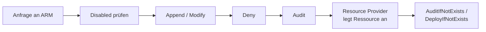
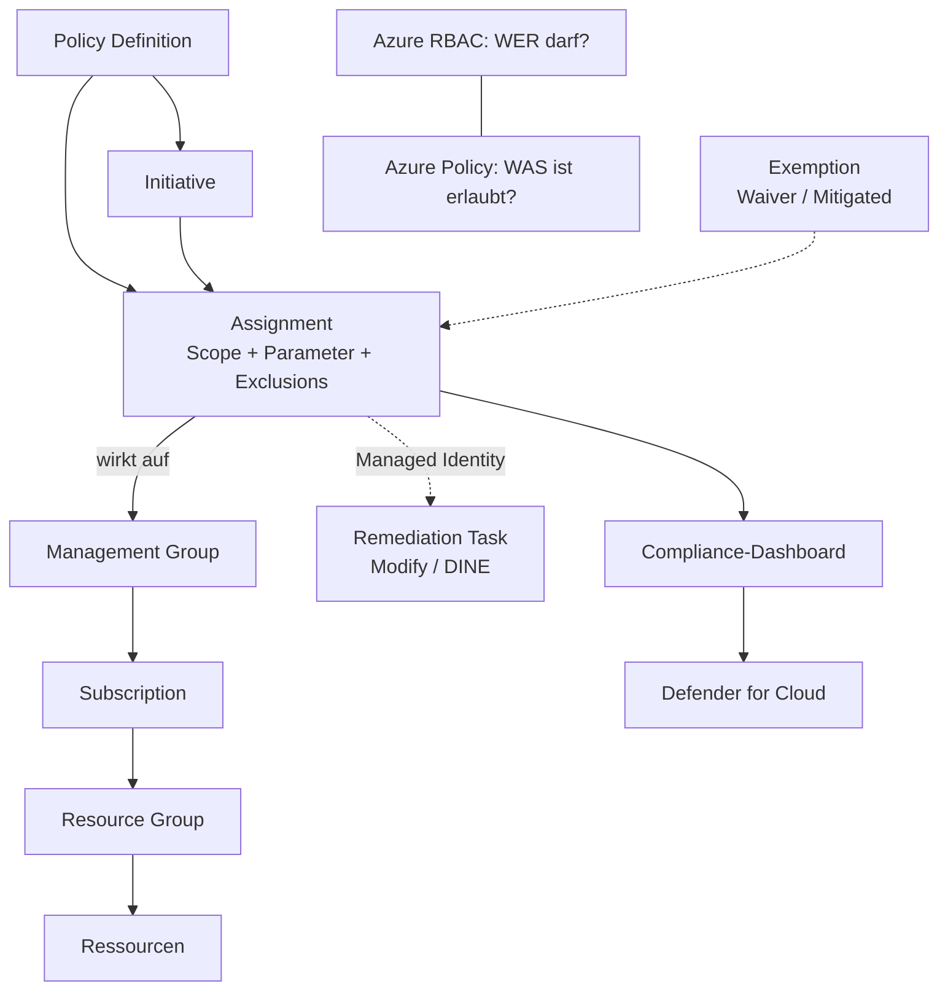

# 1.4 Azure Policy

> **Domäne:** Manage Azure identities and governance · **Gewichtung:** 20–25 %
> **Study-Guide-Punkte:** *Implement and manage Azure Policy*
> **Stand:** November 2026

## Lernziele

Nach diesem Kapitel kann ich …

- **Policy Definition**, **Initiative** und **Assignment** unterscheiden und die JSON-Struktur einer Policy lesen.
- eine Policy auf einen **Scope** (Management Group, Subscription, Resource Group) zuweisen und mit **Exclusions** und **Exemptions** Ausnahmen definieren.
- die **Effects** (Deny, Audit, Modify, DeployIfNotExists …) erklären und ihre **Auswertungsreihenfolge** benennen.
- nicht konforme **bestehende** Ressourcen per **Remediation Task** korrigieren und die Rolle der **Managed Identity** dabei erklären.
- den **Compliance-Status** auswerten und einen **On-demand-Scan** auslösen.
- Azure Policy klar von **Azure RBAC** abgrenzen.

## Überblick

**Azure Policy** setzt organisatorische Standards in Azure durch und bewertet die **Compliance** von Ressourcen. Während RBAC ([1.3](03-rbac-zugriffsverwaltung.md)) regelt, **wer** etwas tun darf, regelt Azure Policy, **was** überhaupt erlaubt ist – unabhängig davon, wer es tut.

Typische Beispiele: „Ressourcen nur in *West Europe* und *Germany West Central*", „Jede Ressource braucht das Tag `CostCenter`", „Nur bestimmte VM-Größen", „Speicherkonten nur mit HTTPS".

Policies wirken bei **neuen und geänderten** Ressourcen (z. B. durch *Deny*) und bewerten zusätzlich **bestehende** Ressourcen. Bestehende nicht konforme Ressourcen werden dabei **nicht gelöscht**, sondern als *Non-compliant* markiert und können per **Remediation** korrigiert werden.

## Kernkonzepte

### Bausteine

| Baustein | Beschreibung |
|---|---|
| **Policy definition** | Eine Regel in JSON: *Wenn* Bedingung erfüllt, *dann* Effect. Built-in (von Microsoft) oder Custom. |
| **Initiative** (*Policy set definition*) | Bündel mehrerer Policy Definitions zu einem Ziel (z. B. „ISO 27001", „Tagging-Standard"). Wird als Ganzes zugewiesen. |
| **Assignment** | Zuweisung einer Policy oder Initiative an einen **Scope**, inkl. Parameterwerten, Exclusions, Enforcement mode und ggf. Managed Identity. |
| **Exemption** | Ausnahme für einen Teilbereich/eine Ressource von einem Assignment – mit Kategorie und optionalem Ablaufdatum. |
| **Remediation task** | Korrigiert bestehende nicht konforme Ressourcen (nur bei *Modify* und *DeployIfNotExists*). |

**Speicherort (Definition location):** Custom Definitions und Initiativen werden in einer **Management Group** oder **Subscription** gespeichert. Zuweisen kann man sie nur auf diesen Scope oder darunter.

### Aufbau einer Policy Definition (JSON)

```json
{
  "properties": {
    "displayName": "Allowed locations (Contoso)",
    "policyType": "Custom",
    "mode": "Indexed",
    "description": "Erlaubt nur die angegebenen Regionen.",
    "parameters": {
      "listOfAllowedLocations": {
        "type": "Array",
        "metadata": {
          "displayName": "Allowed locations",
          "strongType": "location"
        }
      }
    },
    "policyRule": {
      "if": {
        "not": {
          "field": "location",
          "in": "[parameters('listOfAllowedLocations')]"
        }
      },
      "then": {
        "effect": "deny"
      }
    }
  }
}
```

| Element | Bedeutung |
|---|---|
| **mode** | `All` = alle Ressourcentypen inkl. Resource Groups und Subscriptions · `Indexed` = nur Ressourcentypen, die **Tags und Location** unterstützen (empfohlen für Tag-/Location-Policies). Daneben *Resource Provider Modes* wie `Microsoft.Kubernetes.Data` oder `Microsoft.KeyVault.Data`. |
| **parameters** | Machen eine Definition wiederverwendbar (Werte erst beim Assignment). `strongType` sorgt im Portal für Auswahllisten. |
| **policyRule – if** | Bedingung mit `field`, `value`, `count` und Operatoren wie `equals`, `notEquals`, `like`, `in`, `notIn`, `exists`, `contains`; logisch verknüpft mit `allOf`, `anyOf`, `not`. |
| **policyRule – then** | Der **Effect**, oft selbst parametrisiert (`"effect": "[parameters('effect')]"`). |

Typische Felder: `type`, `location`, `name`, `tags`, `tags['CostCenter']`, sowie **Aliases** für Ressourceneigenschaften, z. B. `Microsoft.Storage/storageAccounts/supportsHttpsTrafficOnly` oder `Microsoft.Compute/virtualMachines/sku.name`.

### Effects

| Effect | Wirkung | Zeitpunkt |
|---|---|---|
| **Disabled** | Policy wird nicht ausgewertet (z. B. zum Testen/Abschalten per Parameter) | – |
| **Append** | Fügt beim Erstellen/Ändern Felder hinzu (z. B. IP-Regeln); für Tags besser *Modify* | vor dem Anlegen |
| **Modify** | Fügt Eigenschaften/Tags hinzu, ändert oder entfernt sie (v. a. **Tags**, auch z. B. bestimmte Sicherheitseinstellungen). Braucht **Managed Identity**. Remediation möglich. | vor dem Anlegen |
| **Deny** | Blockiert die Anfrage (HTTP 403, *RequestDisallowedByPolicy*) | vor dem Anlegen |
| **DenyAction** | Blockiert bestimmte Aktionen auf Ressourcen – derzeit v. a. **DELETE** (Schutz vor Löschen) | bei der Aktion |
| **Audit** | Erlaubt die Anfrage, protokolliert aber eine Warnung im Activity Log und markiert als *Non-compliant* | vor dem Anlegen |
| **AuditIfNotExists** | Prüft, ob eine **zugehörige** Ressource existiert (z. B. VM-Erweiterung, Diagnostic Setting); wenn nicht → *Non-compliant* | nach erfolgreicher Bereitstellung |
| **DeployIfNotExists** (DINE) | Wie AuditIfNotExists, stellt die fehlende zugehörige Ressource aber per **ARM-Template-Deployment** bereit. Braucht **Managed Identity**. Remediation möglich. | nach erfolgreicher Bereitstellung |
| **Manual** | Compliance wird manuell per **Attestation** gesetzt (z. B. für organisatorische Kontrollen) | manuell |

**Auswertungsreihenfolge** bei einer Anfrage über Azure Resource Manager:



⚠️ Weil *Append/Modify* **vor** *Deny* laufen, kann eine Modify-Policy (z. B. Tag ergänzen) verhindern, dass eine Deny-Policy (Tag fehlt) greift.

### Assignment, Scope, Exclusions

- **Scope** eines Assignments: **Management Group**, **Subscription** oder **Resource Group**. Die Policy wirkt auf alle untergeordneten Ressourcen (Vererbung, siehe [1.6](06-ressourcengruppen-abonnements-verwaltungsgruppen.md)).
- **Exclusions** (*Excluded scopes*): untergeordnete Scopes (Subscriptions, Resource Groups, einzelne Ressourcen), die beim Assignment **ausgenommen** werden. Sie werden nicht ausgewertet und erscheinen nicht im Compliance-Bericht.
- **Enforcement mode:** `Default` (Enabled) – Effects werden durchgesetzt · `DoNotEnforce` (Disabled) – nur Auswertung/Compliance, **keine** Blockierung, keine automatische Remediation bei neuen Ressourcen. Ideal zum **Testen** („What-if" für Policies).
- **Non-compliance message:** eigener Text, den Benutzer bei einem *Deny* sehen (z. B. „Bitte nur West Europe verwenden – siehe Wiki").
- **Parameters:** Werte für die Definition (z. B. erlaubte Regionen).

### Exemptions

Exemptions nehmen einen Scope oder eine Ressource von einem bestehenden Assignment aus, **ohne** das Assignment selbst zu ändern.

| Kategorie | Bedeutung |
|---|---|
| **Waiver** | Die Ressource ist bewusst nicht konform – Ausnahme akzeptiert |
| **Mitigated** | Die Anforderung wird auf anderem Weg erfüllt |

- Optional mit **Ablaufdatum** (*Expiration date*) – danach gilt die Policy wieder.
- Ausgenommene Ressourcen erscheinen im Compliance-Bericht als **Exempt** (Unterschied zur Exclusion: dort tauchen sie gar nicht auf).
- Bei Initiativen können auch **einzelne Policies** der Initiative ausgenommen werden.

### Remediation und Managed Identity

- **Modify** und **DeployIfNotExists** ändern Ressourcen – dafür braucht das **Assignment** eine **Managed Identity** (system- oder user-assigned).
- Die Identität erhält die in der Definition hinterlegten Rollen (`roleDefinitionIds`, z. B. *Contributor* oder *Tag Contributor*) auf dem Scope. Im Portal geschieht das beim Assignment automatisch – dafür braucht der zuweisende Benutzer Rechte zur Rollenzuweisung (z. B. **Owner** oder **User Access Administrator**).
- **Neue/geänderte** Ressourcen werden automatisch korrigiert.
- **Bestehende** Ressourcen werden **nur** durch einen **Remediation task** korrigiert (beim Assignment über *Create a remediation task* oder später unter *Remediation*).
- *Deny* und *Audit* haben **keine** Remediation – dort muss man die Ressourcen selbst anpassen.

### Compliance-Auswertung

Auswertungen werden ausgelöst durch:

| Auslöser | Ungefährer Zeitpunkt |
|---|---|
| Neues oder geändertes **Assignment** | Assignment wird nach einigen Minuten wirksam, danach Auswertung des Scopes (bei großen Scopes ggf. länger) |
| Ressource erstellt / geändert / gelöscht | Compliance-Ereignis typischerweise innerhalb von **ca. 15 Minuten** |
| Exemption erstellt / geändert / gelöscht | zeitnah für den betroffenen Scope |
| **Standard-Auswertungszyklus** | alle **24 Stunden** automatisch |
| **On-demand-Scan** | manuell per CLI/PowerShell/REST (`az policy state trigger-scan`, `Start-AzPolicyComplianceScan`) |

Compliance-Status: **Compliant**, **Non-compliant**, **Exempt**, **Conflicting**, **Not started**, **Unknown** (z. B. bei *Manual*). Der Gesamtstatus einer Ressource ist *Non-compliant*, sobald **eine** Policy nicht erfüllt ist.

### Wichtige Built-in Policies für AZ-104

| Built-in Policy | Effect | Zweck |
|---|---|---|
| **Allowed locations** | Deny | Ressourcen nur in bestimmten Regionen (gilt nicht für Resource Groups) |
| **Allowed locations for resource groups** | Deny | Regionen für Resource Groups |
| **Allowed virtual machine size SKUs** | Deny | nur bestimmte VM-Größen |
| **Allowed resource types** / **Not allowed resource types** | Deny | Ressourcentypen erlauben bzw. verbieten |
| **Require a tag on resources** / **Require a tag and its value on resources** | Deny | Tag erzwingen (Resource Groups: eigene Varianten *… on resource groups*) |
| **Inherit a tag from the resource group if missing** | Modify | Tag der RG an Ressourcen vererben |
| **Add or replace a tag on resources** | Modify | Tag setzen/überschreiben |
| **Audit VMs that do not use managed disks** | Audit | Bestandsaufnahme |
| **Configure diagnostic settings … to Log Analytics workspace** | DeployIfNotExists | Logs automatisch anbinden ([5.1](../05-monitoring-und-wartung/01-azure-monitor-metriken-und-logs.md)) |

### Rollen für Azure Policy

| Rolle | Darf |
|---|---|
| **Resource Policy Contributor** | Policies/Initiativen erstellen und zuweisen |
| **Owner** / **Contributor** | Contributor kann Policies verwalten, aber **keine Rollen** an die Managed Identity vergeben (dafür Owner/User Access Administrator) |
| **Reader** | Policies und Compliance-Status lesen |

### Bezug zu Microsoft Defender for Cloud

**Microsoft Defender for Cloud** nutzt Azure Policy im Hintergrund: Die Sicherheitsempfehlungen basieren auf der Initiative **Microsoft cloud security benchmark**, die beim Aktivieren automatisch auf die Subscription zugewiesen wird. Regulatorische Standards (z. B. ISO 27001, PCI DSS) im *Regulatory compliance*-Dashboard sind ebenfalls Initiativen.

## Zusammenhänge



- **RBAC** ([1.3](03-rbac-zugriffsverwaltung.md)): Ein Owner einer Subscription kann trotzdem nicht gegen eine Deny-Policy verstoßen. Umgekehrt gibt Policy niemandem Rechte.
- **Tags** ([1.5](05-ressourcensperren-und-tags.md)): Tags werden **nicht** automatisch von der Resource Group vererbt – Vererbung und Pflicht-Tags setzt man mit Azure Policy durch.
- **Resource Locks** ([1.5](05-ressourcensperren-und-tags.md)): Locks schützen vor Löschen/Ändern; *DenyAction* ist die Policy-basierte, skalierbare Alternative für Löschschutz.
- **Management Groups** ([1.6](06-ressourcengruppen-abonnements-verwaltungsgruppen.md)): Assignments auf Management Groups wirken auf alle Subscriptions darunter – ideal für konzernweite Standards.
- **Kosten** ([1.7](07-kostenverwaltung-und-advisor.md)): Pflicht-Tags (z. B. `CostCenter`) ermöglichen Kostenauswertung; *Allowed VM SKUs* begrenzt Kosten.
- **Monitoring** ([5.1](../05-monitoring-und-wartung/01-azure-monitor-metriken-und-logs.md)): DINE-Policies verteilen Diagnostic Settings und Agents automatisch.

## Vergleichstabellen

### Azure Policy vs. Azure RBAC

| Kriterium | Azure Policy | Azure RBAC |
|---|---|---|
| Frage | **Was** darf erstellt/konfiguriert werden? | **Wer** darf welche Aktion ausführen? |
| Fokus | Eigenschaften von Ressourcen | Aktionen von Benutzern/Identitäten |
| Standardverhalten | Alles erlaubt, bis eine Policy etwas verbietet | Nichts erlaubt, bis eine Rolle es erlaubt |
| Bestehende Ressourcen | werden bewertet (Compliance) | – |
| Beispiel | „Nur West Europe" | „Team A ist Contributor auf rg-app" |

### Exclusion vs. Exemption

| Kriterium | Exclusion | Exemption |
|---|---|---|
| Definiert | im **Assignment** | als **eigenes Objekt** auf Scope/Ressource |
| Im Compliance-Bericht | **nicht sichtbar** | als **Exempt** sichtbar |
| Kategorie / Begründung | – | **Waiver** / **Mitigated** + Beschreibung |
| Ablaufdatum | ❌ | ✅ |
| Rechte | wer das Assignment ändert | eigene Berechtigung (`Microsoft.Authorization/policyExemptions/write`) |

### Effects – Deny vs. Audit vs. Modify vs. DeployIfNotExists

| Kriterium | Deny | Audit | Modify | DeployIfNotExists |
|---|---|---|---|---|
| Blockiert Anfrage | ✅ | ❌ | ❌ | ❌ |
| Ändert Ressource | ❌ | ❌ | ✅ (Eigenschaften/Tags) | ✅ (stellt **zusätzliche** Ressource bereit) |
| Managed Identity nötig | ❌ | ❌ | ✅ | ✅ |
| Remediation bestehender Ressourcen | ❌ | ❌ | ✅ | ✅ |
| Typisches Beispiel | Allowed locations | Unverschlüsselte Disks finden | Tag von RG erben | Diagnostic Settings anlegen |

### Policy Definition vs. Initiative

| Kriterium | Policy Definition | Initiative |
|---|---|---|
| Inhalt | eine Regel | viele Policies |
| Zuweisung | einzeln | als Ganzes, ein Compliance-Wert |
| Parameter | eigene | können an die Policies durchgereicht werden |
| Einsatz | Einzelanforderung | Compliance-Standard, Tagging-Paket |

## Azure Portal

Alle Funktionen liegen im Dienst **Policy** (Suche: „Policy").

| Aufgabe | Pfad |
|---|---|
| Compliance-Übersicht | **Portal > Policy > Overview** bzw. **Policy > Compliance** |
| Definitionen durchsuchen (Built-in/Custom) | **Portal > Policy > Authoring > Definitions** (Filter: *Type*, *Category*) |
| Custom Policy erstellen | **… > Definitions > + Policy definition** (Definition location, Name, Category, Policy rule JSON) |
| Initiative erstellen | **… > Definitions > + Initiative definition** |
| Policy zuweisen | **Portal > Policy > Authoring > Assignments > Assign policy** (oder in der Definition: **Assign**) |
| Initiative zuweisen | **… > Assignments > Assign initiative** |
| Exemption anlegen | **Portal > Policy > Authoring > Exemptions** bzw. im Assignment/in der Compliance-Ansicht: **Create exemption** |
| Remediation | **Portal > Policy > Remediation** (Tab *Policies to remediate* / *Remediation tasks*) |
| Compliance einer Ressource | **Ressource > Settings > Policies** |
| Policy auf RG/Subscription sehen | **Resource Group bzw. Subscription > Settings > Policies** |
| Defender for Cloud Standards | **Portal > Microsoft Defender for Cloud > Regulatory compliance** bzw. **Environment settings > Security policies** |

**Assistent *Assign policy* – Tabs:**

1. **Basics:** **Scope** (Management Group/Subscription/RG), **Exclusions**, Policy definition, Assignment name, Description, **Policy enforcement** (*Enabled*/*Disabled*)
2. **Parameters:** z. B. erlaubte Regionen, Tag-Name
3. **Remediation:** *Create a remediation task*, **Create a Managed Identity** (System assigned / User assigned), Location der Identität
4. **Non-compliance messages**
5. **Review + create**

⚠️ **Nach der Erstellung nicht änderbar:**
- **Scope** eines Assignments (neues Assignment anlegen)
- **Definition location** einer Custom Definition
- Die zugewiesene Definition eines Assignments

## Azure CLI & PowerShell

### Azure CLI

```bash
# Built-in Policy finden
az policy definition list \
  --query "[?displayName=='Allowed locations'].{Name:name, Id:id}" -o table

# Policy "Allowed locations" auf eine Resource Group zuweisen
az policy assignment create \
  --name "allowed-locations-rg-app" \
  --display-name "Nur West Europe / Germany West Central" \
  --policy "e56962a6-4747-49cd-b67b-bf8b01975c4c" \
  --scope "/subscriptions/<subscription-id>/resourceGroups/<resource-group>" \
  --params '{"listOfAllowedLocations":{"value":["westeurope","germanywestcentral"]}}'

# Modify-Policy mit System-assigned Managed Identity zuweisen
az policy assignment create \
  --name "inherit-costcenter" \
  --policy "<definition-name-oder-id>" \
  --scope "/subscriptions/<subscription-id>" \
  --params '{"tagName":{"value":"CostCenter"}}' \
  --mi-system-assigned --location westeurope \
  --role "Contributor" --identity-scope "/subscriptions/<subscription-id>"

# Custom Policy aus Dateien anlegen
az policy definition create \
  --name "deny-public-ip" \
  --display-name "Deny Public IP" \
  --rules policy-rule.json \
  --params policy-params.json \
  --mode Indexed \
  --management-group "<management-group-id>"

# Initiative aus mehreren Policies erstellen
az policy set-definition create \
  --name "contoso-tagging" \
  --definitions initiative-definitions.json

# Exemption (Waiver) mit Ablaufdatum
az policy exemption create \
  --name "legacy-app-waiver" \
  --policy-assignment "/subscriptions/<subscription-id>/providers/Microsoft.Authorization/policyAssignments/<assignment-name>" \
  --exemption-category Waiver \
  --expires-on "2027-06-30T00:00:00Z" \
  --resource-group "<resource-group>"

# Compliance auswerten
az policy state summarize --resource-group "<resource-group>"
az policy state list --resource-group "<resource-group>" \
  --filter "complianceState eq 'NonCompliant'" \
  --query "[].{Resource:resourceId, Policy:policyDefinitionName}" -o table

# On-demand-Scan auslösen
az policy state trigger-scan --resource-group "<resource-group>"

# Remediation Task für bestehende Ressourcen
az policy remediation create \
  --name "remediate-costcenter" \
  --policy-assignment "inherit-costcenter"
```

### Az PowerShell

```powershell
# Built-in Definition holen
$def = Get-AzPolicyDefinition -Builtin |
  Where-Object { $_.DisplayName -eq "Allowed locations" }

# Zuweisen auf eine Resource Group
$rg = Get-AzResourceGroup -Name "<resource-group>"
New-AzPolicyAssignment -Name "allowed-locations-rg-app" `
  -PolicyDefinition $def `
  -Scope $rg.ResourceId `
  -PolicyParameterObject @{ listOfAllowedLocations = @("westeurope","germanywestcentral") }

# Assignment mit Managed Identity (für Modify / DeployIfNotExists)
New-AzPolicyAssignment -Name "inherit-costcenter" `
  -PolicyDefinition $tagDef `
  -Scope "/subscriptions/<subscription-id>" `
  -PolicyParameterObject @{ tagName = "CostCenter" } `
  -IdentityType SystemAssigned -Location "westeurope"

# Nur auditieren statt erzwingen (Enforcement mode)
New-AzPolicyAssignment -Name "test-allowed-sku" -PolicyDefinition $skuDef `
  -Scope $rg.ResourceId -EnforcementMode DoNotEnforce

# Exemption
$assignment = Get-AzPolicyAssignment -Name "allowed-locations-rg-app" -Scope $rg.ResourceId
New-AzPolicyExemption -Name "legacy-waiver" -PolicyAssignment $assignment `
  -Scope $rg.ResourceId -ExemptionCategory Waiver

# Compliance-Scan starten und Ergebnisse abfragen
Start-AzPolicyComplianceScan -ResourceGroupName "<resource-group>"
Get-AzPolicyState -ResourceGroupName "<resource-group>" `
  -Filter "ComplianceState eq 'NonCompliant'" |
  Select-Object ResourceId, PolicyDefinitionName
Get-AzPolicyStateSummary -ResourceGroupName "<resource-group>"

# Remediation Task
Start-AzPolicyRemediation -Name "remediate-costcenter" `
  -PolicyAssignmentId "/subscriptions/<subscription-id>/providers/Microsoft.Authorization/policyAssignments/inherit-costcenter"
```

| Ziel | CLI | PowerShell |
|---|---|---|
| Definition anlegen | `az policy definition create` | `New-AzPolicyDefinition` |
| Initiative anlegen | `az policy set-definition create` | `New-AzPolicySetDefinition` |
| Zuweisen | `az policy assignment create` | `New-AzPolicyAssignment` |
| Exemption | `az policy exemption create` | `New-AzPolicyExemption` |
| Compliance abfragen | `az policy state list / summarize` | `Get-AzPolicyState` / `Get-AzPolicyStateSummary` |
| Scan auslösen | `az policy state trigger-scan` | `Start-AzPolicyComplianceScan` |
| Remediation | `az policy remediation create` | `Start-AzPolicyRemediation` |

## Praxisbeispiel

**Szenario:** *Contoso* möchte für alle Subscriptions unter der Management Group `mg-contoso-prod` folgende Regeln:

1. Ressourcen nur in **West Europe** und **Germany West Central**.
2. Jede Ressource soll das Tag `CostCenter` tragen – übernommen von ihrer Resource Group.
3. Nur VM-Größen der B- und D-Serie.
4. Eine Legacy-Anwendung in `rg-legacy` nutzt eine E-Serie-VM und soll bis zur Migration Ende Juni 2027 ausgenommen sein.

**Umsetzung:**

1. **Initiative erstellen:** *Policy > Definitions > + Initiative definition*
   - Definition location: `mg-contoso-prod`, Name: `Contoso Baseline`
   - Policies hinzufügen: **Allowed locations**, **Inherit a tag from the resource group if missing**, **Allowed virtual machine size SKUs**
   - Initiative-Parameter für Regionen, Tag-Name und SKUs anlegen.
2. **Testweise zuweisen:** *Assign initiative* → Scope `mg-contoso-prod`, **Policy enforcement: Disabled** (`DoNotEnforce`). Nach einem Tag im Compliance-Dashboard prüfen, welche Ressourcen betroffen wären.
3. **Scharf schalten:** Assignment bearbeiten → **Policy enforcement: Enabled**. Auf dem Tab **Remediation** eine **System assigned Managed Identity** erstellen lassen (für die Modify-Policy) und **Create a remediation task** für die Tag-Policy aktivieren – so erhalten auch **bestehende** Ressourcen das Tag.
4. **Ausnahme:** *Policy > Exemptions > Create exemption* → Scope `rg-legacy`, Assignment `Contoso Baseline`, nur die Policy *Allowed virtual machine size SKUs*, Kategorie **Waiver**, Ablaufdatum **30.06.2027**.
5. **Prüfen:** Versuch, ein Speicherkonto in *East US* anzulegen → Fehler *RequestDisallowedByPolicy*. Nach Änderungen ggf. `az policy state trigger-scan` für einen sofortigen Compliance-Stand.

## Limits & wichtige Zahlen

| Wert | Grenze / Standard |
|---|---|
| Standard-Compliance-Zyklus | alle **24 Stunden** |
| Compliance nach Ressourcenänderung | typischerweise **ca. 15 Minuten** |
| Scopes für Assignments | Management Group, Subscription, Resource Group |
| Speicherort Custom Definitions | Management Group oder Subscription |
| Policy Definitions pro Scope | ca. **500** |
| Initiative Definitions pro Scope | ca. **200** |
| Policy-/Initiative-Assignments pro Scope | ca. **200** |
| Exemptions pro Scope | ca. **1.000** |
| Policies pro Initiative | ca. **1.000** |
| Exemption-Kategorien | **Waiver**, **Mitigated** |
| Managed Identity nötig für | **Modify**, **DeployIfNotExists** |

Limits können sich ändern – aktuelle Werte: [Azure Policy limits](https://learn.microsoft.com/azure/governance/policy/overview#maximum-count-of-azure-policy-objects).

## Prüfungstipps & Fallstricke

- ⚠️ **Policy auf bestehende, nicht konforme Ressourcen** → sie werden **nicht gelöscht** oder gestoppt, nur als *Non-compliant* markiert.
- ⚠️ **Bestehende Ressourcen korrigieren** → nur mit **Modify** oder **DeployIfNotExists** + **Remediation Task**. *Deny*/*Audit* haben keine Remediation.
- ⚠️ **Remediation schlägt fehl / Assignment lässt sich nicht speichern** → Managed Identity fehlt oder hat keine Rolle; der Zuweisende braucht **Owner** bzw. **User Access Administrator**.
- ⚠️ **Tags werden nicht von der Resource Group vererbt** → Policy **Inherit a tag from the resource group** (Modify).
- **„Benutzer mit Owner-Rolle sollen trotzdem keine Ressourcen außerhalb der EU anlegen"** → **Azure Policy** (Allowed locations), nicht RBAC.
- **„Auswirkungen erst prüfen, ohne etwas zu blockieren"** → **Enforcement mode: DoNotEnforce** oder Effect **Audit**.
- **„Mehrere Policies zusammen zuweisen und gemeinsam auswerten"** → **Initiative**.
- **„Eine RG bei einem Assignment ausnehmen, unsichtbar im Bericht"** → **Exclusion**. **„Befristete, dokumentierte Ausnahme"** → **Exemption** (Waiver/Mitigated, Ablaufdatum).
- **„Compliance-Status sofort aktualisieren"** → **On-demand-Scan** (`az policy state trigger-scan` / `Start-AzPolicyComplianceScan`), nicht 24 h warten.
- **„Fehlende Diagnostic Settings / Agents automatisch ausrollen"** → **DeployIfNotExists**. **„Nur melden, wenn Erweiterung fehlt"** → **AuditIfNotExists**.
- **„Löschen bestimmter Ressourcen per Policy verhindern"** → **DenyAction** (Alternative: Resource Lock, [1.5](05-ressourcensperren-und-tags.md)).
- Reihenfolge: **Disabled → Append/Modify → Deny → Audit** → (nach Bereitstellung) **AuditIfNotExists/DeployIfNotExists**.
- **Allowed locations** gilt **nicht** für Resource Groups – dafür gibt es *Allowed locations for resource groups*.
- Custom Definition in Subscription A gespeichert → kann **nicht** in Subscription B zugewiesen werden → in einer **Management Group** darüber speichern.

## Selbsttest

**1.** Sie weisen die Policy *Allowed locations* (nur West Europe) einer Subscription zu, in der bereits VMs in East US laufen. Was passiert mit diesen VMs?

<details><summary>Lösung</summary>

Nichts – sie laufen weiter und werden im Compliance-Dashboard als **Non-compliant** angezeigt. Nur **neue** oder **geänderte** Ressourcen in East US werden durch *Deny* blockiert.
</details>

**2.** Alle bestehenden Ressourcen sollen das Tag `Environment` ihrer Resource Group erhalten. Was benötigen Sie?

<details><summary>Lösung</summary>

Die Policy **Inherit a tag from the resource group if missing** (Effect **Modify**), ein Assignment mit **Managed Identity** und einen **Remediation Task** für die bestehenden Ressourcen. Neue Ressourcen erhalten das Tag automatisch.
</details>

**3.** Ein Benutzer mit der Rolle **Owner** auf einer Subscription erhält beim Anlegen eines Speicherkontos den Fehler *RequestDisallowedByPolicy*. Warum?

<details><summary>Lösung</summary>

Eine **Deny-Policy** greift. Azure Policy wirkt unabhängig von RBAC-Berechtigungen – auch ein Owner kann nicht gegen eine Deny-Policy verstoßen.
</details>

**4.** Sie möchten eine neue Policy einführen, aber zunächst nur sehen, welche Ressourcen betroffen wären – ohne Bereitstellungen zu blockieren. Welche zwei Möglichkeiten gibt es?

<details><summary>Lösung</summary>

1. Assignment mit **Enforcement mode = DoNotEnforce** (Policy enforcement: Disabled).
2. Effect **Audit** statt Deny (falls die Definition einen Effect-Parameter hat).
</details>

**5.** Welche Effects benötigen eine Managed Identity im Assignment?

<details><summary>Lösung</summary>

**Modify** und **DeployIfNotExists** – sie ändern Ressourcen bzw. stellen Ressourcen bereit.
</details>

**6.** Eine Abteilung benötigt eine befristete Ausnahme von einer Policy bis Ende des Jahres; die Ausnahme soll im Compliance-Bericht nachvollziehbar sein. Was verwenden Sie?

<details><summary>Lösung</summary>

Eine **Exemption** mit Kategorie **Waiver** und **Ablaufdatum**. Eine *Exclusion* hätte kein Ablaufdatum und wäre im Bericht nicht sichtbar.
</details>

**7.** Sie haben eine Custom Policy in Subscription `Sub-A` gespeichert und wollen sie auch in `Sub-B` zuweisen. Das gelingt nicht. Lösung?

<details><summary>Lösung</summary>

Die Definition muss an einem Ort gespeichert sein, der beide Subscriptions umfasst – also in einer **Management Group**, unter der `Sub-A` und `Sub-B` liegen.
</details>

**8.** Eine Modify-Policy fügt fehlende Tags hinzu, eine Deny-Policy verbietet Ressourcen ohne dieses Tag. Ein Benutzer legt eine Ressource ohne Tag an. Wird sie blockiert?

<details><summary>Lösung</summary>

**Nein.** *Modify* wird **vor** *Deny* ausgewertet und ergänzt das Tag. Danach ist die Anfrage konform und wird nicht blockiert.
</details>

**9.** Sie haben gerade eine Policy zugewiesen und Ressourcen angepasst und möchten sofort den aktuellen Compliance-Status sehen. Was tun Sie?

<details><summary>Lösung</summary>

Einen **On-demand-Scan** auslösen: `az policy state trigger-scan --resource-group <rg>` bzw. `Start-AzPolicyComplianceScan`. Andernfalls erfolgt die Auswertung beim nächsten Trigger bzw. im 24-Stunden-Zyklus.
</details>

**10.** Für jede VM soll geprüft werden, ob die Erweiterung *Azure Monitor Agent* installiert ist. Fehlt sie, soll sie automatisch installiert werden. Welcher Effect?

<details><summary>Lösung</summary>

**DeployIfNotExists** (bei reinem Melden: *AuditIfNotExists*).
</details>

## Weiterführende Links

- [AZ-104 Study Guide](https://learn.microsoft.com/credentials/certifications/resources/study-guides/az-104)
- [What is Azure Policy?](https://learn.microsoft.com/azure/governance/policy/overview)
- [Azure Policy definition structure](https://learn.microsoft.com/azure/governance/policy/concepts/definition-structure-basics)
- [Understand Azure Policy effects](https://learn.microsoft.com/azure/governance/policy/concepts/effect-basics)
- [Azure Policy assignment structure](https://learn.microsoft.com/azure/governance/policy/concepts/assignment-structure)
- [Azure Policy exemption structure](https://learn.microsoft.com/azure/governance/policy/concepts/exemption-structure)
- [Remediate non-compliant resources](https://learn.microsoft.com/azure/governance/policy/how-to/remediate-resources)
- [Get compliance data of Azure resources](https://learn.microsoft.com/azure/governance/policy/how-to/get-compliance-data)
- [Assign policies for tag compliance](https://learn.microsoft.com/azure/azure-resource-manager/management/tag-policies)
- [Built-in policy definitions](https://learn.microsoft.com/azure/governance/policy/samples/built-in-policies)
- [Quickstart: Assign a policy with Azure CLI](https://learn.microsoft.com/azure/governance/policy/assign-policy-azurecli)
