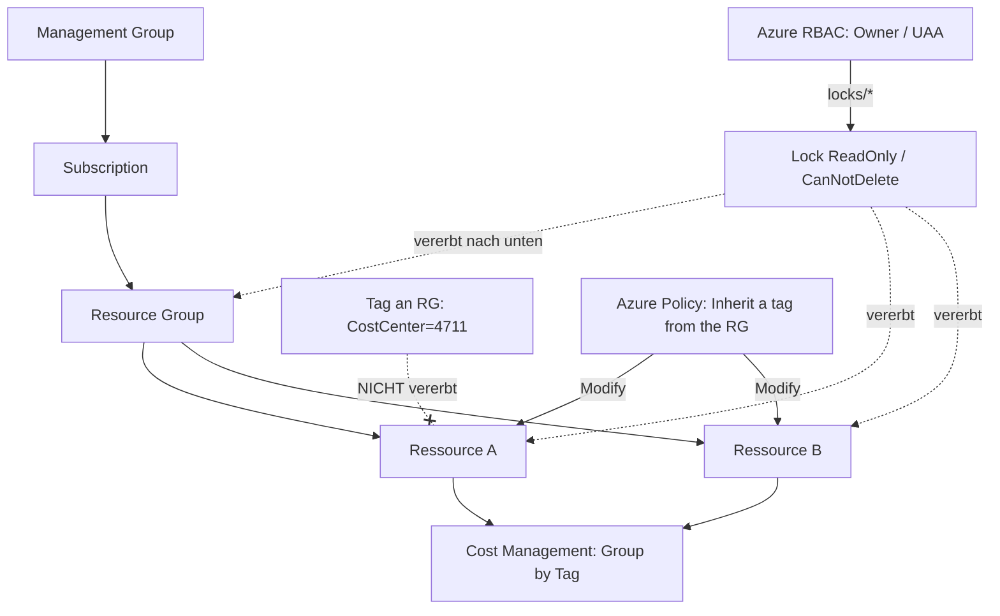

# 1.5 Ressourcensperren und Tags

> **Domäne:** Manage Azure identities and governance · **Gewichtung:** 20–25 %
> **Study-Guide-Punkte:** *Configure resource locks* · *Apply and manage tags on resources*
> **Stand:** November 2026

## Lernziele

Nach diesem Kapitel kann ich …

- die beiden Sperrtypen **CanNotDelete** (*Delete*) und **ReadOnly** (*Read-only*) unterscheiden und auf Subscription, Resource Group oder Ressource anwenden.
- erklären, warum Locks **für alle Benutzer – auch Owner –** gelten und wie sie vererbt werden.
- die Nebenwirkungen eines **ReadOnly**-Locks vorhersagen (z. B. *List Keys* beim Storage Account, VM-Neustart).
- benennen, wer Locks erstellen und löschen darf (`Microsoft.Authorization/locks/*`).
- Tags setzen, ändern (**Merge** vs. **Replace**) und löschen – im Portal, mit Azure CLI und PowerShell.
- erklären, warum Tags **nicht vererbt** werden und wie man das mit **Azure Policy** löst.
- Tags zur Kostenauswertung in **Cost Management** nutzen.

## Überblick

Azure-Rollen ([1.3](03-rbac-zugriffsverwaltung.md)) legen fest, **wer** etwas tun darf. Trotzdem kann ein berechtigter Administrator versehentlich eine produktive Datenbank löschen. **Resource Locks** (Ressourcensperren) sind eine zusätzliche Schutzschicht: Sie verhindern Löschen oder Ändern **unabhängig von den Berechtigungen** des Benutzers.

**Tags** sind Name/Wert-Paare (z. B. `Environment = Production`), die als Metadaten an Ressourcen, Ressourcengruppen und Abonnements gehängt werden. Sie dienen der **Organisation**, der **Kostenzuordnung** (Kostenstelle, Projekt), der **Automatisierung** (z. B. „alle VMs mit `AutoShutdown = true` abends herunterfahren") und der **Governance** in Verbindung mit Azure Policy ([1.4](04-azure-policy.md)).

Beide Funktionen sind Teil der **Azure Resource Manager (ARM)**-Steuerungsebene und werden auf denselben Scopes angewendet wie RBAC und Policy ([1.6](06-ressourcengruppen-abonnements-verwaltungsgruppen.md)).

## Kernkonzepte

### Resource Locks – Sperrtypen

| Lock (API-Name) | Anzeige im Portal | Lesen | Ändern | Löschen |
|---|---|---|---|---|
| **CanNotDelete** | **Delete** | ✅ | ✅ | ❌ |
| **ReadOnly** | **Read-only** | ✅ | ❌ | ❌ |

- **CanNotDelete:** Berechtigte Benutzer können die Ressource lesen und ändern, aber **nicht löschen**.
- **ReadOnly:** Wirkt so, als hätten alle Benutzer nur die Rolle **Reader** – weder Ändern noch Löschen ist möglich.

### Scope und Vererbung

- Locks können auf **Subscription**, **Resource Group** oder **einzelne Ressource** gesetzt werden – **nicht** auf Management Groups.
- Ein Lock wird an **alle untergeordneten Ressourcen vererbt** – auch an Ressourcen, die **später** hinzugefügt werden.
- Bei mehreren Locks gilt der **restriktivste** (ReadOnly schlägt CanNotDelete).
- Ein Lock auf einer Ressource verhindert auch das **Löschen der Resource Group**, die sie enthält (und damit auch das Löschen der Subscription-Inhalte), denn das Löschen der RG würde die gesperrte Ressource mitlöschen.
- Eine geerbte Sperre kann auf der untergeordneten Ebene nicht entfernt werden – sie muss dort gelöscht werden, wo sie erstellt wurde.

### Locks gelten für alle – auch für Owner

- Locks wirken **unabhängig von RBAC**. Auch ein **Owner** oder Global Administrator mit Owner-Rechten kann eine gesperrte Ressource nicht löschen.
- Um die Ressource zu löschen, muss **zuerst der Lock entfernt** werden – das ist ein bewusster zweiter Schritt und genau der Zweck der Sperre.

### Wer darf Locks verwalten?

- Erforderlich sind die Aktionen `Microsoft.Authorization/locks/*` (bzw. `…/locks/write` und `…/locks/delete`).
- Von den integrierten Rollen haben diese nur **Owner** und **User Access Administrator**.
- ⚠️ **Contributor** kann **keine** Locks erstellen oder löschen.
- Für ein „Lock-Team" ohne weitere Rechte bietet sich eine **Custom Role** mit `Microsoft.Authorization/locks/*` an ([1.3](03-rbac-zugriffsverwaltung.md)).

### Control Plane vs. Data Plane

Locks gelten nur für die **Steuerungsebene** (*Control plane*, Aufrufe an `https://management.azure.com`), **nicht** für die **Datenebene** (*Data plane*).

| Beispiel | Wirkung des Locks |
|---|---|
| CanNotDelete auf Storage Account | Storage Account kann nicht gelöscht werden – **Blobs, Dateien, Container-Inhalte** können aber weiterhin gelöscht werden |
| CanNotDelete auf SQL Database | Datenbank-Ressource kann nicht gelöscht werden – **Daten in Tabellen** können weiterhin per SQL gelöscht/geändert werden |
| ReadOnly auf Storage Account | Konfiguration nicht änderbar; Datenzugriff per **RBAC-Datenrolle** (z. B. *Storage Blob Data Contributor*) oder SAS bleibt möglich |

Daten schützt man mit Data-Plane-Mitteln wie **Soft delete**, **Versioning** oder **Immutable storage** ([2.3](../02-speicher/03-blob-storage.md)).

### Nebenwirkungen von ReadOnly (und CanNotDelete)

ReadOnly blockiert alle **Schreib-** und viele **POST-Operationen** auf der Control Plane – auch solche, die harmlos klingen:

| Situation | Effekt |
|---|---|
| ReadOnly auf **Storage Account** | ⚠️ **List Keys** ist ein POST-Vorgang → wird blockiert. Benutzer, die im Portal per Zugriffsschlüssel auf Daten zugreifen, sehen keine Daten mehr; sie brauchen eine Entra-ID-Datenrolle |
| ReadOnly auf RG mit **VMs** | ⚠️ VMs können **nicht gestartet, neu gestartet oder gestoppt** werden (POST-Aktionen) |
| ReadOnly auf **App Service** | Z. B. Anzeigen/Bearbeiten von Dateien über Tools, Skalieren und Konfigurationsänderungen schlagen fehl |
| ReadOnly auf RG mit **Autoscale/VM Scale Set** | Automatische Skalierung kann nicht ausgeführt werden |
| ReadOnly auf **Subscription** | Dienste, die Einstellungen schreiben (z. B. **Azure Advisor**), funktionieren nicht korrekt |
| CanNotDelete auf **RG** | ARM kann die **Deployment-Historie** nicht automatisch bereinigen; bei Erreichen des Limits schlagen Deployments fehl |
| CanNotDelete auf der von **Azure Backup** erstellten RG (Restore Point Collection) | Alte Wiederherstellungspunkte können nicht entfernt werden → **Backups schlagen fehl** ([5.4](../05-monitoring-und-wartung/04-azure-backup.md)) |

Faustregel: **CanNotDelete** ist meist die richtige Wahl für produktive Ressourcen. **ReadOnly** nur gezielt einsetzen, wenn wirklich keine Änderung erfolgen darf.

### Tags – Grundlagen

- Tag = **Name** (Key) + **Value**, z. B. `CostCenter = 4711`.
- Tags können auf **Ressourcen**, **Resource Groups** und **Subscriptions** gesetzt werden.
- **Tag-Namen** sind **nicht** case-sensitive, **Tag-Werte** sind case-sensitive.
- ⚠️ Tags werden **nicht vererbt**: Ein Tag an der Resource Group erscheint nicht automatisch an den enthaltenen Ressourcen.
- Nicht alle Ressourcentypen unterstützen Tags (z. B. klassische Ressourcen bzw. einzelne Untertypen). Welche Typen Tags unterstützen und ob die Tags in Kostendaten auftauchen, steht in der Doku *Tag support for Azure resources*.
- Tags sind **Klartext-Metadaten** – keine Kennwörter, Schlüssel oder personenbezogenen Daten in Tags speichern.

### Berechtigungen für Tags

- Zum Setzen von Tags benötigt man Schreibrechte auf die Ressource (z. B. **Contributor**) oder die Aktion `Microsoft.Resources/tags/*`.
- Die integrierte Rolle **Tag Contributor** erlaubt das Verwalten von Tags **ohne** Zugriff auf die Ressource selbst.
- Ein **ReadOnly-Lock** verhindert auch das Ändern von Tags.

### Tag-Operationen: Merge, Replace, Delete

Beim Ändern per CLI/PowerShell/API ist entscheidend, ob vorhandene Tags **ergänzt** oder **ersetzt** werden:

| Operation | Wirkung |
|---|---|
| **Merge** | Neue Tags hinzufügen, bestehende Namen mit neuem Wert überschreiben, andere Tags **bleiben** |
| **Replace** | **Alle** bisherigen Tags werden durch die angegebenen ersetzt |
| **Delete** | Die angegebenen Tags werden entfernt |

⚠️ Einige Befehle ersetzen standardmäßig **alle** Tags, z. B. `az tag create`, `az resource tag` (ohne `-i`), `New-AzTag -ResourceId`, `Set-AzResourceGroup -Tag`.

### Tags mit Azure Policy durchsetzen und vererben

Da Tags nicht vererbt werden, nutzt man integrierte Policy-Definitionen ([1.4](04-azure-policy.md)):

| Policy (Built-in) | Effekt | Zweck |
|---|---|---|
| *Require a tag on resources* / *Require a tag and its value on resources* | Deny | Ressourcen ohne Tag werden abgelehnt |
| *Require a tag on resource groups* | Deny | Gleiches für RGs |
| *Add a tag to resources* | Modify | Fehlenden Tag mit festem Wert ergänzen |
| ***Inherit a tag from the resource group*** (*if missing*) | Modify | Tag-Wert der RG auf Ressourcen übertragen |
| *Inherit a tag from the subscription* (*if missing*) | Modify | Tag-Wert der Subscription übertragen |

- **Modify**-Policies wirken auf neue/geänderte Ressourcen sofort; für **bestehende** Ressourcen ist ein **Remediation Task** nötig (benötigt eine Managed Identity).

### Tags in der Kostenanalyse

- In **Cost Management > Cost analysis** kann man nach Tags **filtern** und **gruppieren** (*Group by: Tag*), z. B. Kosten pro `CostCenter`.
- Tags wirken nur auf Nutzungsdaten **ab dem Zeitpunkt**, ab dem sie gesetzt sind – **nicht rückwirkend**.
- Nicht jeder Ressourcentyp liefert Tags in den Nutzungsdaten.
- Zusätzlich gibt es in Cost Management eine Einstellung zur **Tag-Vererbung für Kostendaten** (Tags von Subscription/RG werden auf die Nutzungsdatensätze angewendet, ohne die Ressourcen selbst zu ändern) – je nach Abrechnungskonto-Typ verfügbar. Details in [1.7](07-kostenverwaltung-und-advisor.md).

## Zusammenhänge



- **RBAC** ([1.3](03-rbac-zugriffsverwaltung.md)): Bestimmt, **wer** Locks verwalten darf (Owner, User Access Administrator, Custom Role). Locks schränken **zusätzlich** zu RBAC ein – auch Owner.
- **Azure Policy** ([1.4](04-azure-policy.md)): Erzwingt Tags (Deny) und vererbt Tags (Modify + Remediation). Policy kann keine Locks setzen, aber per *DeployIfNotExists* z. B. Locks bereitstellen.
- **Scopes** ([1.6](06-ressourcengruppen-abonnements-verwaltungsgruppen.md)): Locks auf Subscription/RG/Ressource, Tags auf Subscription/RG/Ressource. Ein Lock blockiert das Löschen der RG.
- **Kosten** ([1.7](07-kostenverwaltung-und-advisor.md)): Tags sind das wichtigste Werkzeug zur Kostenzuordnung; Budgets können nach Tags gefiltert werden.
- **Storage** ([2.2](../02-speicher/02-speicherzugriff-und-sicherheit.md)): ReadOnly blockiert *List Keys* → Zugriff über Entra-ID-Datenrollen statt Schlüssel.
- **Backup** ([5.4](../05-monitoring-und-wartung/04-azure-backup.md)): Locks auf der Restore-Point-RG verursachen Backup-Fehler.

## Vergleichstabellen

### CanNotDelete vs. ReadOnly

| Kriterium | CanNotDelete (Delete) | ReadOnly (Read-only) |
|---|---|---|
| Lesen | ✅ | ✅ |
| Konfiguration ändern | ✅ | ❌ |
| Tags ändern | ✅ | ❌ |
| Löschen | ❌ | ❌ |
| VM starten/stoppen | ✅ | ❌ |
| Storage *List Keys* | ✅ | ❌ |
| Typischer Einsatz | Schutz produktiver Ressourcen vor versehentlichem Löschen | Eingefrorene Konfiguration (z. B. kritisches Netzwerk, Compliance) |

### Locks vs. RBAC vs. Azure Policy

| Kriterium | Resource Lock | Azure RBAC | Azure Policy |
|---|---|---|---|
| Frage | „Darf das **überhaupt** gelöscht/geändert werden?" | „**Wer** darf was?" | „**Wie** müssen Ressourcen konfiguriert sein?" |
| Gilt für Owner | ✅ ja | – (Owner hat alle Rechte) | ✅ ja |
| Granularität | 2 Stufen | Aktionen/Rollen | Regeln auf Eigenschaften |
| Scopes | Subscription, RG, Ressource | MG, Subscription, RG, Ressource | MG, Subscription, RG (+ Ausnahmen) |
| Data plane | ❌ | ✅ (Datenrollen) | teilweise (Data-Plane-Modi) |

### Tag-Befehle – ergänzen oder ersetzen?

| Befehl | Standardverhalten |
|---|---|
| `az tag update --operation Merge` | **ergänzt** |
| `az tag update --operation Replace` | ersetzt alle |
| `az tag create --resource-id … --tags …` | ersetzt alle |
| `az resource tag --tags …` | ersetzt alle (mit `-i`/`--is-incremental` ergänzend) |
| `az group update --set tags.Env=Prod` | ergänzt/ändert einen Tag |
| `Update-AzTag -Operation Merge` | **ergänzt** |
| `New-AzTag -ResourceId … -Tag …` | ersetzt alle |
| `Set-AzResourceGroup -Tag …` | ersetzt alle |

## Azure Portal

| Aufgabe | Pfad |
|---|---|
| Lock auf Ressource setzen | **Portal > Ressource > Settings > Locks > + Add** (Lock name, **Lock type**: Delete / Read-only, Notes) |
| Lock auf Resource Group | **Portal > Resource groups > RG > Settings > Locks > + Add** |
| Lock auf Subscription | **Portal > Subscriptions > Abo > Settings > Resource locks > + Add** |
| Lock löschen | **… > Locks > Lock > Delete** |
| Geerbte Locks anzeigen | **… > Locks** – Spalte *Scope* zeigt, wo der Lock definiert ist |
| Tags einer Ressource bearbeiten | **Portal > Ressource > Tags** (oder im *Overview* auf *Tags: Edit*) |
| Tags mehrerer Ressourcen gleichzeitig | **Portal > Resource groups > RG > Ressourcen markieren > Assign tags** (bzw. *All resources* > Auswahl > *Assign tags*) |
| Tags beim Erstellen setzen | Assistent *Create* > Registerkarte **Tags** |
| Übersicht aller Tags | **Portal > Tags** (Liste aller Tag-Namen/-Werte, Ressourcen pro Tag) |
| Nach Tags filtern | **Portal > All resources > Add filter > Tag** |
| Kosten nach Tag | **Portal > Cost Management > Cost analysis > Group by: Tag** |
| Tag-Policies zuweisen | **Portal > Policy > Definitions** (Kategorie *Tags*) **> Assign** |

**Felder beim Erstellen eines Locks:** *Lock name*, *Lock type* (Delete / Read-only), *Notes*. Lock-Name und Typ sind nach dem Erstellen **nicht änderbar** – Lock löschen und neu anlegen.

## Azure CLI & PowerShell

### Locks – Azure CLI

```bash
# CanNotDelete-Lock auf eine Resource Group
az lock create --name lock-rg-prod --lock-type CanNotDelete \
  --resource-group rg-prod --notes "Produktion - nicht löschen"

# ReadOnly-Lock auf eine einzelne Ressource
az lock create --name lock-vnet-ro --lock-type ReadOnly \
  --resource-group rg-network --resource-name vnet-hub \
  --resource-type Microsoft.Network/virtualNetworks

# Lock auf Subscription-Ebene (ohne --resource-group)
az lock create --name lock-sub --lock-type CanNotDelete

# Locks auflisten (RG bzw. Subscription)
az lock list --resource-group rg-prod -o table
az lock list -o table

# Lock löschen
az lock delete --name lock-rg-prod --resource-group rg-prod
```

### Locks – Az PowerShell

```powershell
# CanNotDelete-Lock auf Resource Group
New-AzResourceLock -LockName "lock-rg-prod" -LockLevel CanNotDelete `
  -ResourceGroupName "rg-prod" -LockNotes "Produktion" -Force

# ReadOnly-Lock auf eine Ressource
New-AzResourceLock -LockName "lock-vnet-ro" -LockLevel ReadOnly `
  -ResourceGroupName "rg-network" -ResourceName "vnet-hub" `
  -ResourceType "Microsoft.Network/virtualNetworks"

# Locks anzeigen
Get-AzResourceLock -ResourceGroupName "rg-prod"

# Lock entfernen
Remove-AzResourceLock -LockName "lock-rg-prod" -ResourceGroupName "rg-prod" -Force
```

### Tags – Azure CLI

```bash
RID=$(az resource show -g rg-prod -n vm-web01 \
  --resource-type Microsoft.Compute/virtualMachines --query id -o tsv)

# Tags ergänzen (bestehende bleiben erhalten)
az tag update --resource-id $RID --operation Merge \
  --tags Environment=Production CostCenter=4711

# Alle Tags ersetzen
az tag update --resource-id $RID --operation Replace --tags Owner=Team-Web

# Einzelnen Tag entfernen
az tag update --resource-id $RID --operation Delete --tags Owner=Team-Web

# Tags einer Resource Group setzen/ändern
az group update --name rg-prod --set tags.Environment=Production

# Ressourcen mit bestimmtem Tag finden
az resource list --tag Environment=Production -o table

# Alle Tag-Namen/-Werte der Subscription
az tag list -o table
```

### Tags – Az PowerShell

```powershell
$rid = (Get-AzResource -ResourceGroupName "rg-prod" -Name "vm-web01").ResourceId

# Ergänzen
Update-AzTag -ResourceId $rid -Tag @{ Environment = "Production"; CostCenter = "4711" } -Operation Merge

# Ersetzen
Update-AzTag -ResourceId $rid -Tag @{ Owner = "Team-Web" } -Operation Replace

# Löschen
Update-AzTag -ResourceId $rid -Tag @{ Owner = "Team-Web" } -Operation Delete

# Tags setzen (ersetzt alle vorhandenen Tags der Ressource)
New-AzTag -ResourceId $rid -Tag @{ Environment = "Production" }

# Tags der Subscription anzeigen
Get-AzTag

# Ressourcen nach Tag suchen
Get-AzResource -TagName "Environment" -TagValue "Production"
```

## Praxisbeispiel

**Szenario:** *Contoso* betreibt in der Resource Group `rg-erp-prod` das produktive ERP-System (VMs, Storage Account, SQL Database). Anforderungen:

1. Niemand – auch kein Owner – soll Ressourcen in `rg-erp-prod` versehentlich löschen können; der Betrieb (VM-Neustarts, Skalierung) muss weiter funktionieren.
2. Das Hub-VNet `vnet-hub` darf überhaupt nicht verändert werden.
3. Alle Ressourcen sollen die Tags `CostCenter` und `Environment` tragen; die Kosten sollen pro Kostenstelle ausgewertet werden.

**Umsetzung:**

1. **CanNotDelete auf die RG:** *rg-erp-prod > Locks > + Add* → Name `lock-erp-nodelete`, Typ **Delete**. VMs können weiterhin neu gestartet werden; ReadOnly wäre hier falsch, weil Start/Stopp blockiert würde.
2. **ReadOnly auf das VNet:** *vnet-hub > Locks > + Add* → Typ **Read-only**. Hinweis an das Team: Neue Subnetze oder Peerings erfordern vorher das Entfernen des Locks (nur Owner/User Access Administrator).
3. **Tags vergeben:** RG-Tags `CostCenter = 4711`, `Environment = Production` setzen. Weil Tags nicht vererbt werden:
   - Policy **Inherit a tag from the resource group if missing** zweimal zuweisen (für `CostCenter` und `Environment`), Scope `rg-erp-prod`.
   - **Remediation Task** erstellen, damit auch bestehende Ressourcen die Tags erhalten.
   - Zusätzlich **Require a tag on resources** mit Effekt Deny für neue Ressourcen ohne Tag (optional).
4. **Kosten auswerten:** *Cost Management > Cost analysis* → *Group by: Tag > CostCenter*. Hinweis: Kosten vor dem Setzen der Tags erscheinen als „untagged".

Dieselben Schritte per CLI:

```bash
az lock create --name lock-erp-nodelete --lock-type CanNotDelete --resource-group rg-erp-prod
az lock create --name lock-vnet-ro --lock-type ReadOnly --resource-group rg-erp-prod \
  --resource-name vnet-hub --resource-type Microsoft.Network/virtualNetworks
az group update --name rg-erp-prod --set tags.CostCenter=4711 tags.Environment=Production
```

## Limits & wichtige Zahlen

| Wert | Grenze |
|---|---|
| Tags pro Ressource, RG oder Subscription | **50** Name/Wert-Paare |
| Länge Tag-Name | **512** Zeichen (Storage Accounts: **128**) |
| Länge Tag-Wert | **256** Zeichen |
| Unzulässige Zeichen im Tag-Namen | u. a. `<` `>` `%` `&` `\` `?` `/` |
| Groß-/Kleinschreibung | Namen **nicht** case-sensitive, Werte case-sensitive |
| Lock-Typen | **2** (CanNotDelete, ReadOnly) |
| Lock-Scopes | Subscription, Resource Group, Ressource (**keine** Management Group) |
| Rollen mit `locks/*` (Built-in) | **Owner**, **User Access Administrator** |

Einzelne Ressourcentypen haben abweichende Einschränkungen – aktuelle Werte: [Use tags to organize your Azure resources](https://learn.microsoft.com/azure/azure-resource-manager/management/tag-resources).

## Prüfungstipps & Fallstricke

- ⚠️ **Owner kann Ressource nicht löschen** → es gibt einen Lock (ggf. **geerbt** von RG oder Subscription). Erst Lock entfernen.
- ⚠️ **Contributor soll Lock entfernen** → geht nicht; benötigt **Owner**, **User Access Administrator** oder Custom Role mit `Microsoft.Authorization/locks/*`.
- ⚠️ **ReadOnly auf RG mit VMs** → VMs lassen sich **nicht starten/stoppen/neu starten**.
- ⚠️ **ReadOnly auf Storage Account** → *List Keys* blockiert; Portal-Zugriff auf Daten per Schlüssel schlägt fehl.
- ⚠️ **CanNotDelete auf Storage Account schützt keine Blobs** → Locks wirken nur auf der Control Plane; für Daten Soft delete/Versioning nutzen.
- **„Ressourcen dürfen geändert, aber nicht gelöscht werden"** → **CanNotDelete** (Portal: *Delete*).
- **„Keine Änderungen und kein Löschen"** → **ReadOnly**.
- **RG lässt sich nicht löschen**, obwohl auf der RG kein Lock ist → eine **enthaltene Ressource** hat einen Lock.
- **CanNotDelete + ReadOnly** auf verschiedenen Ebenen → der **restriktivste** gilt (ReadOnly).
- ⚠️ **Tags an der RG, Ressourcen haben sie nicht** → Tags werden **nicht vererbt** → Policy **Inherit a tag from the resource group** + **Remediation**.
- **„Alle neuen Ressourcen müssen einen Tag haben"** → Policy **Require a tag** (Deny).
- **„Tag hinzufügen, ohne bestehende zu verlieren"** → `az tag update --operation Merge` / `Update-AzTag -Operation Merge`.
- **Kosten nach Abteilung/Projekt** → Tags + **Cost analysis > Group by Tag**; Tags wirken nicht rückwirkend.
- **Tags verwalten ohne Zugriff auf die Ressource** → Rolle **Tag Contributor**.
- Locks können **nicht** auf **Management Groups** gesetzt werden.

## Selbsttest

**1.** Ein Benutzer mit der Rolle *Owner* auf der Subscription versucht, die Resource Group `rg-test` zu löschen, und erhält einen Fehler. Auf `rg-test` selbst ist kein Lock konfiguriert. Was ist die wahrscheinlichste Ursache?

<details><summary>Lösung</summary>

Ein Lock auf der **Subscription** (vererbt) oder auf einer **Ressource innerhalb** von `rg-test`. Locks gelten auch für Owner; beide Fälle verhindern das Löschen der RG.
</details>

**2.** Sie setzen einen **ReadOnly**-Lock auf die Resource Group `rg-app`, die mehrere VMs enthält. Welche Auswirkung hat das auf den Betrieb?

<details><summary>Lösung</summary>

Die VMs laufen weiter, können aber **nicht gestartet, gestoppt oder neu gestartet** werden, da dies Schreib-/POST-Vorgänge auf der Control Plane sind. Auch Größenänderungen, Tags und Erweiterungen sind blockiert.
</details>

**3.** Auf einem Storage Account liegt ein **CanNotDelete**-Lock. Kann ein Benutzer mit *Storage Blob Data Contributor* Blobs löschen?

<details><summary>Lösung</summary>

**Ja.** Locks wirken nur auf der **Control Plane**. Das Löschen von Blobs ist ein Data-Plane-Vorgang. Schutz der Daten über **Soft delete**, **Versioning** oder **Immutable storage**.
</details>

**4.** Welche integrierten Rollen dürfen Resource Locks erstellen und löschen?

<details><summary>Lösung</summary>

**Owner** und **User Access Administrator** (Aktion `Microsoft.Authorization/locks/*`). **Contributor** darf es nicht.
</details>

**5.** Sie weisen der Resource Group `rg-sales` den Tag `Department = Sales` zu. Eine Woche später zeigt die Kostenanalyse für die enthaltenen VMs keinen Department-Tag. Warum, und wie lösen Sie das mit minimalem Aufwand dauerhaft?

<details><summary>Lösung</summary>

Tags werden **nicht** von der RG auf Ressourcen vererbt. Lösung: Policy **Inherit a tag from the resource group (if missing)** zuweisen und einen **Remediation Task** für bestehende Ressourcen starten. (Alternativ/ergänzend: Tag-Vererbung in Cost Management für die Kostendaten.)
</details>

**6.** Eine VM hat die Tags `Env = Prod` und `Owner = Team-A`. Sie führen `az tag create --resource-id <vm-id> --tags CostCenter=100` aus. Welche Tags hat die VM danach?

<details><summary>Lösung</summary>

Nur **`CostCenter = 100`**. `az tag create` **ersetzt** alle vorhandenen Tags. Zum Ergänzen: `az tag update --operation Merge`.
</details>

**7.** Auf der Subscription liegt ein **CanNotDelete**-Lock, auf der Resource Group `rg-core` ein **ReadOnly**-Lock. Welcher Lock gilt für eine VM in `rg-core`?

<details><summary>Lösung</summary>

**ReadOnly** – bei mehreren (geerbten) Locks gilt der **restriktivste**.
</details>

**8.** Ihr Team nutzt Zugriffsschlüssel, um im Portal Blobs eines Storage Accounts anzusehen. Nach dem Setzen eines Locks sehen die Benutzer die Daten nicht mehr. Welcher Lock wurde gesetzt und wie stellen Sie den Zugriff wieder her, ohne den Lock zu entfernen?

<details><summary>Lösung</summary>

Ein **ReadOnly**-Lock – er blockiert den POST-Vorgang **List Keys**. Lösung: Den Benutzern eine **Entra-ID-Datenrolle** (z. B. *Storage Blob Data Reader*) zuweisen und im Portal die Authentifizierungsmethode **Microsoft Entra user account** verwenden.
</details>

**9.** Sie möchten verhindern, dass Ressourcen ohne den Tag `CostCenter` erstellt werden. Was verwenden Sie?

<details><summary>Lösung</summary>

**Azure Policy** mit der integrierten Definition **Require a tag on resources** (Effekt **Deny**). Ein Lock oder RBAC kann das nicht.
</details>

**10.** Können Sie einen Resource Lock auf einer Management Group setzen, um alle Abonnements darunter zu schützen?

<details><summary>Lösung</summary>

**Nein.** Locks sind nur auf **Subscription**, **Resource Group** und **Ressource** möglich. Für mehrere Abonnements muss je Subscription ein Lock gesetzt werden (oder per Policy *DeployIfNotExists* bzw. Automatisierung).
</details>

## Weiterführende Links

- [AZ-104 Study Guide](https://learn.microsoft.com/credentials/certifications/resources/study-guides/az-104)
- [Lock your resources to protect your infrastructure](https://learn.microsoft.com/azure/azure-resource-manager/management/lock-resources)
- [Use tags to organize your Azure resources and management hierarchy](https://learn.microsoft.com/azure/azure-resource-manager/management/tag-resources)
- [Apply tags with Azure CLI](https://learn.microsoft.com/azure/azure-resource-manager/management/tag-resources-cli)
- [Apply tags with Azure PowerShell](https://learn.microsoft.com/azure/azure-resource-manager/management/tag-resources-powershell)
- [Tag support for Azure resources](https://learn.microsoft.com/azure/azure-resource-manager/management/tag-support)
- [Assign policy definitions for tag compliance](https://learn.microsoft.com/azure/azure-resource-manager/management/tag-policies)
- [Group and allocate costs using tag inheritance](https://learn.microsoft.com/azure/cost-management-billing/costs/enable-tag-inheritance)
- [Azure built-in roles – Tag Contributor](https://learn.microsoft.com/azure/role-based-access-control/built-in-roles/management-and-governance#tag-contributor)
