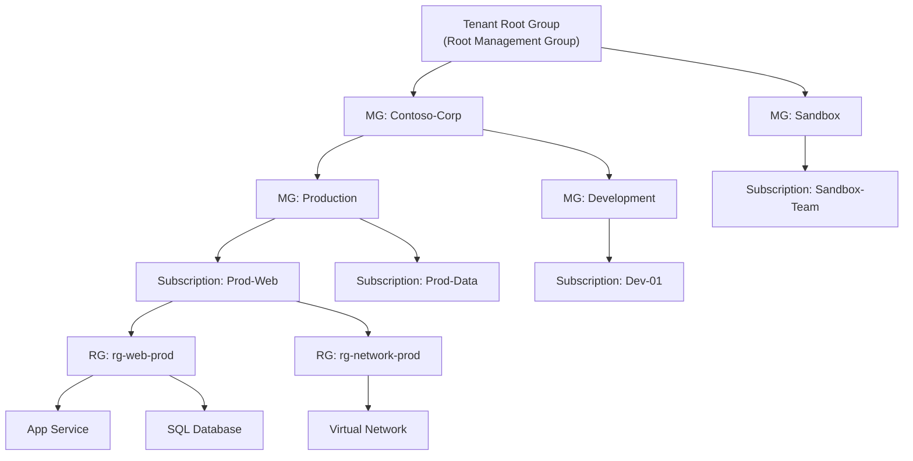
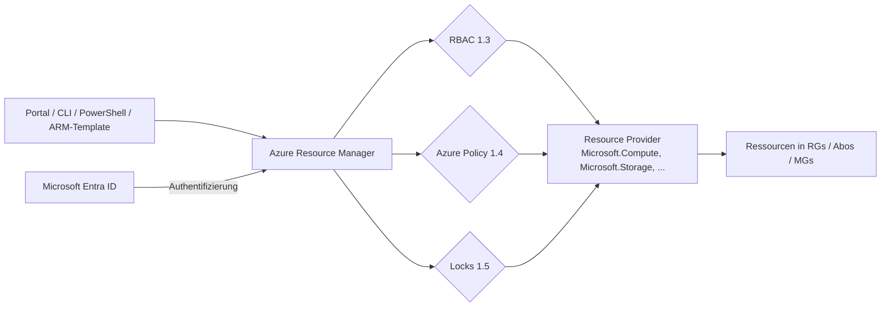

# 1.6 Ressourcengruppen, Abonnements und Verwaltungsgruppen

> **Domäne:** Manage Azure identities and governance · **Gewichtung:** 20–25 %
> **Study-Guide-Punkte:** *Manage resource groups* · *Manage subscriptions* · *Configure management groups*
> **Stand:** November 2026

## Lernziele

Nach diesem Kapitel kann ich …

- die Azure-Ressourcenhierarchie (**Management Groups > Subscriptions > Resource Groups > Resources**) erklären und begründen, auf welcher Ebene Governance ansetzt.
- **Management Groups** anlegen, verschachteln und Abonnements zuordnen – inklusive der Grenzen (6 Ebenen, 10.000 Gruppen) und der **Tenant Root Group**.
- Ressourcengruppen anlegen, löschen und die Bedeutung ihres **Standorts** (Metadaten) erklären.
- Ressourcen zwischen Ressourcengruppen und Abonnements **verschieben** und die Einschränkungen benennen.
- Abonnements verwalten: umbenennen, einer Management Group zuordnen, an einen anderen Tenant übertragen, **Resource Provider** registrieren, **Quotas** prüfen und erhöhen.

## Überblick

Jede Anfrage an Azure – ob aus dem Portal, der CLI, PowerShell, REST oder einem ARM-Template – läuft über **Azure Resource Manager (ARM)**, die zentrale Verwaltungs- und Steuerungsebene (*control plane*, Endpunkt `management.azure.com`). ARM authentifiziert den Aufrufer über Microsoft Entra ID, prüft **RBAC**, **Azure Policy** und **Locks** und leitet die Anfrage dann an den zuständigen **Resource Provider** weiter.

Damit Berechtigungen, Richtlinien und Kosten nicht für jede einzelne Ressource gepflegt werden müssen, organisiert ARM Ressourcen in einer **Hierarchie mit vier Ebenen**. Einstellungen, die auf einer höheren Ebene gesetzt werden (RBAC-Rollen, Policies), **vererben** sich nach unten. Das Ziel für Administratoren: Governance **so weit oben wie sinnvoll** definieren und Ressourcen logisch gruppieren.

## Kernkonzepte

### Die Ressourcenhierarchie



| Ebene | Zweck | Wichtige Regeln |
|---|---|---|
| **Management Group** | Governance über mehrere Abonnements (RBAC, Policy) | genau **ein** Parent, bis zu **6 Ebenen** unter der Root |
| **Subscription** | Abrechnungs- und Skalierungsgrenze, Vertrauensbeziehung zu **einem** Tenant | genau **eine** Management Group als Parent |
| **Resource Group** | Logischer Container für Ressourcen mit gemeinsamem Lebenszyklus | **keine Verschachtelung**, gehört zu genau einem Abo |
| **Resource** | VM, Storage Account, VNet, … | gehört zu **genau einer** Resource Group |

RBAC-Zuweisungen und Policy-Zuweisungen werden nach unten **vererbt**; Tags dagegen **nicht** automatisch (→ [1.5](05-ressourcensperren-und-tags.md)).

### Management Groups (Verwaltungsgruppen)

- **Tenant Root Group:** Jeder Tenant hat genau eine Root Management Group. Ihre ID ist die **Tenant ID**. Sie kann **nicht verschoben oder gelöscht** werden. Alle Management Groups und Abonnements liegen darunter.
- **Standardverhalten:** Neue Abonnements landen automatisch in der Root Management Group – es sei denn, unter *Hierarchy settings* ist eine **Default management group** festgelegt.
- **Hierarchie:** bis zu **6 Ebenen Tiefe** (ohne die Root-Ebene und ohne die Abo-Ebene); bis zu **10.000 Management Groups** pro Verzeichnis. Jede MG und jedes Abo hat **genau einen Parent**, eine MG kann aber viele Kinder haben.
- **ID vs. Anzeigename:** Die **Management group ID** ist eindeutig und **nach der Erstellung nicht änderbar**. Der *Display name* kann jederzeit geändert werden.
- **Löschen:** Nur möglich, wenn die MG **keine untergeordneten** MGs oder Abonnements mehr enthält.
- **Zugriff auf die Root:** Standardmäßig hat niemand Rechte auf der Root Management Group. Ein **Global Administrator** kann sich über **Elevate access** (*Microsoft Entra ID > Properties > Access management for Azure resources = Yes*) die Rolle **User Access Administrator** auf Scope `/` (Root) geben – danach kann er sich oder anderen Rollen zuweisen. Nach Erledigung sollte er das wieder deaktivieren.
- **Berechtigungen zum Verschieben eines Abos in eine MG:** **Owner** auf dem Abonnement sowie Schreibrechte (z. B. **Management Group Contributor**) auf der **Ziel-MG** und der **aktuellen Parent-MG** (außer die aktuelle Parent ist die Root).
- **Hierarchy settings:** *Require write permissions for creating new management groups* verhindert, dass beliebige Benutzer MGs anlegen.

### Subscriptions (Abonnements)

Ein Abonnement ist

- eine **Abrechnungseinheit** (Kosten werden pro Abo gesammelt, → [1.7](07-kostenverwaltung-und-advisor.md)),
- eine **Skalierungs- und Limitgrenze** (Quotas gelten pro Abo und Region),
- eine **Vertrauensbeziehung zu genau einem Entra-Tenant** (→ [1.1](01-entra-id-benutzer-und-gruppen.md)).

**Typische Abo-Angebote (*Offers*):**

| Angebot | Merkmal |
|---|---|
| **Free Account** | Startguthaben für 30 Tage + 12 Monate ausgewählte kostenlose Dienste |
| **Pay-As-You-Go** | Abrechnung nach Verbrauch per Kreditkarte/Rechnung |
| **Enterprise Agreement (EA)** | Rahmenvertrag mit Vorauszahlung, für große Unternehmen |
| **Microsoft Customer Agreement (MCA)** | Moderner Vertragsrahmen, Nachfolger vieler EA-/PAYG-Modelle |
| **Cloud Solution Provider (CSP)** | Bezug über einen Microsoft-Partner |
| **Visual Studio / Dev/Test** | monatliches Guthaben bzw. vergünstigte Preise für Entwicklung und Test, keine Produktion |
| **Azure for Students** | Guthaben ohne Kreditkarte |

**Warum mehrere Abonnements?** Trennung nach Umgebung (Prod/Dev), Abteilung oder Kostenstelle, getrennte Abrechnung, Umgehen von Abo-Limits, Isolation von Berechtigungen.

**Abo-Verwaltungsaufgaben:**

- **Umbenennen:** jederzeit über *Overview > Rename* – die **Subscription ID** bleibt gleich.
- **In andere Management Group verschieben:** *Management groups > MG > + Add subscription* bzw. *Move*.
- **An einen anderen Tenant übertragen** (*Change directory*): ⚠️ **alle RBAC-Rollenzuweisungen und Custom Roles gehen verloren**, **Managed Identities** müssen neu erstellt werden, Dienste mit Tenant-Bindung (z. B. **Key Vault**, Entra-Authentifizierung von SQL) müssen neu konfiguriert werden.
- **Kündigen** (*Cancel subscription*): Das Abo wird deaktiviert, Ressourcen bleiben noch eine Zeit lang erhalten (typisch 90 Tage) und können durch Reaktivieren gerettet werden, danach werden sie gelöscht.
- **Abrechnungsbesitz übertragen** (*Transfer billing ownership*): Wechsel des Rechnungsempfängers, unabhängig vom Tenant-Wechsel.

**Resource Provider:**

- Jeder Dienst wird von einem **Resource Provider** bereitgestellt, z. B. `Microsoft.Compute`, `Microsoft.Storage`, `Microsoft.Network`, `Microsoft.ContainerInstance`.
- Ein Provider muss im Abo **registriert** sein, bevor Ressourcen dieses Typs angelegt werden können. Viele werden automatisch registriert, manche nicht → Fehler *„The subscription is not registered to use namespace …"*.
- Registrierung erfordert die Berechtigung `*/register/action` (z. B. **Contributor** oder **Owner** auf dem Abo).

**Quotas und Limits:**

- Viele Ressourcen haben **Quotas pro Abo und Region**, z. B. **vCPUs** (gesamt und pro VM-Familie), öffentliche IP-Adressen, Storage Accounts.
- Anzeige unter **Subscription > Usage + quotas**; dort kann über **Request increase** (bzw. *New Quota Request*) eine Erhöhung beantragt werden – viele Erhöhungen werden automatisch genehmigt, andere per Support-Ticket.
- Manche Grenzen sind **harte Limits** und können nicht erhöht werden.

### Resource Groups (Ressourcengruppen)

- Container für Ressourcen, die **gemeinsam verwaltet** werden und einen **gemeinsamen Lebenszyklus** haben (gemeinsam bereitstellen, berechtigen, löschen).
- **Standort (Location/Region):** Die RG speichert ihre **Metadaten** (Informationen über die enthaltenen Ressourcen) in dieser Region. Die enthaltenen Ressourcen können **in anderen Regionen** liegen. Fällt die Region der RG aus, können die Ressourcen weiterlaufen, aber die Verwaltung (z. B. Updates über ARM) für diese RG kann eingeschränkt sein. Für Compliance (Datenresidenz) kann der RG-Standort relevant sein.
- **Keine Verschachtelung:** Eine RG kann keine andere RG enthalten.
- **Name:** innerhalb des Abos eindeutig; **eine RG kann nicht umbenannt werden** (→ neue RG anlegen und Ressourcen verschieben).
- **Löschen einer RG löscht alle enthaltenen Ressourcen** – ein Schutz dagegen sind **Resource Locks** (→ [1.5](05-ressourcensperren-und-tags.md)).
- Typische Gliederung: nach Anwendung/Workload (`rg-shop-prod`), nach Umgebung oder nach Lebenszyklus (gemeinsames Netzwerk in eigener RG).
- RBAC-Rollen und Policies können auf RG-Ebene zugewiesen werden (→ [1.3](03-rbac-zugriffsverwaltung.md), [1.4](04-azure-policy.md)).

### Ressourcen verschieben (*Move resources*)

Ressourcen können **zwischen Ressourcengruppen** im selben Abo und **zwischen Abonnements** verschoben werden.

| Regel | Details |
|---|---|
| **Gleicher Tenant** | Quell- und Ziel-Abo müssen zum **selben Entra-Tenant** gehören. |
| **Region bleibt** | Ein Move ändert **nicht** die Region. Für einen Regionswechsel: **Azure Resource Mover** oder Neuerstellung. |
| **Resource ID ändert sich** | Die ID enthält Abo und RG → Skripte, Templates, Monitoring-Verknüpfungen müssen angepasst werden. |
| **Sperre während des Moves** | Quell- **und** Ziel-RG sind während des Vorgangs gesperrt: keine Create-/Update-/Delete-Operationen (Ressourcen selbst laufen weiter). Der Vorgang kann bis zu einigen Stunden dauern. |
| **Validierung** | Vor dem eigentlichen Move prüft ARM, ob der Vorgang möglich ist (Portal automatisch; per API `validateMoveResources`). |
| **Nicht alle Typen** | Nicht jede Ressource unterstützt Moves – Microsoft pflegt dazu eine Liste „Move operation support for resources". |
| **Abhängige Ressourcen** | Müssen meist **gemeinsam** verschoben werden (z. B. VM + Managed Disks + NIC; VNet mit allen abhängigen Ressourcen). |
| **Ziel-Abo** | Der benötigte **Resource Provider** muss im Ziel-Abo registriert sein, und die **Quotas** müssen ausreichen. |
| **Berechtigungen** | `Microsoft.Resources/subscriptions/resourceGroups/moveResources/action` auf der Quell-RG und Schreibrecht auf der Ziel-RG (z. B. **Contributor** auf beiden). |
| **Locks** | Ein **ReadOnly**- oder **Delete**-Lock auf der Quelle kann den Move verhindern bzw. muss vorher geprüft werden. |
| **RBAC** | Rollenzuweisungen **direkt auf der Ressource** werden beim Move zwischen Abos **nicht mitgenommen**; vererbte Rechte ergeben sich neu aus dem Ziel. |

## Zusammenhänge



- **Microsoft Entra ID** ([1.1](01-entra-id-benutzer-und-gruppen.md)): Jedes Abo vertraut genau einem Tenant; die Root Management Group trägt die Tenant ID.
- **RBAC** ([1.3](03-rbac-zugriffsverwaltung.md)): Rollen werden auf MG, Abo, RG oder Ressource zugewiesen und nach unten vererbt. Best Practice: breite Rechte (z. B. Reader für Auditoren) auf MG-Ebene.
- **Azure Policy** ([1.4](04-azure-policy.md)): Policies/Initiatives auf MG-Ebene gelten für alle darunterliegenden Abos – z. B. „Nur Regionen West Europe und Germany West Central".
- **Locks & Tags** ([1.5](05-ressourcensperren-und-tags.md)): Locks auf RG-Ebene schützen alle Ressourcen der RG; Tags werden nicht automatisch vererbt (nur per Policy).
- **Kostenverwaltung** ([1.7](07-kostenverwaltung-und-advisor.md)): Budgets und Kostenanalysen lassen sich auf MG, Abo und RG festlegen; Abonnements sind die Abrechnungseinheit.
- **ARM Templates / Bicep** ([3.1](../03-compute/01-arm-templates-und-bicep.md)): Deployments können auf Ebene RG, Abo, MG oder Tenant erfolgen.

## Vergleichstabellen

### Management Group vs. Subscription vs. Resource Group

| Kriterium | Management Group | Subscription | Resource Group |
|---|---|---|---|
| Hauptzweck | Governance über viele Abos | Abrechnung, Limits, Tenant-Bindung | Lebenszyklus & Organisation von Ressourcen |
| Verschachtelbar | ✅ (6 Ebenen) | ❌ | ❌ |
| Kann Ressourcen direkt enthalten | ❌ | ❌ (nur über RGs) | ✅ |
| RBAC / Policy zuweisbar | ✅ | ✅ | ✅ |
| Budget zuweisbar | ✅ | ✅ | ✅ |
| Umbenennbar | Display name ✅, ID ❌ | ✅ (ID bleibt) | ❌ |
| Löschen | nur wenn leer | Kündigen (Wartefrist) | löscht **alle** Ressourcen |

### Verschieben – was ändert sich?

| Aspekt | Zwischen RGs (gleiches Abo) | Zwischen Abos (gleicher Tenant) | Zu anderem Tenant |
|---|---|---|---|
| Möglich per *Move* | ✅ | ✅ | ❌ (stattdessen ganzes Abo per *Change directory*) |
| Resource ID | ändert sich | ändert sich | – |
| Region | bleibt | bleibt | – |
| RBAC direkt auf Ressource | bleibt erhalten | geht verloren | – |
| Vorbedingung | Move-Support des Typs | + Provider registriert, Quotas im Ziel | – |

## Azure Portal

| Aufgabe | Pfad |
|---|---|
| Management Groups anzeigen/anlegen | **Portal > Management groups > + Create** |
| Abo einer MG zuordnen | **Portal > Management groups > MG > + Add subscription** |
| MG verschieben (Parent ändern) | **Portal > Management groups > MG > Details > Move** |
| Default-MG für neue Abos / Schreibrechte erzwingen | **Portal > Management groups > Tenant Root Group > Settings (Hierarchy settings)** |
| Elevate access (Root-Zugriff für Global Admin) | **Portal > Microsoft Entra ID > Properties > Access management for Azure resources = Yes** |
| Abonnements anzeigen | **Portal > Subscriptions** |
| Abo umbenennen | **Portal > Subscriptions > Abo > Overview > Rename** |
| Abo an anderen Tenant übertragen | **Portal > Subscriptions > Abo > Overview > Change directory** |
| Abo kündigen | **Portal > Subscriptions > Abo > Overview > Cancel subscription** |
| Resource Provider registrieren | **Portal > Subscriptions > Abo > Settings > Resource providers > Provider > Register** |
| Quotas anzeigen / Erhöhung beantragen | **Portal > Subscriptions > Abo > Settings > Usage + quotas** (bzw. **Portal > Quotas**) |
| Ressourcengruppe anlegen | **Portal > Resource groups > + Create** (Subscription, Name, Region) |
| Ressourcengruppe löschen | **Portal > Resource groups > RG > Delete resource group** (Name zur Bestätigung eingeben) |
| Ressourcen verschieben | **Portal > Resource groups > RG > Ressourcen markieren > Move > Move to another resource group / Move to another subscription** (bzw. *Move to another region* → Resource Mover) |
| Deployments einer RG | **Portal > Resource groups > RG > Settings > Deployments** |

**Felder beim Anlegen einer Management Group:** *Management group ID* (nicht änderbar), *Management group display name*.
**Felder beim Anlegen einer Resource Group:** *Subscription*, *Resource group* (Name), *Region*, optional *Tags*.

⚠️ **Nach der Erstellung nicht mehr änderbar:**
- **Management group ID**
- **Name einer Resource Group**
- **Region einer Resource Group** (Metadatenstandort)
- **Subscription ID**

## Azure CLI & PowerShell

### Azure CLI

```bash
# Abonnements anzeigen und aktives Abo wählen
az account list --output table
az account set --subscription "<subscription-id-oder-name>"
az account show --query "{Name:name, Id:id, Tenant:tenantId}"

# Management Groups
az account management-group create --name mg-contoso --display-name "Contoso"
az account management-group create --name mg-prod --display-name "Production" --parent mg-contoso
az account management-group subscription add --name mg-prod --subscription "<subscription-id>"
az account management-group update --name mg-prod --parent mg-contoso   # Parent ändern
az account management-group list --output table
az account management-group delete --name mg-prod                      # nur wenn leer

# Ressourcengruppen
az group create --name rg-web-prod --location westeurope
az group list --output table
az group show --name rg-web-prod
az group delete --name rg-old --yes --no-wait

# Ressourcen verschieben (in andere RG, optional in anderes Abo)
VM_ID=$(az vm show -g rg-web-prod -n vm-web01 --query id -o tsv)
DISK_ID=$(az vm show -g rg-web-prod -n vm-web01 --query storageProfile.osDisk.managedDisk.id -o tsv)
az resource move --destination-group rg-web-new --ids $VM_ID $DISK_ID
az resource move --destination-group rg-web-new \
  --destination-subscription-id "<ziel-subscription-id>" --ids $VM_ID $DISK_ID

# Resource Provider
az provider list --query "[].{Namespace:namespace, State:registrationState}" -o table
az provider register --namespace Microsoft.ContainerInstance
az provider show --namespace Microsoft.ContainerInstance --query registrationState

# Quotas (Beispiel Compute) anzeigen
az vm list-usage --location westeurope --output table
```

### Azure PowerShell

```powershell
# Abonnements
Get-AzSubscription
Set-AzContext -Subscription "<subscription-id-oder-name>"
Rename-AzSubscription -Id "<subscription-id>" -SubscriptionName "Prod-Web"   # Modul Az.Subscription

# Management Groups
New-AzManagementGroup -GroupName "mg-contoso" -DisplayName "Contoso"
$parent = Get-AzManagementGroup -GroupName "mg-contoso"
New-AzManagementGroup -GroupName "mg-prod" -DisplayName "Production" -ParentId $parent.Id
New-AzManagementGroupSubscription -GroupName "mg-prod" -SubscriptionId "<subscription-id>"
Update-AzManagementGroup -GroupName "mg-prod" -ParentId $parent.Id
Remove-AzManagementGroup -GroupName "mg-prod"

# Ressourcengruppen
New-AzResourceGroup -Name "rg-web-prod" -Location "westeurope"
Get-AzResourceGroup | Select-Object ResourceGroupName, Location
Remove-AzResourceGroup -Name "rg-old" -Force

# Ressourcen verschieben
$vm   = Get-AzResource -ResourceGroupName "rg-web-prod" -Name "vm-web01"
$disk = Get-AzResource -ResourceGroupName "rg-web-prod" -Name "vm-web01_OsDisk"
Move-AzResource -DestinationResourceGroupName "rg-web-new" -ResourceId $vm.ResourceId, $disk.ResourceId
Move-AzResource -DestinationSubscriptionId "<ziel-subscription-id>" `
  -DestinationResourceGroupName "rg-web-new" -ResourceId $vm.ResourceId, $disk.ResourceId

# Resource Provider
Get-AzResourceProvider -ListAvailable | Select-Object ProviderNamespace, RegistrationState
Register-AzResourceProvider -ProviderNamespace "Microsoft.ContainerInstance"

# Compute-Quotas anzeigen
Get-AzVMUsage -Location "westeurope"
```

| Ziel | CLI | PowerShell |
|---|---|---|
| RG anlegen | `az group create` | `New-AzResourceGroup` |
| RG löschen | `az group delete` | `Remove-AzResourceGroup` |
| Ressource verschieben | `az resource move` | `Move-AzResource` |
| MG anlegen | `az account management-group create` | `New-AzManagementGroup` |
| Abo in MG | `az account management-group subscription add` | `New-AzManagementGroupSubscription` |
| Abo wechseln | `az account set` | `Set-AzContext` |
| Provider registrieren | `az provider register` | `Register-AzResourceProvider` |

## Praxisbeispiel

**Szenario:** *Contoso* hat bisher alles in einem einzigen Abonnement. Künftig gilt:

1. Getrennte Abonnements für **Produktion** und **Entwicklung**, zentral steuerbar.
2. Für **alle** Produktionsabos soll nur die Region *West Europe* erlaubt sein.
3. Das Auditteam soll in **allen** Abos lesen dürfen.
4. Die bestehende Web-Anwendung soll aus der RG `rg-legacy` in das neue Produktionsabo umziehen.
5. Im Entwicklungsabo soll Azure Container Instances genutzt werden.

**Umsetzung:**

1. **Root-Zugriff herstellen:** Ein Global Administrator aktiviert *Elevate access* und weist sich **Owner** bzw. **Management Group Contributor** auf der Tenant Root Group zu. Danach Elevate access wieder deaktivieren.
2. **Hierarchie:** *Management groups > + Create* → `mg-contoso` unter der Root, darunter `mg-prod` und `mg-dev`. Abos `Prod-Web` und `Dev-01` per *+ Add subscription* zuordnen. Unter *Hierarchy settings* `mg-dev` als **Default management group** setzen, damit neue Abos nicht unkontrolliert in der Root landen.
3. **Policy:** Auf `mg-prod` die integrierte Policy *Allowed locations* mit `West Europe` zuweisen (→ [1.4](04-azure-policy.md)).
4. **RBAC:** Auf `mg-contoso` die Rolle **Reader** an die Gruppe `SG-Audit` vergeben (→ [1.3](03-rbac-zugriffsverwaltung.md)) – gilt automatisch für alle Abos darunter.
5. **Move:** In `rg-legacy` App Service Plan, Web App und zugehörige Ressourcen markieren → *Move > Move to another subscription* → Ziel `Prod-Web`, RG `rg-web-prod`. Portal validiert; Hinweis bestätigen, dass sich Resource IDs ändern. Anschließend Skripte und Monitoring-Verweise anpassen.
6. **Provider:** Im Abo `Dev-01` unter *Resource providers* `Microsoft.ContainerInstance` registrieren:

```bash
az account set --subscription "Dev-01"
az provider register --namespace Microsoft.ContainerInstance
```

## Limits & wichtige Zahlen

| Wert | Grenze / Standard |
|---|---|
| Management Groups pro Verzeichnis | **10.000** |
| Tiefe der MG-Hierarchie | **6 Ebenen** (ohne Root- und Abo-Ebene) |
| Parents pro MG / Abo | genau **1** |
| Tenant Root Group | 1 pro Tenant, ID = Tenant ID, nicht lösch-/verschiebbar |
| Resource Groups pro Abo | **980** |
| Ressourcen pro RG | bis zu **800 Instanzen pro Ressourcentyp** (für die meisten Typen; einige Typen ausgenommen) |
| Deployment-Historie pro RG | **800** (ältere Einträge werden automatisch gelöscht) |
| vCPU-Quotas | pro **Abo und Region**, gesamt und pro VM-Familie – erhöhbar über *Usage + quotas* |
| Gekündigtes Abo | Ressourcen bleiben für eine Übergangszeit (typisch 90 Tage) erhalten |

Aktuelle Werte: [Azure subscription and service limits, quotas, and constraints](https://learn.microsoft.com/azure/azure-resource-manager/management/azure-subscription-service-limits).

## Prüfungstipps & Fallstricke

- ⚠️ **„Policy/RBAC für mehrere Abonnements mit minimalem Aufwand"** → auf einer **Management Group** zuweisen, nicht in jedem Abo einzeln.
- ⚠️ **Ein Abo kann nur in einer MG sein**, eine MG hat nur **einen** Parent – Antworten mit „Abo in zwei MGs" sind falsch.
- ⚠️ **Region einer RG ≠ Region der Ressourcen** – eine RG in *West Europe* kann eine VM in *East US* enthalten.
- ⚠️ **Move ändert nicht die Region** → für Regionswechsel **Azure Resource Mover** oder Neuerstellung.
- ⚠️ **Move zwischen Tenants** ist nicht möglich – nur das ganze Abo per *Change directory*, wobei **RBAC-Zuweisungen verloren gehen**.
- **Ressource in andere RG verschieben → Resource ID ändert sich**; Quell- und Ziel-RG sind während des Moves gesperrt.
- **VM verschieben** → abhängige Ressourcen (Disks, NIC, ggf. Public IP) **mitnehmen**.
- **Fehler „subscription is not registered to use namespace"** → **Resource Provider registrieren**.
- **„Deployment schlägt wegen vCPU-Limit fehl"** → **Usage + quotas** → Erhöhung beantragen (pro Region und VM-Familie).
- **RG umbenennen** → nicht möglich; neue RG anlegen, Ressourcen verschieben.
- **Global Admin sieht keine Abos / kann Root-MG nicht verwalten** → **Elevate access** (*Access management for Azure resources*).
- **Neue Abos sollen nicht in der Root landen** → **Default management group** in den Hierarchy settings.
- **MG lässt sich nicht löschen** → enthält noch Kind-MGs oder Abos.
- **Ganze Umgebung schnell entfernen** → Ressourcen einer RG mit gemeinsamem Lebenszyklus → **RG löschen** (sofern kein Delete-Lock, → [1.5](05-ressourcensperren-und-tags.md)).

## Selbsttest

**1.** Contoso hat 40 Abonnements. Alle Produktionsabos sollen nur Ressourcen in *West Europe* erlauben. Wo weisen Sie die Policy mit dem geringsten Aufwand zu?

<details><summary>Lösung</summary>

Auf einer **Management Group** (z. B. `mg-prod`), der alle Produktionsabos untergeordnet sind. Die Zuweisung vererbt sich auf alle Abos, RGs und Ressourcen darunter.
</details>

**2.** Sie legen die Ressourcengruppe `rg-app` in der Region *Germany West Central* an. Können Sie darin einen Storage Account in *North Europe* erstellen?

<details><summary>Lösung</summary>

**Ja.** Die Region der RG bestimmt nur, wo deren **Metadaten** gespeichert werden. Ressourcen können in beliebigen Regionen liegen (sofern keine Policy das verhindert).
</details>

**3.** Sie verschieben eine VM von `rg-a` nach `rg-b` im selben Abo. Welche zwei Aussagen treffen zu? (A) Die VM wechselt die Region. (B) Die Resource ID ändert sich. (C) Während des Vorgangs können in `rg-a` und `rg-b` keine neuen Ressourcen erstellt werden. (D) Die VM muss zwingend gestoppt werden.

<details><summary>Lösung</summary>

**B und C.** Die Region bleibt gleich, und die VM läuft während des Moves weiter. Die Resource ID enthält die RG und ändert sich; Quell- und Ziel-RG sind während des Moves für Schreiboperationen gesperrt.
</details>

**4.** Ein Abonnement soll an den Tenant einer Tochterfirma übertragen werden. Was passiert mit den bestehenden RBAC-Zuweisungen?

<details><summary>Lösung</summary>

Sie werden **gelöscht** (ebenso Custom Roles); Managed Identities und tenantgebundene Konfigurationen (z. B. Key Vault) müssen neu eingerichtet werden. Die RBAC-Zuweisungen sind im neuen Tenant neu zu erstellen.
</details>

**5.** Wie tief kann eine Management-Group-Hierarchie maximal sein, und wie viele Parents kann eine MG haben?

<details><summary>Lösung</summary>

Bis zu **6 Ebenen** unter der Root (Root- und Abo-Ebene nicht mitgezählt). Jede MG hat genau **einen** Parent.
</details>

**6.** Beim Bereitstellen einer Azure Container Instance erscheint: *„The subscription is not registered to use namespace 'Microsoft.ContainerInstance'"*. Was tun Sie?

<details><summary>Lösung</summary>

Den Resource Provider registrieren: **Subscriptions > Abo > Resource providers > Microsoft.ContainerInstance > Register** oder `az provider register --namespace Microsoft.ContainerInstance`.
</details>

**7.** Ein neu ernannter Global Administrator soll die Management-Group-Hierarchie aufbauen, sieht aber in *Management groups* nur „No access". Was ist zu tun?

<details><summary>Lösung</summary>

**Elevate access** aktivieren: *Microsoft Entra ID > Properties > Access management for Azure resources = Yes*. Damit erhält er **User Access Administrator** auf Root-Scope (`/`) und kann sich die benötigten Rollen auf der Tenant Root Group zuweisen.
</details>

**8.** Eine VM-Bereitstellung mit 64 vCPUs schlägt in *West Europe* mit einem Quota-Fehler fehl. Wie lösen Sie das?

<details><summary>Lösung</summary>

Unter **Subscriptions > Abo > Usage + quotas** die vCPU-Quota (gesamt und für die betreffende VM-Familie) in der Region prüfen und über **Request increase** erhöhen lassen. Alternativ in eine andere Region oder ein anderes Abo ausweichen.
</details>

**9.** Sie möchten die Ressourcengruppe `rg-test` in `rg-shop-dev` umbenennen. Wie gehen Sie vor?

<details><summary>Lösung</summary>

RGs **können nicht umbenannt** werden. `rg-shop-dev` neu anlegen, alle Ressourcen dorthin **verschieben** (Move) und `rg-test` anschließend löschen.
</details>

**10.** Neue Abonnements sollen automatisch unter `mg-sandbox` statt in der Tenant Root Group landen. Wo konfigurieren Sie das?

<details><summary>Lösung</summary>

**Management groups > Tenant Root Group > Settings (Hierarchy settings) > Default management group** = `mg-sandbox`.
</details>

## Weiterführende Links

- [AZ-104 Study Guide](https://learn.microsoft.com/credentials/certifications/resources/study-guides/az-104)
- [What is Azure Resource Manager?](https://learn.microsoft.com/azure/azure-resource-manager/management/overview)
- [What are Azure management groups?](https://learn.microsoft.com/azure/governance/management-groups/overview)
- [Create management groups](https://learn.microsoft.com/azure/governance/management-groups/create-management-group-portal)
- [Manage management groups (move, hierarchy settings)](https://learn.microsoft.com/azure/governance/management-groups/manage)
- [Elevate access to manage all Azure subscriptions and management groups](https://learn.microsoft.com/azure/role-based-access-control/elevate-access-global-admin)
- [Manage resource groups (portal)](https://learn.microsoft.com/azure/azure-resource-manager/management/manage-resource-groups-portal)
- [Move resources to a new resource group or subscription](https://learn.microsoft.com/azure/azure-resource-manager/management/move-resource-group-and-subscription)
- [Move operation support for resources](https://learn.microsoft.com/azure/azure-resource-manager/management/move-support-resources)
- [Transfer an Azure subscription to a different Microsoft Entra directory](https://learn.microsoft.com/azure/role-based-access-control/transfer-subscription)
- [Resource providers and types](https://learn.microsoft.com/azure/azure-resource-manager/management/resource-providers-and-types)
- [Azure subscription and service limits, quotas, and constraints](https://learn.microsoft.com/azure/azure-resource-manager/management/azure-subscription-service-limits)
- [Azure Quotas overview](https://learn.microsoft.com/azure/quotas/quotas-overview)
