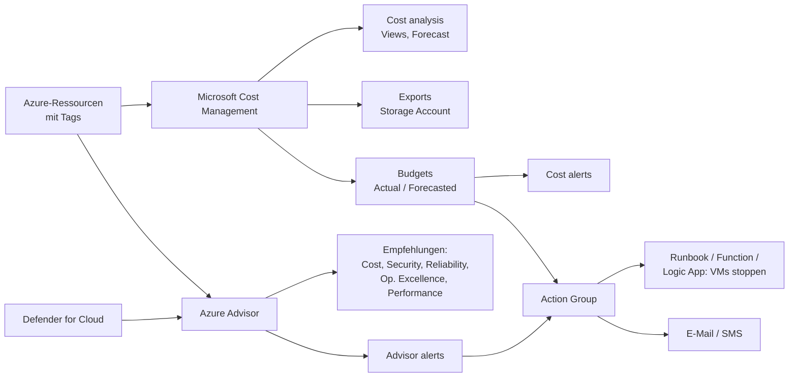

# 1.7 Kostenverwaltung und Azure Advisor

> **Domäne:** Manage Azure identities and governance · **Gewichtung:** 20–25 %
> **Study-Guide-Punkte:** *Manage costs by using alerts, budgets, and Azure Advisor recommendations*
> **Stand:** November 2026

## Lernziele

Nach diesem Kapitel kann ich …

- Kosten mit **Cost analysis** auswerten (Views, Gruppierung nach Tags/Resource Group/Service, Forecast) und regelmäßig **exportieren**.
- **Budgets** auf dem passenden Scope anlegen, Schwellen für **Actual** und **Forecasted** Kosten definieren und mit **Action Groups** verknüpfen.
- die Arten von **Cost alerts** unterscheiden (Budget, Credit, Department spending quota, Anomaly).
- die passenden **Rollen** für Kostenzugriff vergeben (*Cost Management Reader/Contributor*, Billing-Rollen).
- **Azure Advisor**-Empfehlungen in allen fünf Kategorien interpretieren, aufschieben/verwerfen und Advisor konfigurieren.
- die wichtigsten **Kostenoptimierungshebel** (Reservations, Savings Plans, Azure Hybrid Benefit, Spot VMs, Rightsizing, Auto-shutdown) zuordnen.

## Überblick

Azure wird überwiegend **verbrauchsbasiert** abgerechnet (*pay-as-you-go*). Ohne Kontrolle können Kosten schnell steigen – etwa durch vergessene Test-VMs, überdimensionierte SKUs oder hohen ausgehenden Datenverkehr.

**Microsoft Cost Management** (im Portal: *Cost Management + Billing*) ist das kostenlose Werkzeug, um Kosten zu **analysieren**, zu **budgetieren**, bei Überschreitungen zu **alarmieren** und Daten zu **exportieren**. Ergänzend liefert **Azure Advisor** personalisierte Empfehlungen – u. a. welche Ressourcen ungenutzt oder überdimensioniert sind.

Wichtig für die Prüfung: Budgets und Alerts **informieren** – sie **stoppen keine Ressourcen** automatisch. Automatische Reaktionen erfordern eine **Action Group** mit Runbook, Function oder Logic App.

## Kernkonzepte

### Kostenfaktoren

| Faktor | Beispiel |
|---|---|
| **Ressourcentyp & SKU** | VM-Größe, Storage-Tier (Hot/Cool/Archive), Premium vs. Standard |
| **Verbrauch** | Laufzeit (VM-Stunden), gespeicherte GB, Transaktionen |
| **Region** | Gleiche VM kostet in unterschiedlichen Regionen unterschiedlich viel |
| **Bandbreite** | **Eingehender** Datenverkehr (*ingress*) ist i. d. R. kostenlos, **ausgehender** (*egress*) und regionsübergreifender Verkehr kostet |
| **Abrechnungsmodell** | Pay-as-you-go, Reservations, Savings Plans, Spot |
| **Lizenzen** | Windows/SQL-Lizenz im VM-Preis enthalten – oder eigene Lizenz via Azure Hybrid Benefit |

Hinweis: Eine **gestoppte, aber nicht freigegebene** VM (*Stopped*) verursacht weiter Compute-Kosten; erst **Stopped (deallocated)** beendet die Compute-Abrechnung. Datenträger und statische Public IPs kosten weiterhin (→ [3.2](../03-compute/02-virtuelle-maschinen.md)).

### Scopes in Cost Management

Kosten werden immer für einen **Scope** betrachtet:

- **Azure-RBAC-Scopes:** Management Group → Subscription → Resource Group (→ [1.6](06-ressourcengruppen-abonnements-verwaltungsgruppen.md))
- **Billing-Scopes** (abhängig vom Vertragstyp): z. B. *Billing account*, *Department*, *Enrollment account* (EA) bzw. *Billing account*, *Billing profile*, *Invoice section* (Microsoft Customer Agreement, MCA)

### Cost analysis

- Interaktive Auswertung der tatsächlichen (*actual*) und **amortisierten** (*amortized*, Reservierungskosten auf Nutzungszeitraum verteilt) Kosten.
- **Gruppieren und Filtern** nach *Resource group*, *Service name*, *Location*, *Meter*, **Tag** (→ [1.5](05-ressourcensperren-und-tags.md)) u. v. m.
- **Built-in views:** z. B. *Accumulated costs*, *Daily costs*, *Cost by service*, *Cost by resource*, *Invoice details*. Eigene Ansichten lassen sich speichern, teilen und an ein Dashboard anheften.
- **Forecast:** Prognose der Kosten bis zum Ende des Zeitraums auf Basis des bisherigen Verbrauchs.
- Daten werden mit Verzögerung bereitgestellt (typischerweise innerhalb von 8–24 Stunden).
- **Download** als CSV/Excel/PNG.

### Exports

- Geplante, automatische Exporte der Kostendaten als CSV (oder Parquet) in ein **Storage Account** (Blob-Container).
- Frequenz: z. B. **täglich** (Month-to-date), **wöchentlich**, **monatlich** oder einmalig.
- Einsatz: Weiterverarbeitung in Power BI, Archivierung, eigene Reports.

### Budgets

Ein **Budget** definiert einen Kostenbetrag für einen Scope und Zeitraum und löst bei Erreichen von Schwellen Benachrichtigungen aus.

| Einstellung | Bedeutung |
|---|---|
| **Scope** | Management Group, Subscription, Resource Group oder Billing-Scope |
| **Filter** | optional: z. B. nur bestimmte Resource Groups, Services oder **Tags** |
| **Reset period** | *Monthly*, *Quarterly*, *Annually* (bei bestimmten Vertragstypen auch *Billing month/quarter/year*) |
| **Creation / Expiration date** | Start- und Enddatum des Budgets |
| **Amount** | Budgetbetrag in der Abrechnungswährung |
| **Alert conditions** | Typ **Actual** (tatsächliche Kosten) oder **Forecasted** (prognostiziert) + **% of budget** |
| **Alert recipients** | E-Mail-Adressen |
| **Action group** | Azure Monitor Action Group (E-Mail, SMS, Webhook, Runbook, Function, Logic App, ITSM …) |

- Budgets **evaluieren** Kosten regelmäßig (ca. alle 24 Stunden, abhängig von der Datenaktualisierung) – es gibt **keine Echtzeit-Überwachung**.
- ⚠️ Ein Budget **stoppt oder löscht keine Ressourcen**. Automatische Maßnahmen (z. B. VMs herunterfahren) nur über eine **Action Group** mit **Automation Runbook**, **Azure Function** oder **Logic App**.
- ⚠️ **Action Groups** können an Budgets nur auf **Subscription-** und **Resource-Group-Scope** gebunden werden.
- Budgets können auch als **Usage-Budget** (Mengen statt Kosten) definiert werden – selten prüfungsrelevant.

### Cost alerts

Übersicht unter **Cost Management > Cost alerts**:

| Alert-Typ | Auslöser | Verfügbarkeit |
|---|---|---|
| **Budget alerts** | Budget-Schwelle (Actual oder Forecasted) erreicht | alle Scopes mit Budget |
| **Credit alerts** | Azure-Prepayment/Credit (z. B. EA Monetary Commitment) zu einem Anteil verbraucht | Enterprise Agreement |
| **Department spending quota alerts** | Abteilungsquote erreicht | Enterprise Agreement |
| **Anomaly alerts** | Ungewöhnliche Kostenabweichung (ML-basierte Erkennung) | Subscription-Scope (*Cost alerts > + Add > Anomaly alert*) |

Zusätzlich gibt es **Scheduled alerts** (geplante E-Mails mit einer gespeicherten Cost-analysis-Ansicht).

### Rollen für Kostenzugriff

| Rolle | Rechte |
|---|---|
| **Cost Management Reader** | Kostendaten, Budgets und Konfiguration **anzeigen** |
| **Cost Management Contributor** | Kosten anzeigen, **Budgets und Exports verwalten**, Empfehlungen ansehen |
| **Reader / Contributor / Owner** (Azure RBAC) | sehen ebenfalls Kosten auf ihrem Scope; Contributor/Owner dürfen Budgets anlegen |
| **Billing Reader** | Rechnungen und Abrechnungsdaten (Billing) lesen |
| **Billing-Rollen EA** | *Enterprise Administrator*, *Department Administrator*, *Account Owner* |
| **Billing-Rollen MCA** | *Billing account owner/contributor/reader*, *Billing profile owner …*, *Invoice section owner …* |

Hinweis EA: Damit Abteilungs-/Kontoverantwortliche Kosten sehen, müssen in der EA-Konfiguration **„DA view charges“** bzw. **„AO view charges“** aktiviert sein.
Mehr zu RBAC → [1.3](03-rbac-zugriffsverwaltung.md).

### Azure Advisor

**Azure Advisor** analysiert Konfiguration und Nutzungsdaten und gibt kostenlose, personalisierte Empfehlungen in **fünf Kategorien** (angelehnt an das *Well-Architected Framework*):

| Kategorie | Beispiel-Empfehlungen |
|---|---|
| **Cost** | Unterausgelastete VMs verkleinern/herunterfahren, Reservations oder Savings Plans kaufen, ungenutzte Public IPs/Disks löschen |
| **Security** | Integration mit **Microsoft Defender for Cloud** – z. B. MFA, offene Management-Ports, fehlende Verschlüsselung |
| **Reliability** (früher *High Availability*) | Availability Zones/Sets nutzen, Backup aktivieren, Soft delete für Blobs |
| **Operational excellence** | Service-Health-Alerts anlegen, Ressourcenlimits/Quotas, veraltete Konfigurationen |
| **Performance** | Premium-Storage, Größenanpassung, Accelerated Networking |

Funktionen:

- **Advisor Score:** Prozentwert (gesamt und je Kategorie), wie gut die Umgebung den Best Practices folgt.
- **Postpone** (aufschieben für einen Zeitraum) oder **Dismiss** (dauerhaft verwerfen) einzelner Empfehlungen.
- **Configuration:** Abonnements/Resource Groups ausschließen; **VM/VMSS-Rightsizing-Regel** anpassen – CPU-Schwelle (z. B. 5 %, 10 %, 15 %, 20 % oder 100 %; Standard **5 %**) und Betrachtungszeitraum (*lookback period*, z. B. 7–90 Tage).
- **Advisor alerts:** Benachrichtigung bei neuen Empfehlungen (technisch ein Activity-Log-Alert, der eine **Action Group** auslöst → [5.2](../05-monitoring-und-wartung/02-warnungen-und-aktionsgruppen.md)).
- **Recommendation digests:** regelmäßige Zusammenfassung per E-Mail/Action Group.
- Download der Empfehlungen als CSV/PDF.
- Advisor ist **kostenlos**; Empfehlungen werden in regelmäßigen Abständen aktualisiert (bei Kostenempfehlungen kann das bis zu ca. einem Tag dauern).

### Kostenoptimierungshebel

| Hebel | Beschreibung | Typische Ersparnis* |
|---|---|---|
| **Azure Reservations** | Zusage für eine bestimmte Ressource/SKU/Region für **1 oder 3 Jahre** (VMs, SQL, Cosmos DB, Storage …) | bis ca. 72 % |
| **Azure Savings Plan for compute** | Zusage eines festen **Stundenbetrags** für Compute über 1 oder 3 Jahre – flexibel über VM-Größen/Regionen | bis ca. 65 % |
| **Azure Hybrid Benefit** | Vorhandene **Windows-Server- und SQL-Server-Lizenzen mit Software Assurance** (oder Subscriptions, z. B. RHEL/SLES) in Azure nutzen | Lizenzanteil entfällt |
| **Spot VMs** | Ungenutzte Kapazität zu stark reduziertem Preis; können jederzeit **entzogen (evicted)** werden | bis ca. 90 % |
| **Rightsizing** | Überdimensionierte Ressourcen verkleinern (Advisor-Empfehlung) | variabel |
| **Auto-shutdown / Start/Stop** | VMs außerhalb der Arbeitszeit herunterfahren (VM > *Auto-shutdown*, *Start/Stop VMs v2*) | variabel |
| **Dev/Test-Preise** | Vergünstigte Tarife für Entwicklungs-/Testabonnements (Visual Studio Subscriber) | variabel |
| **Ungenutzte Ressourcen löschen** | verwaiste Disks, Public IPs, NICs, Snapshots | variabel |
| **Storage-Tiers & Lifecycle** | Daten automatisch nach Cool/Cold/Archive verschieben (→ [2.3](../02-speicher/03-blob-storage.md)) | variabel |

\* Herstellerangaben „bis zu“; konkrete Werte hängen von SKU, Region und Laufzeit ab.

### Pricing Calculator vs. TCO Calculator

| Tool | Frage | Ergebnis |
|---|---|---|
| **Pricing Calculator** | „Was kostet **diese Azure-Konfiguration**?“ | Monatliche Kostenschätzung für ausgewählte Azure-Dienste |
| **TCO Calculator** | „Was spare ich bei **Migration von On-Premises** nach Azure?“ | Vergleich der Gesamtbetriebskosten (Server, Storage, Netzwerk, Strom, IT-Personal) über mehrere Jahre |

## Zusammenhänge



- **Tags** ([1.5](05-ressourcensperren-und-tags.md)) sind die Grundlage für Kostenzuordnung (*Showback/Chargeback*) – z. B. nach `CostCenter` gruppieren oder ein Budget per Tag-Filter definieren. Ohne Tags fehlt diese Sicht; **Azure Policy** ([1.4](04-azure-policy.md)) kann Tags erzwingen oder vererben.
- **Scopes** ([1.6](06-ressourcengruppen-abonnements-verwaltungsgruppen.md)): Budgets und Kostenauswertungen funktionieren auf Management Group, Subscription und Resource Group.
- **Action Groups** ([5.2](../05-monitoring-und-wartung/02-warnungen-und-aktionsgruppen.md)) werden von Budgets und Advisor alerts genutzt – dieselben Action Groups wie bei Azure Monitor.
- **RBAC** ([1.3](03-rbac-zugriffsverwaltung.md)): Kostenrollen (*Cost Management Reader/Contributor*) folgen dem normalen RBAC-Modell.
- **Compute** ([3.2](../03-compute/02-virtuelle-maschinen.md), [3.4](../03-compute/04-verfuegbarkeit-und-scale-sets.md)): VM-Größe, Deallocation, Spot und Reservations sind die größten Kostenhebel.
- **Speicher** ([2.1](../02-speicher/01-speicherkonten-und-redundanz.md)): Redundanz (LRS/GRS) und Access Tiers beeinflussen die Kosten direkt.

## Vergleichstabellen

### Budget vs. Cost alert vs. Advisor alert vs. Azure Policy

| Werkzeug | Zweck | Verhindert Kosten aktiv? |
|---|---|---|
| **Budget** | Schwellenbasierte Benachrichtigung zum Kostenbetrag | ❌ (nur über Action Group + Automation) |
| **Anomaly alert** | Ungewöhnliche Kostenspitzen erkennen | ❌ |
| **Advisor alert** | Neue Empfehlung verfügbar | ❌ |
| **Azure Policy** (z. B. *Allowed virtual machine size SKUs*, *Allowed locations*) | Teure Konfigurationen **von vornherein verbieten** | ✅ (*Deny*) |
| **Resource Lock** | Löschen/Ändern verhindern | ❌ (kein Kostenwerkzeug) |

### Reservations vs. Savings Plan vs. Spot

| Kriterium | Reservation | Savings Plan | Spot VM |
|---|---|---|---|
| Bindung | 1/3 Jahre, konkrete SKU-Familie + Region | 1/3 Jahre, Stundenbetrag | keine |
| Flexibilität | gering (Austausch/Rückgabe eingeschränkt möglich) | hoch (Größe, Region, Dienst) | hoch |
| Unterbrechung möglich | nein | nein | **ja (Eviction)** |
| Ideal für | stabile, vorhersehbare Workloads | wechselnde Compute-Workloads | Batch, Tests, unterbrechbare Jobs |

### Actual vs. Forecasted Budget-Schwelle

| Typ | Löst aus, wenn … | Nutzen |
|---|---|---|
| **Actual** | die bereits angefallenen Kosten den Prozentsatz erreichen | Bestätigt Überschreitung |
| **Forecasted** | die **prognostizierten** Kosten bis Periodenende den Prozentsatz erreichen | **Frühwarnung**, bevor das Geld ausgegeben ist |

## Azure Portal

| Aufgabe | Pfad |
|---|---|
| Kostenübersicht | **Portal > Cost Management + Billing > Cost Management > Overview** |
| Kostenanalyse | **Portal > Cost Management > Cost analysis** (Scope oben wählen) |
| Kostenanalyse einer Resource Group | **Portal > Resource groups > RG > Cost Management > Cost analysis** |
| Budget anlegen | **Portal > Cost Management > Budgets > + Add** (oder **Subscription > Budgets**) |
| Cost alerts / Anomaly alert | **Portal > Cost Management > Cost alerts > + Add** |
| Export einrichten | **Portal > Cost Management > Exports > + Create** |
| Scope wechseln | **Cost Management > Scope** (Management Group / Subscription / RG / Billing) |
| Rechnungen | **Portal > Cost Management + Billing > Billing scopes > … > Invoices** |
| Reservations kaufen/verwalten | **Portal > Reservations > + Add** |
| Savings Plans | **Portal > Savings plans > + Add** |
| Azure Hybrid Benefit an VM | **Portal > Virtual machines > VM > Configuration > Licensing** (*Azure Hybrid Benefit*) |
| Auto-shutdown | **Portal > Virtual machines > VM > Operations > Auto-shutdown** |
| Advisor-Übersicht / Score | **Portal > Advisor > Overview** bzw. **Advisor > Advisor score** |
| Kostenempfehlungen | **Portal > Advisor > Recommendations > Cost** |
| Empfehlung aufschieben/verwerfen | **… > Recommendations > Empfehlung > Postpone / Dismiss** |
| Advisor konfigurieren (CPU-Schwelle, Ausschlüsse) | **Portal > Advisor > Configuration > Rules / Resources** |
| Advisor alerts | **Portal > Advisor > Alerts > + New Advisor Alert** |
| Kostenrollen zuweisen | **Scope > Access control (IAM) > Add role assignment > Cost Management Reader/Contributor** |

**Felder beim Anlegen eines Budgets:**

1. **Create a budget:** Scope, *Filters* (optional), *Budget scoping*, **Name**, **Reset period**, **Creation date**, **Expiration date**, **Amount** (mit Vorschlag basierend auf historischen Kosten/Forecast)
2. **Set alerts:** *Alert conditions* (Type: **Actual/Forecasted**, % of budget, **Action group**), **Alert recipients (email)**, Sprache

## Azure CLI & PowerShell

### Azure CLI

```bash
# Monatliches Kostenbudget (500 €) für eine Subscription anlegen
az consumption budget create \
  --budget-name "budget-contoso-prod" \
  --amount 500 \
  --category cost \
  --time-grain monthly \
  --start-date 2026-12-01 \
  --end-date 2027-11-30

# Budget für eine Resource Group
az consumption budget create \
  --budget-name "budget-rg-dev" \
  --resource-group <resource-group> \
  --amount 100 --category cost --time-grain monthly \
  --start-date 2026-12-01 --end-date 2027-11-30

# Budgets anzeigen / löschen
az consumption budget list -o table
az consumption budget delete --budget-name "budget-rg-dev" --resource-group <resource-group>

# Verbrauchsdaten abrufen
az consumption usage list --start-date 2026-11-01 --end-date 2026-11-23 -o table

# Advisor-Empfehlungen der Kategorie Cost
az advisor recommendation list --category Cost -o table

# Empfehlung aufschieben bzw. verwerfen
az advisor recommendation disable --ids <recommendation-id> --days 30   # postpone
az advisor recommendation disable --ids <recommendation-id>             # dismiss

# Advisor-Konfiguration: CPU-Schwelle für Rightsizing (5/10/15/20/100)
az advisor configuration update --low-cpu-threshold 10

# Täglichen Kostenexport in ein Storage Account (Extension "costmanagement")
az costmanagement export create \
  --name "daily-export" \
  --scope "/subscriptions/<subscription-id>" \
  --storage-account-id <storage-account-resource-id> \
  --storage-container "cost-exports" \
  --timeframe MonthToDate \
  --recurrence Daily \
  --recurrence-period from="2026-12-01T00:00:00" to="2027-11-30T00:00:00" \
  --schedule-status Active \
  --storage-directory "contoso"
```

### Azure PowerShell

```powershell
# Budget mit E-Mail-Benachrichtigung bei 80 % anlegen
New-AzConsumptionBudget -Name "budget-contoso-prod" `
  -Amount 500 -Category Cost -TimeGrain Monthly `
  -StartDate 2026-12-01 -EndDate 2027-11-30 `
  -ContactEmail "finance@contoso.com" `
  -NotificationKey "Actual80" -NotificationThreshold 80 -NotificationEnabled

# Budget für eine Resource Group
New-AzConsumptionBudget -Name "budget-rg-dev" -ResourceGroupName "<resource-group>" `
  -Amount 100 -Category Cost -TimeGrain Monthly `
  -StartDate 2026-12-01 -EndDate 2027-11-30

# Budgets anzeigen / ändern / löschen
Get-AzConsumptionBudget
Set-AzConsumptionBudget -Name "budget-contoso-prod" -Amount 600
Remove-AzConsumptionBudget -Name "budget-rg-dev" -ResourceGroupName "<resource-group>"

# Advisor-Empfehlungen (Kategorie Cost)
Get-AzAdvisorRecommendation -Category Cost |
  Select-Object ImpactedField, ImpactedValue, Impact, ShortDescriptionSolution

# Empfehlung aufschieben (30 Tage) bzw. Advisor-Regel anpassen
Disable-AzAdvisorRecommendation -RecommendationId "<recommendation-id>" -Day 30
Set-AzAdvisorConfiguration -LowCpuThreshold 10
```

| Ziel | CLI | PowerShell |
|---|---|---|
| Budget anlegen | `az consumption budget create` | `New-AzConsumptionBudget` |
| Budgets anzeigen | `az consumption budget list` | `Get-AzConsumptionBudget` |
| Advisor-Empfehlungen | `az advisor recommendation list` | `Get-AzAdvisorRecommendation` |
| Advisor-Konfiguration | `az advisor configuration update` | `Set-AzAdvisorConfiguration` |
| Kostenexport | `az costmanagement export create` | `New-AzCostManagementExport` |

## Praxisbeispiel

**Szenario:** *Contoso* betreibt eine Subscription `sub-contoso-dev` für Entwicklungsteams. Im letzten Monat wurden die geplanten Kosten um 40 % überschritten, weil Test-VMs über das Wochenende liefen. Anforderungen:

1. Die Finanzabteilung soll Kosten sehen, aber nichts ändern können.
2. Bei 80 % des Monatsbudgets (2.000 €) soll das Team **vorab** gewarnt werden; bei 100 % sollen alle VMs der Resource Group `rg-dev-test` automatisch heruntergefahren werden.
3. Kosten sollen je Kostenstelle auswertbar sein und täglich in ein Storage Account exportiert werden.
4. Überdimensionierte VMs sollen identifiziert werden.

**Umsetzung:**

1. **Rollen:** Auf `sub-contoso-dev` > *Access control (IAM)* > **Cost Management Reader** an die Gruppe `SG-Finance` ([1.3](03-rbac-zugriffsverwaltung.md)).
2. **Action Group:** `ag-dev-shutdown` mit Aktion **Automation Runbook** (Runbook: *Stop-AzVM* für alle VMs in `rg-dev-test`) und E-Mail an das Dev-Team ([5.2](../05-monitoring-und-wartung/02-warnungen-und-aktionsgruppen.md)).
3. **Budget:** *Cost Management > Budgets > + Add*, Scope `rg-dev-test`, Reset period **Monthly**, Amount **2.000**.
   - Alert condition 1: **Forecasted**, **80 %** → E-Mail an das Team
   - Alert condition 2: **Actual**, **100 %** → Action Group `ag-dev-shutdown`
4. **Tags:** Policy *Require a tag on resources* bzw. *Inherit a tag from the resource group* für `CostCenter` ([1.4](04-azure-policy.md), [1.5](05-ressourcensperren-und-tags.md)). In **Cost analysis** → *Group by: Tag > CostCenter* → als View „Kosten je Kostenstelle“ speichern.
5. **Export:** *Cost Management > Exports > + Create* → *Daily export of month-to-date costs* → Storage Account `stcontosocost`, Container `exports`.
6. **Advisor:** *Advisor > Configuration > Rules* → CPU-Schwelle **10 %**, Lookback **14 Tage**; unter *Recommendations > Cost* die Rightsizing-Empfehlungen prüfen. Zusätzlich **Auto-shutdown** um 19:00 Uhr an allen Dev-VMs aktivieren.

## Limits & wichtige Zahlen

| Wert | Grenze / Standard |
|---|---|
| Budget-Evaluierung | ca. alle **24 Stunden** (keine Echtzeit) |
| Datenverzögerung Cost analysis | typischerweise **8–24 Stunden** |
| Action Groups an Budgets | nur **Subscription** und **Resource Group** |
| Budget Reset period | Monthly, Quarterly, Annually (+ Billing month/quarter/year je nach Vertrag) |
| Advisor CPU-Schwelle Rightsizing | 5 %, 10 %, 15 %, 20 %, 100 % – Standard **5 %** |
| Reservations / Savings Plans Laufzeit | **1 oder 3 Jahre** |
| Ersparnis (Herstellerangabe „bis zu“) | Reservations ~72 %, Savings Plan ~65 %, Spot ~90 % |
| Cost Management / Advisor | **kostenlos** für Azure-Ressourcen |
| Datenverkehr | Ingress meist kostenlos, **Egress kostenpflichtig** |

## Prüfungstipps & Fallstricke

- ⚠️ **„Ressourcen automatisch stoppen, wenn das Budget erreicht ist“** → Budget **+ Action Group** mit Runbook/Function/Logic App. Ein Budget allein stoppt nichts.
- ⚠️ **„Warnung, bevor das Budget überschritten wird“** → Alert condition vom Typ **Forecasted**.
- ⚠️ **Action Group an ein Budget auf Management-Group-Ebene** → nicht unterstützt (nur Subscription/RG).
- **„Teure VM-Größen verhindern“** → **Azure Policy** (*Allowed virtual machine size SKUs*), nicht Budget.
- **„Kosten je Abteilung/Projekt auswerten“** → **Tags** + *Cost analysis > Group by Tag*.
- **„Kosten nur sehen, nichts ändern“** → **Cost Management Reader** (bzw. Reader). **„Budgets verwalten, aber keine Ressourcen“** → **Cost Management Contributor**.
- **„Unterausgelastete VMs finden“** → **Azure Advisor > Cost**. **„Advisor soll VMs erst unter 10 % CPU melden“** → *Advisor > Configuration*.
- **„Benachrichtigung bei neuen Advisor-Empfehlungen“** → **Advisor alert** mit Action Group.
- **„Kosten einer geplanten Azure-Umgebung schätzen“** → **Pricing Calculator**; **„Einsparung durch Migration aus dem Rechenzentrum“** → **TCO Calculator**.
- **Vorhandene Windows-/SQL-Lizenzen mit Software Assurance** → **Azure Hybrid Benefit**.
- **Stabile 24/7-Workload für 3 Jahre** → **Reservation**; **wechselnde VM-Größen/Regionen** → **Savings Plan**; **unterbrechbarer Batch-Job** → **Spot VM**.
- **VM gestoppt, Kosten laufen weiter** → nur *Stopped* statt *Stopped (deallocated)*; Disks kosten immer.
- **Ungewöhnliche Kostenspitze automatisch erkennen** → **Anomaly alert**.
- **Credit alerts / Department spending quota alerts** gibt es nur bei **Enterprise Agreement**.

## Selbsttest

**1.** Sie erstellen ein Budget von 1.000 € für eine Subscription mit einer Benachrichtigung bei 100 %. Die Kosten erreichen 1.050 €. Was passiert mit den laufenden VMs?

<details><summary>Lösung</summary>

**Nichts.** Budgets senden nur Benachrichtigungen. Um VMs zu stoppen, muss eine **Action Group** mit z. B. einem Automation Runbook an die Alert condition gebunden sein.
</details>

**2.** Das Management möchte informiert werden, **bevor** die Monatskosten das Budget überschreiten. Welche Einstellung wählen Sie?

<details><summary>Lösung</summary>

Eine Alert condition vom Typ **Forecasted** (z. B. 100 % oder 90 %). Sie löst aus, sobald die Prognose bis Periodenende die Schwelle erreicht.
</details>

**3.** Sie wollen ein Budget auf Ebene einer **Management Group** anlegen und bei Überschreitung eine Action Group auslösen. Funktioniert das?

<details><summary>Lösung</summary>

Das Budget selbst ja (E-Mail-Benachrichtigungen), aber **Action Groups** werden nur für Budgets auf **Subscription-** und **Resource-Group-Scope** unterstützt.
</details>

**4.** Ein Controller soll Kosten aller Resource Groups einer Subscription analysieren und Budgets anlegen dürfen, aber keine Ressourcen verändern. Welche Rolle ist minimal ausreichend?

<details><summary>Lösung</summary>

**Cost Management Contributor** auf der Subscription.
</details>

**5.** Sie möchten Kosten nach Kostenstellen aufschlüsseln. Welche Voraussetzung muss erfüllt sein, und wo werten Sie aus?

<details><summary>Lösung</summary>

Ressourcen müssen mit einem **Tag** (z. B. `CostCenter`) versehen sein – ideal per Azure Policy erzwungen/vererbt. Auswertung in **Cost analysis > Group by > Tag**.
</details>

**6.** Azure Advisor empfiehlt das Verkleinern einer VM mit 8 % durchschnittlicher CPU-Last nicht. Sie möchten, dass VMs unter 10 % CPU gemeldet werden. Was tun Sie?

<details><summary>Lösung</summary>

In **Advisor > Configuration > Rules** die CPU-Schwelle für *Right-size or shutdown underutilized VMs* auf **10 %** setzen (Standard: 5 %).
</details>

**7.** Ihr Unternehmen besitzt Windows-Server-Lizenzen mit Software Assurance und migriert 50 VMs nach Azure. Wie senken Sie die Kosten am einfachsten?

<details><summary>Lösung</summary>

**Azure Hybrid Benefit** aktivieren – der Windows-Lizenzanteil im VM-Preis entfällt. Für dauerhaft laufende VMs zusätzlich **Reservations** oder einen **Savings Plan** erwägen.
</details>

**8.** Welches Tool beantwortet die Frage: „Wie viel sparen wir in 5 Jahren, wenn wir unser Rechenzentrum nach Azure migrieren?“

<details><summary>Lösung</summary>

Der **TCO Calculator** (Total Cost of Ownership). Der Pricing Calculator schätzt nur die Kosten einer Azure-Konfiguration.
</details>

**9.** Ein Rendering-Job läuft nachts, darf unterbrochen werden und soll so günstig wie möglich sein. Welche Option?

<details><summary>Lösung</summary>

**Spot VMs** (bzw. Spot-Instanzen in einem Scale Set) – stark vergünstigt, können aber jederzeit entzogen werden.
</details>

**10.** Die Finanzabteilung möchte täglich aktuelle Kostendaten in Power BI weiterverarbeiten. Was richten Sie ein?

<details><summary>Lösung</summary>

Einen **Export** in Cost Management (*Daily export of month-to-date costs*) in ein **Storage Account**; Power BI liest die Dateien aus dem Container (alternativ Power-BI-Connector für Cost Management).
</details>

## Weiterführende Links

- [AZ-104 Study Guide](https://learn.microsoft.com/credentials/certifications/resources/study-guides/az-104)
- [What is Microsoft Cost Management?](https://learn.microsoft.com/azure/cost-management-billing/costs/overview-cost-management)
- [Quickstart: Explore and analyze costs with cost analysis](https://learn.microsoft.com/azure/cost-management-billing/costs/quick-acm-cost-analysis)
- [Tutorial: Create and manage budgets](https://learn.microsoft.com/azure/cost-management-billing/costs/tutorial-acm-create-budgets)
- [Manage costs with budgets (Action Groups / Automation)](https://learn.microsoft.com/azure/cost-management-billing/manage/cost-management-budget-scenario)
- [Use cost alerts to monitor usage and spending](https://learn.microsoft.com/azure/cost-management-billing/costs/cost-mgt-alerts-monitor-usage-spending)
- [Identify anomalies and unexpected changes in cost](https://learn.microsoft.com/azure/cost-management-billing/understand/analyze-unexpected-charges)
- [Tutorial: Create and manage exported data](https://learn.microsoft.com/azure/cost-management-billing/costs/tutorial-improved-exports)
- [Assign access to Cost Management data](https://learn.microsoft.com/azure/cost-management-billing/costs/assign-access-acm-data)
- [Introduction to Azure Advisor](https://learn.microsoft.com/azure/advisor/advisor-overview)
- [Configure Azure Advisor](https://learn.microsoft.com/azure/advisor/advisor-get-started)
- [Reduce service costs by using Azure Advisor](https://learn.microsoft.com/azure/advisor/advisor-reference-cost-recommendations)
- [Create Azure Advisor alerts](https://learn.microsoft.com/azure/advisor/advisor-alerts-portal)
- [Optimize costs with Azure Advisor score](https://learn.microsoft.com/azure/advisor/azure-advisor-score)
- [What are Azure Reservations?](https://learn.microsoft.com/azure/cost-management-billing/reservations/save-compute-costs-reservations)
- [What is Azure savings plans for compute?](https://learn.microsoft.com/azure/cost-management-billing/savings-plan/savings-plan-compute-overview)
- [Azure Hybrid Benefit for Windows Server](https://learn.microsoft.com/azure/virtual-machines/windows/hybrid-use-benefit-licensing)
- [Azure Spot Virtual Machines](https://learn.microsoft.com/azure/virtual-machines/spot-vms)
- Learn-Modul: [Manage identities and governance in Azure](https://learn.microsoft.com/training/paths/az-104-manage-identities-governance/)
