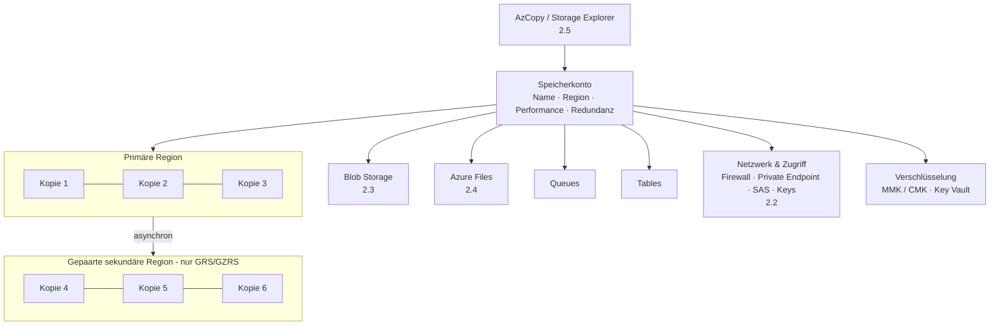

# 2.1 Speicherkonten und Redundanz

> **Domäne:** Implement and manage storage · **Gewichtung:** 15–20 %
> **Study-Guide-Punkte:** *Create and configure storage accounts* · *Configure Azure Storage redundancy*
> (Zugriff & Sicherheit → [2.2](02-speicherzugriff-und-sicherheit.md) · Blob → [2.3](03-blob-storage.md) · Files → [2.4](04-azure-files.md) · AzCopy → [2.5](05-datenuebertragung-azcopy-und-storage-explorer.md))
> **Stand:** November 2026

## Lernziele

Nach diesem Kapitel kann ich …

- die **Speicherkontotypen** (Standard GPv2, Premium Block Blobs, Premium File Shares, Premium Page Blobs) unterscheiden und für ein Szenario den richtigen wählen.
- ein Speicherkonto im Portal, per Azure CLI und PowerShell anlegen und die wichtigsten Einstellungen der Erstellungs-Tabs erklären.
- die Redundanzoptionen **LRS, ZRS, GRS, RA-GRS, GZRS, RA-GZRS** nach Kopien, Ausfallszenario und Lesezugriff vergleichen.
- erklären, welche **Redundanzwechsel** direkt möglich sind und welche eine **Konvertierung** oder **Migration** erfordern.
- einen **kundenseitig ausgelösten Failover** durchführen und die Bedeutung der **Last Sync Time** einschätzen.
- benennen, welche Einstellungen **nach der Erstellung nicht mehr änderbar** sind.

## Überblick

Ein **Speicherkonto** (*Storage account*) ist der zentrale Container für alle Azure-Storage-Datendienste: **Blobs**, **Dateifreigaben** (Azure Files), **Queues** und **Tables**. Es stellt einen **global eindeutigen Namespace** bereit, über den die Daten per HTTP(S) erreichbar sind, z. B. `https://contosodata.blob.core.windows.net`.

Auf Ebene des Speicherkontos werden grundlegende Entscheidungen getroffen, die für alle enthaltenen Daten gelten: **Region**, **Performance** (Standard/Premium), **Redundanz** (wie viele Kopien wo), **Netzwerkzugriff**, **Verschlüsselung** und **Datenschutzfunktionen**. Einige davon lassen sich später nicht mehr ändern – deshalb ist die Planung beim Anlegen prüfungsrelevant.

Azure Storage speichert Daten **immer mehrfach**. Die Redundanzoption bestimmt, ob die Kopien in einem Rechenzentrum, über **Verfügbarkeitszonen** oder zusätzlich in einer **gepaarten sekundären Region** liegen – und damit, gegen welche Ausfälle die Daten geschützt sind.

## Kernkonzepte

### Speicherkontotypen (*Account kind*)

| Typ (Portal) | `--kind` / `-Kind` | Performance | Unterstützte Dienste | Redundanz | Einsatz |
|---|---|---|---|---|---|
| **Standard general-purpose v2** | `StorageV2` | Standard (HDD-basiert) | Blob (inkl. Data Lake Gen2), Files, Queue, Table | LRS, ZRS, GRS, RA-GRS, GZRS, RA-GZRS | **Standard für fast alle Szenarien** |
| **Premium block blobs** | `BlockBlobStorage` | Premium (SSD) | Block- und Append-Blobs | LRS, ZRS | hohe Transaktionsraten, kleine Objekte, niedrige Latenz (IoT, Analytics) |
| **Premium file shares** | `FileStorage` | Premium (SSD) | nur Azure Files (SMB & NFS) | LRS, ZRS | Unternehmens-Dateifreigaben mit hoher Leistung, **NFS-Freigaben** |
| **Premium page blobs** | `StorageV2` mit `Premium_LRS` | Premium (SSD) | nur Page Blobs | LRS | VHDs nicht verwalteter Datenträger |
| *Legacy:* General-purpose v1 | `Storage` | Standard/Premium | alle, aber ohne Access Tiers | eingeschränkt | nicht mehr verwenden → auf GPv2 **upgraden** |
| *Legacy:* Blob storage | `BlobStorage` | Standard | nur Blobs | | nicht mehr verwenden → auf GPv2 upgraden |

> Das Upgrade **GPv1/BlobStorage → GPv2** ist im Portal (*Configuration > Upgrade*) möglich, kostenlos und **nicht umkehrbar**. Danach gelten die GPv2-Preise (Transaktionen können teurer sein).

### Performance: Standard vs. Premium

- **Standard:** magnetische Datenträger (HDD), günstig pro GB, Abrechnung nach Kapazität + Transaktionen. Unterstützt alle Redundanzoptionen und **Access Tiers** (Hot/Cool/Cold/Archive).
- **Premium:** SSD, konsistent niedrige Latenz, höhere GB-Preise, aber günstigere Transaktionen. Nur **LRS** oder **ZRS**, keine Access Tiers.
- ⚠️ Die **Performance-Stufe ist nach der Erstellung nicht änderbar** – ein Wechsel erfordert ein neues Konto und das Kopieren der Daten (z. B. mit AzCopy, [2.5](05-datenuebertragung-azcopy-und-storage-explorer.md)).

### Datendienste im Speicherkonto

| Dienst | Beschreibung | Kapitel |
|---|---|---|
| **Blob Storage** | Objektspeicher für unstrukturierte Daten (Block, Append, Page Blobs), Container | [2.3](03-blob-storage.md) |
| **Azure Files** | Verwaltete Dateifreigaben über SMB, NFS und REST | [2.4](04-azure-files.md) |
| **Queue Storage** | Nachrichtenwarteschlangen (bis 64 KB pro Nachricht) für entkoppelte Anwendungen | – |
| **Table Storage** | NoSQL-Key-Value-Speicher für strukturierte, nicht-relationale Daten | – |
| **Data Lake Storage Gen2** | Blob Storage mit **hierarchischem Namespace** (Ordner, POSIX-ACLs) für Analytics | – |

### Name und Endpunkte

**Namensregeln:**

- **3–24 Zeichen**
- nur **Kleinbuchstaben und Ziffern** (keine Bindestriche, keine Großbuchstaben)
- **global eindeutig** in ganz Azure (Teil des DNS-Namens)

**Standard-Endpunkte** (*Standard endpoints*):

| Dienst | Endpunkt |
|---|---|
| Blob | `https://<konto>.blob.core.windows.net` |
| Data Lake Gen2 | `https://<konto>.dfs.core.windows.net` |
| Files | `https://<konto>.file.core.windows.net` |
| Queue | `https://<konto>.queue.core.windows.net` |
| Table | `https://<konto>.table.core.windows.net` |
| Static website | `https://<konto>.<zone>.web.core.windows.net` |

Bei RA-GRS/RA-GZRS gibt es zusätzlich **sekundäre Endpunkte** mit dem Suffix `-secondary`, z. B. `https://<konto>-secondary.blob.core.windows.net` (nur lesend).

Alternativ: **Azure DNS zone endpoints** (Endpunkt enthält eine DNS-Zonenkennung, für sehr viele Konten pro Abo) sowie eine **Custom domain** für Blob-Endpunkte.

### Redundanzoptionen

#### In der primären Region

- **LRS – Locally redundant storage:** **3 synchrone Kopien** in **einem Rechenzentrum** der primären Region. Schützt vor Server-/Rack-/Laufwerksausfällen, **nicht** vor dem Ausfall des Rechenzentrums. Günstigste Option. Haltbarkeit: mind. **11 Neunen** (99,999999999 %) pro Jahr.
- **ZRS – Zone-redundant storage:** **3 synchrone Kopien** verteilt auf **3 Verfügbarkeitszonen** der primären Region. Schützt vor dem Ausfall einer Zone; Lese- und Schreibzugriff bleiben bei einem Zonenausfall verfügbar. Haltbarkeit: mind. **12 Neunen**. Nur in Regionen mit Availability Zones.

#### Mit sekundärer Region

- **GRS – Geo-redundant storage:** LRS in der primären Region + **asynchrone** Replikation in die **gepaarte sekundäre Region**, dort ebenfalls **LRS** → insgesamt **6 Kopien**. Sekundäre Daten sind **nur nach einem Failover** lesbar.
- **RA-GRS – Read-access geo-redundant storage:** wie GRS, aber die sekundäre Region ist **jederzeit lesend** erreichbar (`-secondary`-Endpunkt).
- **GZRS – Geo-zone-redundant storage:** **ZRS** in der primären Region + asynchrone Replikation in die sekundäre Region (dort **LRS**) → 6 Kopien. Höchster Schutz: Zonenausfall **und** Regionsausfall.
- **RA-GZRS:** wie GZRS, zusätzlich **lesender Zugriff** auf die sekundäre Region.

Haltbarkeit der geo-redundanten Optionen: mind. **16 Neunen** pro Jahr.

> ⚠️ Die Geo-Replikation ist **asynchron**. Der **Recovery Point Objective (RPO)** liegt typischerweise bei unter 15 Minuten, ist aber **nicht garantiert** (außer mit dem optionalen Feature *Geo priority replication* für Blobs, sofern verfügbar). Daten, die nach der **Last Sync Time** geschrieben wurden, können bei einem ungeplanten Failover verloren gehen.

#### Unterstützung nach Kontotyp

| Kontotyp | LRS | ZRS | GRS / RA-GRS | GZRS / RA-GZRS |
|---|---|---|---|---|
| Standard GPv2 | ✅ | ✅ | ✅ | ✅ |
| Premium block blobs | ✅ | ✅ | ❌ | ❌ |
| Premium file shares | ✅ | ✅ | ❌ | ❌ |
| Premium page blobs | ✅ | ❌ | ❌ | ❌ |

Weitere Einschränkungen: Der **Archive**-Tier ([2.3](03-blob-storage.md)) wird nur bei **LRS, GRS und RA-GRS** unterstützt, nicht bei ZRS/GZRS/RA-GZRS. **Managed Disks** ([3.3](../03-compute/03-vm-datentraeger-und-verschluesselung.md)) haben ein eigenes Redundanzmodell (LRS/ZRS) und sind kein Teil eines Speicherkontos.

### Redundanz nachträglich ändern

Die Redundanz eines Standard-GPv2-Kontos ist **änderbar** – aber nicht jeder Wechsel funktioniert gleich:

| Art der Änderung | Beispiele | Methode |
|---|---|---|
| **Geo-Redundanz hinzufügen/entfernen** bzw. Lesezugriff umschalten | LRS ↔ GRS ↔ RA-GRS · ZRS ↔ GZRS ↔ RA-GZRS | **Direkte Änderung** der Kontokonfiguration (Portal *Redundancy*, `az storage account update --sku`). Beim Hinzufügen von Geo-Redundanz startet die initiale Synchronisation im Hintergrund. |
| **Zonenredundanz hinzufügen/entfernen** | LRS ↔ ZRS · GRS ↔ GZRS | **Konvertierung** (*customer-initiated conversion*) im Portal über *Redundancy* bzw. `az storage account migration start` – läuft asynchron, kann Stunden bis Tage dauern; alternativ **manuelle Migration** (neues Konto + Daten kopieren) |
| Zone **und** Geo gleichzeitig | z. B. LRS → GZRS | in **zwei Schritten** (z. B. LRS → GRS, dann GRS → GZRS) |

- Eine **manuelle Migration** ist u. a. nötig, wenn ein Feature die Konvertierung blockiert (z. B. Blobs im **Archive**-Tier beim Wechsel zu ZRS, eine laufende Failover-Situation oder nicht unterstützte Regionen).
- **Premium**-Konten: nur LRS ↔ ZRS (per Konvertierung, sofern für den Kontotyp unterstützt).
- Nach einem **ungeplanten Failover** ist das Konto LRS und muss bei Bedarf wieder auf GRS/RA-GRS umgestellt werden (erneute vollständige Replikation, kostet Egress).

### Failover

| Failover-Art | Auslöser | Ergebnis |
|---|---|---|
| **Customer-managed unplanned failover** | Kunde, wenn die primäre Region nicht verfügbar ist | Sekundäre Region wird primär; DNS-Einträge werden umgeschrieben. Das Konto ist danach **LRS** (bzw. bei GZRS in einer Region ohne Zonen ebenfalls lokal redundant). **Datenverlust** möglich (alles nach der Last Sync Time). |
| **Customer-managed planned failover** | Kunde, z. B. für DR-Tests oder Wartung, während beide Regionen verfügbar sind | Primär und sekundär **tauschen die Rollen**; **kein Datenverlust**, Geo-Redundanz bleibt erhalten. Anschließend Failback möglich. |
| **Microsoft-managed failover** | Microsoft bei einer schweren regionalen Katastrophe | Wird nur in Ausnahmefällen durchgeführt – **nicht** darauf verlassen, eigene Failover-Planung machen. |

- Voraussetzung: Konto mit **GRS, RA-GRS, GZRS oder RA-GZRS**.
- **Last Sync Time (LST):** Zeitpunkt, bis zu dem alle Schreibvorgänge garantiert in der sekundären Region angekommen sind. Vor einem ungeplanten Failover prüfen (*Redundancy*-Blade oder `geoReplicationStats`).
- Für **Lesezugriff** im Störfall reicht RA-GRS/RA-GZRS – dafür ist **kein Failover** nötig. Für **Schreibzugriff** ist ein Failover nötig.

### Hierarchischer Namespace (Data Lake Storage Gen2)

- Aktiviert Ordner-Semantik (atomare Umbenennung/Löschung von Verzeichnissen) und **POSIX-ähnliche ACLs**.
- Voraussetzung für **SFTP** und **NFS v3** auf Blob Storage.
- Wird bei der Erstellung im Tab **Advanced** aktiviert. Ein bestehendes Konto kann **einmalig upgegradet** werden (*Data Lake Gen2 upgrade*), ⚠️ das ist **nicht umkehrbar**; einige Blob-Features werden dabei ggf. nicht unterstützt.

### Access Tier auf Kontoebene

- **Default access tier** eines GPv2-Kontos: **Hot** (Standard) oder **Cool** (je nach Region/API auch **Cold**).
- Gilt für alle Blobs **ohne explizit gesetzten Tier** (*inferred*). **Archive** kann **nicht** als Kontostandard gesetzt werden – nur pro Blob.
- Eine Änderung des Kontostandards kann Kosten auslösen (Tier-Wechsel aller „inferred"-Blobs). Details → [2.3](03-blob-storage.md).

### Erstellungs-Tabs im Portal

| Tab | Wichtige Einstellungen |
|---|---|
| **Basics** | Subscription, Resource group, **Storage account name**, **Region**, *Primary service* (Hilfe zur Vorauswahl), **Performance** (Standard/Premium), bei Premium **Premium account type**, **Redundancy**, *Make read access to data available in the event of regional unavailability* (= RA-…) |
| **Advanced** | *Require secure transfer for REST API operations* (HTTPS), *Allow enabling anonymous access on individual containers*, *Enable storage account key access*, *Default to Microsoft Entra authorization in the Azure portal*, *Minimum TLS version*, *Permitted scope for copy operations*, **Hierarchical namespace**, *SFTP*, *NFS v3*, *Allow cross-tenant replication*, **Access tier** (Hot/Cool), *Large file shares* |
| **Networking** | *Network access*: öffentlicher Zugriff von allen Netzwerken / ausgewählten VNets und IPs / deaktiviert (+ Private Endpoint), *Routing preference* (Microsoft network vs. Internet routing) → [2.2](02-speicherzugriff-und-sicherheit.md) |
| **Data protection** | Point-in-time restore, **Soft delete** für Blobs/Container/Files, **Versioning**, **Change feed**, Version-level immutability → [2.3](03-blob-storage.md) |
| **Encryption** | *Encryption type*: **Microsoft-managed keys (MMK)** oder **Customer-managed keys (CMK)**, *Enable support for customer-managed keys* (nur Blobs/Files oder alle Dienste), **Infrastructure encryption** (doppelte Verschlüsselung) |
| **Tags** | Tags für Kostenzuordnung → [1.5](../01-identitaeten-und-governance/05-ressourcensperren-und-tags.md) |

⚠️ **Nach der Erstellung nicht mehr änderbar:**

- **Name** des Speicherkontos
- **Region** (nur über Migration in ein neues Konto)
- **Performance** (Standard ↔ Premium) und Premium-Kontotyp
- **Infrastructure encryption**
- **NFS v3** und die Wahl, ob CMK-Unterstützung auch für Queues/Tables gilt
- **Large file shares**: lässt sich aktivieren, aber **nicht wieder deaktivieren**
- **Hierarchical namespace**: nur einmaliges, nicht umkehrbares Upgrade

**Änderbar** sind u. a.: Redundanz (siehe oben), Default access tier, Secure transfer, TLS-Version, Netzwerkregeln, Schlüsselzugriff, Soft delete/Versioning, Verschlüsselungsschlüssel (MMK ↔ CMK), Tags. Ein Speicherkonto kann in eine andere **Resource Group** oder ein anderes **Abonnement** verschoben werden ([1.6](../01-identitaeten-und-governance/06-ressourcengruppen-abonnements-verwaltungsgruppen.md)).

## Zusammenhänge



- **Blob Storage** ([2.3](03-blob-storage.md)): Access Tiers, Lifecycle Management, Object Replication und Soft Delete setzen auf dem Konto auf. Der Archive-Tier schränkt die Redundanzwahl ein.
- **Azure Files** ([2.4](04-azure-files.md)): Premium-Freigaben erfordern ein **FileStorage**-Konto; NFS-Freigaben nur im Premium-Tier.
- **Zugriff & Sicherheit** ([2.2](02-speicherzugriff-und-sicherheit.md)): Firewall, Service/Private Endpoints, Kontoschlüssel, SAS und Verschlüsselung werden pro Konto konfiguriert.
- **Datenübertragung** ([2.5](05-datenuebertragung-azcopy-und-storage-explorer.md)): Für Performance-/Regionswechsel oder manuelle Redundanzmigration werden Daten mit AzCopy kopiert.
- **Netzwerk** ([4.7](../04-netzwerk/07-service-endpoints-und-private-endpoints.md)): Service Endpoints und Private Endpoints für Speicherkonten.
- **Kosten** ([1.7](../01-identitaeten-und-governance/07-kostenverwaltung-und-advisor.md)): Redundanz, Performance und Access Tier sind die größten Kostenfaktoren; Geo-Replikation verursacht zusätzlich Kosten für Datenübertragung.
- **Governance** ([1.4](../01-identitaeten-und-governance/04-azure-policy.md), [1.5](../01-identitaeten-und-governance/05-ressourcensperren-und-tags.md)): Policies wie „Storage accounts should restrict network access" oder „Secure transfer should be enabled"; ein **ReadOnly-Lock** blockiert *List keys*.
- **Backup** ([5.4](../05-monitoring-und-wartung/04-azure-backup.md)): Azure Backup für Blobs und Azure Files ergänzt die Redundanz (Redundanz ≠ Backup – versehentliches Löschen wird repliziert!).

## Vergleichstabellen

### Redundanzoptionen im Überblick

| Option | Kopien | Verteilung primär | Sekundäre Region | Lesen sekundär ohne Failover | Schützt vor | Haltbarkeit (mind.) |
|---|---|---|---|---|---|---|
| **LRS** | 3 | 1 Rechenzentrum | – | – | Hardwarefehler | 11 Neunen |
| **ZRS** | 3 | 3 Zonen | – | – | + Ausfall einer Zone | 12 Neunen |
| **GRS** | 6 | 1 Rechenzentrum | ✅ (LRS) | ❌ | + Regionsausfall | 16 Neunen |
| **RA-GRS** | 6 | 1 Rechenzentrum | ✅ (LRS) | ✅ | + Regionsausfall, Lesen sofort | 16 Neunen |
| **GZRS** | 6 | 3 Zonen | ✅ (LRS) | ❌ | Zone + Region | 16 Neunen |
| **RA-GZRS** | 6 | 3 Zonen | ✅ (LRS) | ✅ | Zone + Region, Lesen sofort | 16 Neunen |

### Standard GPv2 vs. Premium

| Kriterium | Standard GPv2 | Premium (Block Blobs / File Shares / Page Blobs) |
|---|---|---|
| Speichermedium | HDD | SSD |
| Latenz | variabel | konstant niedrig |
| Redundanz | alle 6 Optionen | LRS, ZRS (Page Blobs nur LRS) |
| Access Tiers | ✅ Hot/Cool/Cold/Archive | ❌ |
| Abrechnung | Kapazität (günstig) + Transaktionen | Kapazität (teurer), günstige Transaktionen; Files: bereitgestellte Kapazität |
| Dienste | Blob, Files, Queue, Table | jeweils nur ein Dienst |
| Wechsel nachträglich | ❌ | ❌ |

### Failover-Arten

| Kriterium | Unplanned (customer-managed) | Planned (customer-managed) | Microsoft-managed |
|---|---|---|---|
| Primäre Region verfügbar? | nein | ja | nein |
| Datenverlust | möglich (nach LST) | nein | möglich |
| Redundanz danach | LRS (neu konfigurieren) | Geo-Redundanz bleibt | – |
| Einsatz | Notfall | DR-Test, Wartung | Katastrophe, Ausnahme |

## Azure Portal

| Aufgabe | Pfad |
|---|---|
| Speicherkonto erstellen | **Portal > Storage accounts > + Create** |
| Übersicht (Endpunkte, Kontotyp, Redundanz, Standort) | **… > Speicherkonto > Overview** (Tab *Properties*) |
| Endpunkte anzeigen | **… > Speicherkonto > Settings > Endpoints** |
| Redundanz ändern / Konvertierung starten | **… > Speicherkonto > Data management > Redundancy** |
| Last Sync Time, primäre/sekundäre Region | **… > Speicherkonto > Data management > Redundancy** |
| Failover auslösen | **… > Speicherkonto > Data management > Redundancy > Prepare for failover** |
| Default access tier, Secure transfer, TLS, Key access, Anonymous access | **… > Speicherkonto > Settings > Configuration** |
| GPv1 → GPv2 upgraden | **… > Speicherkonto > Settings > Configuration > Upgrade** |
| Data Lake Gen2 aktivieren (Upgrade) | **… > Speicherkonto > Settings > Data Lake Gen2 upgrade** |
| Netzwerkzugriff | **… > Speicherkonto > Security + networking > Networking** |
| Verschlüsselung (MMK/CMK) | **… > Speicherkonto > Security + networking > Encryption** |
| Soft delete / Versioning | **… > Speicherkonto > Data management > Data protection** |
| Nutzung und Kontingent (Anzahl Konten pro Region) | **Portal > Subscriptions > Abo > Usage + quotas** (Anbieter *Storage*) |

## Azure CLI & PowerShell

### Azure CLI

```bash
# Standard-GPv2-Konto mit RA-GRS erstellen (sichere Grundeinstellungen)
az storage account create \
  --name contosodata01 \
  --resource-group rg-storage \
  --location westeurope \
  --sku Standard_RAGRS \
  --kind StorageV2 \
  --access-tier Hot \
  --min-tls-version TLS1_2 \
  --https-only true \
  --allow-blob-public-access false

# Premium-Konto für Dateifreigaben (FileStorage) mit ZRS
az storage account create -n contosofiles01 -g rg-storage -l westeurope \
  --sku Premium_ZRS --kind FileStorage

# Premium-Block-Blob-Konto
az storage account create -n contosoiot01 -g rg-storage -l westeurope \
  --sku Premium_LRS --kind BlockBlobStorage

# Data Lake Gen2 (hierarchischer Namespace) bei der Erstellung
az storage account create -n contosolake01 -g rg-storage -l westeurope \
  --sku Standard_ZRS --kind StorageV2 --enable-hierarchical-namespace true

# Namensverfügbarkeit prüfen
az storage account check-name --name contosodata01

# Redundanz direkt ändern (Geo-Redundanz hinzufügen: LRS -> GRS)
az storage account update -n contosodata01 -g rg-storage --sku Standard_GRS

# Zonenredundanz per Konvertierung hinzufügen (LRS -> ZRS)
az storage account migration start --account-name contosodata01 \
  --resource-group rg-storage --sku Standard_ZRS --no-wait

# Default access tier ändern
az storage account update -n contosodata01 -g rg-storage --access-tier Cool

# Regionen, Status und Last Sync Time anzeigen
az storage account show -n contosodata01 -g rg-storage \
  --expand geoReplicationStats \
  --query "{primary:primaryLocation, secondary:secondaryLocation, statusSecondary:statusOfSecondary, lastSync:geoReplicationStats.lastSyncTime}"

# Failover auslösen (ungeplant; mit --failover-type Planned für geplanten Failover)
az storage account failover -n contosodata01 -g rg-storage --yes
```

### Azure PowerShell

```powershell
# Standard-GPv2-Konto mit RA-GZRS erstellen
New-AzStorageAccount -ResourceGroupName "rg-storage" `
  -Name "contosodata01" `
  -Location "westeurope" `
  -SkuName "Standard_RAGZRS" `
  -Kind "StorageV2" `
  -AccessTier "Hot" `
  -MinimumTlsVersion "TLS1_2" `
  -EnableHttpsTrafficOnly $true `
  -AllowBlobPublicAccess $false

# Redundanz ändern (Geo-Redundanz entfernen: RA-GZRS -> ZRS)
Set-AzStorageAccount -ResourceGroupName "rg-storage" -Name "contosodata01" -SkuName "Standard_ZRS"

# Default access tier ändern
Set-AzStorageAccount -ResourceGroupName "rg-storage" -Name "contosodata01" -AccessTier "Cool"

# GPv1 -> GPv2 upgraden
Set-AzStorageAccount -ResourceGroupName "rg-storage" -Name "legacydata01" `
  -UpgradeToStorageV2 -AccessTier "Hot"

# Last Sync Time abfragen
$sa = Get-AzStorageAccount -ResourceGroupName "rg-storage" -Name "contosodata01" -IncludeGeoReplicationStats
$sa.GeoReplicationStats.LastSyncTime

# Failover auslösen
Invoke-AzStorageAccountFailover -ResourceGroupName "rg-storage" -Name "contosodata01" -Force
```

**SKU-Namen** (für `--sku` / `-SkuName`): `Standard_LRS`, `Standard_ZRS`, `Standard_GRS`, `Standard_RAGRS`, `Standard_GZRS`, `Standard_RAGZRS`, `Premium_LRS`, `Premium_ZRS`.

| Ziel | CLI | PowerShell |
|---|---|---|
| Konto erstellen | `az storage account create` | `New-AzStorageAccount` |
| Konto ändern (SKU, Tier, TLS) | `az storage account update` | `Set-AzStorageAccount` |
| Konto anzeigen / LST | `az storage account show --expand geoReplicationStats` | `Get-AzStorageAccount -IncludeGeoReplicationStats` |
| Failover | `az storage account failover` | `Invoke-AzStorageAccountFailover` |
| Konto löschen | `az storage account delete` | `Remove-AzStorageAccount` |

## Praxisbeispiel

**Szenario:** *Contoso* baut eine neue Plattform in **West Europe** auf und benötigt Speicher für drei Anwendungsfälle:

1. **Webanwendung** mit Bildern und Dokumenten: Daten müssen einen **kompletten Regionsausfall** überstehen; die Anwendung soll im Störfall **sofort lesend** weiterarbeiten können. Rechenzentrumsausfälle in der primären Region sollen keine Unterbrechung verursachen.
2. **Abteilungsfreigaben** mit hoher Leistung und niedriger Latenz, Schutz gegen Zonenausfall.
3. **Log-Archiv**, das selten gelesen wird, möglichst günstig, Langzeitaufbewahrung im Archive-Tier.

**Umsetzung:**

| Anwendungsfall | Kontotyp | Redundanz | Begründung |
|---|---|---|---|
| Webanwendung | Standard GPv2 | **RA-GZRS** | Zonenredundant primär + Geo-Kopie + Lesezugriff auf sekundär |
| Abteilungsfreigaben | **Premium file shares** (`FileStorage`) | **ZRS** | SSD-Leistung; Premium unterstützt kein GRS → ZRS ist das Maximum |
| Log-Archiv | Standard GPv2 | **LRS** (oder GRS) | günstig; **Archive-Tier** wird bei ZRS/GZRS nicht unterstützt |

**Schritte im Portal (Webanwendung):**

1. **Storage accounts > + Create** → Basics: RG `rg-web-prod`, Name `contosowebprod01`, Region *West Europe*, Performance **Standard**, Redundancy **Geo-zone-redundant storage (GZRS)**, Haken bei *Make read access to data available in the event of regional unavailability* (= RA-GZRS).
2. **Advanced:** *Require secure transfer* ✅, *Minimum TLS version* 1.2, *Allow enabling anonymous access on individual containers* ❌, Access tier **Hot**.
3. **Networking:** *Enable public access from selected virtual networks and IP addresses* → Subnetz der Web-App ([2.2](02-speicherzugriff-und-sicherheit.md)).
4. **Data protection:** Soft delete für Blobs und Container (z. B. 14 Tage), Versioning ✅ – denn Redundanz schützt **nicht** vor versehentlichem Löschen.
5. **Tags:** `CostCenter = Web`, `Environment = Prod`.
6. Die Anwendung wird so konfiguriert, dass sie bei Fehlern auf den Endpunkt `contosowebprod01-secondary.blob.core.windows.net` ausweicht (lesend).

**DR-Test:** Ein Jahr später wird ein **geplanter Failover** nach North Europe durchgeführt (*Redundancy > Prepare for failover > Planned failover*) – ohne Datenverlust, die Geo-Redundanz bleibt erhalten; danach Failback.

## Limits & wichtige Zahlen

| Wert | Grenze / Standard |
|---|---|
| Name | **3–24** Zeichen, Kleinbuchstaben + Ziffern, global eindeutig |
| Speicherkonten pro Region und Abo (Standard-Endpunkte) | **250** (Erhöhung auf **500** per Support-Anfrage) |
| Max. Kapazität pro Standard-Konto | standardmäßig **5 PiB** (Erhöhung möglich) |
| Kopien LRS / ZRS | **3** |
| Kopien GRS / RA-GRS / GZRS / RA-GZRS | **6** (3 primär + 3 sekundär) |
| Haltbarkeit LRS / ZRS / Geo | mind. **11 / 12 / 16 Neunen** pro Jahr |
| RPO Geo-Replikation | typischerweise **< 15 Minuten**, ohne Garantie |
| Premium | nur **LRS/ZRS** (Page Blobs nur LRS) |
| Archive-Tier | nur **LRS, GRS, RA-GRS** |
| Queue-Nachricht | max. **64 KB** |

Aktuelle Werte: [Scalability and performance targets for standard storage accounts](https://learn.microsoft.com/azure/storage/common/scalability-targets-standard-account).

## Prüfungstipps & Fallstricke

- ⚠️ **Name mit Großbuchstaben oder Bindestrich** (z. B. `Contoso-Data`) → **ungültig**. Nur 3–24 Kleinbuchstaben/Ziffern.
- ⚠️ **„Daten sollen bei Regionsausfall lesbar sein, ohne Failover"** → **RA-GRS** oder **RA-GZRS** (nicht GRS/GZRS).
- **„Schutz vor Rechenzentrums-/Zonenausfall, Daten dürfen die Region nicht verlassen"** (Datenresidenz) → **ZRS**.
- **„Höchste Verfügbarkeit und Haltbarkeit"** → **RA-GZRS**. **„Günstigste Option"** → **LRS**.
- ⚠️ **Premium-Konto mit GRS** → nicht möglich. Premium = LRS oder ZRS.
- ⚠️ **Archive-Tier + ZRS/GZRS** → nicht unterstützt. Wenn ein Szenario Archive verlangt: LRS/GRS/RA-GRS.
- ⚠️ **Performance von Standard auf Premium ändern** → nicht möglich; neues Konto anlegen und Daten kopieren (AzCopy).
- **Region eines Speicherkontos ändern** → nicht möglich; neues Konto + Datenkopie (oder Verschieben per Export-Template + AzCopy).
- **LRS → GRS** = direkte Änderung. **LRS → ZRS** = **Konvertierung** oder manuelle Migration. **LRS → GZRS** = zwei Schritte.
- ⚠️ **Ungeplanter Failover** → möglicher **Datenverlust** (nach Last Sync Time), Konto ist anschließend **LRS**.
- **NFS-Dateifreigabe benötigt** → **Premium file shares** (`FileStorage`). **SFTP/NFS v3 für Blobs** → **hierarchischer Namespace**.
- **Viele kleine Objekte, hohe Transaktionsrate, niedrige Latenz** → **Premium block blobs**.
- **Alter GPv1-Account soll Access Tiers nutzen** → **Upgrade auf GPv2** (nicht umkehrbar).
- **Redundanz ≠ Backup:** Versehentliches Löschen wird sofort repliziert → Soft delete, Versioning, Azure Backup.

## Selbsttest

**1.** Welche der folgenden Namen sind für ein Speicherkonto gültig? a) `contosodata2026` b) `Contoso-Data` c) `cd` d) `contoso_logs`

<details><summary>Lösung</summary>

Nur **a)** `contosodata2026`. b) enthält Großbuchstaben und Bindestrich, c) ist kürzer als 3 Zeichen, d) enthält einen Unterstrich.
</details>

**2.** Eine Anwendung muss bei einem vollständigen Ausfall der primären Region **ohne Eingriff des Administrators** weiterhin Daten lesen können. Zusätzlich soll ein Zonenausfall in der primären Region keine Auswirkung haben. Welche Redundanz wählen Sie?

<details><summary>Lösung</summary>

**RA-GZRS**: ZRS in der primären Region (Zonenausfall) + Geo-Replikation + Lesezugriff auf den sekundären Endpunkt ohne Failover.
</details>

**3.** Sie haben ein Konto vom Typ *Premium file shares*. Ihr Vorgesetzter verlangt Geo-Redundanz. Was antworten Sie?

<details><summary>Lösung</summary>

Premium-Konten unterstützen **nur LRS und ZRS**. Für Geo-Schutz müssen andere Mittel genutzt werden, z. B. ein Standard-Konto (Standard file shares mit GRS/GZRS) oder Azure Backup bzw. eine regionsübergreifende Kopie.
</details>

**4.** Ein Konto verwendet LRS. Sie sollen es auf ZRS umstellen. Welche Methoden kommen infrage?

<details><summary>Lösung</summary>

Eine **kundenseitig ausgelöste Konvertierung** (Portal *Redundancy* bzw. `az storage account migration start`) oder eine **manuelle Migration** (neues ZRS-Konto anlegen und Daten z. B. mit AzCopy kopieren). Eine einfache SKU-Änderung wie bei LRS → GRS reicht nicht.
</details>

**5.** Nach einem kundenseitig ausgelösten **ungeplanten** Failover: Welche Redundanz hat das Konto, und was ist mit Daten, die nach der Last Sync Time geschrieben wurden?

<details><summary>Lösung</summary>

Das Konto ist danach **lokal redundant (LRS)** in der neuen primären Region und muss bei Bedarf wieder auf GRS/RA-GRS umgestellt werden. Daten nach der **Last Sync Time** können **verloren** sein.
</details>

**6.** Sie möchten Blobs zur Langzeitaufbewahrung in den **Archive**-Tier verschieben. Das Konto verwendet **GZRS**. Was ist das Problem?

<details><summary>Lösung</summary>

Der **Archive**-Tier wird bei **ZRS, GZRS und RA-GZRS nicht** unterstützt – nur bei LRS, GRS und RA-GRS. Lösung: Konto mit passender Redundanz verwenden oder Redundanz ändern.
</details>

**7.** Welche Einstellung eines Speicherkontos können Sie nach der Erstellung **nicht** mehr ändern? a) Default access tier b) Performance c) Minimum TLS version d) Redundanz LRS → GRS

<details><summary>Lösung</summary>

**b) Performance** (Standard ↔ Premium). Alle anderen sind nachträglich änderbar.
</details>

**8.** Eine IoT-Lösung schreibt Millionen kleiner Dateien pro Stunde und benötigt konstant niedrige Latenz. Welcher Kontotyp ist am besten geeignet?

<details><summary>Lösung</summary>

**Premium block blobs** (`BlockBlobStorage`) – SSD-basiert, für hohe Transaktionsraten und niedrige Latenz optimiert.
</details>

**9.** Ein Kunde möchte mit einem Linux-Client per **NFS v3** direkt auf Blob Storage zugreifen. Welche Voraussetzung muss das Speicherkonto erfüllen?

<details><summary>Lösung</summary>

Der **hierarchische Namespace** (Data Lake Gen2) muss aktiviert sein, und **NFS v3** muss bei der **Erstellung** aktiviert werden (zusätzlich ist ein Netzwerkzugriff über VNet/Private Endpoint erforderlich).
</details>

**10.** Sie verwalten bereits 250 Speicherkonten in West Europe in einem Abonnement und benötigen weitere. Was tun Sie?

<details><summary>Lösung</summary>

Über **Usage + quotas** bzw. eine **Support-Anfrage** eine Erhöhung des Limits beantragen (bis 500 pro Region mit Standard-Endpunkten), ein anderes Abonnement/eine andere Region nutzen oder Konten mit **Azure DNS zone endpoints** verwenden.
</details>

## Weiterführende Links

- [AZ-104 Study Guide](https://learn.microsoft.com/credentials/certifications/resources/study-guides/az-104)
- [Storage account overview](https://learn.microsoft.com/azure/storage/common/storage-account-overview)
- [Create a storage account](https://learn.microsoft.com/azure/storage/common/storage-account-create)
- [Azure Storage redundancy](https://learn.microsoft.com/azure/storage/common/storage-redundancy)
- [Change how a storage account is replicated](https://learn.microsoft.com/azure/storage/common/redundancy-migration)
- [Azure Storage disaster recovery planning and failover](https://learn.microsoft.com/azure/storage/common/storage-disaster-recovery-guidance)
- [Initiate a storage account failover](https://learn.microsoft.com/azure/storage/common/storage-initiate-account-failover)
- [Check the Last Sync Time property](https://learn.microsoft.com/azure/storage/common/last-sync-time-get)
- [Upgrade to a general-purpose v2 storage account](https://learn.microsoft.com/azure/storage/common/storage-account-upgrade)
- [Upgrade Azure Blob Storage with Azure Data Lake Storage capabilities](https://learn.microsoft.com/azure/storage/blobs/upgrade-to-data-lake-storage-gen2)
- [Scalability and performance targets for standard storage accounts](https://learn.microsoft.com/azure/storage/common/scalability-targets-standard-account)
- Learn-Pfad: [AZ-104: Implement and manage storage in Azure](https://learn.microsoft.com/training/paths/az-104-manage-storage/)
