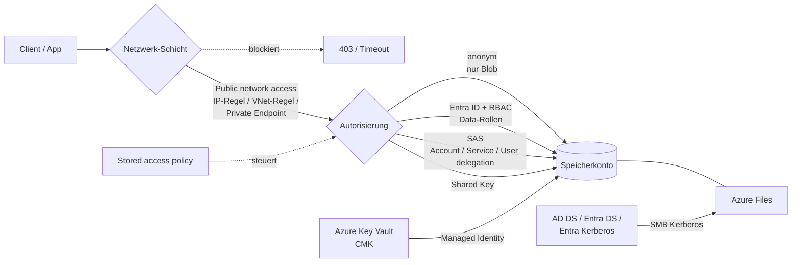

# 2.2 Zugriff auf Speicher und Sicherheit (Firewalls, SAS, Schlüssel, Verschlüsselung)

> **Domäne:** Implement and manage storage · **Gewichtung:** 15–20 %
> **Study-Guide-Punkte:** *Configure Azure Storage firewalls and virtual networks* · *Create and use shared access signature (SAS) tokens* · *Configure stored access policies* · *Manage access keys* · *Configure identity-based access for Azure Files* · *Configure Azure Storage encryption*
> (Speicherkonten anlegen und Redundanz → [Kapitel 2.1](01-speicherkonten-und-redundanz.md))
> **Stand:** November 2026

## Lernziele

Nach diesem Kapitel kann ich …

- den **Netzwerkzugriff** auf ein Speicherkonto über *Public network access*, IP-Regeln, VNet-Regeln, *Resource instances* und die Ausnahme *Trusted Microsoft services* steuern.
- die **Autorisierungsarten** (Shared Key, SAS, Microsoft Entra ID/RBAC, anonym) unterscheiden und gezielt deaktivieren.
- **Access Keys** rotieren und eine Schlüsselablauf-Erinnerung einrichten.
- **Account SAS**, **Service SAS** und **User delegation SAS** erstellen, ihre Parameter lesen und kompromittierte SAS widerrufen.
- **Stored access policies** anlegen und damit SAS zentral verwalten.
- **identitätsbasierten Zugriff** auf Azure Files (AD DS, Entra Domain Services, Entra Kerberos) mit Share-Level-Rollen und NTFS-ACLs konfigurieren.
- die Optionen der **Storage-Verschlüsselung** (Microsoft-managed Keys, Customer-managed Keys, Encryption scopes, Infrastructure encryption) erklären und einrichten.

## Überblick

Ein Speicherkonto ist standardmäßig über einen öffentlichen Endpunkt (`https://<konto>.blob.core.windows.net` usw.) aus dem Internet erreichbar. Ob ein Zugriff gelingt, entscheiden **zwei voneinander unabhängige Schichten**:

1. **Netzwerk** – Darf der Client das Konto überhaupt erreichen? (Firewall, VNet-Regeln, Private Endpoints)
2. **Autorisierung** – Darf diese Identität bzw. dieses Token die Operation ausführen? (Access Key, SAS, Entra ID + RBAC)

Beide Prüfungen müssen bestehen. Ein gültiger SAS-Token nützt nichts, wenn die Firewall die IP-Adresse blockiert – und eine erlaubte IP-Adresse nützt nichts ohne gültige Autorisierung.

Zusätzlich sind alle Daten **im Ruhezustand immer verschlüsselt** (Storage Service Encryption, SSE). Der Admin entscheidet nur, **wer die Schlüssel verwaltet**. Bei der Übertragung schützen *Secure transfer required* (HTTPS) und eine *Minimum TLS version*.

## Kernkonzepte

### Netzwerkzugriff (Storage Firewall)

Pfad: **Storage account > Security + networking > Networking > Firewalls and virtual networks**

**Public network access:**

| Option | Wirkung |
|---|---|
| **Enabled from all networks** | Standard. Jeder Client mit gültiger Autorisierung erreicht den öffentlichen Endpunkt. |
| **Enabled from selected virtual networks and IP addresses** | Firewall aktiv (*default action = Deny*). Nur explizit erlaubte VNets/Subnetze, IP-Bereiche und Ressourceninstanzen kommen durch. |
| **Disabled** | Öffentlicher Endpunkt komplett gesperrt. Zugriff **nur** über **Private Endpoints**. |

**Regeltypen bei „selected networks":**

- **Virtual networks** – erlaubt ein **Subnetz**. Voraussetzung: Auf dem Subnetz ist der **Service Endpoint `Microsoft.Storage`** aktiviert (das Portal aktiviert ihn beim Hinzufügen automatisch). Das VNet kann auch in einer anderen Region bzw. einem anderen Abonnement liegen.
- **IP network rules** – erlaubt **öffentliche** IP-Adressen oder CIDR-Bereiche (z. B. das NAT-Gateway des Firmennetzes).
  - ⚠️ **Private IP-Adressen** (RFC 1918: `10.x`, `172.16–31.x`, `192.168.x`) sind **nicht** erlaubt.
  - Sehr kleine Präfixe (`/31`, `/32`) werden nicht als Bereich unterstützt – einzelne Adressen ohne Präfix eintragen.
  - ⚠️ IP-Regeln greifen **nicht** für Clients in **derselben Azure-Region** wie das Speicherkonto – deren Datenverkehr läuft über private Azure-Adressen. Für diese Clients VNet-Regeln oder Private Endpoints verwenden.
- **Resource instances** – erlaubt bestimmte Instanzen von Azure-Diensten (z. B. eine bestimmte Synapse-Workspace- oder Data-Factory-Instanz) anhand ihrer **Managed Identity** und Ressourcen-ID.
- **Exceptions:**
  - **Allow Azure services on the trusted services list to access this storage account** – z. B. Azure Backup, Azure Site Recovery, Azure Monitor, Event Grid, Azure DevTest Labs (Bypass `AzureServices`).
  - *Allow read access to storage logging from any network* und *Allow read access to storage metrics from any network*.

### Service Endpoints vs. Private Endpoints (Kurzfassung)

| Kriterium | Service Endpoint | Private Endpoint |
|---|---|---|
| Ziel-IP | **öffentliche** IP des Speicherkontos | **private** IP aus dem eigenen Subnetz (NIC) |
| Konfiguration | am **Subnetz** + VNet-Regel im Speicherkonto | eigene Ressource + Private DNS Zone (`privatelink.blob.core.windows.net`) |
| Zugriff aus On-Premises (VPN/ExpressRoute) | ❌ | ✅ |
| Öffentlichen Endpunkt komplett abschalten | ❌ | ✅ (*Public network access: Disabled*) |
| Kosten | kostenlos | stündlich + pro GB |

Details → [Kapitel 4.7](../04-netzwerk/07-service-endpoints-und-private-endpoints.md).

### Autorisierungsarten

| Methode | Funktionsweise | Gilt für |
|---|---|---|
| **Shared Key** (Access Key) | Volle Kontrolle über das gesamte Konto – wie ein Root-Kennwort | Blob, Files, Queue, Table |
| **Shared Access Signature (SAS)** | Signierte URL mit eingeschränkten Rechten, Dauer, IPs | Blob, Files, Queue, Table |
| **Microsoft Entra ID + RBAC** | OAuth-Token einer Identität + Daten-Rolle (*Storage Blob Data Reader* …) | Blob, Queue, Table, Files (REST/SMB) |
| **Anonymer Zugriff** | Öffentlicher Lesezugriff ohne Autorisierung | nur Blob |

> **Empfehlung von Microsoft:** Microsoft Entra ID mit RBAC verwenden, Shared Key möglichst deaktivieren.

**Wichtige Kontoeinstellungen (Configuration):**

- **Allow storage account key access** – `Disabled` verbietet **Shared Key** und alle **mit dem Account Key signierten SAS** (Account SAS, Service SAS). Eine **User delegation SAS** funktioniert weiterhin, da sie mit Entra-Anmeldeinformationen signiert ist.
- **Default to Microsoft Entra authorization in the Azure portal** – das Portal greift auf Daten mit dem Entra-Konto des Benutzers zu statt mit dem Access Key.
- **Allow Blob anonymous access** – Kontoschalter für anonymen Zugriff. Erst wenn er aktiviert ist, kann ein Container auf *Blob* (anonymes Lesen einzelner Blobs) oder *Container* (zusätzlich Auflisten) gestellt werden. Standard für neue Konten: deaktiviert.

**Steuerungsebene vs. Datenebene:**

- *Owner*, *Contributor*, *Storage Account Contributor* sind **Management-Rollen**. Sie enthalten aber die Aktion `Microsoft.Storage/storageAccounts/listkeys/action` – wer Keys abrufen kann, hat damit indirekt **vollen Datenzugriff** (solange Shared Key erlaubt ist).
- *Reader* allein gibt **keinen** Datenzugriff; *Reader and Data Access* erlaubt das Abrufen der Keys.
- **Daten-Rollen** (DataActions): *Storage Blob Data Owner / Contributor / Reader*, *Storage Queue Data Contributor / Reader / Message Sender / Message Processor*, *Storage Table Data Contributor / Reader*, *Storage File Data SMB Share …* – siehe [Kapitel 1.3](../01-identitaeten-und-governance/03-rbac-zugriffsverwaltung.md).

### Access Keys

- Jedes Speicherkonto hat **zwei** 512-Bit-Schlüssel: **key1** und **key2**. Zwei Schlüssel ermöglichen eine **Rotation ohne Ausfallzeit**.
- **Rotationsablauf:**
  1. Anwendungen auf **key2** umstellen.
  2. **key1** neu generieren (*Rotate key*).
  3. Anwendungen auf den neuen key1 umstellen.
  4. key2 neu generieren.
- ⚠️ Beim Neugenerieren werden alle **mit diesem Schlüssel signierten SAS** (Account SAS, ad-hoc Service SAS, Service SAS mit Stored access policy) **sofort ungültig**.
- **Key expiration policy** (*Set rotation reminder*): Zeitraum in Tagen festlegen, nach dem ein Schlüssel rotiert werden soll. Das Portal zeigt danach eine Warnung; Azure Policy kann die Einhaltung prüfen. Es wird **nicht automatisch** rotiert.
- **Azure Key Vault:** Keys bzw. Connection Strings als Secrets in Key Vault speichern, statt sie in Konfigurationsdateien abzulegen. Die Rotation lässt sich per Key-Vault-Automatisierung (z. B. Event Grid + Function) umsetzen.
- Connection String: `DefaultEndpointsProtocol=https;AccountName=<konto>;AccountKey=<key>;EndpointSuffix=core.windows.net`

### Shared Access Signatures (SAS)

Eine SAS ist ein **Token**, das an die Ressourcen-URL angehängt wird und eingeschränkten, zeitlich begrenzten Zugriff gewährt – ohne den Account Key herauszugeben.

```text
https://contoso.blob.core.windows.net/reports/q3.pdf?sv=2022-11-02&ss=b&srt=co&sp=rl&st=2026-11-23T08:00:00Z&se=2026-11-24T08:00:00Z&sip=203.0.113.10&spr=https&sig=<signatur>
```

#### SAS-Typen

| Typ | Signiert mit | Gültig für | Besonderheiten |
|---|---|---|---|
| **User delegation SAS** | **User delegation key** (über Microsoft Entra ID angefordert) | **nur Blob Storage / Data Lake Storage** | von Microsoft **empfohlen**; Rechte = Schnittmenge aus SAS-Rechten und RBAC-Rechten des Erstellers; Gültigkeit **max. 7 Tage** |
| **Service SAS** | **Account Key** | **einen** Dienst (Blob, Files, Queue oder Table), konkrete Ressource (Container, Blob, Share, Datei, Queue, Tabelle) | kann an eine **Stored access policy** gebunden werden |
| **Account SAS** | **Account Key** | **ein oder mehrere** Dienste, auch Operationen auf Dienst-/Kontoebene (z. B. Container anlegen, Service-Properties) | **keine** Stored access policy möglich |

Zusätzlich unterscheidet man:

- **Ad-hoc SAS** – alle Parameter (Start, Ablauf, Rechte) stehen in der URL.
- **SAS mit Stored access policy** – Start, Ablauf und/oder Rechte stehen in einer Richtlinie auf dem Container; die URL referenziert sie über `si=<policyname>` (nur Service SAS).

#### Wichtige SAS-Parameter

| Parameter | Bedeutung | Beispiel |
|---|---|---|
| `sv` | *Signed version* – Storage-Service-Version | `2022-11-02` |
| `ss` | *Signed services* (nur Account SAS): **b**lob, **f**ile, **q**ueue, **t**able | `bf` |
| `srt` | *Signed resource types* (nur Account SAS): **s**ervice, **c**ontainer, **o**bject | `co` |
| `sr` | *Signed resource* (Service SAS): `b` = Blob, `c` = Container, `s` = Share, `f` = Datei | `c` |
| `sp` | *Signed permissions*: **r**ead, **a**dd, **c**reate, **w**rite, **d**elete, **l**ist, **u**pdate, **p**rocess … | `rl` |
| `st` | *Signed start* (UTC) | `2026-11-23T08:00:00Z` |
| `se` | *Signed expiry* (UTC) | `2026-11-24T08:00:00Z` |
| `sip` | *Signed IP* – erlaubte IP oder IP-Bereich | `203.0.113.10` |
| `spr` | *Signed protocol*: `https` oder `https,http` | `https` |
| `si` | *Signed identifier* – Name der Stored access policy | `policy-reports` |
| `skoid`, `sktid`, … | Felder der User delegation SAS (Object ID, Tenant ID des Erstellers) | – |
| `sig` | *Signature* – HMAC-SHA256 über alle Felder | – |

> Tipp: Startzeit etwas in die Vergangenheit legen (oder weglassen), um Probleme durch Uhrzeit-Abweichungen (*clock skew*) zu vermeiden.

#### SAS widerrufen

| SAS-Typ | Widerruf |
|---|---|
| Ad-hoc **Service/Account SAS** | den signierenden **Access Key rotieren** (betrifft **alle** SAS dieses Keys) |
| **Service SAS mit Stored access policy** | die **Stored access policy löschen** oder Ablaufzeit in die Vergangenheit setzen bzw. umbenennen → nur SAS dieser Richtlinie betroffen |
| **User delegation SAS** | **User delegation keys widerrufen** (*Revoke user delegation keys*) oder die RBAC-Rechte des Erstellers entziehen; der Key ist ohnehin max. 7 Tage gültig |

#### SAS expiration policy

Auf Kontoebene (**Configuration > Allow storage account key access** bzw. **Settings > Configuration**) lässt sich eine **empfohlene maximale Gültigkeitsdauer** für SAS festlegen (z. B. 1 Tag). SAS mit längerer Laufzeit werden – je nach gewählter Aktion – im Log markiert oder abgelehnt. Gilt für SAS, die mit dem Account Key signiert sind.

### Stored Access Policies

- Werden auf einem **Container**, einer **Dateifreigabe**, einer **Queue** oder einer **Tabelle** definiert.
- Enthalten optional **Startzeit**, **Ablaufzeit** und **Berechtigungen**. Was in der Richtlinie steht, darf nicht zusätzlich in der SAS-URL stehen (und umgekehrt – jedes Feld muss genau einmal definiert sein).
- **Maximal 5** Stored access policies pro Container/Share/Queue/Tabelle.
- Nur für **Service SAS** verwendbar – **nicht** für Account SAS und **nicht** für User delegation SAS.
- Vorteil: SAS lassen sich **nachträglich ändern oder widerrufen**, ohne den Account Key zu rotieren.
- Änderungen an einer Richtlinie können bis zu ca. 30 Sekunden brauchen, bis sie wirksam werden.

### Identitätsbasierter Zugriff auf Azure Files (SMB)

Statt mit dem Storage Account Key können Benutzer eine Azure-Dateifreigabe mit ihrer **Domänenidentität** über SMB (Kerberos) einbinden.

**Identitätsquellen** (pro Speicherkonto **eine** aktiv):

| Quelle | Voraussetzung | Typischer Einsatz |
|---|---|---|
| **On-premises AD DS** | Speicherkonto wird als Computerkonto im AD registriert (Modul *AzFilesHybrid*); Identitäten per Entra Connect/Cloud Sync synchronisiert; Clients mit Sichtverbindung zum DC | klassische Hybrid-Umgebung, Fileserver-Ersatz |
| **Microsoft Entra Domain Services** | verwaltete Domäne in Azure; Clients sind der Domäne beigetreten | Cloud-VMs ohne eigene DCs |
| **Microsoft Entra Kerberos** | hybride Identitäten (aus AD DS synchronisiert); Clients Entra-joined oder hybrid-joined; **keine** Sichtverbindung zum DC nötig | moderne, Entra-joined Clients, Azure Virtual Desktop |

**Zwei Berechtigungsebenen:**

1. **Share-Level (Azure RBAC)** – Wer darf die Freigabe überhaupt einbinden?
   - **Storage File Data SMB Share Reader** – Lesen
   - **Storage File Data SMB Share Contributor** – Lesen, Schreiben, Löschen
   - **Storage File Data SMB Share Elevated Contributor** – zusätzlich NTFS-Berechtigungen ändern
   - (*Storage File Data Privileged Reader/Contributor* – umgehen die NTFS-ACLs, für Admin-Zugriff)
   - **Default share-level permission** – Konto-weite Standardrolle für **alle** authentifizierten Identitäten (z. B. *SMB Share Contributor*), praktisch, wenn die Feinsteuerung über NTFS erfolgt oder Identitäten nicht in Entra ID synchronisiert sind.
2. **Directory/File-Level (Windows ACLs / NTFS)** – konfiguriert über den Windows Explorer oder `icacls` nach dem Einbinden (Mount mit Storage Account Key bzw. mit einer Identität mit *Elevated Contributor*).

Effektive Rechte = **restriktivere** Kombination aus Share-Level-Rolle und NTFS-ACL.

> ⚠️ Port **445 (SMB)** muss ausgehend offen sein. Viele ISPs blockieren ihn – dann VPN/ExpressRoute oder Azure File Sync nutzen. Details zu Freigaben → [Kapitel 2.4](04-azure-files.md).

### Verschlüsselung

#### Verschlüsselung im Ruhezustand (Storage Service Encryption, SSE)

- **Immer aktiv**, kann **nicht deaktiviert** werden, **AES-256**, transparent, ohne Leistungseinbußen und ohne Zusatzkosten.
- Gilt für alle Daten (Blobs, Dateien, Queues, Tabellen, Metadaten) und alle Leistungsstufen/Redundanzen.

**Schlüsselverwaltung:**

| Option | Wer verwaltet den Schlüssel? | Hinweise |
|---|---|---|
| **Microsoft-managed keys (MMK)** | Microsoft | Standard, keine Konfiguration |
| **Customer-managed keys (CMK)** | Kunde, in **Azure Key Vault** oder **Key Vault Managed HSM** | Speicherkonto greift über eine **Managed Identity** (system- oder user-assigned) zu; Key Vault benötigt **Soft delete** und **Purge protection**; Rolle *Key Vault Crypto Service Encryption User* (bzw. Access Policy *Get, Wrap Key, Unwrap Key*). Automatische Rotation, wenn **keine Schlüsselversion** angegeben ist. Key Vault darf in anderem Abonnement/Tenant liegen (Cross-Tenant mit user-assigned MI). |
| **Customer-provided keys** | Kunde liefert den Schlüssel **pro Anfrage** (Blob-REST-Aufruf) | nur Blob Storage, Schlüssel wird nicht gespeichert |

⚠️ Wird ein CMK gelöscht oder der Zugriff entzogen, sind die Daten **nicht mehr lesbar**, bis der Zugriff wiederhergestellt ist.

#### Encryption scopes

- Ermöglichen **unterschiedliche Schlüssel innerhalb eines Kontos** – auf **Container**- oder **Blob**-Ebene (nur Blob Storage).
- Jeder Scope nutzt MMK oder CMK. Einsatz: mandantenfähige Anwendungen (jeder Kunde eigener Schlüssel).
- Ein Container kann einen **Default encryption scope** erhalten und optional erzwingen, dass alle Blobs ihn verwenden.

#### Infrastructure encryption (Double encryption)

- Zusätzliche, **zweite Verschlüsselungsschicht** auf Infrastrukturebene mit einem anderen Algorithmus/Schlüssel (immer Microsoft-managed).
- ⚠️ **Nur bei der Erstellung** des Speicherkontos aktivierbar (*Advanced/Encryption* > *Enable infrastructure encryption*) – nachträglich nicht änderbar.

#### Verschlüsselung bei der Übertragung

- **Secure transfer required** (Standard: aktiviert) – lehnt HTTP-Anfragen und SMB ohne Verschlüsselung ab.
- **Minimum TLS version** – **TLS 1.2** ist Standard und Empfehlung; ältere TLS-Versionen werden von Azure Storage nicht mehr unterstützt.
- SMB 3.x mit Verschlüsselung für Azure Files.

## Zusammenhänge



- **Speicherkonto-Grundlagen** ([2.1](01-speicherkonten-und-redundanz.md)): Kontotyp und Redundanz legen fest, welche Dienste (Blob, Files …) überhaupt abgesichert werden müssen; Infrastructure encryption wird bei der Erstellung gesetzt.
- **RBAC** ([1.3](../01-identitaeten-und-governance/03-rbac-zugriffsverwaltung.md)): Daten-Rollen (DataActions) vs. Management-Rollen; *listKeys* in *Contributor*.
- **Blob Storage** ([2.3](03-blob-storage.md)): anonymer Zugriff auf Container-Ebene, User delegation SAS, Encryption scopes pro Container.
- **Azure Files** ([2.4](04-azure-files.md)): identitätsbasierter SMB-Zugriff, Port 445.
- **AzCopy/Storage Explorer** ([2.5](05-datenuebertragung-azcopy-und-storage-explorer.md)): authentifizieren sich per SAS oder Entra ID.
- **Netzwerk** ([4.7](../04-netzwerk/07-service-endpoints-und-private-endpoints.md)): Service Endpoints und Private Endpoints inkl. DNS.
- **Azure Policy** ([1.4](../01-identitaeten-und-governance/04-azure-policy.md)): Built-in-Policies wie „Storage accounts should restrict network access", „Storage accounts should prevent shared key access" oder „…should use customer-managed key for encryption".

## Vergleichstabellen

### SAS-Typen auf einen Blick

| Kriterium | User delegation SAS | Service SAS | Account SAS |
|---|---|---|---|
| Signatur | Entra ID (User delegation key) | Account Key | Account Key |
| Dienste | nur Blob / Data Lake | ein Dienst | ein oder mehrere Dienste |
| Stored access policy | ❌ | ✅ | ❌ |
| Funktioniert bei *Allow storage account key access = Disabled* | ✅ | ❌ | ❌ |
| Max. Gültigkeit | 7 Tage | unbegrenzt (Policy empfohlen) | unbegrenzt (Policy empfohlen) |
| Widerruf | User delegation keys widerrufen / RBAC entziehen | Key rotieren oder Policy löschen | Key rotieren |
| Empfehlung | ✅ bevorzugt | wenn nötig mit Policy | sparsam |

### Netzwerkoptionen

| Anforderung | Lösung |
|---|---|
| Zugriff nur aus einem bestimmten Azure-Subnetz | *Selected networks* + **VNet-Regel** (Service Endpoint) |
| Zugriff aus dem Firmennetz über das Internet | *Selected networks* + **IP-Regel** (öffentliche NAT-IP) |
| Zugriff aus On-Premises über VPN/ExpressRoute, privat | **Private Endpoint** |
| Öffentlicher Endpunkt darf gar nicht erreichbar sein | *Public network access: Disabled* + **Private Endpoint** |
| Azure Backup / Monitor sollen trotz Firewall zugreifen | Exception **Trusted Microsoft services** |
| Eine bestimmte Data-Factory-Instanz soll zugreifen | **Resource instances** |

### Verschlüsselungsoptionen

| Option | Ebene | Nachträglich änderbar | Zweck |
|---|---|---|---|
| Microsoft-managed keys | Konto | ✅ (Wechsel zu CMK) | Standard |
| Customer-managed keys | Konto oder Encryption scope | ✅ | Kontrolle über Schlüssel, Compliance |
| Encryption scopes | Container / Blob | ✅ (neue Scopes) | unterschiedliche Schlüssel pro Mandant |
| Infrastructure encryption | Konto | ❌ nur bei Erstellung | doppelte Verschlüsselung |
| Customer-provided keys | pro Anfrage (Blob) | – | Schlüssel bleibt beim Client |

### Identitätsquellen für Azure Files

| Kriterium | AD DS | Entra Domain Services | Entra Kerberos |
|---|---|---|---|
| Eigene DCs nötig | ✅ | ❌ (verwaltet) | ❌ (für den Mount) |
| Client-Join | AD-Domäne | Entra-DS-Domäne | Entra-joined / hybrid-joined |
| Sichtverbindung zum DC | ✅ | ✅ (zur verwalteten Domäne) | ❌ |
| Identitäten | hybrid (synchronisiert) | Entra-Identitäten | hybrid (synchronisiert) |

## Azure Portal

| Aufgabe | Pfad |
|---|---|
| Firewall / Public network access | **Portal > Storage accounts > Konto > Security + networking > Networking > Firewalls and virtual networks** |
| VNet-Regel hinzufügen | **… > Networking > Virtual networks > + Add existing virtual network** |
| IP-Regel hinzufügen | **… > Networking > Firewall > Address range** |
| Resource instances | **… > Networking > Resource instances** |
| Trusted services Exception | **… > Networking > Exceptions > Allow Azure services on the trusted services list …** |
| Private Endpoint anlegen | **… > Networking > Private endpoint connections > + Private endpoint** |
| Access Keys anzeigen / rotieren | **… > Security + networking > Access keys > Show / Rotate key** |
| Rotationserinnerung | **… > Access keys > Set rotation reminder** |
| Account SAS erzeugen | **… > Security + networking > Shared access signature** |
| Service SAS / User delegation SAS für Container/Blob | **… > Data storage > Containers > Container (bzw. Blob) > … > Generate SAS** → *Signing method: Account key* oder *User delegation key* |
| Stored access policy | **… > Containers > Container > Settings > Access policy > + Add policy** |
| User delegation keys widerrufen | **… > Overview > Revoke user delegation keys** (bzw. über CLI/PowerShell) |
| Shared Key / anonymen Zugriff / TLS / HTTPS | **… > Settings > Configuration** (*Allow storage account key access*, *Allow Blob anonymous access*, *Minimum TLS version*, *Secure transfer required*) |
| SAS expiration policy | **… > Settings > Configuration** bzw. **Access keys > Set SAS expiration policy** |
| Verschlüsselung / CMK | **… > Security + networking > Encryption > Encryption type: Customer-managed keys** |
| Encryption scopes | **… > Security + networking > Encryption > Encryption scopes > + Add** |
| Infrastructure encryption | nur beim Erstellen: **Create storage account > Encryption > Enable infrastructure encryption** |
| Identitätsbasierter Zugriff Azure Files | **… > Data storage > File shares > Identity-based access > Set up** |
| Default share-level permission | **… > File shares > Identity-based access > Default share-level permissions** |
| Share-Level-Rolle zuweisen | **… > File shares > Freigabe > Access control (IAM) > Add role assignment** |
| Daten-Rollen (Blob/Queue/Table) | **… > Konto oder Container > Access control (IAM) > Add role assignment** |

⚠️ **Nach der Erstellung nicht mehr änderbar:** *Infrastructure encryption*. Customer-managed keys lassen sich dagegen jederzeit aktivieren bzw. zurück auf Microsoft-managed keys umstellen.

## Azure CLI & PowerShell

### Azure CLI

```bash
# Firewall aktivieren: Standard = Deny, Trusted Services erlauben
az storage account update -g <resource-group> -n <konto> \
  --default-action Deny --bypass AzureServices

# Öffentlichen Zugriff vollständig deaktivieren (nur Private Endpoints)
az storage account update -g <resource-group> -n <konto> --public-network-access Disabled

# IP-Regel (öffentliche IP / CIDR) hinzufügen
az storage account network-rule add -g <resource-group> --account-name <konto> \
  --ip-address 203.0.113.0/24

# VNet-Regel: zuerst Service Endpoint am Subnetz, dann Regel
az network vnet subnet update -g <resource-group> --vnet-name <vnet> -n <subnet> \
  --service-endpoints Microsoft.Storage
az storage account network-rule add -g <resource-group> --account-name <konto> \
  --vnet-name <vnet> --subnet <subnet>

# Access Keys anzeigen und key1 rotieren
az storage account keys list -g <resource-group> -n <konto> -o table
az storage account keys renew -g <resource-group> -n <konto> --key primary

# Härtung: Shared Key aus, kein anonymer Zugriff, nur HTTPS, TLS 1.2
az storage account update -g <resource-group> -n <konto> \
  --allow-shared-key-access false --allow-blob-public-access false \
  --https-only true --min-tls-version TLS1_2

# User delegation SAS für einen Container (Entra-Anmeldung, max. 7 Tage)
az storage container generate-sas --account-name <konto> --name reports \
  --permissions rl --expiry 2026-11-30T23:59Z --https-only \
  --auth-mode login --as-user -o tsv

# Stored access policy anlegen und Service SAS daran binden
az storage container policy create --account-name <konto> --account-key <key> \
  --container-name reports --name policy-reports \
  --permissions rl --expiry 2026-12-31T23:59Z
az storage container generate-sas --account-name <konto> --account-key <key> \
  --name reports --policy-name policy-reports -o tsv

# Alle User delegation keys widerrufen
az storage account revoke-delegation-keys -g <resource-group> -n <konto>

# Customer-managed key (system-assigned MI muss Zugriff auf den Key Vault haben)
az storage account update -g <resource-group> -n <konto> --assign-identity
az storage account update -g <resource-group> -n <konto> \
  --encryption-key-source Microsoft.Keyvault \
  --encryption-key-vault https://<keyvault>.vault.azure.net \
  --encryption-key-name <key-name>

# Konto mit Infrastructure encryption erstellen (nur bei Erstellung!)
az storage account create -g <resource-group> -n <konto> -l westeurope \
  --sku Standard_ZRS --kind StorageV2 --require-infrastructure-encryption

# Encryption scope anlegen
az storage account encryption-scope create -g <resource-group> --account-name <konto> \
  --name scope-kunde-a --key-source Microsoft.Storage

# Share-Level-Rolle für Azure Files zuweisen
az role assignment create --role "Storage File Data SMB Share Contributor" \
  --assignee <user-oder-gruppe-object-id> \
  --scope "/subscriptions/<sub-id>/resourceGroups/<resource-group>/providers/Microsoft.Storage/storageAccounts/<konto>/fileServices/default/fileshares/<share>"
```

### Az PowerShell

```powershell
# Firewall: Standard = Deny, Trusted Services erlauben
Update-AzStorageAccountNetworkRuleSet -ResourceGroupName "<resource-group>" -Name "<konto>" `
  -DefaultAction Deny -Bypass AzureServices

# IP-Regel und VNet-Regel hinzufügen
Add-AzStorageAccountNetworkRule -ResourceGroupName "<resource-group>" -Name "<konto>" `
  -IPAddressOrRange "203.0.113.0/24"
$subnet = Get-AzVirtualNetwork -ResourceGroupName "<resource-group>" -Name "<vnet>" |
  Get-AzVirtualNetworkSubnetConfig -Name "<subnet>"
Add-AzStorageAccountNetworkRule -ResourceGroupName "<resource-group>" -Name "<konto>" `
  -VirtualNetworkResourceId $subnet.Id

# Access Key key1 neu generieren
New-AzStorageAccountKey -ResourceGroupName "<resource-group>" -Name "<konto>" -KeyName key1

# User delegation SAS (Kontext mit Entra-Anmeldung)
$ctx = New-AzStorageContext -StorageAccountName "<konto>" -UseConnectedAccount
New-AzStorageContainerSASToken -Name "reports" -Permission rl `
  -ExpiryTime (Get-Date).AddDays(2) -Protocol HttpsOnly -Context $ctx

# Stored access policy (Kontext mit Account Key) und Service SAS
$keyCtx = (Get-AzStorageAccount -ResourceGroupName "<resource-group>" -Name "<konto>").Context
New-AzStorageContainerStoredAccessPolicy -Container "reports" -Policy "policy-reports" `
  -Permission rl -ExpiryTime (Get-Date).AddMonths(1) -Context $keyCtx
New-AzStorageContainerSASToken -Name "reports" -Policy "policy-reports" -Context $keyCtx

# User delegation keys widerrufen
Revoke-AzStorageAccountUserDelegationKeys -ResourceGroupName "<resource-group>" -StorageAccountName "<konto>"

# Customer-managed key aktivieren
Set-AzStorageAccount -ResourceGroupName "<resource-group>" -Name "<konto>" -AssignIdentity
Set-AzStorageAccount -ResourceGroupName "<resource-group>" -Name "<konto>" `
  -KeyvaultEncryption -KeyName "<key-name>" -KeyVaultUri "https://<keyvault>.vault.azure.net"

# Härtung
Set-AzStorageAccount -ResourceGroupName "<resource-group>" -Name "<konto>" `
  -AllowSharedKeyAccess $false -AllowBlobPublicAccess $false `
  -EnableHttpsTrafficOnly $true -MinimumTlsVersion TLS1_2
```

| Ziel | CLI | PowerShell |
|---|---|---|
| Firewall-Standardaktion | `az storage account update --default-action` | `Update-AzStorageAccountNetworkRuleSet -DefaultAction` |
| Netzwerkregel | `az storage account network-rule add` | `Add-AzStorageAccountNetworkRule` |
| Key rotieren | `az storage account keys renew` | `New-AzStorageAccountKey` |
| SAS für Container | `az storage container generate-sas` | `New-AzStorageContainerSASToken` |
| Stored access policy | `az storage container policy create` | `New-AzStorageContainerStoredAccessPolicy` |
| CMK | `az storage account update --encryption-key-source Microsoft.Keyvault` | `Set-AzStorageAccount -KeyvaultEncryption` |

## Praxisbeispiel

**Szenario:** *Contoso* betreibt das Speicherkonto `stcontosofinance` mit einem Container `reports` und einer Dateifreigabe `finance`. Anforderungen:

1. Zugriff nur aus dem Subnetz `snet-app` (VNet `vnet-prod`) und aus dem Firmennetz (öffentliche NAT-IP `203.0.113.10`). Azure Backup muss weiterhin funktionieren.
2. Ein externer Prüfer soll 48 Stunden lang Berichte lesen können – widerrufbar, ohne andere Anwendungen zu stören.
3. Mitarbeitende der Finanzabteilung binden `finance` mit ihrem Domänenkonto ein (Hybrid-Umgebung mit AD DS).
4. Die Revision verlangt eigene Schlüssel in Key Vault.

**Umsetzung:**

1. **Netzwerk:** *Networking > Public network access: Enabled from selected virtual networks and IP addresses* → *+ Add existing virtual network* `vnet-prod/snet-app` (Service Endpoint wird aktiviert) → *Address range* `203.0.113.10` → *Exceptions: Allow Azure services on the trusted services list* ✅.
2. **Prüfer-Zugriff:** Option A (empfohlen): **User delegation SAS** auf den Container `reports` mit `sp=rl`, `se=+48h`, `spr=https`, optional `sip=<IP des Prüfers>` – erstellt von einem Admin mit *Storage Blob Data Reader*. Widerruf: *Revoke user delegation keys*. Option B: **Stored access policy** `policy-pruefer` (rl, 48 h) + Service SAS mit `si=policy-pruefer` – Widerruf durch Löschen der Richtlinie, ohne den Account Key zu rotieren. ⚠️ Die IP des Prüfers muss zusätzlich in der Firewall erlaubt sein.
3. **Azure Files:** *File shares > Identity-based access > Active Directory Domain Services* → Konto mit `AzFilesHybrid` (`Join-AzStorageAccount`) im AD registrieren → Gruppe `SG-Finance` (synchronisiert) erhält auf der Freigabe **Storage File Data SMB Share Contributor** → nach dem Mount NTFS-Rechte auf Unterordnern setzen (Admin mit *Elevated Contributor*).
4. **CMK:** Key Vault `kv-contoso-fin` mit **Soft delete + Purge protection**, RSA-Key `stkey` → Speicherkonto bekommt eine **system-assigned Managed Identity** → Rolle **Key Vault Crypto Service Encryption User** auf den Key Vault → *Encryption > Customer-managed keys* → Key auswählen, **ohne Version** (automatische Rotation).
5. **Härtung:** *Configuration > Allow Blob anonymous access: Disabled*, *Minimum TLS version: 1.2*, *Secure transfer required: Enabled*. Wenn alle Anwendungen Entra ID nutzen: *Allow storage account key access: Disabled*.

## Limits & wichtige Zahlen

| Wert | Grenze / Standard |
|---|---|
| Access Keys pro Konto | **2** (key1, key2), je 512 Bit |
| Stored access policies | **max. 5** pro Container / Share / Queue / Tabelle |
| User delegation SAS / User delegation key | Gültigkeit **max. 7 Tage** |
| Wirksamkeit einer geänderten Stored access policy | bis ca. **30 Sekunden** |
| IP- und VNet-Regeln pro Konto | bis zu **400 IP-Regeln** und **200 VNet-Regeln** (aktuelle Werte prüfen) |
| Verschlüsselung im Ruhezustand | **AES-256**, immer aktiv |
| Minimum TLS version | **TLS 1.2** (Standard/Empfehlung) |
| Azure Files SMB-Port | **445** (TCP, ausgehend) |
| Identitätsquellen für Azure Files | **eine** pro Speicherkonto gleichzeitig |
| Infrastructure encryption | nur **bei Erstellung** |

## Prüfungstipps & Fallstricke

- ⚠️ **„SAS soll widerrufbar sein, ohne den Account Key zu rotieren"** → **Stored access policy** (Service SAS) oder **User delegation SAS**.
- ⚠️ **Stored access policy für Account SAS** → geht **nicht** – nur Service SAS.
- ⚠️ **Max. 5** Stored access policies pro Container – sechste Richtlinie schlägt fehl.
- ⚠️ **„Höchste Sicherheit für SAS, Blob Storage"** → **User delegation SAS** (Entra-signiert, kein Account Key).
- ⚠️ User delegation SAS für **Azure Files, Queue oder Table** → **nicht möglich** (nur Blob/Data Lake).
- ⚠️ **Key rotiert → Anwendungen fallen aus** → alle SAS und Connection Strings mit diesem Key sind ungültig. Rotationsreihenfolge beachten (erst auf den anderen Key umstellen).
- ⚠️ **IP-Regel mit privater IP (10.x)** → nicht erlaubt; für Azure-interne Clients **VNet-Regel** oder **Private Endpoint**.
- ⚠️ **VM in derselben Region** wird trotz IP-Regel für ihre Public IP blockiert → IP-Regeln gelten nicht für Datenverkehr aus derselben Region → **VNet-Regel**.
- **On-Premises-Server über VPN** soll privat zugreifen → **Private Endpoint** (Service Endpoints helfen On-Premises nicht).
- **Azure Backup / Site Recovery / Monitor** werden durch die Firewall blockiert → **Trusted Microsoft services** aktivieren.
- **„Benutzer mit Contributor-Rolle kann Blobs lesen, obwohl er keine Daten-Rolle hat"** → Contributor kann **Keys auflisten** → Shared Key deaktivieren oder Rechte reduzieren.
- **„Benutzer mit Reader-Rolle sieht das Konto, aber keine Blobs"** → **Daten-Rolle** fehlt (z. B. *Storage Blob Data Reader*).
- **Allow storage account key access = Disabled** → Account SAS/Service SAS funktionieren nicht mehr, **User delegation SAS** schon.
- **Infrastructure encryption nachträglich aktivieren** → nicht möglich → neues Konto anlegen und Daten migrieren.
- **CMK** benötigt **Managed Identity** + Key Vault mit **Soft delete und Purge protection**.
- **Unterschiedliche Schlüssel pro Kunde in einem Konto** → **Encryption scopes**.
- **Azure Files ohne Sichtverbindung zum DC, Clients Entra-joined** → **Microsoft Entra Kerberos**.
- **Alle authentifizierten Benutzer sollen die Freigabe einbinden können, feine Rechte über NTFS** → **Default share-level permission**.
- **SMB-Mount aus dem Heimnetz scheitert** → Port **445** blockiert.

## Selbsttest

**1.** Ein Entwickler benötigt für 3 Tage Lesezugriff auf einen Blob-Container. Die Sicherheitsrichtlinie verbietet die Nutzung von Storage Account Keys. Welche Lösung wählen Sie?

<details><summary>Lösung</summary>

Eine **User delegation SAS**. Sie wird mit einem über Microsoft Entra ID angeforderten User delegation key signiert, ist bis zu 7 Tage gültig und funktioniert auch bei *Allow storage account key access = Disabled*.
</details>

**2.** Sie haben 20 Service SAS für den Container `invoices` an Partner verteilt. Ein Token wurde kompromittiert. Sie möchten **nur** die SAS dieses Partners widerrufen. Was hätten Sie vorab tun müssen?

<details><summary>Lösung</summary>

Pro Partner(-gruppe) eine **Stored access policy** anlegen und die Service SAS daran binden (`si=`). Dann genügt es, die betreffende Richtlinie zu löschen oder ihre Ablaufzeit zu ändern. Ohne Policy bleibt nur das Rotieren des Account Keys – das macht **alle** SAS ungültig. Achtung: max. 5 Policies pro Container.
</details>

**3.** Sie möchten einer Account SAS eine Stored access policy zuordnen. Ist das möglich?

<details><summary>Lösung</summary>

**Nein.** Stored access policies funktionieren nur mit **Service SAS**.
</details>

**4.** Die Firewall eines Speicherkontos erlaubt nur ausgewählte Netzwerke. Eine VM in derselben Region mit der Public IP `20.50.1.10` ist als IP-Regel eingetragen, wird aber dennoch abgewiesen. Warum, und wie lösen Sie es?

<details><summary>Lösung</summary>

Datenverkehr aus **derselben Azure-Region** läuft über private Adressen; **IP-Regeln greifen dafür nicht**. Lösung: Service Endpoint `Microsoft.Storage` auf dem VM-Subnetz aktivieren und eine **VNet-Regel** anlegen (oder Private Endpoint).
</details>

**5.** Nach der Aktivierung der Storage-Firewall schlagen die Sicherungen von Azure Backup fehl. Was ist die einfachste Lösung?

<details><summary>Lösung</summary>

Unter *Exceptions* **Allow Azure services on the trusted services list to access this storage account** aktivieren (Bypass `AzureServices`).
</details>

**6.** Sie rotieren `key1` eines Speicherkontos. Welche Zugriffe sind betroffen?

<details><summary>Lösung</summary>

Alle Anwendungen/Connection Strings, die `key1` nutzen, sowie **alle mit key1 signierten SAS** (Account SAS, Service SAS – auch solche mit Stored access policy). User delegation SAS und Entra-ID-Zugriffe sind nicht betroffen.
</details>

**7.** Ein Unternehmen verlangt, dass zusätzlich zur Standardverschlüsselung eine zweite Verschlüsselungsschicht verwendet wird. Das Speicherkonto existiert bereits. Was tun Sie?

<details><summary>Lösung</summary>

**Infrastructure encryption** kann nur **bei der Erstellung** aktiviert werden. Ein neues Speicherkonto mit aktivierter Infrastructure encryption anlegen und die Daten migrieren (z. B. mit AzCopy).
</details>

**8.** Sie konfigurieren Customer-managed keys für ein Speicherkonto. Welche zwei Voraussetzungen muss der Key Vault erfüllen, und wie authentifiziert sich das Speicherkonto?

<details><summary>Lösung</summary>

Der Key Vault muss **Soft delete** und **Purge protection** aktiviert haben. Das Speicherkonto authentifiziert sich über eine **Managed Identity** (system- oder user-assigned) mit Rechten auf den Schlüssel (*Key Vault Crypto Service Encryption User* bzw. Get/Wrap/Unwrap).
</details>

**9.** Benutzer mit Entra-joined Windows-Clients sollen eine Azure-Dateifreigabe mit ihren (aus AD DS synchronisierten) Identitäten einbinden. Die Clients haben keine Verbindung zu den Domänencontrollern. Welche Identitätsquelle konfigurieren Sie?

<details><summary>Lösung</summary>

**Microsoft Entra Kerberos** für hybride Identitäten. Zusätzlich benötigen die Benutzer eine Share-Level-Rolle (z. B. *Storage File Data SMB Share Contributor*) oder eine *Default share-level permission*.
</details>

**10.** Ein Benutzer hat die Rolle *Storage File Data SMB Share Reader* auf der Freigabe und NTFS-Vollzugriff auf einen Ordner. Kann er Dateien in diesem Ordner ändern?

<details><summary>Lösung</summary>

**Nein.** Die effektiven Rechte ergeben sich aus der **restriktiveren** Kombination von Share-Level-Rolle (nur Lesen) und NTFS-ACL.
</details>

## Weiterführende Links

- [AZ-104 Study Guide](https://learn.microsoft.com/credentials/certifications/resources/study-guides/az-104)
- [Configure Azure Storage firewalls and virtual networks](https://learn.microsoft.com/azure/storage/common/storage-network-security)
- [Authorize access to data in Azure Storage](https://learn.microsoft.com/azure/storage/common/authorize-data-access)
- [Manage storage account access keys](https://learn.microsoft.com/azure/storage/common/storage-account-keys-manage)
- [Prevent Shared Key authorization](https://learn.microsoft.com/azure/storage/common/shared-key-authorization-prevent)
- [Grant limited access with shared access signatures (SAS)](https://learn.microsoft.com/azure/storage/common/storage-sas-overview)
- [Create a user delegation SAS](https://learn.microsoft.com/rest/api/storageservices/create-user-delegation-sas)
- [Define a stored access policy](https://learn.microsoft.com/rest/api/storageservices/define-stored-access-policy)
- [Configure a SAS expiration policy](https://learn.microsoft.com/azure/storage/common/sas-expiration-policy)
- [Overview of Azure Files identity-based authentication for SMB](https://learn.microsoft.com/azure/storage/files/storage-files-active-directory-overview)
- [Assign share-level permissions](https://learn.microsoft.com/azure/storage/files/storage-files-identity-ad-ds-assign-permissions)
- [Azure Storage encryption for data at rest](https://learn.microsoft.com/azure/storage/common/storage-service-encryption)
- [Customer-managed keys for Azure Storage encryption](https://learn.microsoft.com/azure/storage/common/customer-managed-keys-overview)
- [Encryption scopes for Blob storage](https://learn.microsoft.com/azure/storage/blobs/encryption-scope-overview)
- [Enable infrastructure encryption](https://learn.microsoft.com/azure/storage/common/infrastructure-encryption-enable)
