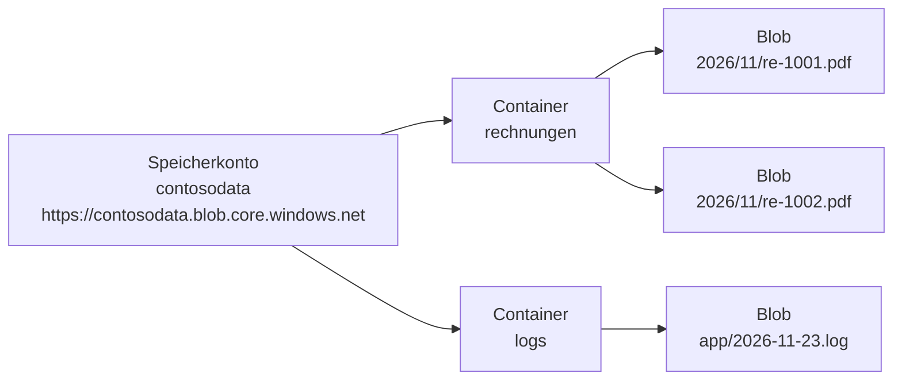
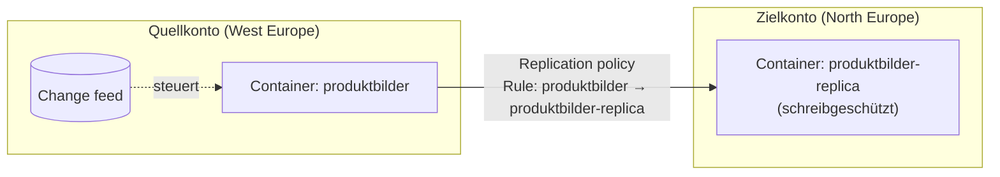
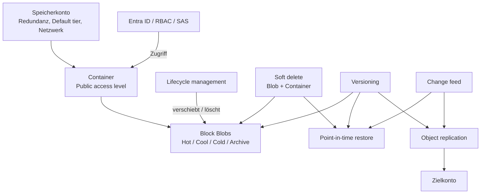

# 2.3 Azure Blob Storage

> **Domäne:** Implement and manage storage · **Gewichtung:** 15–20 %
> **Study-Guide-Punkte:** *Create and configure a container in Blob Storage* · *Configure storage tiers* · *Configure soft delete for blobs and containers* · *Configure snapshots and versioning* · *Configure blob lifecycle management* · *Configure blob object replication*
> (Speicherkonto & Redundanz → [Kapitel 2.1](01-speicherkonten-und-redundanz.md), Zugriff & Sicherheit → [Kapitel 2.2](02-speicherzugriff-und-sicherheit.md))
> **Stand:** November 2026

## Lernziele

Nach diesem Kapitel kann ich …

- Container anlegen, die Namensregeln anwenden und die **anonyme Zugriffsebene** (*Private*, *Blob*, *Container*) korrekt einstellen.
- die **Access tiers** Hot, Cool, Cold und Archive unterscheiden, Mindestaufbewahrung und *Early deletion fee* erklären und Blobs aus Archive **rehydrieren**.
- **Soft delete** für Blobs und Container, **Snapshots**, **Versioning**, **Change feed** und **Point-in-time restore** konfigurieren und gegeneinander abgrenzen.
- Regeln für **Lifecycle management** in JSON schreiben (Filter, Aktionen, Bedingungen).
- **Object replication** zwischen zwei Speicherkonten einrichten und ihre Voraussetzungen benennen.

## Überblick

**Azure Blob Storage** ist der Objektspeicher von Azure für große Mengen **unstrukturierter Daten** – Dokumente, Bilder, Videos, Backups, Logdateien, Data-Lake-Daten oder Festplatten-Images. Daten werden über HTTP(S) per REST-API, SDKs, AzCopy oder Storage Explorer angesprochen.

Für den Administrator sind drei Fragen zentral:

1. **Organisation & Zugriff:** Wie werden Daten in Containern abgelegt und wer darf sie lesen?
2. **Kosten:** In welcher **Zugriffsebene** (*Access tier*) liegen die Daten, und wie werden sie automatisch günstiger abgelegt (**Lifecycle management**)?
3. **Schutz & Verfügbarkeit:** Wie schützt man sich vor versehentlichem Löschen/Überschreiben (**Soft delete, Versioning, Snapshots, Point-in-time restore**) und wie werden Daten in ein anderes Konto/eine andere Region kopiert (**Object replication**)?

## Kernkonzepte

### Hierarchie: Speicherkonto > Container > Blob



- **Speicherkonto** (*Storage account*): Namensraum, Redundanz, Netzwerk- und Sicherheitseinstellungen ([2.1](01-speicherkonten-und-redundanz.md)).
- **Container**: Gruppiert Blobs (vergleichbar mit einem Ordner der obersten Ebene). Beliebig viele Container pro Konto.
- **Blob**: das eigentliche Objekt. Blob-URL: `https://<konto>.blob.core.windows.net/<container>/<blob>`.
- Ohne **hierarchischen Namespace** (Data Lake Storage Gen2) gibt es keine echten Ordner – `/` im Blobnamen erzeugt nur **virtuelle Verzeichnisse**.

**Namensregeln für Container:**

- **3–63 Zeichen**, nur **Kleinbuchstaben**, Ziffern und Bindestriche
- muss mit Buchstabe oder Ziffer beginnen; keine zwei aufeinanderfolgenden Bindestriche
- Sondercontainer: `$root` (Standardcontainer), `$web` (Static website), `$logs` (Storage Analytics), `$blobchangefeed` (Change feed)

### Blob-Typen

| Typ | Aufbau | Typischer Einsatz | Max. Größe (ca.) |
|---|---|---|---|
| **Block Blob** | aus Blöcken zusammengesetzt, effizienter Upload großer Dateien | Dokumente, Medien, Backups – der **Standard** | ~190,7 TiB |
| **Append Blob** | nur Anhängen am Ende möglich | Logdateien, Audit-Logs | ~195 GiB |
| **Page Blob** | 512-Byte-Seiten, wahlfreier Lese-/Schreibzugriff | VHD-Dateien (nicht verwaltete VM-Datenträger), Managed Disks intern | 8 TiB |

⚠️ **Access tiers, Lifecycle-Tiering und Object replication gelten nur für Block Blobs.** Der Blob-Typ wird beim Erstellen festgelegt und kann nicht geändert werden.

### Anonymer (öffentlicher) Zugriff

Anonymer Lesezugriff wird auf **zwei Ebenen** gesteuert:

1. **Speicherkonto:** *Allow Blob anonymous access* (`AllowBlobPublicAccess`). Bei neuen Konten standardmäßig **deaktiviert**. Ist sie deaktiviert, ist anonymer Zugriff für **alle** Container ausgeschlossen – egal wie der Container eingestellt ist.
2. **Container – Public access level:**

| Ebene | Wirkung |
|---|---|
| **Private (no anonymous access)** | Kein anonymer Zugriff (Standard). Zugriff nur mit Entra ID, Kontoschlüssel oder SAS. |
| **Blob (anonymous read access for blobs only)** | Einzelne Blobs anonym lesbar, wenn man die URL kennt; Container-Inhalt **nicht auflistbar**. |
| **Container (anonymous read access for containers and blobs)** | Blobs anonym lesbar **und** Container-Inhalt auflistbar. |

Authentifizierter Zugriff (Entra ID/RBAC, Schlüssel, SAS) → [Kapitel 2.2](02-speicherzugriff-und-sicherheit.md).

### Access tiers (Zugriffsebenen)

| Tier | Online? | Speicherkosten | Zugriffskosten | Mindestaufbewahrung | Einsatz |
|---|---|---|---|---|---|
| **Hot** | ✅ | am höchsten | am niedrigsten | – | häufig genutzte Daten |
| **Cool** | ✅ | niedriger | höher | **30 Tage** | selten genutzt, z. B. kurzfristige Backups |
| **Cold** | ✅ | noch niedriger | noch höher | **90 Tage** | sehr selten genutzt, aber sofort verfügbar |
| **Archive** | ❌ **offline** | am niedrigsten | am höchsten + Rehydrierung | **180 Tage** | Langzeitarchiv, Compliance |

- **Kontoebene – Default access tier:** gilt für Blobs **ohne** explizit gesetzten Tier (*inferred*). Einstellbar sind **Hot** oder **Cool** (in aktuellen API-Versionen auch Cold) – **nie Archive**.
- **Blobebene:** Tier pro Block Blob explizit setzen (Upload oder *Change tier*), auch **Archive**.
- **Early deletion fee:** Wird ein Blob vor Ablauf der Mindestaufbewahrung **gelöscht, überschrieben oder in einen anderen Tier verschoben**, wird die Restzeit anteilig berechnet.
- **Archive-Einschränkungen:** nur bei Redundanz **LRS, GRS, RA-GRS** – ⚠️ **nicht** bei ZRS, GZRS, RA-GZRS. Archive-Blobs können **nicht gelesen** und nicht geändert werden (nur Metadaten lesen, löschen, Tier ändern).
- **Premium Block Blob**-Konten haben **keine** Access tiers.

#### Rehydrierung aus Archive

Ein Archive-Blob muss erst in einen Online-Tier (Hot/Cool/Cold) überführt werden:

| Methode | Beschreibung |
|---|---|
| **Set Blob Tier** (*Change tier*) | Tier des **bestehenden** Blobs ändern. Während der Rehydrierung bleibt der Blob im Status *rehydrate-pending* im Archive. |
| **Copy Blob** | Archive-Blob in einen **neuen Blob** in einem Online-Tier kopieren; das Original bleibt im Archive. ⚠️ Empfohlen, wenn das Original noch keine 180 Tage im Archive liegt (keine Early deletion fee für das Original). |

| Rehydrate priority | Dauer |
|---|---|
| **Standard** | bis zu **15 Stunden** |
| **High** | i. d. R. **unter 1 Stunde** für Blobs **< 10 GB** (teurer) |

### Datenschutz-Funktionen

#### Soft delete

| Funktion | Schützt vor | Aufbewahrung | Wiederherstellen |
|---|---|---|---|
| **Blob soft delete** | Löschen von Blobs, Snapshots (und Überschreiben, wenn Versioning aus ist) | **1–365 Tage** | *Undelete* |
| **Container soft delete** | Löschen ganzer Container | **1–365 Tage** | *Restore container* |

- Im Portal bei neuen Konten standardmäßig aktiv (je **7 Tage**).
- Gelöschte Objekte sind im Portal über **Show deleted blobs / Show deleted containers** sichtbar.
- Soft-gelöschte Daten werden zum Tarif des jeweiligen Tiers **berechnet**.
- ⚠️ Container soft delete schützt **nicht** vor dem Löschen einzelner Blobs und Blob soft delete **nicht** vor dem Löschen des Containers – beide aktivieren. **Konto löschen** schützt keines von beiden (dafür: Resource Lock, [1.5](../01-identitaeten-und-governance/05-ressourcensperren-und-tags.md)).

#### Snapshots

- **Schreibgeschützte**, zeitpunktbezogene Kopie eines Blobs; identifiziert über einen **DateTime-Wert** im URL-Parameter `?snapshot=`.
- Werden **manuell** (bzw. per Skript/Anwendung) erstellt.
- Kosten nur für **geänderte/eindeutige Blöcke**.
- Ein Blob mit Snapshots kann nur gelöscht werden, wenn die Snapshots mitgelöscht werden (*Delete blob and its snapshots*).
- Wiederherstellen: Snapshot über den Basis-Blob kopieren (*Promote snapshot*).

#### Versioning

- Bei **jedem Schreib-/Löschvorgang** wird **automatisch** die vorherige Version als **Version** (mit *Version ID*) aufbewahrt.
- Die aktuelle Version ist änderbar, ältere Versionen sind schreibgeschützt; eine ältere Version kann zur aktuellen gemacht werden (*Make current version*).
- Jede Version kostet Speicher → **mit Lifecycle management** alte Versionen automatisch löschen.
- Voraussetzung für **Object replication** und **Point-in-time restore**.
- Mit Versioning wird beim Löschen der aktuelle Stand zu einer **vorherigen Version**; Microsoft empfiehlt Versioning **zusammen mit** Blob soft delete.

#### Change feed

- Geordnetes, dauerhaftes, schreibgeschütztes **Transaktionsprotokoll** aller Änderungen an Blobs und Blob-Metadaten.
- Wird im Container **`$blobchangefeed`** gespeichert (Avro-Format); Aufbewahrung konfigurierbar.
- Voraussetzung für **Object replication** (Quellkonto) und **Point-in-time restore**.

#### Point-in-time restore (PITR)

- Stellt **Block Blobs** in einem oder mehreren Containern auf einen früheren Zeitpunkt zurück.
- **Voraussetzungen:** **Blob soft delete** + **Versioning** + **Change feed** aktiviert; *Maximum restore point* (Tage) muss **kleiner** als die Soft-delete-Aufbewahrung sein.
- Nur Standard-GPv2-Konten; ⚠️ stellt **keine gelöschten Container** wieder her (dafür Container soft delete).

#### Immutable storage (WORM)

- **Time-based retention policy:** Blobs können für einen Zeitraum weder geändert noch gelöscht werden. Eine **gesperrte** (*locked*) Richtlinie kann nur verlängert, nicht verkürzt oder entfernt werden.
- **Legal hold:** Schutz ohne Zeitraum, bis der Hold (mit Tag) explizit entfernt wird.
- Auf **Container-** oder **Versionsebene** konfigurierbar; typisch für Compliance (z. B. SEC 17a-4).

### Lifecycle management

Regelbasierte Automatisierung, die Blobs **in günstigere Tiers verschiebt oder löscht**. Verfügbar für GPv2-, Blob-Storage- und (eingeschränkt) Premium-Block-Blob-Konten.

**Aufbau einer Regel:**

| Bestandteil | Optionen |
|---|---|
| **Filter** | `blobTypes` (**Pflicht**: `blockBlob`, `appendBlob`), `prefixMatch` (Container/Präfix, z. B. `logs/app`), `blobIndexMatch` (Blob index tags) |
| **Ziel** | `baseBlob` (aktuelle Version), `snapshot`, `version` |
| **Aktionen** | `tierToCool`, `tierToCold`, `tierToArchive`, `enableAutoTierToHotFromCool`, `delete` |
| **Bedingungen** | `daysAfterModificationGreaterThan`, `daysAfterCreationGreaterThan` (Snapshots/Versionen bzw. baseBlob), `daysAfterLastAccessTimeGreaterThan` (erfordert **Last access time tracking**), `daysAfterLastTierChangeGreaterThan` (nach Rehydrierung) |

**Beispiel (JSON):**

```json
{
  "rules": [
    {
      "enabled": true,
      "name": "logs-tiering",
      "type": "Lifecycle",
      "definition": {
        "filters": {
          "blobTypes": [ "blockBlob" ],
          "prefixMatch": [ "logs/" ]
        },
        "actions": {
          "baseBlob": {
            "tierToCool":    { "daysAfterModificationGreaterThan": 30 },
            "tierToArchive": { "daysAfterModificationGreaterThan": 90 },
            "delete":        { "daysAfterModificationGreaterThan": 365 }
          },
          "version": {
            "delete": { "daysAfterCreationGreaterThan": 90 }
          }
        }
      }
    }
  ]
}
```

- Die Richtlinie wird **etwa einmal täglich** ausgewertet. Neue/geänderte Regeln können **bis zu 24 Stunden** brauchen, bis sie greifen; die Ausführung selbst kann bei vielen Objekten länger dauern.
- Mehrere Aktionen auf denselben Blob: Die **günstigste** Aktion gewinnt (delete > tierToArchive > tierToCold > tierToCool).
- **Append Blobs** unterstützen nur `delete`.
- Eine Aktion „zurück nach Hot" gibt es nur als `enableAutoTierToHotFromCool` (bei Zugriff, nur zusammen mit einer Last-access-Bedingung).

### Object replication

Kopiert Block Blobs **asynchron** von einem Container im **Quellkonto** in einen Container im **Zielkonto**.



- **Voraussetzungen:** **Versioning** auf **Quell- und Zielkonto**, **Change feed** auf dem **Quellkonto**.
- Konten können in **verschiedenen Regionen, Abonnements und sogar Tenants** liegen (tenantübergreifend nur, wenn *Allow cross-tenant replication* aktiviert ist – bei neuen Konten standardmäßig aus).
- **Replication policy** pro Kontopaar mit einer oder mehreren **Rules** (je Quell-/Zielcontainer-Paar), optional mit Präfixfilter und Startzeitpunkt (nur neue Blobs, alle Blobs oder ab Datum).
- Der **Zielcontainer ist schreibgeschützt**, solange die Replikationsregel besteht.
- ⚠️ **Nicht repliziert:** Blobs im **Archive**-Tier, Snapshots; nicht unterstützt für Konten mit **hierarchischem Namespace** (Data Lake Gen2).
- Ein Quellkonto kann in **höchstens zwei** Zielkonten replizieren.
- Abgrenzung zu **GRS/GZRS** ([2.1](01-speicherkonten-und-redundanz.md)): GRS repliziert das **ganze Konto** in die **gepaarte Region** (Microsoft-gesteuert); Object replication repliziert **ausgewählte Container** in ein **beliebiges** Konto, und das Ziel ist sofort lesbar.

### Blob index tags

- Schlüssel-Wert-Paare direkt am Blob (bis zu **10 Tags** pro Blob), **durchsuchbar** über *Find Blobs by Tags*.
- Nutzbar als Filter in **Lifecycle management** (`blobIndexMatch`) und in ABAC-Bedingungen.
- Nicht verwechseln mit **Ressourcen-Tags** ([1.5](../01-identitaeten-und-governance/05-ressourcensperren-und-tags.md)) am Speicherkonto.

## Zusammenhänge



- **Speicherkonto & Redundanz** ([2.1](01-speicherkonten-und-redundanz.md)): Default access tier und Redundanz werden am Konto gesetzt; Archive nur mit LRS/GRS/RA-GRS.
- **Zugriff & Sicherheit** ([2.2](02-speicherzugriff-und-sicherheit.md)): Anonymer Zugriff vs. RBAC-Rollen (*Storage Blob Data Reader/Contributor/Owner*), SAS, Schlüssel, Firewall, Verschlüsselung.
- **Datenübertragung** ([2.5](05-datenuebertragung-azcopy-und-storage-explorer.md)): AzCopy und Storage Explorer laden Blobs hoch, setzen Tiers und kopieren zwischen Konten.
- **Kosten** ([1.7](../01-identitaeten-und-governance/07-kostenverwaltung-und-advisor.md)): Tiers und Lifecycle-Regeln sind der wichtigste Kostenhebel; Versionen, Snapshots und Soft delete erhöhen den Speicherverbrauch.
- **RBAC** ([1.3](../01-identitaeten-und-governance/03-rbac-zugriffsverwaltung.md)): *Contributor* verwaltet das Konto (Control plane), für Blob-Daten braucht man **Data-Rollen** (Data plane).
- **Resource Locks** ([1.5](../01-identitaeten-und-governance/05-ressourcensperren-und-tags.md)): schützen das **Konto** vor Löschung – nicht die Blobs darin.
- **Azure Backup** ([5.4](../05-monitoring-und-wartung/04-azure-backup.md)): *Operational backup* für Blobs basiert auf Point-in-time restore; *Vaulted backup* kopiert in einen Backup-Tresor.

## Vergleichstabellen

### Snapshot vs. Version vs. Soft delete

| Kriterium | Snapshot | Version | Soft delete |
|---|---|---|---|
| Entsteht | **manuell** | **automatisch** bei jedem Schreiben | automatisch beim Löschen |
| Ebene | Blob | Blob | Blob bzw. Container |
| Schreibgeschützt | ✅ | ✅ (ältere Versionen) | – |
| Begrenzte Aufbewahrung | nein (bis gelöscht) | nein (bis gelöscht/Lifecycle) | **1–365 Tage** |
| Voraussetzung für PITR / Object replication | ❌ | ✅ | ✅ (PITR) |

### Access tiers im Überblick

| Kriterium | Hot | Cool | Cold | Archive |
|---|---|---|---|---|
| Mindestaufbewahrung | – | 30 Tage | 90 Tage | 180 Tage |
| Latenz | ms | ms | ms | **Stunden** (Rehydrierung) |
| Als Default access tier am Konto | ✅ | ✅ | (neuere APIs) | ❌ |
| ZRS/GZRS unterstützt | ✅ | ✅ | ✅ | ❌ |

### Object replication vs. GRS vs. AzCopy

| Kriterium | Object replication | GRS / RA-GRS | AzCopy |
|---|---|---|---|
| Umfang | ausgewählte Container/Präfixe | ganzes Konto | beliebig, manuell/skriptgesteuert |
| Ziel | beliebiges Konto/Region/Abo | feste gepaarte Region | beliebig |
| Automatisch / kontinuierlich | ✅ asynchron | ✅ asynchron | ❌ (pro Ausführung) |
| Ziel lesbar | ✅ (schreibgeschützt) | nur RA-GRS / nach Failover | ✅ |
| Voraussetzungen | Versioning + Change feed | Redundanzoption | keine |

## Azure Portal

| Aufgabe | Pfad |
|---|---|
| Container anlegen | **Portal > Storage accounts > Konto > Data storage > Containers > + Container** |
| Anonymen Zugriff auf Kontoebene | **… > Konto > Settings > Configuration > Allow Blob anonymous access** |
| Public access level des Containers | **… > Containers > Container auswählen > Change access level** |
| Default access tier | **… > Konto > Settings > Configuration > Blob access tier (default)** |
| Tier eines Blobs ändern / rehydrieren | **… > Containers > Container > Blob > Change tier** (bei Archive: *Rehydrate priority*) |
| Blob hochladen mit Tier | **… > Containers > Container > Upload > Advanced > Access tier** |
| Soft delete, Versioning, Change feed, PITR | **… > Konto > Data management > Data protection** |
| Gelöschte Blobs anzeigen / wiederherstellen | **… > Containers > Container > Show deleted blobs** → Blob > **Undelete** |
| Gelöschte Container wiederherstellen | **… > Data storage > Containers > Show deleted containers** → **Undelete** |
| Snapshot erstellen / anzeigen | **… > Container > Blob > Snapshots > + Create snapshot** |
| Versionen anzeigen / wiederherstellen | **… > Container > Blob > Versions > Make current version** |
| Point-in-time restore ausführen | **… > Data storage > Containers > Restore containers** |
| Lifecycle management | **… > Konto > Data management > Lifecycle management > + Add a rule** (Rule builder oder *Code view*) |
| Last access time tracking | **… > Data management > Lifecycle management > Enable access tracking** |
| Object replication | **… > Konto > Data management > Object replication > Create replication rules** |
| Cross-tenant replication erlauben | **… > Data management > Object replication > Advanced settings** |
| Immutability policy | **… > Containers > Container > Access policy > Immutable blob storage > + Add policy** |
| Blob index tags | **… > Container > Blob > Overview > Blob index tags** |

**Wichtige Felder beim Anlegen eines Containers:** Name, *Anonymous access level*, unter *Advanced* ggf. Encryption scope und *Enable version-level immutability support*.

⚠️ **Nicht (oder nur eingeschränkt) änderbar:**
- **Blob-Typ** (Block/Append/Page) nach dem Erstellen
- Containername (umbenennen nicht möglich → neu anlegen und kopieren)
- Eine **gesperrte** Time-based retention policy kann nicht verkürzt/entfernt werden

## Azure CLI & PowerShell

### Azure CLI

```bash
# Anonymen Zugriff auf Kontoebene deaktivieren
az storage account update -n <konto> -g <resource-group> --allow-blob-public-access false

# Container anlegen (Auth über Entra ID)
az storage container create --name rechnungen --account-name <konto> \
  --auth-mode login --public-access off

# Blob mit Tier hochladen
az storage blob upload --account-name <konto> --container-name rechnungen \
  --name 2026/11/re-1001.pdf --file ./re-1001.pdf --tier Cool --auth-mode login

# Tier ändern bzw. aus Archive rehydrieren
az storage blob set-tier --account-name <konto> --container-name rechnungen \
  --name 2026/11/re-1001.pdf --tier Hot --rehydrate-priority High --auth-mode login

# Datenschutz: Soft delete, Container soft delete, Versioning, Change feed, PITR
az storage account blob-service-properties update \
  --account-name <konto> --resource-group <resource-group> \
  --enable-delete-retention true --delete-retention-days 14 \
  --enable-container-delete-retention true --container-delete-retention-days 14 \
  --enable-versioning true \
  --enable-change-feed true \
  --enable-restore-policy true --restore-days 7

# Snapshot erstellen
az storage blob snapshot --account-name <konto> --container-name rechnungen \
  --name 2026/11/re-1001.pdf --auth-mode login

# Gelöschten Blob wiederherstellen
az storage blob undelete --account-name <konto> --container-name rechnungen \
  --name 2026/11/re-1001.pdf --auth-mode login

# Last access time tracking aktivieren und Lifecycle-Richtlinie setzen
az storage account blob-service-properties update \
  --account-name <konto> -g <resource-group> --enable-last-access-tracking true
az storage account management-policy create \
  --account-name <konto> -g <resource-group> --policy @policy.json

# Object replication: zuerst Policy am Zielkonto, dann mit derselben Policy am Quellkonto
az storage account or-policy create -g <resource-group> \
  --account-name <zielkonto> --source-account <quellkonto> --destination-account <zielkonto> \
  --source-container produktbilder --destination-container produktbilder-replica \
  --min-creation-time "2026-11-01T00:00:00Z"
az storage account or-policy show -g <resource-group> --account-name <zielkonto> \
  --policy-id <policy-id> > or-policy.json
az storage account or-policy create -g <resource-group> \
  --account-name <quellkonto> --policy @or-policy.json
```

### Azure PowerShell

```powershell
# Kontext mit Entra-ID-Anmeldung
$ctx = New-AzStorageContext -StorageAccountName "<konto>" -UseConnectedAccount

# Container anlegen (kein anonymer Zugriff)
New-AzStorageContainer -Name "rechnungen" -Context $ctx -Permission Off

# Blob mit Tier hochladen
Set-AzStorageBlobContent -File ".\re-1001.pdf" -Container "rechnungen" `
  -Blob "2026/11/re-1001.pdf" -Context $ctx -StandardBlobTier Cool

# Tier eines bestehenden Blobs ändern
$blob = Get-AzStorageBlob -Container "rechnungen" -Blob "2026/11/re-1001.pdf" -Context $ctx
$blob.BlobClient.SetAccessTier("Archive")

# Soft delete für Blobs und Container
Enable-AzStorageBlobDeleteRetentionPolicy -ResourceGroupName "<resource-group>" `
  -StorageAccountName "<konto>" -RetentionDays 14
Enable-AzStorageContainerDeleteRetentionPolicy -ResourceGroupName "<resource-group>" `
  -StorageAccountName "<konto>" -RetentionDays 14

# Versioning und Change feed
Update-AzStorageBlobServiceProperty -ResourceGroupName "<resource-group>" `
  -StorageAccountName "<konto>" -IsVersioningEnabled $true -EnableChangeFeed $true

# Lifecycle-Regel: nach 30 Tagen Cool, nach 365 Tagen löschen
$action = Add-AzStorageAccountManagementPolicyAction -BaseBlobAction TierToCool `
  -DaysAfterModificationGreaterThan 30
$action = Add-AzStorageAccountManagementPolicyAction -InputObject $action `
  -BaseBlobAction Delete -DaysAfterModificationGreaterThan 365
$filter = New-AzStorageAccountManagementPolicyFilter -PrefixMatch "logs/" -BlobType blockBlob
$rule   = New-AzStorageAccountManagementPolicyRule -Name "logs-tiering" -Action $action -Filter $filter
Set-AzStorageAccountManagementPolicy -ResourceGroupName "<resource-group>" `
  -StorageAccountName "<konto>" -Rule $rule

# Object replication: Policy am Ziel anlegen, dann am Quellkonto übernehmen
$orRule = New-AzStorageObjectReplicationPolicyRule -SourceContainer "produktbilder" `
  -DestinationContainer "produktbilder-replica"
$destPolicy = Set-AzStorageObjectReplicationPolicy -ResourceGroupName "<resource-group>" `
  -StorageAccountName "<zielkonto>" -PolicyId default `
  -SourceAccount "<quellkonto>" -Rule $orRule
Set-AzStorageObjectReplicationPolicy -ResourceGroupName "<resource-group>" `
  -StorageAccountName "<quellkonto>" -InputObject $destPolicy
```

| Ziel | CLI | PowerShell |
|---|---|---|
| Container anlegen | `az storage container create` | `New-AzStorageContainer` |
| Blob hochladen | `az storage blob upload` | `Set-AzStorageBlobContent` |
| Tier ändern | `az storage blob set-tier` | `$blob.BlobClient.SetAccessTier()` |
| Soft delete / Versioning | `az storage account blob-service-properties update` | `Enable-AzStorageBlobDeleteRetentionPolicy`, `Update-AzStorageBlobServiceProperty` |
| Lifecycle | `az storage account management-policy create` | `Set-AzStorageAccountManagementPolicy` |
| Object replication | `az storage account or-policy create` | `Set-AzStorageObjectReplicationPolicy` |

## Praxisbeispiel

**Szenario:** *Contoso* speichert Rechnungs-PDFs und Anwendungslogs in Blob Storage (Konto `contosodata`, West Europe, Redundanz GRS). Anforderungen:

1. Rechnungen dürfen nicht öffentlich erreichbar sein; versehentlich gelöschte oder überschriebene Rechnungen müssen 30 Tage lang wiederherstellbar sein.
2. Logs werden nach 30 Tagen selten, nach 90 Tagen gar nicht mehr gelesen, müssen aber 2 Jahre aufbewahrt werden – zu minimalen Kosten.
3. Produktbilder für den Webshop sollen zusätzlich in einem Konto in North Europe lesbar vorliegen.

**Umsetzung:**

1. **Container & Zugriff:** *Settings > Configuration* → *Allow Blob anonymous access* = **Disabled**. Container `rechnungen` mit *Private* anlegen.
2. **Datenschutz:** *Data management > Data protection* →
   - *Enable soft delete for blobs* = **30 Tage**
   - *Enable soft delete for containers* = **30 Tage**
   - *Enable versioning for blobs* = an (schützt auch vor **Überschreiben**)
   - optional *Point-in-time restore* (aktiviert Change feed automatisch mit)
3. **Lifecycle:** *Data management > Lifecycle management* → Regel `logs-tiering` mit Filter `logs/`, Block Blobs:
   - **tierToCool** nach 30 Tagen, **tierToArchive** nach 90 Tagen, **delete** nach 730 Tagen
   - zusätzlich **Versionen** nach 90 Tagen löschen, damit Versioning die Kosten nicht treibt
   - Archive ist möglich, weil das Konto **GRS** (nicht GZRS) nutzt.
4. **Object replication:** Zielkonto `contosodatane` (North Europe) mit aktiviertem **Versioning**; am Quellkonto **Versioning + Change feed**. *Data management > Object replication > Create replication rules* → Quelle `produktbilder`, Ziel `produktbilder-replica`, *Copy over: Everything*.
5. **Kontrolle:** Kosten nach einigen Wochen in **Cost analysis** gefiltert auf das Konto prüfen ([1.7](../01-identitaeten-und-governance/07-kostenverwaltung-und-advisor.md)).

## Limits & wichtige Zahlen

| Wert | Grenze / Standard |
|---|---|
| Containername | **3–63** Zeichen, Kleinbuchstaben/Ziffern/Bindestriche |
| Mindestaufbewahrung Cool / Cold / Archive | **30 / 90 / 180 Tage** |
| Rehydrierung Standard / High | bis **15 h** / meist **< 1 h** (Blobs < 10 GB) |
| Blob soft delete / Container soft delete | **1–365 Tage** (Portal-Standard 7) |
| Lifecycle-Ausführung | ca. **einmal täglich**; neue Regeln bis zu **24 h** bis wirksam |
| Lifecycle-Regeln pro Richtlinie | bis zu **100** |
| Blob index tags pro Blob | bis zu **10** |
| Object replication: Zielkonten pro Quellkonto | höchstens **2** |
| Max. Blobgröße Block / Append / Page | ca. **190,7 TiB / 195 GiB / 8 TiB** |
| Archive-Redundanz | nur **LRS, GRS, RA-GRS** |

Aktuelle Werte: [Scalability and performance targets for Blob storage](https://learn.microsoft.com/azure/storage/blobs/scalability-targets).

## Prüfungstipps & Fallstricke

- ⚠️ **Blob im Archive kann nicht gelesen werden** → erst **rehydrieren** (Set tier oder Copy). „So schnell wie möglich" bei < 10 GB → **High priority**.
- ⚠️ **Archive nicht verfügbar** → Konto nutzt **ZRS/GZRS/RA-GZRS** oder es ist ein **Premium**-Konto.
- ⚠️ **Default access tier = Archive** gibt es nicht – Archive nur pro Blob.
- **Early deletion fee:** Blob nach 10 Tagen aus Cool gelöscht → 20 Tage werden nachberechnet. Archive-Blob nach 60 Tagen rehydriert (Set tier) → 120 Tage nachberechnet; **Copy Blob** vermeidet das für das Original.
- **„Schutz vor Überschreiben"** → **Versioning** (bzw. Soft delete erzeugt bei Überschreiben einen soft-gelöschten Snapshot, wenn Versioning aus ist). **„Schutz vor Löschen des Containers"** → **Container soft delete**.
- **Point-in-time restore** verlangt **Soft delete + Versioning + Change feed**; Restore-Zeitraum < Soft-delete-Zeitraum.
- **Object replication** verlangt **Versioning auf beiden** Konten und **Change feed auf der Quelle**; Archive-Blobs werden **nicht** repliziert; Zielcontainer ist **schreibgeschützt**.
- **Lifecycle-Regel greift nicht sofort** → bis zu 24 h + Ausführungszeit; nicht „Fehler suchen", sondern warten.
- **„Nach letztem Zugriff tiering"** → `daysAfterLastAccessTimeGreaterThan` + **Last access time tracking** aktivieren.
- **Append Blobs** im Lifecycle → nur **delete**; Tiers gelten nur für **Block Blobs**.
- **Anonymer Zugriff funktioniert trotz Container-Ebene „Blob" nicht** → *Allow Blob anonymous access* am **Konto** ist deaktiviert.
- **„Container-Inhalt soll anonym auflistbar sein"** → Ebene **Container**, nicht *Blob*.
- **Snapshots** sind **manuell**, **Versionen** automatisch – in der Prüfung oft vertauscht.
- **Resource Lock** auf dem Speicherkonto schützt **nicht** vor dem Löschen einzelner Blobs (Data plane).

## Selbsttest

**1.** Ein Blob liegt im Archive-Tier. Ein Anwender muss die 2-GB-Datei innerhalb von zwei Stunden lesen. Was tun Sie?

<details><summary>Lösung</summary>

Den Blob mit **Rehydrate priority = High** in **Hot** oder **Cool** überführen (*Change tier* oder Copy in einen neuen Blob). High priority rehydriert Blobs < 10 GB i. d. R. in unter einer Stunde; Standard kann bis zu 15 Stunden dauern.
</details>

**2.** Sie möchten bei einem Speicherkonto mit **GZRS** Blobs in den Archive-Tier verschieben. Die Option fehlt. Warum?

<details><summary>Lösung</summary>

Archive wird nur bei **LRS, GRS und RA-GRS** unterstützt – nicht bei ZRS, GZRS oder RA-GZRS. Redundanz ändern oder ein anderes Konto verwenden.
</details>

**3.** Sie möchten Object replication zwischen `contosoA` (Quelle) und `contosoB` (Ziel) einrichten. Welche Funktionen müssen aktiviert sein?

<details><summary>Lösung</summary>

**Versioning** auf **beiden** Konten und **Change feed** auf dem **Quellkonto** `contosoA`.
</details>

**4.** Ein Administrator hat Blob soft delete (14 Tage) aktiviert. Ein Kollege löscht versehentlich den gesamten Container. Können die Blobs wiederhergestellt werden?

<details><summary>Lösung</summary>

**Nein** – Blob soft delete schützt nicht vor dem Löschen des **Containers**. Dafür muss **Container soft delete** aktiviert sein.
</details>

**5.** Logs sollen 30 Tage nach der letzten Änderung in Cool, nach 180 Tagen in Archive verschoben und nach 3 Jahren gelöscht werden – ohne manuellen Aufwand. Welche Funktion?

<details><summary>Lösung</summary>

**Lifecycle management** mit einer Regel: `tierToCool` (30), `tierToArchive` (180), `delete` (1095) jeweils über `daysAfterModificationGreaterThan`, Filter `blobTypes: blockBlob` und ggf. `prefixMatch`.
</details>

**6.** Ein Blob wurde 45 Tage nach dem Verschieben in Cool gelöscht. Fällt eine Early deletion fee an?

<details><summary>Lösung</summary>

**Nein.** Die Mindestaufbewahrung für Cool beträgt 30 Tage; nach 45 Tagen fällt keine Gebühr an. (Bei Cold wären es 90, bei Archive 180 Tage.)
</details>

**7.** Ein Container hat die Zugriffsebene *Blob*, trotzdem erhalten anonyme Benutzer einen Fehler beim Abruf einer bekannten Blob-URL. Was ist die wahrscheinlichste Ursache?

<details><summary>Lösung</summary>

Am Speicherkonto ist **Allow Blob anonymous access** deaktiviert. Diese Kontoeinstellung übersteuert die Container-Ebene.
</details>

**8.** Sie wollen alle Block Blobs eines Containers auf den Stand von gestern 14:00 Uhr zurücksetzen. Welche Funktion, und was muss aktiviert sein?

<details><summary>Lösung</summary>

**Point-in-time restore**. Voraussetzungen: **Blob soft delete**, **Versioning** und **Change feed**; der Restore-Zeitraum muss kleiner als die Soft-delete-Aufbewahrung sein.
</details>

**9.** Welcher Unterschied besteht zwischen einem Snapshot und einer Version?

<details><summary>Lösung</summary>

Ein **Snapshot** wird **manuell** erstellt; eine **Version** entsteht bei aktiviertem Versioning **automatisch** bei jedem Schreib- oder Löschvorgang. Beide sind schreibgeschützt und kosten Speicher für geänderte Daten.
</details>

**10.** Eine Lifecycle-Regel wurde vor einer Stunde erstellt, aber noch kein Blob wurde verschoben. Was ist zu tun?

<details><summary>Lösung</summary>

**Abwarten.** Lifecycle-Richtlinien werden etwa einmal täglich ausgeführt; neue Regeln können bis zu 24 Stunden brauchen, bis sie greifen.
</details>

## Weiterführende Links

- [AZ-104 Study Guide](https://learn.microsoft.com/credentials/certifications/resources/study-guides/az-104)
- [Introduction to Azure Blob Storage](https://learn.microsoft.com/azure/storage/blobs/storage-blobs-introduction)
- [Configure anonymous read access for containers and blobs](https://learn.microsoft.com/azure/storage/blobs/anonymous-read-access-configure)
- [Access tiers for blob data](https://learn.microsoft.com/azure/storage/blobs/access-tiers-overview)
- [Blob rehydration from the archive tier](https://learn.microsoft.com/azure/storage/blobs/archive-rehydrate-overview)
- [Data protection overview](https://learn.microsoft.com/azure/storage/blobs/data-protection-overview)
- [Soft delete for blobs](https://learn.microsoft.com/azure/storage/blobs/soft-delete-blob-overview)
- [Soft delete for containers](https://learn.microsoft.com/azure/storage/blobs/soft-delete-container-overview)
- [Blob snapshots](https://learn.microsoft.com/azure/storage/blobs/snapshots-overview)
- [Blob versioning](https://learn.microsoft.com/azure/storage/blobs/versioning-overview)
- [Change feed support](https://learn.microsoft.com/azure/storage/blobs/storage-blob-change-feed)
- [Point-in-time restore for block blobs](https://learn.microsoft.com/azure/storage/blobs/point-in-time-restore-overview)
- [Immutable storage for blob data](https://learn.microsoft.com/azure/storage/blobs/immutable-storage-overview)
- [Lifecycle management overview](https://learn.microsoft.com/azure/storage/blobs/lifecycle-management-overview)
- [Object replication overview](https://learn.microsoft.com/azure/storage/blobs/object-replication-overview)
- [Blob index tags](https://learn.microsoft.com/azure/storage/blobs/storage-manage-find-blobs)
