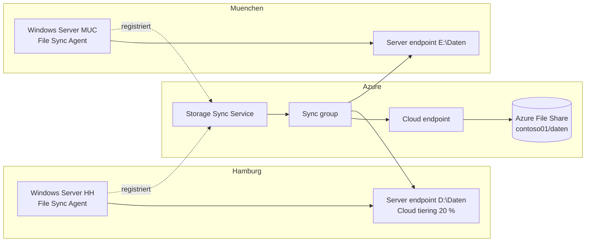
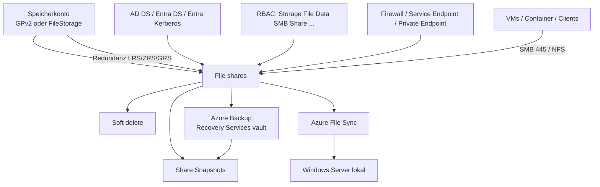

# 2.4 Azure Files

> **Domäne:** Implement and manage storage · **Gewichtung:** 15–20 %
> **Study-Guide-Punkte:** *Create and configure a file share in Azure Storage* · *Configure snapshots and soft delete for Azure Files* · Bezug zu *Configure identity-based access for Azure Files*
> (Identitätsbasierter Zugriff im Detail → [Kapitel 2.2](02-speicherzugriff-und-sicherheit.md))
> **Stand:** November 2026

## Lernziele

Nach diesem Kapitel kann ich …

- eine **Azure-Dateifreigabe** (*File share*) mit passendem Kontotyp, Tier, Protokoll und Kontingent anlegen.
- die Protokolle **SMB**, **NFS** und **REST** unterscheiden und ihre Voraussetzungen (Port 445, Premium, VNet) benennen.
- eine Freigabe unter **Windows**, **Linux** und **macOS** einbinden.
- **Share Snapshots** erstellen und daraus einzelne Dateien oder die ganze Freigabe wiederherstellen.
- **Soft Delete** für Dateifreigaben konfigurieren und gelöschte Freigaben wiederherstellen.
- die Komponenten von **Azure File Sync** (Storage Sync Service, Sync group, Cloud/Server endpoint, Cloud tiering) erklären.

## Überblick

**Azure Files** stellt vollständig verwaltete Dateifreigaben in der Cloud bereit, die über die Standardprotokolle **SMB** (*Server Message Block*) und **NFS** (*Network File System*) sowie über eine **REST-API** erreichbar sind. Clients binden eine Freigabe wie ein gewöhnliches Netzlaufwerk ein – es gibt keinen Dateiserver, der gepatcht oder gesichert werden muss.

Typische Einsatzzwecke:

- **Lift-and-Shift** klassischer Dateiserver und Anwendungen, die auf ein Netzlaufwerk angewiesen sind.
- **Gemeinsamer Speicher** für mehrere VMs oder Container (z. B. Konfigurationsdateien, Logs, Tools).
- **Hybride Szenarien** mit **Azure File Sync**: lokaler Windows-Server als Cache, Azure als zentrale Ablage.
- Benutzerprofile (*FSLogix*) für Azure Virtual Desktop.

Dateifreigaben leben in einem **Speicherkonto** ([Kapitel 2.1](01-speicherkonten-und-redundanz.md)) und erben dessen Redundanz, Netzwerk- und Verschlüsselungseinstellungen.

## Kernkonzepte

### Aufbau und Adressierung

```text
Speicherkonto  →  File service  →  File share  →  Verzeichnisse  →  Dateien
contoso01         (file)            daten           /projekte          plan.xlsx

UNC-Pfad (SMB):  \\contoso01.file.core.windows.net\daten
REST-URL:        https://contoso01.file.core.windows.net/daten/projekte/plan.xlsx
```

### Kontotypen und Leistungsstufen

| Kontotyp | Medium | Freigabetyp | Protokolle |
|---|---|---|---|
| **General-purpose v2 (GPv2)** | HDD | **Standard** File Shares | SMB, REST |
| **FileStorage** | **SSD** (Premium) oder HDD (Provisioned v2) | **Premium** bzw. Provisioned-Shares | SMB, **NFS** (nur SSD), REST |

⚠️ **Premium-Dateifreigaben** gibt es **nur** in einem Speicherkonto vom Typ **FileStorage** (Performance: *Premium*). Ein GPv2-Konto kann keine Premium-Freigaben enthalten, und der Kontotyp lässt sich nachträglich nicht ändern.

### Abrechnungsmodelle

| Modell | Prinzip | Wo |
|---|---|---|
| **Pay-as-you-go** | Bezahlt wird die **genutzte** Speichermenge + Transaktionen; Preis abhängig vom Tier | Standard-Freigaben in **GPv2** |
| **Provisioned v1** | Bezahlt wird die **bereitgestellte** Größe; IOPS und Durchsatz skalieren mit der Größe | Premium (SSD) in **FileStorage** |
| **Provisioned v2** | Speicher, IOPS und Durchsatz werden **getrennt** bereitgestellt und abgerechnet | **FileStorage** (SSD und HDD) |

### Zugriffsebenen (Tiers) für Standard-Freigaben

| Tier | Geeignet für | Speicherpreis | Transaktionspreis |
|---|---|---|---|
| **Transaction optimized** (Standard) | Transaktionslastige Workloads ohne Latenzanforderungen | höchster der drei | niedrigster |
| **Hot** | Allgemeine Dateifreigaben, Team-Shares, File Sync | mittel | mittel |
| **Cool** | Archiv-/Backup-ähnliche Daten, selten genutzt | niedrigster | höchster |

- Der Tier gilt **pro Freigabe** (nicht pro Datei wie bei Blob Storage) und kann jederzeit geändert werden – ein Wechsel verursacht Transaktionskosten.
- **Premium** (SSD) hat keine Tiers; die Leistung ergibt sich aus der bereitgestellten Größe bzw. den bereitgestellten IOPS.
- Es gibt **keinen Archive-Tier** für Azure Files.

### Kontingent (*Quota*) und Größe

- Jede Freigabe hat ein **Kontingent** in GiB – die Obergrenze, bis zu der sie wachsen darf.
- Maximale Größe einer Freigabe: **100 TiB**.
- Bei **Standard**-Freigaben in GPv2 liegt das Maximum ohne weitere Einstellung bei **5 TiB**; für bis zu 100 TiB muss am Speicherkonto **Large file shares** aktiviert werden. ⚠️ Diese Einstellung lässt sich **nicht wieder deaktivieren** und schränkt die wählbare Redundanz ein (prüfen, welche Redundanzoptionen für Large file shares in der Region unterstützt werden).
- Premium-Freigaben unterstützen 100 TiB ohne zusätzliche Einstellung.

### Protokolle

| Protokoll | Version | Voraussetzungen / Besonderheiten |
|---|---|---|
| **SMB** | 2.1, **3.0, 3.1.1** | **TCP-Port 445** muss ausgehend offen sein – wird von vielen ISPs und Firmennetzen **blockiert**. Verschlüsselung bei SMB 3.x. Clients: Windows, Linux, macOS. Identitätsbasierte Authentifizierung (AD DS, Entra Domain Services, Entra Kerberos) möglich. |
| **NFS** | **4.1** | ⚠️ **Nur Premium** (FileStorage, SSD). Zugriff **nur aus einem VNet** (Service Endpoint oder Private Endpoint), kein öffentlicher Internetzugang. **Keine** identitätsbasierte Authentifizierung (Entra/AD) – Berechtigungen über UNIX-Rechte (UID/GID) und Netzwerkregeln. Gedacht für Linux-Clients. |
| **REST** (FileREST) | HTTPS | Programmatischer Zugriff, Azure Portal, Storage Explorer, AzCopy ([2.5](05-datenuebertragung-azcopy-und-storage-explorer.md)) |

⚠️ Das Protokoll wird **beim Anlegen der Freigabe** festgelegt (*SMB* oder *NFS*) und kann danach nicht geändert werden. Eine Freigabe ist nie gleichzeitig über SMB und NFS erreichbar.

Hinweis zu **Secure transfer required**: Das Speicherkonto-Flag erzwingt HTTPS bzw. SMB mit Verschlüsselung. Ältere Clients ohne SMB-3-Verschlüsselung (z. B. SMB 2.1) können dann nicht einbinden. Für NFS-Freigaben gelten eigene Regeln zur Verschlüsselung in transit – vor der Einrichtung die aktuelle Dokumentation prüfen.

### Einbinden (Mount)

Das Portal liefert unter **File share > Connect** fertige Skripte für Windows, Linux und macOS (inkl. Port-445-Test).

**Windows (SMB):**

```powershell
# Prüfen, ob Port 445 erreichbar ist
Test-NetConnection -ComputerName contoso01.file.core.windows.net -Port 445

# Zugangsdaten speichern und Laufwerk Z: einbinden (Schlüsselbasiert)
cmd.exe /C "cmdkey /add:`"contoso01.file.core.windows.net`" /user:`"localhost\contoso01`" /pass:`"<storage-account-key>`""
New-PSDrive -Name Z -PSProvider FileSystem -Root "\\contoso01.file.core.windows.net\daten" -Persist

# Alternativ klassisch
net use Z: \\contoso01.file.core.windows.net\daten /user:localhost\contoso01 <storage-account-key>
```

**Linux (SMB):**

```bash
sudo mkdir -p /mnt/daten
sudo mount -t cifs //contoso01.file.core.windows.net/daten /mnt/daten \
  -o vers=3.1.1,username=contoso01,password=<storage-account-key>,serverino,dir_mode=0777,file_mode=0777
# Dauerhaft: Eintrag in /etc/fstab mit credentials=/etc/smbcredentials/contoso01.cred
```

**Linux (NFS 4.1, nur Premium, aus dem VNet):**

```bash
sudo mount -t nfs contoso01.file.core.windows.net:/contoso01/daten /mnt/daten \
  -o vers=4,minorversion=1,sec=sys
```

**macOS:** Im Finder *Gehe zu > Mit Server verbinden* → `smb://contoso01.file.core.windows.net/daten` (Benutzername = Kontoname, Kennwort = Speicherkontoschlüssel), oder per Terminal mit `mount_smbfs`.

> Mit **Speicherkontoschlüssel** hat der Client **Vollzugriff** auf alle Freigaben des Kontos (wie ein Superuser). Für Benutzerzugriff mit Berechtigungen pro Person: identitätsbasierte Authentifizierung (siehe unten und [2.2](02-speicherzugriff-und-sicherheit.md)).

### Identitätsbasierter Zugriff (Kurzfassung)

Details stehen in [Kapitel 2.2](02-speicherzugriff-und-sicherheit.md). Für die Freigabe gilt ein Zwei-Stufen-Modell:

1. **Identitätsquelle** am Speicherkonto aktivieren (genau eine): **AD DS** (lokales AD, Konto wird in AD als Computer-/Dienstkonto registriert), **Microsoft Entra Domain Services** oder **Microsoft Entra Kerberos** (für hybride Identitäten, z. B. Entra-joined Clients).
2. **Berechtigungen auf Freigabeebene** über Azure RBAC ([1.3](../01-identitaeten-und-governance/03-rbac-zugriffsverwaltung.md)): **Storage File Data SMB Share Reader**, **Storage File Data SMB Share Contributor**, **Storage File Data SMB Share Elevated Contributor** – oder eine *Default share-level permission* für alle authentifizierten Benutzer.
3. **Berechtigungen auf Verzeichnis-/Dateiebene** über **Windows-ACLs (NTFS)**, gesetzt z. B. mit dem Explorer oder `icacls`.

Die **effektive** Berechtigung ist die restriktivere der beiden Ebenen. Gruppen dafür stammen aus [1.1](../01-identitaeten-und-governance/01-entra-id-benutzer-und-gruppen.md) (bei AD DS: synchronisierte Gruppen).

### Share Snapshots

Ein **Share Snapshot** ist eine **schreibgeschützte**, zeitpunktbezogene Kopie der **gesamten Freigabe**.

- **Inkrementell:** Gespeichert (und berechnet) werden nur die seit dem letzten Snapshot geänderten Daten.
- Bis zu **200 Snapshots pro Freigabe**.
- Erstellt manuell (Portal, CLI, PowerShell, REST) oder automatisiert über **Azure Backup**.
- Snapshots werden **immer auf Freigabeebene** erstellt – nicht für einzelne Dateien oder Verzeichnisse. Die **Wiederherstellung** ist aber granular möglich:
  - einzelne Dateien/Ordner im Portal unter **Snapshots** durchsuchen und **Restore** (überschreiben oder als Kopie),
  - in Windows über **Vorgängerversionen** (*Previous Versions*) im Explorer, wenn die Freigabe eingebunden ist,
  - per AzCopy/Storage Explorer kopieren.
- ⚠️ Eine Freigabe, die Snapshots besitzt, kann nur gelöscht werden, wenn **die Snapshots mitgelöscht** werden (*Delete share including snapshots*).
- Snapshots liegen im selben Speicherkonto – sie schützen vor versehentlichem Ändern/Löschen von Dateien, **nicht** vor dem Verlust des Speicherkontos. Dafür: Redundanz ([2.1](01-speicherkonten-und-redundanz.md)) und Azure Backup.

### Soft Delete für Dateifreigaben

- Schützt **ganze Freigaben** vor versehentlichem Löschen (nicht einzelne Dateien – dafür Snapshots).
- Aufbewahrung: **1–365 Tage**, Standard **7 Tage**. Bei neuen Speicherkonten standardmäßig **aktiviert**.
- Gelöschte Freigaben erscheinen im Portal mit dem Schalter **Show deleted shares** und können per **Undelete** wiederhergestellt werden – inklusive aller Snapshots.
- Während der Aufbewahrung wird die gelöschte Freigabe weiterhin berechnet (bei Premium: nach bereitgestellter Größe).
- Einstellung gilt für **alle Freigaben im Speicherkonto** (Eigenschaft des File Service).

### Azure Backup für Azure Files

- Richtlinienbasierte, geplante Sicherung über einen **Recovery Services vault**.
- Standardmäßig **snapshotbasiert**: Azure Backup erstellt und verwaltet Share Snapshots nach Zeitplan und Aufbewahrungsregeln (täglich/wöchentlich/monatlich/jährlich). Zusätzlich gibt es eine *vaulted*-Variante, bei der die Daten in den Tresor kopiert werden.
- Wiederherstellung der ganzen Freigabe oder einzelner Dateien, an den Originalort oder einen anderen.
- Azure Backup aktiviert automatisch Soft Delete am Speicherkonto und setzt einen **Lock** (*AzureBackupProtectionLock*), damit das Konto nicht versehentlich gelöscht wird.

Details → [Kapitel 5.4 Azure Backup](../05-monitoring-und-wartung/04-azure-backup.md).

### Azure File Sync

**Azure File Sync** synchronisiert Azure-Dateifreigaben mit lokalen **Windows-Servern**. Der Server dient als schneller lokaler Cache; Azure ist die zentrale Quelle.

| Komponente | Beschreibung |
|---|---|
| **Storage Sync Service** | Azure-Ressource (Top-Level), die File Sync verwaltet. Wird in einer Region in einer Ressourcengruppe angelegt. |
| **Registered server** | Windows Server, auf dem der **Azure File Sync Agent** installiert und der beim Storage Sync Service registriert ist. ⚠️ Ein Server kann nur bei **einem** Storage Sync Service registriert sein. |
| **Sync group** | Definiert die Synchronisationstopologie: **genau ein Cloud endpoint** + ein oder mehrere Server endpoints. |
| **Cloud endpoint** | Verweis auf eine **Azure-Dateifreigabe** (SMB). Eine Freigabe kann nur Cloud endpoint in **einer** Sync group sein. |
| **Server endpoint** | Ein Pfad auf einem registrierten Server (z. B. `D:\Daten`). Ein Server kann Endpunkte in mehreren Sync groups haben (unterschiedliche, nicht verschachtelte Pfade). |

**Cloud Tiering** (optional, pro Server endpoint):

- Selten genutzte Dateien werden lokal durch **Reparse Points** (Platzhalter) ersetzt; der Inhalt liegt nur noch in Azure und wird bei Zugriff transparent nachgeladen.
- **Volume free space policy:** Prozentsatz, der auf dem Volume frei bleiben soll (z. B. 20 %). Wird er unterschritten, werden die am längsten nicht genutzten Dateien ausgelagert.
- **Date policy:** Dateien, auf die seit *X* Tagen nicht zugegriffen wurde, werden ausgelagert.
- Gelten beide, gewinnt die Volume-free-space-Policy.
- ⚠️ Cloud Tiering wird auf dem **Systemvolume nicht** unterstützt.

**Weitere Fakten:**

- Änderungen, die **direkt** in der Azure-Dateifreigabe gemacht werden (nicht über einen Server endpoint), erkennt File Sync über einen **Change-Detection-Job**, der standardmäßig **alle 24 Stunden** läuft.
- Typische Szenarien: Dateiserver-Konsolidierung, Multi-Site-Zugriff (mehrere Server an verschiedenen Standorten in einer Sync group), schnelle Disaster Recovery (neuen Server registrieren, Namespace sofort verfügbar).
- Netzwerk: Der Agent kommuniziert ausgehend über **HTTPS (443)** – Port 445 wird für File Sync **nicht** benötigt.



## Zusammenhänge



- **Speicherkonto** ([2.1](01-speicherkonten-und-redundanz.md)): Kontotyp (GPv2 vs. FileStorage) und Redundanz bestimmen, welche Freigaben möglich sind.
- **Zugriff & Sicherheit** ([2.2](02-speicherzugriff-und-sicherheit.md)): Speicherkontoschlüssel, SAS (nur REST), identitätsbasierte Authentifizierung, Firewall, Private Endpoints.
- **Netzwerk:** NFS benötigt ein VNet; für SMB aus dem Firmennetz oft **Private Endpoint** über VPN/ExpressRoute, weil Port 445 ins Internet gesperrt ist ([4.7](../04-netzwerk/07-service-endpoints-und-private-endpoints.md)).
- **Datenübertragung** ([2.5](05-datenuebertragung-azcopy-und-storage-explorer.md)): AzCopy und Storage Explorer kopieren Dateien in/aus Freigaben über REST.
- **Identitäten & RBAC** ([1.1](../01-identitaeten-und-governance/01-entra-id-benutzer-und-gruppen.md), [1.3](../01-identitaeten-und-governance/03-rbac-zugriffsverwaltung.md)): Freigabeberechtigungen werden an Gruppen vergeben.
- **Backup** ([5.4](../05-monitoring-und-wartung/04-azure-backup.md)): nutzt Share Snapshots und Soft Delete.
- **Compute** ([3.2](../03-compute/02-virtuelle-maschinen.md), [3.5](../03-compute/05-container-acr-aci-container-apps.md)): VMs und Container Instances binden Azure Files als gemeinsames Volume ein.

## Vergleichstabellen

### Azure Files vs. Blob Storage vs. Managed Disks vs. Azure NetApp Files

| Kriterium | Azure Files | Blob Storage | Managed Disks | Azure NetApp Files |
|---|---|---|---|---|
| Datenmodell | Dateisystem (Verzeichnisse) | Objekte in Containern (flach; hierarchisch mit ADLS Gen2) | Blockgerät (Volume) | Dateisystem |
| Zugriff | SMB, NFS 4.1, REST | REST/HTTPS, NFS 3.0, SFTP, BlobFuse | an **eine** VM angehängt (Shared Disks als Sonderfall) | SMB, NFS 3/4.1 |
| Mehrere Clients gleichzeitig | ✅ | ✅ | ❌ (außer Shared Disks) | ✅ |
| Typischer Einsatz | Dateiserver, Lift-and-Shift, gemeinsame Konfiguration | Unstrukturierte Daten, Backups, Medien, Data Lake | OS- und Datenträger von VMs | Hochleistungs-Workloads (SAP, HPC, Datenbanken) |
| Verwaltung | im Speicherkonto | im Speicherkonto | eigene Ressource | eigener Dienst (NetApp-Konto, Capacity pool, Volume) |
| Kapitel | dieses | [2.3](03-blob-storage.md) | [3.3](../03-compute/03-vm-datentraeger-und-verschluesselung.md) | – (nicht prüfungsrelevant im Detail) |

### Standard vs. Premium File Shares

| Kriterium | Standard | Premium |
|---|---|---|
| Kontotyp | GPv2 | **FileStorage** |
| Medium | HDD | SSD |
| Abrechnung | Pay-as-you-go (genutzte Menge) | Provisioned (bereitgestellte Größe/IOPS) |
| Tiers | Transaction optimized, Hot, Cool | – |
| Protokolle | SMB, REST | SMB, **NFS 4.1**, REST |
| Max. Größe | 5 TiB, mit **Large file shares** 100 TiB | 100 TiB |
| Redundanz | LRS, ZRS, GRS, GZRS (abhängig von Large file shares) | **LRS, ZRS** |
| Latenz | einstellige bis zweistellige ms | niedrige einstellige ms |

### Snapshots vs. Soft Delete vs. Azure Backup

| Kriterium | Share Snapshot | Soft Delete (Share) | Azure Backup |
|---|---|---|---|
| Schützt vor | Ändern/Löschen von **Dateien** | Löschen der **ganzen Freigabe** | beides + zeitplanbasierte Aufbewahrung |
| Granularität der Wiederherstellung | Datei, Ordner, Freigabe | ganze Freigabe | Datei, Ordner, Freigabe |
| Automatisierung | manuell (oder via Backup) | automatisch beim Löschen | Zeitplan + Richtlinie |
| Aufbewahrung | bis gelöscht (max. 200) | 1–365 Tage | bis zu Jahren (je nach Richtlinie) |
| Speicherort | im selben Speicherkonto | im selben Speicherkonto | Snapshots im Konto bzw. Kopie im Vault (*vaulted*) |

### SMB vs. NFS bei Azure Files

| Kriterium | SMB | NFS 4.1 |
|---|---|---|
| Freigabetyp | Standard & Premium | nur **Premium** |
| Port | 445 | 2049 |
| Zugriff aus dem Internet | ✅ (wenn Port 445 offen und Firewall erlaubt) | ❌ nur VNet |
| Identitätsbasierte Auth | ✅ AD DS / Entra DS / Entra Kerberos | ❌ (UID/GID, Netzwerkregeln) |
| Clients | Windows, Linux, macOS | Linux |
| Azure File Sync | ✅ | ❌ |
| Snapshots | ✅ | ✅ |

## Azure Portal

| Aufgabe | Pfad |
|---|---|
| Speicherkonto für Premium-Freigaben anlegen | **Portal > Storage accounts > + Create > Basics > Performance: Premium > Premium account type: File shares** |
| Freigabe anlegen | **Portal > Storage accounts > Konto > Data storage > File shares > + File share** |
| Tier / Kontingent ändern | **… > File shares > Freigabe > Overview > Change tier / Edit quota** (bzw. *Change size and performance* bei Provisioned) |
| Freigabe einbinden (Skript) | **… > File shares > Freigabe > Connect** (Windows / Linux / macOS, Port-445-Check) |
| Dateien durchsuchen / hochladen | **… > File shares > Freigabe > Browse** |
| Snapshot erstellen | **… > File shares > Freigabe > Operations > Snapshots > + Add snapshot** |
| Datei aus Snapshot wiederherstellen | **… > Snapshots > Snapshot > Datei auswählen > Restore** |
| Soft Delete konfigurieren | **… > Data storage > File shares > File share settings > Soft delete** (bzw. **Data management > Data protection**) |
| Gelöschte Freigabe wiederherstellen | **… > Data storage > File shares > Show deleted shares** → Freigabe **Undelete** |
| Large file shares aktivieren | **… > Data storage > File shares > File share settings > Large file shares** (bzw. **Settings > Configuration**) |
| Identitätsbasierten Zugriff aktivieren | **… > Data storage > File shares > File share settings > Identity-based access** |
| Freigabeberechtigungen (RBAC) | **… > File shares > Freigabe > Access control (IAM) > Add role assignment** |
| SMB-Sicherheitseinstellungen | **… > File shares > File share settings > Security** (SMB-Versionen, Kerberos-Verschlüsselung, Kanalverschlüsselung) |
| Backup aktivieren | **… > File shares > Freigabe > Operations > Backup** oder **Portal > Recovery Services vaults > Vault > + Backup** |
| Storage Sync Service anlegen | **Portal > Storage Sync Services > + Create** |
| Sync group anlegen | **Portal > Storage Sync Services > Dienst > Sync > Sync groups > + Sync group** |
| Server endpoint hinzufügen | **… > Sync groups > Sync group > Add server endpoint** (Pfad, Cloud tiering, Volume free space %, Date policy) |
| Registrierte Server anzeigen | **… > Storage Sync Services > Dienst > Sync > Registered servers** |

**Wichtige Felder beim Anlegen einer Freigabe:** Name (3–63 Zeichen, Kleinbuchstaben, Ziffern, Bindestriche), **Access tier** (Standard) bzw. **Provisioned capacity/IOPS/Throughput** (Provisioned), **Protocol** (SMB/NFS, nur bei Premium wählbar), bei NFS **Root squash**, Backup-Aktivierung.

⚠️ **Nach der Erstellung nicht mehr änderbar:**
- **Protokoll** der Freigabe (SMB ↔ NFS)
- **Kontotyp** des Speicherkontos (GPv2 ↔ FileStorage) und damit Standard ↔ Premium
- **Large file shares** (einmal aktiviert, nicht deaktivierbar)
- Name der Freigabe

## Azure CLI & PowerShell

### Azure CLI

```bash
# Standard-Freigabe (GPv2) mit 1 TiB Kontingent im Tier Hot anlegen
az storage share-rm create \
  --resource-group rg-storage \
  --storage-account contoso01 \
  --name daten \
  --quota 1024 \
  --access-tier Hot

# NFS-Freigabe in einem FileStorage-Konto (Premium)
az storage share-rm create \
  --resource-group rg-storage \
  --storage-account contosopremium01 \
  --name linuxdaten \
  --quota 1024 \
  --enabled-protocols NFS \
  --root-squash RootSquash

# Tier und Kontingent ändern
az storage share-rm update \
  --resource-group rg-storage --storage-account contoso01 \
  --name daten --access-tier Cool --quota 2048

# Freigaben auflisten (inkl. gelöschter)
az storage share-rm list --resource-group rg-storage --storage-account contoso01 \
  --include-deleted -o table

# Snapshot erstellen (Data plane, Kontoschlüssel oder --auth-mode login)
az storage share snapshot --name daten --account-name contoso01

# Soft Delete für Freigaben aktivieren (14 Tage)
az storage account file-service-properties update \
  --resource-group rg-storage --account-name contoso01 \
  --enable-delete-retention true --delete-retention-days 14

# Gelöschte Freigabe wiederherstellen (Version aus "list --include-deleted")
az storage share-rm restore \
  --resource-group rg-storage --storage-account contoso01 \
  --name daten --deleted-version <deleted-version>

# Large file shares am Konto aktivieren
az storage account update --resource-group rg-storage --name contoso01 \
  --enable-large-file-share
```

### Az PowerShell

```powershell
# Standard-Freigabe anlegen
New-AzRmStorageShare -ResourceGroupName "rg-storage" -StorageAccountName "contoso01" `
  -Name "daten" -QuotaGiB 1024 -AccessTier Hot

# Kontingent / Tier ändern
Update-AzRmStorageShare -ResourceGroupName "rg-storage" -StorageAccountName "contoso01" `
  -Name "daten" -QuotaGiB 2048 -AccessTier Cool

# Snapshot erstellen (Data plane über den Storage-Kontext)
$ctx   = (Get-AzStorageAccount -ResourceGroupName "rg-storage" -Name "contoso01").Context
$share = Get-AzStorageShare -Context $ctx -Name "daten"
$share.ShareClient.CreateSnapshot()

# Soft Delete für Freigaben aktivieren (14 Tage)
Update-AzStorageFileServiceProperty -ResourceGroupName "rg-storage" -StorageAccountName "contoso01" `
  -EnableShareDeleteRetentionPolicy $true -ShareRetentionDays 14

# Gelöschte Freigaben anzeigen und wiederherstellen
$deleted = Get-AzRmStorageShare -ResourceGroupName "rg-storage" -StorageAccountName "contoso01" `
  -IncludeDeleted | Where-Object { $_.Deleted -and $_.Name -eq "daten" }
Restore-AzRmStorageShare -ResourceGroupName "rg-storage" -StorageAccountName "contoso01" `
  -Name $deleted.Name -DeletedShareVersion $deleted.Version
```

### Azure File Sync (Az.StorageSync)

```powershell
# Storage Sync Service und Sync group anlegen
$svc = New-AzStorageSyncService -ResourceGroupName "rg-storage" -Name "sss-contoso" -Location "westeurope"
$grp = New-AzStorageSyncGroup -ParentObject $svc -Name "sg-daten"

# Cloud endpoint (Azure-Dateifreigabe)
$sa = Get-AzStorageAccount -ResourceGroupName "rg-storage" -Name "contoso01"
New-AzStorageSyncCloudEndpoint -ParentObject $grp -Name "ce-daten" `
  -StorageAccountResourceId $sa.Id -AzureFileShareName "daten"

# Auf dem lokalen Server (nach Agent-Installation): Server registrieren
$server = Register-AzStorageSyncServer -ParentObject $svc

# Server endpoint mit Cloud tiering (20 % frei halten)
New-AzStorageSyncServerEndpoint -ParentObject $grp -Name "se-hh-daten" `
  -ServerResourceId $server.ResourceId -ServerLocalPath "D:\Daten" `
  -CloudTiering -VolumeFreeSpacePercent 20
```

| Ziel | CLI | PowerShell |
|---|---|---|
| Freigabe anlegen | `az storage share-rm create` | `New-AzRmStorageShare` |
| Freigabe ändern | `az storage share-rm update` | `Update-AzRmStorageShare` |
| Snapshot | `az storage share snapshot` | `$share.ShareClient.CreateSnapshot()` |
| Soft Delete | `az storage account file-service-properties update` | `Update-AzStorageFileServiceProperty` |
| Wiederherstellen | `az storage share-rm restore` | `Restore-AzRmStorageShare` |

## Praxisbeispiel

**Szenario:** *Contoso* betreibt in Hamburg und München je einen alten Windows-Dateiserver. Ziele:

1. Zentrale Ablage in Azure, beide Standorte arbeiten mit schnellem lokalem Zugriff.
2. Lokale Server haben wenig Speicher – selten genutzte Dateien sollen nur in Azure liegen.
3. Benutzer sollen versehentlich gelöschte Dateien selbst wiederherstellen können.
4. Eine versehentlich gelöschte Freigabe muss 14 Tage lang wiederherstellbar sein.
5. Zugriff mit den bestehenden AD-Konten und NTFS-Rechten.

**Umsetzung:**

1. **Speicherkonto** `contoso01` (GPv2, Standard, ZRS) in *West Europe* anlegen ([2.1](01-speicherkonten-und-redundanz.md)), **Large file shares** aktivieren.
2. **Freigabe** `daten`: *Data storage > File shares > + File share*, Tier **Hot**, Kontingent 10 TiB.
3. **Soft Delete:** *File share settings > Soft delete* → **14 Tage**.
4. **Azure Backup:** *Freigabe > Backup* → Recovery Services vault, Richtlinie täglich 22:00 Uhr, 30 Tage Aufbewahrung. Die geplanten Snapshots erscheinen in Windows als **Vorgängerversionen** – Benutzer stellen Dateien selbst wieder her.
5. **Identitätsbasierter Zugriff:** *File share settings > Identity-based access* → **AD DS**, Speicherkonto mit dem Modul *AzFilesHybrid* in der Domäne registrieren; RBAC-Rolle **Storage File Data SMB Share Contributor** an die synchronisierte Gruppe `GG-Fileshare-Users`; NTFS-Rechte wie bisher ([2.2](02-speicherzugriff-und-sicherheit.md)).
6. **Azure File Sync:**
   - *Storage Sync Services > + Create* → `sss-contoso`
   - Agent auf beiden Servern installieren und registrieren
   - *Sync group* `sg-daten` mit Cloud endpoint `contoso01/daten`
   - Server endpoints `HH-FS01: D:\Daten` und `MUC-FS01: E:\Daten`, jeweils **Cloud tiering** mit **Volume free space 20 %** und **Date policy 60 Tage**
7. Ergebnis: Beide Standorte sehen denselben Namespace, häufig genutzte Dateien liegen lokal, der Rest wird bei Bedarf aus Azure nachgeladen. Port 445 ins Internet ist dafür **nicht** nötig (File Sync nutzt HTTPS).

## Limits & wichtige Zahlen

| Wert | Grenze / Standard |
|---|---|
| Max. Größe einer Freigabe | **100 TiB** |
| Standard-Freigabe ohne *Large file shares* | **5 TiB** |
| Max. Dateigröße | **4 TiB** |
| Share Snapshots pro Freigabe | **200** |
| Soft Delete Aufbewahrung | **1–365 Tage**, Standard **7** |
| SMB-Port | **TCP 445** |
| NFS-Version | **4.1** (nur Premium, nur VNet) |
| SMB-Versionen | 2.1, 3.0, 3.1.1 (Verschlüsselung ab 3.0) |
| File Sync: Cloud endpoints pro Sync group | **genau 1** |
| File Sync: Storage Sync Services pro registriertem Server | **1** |
| File Sync Change Detection (direkte Änderungen in Azure) | alle **24 Stunden** |
| Freigabename | 3–63 Zeichen, Kleinbuchstaben, Ziffern, Bindestriche |

Aktuelle Werte: [Azure Files scalability and performance targets](https://learn.microsoft.com/azure/storage/files/storage-files-scale-targets).

## Prüfungstipps & Fallstricke

- ⚠️ **Freigabe lässt sich vom Firmen-PC/aus dem Internet nicht einbinden** → meist ist **Port 445** blockiert. Lösungen: VPN/ExpressRoute + **Private Endpoint**, **Azure File Sync** oder REST-basierte Tools.
- ⚠️ **NFS-Freigabe gewünscht** → **Premium-Freigabe in einem FileStorage-Konto** + Zugriff aus einem **VNet**. Mit GPv2/Standard nicht möglich.
- ⚠️ **NFS + Entra-/AD-Authentifizierung** → nicht möglich; NFS nutzt UID/GID und Netzwerkregeln.
- **„Freigabe größer als 5 TiB im Standard-Tier"** → **Large file shares** am Speicherkonto aktivieren (irreversibel).
- **„Kosten senken für selten genutzte Freigabe"** → Tier **Cool**. Ein Archive-Tier existiert für Azure Files **nicht**.
- **„Einzelne Datei von gestern wiederherstellen"** → **Share Snapshot** (bzw. Azure Backup) → Restore oder *Previous Versions*. Soft Delete hilft hier **nicht** (gilt nur für ganze Freigaben).
- **„Gelöschte Freigabe wiederherstellen"** → **Soft Delete** + *Show deleted shares* → **Undelete**.
- ⚠️ **Snapshot einer einzelnen Datei/eines Ordners** → nicht möglich; Snapshots gelten immer für die **ganze Freigabe**.
- **„Dateiserver lokal behalten, aber Speicher in Azure auslagern"** → **Azure File Sync** mit **Cloud Tiering**.
- **„Mehrere Standorte, gleicher Datenbestand"** → eine **Sync group** mit **einem Cloud endpoint** und mehreren **Server endpoints**.
- ⚠️ **Zwei Azure-Dateifreigaben in einer Sync group** → nicht möglich (nur ein Cloud endpoint).
- ⚠️ **Server bei zwei Storage Sync Services registrieren** → nicht möglich.
- **Cloud Tiering auf C:** → nicht unterstützt (Systemvolume).
- **Datei direkt in der Azure-Freigabe geändert, erscheint erst spät auf dem Server** → Change Detection läuft nur alle 24 Stunden.
- **„Benutzer sollen nur ihre Ordner sehen, Anmeldung mit AD-Konto"** → identitätsbasierte Authentifizierung (AD DS) + RBAC auf Freigabeebene + **NTFS-ACLs** ([2.2](02-speicherzugriff-und-sicherheit.md)).
- Speicherkontoschlüssel = **Vollzugriff** auf alle Freigaben – nicht an Endbenutzer verteilen.

## Selbsttest

**1.** Sie müssen eine Dateifreigabe für Linux-VMs bereitstellen, die über **NFS 4.1** eingebunden wird. Welchen Speicherkontotyp und welche Leistungsstufe benötigen Sie?

<details><summary>Lösung</summary>

Ein Speicherkonto vom Typ **FileStorage** (Performance **Premium**) mit einer Premium-Freigabe und Protokoll **NFS**. Der Zugriff muss aus einem **VNet** erfolgen (Service Endpoint oder Private Endpoint). GPv2/Standard unterstützt kein NFS für Azure Files.
</details>

**2.** Ein Benutzer im Homeoffice kann `\\contoso01.file.core.windows.net\daten` nicht einbinden, `Test-NetConnection -Port 445` schlägt fehl. Was ist die wahrscheinlichste Ursache – und welche Lösungen gibt es?

<details><summary>Lösung</summary>

Der Internetanbieter blockiert **TCP-Port 445**. Lösungen: **VPN** (Point-to-Site/Site-to-Site) mit **Private Endpoint**, **Azure File Sync** auf einem lokalen Server (nutzt HTTPS/443) oder Zugriff über REST-basierte Tools (Portal, Storage Explorer).
</details>

**3.** Eine Mitarbeiterin hat gestern eine Excel-Datei überschrieben. Die Freigabe wird täglich mit Azure Backup gesichert. Wie stellt sie die Datei am schnellsten selbst wieder her?

<details><summary>Lösung</summary>

Im Windows-Explorer über **Vorgängerversionen** (*Previous Versions*) – die von Azure Backup erstellten **Share Snapshots** werden dort angezeigt. Alternativ der Admin im Portal unter *Snapshots > Restore* oder über den Recovery Services vault.
</details>

**4.** Ein Administrator hat die Freigabe `projekte` vor drei Tagen gelöscht. Soft Delete ist mit Standardwerten aktiv. Ist eine Wiederherstellung möglich?

<details><summary>Lösung</summary>

**Ja.** Standard-Aufbewahrung sind **7 Tage**. Im Portal unter *File shares* **Show deleted shares** aktivieren und **Undelete** wählen (oder `az storage share-rm restore` / `Restore-AzRmStorageShare`). Die Snapshots der Freigabe werden mit wiederhergestellt.
</details>

**5.** Eine Standard-Freigabe in einem GPv2-Konto soll auf 20 TiB vergrößert werden, die Einstellung ist aber auf 5 TiB begrenzt. Was müssen Sie tun?

<details><summary>Lösung</summary>

Am Speicherkonto **Large file shares** aktivieren. Danach sind bis zu **100 TiB** möglich. Die Einstellung kann nicht rückgängig gemacht werden.
</details>

**6.** Sie planen Azure File Sync für drei Standorte, die denselben Datenbestand nutzen sollen. Wie viele Sync groups, Cloud endpoints und Server endpoints benötigen Sie mindestens?

<details><summary>Lösung</summary>

**1 Sync group** mit **1 Cloud endpoint** (die Azure-Dateifreigabe) und **3 Server endpoints** (je einer pro Standortserver).
</details>

**7.** Auf einem Dateiserver soll mit Azure File Sync immer mindestens 30 % des Volumes frei bleiben; zusätzlich sollen Dateien, die 90 Tage nicht geöffnet wurden, ausgelagert werden. Welche Einstellungen?

<details><summary>Lösung</summary>

**Cloud tiering** am Server endpoint aktivieren mit **Volume free space policy = 30 %** und **Date policy = 90 Tage**. Bei Konflikt hat die Volume-free-space-Policy Vorrang.
</details>

**8.** Sie möchten Speicherkosten für eine Standard-Freigabe senken, auf die nur einmal im Monat für Audits zugegriffen wird. Welcher Tier ist geeignet, und gibt es einen Archive-Tier?

<details><summary>Lösung</summary>

Tier **Cool** (niedrigster Speicherpreis, höhere Transaktionskosten). Einen **Archive-Tier gibt es für Azure Files nicht** – nur für Blob Storage ([2.3](03-blob-storage.md)).
</details>

**9.** Sie versuchen, eine Freigabe zu löschen, erhalten aber einen Fehler. Die Freigabe besitzt 15 Snapshots. Woran liegt es?

<details><summary>Lösung</summary>

Eine Freigabe mit Snapshots kann nur zusammen mit ihren Snapshots gelöscht werden (**Delete share including snapshots**). Zusätzlich kann ein **Resource Lock** von Azure Backup oder ein manueller Lock ([1.5](../01-identitaeten-und-governance/05-ressourcensperren-und-tags.md)) das Löschen verhindern.
</details>

**10.** Welche Komponente müssen Sie auf einem lokalen Windows Server installieren, damit er an Azure File Sync teilnehmen kann, und wo wird er registriert?

<details><summary>Lösung</summary>

Den **Azure File Sync Agent**. Der Server wird anschließend bei **genau einem Storage Sync Service** registriert (*Registered servers*) und kann dann als **Server endpoint** in Sync groups verwendet werden.
</details>

## Weiterführende Links

- [AZ-104 Study Guide](https://learn.microsoft.com/credentials/certifications/resources/study-guides/az-104)
- [What is Azure Files?](https://learn.microsoft.com/azure/storage/files/storage-files-introduction)
- [Planning for an Azure Files deployment](https://learn.microsoft.com/azure/storage/files/storage-files-planning)
- [Understand Azure Files billing](https://learn.microsoft.com/azure/storage/files/understanding-billing)
- [Create an Azure file share](https://learn.microsoft.com/azure/storage/files/storage-how-to-create-file-share)
- [Mount SMB Azure file share on Windows](https://learn.microsoft.com/azure/storage/files/storage-how-to-use-files-windows)
- [Mount SMB Azure file share on Linux](https://learn.microsoft.com/azure/storage/files/storage-how-to-use-files-linux)
- [NFS file shares in Azure Files](https://learn.microsoft.com/azure/storage/files/files-nfs-protocol)
- [Overview of share snapshots for Azure Files](https://learn.microsoft.com/azure/storage/files/storage-snapshots-files)
- [Enable soft delete on Azure file shares](https://learn.microsoft.com/azure/storage/files/storage-files-enable-soft-delete)
- [About Azure Files backup](https://learn.microsoft.com/azure/backup/azure-file-share-backup-overview)
- [Overview of identity-based authentication for Azure Files](https://learn.microsoft.com/azure/storage/files/storage-files-active-directory-overview)
- [Planning for an Azure File Sync deployment](https://learn.microsoft.com/azure/storage/file-sync/file-sync-planning)
- [Cloud tiering overview](https://learn.microsoft.com/azure/storage/file-sync/file-sync-cloud-tiering-overview)
- [Azure Files scalability and performance targets](https://learn.microsoft.com/azure/storage/files/storage-files-scale-targets)
