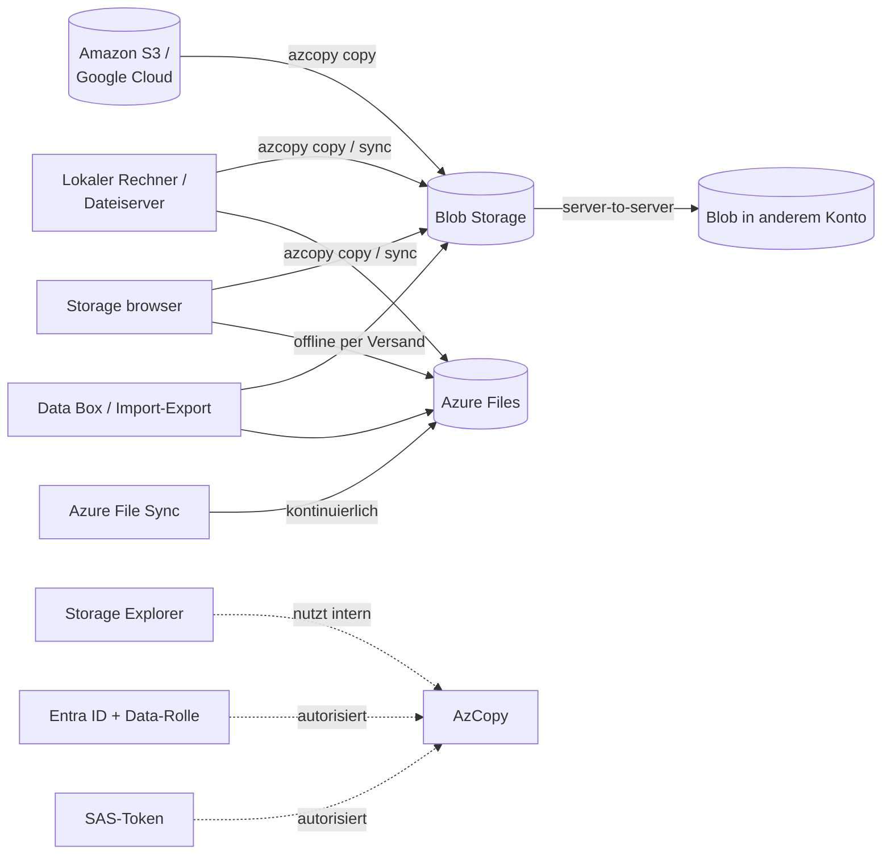

# 2.5 Datenübertragung mit AzCopy und Storage Explorer

> **Domäne:** Implement and manage storage · **Gewichtung:** 15–20 %
> **Study-Guide-Punkte:** *Manage data by using Azure Storage Explorer and AzCopy*
> (Zugriff per SAS/RBAC → [Kapitel 2.2](02-speicherzugriff-und-sicherheit.md) · Blob → [2.3](03-blob-storage.md) · Files → [2.4](04-azure-files.md))
> **Stand:** November 2026

## Lernziele

Nach diesem Kapitel kann ich …

- Daten mit **AzCopy v10** zwischen lokalem Dateisystem, Blob Storage, Azure Files und anderen Speicherkonten kopieren und synchronisieren.
- die passende **Autorisierung** für AzCopy wählen (Entra ID mit Data-Rollen, SAS, Managed Identity, Service Principal) und typische Berechtigungsfehler erklären.
- den Unterschied zwischen `azcopy copy` und `azcopy sync` (inkl. `--delete-destination`) benennen.
- **Azure Storage Explorer** und den **Storage browser** im Portal für die tägliche Datenverwaltung nutzen.
- für große Datenmengen oder geringe Bandbreite die richtige Alternative wählen (**Azure Data Box**, **Import/Export**, **Data Factory**, **Azure File Sync**).

## Überblick

Speicherkonten anzulegen ist nur die halbe Arbeit – die Daten müssen auch hinein, heraus oder zwischen Konten bewegt werden. Microsoft bietet dafür Werkzeuge für unterschiedliche Situationen:

- **AzCopy** – Kommandozeilenwerkzeug für schnelle, skriptbare und **parallele** Übertragungen. Ideal für Automatisierung, große Dateimengen und Konto-zu-Konto-Kopien.
- **Azure Storage Explorer** – kostenlose **grafische Desktop-Anwendung** zum Durchsuchen und Verwalten von Speicherkonten. Nutzt für Übertragungen intern AzCopy.
- **Storage browser** – die browserbasierte Variante direkt im Azure Portal.
- **Offline-/Massenübertragung** – Wenn das Netzwerk zu langsam ist, werden Daten physisch per **Data Box** oder **Import/Export** verschickt.

In der Prüfung geht es vor allem um: *Welcher Befehl/welches Tool?*, *Welche Berechtigung ist nötig?* und *Welche Methode passt zu Datenmenge und Bandbreite?*

## Kernkonzepte

### AzCopy v10

- **Einzelne ausführbare Datei** (`azcopy.exe` bzw. `azcopy`) für Windows, Linux und macOS – **keine Installation** nötig: herunterladen, entpacken, ausführen (optional in den `PATH` legen).
- Ist in der **Azure Cloud Shell** bereits vorinstalliert.
- Arbeitet **jobbasiert**: Jede Übertragung ist ein Job mit Job-ID, Plan-Datei und Log-Datei; abgebrochene Jobs lassen sich **fortsetzen**.
- Überträgt hochgradig **parallel** und nutzt bei Konto-zu-Konto-Kopien **server-to-server**-APIs (z. B. *Put Block From URL*) – die Daten fließen dabei **nicht** über den lokalen Rechner.
- Syntax: `azcopy <befehl> '<quelle>' '<ziel>' [optionen]`

**Unterstützte Quelle → Ziel-Kombinationen (Auswahl):**

| Quelle | Ziel |
|---|---|
| Lokal | Blob, Data Lake Storage Gen2, Azure Files |
| Blob / Data Lake Gen2 | Lokal, Blob (anderes Konto/Container), Azure Files |
| Azure Files | Lokal, Azure Files, Blob |
| **Amazon S3** | **Blob** |
| **Google Cloud Storage** | **Blob** |

⚠️ S3 und Google Cloud Storage sind **nur als Quelle** möglich, Ziel ist immer **Blob Storage**.

### Autorisierung von AzCopy

| Methode | Funktionsweise | Erforderliche Berechtigung |
|---|---|---|
| **Microsoft Entra ID** (`azcopy login`) | Interaktive Anmeldung (Device Code / Browser) | **Data-plane-Rolle**, z. B. **Storage Blob Data Contributor** (Schreiben) oder **Storage Blob Data Reader** (Lesen) |
| **Managed Identity** (`azcopy login --identity`) | Auf einer Azure-VM/einem Dienst ohne Geheimnis | Data-plane-Rolle für die Identität |
| **Service Principal** (`azcopy login --service-principal`) | Für Skripte/Pipelines; Secret per Umgebungsvariable `AZCOPY_SPA_CLIENT_SECRET` oder Zertifikat | Data-plane-Rolle für den Service Principal |
| **SAS-Token** | An die URL angehängt: `https://<konto>.blob.core.windows.net/<container>?<sas>` | Rechte, die im SAS festgelegt sind (z. B. `racwdl`) |

⚠️ **Owner** oder **Contributor** reichen für `azcopy login` **nicht** aus! Diese Rollen sind *Control-plane*-Rollen (Verwaltung der Ressource). Für Datenzugriff mit Entra ID braucht man eine **Storage … Data …**-Rolle (siehe [2.2](02-speicherzugriff-und-sicherheit.md) und [1.3](../01-identitaeten-und-governance/03-rbac-zugriffsverwaltung.md)). Neue Rollenzuweisungen können einige Minuten brauchen, bis sie wirksam sind.

**Azure Files:** Klassisch wird für AzCopy mit Azure Files ein **SAS-Token** verwendet. Neuere AzCopy-Versionen unterstützen auch Entra ID für Azure Files (Rollen *Storage File Data Privileged Reader/Contributor*). **Speicherkontoschlüssel** (Account Key) werden von AzCopy **nicht direkt** als Parameter unterstützt – man erzeugt daraus einen SAS.

**Konto-zu-Konto-Kopie:** Die Quelle wird typischerweise per **SAS** angegeben (mindestens Lese- und Listenrechte), das Ziel per SAS oder Entra ID.

**Amazon S3 / Google Cloud:** Zugangsdaten per Umgebungsvariablen (`AWS_ACCESS_KEY_ID`/`AWS_SECRET_ACCESS_KEY` bzw. `GOOGLE_APPLICATION_CREDENTIALS`), das Azure-Ziel per SAS oder Entra ID.

### Die wichtigsten AzCopy-Befehle

| Befehl | Zweck |
|---|---|
| `azcopy login` / `azcopy logout` | Anmeldung/Abmeldung mit Entra ID |
| `azcopy make` | Container bzw. Dateifreigabe erstellen |
| `azcopy copy` | Dateien/Verzeichnisse kopieren (Upload, Download, Konto-zu-Konto) |
| `azcopy sync` | Quelle und Ziel **synchronisieren** (nur geänderte/neue Dateien) |
| `azcopy list` | Inhalt eines Containers/einer Freigabe auflisten |
| `azcopy remove` | Blobs/Dateien löschen |
| `azcopy jobs list` / `show` / `resume` / `clean` | Jobs anzeigen, fortsetzen, aufräumen |
| `azcopy bench` | Leistungstest (Benchmark) gegen ein Ziel durchführen |
| `azcopy env` | Unterstützte Umgebungsvariablen anzeigen |

### `azcopy copy` vs. `azcopy sync`

- **`copy`** überträgt alles, was durch Quelle/Filter ausgewählt ist. Mit `--overwrite` (`true` Standard, `false`, `prompt`, `ifSourceNewer`) wird gesteuert, ob vorhandene Ziele überschrieben werden. Unterstützt alle Kombinationen inkl. S3/GCS.
- **`sync`** vergleicht Quelle und Ziel (standardmäßig über **Dateiname und Last-Modified-Zeitstempel**) und überträgt nur **neue oder geänderte** Dateien. Arbeitet immer **rekursiv**.
  - `--delete-destination true|false|prompt` – löscht im Ziel Dateien, die in der Quelle **nicht mehr existieren** (Standard: `false`). Damit wird das Ziel ein echter Spiegel der Quelle.
  - Unterstützt Lokal ↔ Blob, Lokal ↔ Files, Blob ↔ Blob, Files ↔ Files (nicht S3/GCS).

### Wichtige Optionen

| Option | Bedeutung |
|---|---|
| `--recursive` | Verzeichnisse inkl. Unterverzeichnisse kopieren (bei `copy` für Ordner nötig) |
| `--include-pattern "*.jpg;*.png"` | Nur passende Dateinamen (Platzhalter `*`, Trennung mit `;`) |
| `--exclude-pattern` / `--exclude-path` | Dateien bzw. Pfade ausschließen |
| `--include-after` / `--include-before` | Nach Änderungszeitpunkt filtern |
| `--block-blob-tier Hot\|Cool\|Cold\|Archive` | Zugriffsebene beim Upload direkt setzen ([2.3](03-blob-storage.md)) |
| `--blob-type BlockBlob\|PageBlob\|AppendBlob` | Blob-Typ beim Upload (z. B. PageBlob für VHDs) |
| `--overwrite` | Verhalten bei vorhandenen Zielen |
| `--dry-run` | Nur anzeigen, was passieren würde |
| `--cap-mbps` | Bandbreite begrenzen |
| `--put-md5` / `--check-md5` | MD5-Hash setzen bzw. beim Download prüfen |
| `--log-level` | Ausführlichkeit des Logs (`INFO`, `WARNING`, `ERROR`, `NONE`) |
| `--as-subdir` | Ordnername der Quelle als Unterordner im Ziel anlegen |

### Logs, Plan-Dateien und Jobs

- Pro Job legt AzCopy eine **Log-Datei** und eine **Plan-Datei** ab – standardmäßig im Ordner `.azcopy` im Benutzerverzeichnis (`%USERPROFILE%\.azcopy` bzw. `~/.azcopy`).
- Speicherort änderbar über `AZCOPY_LOG_LOCATION` und `AZCOPY_JOB_PLAN_LOCATION`.
- Abgebrochener Job: `azcopy jobs list` → Job-ID → `azcopy jobs resume <job-id>`. Bei SAS-Autorisierung muss das SAS erneut übergeben werden (`--source-sas`, `--destination-sas`), da es aus Sicherheitsgründen nicht im Plan gespeichert wird.
- Fehlgeschlagene Dateien findet man im Log (Suche nach `UPLOADFAILED`, `COPYFAILED`, `DOWNLOADFAILED`) oder per `azcopy jobs show <job-id> --with-status=Failed`.
- Leistung: Parallelität über `AZCOPY_CONCURRENCY_VALUE`, Pufferspeicher über `AZCOPY_BUFFER_GB`.

### Azure Storage Explorer

- **Kostenlose Desktop-Anwendung** für **Windows, macOS und Linux**.
- Nutzt für Uploads/Downloads/Kopien **intern AzCopy** – daher ähnlich schnell.
- **Verbindungsmöglichkeiten:**
  - Anmeldung mit **Azure-Konto (Entra ID)** → alle Abonnements und Speicherkonten, auf die man Zugriff hat
  - **Storage account name + Account key**
  - **Connection string**
  - **SAS-URL** (für ein Konto, einen Container, eine Freigabe, Queue oder Tabelle)
  - **Lokaler Emulator** (Azurite)
- **Funktionen:**
  - Blob Container, Data Lake Gen2 (inkl. **ACLs**), **File shares**, **Queues**, **Tables** und **Managed Disks** (Upload/Download/Kopie von VHDs) verwalten
  - Dateien hoch-/herunterladen, kopieren, umbenennen, löschen (Drag & Drop)
  - **SAS erzeugen** (*Get Shared Access Signature*) und **Stored Access Policies** verwalten (*Manage Access Policies*)
  - **Access Tier** von Blobs ändern (Hot/Cool/Cold/Archive) und Rehydrierung anstoßen
  - **Snapshots** erstellen/anzeigen, **Versionen** anzeigen
  - **Soft-deleted Blobs** anzeigen und wiederherstellen (*Undelete*)
  - Eigenschaften und Metadaten bearbeiten, Container-Zugriffsebene (*Public access level*) setzen
- **Berechtigungen:** Mit Entra-Anmeldung versucht Storage Explorer standardmäßig, die **Kontoschlüssel abzurufen** (benötigt `listKeys`, z. B. über *Contributor*/*Storage Account Contributor*). Hat man diese Berechtigung nicht, ist für den Datenzugriff eine **Data-plane-Rolle** nötig. Mindestens eine Rolle mit **Lesezugriff auf das Speicherkonto** (z. B. *Reader*) wird gebraucht, damit das Konto überhaupt in der Liste erscheint.

### Storage browser im Azure Portal

- Browserbasierte Datenverwaltung direkt im Portal (**Speicherkonto > Storage browser**): Container, Freigaben, Queues und Tabellen durchsuchen, hoch-/herunterladen, SAS erzeugen, Access Tier ändern, gelöschte Blobs anzeigen.
- Kein Download nötig, aber für viele/große Dateien weniger geeignet als AzCopy.
- Authentifizierung: **Access key** oder **Microsoft Entra user account** (umschaltbar je Container/Freigabe; für Entra wieder Data-Rolle erforderlich).

### Alternativen für große Datenmengen

| Werkzeug | Art | Einsatz |
|---|---|---|
| **Azure Data Box Disk** | Offline – Microsoft schickt SSDs (mehrere Disks, insgesamt im Bereich **einiger zehn TB**) | Mittlere Datenmengen ohne ausreichende Bandbreite |
| **Azure Data Box** | Offline – robustes Gerät von Microsoft (nutzbare Kapazität im Bereich **~100 TB**, neuere Generationen mehr) | Große Migrationen |
| **Azure Data Box Heavy** | Offline – Gerät im Bereich **~1 PB** | Sehr große Datenmengen (Verfügbarkeit regional prüfen) |
| **Azure Import/Export** | Offline – **eigene Festplatten** (SATA HDD/SSD), mit **BitLocker** verschlüsselt, vorbereitet mit dem **WAImportExport**-Tool | Import in Blob **und** Azure Files; **Export nur aus Blob** |
| **Azure Data Factory** | Online – Orchestrierung/ETL-Pipelines, Copy Activity mit vielen Quellen | Wiederkehrende, geplante Datenintegration |
| **Azure File Sync** | Online – kontinuierliche Synchronisierung Windows-Dateiserver ↔ Azure Files | Hybride Dateiserver ([2.4](04-azure-files.md)) |
| **AzCopy / Storage Explorer** | Online | Bis einige TB bei ausreichender Bandbreite, Ad-hoc und Skripte |

Data Box und Import/Export werden im Portal als **Auftrag (Order/Job)** angelegt; die Daten werden im Azure-Rechenzentrum in das Ziel-Speicherkonto geladen und die Datenträger anschließend sicher gelöscht.

## Zusammenhänge



- **Zugriff & Sicherheit** ([2.2](02-speicherzugriff-und-sicherheit.md)): AzCopy und Storage Explorer brauchen entweder einen **SAS**, einen **Kontoschlüssel** (Storage Explorer) oder **Entra ID + Data-Rolle**. Ist *Allow storage account key access* deaktiviert, funktionieren Schlüssel und Konto-SAS nicht mehr – dann nur Entra ID bzw. User-Delegation-SAS.
- **Netzwerk:** Firewall-Regeln des Speicherkontos ([2.2](02-speicherzugriff-und-sicherheit.md)) gelten auch für AzCopy – die öffentliche IP des Clients muss erlaubt sein oder der Zugriff erfolgt über einen **Private Endpoint** ([4.7](../04-netzwerk/07-service-endpoints-und-private-endpoints.md)).
- **Blob Storage** ([2.3](03-blob-storage.md)): Access Tier beim Upload setzen, Soft Delete/Versionen in Storage Explorer verwalten.
- **Azure Files** ([2.4](04-azure-files.md)): Daten per AzCopy/Storage Explorer migrieren oder per Azure File Sync kontinuierlich synchronisieren.
- **RBAC** ([1.3](../01-identitaeten-und-governance/03-rbac-zugriffsverwaltung.md)): Unterscheidung Control plane (Owner, Contributor) vs. Data plane (Storage Blob Data …).
- **VM-Datenträger** ([3.3](../03-compute/03-vm-datentraeger-und-verschluesselung.md)): VHDs lassen sich mit AzCopy (`--blob-type PageBlob`) bzw. Storage Explorer hochladen.

## Vergleichstabellen

### AzCopy vs. Storage Explorer vs. Storage browser

| Kriterium | AzCopy | Storage Explorer | Storage browser (Portal) |
|---|---|---|---|
| Oberfläche | Kommandozeile | Desktop-GUI | Web-GUI |
| Installation | keine (eine Datei) | Desktop-Installation | keine |
| Automatisierung/Skripte | ✅ | ❌ | ❌ |
| Große Datenmengen | ✅ sehr gut | ✅ gut (nutzt AzCopy) | ⚠️ eingeschränkt |
| Konto-zu-Konto (server-side) | ✅ | ✅ | ⚠️ eingeschränkt |
| S3/GCS als Quelle | ✅ | ❌ | ❌ |
| Queues/Tables verwalten | ❌ | ✅ | ✅ |
| SAS erzeugen | ❌ | ✅ | ✅ |
| Autorisierung | Entra ID, SAS | Entra ID, Key, SAS, Connection string | Access key, Entra ID |

### `azcopy copy` vs. `azcopy sync`

| Kriterium | copy | sync |
|---|---|---|
| Überträgt | alles (gemäß Filter) | nur neue/geänderte Dateien |
| Rekursiv | mit `--recursive` | immer |
| Löschen im Ziel | ❌ | ✅ mit `--delete-destination true` |
| S3/GCS als Quelle | ✅ | ❌ |
| Typischer Einsatz | Erstmigration, einmalige Kopie | regelmäßiger Abgleich/Spiegel |

### Online oder offline? – Entscheidungsmatrix

| Datenmenge | Gute Bandbreite | Geringe Bandbreite |
|---|---|---|
| bis einige TB | **AzCopy**, Storage Explorer | AzCopy (dauert länger) oder **Data Box Disk** |
| zehn bis ~100 TB | AzCopy, Data Factory | **Data Box Disk** / **Data Box** |
| hunderte TB bis PB | Data Factory / AzCopy (lange Dauer) | **Data Box** (mehrere) / **Data Box Heavy** |
| eigene Festplatten vorhanden | – | **Azure Import/Export** |
| kontinuierlich, hybrider Dateiserver | **Azure File Sync** | Azure File Sync (mit Cloud Tiering) |

## Azure Portal

| Aufgabe | Pfad |
|---|---|
| Daten im Portal verwalten | **Portal > Storage accounts > Konto > Storage browser** |
| Blob hochladen | **Portal > Storage accounts > Konto > Data storage > Containers > Container > Upload** (unter *Advanced*: Blob type, Block size, **Access tier**, Upload to folder) |
| Datei in Freigabe hochladen | **… > Data storage > File shares > Freigabe > Browse > Upload** |
| Konto-SAS für AzCopy erzeugen | **… > Security + networking > Shared access signature** |
| Container-SAS erzeugen | **… > Data storage > Containers > Container > Shared access tokens** (oder Kontextmenü *Generate SAS*) |
| Data-Rolle für `azcopy login` vergeben | **… > Konto > Access control (IAM) > Add role assignment > Storage Blob Data Contributor** |
| In Storage Explorer öffnen | **… > Konto > Overview > Open in Explorer** |
| Storage Explorer herunterladen | über **Storage browser** bzw. *Open in Explorer* → Download-Link |
| Kontoschlüssel-Zugriff prüfen | **… > Settings > Configuration > Allow storage account key access** |
| Data Box bestellen | **Portal > Azure Data Box > + Create** (Abonnement, Ressourcengruppe, Quellland, Zielregion, Gerätetyp) |
| Import/Export-Auftrag anlegen | **Portal > Import/export jobs > + Create** (Import into Azure / Export from Azure) |

## Azure CLI & PowerShell

### AzCopy

```bash
# Anmelden mit Entra ID (Device Code), mit Managed Identity oder Service Principal
azcopy login --tenant-id <tenant-id>
azcopy login --identity
export AZCOPY_SPA_CLIENT_SECRET="<client-secret>"
azcopy login --service-principal --application-id <app-id> --tenant-id <tenant-id>

# Container erstellen
azcopy make 'https://contosodata.blob.core.windows.net/backup'

# Einzelne Datei hochladen
azcopy copy './bericht.pdf' 'https://contosodata.blob.core.windows.net/backup/bericht.pdf'

# Verzeichnis rekursiv hochladen, nur Bilder, direkt in die Cool-Ebene
azcopy copy './bilder' 'https://contosodata.blob.core.windows.net/backup' \
  --recursive --include-pattern '*.jpg;*.png' --block-blob-tier Cool

# Container herunterladen (mit SAS statt Entra-Anmeldung)
azcopy copy 'https://contosodata.blob.core.windows.net/backup?<sas>' './restore' --recursive

# Konto-zu-Konto (server-to-server), Quelle mit SAS
azcopy copy 'https://contosodata.blob.core.windows.net/backup?<sas>' \
  'https://contosodr.blob.core.windows.net/backup' --recursive

# Lokales Verzeichnis in eine Azure-Files-Freigabe hochladen (SAS)
azcopy copy './projekte' 'https://contosodata.file.core.windows.net/projekte?<sas>' --recursive

# Ordner spiegeln: nur Änderungen übertragen, im Ziel gelöschte Quelldateien entfernen
azcopy sync './projekte' 'https://contosodata.blob.core.windows.net/projekte' --delete-destination true

# Von Amazon S3 nach Blob kopieren
export AWS_ACCESS_KEY_ID=<key-id>
export AWS_SECRET_ACCESS_KEY=<secret>
azcopy copy 'https://s3.amazonaws.com/<bucket>' \
  'https://contosodata.blob.core.windows.net/<container>' --recursive

# Auflisten, Löschen, Testlauf
azcopy list 'https://contosodata.blob.core.windows.net/backup'
azcopy remove 'https://contosodata.blob.core.windows.net/backup/alt' --recursive --dry-run

# Jobs verwalten
azcopy jobs list
azcopy jobs show <job-id> --with-status=Failed
azcopy jobs resume <job-id> --destination-sas '<sas>'

# Leistungstest
azcopy bench 'https://contosodata.blob.core.windows.net/benchtest'
```

### Azure CLI

```bash
# Viele Dateien in einen Container hochladen (Entra-Anmeldung statt Schlüssel)
az storage blob upload-batch \
  --account-name contosodata --destination backup --source ./bilder \
  --pattern "*.jpg" --auth-mode login

# Container herunterladen
az storage blob download-batch \
  --account-name contosodata --source backup --destination ./restore --auth-mode login

# az storage copy nutzt intern AzCopy
az storage copy -s ./projekte -d "https://contosodata.blob.core.windows.net/projekte" --recursive

# Asynchrone serverseitige Blob-Kopie zwischen Konten
az storage blob copy start \
  --account-name contosodr --destination-container backup --destination-blob bericht.pdf \
  --source-uri "https://contosodata.blob.core.windows.net/backup/bericht.pdf?<sas>"

# Dateien in eine Azure-Files-Freigabe hochladen
az storage file upload-batch --account-name contosodata --destination projekte --source ./projekte
```

### Az PowerShell

```powershell
# Kontext mit Entra-Identität (Data-Rolle nötig) oder mit Kontoschlüssel
$ctx = New-AzStorageContext -StorageAccountName "contosodata" -UseConnectedAccount

# Datei hochladen und direkt in die Cool-Ebene legen
Set-AzStorageBlobContent -File ".\bericht.pdf" -Container "backup" `
  -Blob "bericht.pdf" -Context $ctx -StandardBlobTier Cool

# Blob herunterladen
Get-AzStorageBlobContent -Container "backup" -Blob "bericht.pdf" `
  -Destination ".\restore\" -Context $ctx

# Serverseitige Kopie in ein anderes Konto und Status prüfen
$destCtx = New-AzStorageContext -StorageAccountName "contosodr" -UseConnectedAccount
Start-AzStorageBlobCopy -SrcContainer "backup" -SrcBlob "bericht.pdf" -Context $ctx `
  -DestContainer "backup" -DestBlob "bericht.pdf" -DestContext $destCtx
Get-AzStorageBlobCopyState -Container "backup" -Blob "bericht.pdf" -Context $destCtx

# Datei in eine Azure-Files-Freigabe hochladen (Kontext mit Schlüssel)
$key = (Get-AzStorageAccountKey -ResourceGroupName "rg-storage" -Name "contosodata")[0].Value
$fctx = New-AzStorageContext -StorageAccountName "contosodata" -StorageAccountKey $key
Set-AzStorageFileContent -ShareName "projekte" -Source ".\plan.docx" -Path "plan.docx" -Context $fctx
```

| Ziel | AzCopy | CLI | PowerShell |
|---|---|---|---|
| Upload | `azcopy copy` | `az storage blob upload(-batch)` | `Set-AzStorageBlobContent` |
| Download | `azcopy copy` | `az storage blob download(-batch)` | `Get-AzStorageBlobContent` |
| Konto-zu-Konto | `azcopy copy` | `az storage blob copy start` | `Start-AzStorageBlobCopy` |
| Synchronisieren | `azcopy sync` | `az storage blob sync` | – |

## Praxisbeispiel

**Szenario:** *Contoso* migriert ein Bildarchiv (ca. 3 TB) von einem lokalen Dateiserver nach Azure Blob Storage und will es danach wöchentlich abgleichen. Zusätzlich sollen 250 TB Archivdaten aus einer Außenstelle mit schwacher Internetanbindung übertragen werden.

**Anforderungen:**

1. Keine Speicherkontoschlüssel in Skripten.
2. Archivdaten sollen kostengünstig gespeichert werden.
3. Der wöchentliche Abgleich soll nur Änderungen übertragen und gelöschte Dateien auch in Azure entfernen.
4. Das Team will die Daten anschließend grafisch prüfen und gelöschte Blobs wiederherstellen können.

**Umsetzung:**

1. **Berechtigung:** Auf dem Speicherkonto `contosodata` unter *Access control (IAM)* dem Migrationskonto die Rolle **Storage Blob Data Contributor** zuweisen (nicht *Contributor*). Auf dem Dateiserver: `azcopy login --tenant-id <tenant-id>` – bzw. auf einer Azure-VM mit Managed Identity `azcopy login --identity`.
2. **Erstmigration:**
   ```bash
   azcopy make 'https://contosodata.blob.core.windows.net/bildarchiv'
   azcopy copy 'D:\Bildarchiv' 'https://contosodata.blob.core.windows.net/bildarchiv' \
     --recursive --block-blob-tier Cool
   ```
   Bricht die Übertragung ab: `azcopy jobs list` → `azcopy jobs resume <job-id>`.
3. **Wöchentlicher Abgleich** (geplanter Task):
   ```bash
   azcopy sync 'D:\Bildarchiv' 'https://contosodata.blob.core.windows.net/bildarchiv' \
     --delete-destination true
   ```
   Vorher **Blob Soft Delete** aktivieren ([2.3](03-blob-storage.md)), damit versehentlich gelöschte Dateien wiederherstellbar bleiben.
4. **Außenstelle (250 TB, schwache Leitung):** Online würde die Übertragung Wochen bis Monate dauern → im Portal **Azure Data Box** (ggf. mehrere Geräte) bestellen, Daten lokal per SMB/NFS kopieren, Gerät zurückschicken. Microsoft lädt die Daten in das Ziel-Speicherkonto.
5. **Prüfung:** Das Team öffnet das Konto in **Azure Storage Explorer** (*Open in Explorer*), prüft Ordnerstruktur und Access Tier und stellt über *Show deleted blobs* → *Undelete* versehentlich entfernte Dateien wieder her.

## Limits & wichtige Zahlen

| Wert | Grenze / Hinweis |
|---|---|
| AzCopy-Version | **v10** (v8/v7 veraltet) |
| AzCopy-Installation | keine – einzelne ausführbare Datei; in Cloud Shell vorinstalliert |
| Quellen S3 / Google Cloud Storage | nur nach **Blob Storage** |
| `sync` Standardverhalten | vergleicht **Last-Modified**, `--delete-destination` Standard **false** |
| Max. Größe Block Blob | ca. **190,7 TiB** (50.000 Blöcke × 4.000 MiB) |
| Log/Plan-Speicherort | `~/.azcopy` bzw. `%USERPROFILE%\.azcopy` |
| Import/Export | eigene SATA-HDD/SSD, **BitLocker**, Import Blob + Files, **Export nur Blob** |
| Data Box Disk / Data Box / Data Box Heavy | grob: **einige zehn TB** / **~100 TB** / **~1 PB** pro Bestellung bzw. Gerät (aktuelle Werte und Generationen in der Doku prüfen) |
| Rollenzuweisung wirksam | kann einige Minuten dauern |

## Prüfungstipps & Fallstricke

- ⚠️ **`azcopy login` schlägt mit 403 fehl, obwohl der Benutzer Owner ist** → Owner/Contributor sind Control-plane-Rollen. Es fehlt eine **Storage Blob Data Contributor/Reader**-Rolle.
- ⚠️ **Account Key direkt an AzCopy übergeben** → nicht unterstützt; stattdessen **SAS** erzeugen oder Entra ID nutzen.
- ⚠️ **Daten von Amazon S3 nach Azure Files** → mit AzCopy nicht direkt; S3 → **Blob** ist die unterstützte Kombination.
- ⚠️ **Ziel soll exakte Kopie der Quelle sein (inkl. Löschungen)** → `azcopy sync … --delete-destination true`. `azcopy copy` löscht im Ziel nie etwas.
- **„Nur geänderte Dateien übertragen"** → `azcopy sync`.
- **„Ordner inklusive Unterordner"** mit `copy` → `--recursive` nicht vergessen.
- **„Direkt in die Archive-/Cool-Ebene hochladen"** → `--block-blob-tier` (AzCopy) bzw. *Access tier* im Upload-Dialog / `-StandardBlobTier` (PowerShell).
- **„Abgebrochene Übertragung fortsetzen"** → `azcopy jobs resume <job-id>` (bei SAS das SAS erneut angeben).
- **„Grafisch Queues und Tables verwalten, SAS erzeugen, gelöschte Blobs wiederherstellen"** → **Storage Explorer** (oder Storage browser), nicht AzCopy.
- **„Mehrere hundert TB, geringe Bandbreite"** → **Azure Data Box**. **„Eigene Festplatten verschicken"** → **Azure Import/Export**.
- ⚠️ **Export aus Azure Files per Import/Export** → nicht möglich; Export nur aus **Blob Storage**.
- **„Kontinuierliche Synchronisierung eines lokalen Windows-Dateiservers"** → **Azure File Sync**, nicht AzCopy (siehe [2.4](04-azure-files.md)).
- **Kontoschlüssel-Zugriff deaktiviert** → Storage Explorer/Storage browser mit Key und Konto-SAS funktionieren nicht mehr; Entra ID mit Data-Rolle verwenden.
- **Firewall des Speicherkontos aktiv** → Client-IP muss erlaubt sein, sonst *AuthorizationFailure* trotz korrekter Rolle.

## Selbsttest

**1.** Ein Administrator mit der Rolle *Owner* auf dem Speicherkonto meldet sich mit `azcopy login` an und erhält beim Upload einen *403 – AuthorizationPermissionMismatch*. Was ist die Ursache und wie lösen Sie das Problem mit minimalen Rechten?

<details><summary>Lösung</summary>

*Owner* ist eine **Control-plane**-Rolle und gewährt keinen Datenzugriff per Entra ID. Lösung: die **Data-plane**-Rolle **Storage Blob Data Contributor** auf Container- oder Kontoebene zuweisen (und ggf. einige Minuten warten).
</details>

**2.** Sie möchten einen lokalen Ordner regelmäßig in einen Blob-Container spiegeln. Dateien, die lokal gelöscht werden, sollen auch im Container verschwinden. Welcher Befehl?

<details><summary>Lösung</summary>

`azcopy sync '<lokaler-ordner>' '<container-url>' --delete-destination true`
</details>

**3.** Sie müssen 2 TB Daten aus einem Amazon-S3-Bucket nach Azure übertragen. Welches Werkzeug und welches Ziel sind möglich?

<details><summary>Lösung</summary>

**AzCopy** (`azcopy copy` mit `AWS_ACCESS_KEY_ID`/`AWS_SECRET_ACCESS_KEY`) – Ziel ist **Azure Blob Storage**. S3 → Azure Files wird nicht direkt unterstützt.
</details>

**4.** Ein Kollege möchte in einer grafischen Oberfläche Queues verwalten, eine SAS für einen Container erzeugen und versehentlich gelöschte Blobs wiederherstellen. Welches Tool empfehlen Sie?

<details><summary>Lösung</summary>

**Azure Storage Explorer** (alternativ der **Storage browser** im Portal). AzCopy kann weder Queues verwalten noch SAS erzeugen.
</details>

**5.** Ein Unternehmen muss 400 TB aus einem Rechenzentrum mit 50-Mbit/s-Leitung nach Azure übertragen. Welche Lösung ist geeignet?

<details><summary>Lösung</summary>

**Azure Data Box** (mehrere Geräte bzw. Data Box Heavy, je nach regionaler Verfügbarkeit). Online würde die Übertragung bei 50 Mbit/s weit über ein Jahr dauern.
</details>

**6.** Sie möchten Daten aus einer Azure-Files-Freigabe mit dem Azure Import/Export Service auf eigene Festplatten exportieren. Ist das möglich?

<details><summary>Lösung</summary>

**Nein.** Import/Export unterstützt den **Import** in Blob Storage und Azure Files, den **Export** aber **nur aus Blob Storage**. Alternativen: AzCopy-Download oder Data Box (Export-Auftrag).
</details>

**7.** Ein AzCopy-Upload von 500.000 Dateien bricht nach der Hälfte wegen eines Netzwerkausfalls ab. Wie setzen Sie ihn fort, ohne alles erneut zu übertragen?

<details><summary>Lösung</summary>

`azcopy jobs list` → Job-ID ermitteln → `azcopy jobs resume <job-id>`. Bei SAS-Autorisierung das SAS per `--source-sas`/`--destination-sas` erneut übergeben.
</details>

**8.** Ein Skript soll auf einer Azure-VM ohne gespeicherte Geheimnisse Daten in ein Speicherkonto kopieren. Wie authentifiziert sich AzCopy?

<details><summary>Lösung</summary>

Über die **Managed Identity** der VM: `azcopy login --identity`. Der Managed Identity wird eine Data-Rolle (z. B. *Storage Blob Data Contributor*) zugewiesen.
</details>

**9.** Sie wollen beim Upload von Logdateien mit AzCopy erreichen, dass diese sofort in der kostengünstigen Archive-Ebene landen. Welche Option?

<details><summary>Lösung</summary>

`--block-blob-tier Archive`
</details>

**10.** Zwei Speicherkonten liegen in unterschiedlichen Regionen. Sie kopieren mit AzCopy einen Container von Konto A nach Konto B. Fließen die Daten über Ihren lokalen Rechner?

<details><summary>Lösung</summary>

**Nein.** AzCopy nutzt bei Konto-zu-Konto-Kopien **server-to-server**-APIs; die Daten werden direkt zwischen den Speicherkonten übertragen. Die Quelle wird dafür typischerweise per SAS autorisiert.
</details>

## Weiterführende Links

- [AZ-104 Study Guide](https://learn.microsoft.com/credentials/certifications/resources/study-guides/az-104)
- [Get started with AzCopy](https://learn.microsoft.com/azure/storage/common/storage-use-azcopy-v10)
- [Authorize access to blobs with AzCopy and Microsoft Entra ID](https://learn.microsoft.com/azure/storage/common/storage-use-azcopy-authorize-azure-active-directory)
- [Upload files to Azure Blob storage by using AzCopy](https://learn.microsoft.com/azure/storage/common/storage-use-azcopy-blobs-upload)
- [Synchronize with Azure Blob storage by using AzCopy](https://learn.microsoft.com/azure/storage/common/storage-use-azcopy-blobs-synchronize)
- [Copy blobs between storage accounts by using AzCopy](https://learn.microsoft.com/azure/storage/common/storage-use-azcopy-blobs-copy)
- [Copy data from Amazon S3 to Azure Storage by using AzCopy](https://learn.microsoft.com/azure/storage/common/storage-use-azcopy-s3)
- [Transfer data with AzCopy and file storage](https://learn.microsoft.com/azure/storage/common/storage-use-azcopy-files)
- [Find errors and resume jobs by using log and plan files in AzCopy](https://learn.microsoft.com/azure/storage/common/storage-use-azcopy-configure)
- [Get started with Storage Explorer](https://learn.microsoft.com/azure/storage/storage-explorer/vs-azure-tools-storage-manage-with-storage-explorer)
- [Storage Explorer security guide / RBAC](https://learn.microsoft.com/azure/storage/storage-explorer/storage-explorer-security)
- [Choose an Azure solution for data transfer](https://learn.microsoft.com/azure/storage/common/storage-choose-data-transfer-solution)
- [What is Azure Data Box?](https://learn.microsoft.com/azure/databox/data-box-overview)
- [What is Azure Import/Export service?](https://learn.microsoft.com/azure/import-export/storage-import-export-service)
