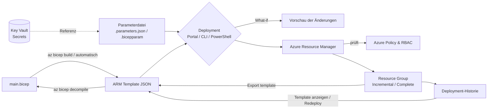

# 3.1 ARM Templates und Bicep

> **Domäne:** Deploy and manage Azure compute resources · **Gewichtung:** 20–25 %
> **Study-Guide-Punkte:** *Interpret an Azure Resource Manager template or a Bicep file* · *Modify an existing Azure Resource Manager template* · *Modify an existing Bicep file* · *Deploy resources by using an Azure Resource Manager template or a Bicep file* · *Export a deployment as an Azure Resource Manager template or convert an Azure Resource Manager template to a Bicep file*
> **Stand:** November 2026

## Lernziele

Nach diesem Kapitel kann ich …

- den Aufbau eines **ARM Templates** (JSON) und einer **Bicep-Datei** lesen und erklären, was beim Deployment passiert.
- Parameter, Variablen, Funktionen, Abhängigkeiten, Schleifen und Bedingungen in beiden Formaten erkennen und anpassen.
- Templates per Portal, Azure CLI und PowerShell bereitstellen – mit Parameterdatei, **What-if** und dem richtigen **Deployment-Modus** (Incremental vs. Complete).
- ein Template aus einer Ressourcengruppe oder einem Deployment **exportieren** und die Unterschiede benennen.
- ein ARM Template mit `az bicep decompile` in **Bicep** umwandeln und Bicep mit `az bicep build` in JSON übersetzen.

## Überblick

**Azure Resource Manager (ARM)** ist die Bereitstellungs- und Verwaltungsschicht von Azure: Jede Aktion – ob über Portal, CLI, PowerShell oder REST – landet bei ARM ([1.6](../01-identitaeten-und-governance/06-ressourcengruppen-abonnements-verwaltungsgruppen.md)).

**Infrastructure as Code (IaC)** beschreibt die gewünschte Infrastruktur in Dateien. Azure bietet dafür zwei native Formate:

- **ARM Templates** – JSON-Dateien, das „Maschinenformat" von ARM.
- **Bicep** – eine kompaktere, **domänenspezifische Sprache (DSL)**, die vor dem Deployment automatisch in ein ARM Template (JSON) **transpiliert** wird. Alles, was ARM kann, kann auch Bicep.

Beide sind **deklarativ**: Man beschreibt den *Zielzustand* („es soll ein Speicherkonto mit diesen Eigenschaften geben"), nicht die einzelnen Schritte. ARM kümmert sich um Reihenfolge, Parallelisierung und Idempotenz – ein erneutes Deployment desselben Templates führt zum selben Ergebnis.

In der Prüfung geht es weniger ums Schreiben großer Templates als ums **Lesen, Interpretieren und gezielte Anpassen** („Welcher Wert fehlt?", „Was passiert beim Deployment?", „Wie viele Ressourcen entstehen?").

## Kernkonzepte

### Aufbau eines ARM Templates

| Element | Pflicht | Bedeutung |
|---|---|---|
| `$schema` | ✅ | Schema-URL, bestimmt den **Scope** (RG, Subscription, MG, Tenant) und die Sprachversion |
| `contentVersion` | ✅ | Frei wählbare Versionsnummer des Templates (z. B. `1.0.0.0`) |
| `parameters` | – | Werte, die **beim Deployment** übergeben werden |
| `variables` | – | Intern berechnete/wiederverwendete Werte |
| `functions` | – | Benutzerdefinierte Funktionen |
| `resources` | ✅ | Die bereitzustellenden Ressourcen |
| `outputs` | – | Rückgabewerte nach dem Deployment (z. B. Endpunkt-URL) |

#### Vollständiges Beispiel: Speicherkonto (ARM, JSON)

```json
{
  "$schema": "https://schema.management.azure.com/schemas/2019-04-01/deploymentTemplate.json#",
  "contentVersion": "1.0.0.0",
  "parameters": {
    "storagePrefix": {
      "type": "string",
      "minLength": 3,
      "maxLength": 11,
      "metadata": { "description": "Präfix für den Speicherkontonamen" }
    },
    "storageSku": {
      "type": "string",
      "defaultValue": "Standard_LRS",
      "allowedValues": [ "Standard_LRS", "Standard_ZRS", "Standard_GRS" ]
    },
    "location": {
      "type": "string",
      "defaultValue": "[resourceGroup().location]"
    }
  },
  "variables": {
    "storageName": "[concat(parameters('storagePrefix'), uniqueString(resourceGroup().id))]"
  },
  "resources": [
    {
      "type": "Microsoft.Storage/storageAccounts",
      "apiVersion": "2023-05-01",
      "name": "[variables('storageName')]",
      "location": "[parameters('location')]",
      "sku": { "name": "[parameters('storageSku')]" },
      "kind": "StorageV2",
      "properties": {
        "accessTier": "Hot",
        "minimumTlsVersion": "TLS1_2",
        "supportsHttpsTrafficOnly": true
      }
    }
  ],
  "outputs": {
    "blobEndpoint": {
      "type": "string",
      "value": "[reference(variables('storageName')).primaryEndpoints.blob]"
    }
  }
}
```

**So liest man es:**

- Ohne Angabe von `storageSku` wird `Standard_LRS` verwendet (`defaultValue`); andere Werte als die drei erlaubten führen zu einem **Validierungsfehler vor dem Deployment** (`allowedValues`).
- `storagePrefix` hat **keinen** Default → muss beim Deployment angegeben werden (sonst fragt CLI/PowerShell interaktiv nach bzw. das Portal markiert das Feld als Pflicht).
- Der Name wird aus Präfix + `uniqueString(resourceGroup().id)` (13 Zeichen, deterministisch pro RG) gebildet → global eindeutig, max. 11 + 13 = 24 Zeichen (passt zur Namensregel aus [2.1](../02-speicher/01-speicherkonten-und-redundanz.md)).
- Die Region folgt standardmäßig der Ressourcengruppe.
- Nach dem Deployment wird der Blob-Endpunkt ausgegeben.

#### Parameter

| Eigenschaft | Bedeutung |
|---|---|
| `type` | `string`, `securestring`, `int`, `bool`, `object`, `secureObject`, `array` |
| `defaultValue` | Standardwert, macht den Parameter optional |
| `allowedValues` | Liste erlaubter Werte |
| `minValue` / `maxValue` | Grenzen für `int` |
| `minLength` / `maxLength` | Grenzen für `string` und `array` |
| `metadata.description` | Beschreibung (erscheint als Tooltip im Portal) |

⚠️ **`securestring` / `secureObject`**: Werte werden **nicht** in der Deployment-Historie gespeichert und nicht protokolliert – Pflicht für Kennwörter (z. B. VM-Admin-Kennwort, [3.2](02-virtuelle-maschinen.md)). Secure-Werte nie als Output zurückgeben.

#### Wichtige Template-Funktionen

| Funktion | Zweck | Beispiel |
|---|---|---|
| `parameters('x')` | Parameterwert lesen | `[parameters('location')]` |
| `variables('x')` | Variablenwert lesen | `[variables('storageName')]` |
| `resourceGroup()` | Infos zur Ziel-RG (`.location`, `.id`, `.name`) | `[resourceGroup().location]` |
| `subscription()` | Infos zum Abo (`.subscriptionId`) | `[subscription().subscriptionId]` |
| `uniqueString(...)` | deterministischer 13-Zeichen-Hash | `[uniqueString(resourceGroup().id)]` |
| `concat(...)` | Zeichenketten/Arrays verbinden | `[concat('vm-', parameters('name'))]` |
| `format(...)` | formatierte Zeichenkette | `[format('{0}-nic', parameters('vmName'))]` |
| `resourceId(...)` | vollständige Ressourcen-ID bilden | `[resourceId('Microsoft.Network/virtualNetworks', 'vnet1')]` |
| `reference(...)` | **Laufzeit**-Eigenschaften einer Ressource lesen | `[reference(variables('storageName')).primaryEndpoints.blob]` |
| `copyIndex()` | aktueller Index in einer Schleife | `[concat('vm', copyIndex(1))]` |
| `toLower`, `substring`, `if`, `equals`, `length` | Zeichenketten/Logik | `[if(equals(parameters('env'),'prod'), 'Standard_GRS', 'Standard_LRS')]` |

Ausdrücke stehen immer in **eckigen Klammern** innerhalb eines JSON-Strings: `"[ ... ]"`.

#### Abhängigkeiten (`dependsOn`)

ARM stellt Ressourcen **parallel** bereit, sofern keine Abhängigkeit definiert ist. Eine NIC muss z. B. warten, bis VNet/Subnetz existieren:

```json
{
  "type": "Microsoft.Network/networkInterfaces",
  "apiVersion": "2023-09-01",
  "name": "nic-web01",
  "location": "[parameters('location')]",
  "dependsOn": [
    "[resourceId('Microsoft.Network/virtualNetworks', 'vnet-contoso')]"
  ],
  "properties": { "...": "..." }
}
```

- `reference()` auf eine Ressource **im selben Template** erzeugt eine **implizite** Abhängigkeit.
- ⚠️ Fehlende `dependsOn`-Einträge führen zu Fehlern wie *„ResourceNotFound"*, weil eine Ressource zu früh angelegt wird.

#### Schleifen (`copy`) und Bedingungen (`condition`)

```json
{
  "type": "Microsoft.Storage/storageAccounts",
  "apiVersion": "2023-05-01",
  "name": "[concat('stlog', copyIndex(), uniqueString(resourceGroup().id))]",
  "location": "[resourceGroup().location]",
  "sku": { "name": "Standard_LRS" },
  "kind": "StorageV2",
  "condition": "[equals(parameters('environment'), 'prod')]",
  "copy": {
    "name": "storageLoop",
    "count": 3,
    "mode": "Parallel"
  }
}
```

- `copy.count` = Anzahl der Instanzen; `copyIndex()` beginnt bei **0** (`copyIndex(1)` beginnt bei 1).
- `mode`: `Parallel` (Standard) oder `Serial` mit `batchSize`.
- `condition`: Ressource wird nur bereitgestellt, wenn der Ausdruck `true` ist. Im Beispiel entstehen in `prod` **drei** Konten, sonst **keines**.
- Schleifen gibt es auch für **Eigenschaften** (z. B. mehrere Datenträger oder Subnetze), für Variablen und Outputs.

### Parameterdateien

Statt Werte auf der Kommandozeile zu übergeben, nutzt man eine **Parameterdatei** (`*.parameters.json`) – z. B. je eine für `dev` und `prod`:

```json
{
  "$schema": "https://schema.management.azure.com/schemas/2019-04-01/deploymentParameters.json#",
  "contentVersion": "1.0.0.0",
  "parameters": {
    "storagePrefix": { "value": "contoso" },
    "storageSku":    { "value": "Standard_GRS" },
    "adminPassword": {
      "reference": {
        "keyVault": {
          "id": "/subscriptions/<subscription-id>/resourceGroups/rg-security/providers/Microsoft.KeyVault/vaults/kv-contoso"
        },
        "secretName": "vmAdminPassword"
      }
    }
  }
}
```

- **Key-Vault-Referenz:** Das Geheimnis wird zur Deploymentzeit aus dem Key Vault gelesen und taucht nie im Klartext auf.
  - Voraussetzung: Im Key Vault ist **„Azure Resource Manager for template deployment"** aktiviert (`enabledForTemplateDeployment = true`).
  - Wer deployt, braucht die Berechtigung `Microsoft.KeyVault/vaults/deploy/action` auf dem Vault (z. B. über *Owner*/*Contributor* oder eine Custom Role).
  - Der referenzierte Parameter muss im Template vom Typ `securestring` sein.
- Werte auf der Kommandozeile **überschreiben** Werte aus der Parameterdatei, wenn beide angegeben werden.

### Bicep

Dasselbe Speicherkonto in **Bicep** (`main.bicep`):

```bicep
@description('Präfix für den Speicherkontonamen')
@minLength(3)
@maxLength(11)
param storagePrefix string

@allowed([
  'Standard_LRS'
  'Standard_ZRS'
  'Standard_GRS'
])
param storageSku string = 'Standard_LRS'

param location string = resourceGroup().location

var storageName = '${storagePrefix}${uniqueString(resourceGroup().id)}'

resource stg 'Microsoft.Storage/storageAccounts@2023-05-01' = {
  name: storageName
  location: location
  sku: {
    name: storageSku
  }
  kind: 'StorageV2'
  properties: {
    accessTier: 'Hot'
    minimumTlsVersion: 'TLS1_2'
    supportsHttpsTrafficOnly: true
  }
}

output blobEndpoint string = stg.properties.primaryEndpoints.blob
```

**Bicep-Bausteine:**

| Element | Syntax | ARM-Entsprechung |
|---|---|---|
| Parameter | `param name string = 'default'` | `parameters` |
| Variable | `var name = ...` | `variables` |
| Ressource | `resource <symbolischer-name> '<Typ>@<API-Version>' = { ... }` | Eintrag in `resources` |
| Ausgabe | `output name string = ...` | `outputs` |
| Decorators | `@allowed`, `@secure()`, `@description`, `@minLength`, `@maxLength`, `@minValue`, `@maxValue` | Parameter-Eigenschaften |
| String-Interpolation | `'${a}-${b}'` | `concat()` / `format()` |
| Bestehende Ressource | `resource vnet 'Microsoft.Network/virtualNetworks@2023-09-01' existing = { name: 'vnet-contoso' }` | `reference()` / `resourceId()` |
| Modul | `module net './network.bicep' = { name: 'netDeploy', params: { ... } }` | Nested/Linked Template |
| Schleife | `[for i in range(0, 3): { ... }]` | `copy` |
| Bedingung | `resource x '...' = if (env == 'prod') { ... }` | `condition` |

**Symbolische Namen statt `dependsOn`:** Verweist eine Ressource auf eine andere über deren symbolischen Namen (z. B. `subnet: { id: vnet.properties.subnets[0].id }` oder `parent: vnet`), erkennt Bicep die Abhängigkeit **automatisch**. Explizites `dependsOn` wird nur selten benötigt.

**Schleife und Bedingung in Bicep:**

```bicep
param environment string = 'dev'

resource logStorage 'Microsoft.Storage/storageAccounts@2023-05-01' = [for i in range(0, 3): if (environment == 'prod') {
  name: 'stlog${i}${uniqueString(resourceGroup().id)}'
  location: resourceGroup().location
  sku: { name: 'Standard_LRS' }
  kind: 'StorageV2'
}]
```

**Secure-Parameter:**

```bicep
@secure()
param adminPassword string
```

**Bicep-Parameterdatei** (`main.bicepparam`):

```bicep
using './main.bicep'

param storagePrefix = 'contoso'
param storageSku = 'Standard_GRS'
```

Alternativ funktionieren auch klassische `*.parameters.json`-Dateien mit Bicep.

### Deployment-Scopes

| Scope | Typische Ressourcen | CLI | Bicep `targetScope` |
|---|---|---|---|
| **Resource group** | VMs, VNets, Speicherkonten (Standard) | `az deployment group create` | `'resourceGroup'` (Standard) |
| **Subscription** | Ressourcengruppen, Policy-/RBAC-Zuweisungen, Budgets | `az deployment sub create --location` | `'subscription'` |
| **Management group** | Policy-Definitionen/-Zuweisungen, RBAC | `az deployment mg create` | `'managementGroup'` |
| **Tenant** | Management Groups, Abonnements | `az deployment tenant create` | `'tenant'` |

Bei Subscription-, MG- und Tenant-Deployments muss eine **`--location`** angegeben werden – dort werden die **Deployment-Metadaten** gespeichert (nicht die Ressourcen).

### Deployment-Modi: Incremental vs. Complete

| Modus | Verhalten | Standard? |
|---|---|---|
| **Incremental** | Ressourcen im Template werden angelegt/aktualisiert; **andere Ressourcen in der RG bleiben unverändert** | ✅ Standard |
| **Complete** | Ressourcen im Template werden angelegt/aktualisiert; ⚠️ **alle Ressourcen der RG, die nicht im Template stehen, werden gelöscht** | ❌ nur explizit |

- Complete gibt es nur für Deployments auf **Resource-group-Ebene**.
- Bei Ressourcen mit `condition = false` verhält sich Complete je nach API-Version unterschiedlich – vor dem Einsatz immer **What-if** laufen lassen.
- Auch im Incremental-Modus gilt: Für eine im Template definierte Ressource werden **alle angegebenen Eigenschaften** gesetzt – Eigenschaften, die im Template fehlen, können auf Standardwerte zurückfallen. Beim Anpassen eines bestehenden Templates die vollständige Ressourcendefinition mitgeben.
- Ressourcensperren ([1.5](../01-identitaeten-und-governance/05-ressourcensperren-und-tags.md)) schützen auch vor dem Löschen durch Complete-Deployments.

### What-if

**What-if** zeigt vor dem Deployment, welche Änderungen passieren würden – ohne etwas zu ändern:

| Änderungstyp | Bedeutung |
|---|---|
| **Create** | Ressource wird neu angelegt |
| **Delete** | Ressource wird gelöscht (nur im Complete-Modus) |
| **Modify** | Eigenschaften ändern sich |
| **NoChange** | Ressource bleibt gleich |
| **Ignore** | Ressource existiert, ist aber nicht im Template (Incremental) |
| **Deploy** | Wird erneut bereitgestellt, Änderungen nicht vorhersagbar |

### Deployment-Historie und Export

- Jedes Deployment wird in der **Deployment-Historie** des Scopes gespeichert (**Resource group > Deployments**): Name, Status, Dauer, Template, Parameter (außer `securestring`), Outputs, Fehlerdetails. Einträge lassen sich **erneut bereitstellen** (*Redeploy*).
- Die Historie ist begrenzt (siehe Limits); ARM löscht ältere Einträge automatisch, wenn die Grenze erreicht wird.

**Zwei Wege zum Export:**

| | **Export aus Ressourcengruppe/Ressource** | **Export aus Deployment-Historie** |
|---|---|---|
| Pfad | *Resource group > Automation > Export template* | *Resource group > Deployments > Deployment > Template* |
| Inhalt | **aktueller Zustand** der Ressourcen (Snapshot) | **genau das Template**, das damals bereitgestellt wurde |
| Parameter | wenige, Werte meist **fest codiert** | Original-Parameter und -Logik bleiben erhalten |
| Nachträgliche Änderungen (Portal, CLI) | enthalten | **nicht** enthalten |
| Einschränkungen | nicht alle Ressourcentypen exportierbar (Warnung im Portal), große RGs nicht exportierbar, Geheimnisse fehlen | nur Ressourcen, die per Template bereitgestellt wurden |

Exportierte Templates sind ein **Startpunkt**, keine fertige Vorlage – meist müssen Parameter ergänzt und Werte bereinigt werden. Im Portal kann der Export auch direkt als **Bicep** angezeigt werden (Registerkarte im Export-Blade, sofern verfügbar).

### Konvertierung ARM ↔ Bicep

| Richtung | Befehl | Hinweis |
|---|---|---|
| Bicep → ARM | `az bicep build --file main.bicep` | erzeugt `main.json`; passiert bei `az deployment … create --template-file main.bicep` automatisch |
| ARM → Bicep | `az bicep decompile --file template.json` | **Best-effort**: Ergebnis prüfen und ggf. nachbessern (Warnungen beachten) |
| Bicep-Parameter | `az bicep build-params --file main.bicepparam` | erzeugt JSON-Parameterdatei |

PowerShell nutzt für `.bicep`-Dateien ebenfalls die Bicep-CLI, die dann **separat installiert** sein muss; die Azure CLI installiert Bicep bei Bedarf selbst (`az bicep install` / `az bicep upgrade`).

### Template Specs

**Template Specs** (`Microsoft.Resources/templateSpecs`) speichern ARM Templates bzw. Bicep-Dateien **als Azure-Ressource** mit **Versionen**. Sie werden per **RBAC** geteilt (z. B. *Reader* auf die Template Spec reicht zum Bereitstellen) – praktisch, um freigegebene Vorlagen zentral für Teams anzubieten.

## Zusammenhänge



- **Azure Resource Manager & Scopes** ([1.6](../01-identitaeten-und-governance/06-ressourcengruppen-abonnements-verwaltungsgruppen.md)): Templates werden an RG, Subscription, Management Group oder Tenant bereitgestellt.
- **Azure Policy** ([1.4](../01-identitaeten-und-governance/04-azure-policy.md)): Ein Deployment, das gegen eine *Deny*-Policy verstößt (z. B. falsche Region), schlägt fehl – bereits bei der Validierung. Policy-Definitionen und -Zuweisungen lassen sich selbst per Template ausrollen.
- **RBAC** ([1.3](../01-identitaeten-und-governance/03-rbac-zugriffsverwaltung.md)): Wer deployt, braucht Schreibrechte (`Microsoft.Resources/deployments/*` + Rechte auf die Ressourcentypen), z. B. *Contributor*.
- **Tags & Locks** ([1.5](../01-identitaeten-und-governance/05-ressourcensperren-und-tags.md)): Tags werden im Template pro Ressource (`tags`) gesetzt; Locks verhindern Löschungen auch bei Complete-Deployments.
- **Speicherkonten** ([2.1](../02-speicher/01-speicherkonten-und-redundanz.md)) und **VMs** ([3.2](02-virtuelle-maschinen.md)): klassische Beispiele für Template-Ressourcen; VM-Deployments erfordern meist mehrere abhängige Ressourcen (VNet, NIC, Public IP, Disk).

## Vergleichstabellen

### ARM Template (JSON) vs. Bicep

| Kriterium | ARM Template | Bicep |
|---|---|---|
| Format | JSON | eigene DSL, kompakter |
| Abhängigkeiten | meist explizit (`dependsOn`) | meist **automatisch** über symbolische Namen |
| Modularisierung | Linked/Nested Templates (Linked: per URL erreichbar) | `module` mit lokalen Dateien |
| Kommentare | eingeschränkt | `//` und `/* */` |
| Deployment | direkt | wird zu JSON transpiliert, dann wie ARM |
| Funktionsumfang | vollständig | vollständig (Day-0-Support neuer API-Versionen) |
| State-Datei | keine | keine (State liegt in Azure) |

### Incremental vs. Complete

| Situation | Incremental | Complete |
|---|---|---|
| Ressource im Template, existiert nicht | wird erstellt | wird erstellt |
| Ressource im Template, existiert | wird aktualisiert | wird aktualisiert |
| Ressource **nicht** im Template, existiert in RG | **bleibt** | ⚠️ **wird gelöscht** |
| Verfügbar für Scope | alle | nur Resource group |

### Exportwege

| Ziel | Mittel |
|---|---|
| Originaltemplate eines früheren Deployments | **Deployments > Deployment > Template** |
| Aktuellen Zustand inkl. manueller Änderungen | **Export template** an RG/Ressource |
| ARM-JSON in Bicep umwandeln | `az bicep decompile` |
| Bicep in ARM-JSON umwandeln | `az bicep build` |

## Azure Portal

| Aufgabe | Pfad |
|---|---|
| Eigenes Template bereitstellen | **Portal > Deploy a custom template** (Suche „Deploy a custom template") **> Build your own template in the editor** |
| Quickstart-Template auswählen | **… > Deploy a custom template > Quickstart template** (Auswahl aus *Azure Quickstart Templates*) |
| Template-Datei hochladen | **… > Build your own template in the editor > Load file > Save** |
| Parameter beim Deployment eingeben | nach *Save*: Formular mit Subscription, Resource group, Region und Template-Parametern **> Review + create** |
| Template einer neuen Ressource vor dem Erstellen ansehen | im Erstellungs-Assistenten jeder Ressource: **Review + create > Download a template for automation** |
| Deployment-Historie | **Portal > Resource groups > RG > Settings > Deployments** |
| Template/Parameter/Outputs eines Deployments | **… > Deployments > Deployment > Template / Inputs / Outputs** |
| Deployment erneut ausführen | **… > Deployments > Deployment > Redeploy** |
| Fehler eines Deployments analysieren | **… > Deployments > Deployment > Error details / Operation details** |
| Template aus RG exportieren | **Portal > Resource groups > RG > Automation > Export template** (Download, *Add to library*, *Deploy*) |
| Template einer einzelnen Ressource exportieren | **Ressource > Automation > Export template** |
| Template Specs | **Portal > Template specs > + Create** |
| Key Vault für Template-Deployments freigeben | **Portal > Key vaults > Vault > Settings > Access configuration > Azure Resource Manager for template deployment** |

⚠️ Das Portal verwendet bei *Deploy a custom template* den Modus **Incremental**. Complete-Deployments erfolgen über CLI, PowerShell oder REST.

**Beim Custom Deployment ist wichtig:** Ziel-**Resource group** (vorhanden oder neu) und **Region** (bei neuer RG = Standort der RG-Metadaten) werden im Formular gewählt; Parameter mit `allowedValues` erscheinen als Dropdown, `securestring` als verdecktes Feld.

## Azure CLI & PowerShell

### Azure CLI

```bash
# Ressourcengruppe anlegen und Bicep-Datei bereitstellen (Inline-Parameter)
az group create --name rg-contoso-dev --location westeurope
az deployment group create \
  --resource-group rg-contoso-dev \
  --template-file main.bicep \
  --parameters storagePrefix=contoso storageSku=Standard_ZRS

# ARM Template mit Parameterdatei bereitstellen (eigener Deployment-Name)
az deployment group create \
  --name deploy-storage-001 \
  --resource-group rg-contoso-dev \
  --template-file azuredeploy.json \
  --parameters @azuredeploy.parameters.dev.json

# Bicep-Parameterdatei verwenden
az deployment group create --resource-group rg-contoso-dev \
  --template-file main.bicep --parameters main.bicepparam

# Vorschau der Änderungen (What-if)
az deployment group what-if --resource-group rg-contoso-dev \
  --template-file main.bicep --parameters storagePrefix=contoso

# Complete-Modus (Achtung: löscht Ressourcen, die nicht im Template stehen!)
az deployment group create --resource-group rg-contoso-dev \
  --template-file main.bicep --parameters storagePrefix=contoso \
  --mode Complete --confirm-with-what-if

# Deployment auf Subscription-Ebene (z. B. Ressourcengruppen anlegen)
az deployment sub create --location westeurope --template-file sub.bicep

# Deployment-Historie anzeigen / Template eines Deployments exportieren
az deployment group list --resource-group rg-contoso-dev -o table
az deployment group export --resource-group rg-contoso-dev --name deploy-storage-001 > original.json

# Aktuellen Zustand der Ressourcengruppe als Template exportieren
az group export --name rg-contoso-dev > exported.json

# Konvertieren
az bicep build --file main.bicep             # -> main.json
az bicep decompile --file exported.json      # -> exported.bicep
az bicep upgrade                             # Bicep-CLI aktualisieren
```

### Azure PowerShell

```powershell
# Bereitstellen mit Parameterdatei
New-AzResourceGroupDeployment -Name "deploy-storage-001" `
  -ResourceGroupName "rg-contoso-dev" `
  -TemplateFile ".\azuredeploy.json" `
  -TemplateParameterFile ".\azuredeploy.parameters.dev.json"

# Bicep-Datei mit Inline-Parametern (Template-Parameter werden zu dynamischen Parametern)
New-AzResourceGroupDeployment -ResourceGroupName "rg-contoso-dev" `
  -TemplateFile ".\main.bicep" -storagePrefix "contoso" -storageSku "Standard_ZRS"

# What-if
New-AzResourceGroupDeployment -ResourceGroupName "rg-contoso-dev" `
  -TemplateFile ".\main.bicep" -storagePrefix "contoso" -WhatIf

# Complete-Modus
New-AzResourceGroupDeployment -ResourceGroupName "rg-contoso-dev" `
  -TemplateFile ".\main.bicep" -storagePrefix "contoso" -Mode Complete

# Deployment-Historie / Status
Get-AzResourceGroupDeployment -ResourceGroupName "rg-contoso-dev"
Get-AzResourceGroupDeploymentOperation -ResourceGroupName "rg-contoso-dev" -DeploymentName "deploy-storage-001"

# Template eines Deployments speichern
Save-AzResourceGroupDeploymentTemplate -ResourceGroupName "rg-contoso-dev" -DeploymentName "deploy-storage-001"

# Aktuellen Zustand der RG exportieren
Export-AzResourceGroup -ResourceGroupName "rg-contoso-dev" -Path ".\exported.json"

# Subscription-Deployment
New-AzSubscriptionDeployment -Location "westeurope" -TemplateFile ".\sub.bicep"
```

| Ziel | CLI | PowerShell |
|---|---|---|
| In RG bereitstellen | `az deployment group create` | `New-AzResourceGroupDeployment` |
| Vorschau | `az deployment group what-if` | `New-AzResourceGroupDeployment -WhatIf` / `Get-AzResourceGroupDeploymentWhatIfResult` |
| Subscription-Scope | `az deployment sub create --location` | `New-AzSubscriptionDeployment -Location` |
| Management-Group-Scope | `az deployment mg create` | `New-AzManagementGroupDeployment` |
| RG exportieren | `az group export` | `Export-AzResourceGroup` |
| Deployment-Template sichern | `az deployment group export` | `Save-AzResourceGroupDeploymentTemplate` |
| Bicep → JSON / JSON → Bicep | `az bicep build` / `az bicep decompile` | (Bicep-CLI: `bicep build` / `bicep decompile`) |

## Praxisbeispiel

**Szenario:** Bei *Contoso* hat ein Kollege im Portal eine Ressourcengruppe `rg-web-test` mit einem Speicherkonto und einem VNet „von Hand" angelegt. Das Setup soll künftig reproduzierbar für `dev`, `test` und `prod` bereitgestellt werden – in `prod` mit **GRS**, sonst **LRS**.

**Umsetzung:**

1. **Exportieren:** *Resource groups > rg-web-test > Automation > Export template* → Template herunterladen. Hinweis-Banner prüfen: Sind alle Ressourcentypen exportiert worden?
2. **Nach Bicep konvertieren:**
   ```bash
   az bicep decompile --file template.json
   ```
3. **Bereinigen und parametrisieren** (fest codierte Namen und Werte ersetzen):
   ```bicep
   @allowed([ 'dev', 'test', 'prod' ])
   param environment string

   param location string = resourceGroup().location

   var storageSku = environment == 'prod' ? 'Standard_GRS' : 'Standard_LRS'

   resource stg 'Microsoft.Storage/storageAccounts@2023-05-01' = {
     name: 'stweb${environment}${uniqueString(resourceGroup().id)}'
     location: location
     sku: { name: storageSku }
     kind: 'StorageV2'
     tags: { environment: environment, costCenter: 'CC-4711' }
   }
   ```
4. **Parameterdateien** `dev.bicepparam` und `prod.bicepparam` anlegen (`using './main.bicep'`, `param environment = 'prod'`).
5. **Vorschau und Deployment:**
   ```bash
   az group create -n rg-web-prod -l westeurope
   az deployment group what-if  -g rg-web-prod --template-file main.bicep --parameters prod.bicepparam
   az deployment group create   -g rg-web-prod --template-file main.bicep --parameters prod.bicepparam
   ```
6. **Kontrolle:** *rg-web-prod > Deployments* → Status *Succeeded*, unter *Outputs* ggf. Endpunkte prüfen.
7. **Bereitstellen für andere Teams:** Datei als **Template Spec** veröffentlichen, Team erhält *Reader* auf die Template Spec.

## Limits & wichtige Zahlen

| Wert | Grenze |
|---|---|
| Parameter pro Template | **256** |
| Variablen pro Template | **256** |
| Ressourcen pro Template (inkl. `copy`-Instanzen) | **800** |
| Outputs pro Template | **64** |
| Template-Größe (nach Erweiterung) | **4 MB** |
| Größe Parameterdatei | **4 MB** |
| `copy.count` | max. **800** |
| Deployment-Historie pro RG/Scope | **800** Einträge (ältere werden automatisch gelöscht) |
| `uniqueString()` | liefert **13** Zeichen |
| `copyIndex()` | startet bei **0** (mit Offset: `copyIndex(1)`) |

Aktuelle Werte: [ARM template limits](https://learn.microsoft.com/azure/azure-resource-manager/templates/best-practices#template-limits).

## Prüfungstipps & Fallstricke

- ⚠️ **„Ressourcen, die nicht im Template sind, wurden gelöscht"** → Deployment lief im **Complete**-Modus. Standard ist **Incremental**.
- ⚠️ **„Das exportierte Template enthält die manuellen Änderungen nicht"** → es wurde aus der **Deployment-Historie** exportiert; für den aktuellen Zustand **Export template** an der RG nutzen (und umgekehrt).
- ⚠️ **Kennwort im Template** → Parameter vom Typ **`securestring`** (Bicep: `@secure()`), Wert idealerweise per **Key-Vault-Referenz** in der Parameterdatei. Key Vault braucht **`enabledForTemplateDeployment`**.
- **Fehler „The value is not part of the allowed values"** → Parameterwert steht nicht in `allowedValues` → Wert ändern oder `allowedValues` erweitern.
- **Fehler „ResourceNotFound" bei abhängigen Ressourcen** → fehlendes **`dependsOn`** (ARM) bzw. fehlender symbolischer Verweis (Bicep).
- **„Wie viele Ressourcen entstehen?"** → `copy.count` × `condition` beachten; `copyIndex()` startet bei 0.
- **„Welche Region erhält die Ressource?"** → Wenn `location` = `resourceGroup().location` und nichts übergeben wird → Region der **Ressourcengruppe**.
- **ARM Template in Bicep umwandeln** → `az bicep decompile`; **Bicep in JSON** → `az bicep build`.
- **Änderungen vorab prüfen** → **What-if** (`az deployment group what-if`, `-WhatIf`).
- **Ressourcengruppen per Template anlegen** → Deployment auf **Subscription-Ebene** (`az deployment sub create --location …`, Bicep `targetScope = 'subscription'`).
- **API-Version** gehört bei Bicep hinter das `@` im Ressourcentyp (`'Microsoft.Storage/storageAccounts@2023-05-01'`), bei ARM in die Eigenschaft `apiVersion`.
- **Portal-Weg für eigene Templates** → *Deploy a custom template* > *Build your own template in the editor*.
- **Template vor dem Erstellen einer Ressource sichern** → *Review + create* > **Download a template for automation**.

## Selbsttest

**1.** Ein ARM Template definiert den Parameter `storageSku` mit `"allowedValues": ["Standard_LRS","Standard_GRS"]` und `"defaultValue": "Standard_LRS"`. Ein Administrator übergibt `Standard_ZRS`. Was passiert?

<details><summary>Lösung</summary>

Das Deployment schlägt bereits bei der **Validierung** fehl, weil `Standard_ZRS` nicht in `allowedValues` steht. Lösung: `Standard_ZRS` in `allowedValues` ergänzen oder einen erlaubten Wert übergeben.
</details>

**2.** Die Ressourcengruppe `rg-app` enthält VM1, VM2 und ein Speicherkonto. Sie stellen ein Template, das nur VM1 und das Speicherkonto enthält, mit `--mode Complete` bereit. Welche Ressourcen existieren danach?

<details><summary>Lösung</summary>

**VM1 und das Speicherkonto.** VM2 wird im Complete-Modus **gelöscht**, weil sie nicht im Template steht (sofern kein Lock sie schützt). Im Incremental-Modus bliebe VM2 bestehen.
</details>

**3.** Ein Template enthält eine Ressource mit `"copy": {"name": "loop", "count": 4}` und `"condition": "[equals(parameters('env'),'prod')]"`. Es wird mit `env = test` bereitgestellt. Wie viele Instanzen entstehen?

<details><summary>Lösung</summary>

**Keine.** Die Bedingung ist `false`, daher wird keine der vier Instanzen bereitgestellt.
</details>

**4.** Sie möchten das Template exportieren, mit dem ein Speicherkonto vor drei Monaten bereitgestellt wurde – inklusive der damaligen Parameterlogik. Seitdem wurden Einstellungen im Portal geändert. Welchen Weg wählen Sie?

<details><summary>Lösung</summary>

**Resource group > Deployments > Deployment > Template** (bzw. `az deployment group export` / `Save-AzResourceGroupDeploymentTemplate`). Dieses Template entspricht dem Original. *Export template* an der RG würde dagegen den **aktuellen Zustand** mit fest codierten Werten liefern.
</details>

**5.** Ein VM-Template soll das Administratorkennwort nicht im Klartext enthalten und das Kennwort soll nicht in der Deployment-Historie sichtbar sein. Welche zwei Maßnahmen treffen Sie?

<details><summary>Lösung</summary>

1. Parameter als **`securestring`** (Bicep: `@secure()`) definieren.
2. Wert über eine **Key-Vault-Referenz** in der Parameterdatei übergeben; im Key Vault **„Azure Resource Manager for template deployment"** aktivieren.
</details>

**6.** Mit welchem Befehl wandeln Sie ein vorhandenes `azuredeploy.json` in eine Bicep-Datei um?

<details><summary>Lösung</summary>

`az bicep decompile --file azuredeploy.json` – das Ergebnis ist eine Best-effort-Konvertierung und sollte geprüft werden.
</details>

**7.** Ein Bicep-Template enthält `param location string = resourceGroup().location`. Die Ressourcengruppe liegt in *West Europe*. Sie stellen ohne `location`-Parameter bereit. Wo wird die Ressource erstellt?

<details><summary>Lösung</summary>

In **West Europe** – der Standardwert übernimmt die Region der Ziel-Ressourcengruppe.
</details>

**8.** Sie sollen per Template drei Ressourcengruppen anlegen. Der Befehl `az deployment group create` schlägt fehl. Warum, und was ist richtig?

<details><summary>Lösung</summary>

Ressourcengruppen werden auf **Subscription-Ebene** bereitgestellt. Richtig: `az deployment sub create --location <region> --template-file rgs.bicep` mit `targetScope = 'subscription'` in der Bicep-Datei.
</details>

**9.** Eine NIC-Ressource in einem ARM Template schlägt mit „Subnet not found" fehl, obwohl das VNet im selben Template definiert ist. Was fehlt?

<details><summary>Lösung</summary>

Ein **`dependsOn`**-Eintrag auf das VNet. Ohne Abhängigkeit stellt ARM beide Ressourcen parallel bereit, und die NIC wird eventuell vor dem VNet angelegt. (In Bicep löst ein Verweis über den symbolischen Namen die Abhängigkeit automatisch.)
</details>

**10.** Sie wollen vor einem Deployment sehen, welche Ressourcen erstellt, geändert oder gelöscht würden, ohne etwas zu verändern. Welches Feature nutzen Sie?

<details><summary>Lösung</summary>

**What-if**: `az deployment group what-if` bzw. `New-AzResourceGroupDeployment … -WhatIf`.
</details>

## Weiterführende Links

- [AZ-104 Study Guide](https://learn.microsoft.com/credentials/certifications/resources/study-guides/az-104)
- [What are ARM templates?](https://learn.microsoft.com/azure/azure-resource-manager/templates/overview)
- [Understand the structure and syntax of ARM templates](https://learn.microsoft.com/azure/azure-resource-manager/templates/syntax)
- [ARM template functions](https://learn.microsoft.com/azure/azure-resource-manager/templates/template-functions)
- [Use Azure Key Vault to pass secure parameter values](https://learn.microsoft.com/azure/azure-resource-manager/templates/key-vault-parameter)
- [What is Bicep?](https://learn.microsoft.com/azure/azure-resource-manager/bicep/overview)
- [Bicep file structure and syntax](https://learn.microsoft.com/azure/azure-resource-manager/bicep/file)
- [Create parameter files for Bicep deployment](https://learn.microsoft.com/azure/azure-resource-manager/bicep/parameter-files)
- [Azure Resource Manager deployment modes](https://learn.microsoft.com/azure/azure-resource-manager/templates/deployment-modes)
- [ARM template deployment what-if operation](https://learn.microsoft.com/azure/azure-resource-manager/templates/deploy-what-if)
- [Use Azure portal to export a template](https://learn.microsoft.com/azure/azure-resource-manager/templates/export-template-portal)
- [Decompiling ARM template JSON to Bicep](https://learn.microsoft.com/azure/azure-resource-manager/bicep/decompile)
- [Azure Resource Manager template specs](https://learn.microsoft.com/azure/azure-resource-manager/templates/template-specs)
- Learn-Modul: [Deploy and manage resources in Azure by using JSON ARM templates](https://learn.microsoft.com/training/modules/create-azure-resource-manager-template-vs-code/)
