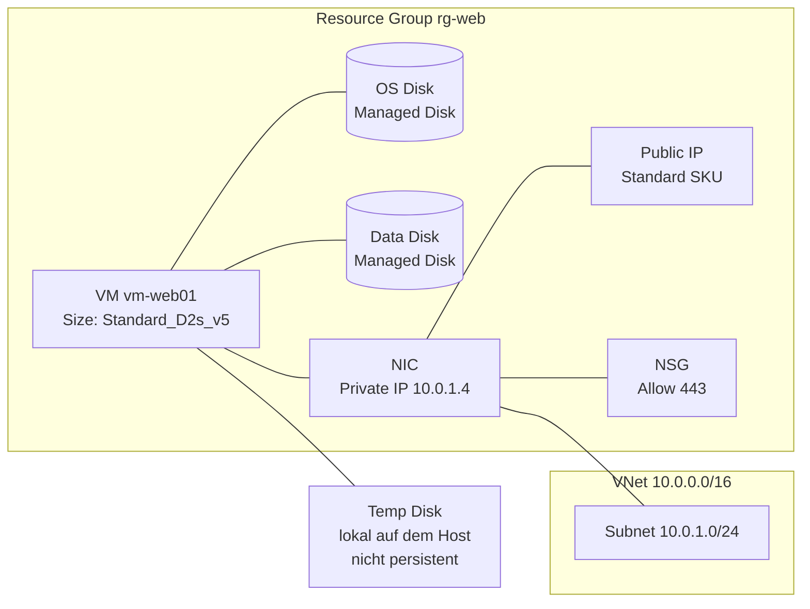
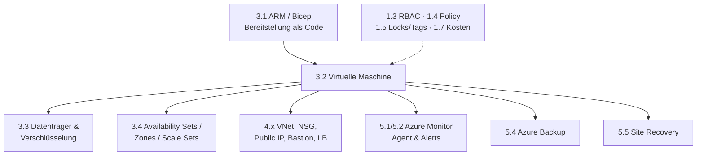

# 3.2 Virtuelle Maschinen

> **Domäne:** Deploy and manage Azure compute resources · **Gewichtung:** 20–25 %
> **Study-Guide-Punkte:** *Create a virtual machine* · *Move a virtual machine to another resource group, subscription, or region* · *Manage virtual machine sizes*
> (Datenträger & Verschlüsselung → [Kapitel 3.3](03-vm-datentraeger-und-verschluesselung.md), Verfügbarkeit & Scale Sets → [Kapitel 3.4](04-verfuegbarkeit-und-scale-sets.md))
> **Stand:** November 2026

## Lernziele

Nach diesem Kapitel kann ich …

- die **Bestandteile einer Azure-VM** (Compute, Datenträger, NIC, VNet, Public IP, NSG) benennen und ihr Zusammenspiel erklären.
- eine VM im Portal, mit Azure CLI und Az PowerShell erstellen und die wichtigsten Einstellungen jedes Erstellungs-Tabs begründen.
- **VM-Größen** anhand des Namensschemas lesen, die passende Familie wählen und eine VM **resizen** – inklusive der Frage, wann eine Deallocation nötig ist.
- die Zustände **Stopped** und **Stopped (deallocated)** und ihre Kostenwirkung unterscheiden.
- VMs über **Extensions**, **Run command**, **Serial console**, **Reset password**, **Redeploy** und **Reapply** verwalten und reparieren.
- eine VM in eine andere **Ressourcengruppe**, ein anderes **Abonnement** oder eine andere **Region** verschieben und die jeweiligen Werkzeuge und Einschränkungen nennen.

## Überblick

Azure Virtual Machines sind **IaaS** (*Infrastructure as a Service*): Microsoft betreibt Rechenzentrum, Hardware und Hypervisor, der Kunde verantwortet **Betriebssystem, Patches, Anwendungen und Daten**. VMs sind die richtige Wahl, wenn volle Kontrolle über das Betriebssystem nötig ist – z. B. für Lift-and-Shift-Migrationen, Legacy-Anwendungen, spezielle Software oder eigene Domänencontroller.

Eine VM ist in Azure **keine einzelne Ressource**, sondern ein Verbund: Die VM-Ressource selbst (CPU/RAM) referenziert **Managed Disks**, eine oder mehrere **Netzwerkschnittstellen (NICs)**, die in einem **Subnetz eines VNets** hängen, optional eine **Public IP** und eine **NSG**. Dieses Zusammenspiel ist entscheidend für das Verschieben, Löschen und die Kosten.

Die Größe (*Size*) bestimmt vCPUs, Arbeitsspeicher, maximale Anzahl Datenträger und NICs, Netzwerkbandbreite und Preis. Sie kann jederzeit geändert werden – mit einem Neustart.

## Kernkonzepte

### Bestandteile einer VM

| Komponente | Ressourcentyp | Bemerkung |
|---|---|---|
| **Virtual machine** | `Microsoft.Compute/virtualMachines` | Compute (vCPU, RAM), Größe, Image-Referenz, Konfiguration |
| **OS disk** | `Microsoft.Compute/disks` (Managed Disk) | Bootlaufwerk (`C:` bzw. `/dev/sda`), persistent |
| **Temporary disk** | – (Teil des Hosts) | Lokale SSD des Hosts (`D:` bzw. `/dev/sdb` / `/mnt`), **nicht persistent** – Daten gehen bei Deallocation, Resize, Redeploy oder Host-Wechsel verloren. Nur bei Größen mit lokaler Temp-Disk (z. B. „d" im Namen). |
| **Data disks** | Managed Disks | optional, persistent → [3.3](03-vm-datentraeger-und-verschluesselung.md) |
| **Network interface (NIC)** | `Microsoft.Network/networkInterfaces` | Private IP, Verbindung zum Subnetz; mindestens eine pro VM |
| **Virtual network / Subnet** | `Microsoft.Network/virtualNetworks` | → [4.1](../04-netzwerk/01-virtuelle-netzwerke-und-subnetze.md) |
| **Public IP address** | `Microsoft.Network/publicIPAddresses` | optional, an der NIC → [4.3](../04-netzwerk/03-oeffentliche-ip-adressen.md) |
| **Network security group** | `Microsoft.Network/networkSecurityGroups` | an NIC und/oder Subnetz → [4.5](../04-netzwerk/05-nsg-und-asg.md) |



### Images

- **Marketplace-Images** von Microsoft und Drittanbietern (Windows Server, Ubuntu, RHEL, SUSE, …). Manche Drittanbieter-Images haben einen **Plan** (Kaufbedingungen) – relevant beim Verschieben.
- **Eigene Images:**
  - **Generalisiert** (*generalized*): Maschinenspezifische Informationen entfernt – Windows mit `sysprep /generalize /oobe /shutdown`, Linux mit `waagent -deprovision+user`. Aus einem generalisierten Image entstehen beliebig viele neue VMs mit eigenem Hostnamen und Admin-Konto.
  - **Spezialisiert** (*specialized*): 1:1-Kopie einer VM inkl. Hostname und Konten – z. B. für schnelle Klone/Wiederherstellung.
- **Azure Compute Gallery** (früher *Shared Image Gallery*): verwaltet **Image definitions** und **Image versions**, repliziert sie in mehrere Regionen, unterstützt Versionierung und Freigabe (RBAC, an andere Tenants/Community). Alternative ältere Variante: **Managed image** (eine Region, keine Versionierung).
- **VM generation:** Gen1 (BIOS) oder **Gen2** (UEFI, Voraussetzung für Trusted launch, größere OS-Disks).

### Security type

| Option | Beschreibung |
|---|---|
| **Standard** | Klassische VM ohne zusätzliche Boot-Schutzfunktionen |
| **Trusted launch** (Standard bei neuen Gen2-VMs) | **Secure Boot**, **vTPM**, Boot-Integritätsüberwachung; nur Gen2-Images und unterstützte Größen |
| **Confidential virtual machines** | Hardwarebasierte Isolation/Verschlüsselung im Speicher (AMD SEV-SNP / Intel TDX), spezielle Größen (z. B. DC-/EC-Serie) |

### VM-Größen (*Sizes*)

**Größenfamilien:**

| Familie | Typ | Typischer Einsatz |
|---|---|---|
| **A** | Entry-level | Test/Dev, kleine Workloads (ältere Serie) |
| **B** | **Burstable** | Geringe Grundlast mit gelegentlichen Spitzen (CPU-Credits) – Webserver mit wenig Traffic, Dev/Test, kleine DBs |
| **D** | **General purpose** | Ausgewogenes CPU-/RAM-Verhältnis – Webserver, App-Server, die meisten Unternehmensanwendungen |
| **E** | **Memory optimized** | Hohes RAM-Verhältnis – relationale Datenbanken, Caches, In-Memory-Analytics |
| **F** | **Compute optimized** | Hohes CPU-Verhältnis – Batch, Gaming-Server, Webserver mit viel Traffic |
| **L** | **Storage optimized** | Hoher Datenträger-Durchsatz/IOPS mit lokalen NVMe-Disks – NoSQL, Data Warehousing, große Datenbanken |
| **M** | **Memory optimized (sehr groß)** | Sehr viel RAM (bis in den TiB-Bereich) – SAP HANA |
| **N** | **GPU** | NC (Compute/KI-Training), ND (Deep Learning), NV (Visualisierung/VDI) |
| **H** | **High performance compute (HPC)** | Simulationen, Strömungsmechanik, Modellierung, InfiniBand |

**Namensschema** (vereinfacht): `Familie [Subfamilie] #vCPUs [eingeschränkte vCPUs] [Zusatzmerkmale] [Accelerator] _Version`

Beispiel **`Standard_D4ds_v5`**:

| Teil | Bedeutung |
|---|---|
| `D` | Familie General purpose |
| `4` | 4 vCPUs |
| `d` | lokale **Temp-Disk** vorhanden |
| `s` | **Premium Storage**-fähig (Premium SSD möglich) |
| `v5` | Generation/Version der Serie |

Weitere Zusatzbuchstaben: `a` = AMD-CPU, `p` = ARM-CPU, `m` = memory intensive, `l` = low memory, `t` = tiny memory, `i` = isolated, `b` = höhere Block-Storage-Performance, `C` = confidential.

**Verfügbarkeit:** Nicht jede Größe ist in jeder Region und jeder Availability Zone verfügbar. Prüfen mit `az vm list-skus` bzw. im Portal (*See all sizes*, Filter).

### Größe ändern (*Resize*)

- Die Größe kann jederzeit geändert werden – **ein Neustart erfolgt immer**.
- Ist die Zielgröße auf dem **aktuellen Hardware-Cluster** verfügbar, kann die VM im laufenden Zustand umgestellt werden (Portal zeigt die Größe als verfügbar an).
- Ist sie dort **nicht** verfügbar, muss die VM zuerst **deallokiert** werden (*Stop* im Portal), damit sie auf einem anderen Cluster starten kann.
- ⚠️ **Availability Set:** Ist die Zielgröße im Cluster des Availability Sets nicht verfügbar, müssen **alle VMs des Availability Sets** deallokiert werden ([3.4](04-verfuegbarkeit-und-scale-sets.md)).
- Einschränkungen (vorher prüfen): Wechsel zwischen Größen **mit** und **ohne** lokale Temp-Disk ist nicht ohne Weiteres möglich; Zielgröße muss die VM-Generation, den Security type (z. B. Trusted launch) und die Anzahl angehängter Datenträger/NICs unterstützen.
- Daten auf der **Temp-Disk** gehen beim Resize verloren.

### vCPU-Quotas

- Pro Abonnement und Region gibt es **Quotas** für **Total Regional vCPUs** und **vCPUs pro VM-Familie** (z. B. *Standard DSv5 Family vCPUs*); **Spot-VMs** haben eine eigene Quota.
- Eine VM-Erstellung/Resize schlägt fehl, wenn **eine** der beiden Grenzen überschritten würde – auch wenn die andere noch Luft hat.
- Erhöhung: **Subscriptions > Abo > Usage + quotas** bzw. Dienst **Quotas** > *Request increase* (→ [1.6](../01-identitaeten-und-governance/06-ressourcengruppen-abonnements-verwaltungsgruppen.md)).

### VM-Zustände und Abrechnung

| Zustand | Wie erreicht | Compute-Kosten | Disks / statische IP |
|---|---|---|---|
| **Running** | gestartet | ✅ | ✅ |
| **Stopped** | Herunterfahren **im Betriebssystem**, `az vm stop`, `Stop-AzVM -StayProvisioned` | ⚠️ **ja** – Host-Ressourcen bleiben reserviert | ✅ |
| **Stopped (deallocated)** | **Stop-Button im Portal**, `az vm deallocate`, `Stop-AzVM` (Standard) | ❌ keine | ✅ Disks und statische Public IPs werden weiter berechnet |

Bei Deallocation werden die Host-Ressourcen freigegeben: Temp-Disk-Daten gehen verloren, **dynamische** öffentliche IPs (Basic SKU) können sich ändern, beim nächsten Start kann die VM auf einem anderen Host landen.

### Kostenoptionen

- **Azure Spot Virtual Machines:** ungenutzte Kapazität mit hohem Rabatt, **ohne SLA**. Azure kann die VM jederzeit entziehen (*eviction*), Vorwarnung ca. **30 Sekunden** über *Scheduled Events*.
  - *Eviction type*: **Capacity only** oder **Price or capacity** (mit Höchstpreis).
  - *Eviction policy*: **Stop / Deallocate** (Disks bleiben, kosten weiter) oder **Delete** (VM und Disks werden gelöscht).
  - Einsatz: Batch, Dev/Test, unterbrechbare Workloads – nie produktive, zustandsbehaftete Systeme.
- **Azure Hybrid Benefit:** Vorhandene **Windows Server-** (mit Software Assurance) bzw. **RHEL/SLES-Lizenzen** nutzen – es fällt nur der Basis-Compute-Preis an. Einstellung im Basics-Tab bzw. nachträglich unter *Configuration*.
- **Reservations / Savings Plans**, **Auto-shutdown**, **Rightsizing** → [1.7](../01-identitaeten-und-governance/07-kostenverwaltung-und-advisor.md).

### VM Extensions

Extensions sind kleine Anwendungen, die **nach der Bereitstellung** Konfiguration und Automatisierung in der VM ausführen. Voraussetzung ist der **Azure VM Agent** (in Marketplace-Images vorinstalliert).

| Extension | Zweck |
|---|---|
| **Custom Script Extension** | Lädt ein Skript (z. B. aus Blob Storage oder GitHub) herunter und führt es aus – Software installieren, Konfiguration. Pro VM nur **eine** Instanz der Extension; Skript sollte **idempotent** sein. Windows: Publisher `Microsoft.Compute`, Typ `CustomScriptExtension`; Linux: `Microsoft.Azure.Extensions`, Typ `CustomScript`. |
| **Azure Monitor Agent (AMA)** | Sammelt Gast-Metriken und Logs über **Data Collection Rules** → [5.1](../05-monitoring-und-wartung/01-azure-monitor-metriken-und-logs.md) |
| **VMAccess** | Kennwort/SSH-Key zurücksetzen, RDP-Konfiguration reparieren (wird von *Reset password* genutzt) |
| **Desired State Configuration (DSC)** | Deklarative Konfiguration (PowerShell DSC). Wird zugunsten von **Azure Machine Configuration** (Azure Policy Guest Configuration) abgelöst – nur noch Kontextwissen. |
| **Microsoft Antimalware, Dependency Agent, …** | weitere Microsoft-/Drittanbieter-Extensions |

Abgrenzung: **Custom data** (`cloud-init` unter Linux) wird nur **beim ersten Start** ausgewertet; **User data** bleibt über die Lebensdauer abrufbar (Instance Metadata Service) und kann aktualisiert werden. Beide max. **64 KB**.

### Verwaltung und Problembehebung

| Werkzeug | Zweck | Hinweis |
|---|---|---|
| **Run command** | Skript in der VM ausführen, ohne RDP/SSH (über den VM Agent) | Ideal, wenn Netzwerkzugang gestört ist, aber der Agent läuft |
| **Boot diagnostics** | Screenshot des Bildschirms und serielles Log beim Booten | Empfohlen: **Managed storage account**; Voraussetzung für Serial console |
| **Serial console** | Textkonsole (COM1) unabhängig vom Netzwerk | Erfordert Boot diagnostics und ein lokales Konto **mit Kennwort** |
| **Reset password** | Kennwort/SSH-Key des Admins oder RDP-Konfiguration zurücksetzen | nutzt VMAccess-Extension |
| **Redeploy** | VM auf einen **neuen Host** im Rechenzentrum verschieben und neu starten | Bei unerklärlichen RDP/SSH-/Host-Problemen; ⚠️ **Temp-Disk-Daten gehen verloren**, dynamische IP-Zuordnungen der NIC werden aktualisiert |
| **Reapply** | Aktuelle VM-Konfiguration erneut anwenden | Bei VM im Status *Failed* bzw. hängender Bereitstellung |
| **Restart** | normaler Neustart | – |

### Verbindung herstellen

- **RDP** (Windows, TCP **3389**) und **SSH** (Linux, TCP **22**) – über Public IP oder private IP (VPN/ExpressRoute).
- **Azure Bastion:** RDP/SSH im Browser über TLS (443), **ohne Public IP** an der VM → [4.6](../04-netzwerk/06-azure-bastion.md).
- **Just-in-time (JIT) VM access** (Microsoft Defender for Cloud, Defender for Servers Plan 2): Management-Ports sind standardmäßig per NSG/Azure Firewall gesperrt und werden **auf Anfrage für begrenzte Zeit** und für eine bestimmte Quell-IP geöffnet.
- **Microsoft Entra ID-Login** für Windows-/Linux-VMs (Extension *AADLoginForWindows*/*AADSSHLoginForLinux*) mit RBAC-Rollen *Virtual Machine Administrator Login* / *Virtual Machine User Login*.

### VM verschieben

| Ziel | Werkzeug | Was passiert |
|---|---|---|
| **Andere Ressourcengruppe** (gleiches Abo) | Portal *Move > Move to another resource group*, `az resource move`, `Move-AzResource` | Ressourcen-IDs ändern sich, VM läuft weiter, Region bleibt gleich |
| **Anderes Abonnement** (gleicher Tenant) | Portal *Move > Move to another subscription*, `az resource move --destination-subscription-id`, `Move-AzResource -DestinationSubscriptionId` | wie oben; Ziel-Abo muss Resource Provider registriert und genug Quota haben |
| **Andere Region** | **Azure Resource Mover** (Portal *Move > Move to another region*) oder **Azure Site Recovery** (→ [5.5](../05-monitoring-und-wartung/05-azure-site-recovery.md)) | VM wird in der Zielregion **neu erstellt** (Replikation), danach Commit und Löschen der Quelle |

**Regeln beim Verschieben zwischen RG/Abos** (→ [1.6](../01-identitaeten-und-governance/06-ressourcengruppen-abonnements-verwaltungsgruppen.md)):

- **Abhängige Ressourcen gemeinsam verschieben:** VM mit ihren **Disks** und **NICs** (und ggf. Public IP, NSG). Beim **Abo-Wechsel** müssen NIC und VNet im selben Abo liegen – daher muss das **VNet mit allen abhängigen Ressourcen** mitgenommen werden.
- Während des Moves sind **Quell- und Ziel-Ressourcengruppe gesperrt** (keine Create/Update/Delete-Vorgänge), die VM selbst läuft weiter.
- Das Portal bzw. die API führt vorab eine **Validierung** durch.
- **Einschränkungen** (Auswahl, vor dem Move die Move-Support-Tabelle prüfen):
  - VMs aus **Marketplace-Images mit Plan** können nicht abonnementübergreifend verschoben werden (neu bereitstellen).
  - VMs mit **Azure Disk Encryption** (Key-Vault-integriert) haben Einschränkungen, insbesondere beim Abo-Wechsel.
  - VMs mit **Azure Backup**: Backup stoppen bzw. die Restore-Point-Collection entfernen, bevor verschoben wird.
  - **Public IPs / Load Balancer**: je nach SKU eingeschränkt – Validierung beachten.
  - Kein Move in einen **anderen Tenant** (dafür das Abonnement übertragen oder neu bereitstellen).
- Eine **Regionsänderung** ist per RG-/Abo-Move **nicht** möglich – dafür Resource Mover oder ASR.

**Azure Resource Mover – Ablauf:** Ressourcen auswählen → Abhängigkeiten validieren (*Validate dependencies*) → **Prepare** → **Initiate move** → **Commit** (oder *Discard*) → Quellressourcen löschen.

## Zusammenhänge



- **Bereitstellung als Code:** VMs werden in der Praxis per ARM-Template/Bicep ausgerollt → [3.1](01-arm-templates-und-bicep.md). Im Portal: *Review + create > Download a template for automation*.
- **Datenträger** (OS/Data Disks, Disk-Typen, Verschlüsselung) → [3.3](03-vm-datentraeger-und-verschluesselung.md).
- **Verfügbarkeit** (Availability options im Basics-Tab) → [3.4](04-verfuegbarkeit-und-scale-sets.md).
- **Netzwerk:** NIC im [Subnetz](../04-netzwerk/01-virtuelle-netzwerke-und-subnetze.md), [Public IP](../04-netzwerk/03-oeffentliche-ip-adressen.md), [NSG](../04-netzwerk/05-nsg-und-asg.md), [Bastion](../04-netzwerk/06-azure-bastion.md), [Load Balancer](../04-netzwerk/09-load-balancer.md).
- **Governance:** RBAC-Rolle *Virtual Machine Contributor* ([1.3](../01-identitaeten-und-governance/03-rbac-zugriffsverwaltung.md)), Policy *Allowed virtual machine size SKUs* ([1.4](../01-identitaeten-und-governance/04-azure-policy.md)), Locks gegen versehentliches Löschen ([1.5](../01-identitaeten-und-governance/05-ressourcensperren-und-tags.md)).
- **Managed Identity** der VM (Management-Tab) → Identität im Entra-Tenant ([1.1](../01-identitaeten-und-governance/01-entra-id-benutzer-und-gruppen.md)), z. B. für Zugriff auf Key Vault oder Storage ohne Kennwörter.
- **Schutz:** [Azure Backup](../05-monitoring-und-wartung/04-azure-backup.md) und [Site Recovery](../05-monitoring-und-wartung/05-azure-site-recovery.md) lassen sich direkt im Management-Tab aktivieren.

## Vergleichstabellen

### Stopped vs. Stopped (deallocated)

| Kriterium | Stopped | Stopped (deallocated) |
|---|---|---|
| Ausgelöst durch | Shutdown im OS, `az vm stop` | Portal *Stop*, `az vm deallocate`, `Stop-AzVM` |
| Compute-Kosten | ✅ weiter | ❌ keine |
| Disk-Kosten | ✅ | ✅ |
| Host reserviert | ✅ | ❌ |
| Temp-Disk-Daten | bleiben | ⚠️ gehen verloren |
| Dynamische Public IP | bleibt | kann sich ändern |

### Werkzeuge zum Verschieben

| Kriterium | Move (RG/Abo) | Azure Resource Mover | Azure Site Recovery |
|---|---|---|---|
| Andere RG | ✅ | (✅ als Teil eines Regionsmoves) | ❌ |
| Anderes Abo | ✅ | ❌ (Fokus Region) | ✅ (Ziel-Abo wählbar) |
| Andere Region | ❌ | ✅ | ✅ |
| Downtime | keine | kurz beim Umschalten | kurz beim Failover |
| Typischer Zweck | Organisation/Abrechnung | geplante Regionsmigration | Disaster Recovery, auch Migration |

### Redeploy vs. Reapply vs. Restart

| Aktion | Neuer Host | Temp-Disk-Daten | Einsatz |
|---|---|---|---|
| **Restart** | ❌ | bleiben | Hänger im Gast-OS |
| **Redeploy** | ✅ | ⚠️ verloren | Host-/Konnektivitätsprobleme |
| **Reapply** | ❌ | bleiben | VM im Status *Failed*, Konfiguration hängt |

### Custom Script Extension vs. Run command vs. Custom data

| Kriterium | Custom Script Extension | Run command | Custom data / cloud-init |
|---|---|---|---|
| Zeitpunkt | jederzeit nach Bereitstellung | jederzeit, ad hoc | nur beim **ersten Boot** |
| Typischer Zweck | Software-Installation, wiederholbare Konfiguration | Troubleshooting, einmalige Befehle | Erstkonfiguration |
| Teil des Templates | ✅ | ✅ (Managed Run Command) | ✅ |

## Azure Portal

| Aufgabe | Pfad |
|---|---|
| VM erstellen | **Portal > Virtual machines > + Create > Azure virtual machine** |
| Alle verfügbaren Größen anzeigen | im Basics-Tab: **Size > See all sizes** |
| Größe ändern | **Portal > Virtual machines > VM > Availability + scale > Size** |
| VM starten/stoppen (deallocate)/neu starten | **Portal > Virtual machines > VM > Overview > Start / Stop / Restart** |
| Auto-shutdown | **… > VM > Operations > Auto-shutdown** |
| Extensions | **… > VM > Settings > Extensions + applications > + Add** |
| Run command | **… > VM > Operations > Run command > RunPowerShellScript / RunShellScript** |
| Boot diagnostics | **… > VM > Help > Boot diagnostics** (Settings: *Enable with managed storage account*) |
| Serial console | **… > VM > Help > Serial console** |
| Kennwort zurücksetzen | **… > VM > Help > Reset password** |
| Redeploy / Reapply | **… > VM > Help > Redeploy + reapply** |
| Verbinden (RDP/SSH/Bastion) | **… > VM > Connect** |
| Just-in-time access | **… > VM > Configuration** (*Enable just-in-time*) bzw. **Microsoft Defender for Cloud > Workload protections > Just-in-time VM access** |
| Azure Hybrid Benefit nachträglich | **… > VM > Settings > Configuration > Licensing** |
| Managed Identity | **… > VM > Security > Identity** |
| In andere RG/Abo verschieben | **… > VM > Overview > Move > Move to another resource group / subscription** (oder in der Ressourcengruppe: Ressourcen markieren > *Move*) |
| In andere Region verschieben | **… > VM > Overview > Move > Move to another region** (Azure Resource Mover) |
| Resource Mover verwalten | **Portal > Azure Resource Mover** |
| vCPU-Quotas | **Portal > Subscriptions > Abo > Settings > Usage + quotas** bzw. **Portal > Quotas > Compute** |
| Image erfassen | **… > VM > Overview > Capture > Image** (Ziel: Azure Compute Gallery) |

**Erstellungs-Tabs und wichtige Felder:**

| Tab | Wichtige Felder |
|---|---|
| **Basics** | Subscription, Resource group, VM name, **Region**, **Availability options** (*No infrastructure redundancy required* / *Availability zone* / *Virtual machine scale set* / *Availability set*), **Security type** (Standard / Trusted launch / Confidential), **Image**, VM architecture (x64/Arm64), *Run with Azure Spot discount*, **Size**, Administrator account (**SSH public key** oder **Password**), **Inbound port rules** (*None* / *Allow selected ports*: RDP 3389, SSH 22, HTTP 80, HTTPS 443), Licensing (Azure Hybrid Benefit) |
| **Disks** | OS disk size, **OS disk type** (Premium SSD / Standard SSD / Standard HDD), *Delete with VM*, Key management, *Encryption at host*, *Enable Ultra Disk compatibility*, Data disks → [3.3](03-vm-datentraeger-und-verschluesselung.md) |
| **Networking** | **Virtual network**, **Subnet**, **Public IP**, **NIC network security group** (*None* / *Basic* / *Advanced*), Public inbound ports, *Delete public IP and NIC when VM is deleted*, *Enable accelerated networking*, Load balancing options |
| **Management** | Microsoft Defender for Cloud, **Identity** (*Enable system assigned managed identity*), *Login with Microsoft Entra ID*, **Auto-shutdown**, **Backup**, Site Recovery, **Guest OS updates / Patch orchestration options** |
| **Monitoring** | Alerts (empfohlene Alert-Regeln), **Boot diagnostics** (*Enable with managed storage account* empfohlen), OS guest diagnostics |
| **Advanced** | **Extensions**, VM applications, **Custom data** (cloud-init), **User data**, Host (Dedicated host group), Capacity reservations, **Proximity placement group** |
| **Tags** | Name/Value → [1.5](../01-identitaeten-und-governance/05-ressourcensperren-und-tags.md) |
| **Review + create** | Validierung, Preis pro Stunde, *Download a template for automation* |

⚠️ **Nach der Erstellung nicht (direkt) änderbar:**
- **Region** – nur per Resource Mover/ASR (Neuerstellung)
- **Availability set**-Zugehörigkeit – eine bestehende VM kann keinem Availability Set hinzugefügt oder daraus entfernt werden (VM neu erstellen) → [3.4](04-verfuegbarkeit-und-scale-sets.md)
- **Image / Betriebssystem** und VM-Name
- **Custom data** (wirkt nur beim ersten Start)

## Azure CLI & PowerShell

### Azure CLI

```bash
# Linux-VM mit SSH-Key und Standard-Public-IP erstellen
az vm create \
  --resource-group rg-web \
  --name vm-web01 \
  --image Ubuntu2204 \
  --size Standard_D2s_v5 \
  --admin-username azureuser \
  --generate-ssh-keys \
  --public-ip-sku Standard

# Windows-VM erstellen (Kennwort wird abgefragt, wenn --admin-password fehlt)
az vm create \
  --resource-group rg-web \
  --name vm-win01 \
  --image Win2022Datacenter \
  --size Standard_D2s_v5 \
  --admin-username azureadmin \
  --public-ip-sku Standard

# Port öffnen (legt NSG-Regel an)
az vm open-port --resource-group rg-web --name vm-web01 --port 443

# Größen in einer Region / mögliche Resize-Ziele einer VM
az vm list-sizes --location westeurope -o table
az vm list-vm-resize-options --resource-group rg-web --name vm-web01 -o table
az vm list-skus --location westeurope --size Standard_D --all false -o table

# Größe ändern (Neustart!)
az vm resize --resource-group rg-web --name vm-web01 --size Standard_D4s_v5

# Stoppen (weiter Compute-Kosten!) vs. deallokieren (keine Compute-Kosten)
az vm stop       --resource-group rg-web --name vm-web01
az vm deallocate --resource-group rg-web --name vm-web01
az vm start      --resource-group rg-web --name vm-web01

# Auto-shutdown täglich um 19:00 UTC
az vm auto-shutdown --resource-group rg-web --name vm-web01 --time 1900

# Custom Script Extension (Linux)
az vm extension set \
  --resource-group rg-web --vm-name vm-web01 \
  --publisher Microsoft.Azure.Extensions --name CustomScript \
  --settings '{"commandToExecute":"apt-get update && apt-get install -y nginx"}'

# Run command (ohne SSH)
az vm run-command invoke \
  --resource-group rg-web --name vm-web01 \
  --command-id RunShellScript --scripts "systemctl status nginx"

# Troubleshooting
az vm boot-diagnostics enable --resource-group rg-web --name vm-web01
az vm user update --resource-group rg-web --name vm-win01 --username azureadmin --password "<neues-kennwort>"
az vm redeploy --resource-group rg-web --name vm-web01
az vm reapply  --resource-group rg-web --name vm-web01

# VM samt abhängigen Ressourcen in andere RG verschieben
ids=$(az resource list --resource-group rg-web --query "[?contains(name,'vm-web01')].id" -o tsv)
az resource move --destination-group rg-prod --ids $ids
# … in ein anderes Abonnement
az resource move --destination-group rg-prod --destination-subscription-id <subscription-id> --ids $ids
```

> Hinweis: `az resource list` mit Namensfilter ist nur ein Beispiel – in der Praxis die IDs von VM, Disks, NIC und Public IP gezielt zusammenstellen.

### Az PowerShell

```powershell
# Windows-VM erstellen (vereinfachte Parameter-Variante)
$cred = Get-Credential -Message "Admin-Konto der VM"
New-AzVM -ResourceGroupName "rg-web" -Name "vm-win01" -Location "westeurope" `
  -Image "Win2022Datacenter" -Size "Standard_D2s_v5" -Credential $cred `
  -VirtualNetworkName "vnet-web" -SubnetName "snet-web" `
  -PublicIpAddressName "pip-vm-win01" -OpenPorts 3389

# Verfügbare Größen in der Region / für eine VM
Get-AzVMSize -Location "westeurope"
Get-AzVMSize -ResourceGroupName "rg-web" -VMName "vm-win01"

# Größe ändern
$vm = Get-AzVM -ResourceGroupName "rg-web" -Name "vm-win01"
$vm.HardwareProfile.VmSize = "Standard_D4s_v5"
Update-AzVM -ResourceGroupName "rg-web" -VM $vm

# Stoppen: Standard = deallokieren! -StayProvisioned = nur stoppen (weiter Kosten)
Stop-AzVM -ResourceGroupName "rg-web" -Name "vm-win01" -Force
Stop-AzVM -ResourceGroupName "rg-web" -Name "vm-win01" -StayProvisioned -Force
Start-AzVM -ResourceGroupName "rg-web" -Name "vm-win01"

# Custom Script Extension (Windows)
Set-AzVMCustomScriptExtension -ResourceGroupName "rg-web" -VMName "vm-win01" `
  -Location "westeurope" -Name "InstallIIS" `
  -FileUri "https://<storage-account>.blob.core.windows.net/scripts/install-iis.ps1" `
  -Run "install-iis.ps1"

# Generische Extension
Set-AzVMExtension -ResourceGroupName "rg-web" -VMName "vm-win01" -Location "westeurope" `
  -Name "AzureMonitorWindowsAgent" -Publisher "Microsoft.Azure.Monitor" `
  -ExtensionType "AzureMonitorWindowsAgent" -TypeHandlerVersion "1.0"

# Run command
Invoke-AzVMRunCommand -ResourceGroupName "rg-web" -VMName "vm-win01" `
  -CommandId "RunPowerShellScript" -ScriptString "Get-Service W3SVC"

# Verschieben in andere RG bzw. anderes Abo
$ids = @(
  (Get-AzVM -ResourceGroupName "rg-web" -Name "vm-win01").Id,
  (Get-AzDisk -ResourceGroupName "rg-web" -DiskName "<os-disk-name>").Id,
  (Get-AzNetworkInterface -ResourceGroupName "rg-web" -Name "<nic-name>").Id
)
Move-AzResource -DestinationResourceGroupName "rg-prod" -ResourceId $ids
Move-AzResource -DestinationSubscriptionId "<subscription-id>" `
  -DestinationResourceGroupName "rg-prod" -ResourceId $ids
```

| Ziel | CLI | PowerShell |
|---|---|---|
| VM erstellen | `az vm create` | `New-AzVM` |
| Größen anzeigen | `az vm list-sizes` / `list-vm-resize-options` | `Get-AzVMSize` |
| Größe ändern | `az vm resize` | `Update-AzVM` (nach Setzen von `HardwareProfile.VmSize`) |
| Nur stoppen | `az vm stop` | `Stop-AzVM -StayProvisioned` |
| Deallokieren | `az vm deallocate` | `Stop-AzVM` |
| Extension | `az vm extension set` | `Set-AzVMExtension` / `Set-AzVMCustomScriptExtension` |
| Run command | `az vm run-command invoke` | `Invoke-AzVMRunCommand` |
| Verschieben | `az resource move` | `Move-AzResource` |

## Praxisbeispiel

**Szenario:** *Contoso* betreibt einen internen Webserver.

1. Eine Linux-VM mit Nginx soll in *West Europe* bereitgestellt werden – ohne öffentlich erreichbares SSH.
2. Nach einigen Wochen meldet Azure Advisor eine dauerhaft hohe CPU-Auslastung.
3. Die VM soll aus der Projekt-Ressourcengruppe in die Produktions-Ressourcengruppe und später in eine zweite Region (*North Europe*) umziehen.

**Umsetzung:**

1. **Erstellen** (*Virtual machines > + Create*):
   - Basics: RG `rg-projekt-web`, Name `vm-web01`, Region *West Europe*, Availability options *Availability zone* (Zone 1), Security type **Trusted launch**, Image *Ubuntu Server 22.04 LTS – Gen2*, Size **Standard_D2s_v5**, Authentication **SSH public key**, Inbound ports **None**.
   - Disks: OS disk *Premium SSD*.
   - Networking: VNet `vnet-web`, Subnet `snet-web`, **Public IP: None**, NIC NSG *Advanced* (eigene NSG mit Allow 443 aus dem Firmennetz).
   - Management: **Auto-shutdown** aus (Produktivsystem), **Enable system assigned managed identity**, Backup aktivieren.
   - Monitoring: **Boot diagnostics** mit managed storage account.
   - Advanced: **Custom data** mit cloud-init (`packages: [nginx]`).
   - Zugriff für Admins über **Azure Bastion** ([4.6](../04-netzwerk/06-azure-bastion.md)).
2. **Resize:** *VM > Availability + scale > Size* → **Standard_D4s_v5**. Ist die Größe ausgegraut/nicht verfügbar: VM **stoppen (deallocate)**, dann resizen und starten. Vorher prüfen, ob die **DSv5-Familien-Quota** in der Region reicht (*Usage + quotas*).
3. **RG-Wechsel:** In `rg-projekt-web` VM, OS-Disk, NIC und NSG markieren → *Move > Move to another resource group* → `rg-prod-web`. Validierung abwarten, bestätigen, dass sich Ressourcen-IDs ändern (Skripte/Tags anpassen!).
4. **Regionswechsel:** *VM > Move > Move to another region* → **Azure Resource Mover** → Zielregion *North Europe*, Abhängigkeiten (VNet, NSG, …) hinzufügen → *Prepare* → *Initiate move* → Funktion testen → *Commit* → Quellressourcen löschen.

Dasselbe Resize per CLI:

```bash
az vm list-vm-resize-options -g rg-prod-web -n vm-web01 -o table
az vm deallocate -g rg-prod-web -n vm-web01      # nur falls Zielgröße nicht im aktuellen Cluster
az vm resize -g rg-prod-web -n vm-web01 --size Standard_D4s_v5
az vm start -g rg-prod-web -n vm-web01
```

## Limits & wichtige Zahlen

| Wert | Grenze / Standard |
|---|---|
| Ports | RDP **3389**, SSH **22**, Bastion **443** |
| Custom data / User data | je max. **64 KB** |
| Spot-Eviction-Vorwarnung | ca. **30 Sekunden** (Scheduled Events) |
| VMs pro Availability Set | **200** (→ [3.4](04-verfuegbarkeit-und-scale-sets.md)) |
| vCPU-Quotas | pro Region **und** pro VM-Familie; Standardwerte je nach Abo-Typ unterschiedlich – unter *Usage + quotas* prüfen |
| Windows-Computername | max. **15** Zeichen (NetBIOS); Linux-Hostname bis **64** Zeichen |
| Max. Datenträger / NICs pro VM | abhängig von der **VM-Größe** |
| Custom Script Extension | eine Instanz pro VM; lange laufende Skripte haben ein Timeout (Windows ca. 90 Minuten) |
| Resize | immer **Neustart**; ggf. Deallocation nötig |

Aktuelle Werte: [Azure subscription and service limits](https://learn.microsoft.com/azure/azure-resource-manager/management/azure-subscription-service-limits).

## Prüfungstipps & Fallstricke

- ⚠️ **„VM heruntergefahren, aber weiter Kosten"** → Die VM wurde im Betriebssystem heruntergefahren (Zustand *Stopped*), nicht **deallokiert**. Lösung: im Portal *Stop* bzw. `az vm deallocate`.
- ⚠️ **`Stop-AzVM` deallokiert standardmäßig**, `az vm stop` **nicht** – beliebte Verwechslung.
- ⚠️ **Resize nicht möglich / Größe nicht in der Liste** → VM deallokieren (anderer Cluster); im **Availability Set** ggf. **alle** VMs deallokieren.
- ⚠️ **Resize führt immer zu einem Neustart** – „ohne Downtime" ist bei einer Einzel-VM nicht möglich.
- **Fehlermeldung „Quota exceeded"** bei Erstellung/Resize → **vCPU-Quota** (regional oder Familie) erhöhen lassen.
- **„Software nach der Bereitstellung automatisch installieren"** → **Custom Script Extension** (oder DSC/Machine Configuration); **„nur beim ersten Start"** → **Custom data / cloud-init**.
- **„Befehl ausführen, obwohl RDP/SSH nicht geht"** → **Run command**; **„Konsole sehen, obwohl Netzwerk kaputt"** → **Serial console** (benötigt **Boot diagnostics**).
- **„Admin-Kennwort vergessen"** → **Reset password** (VMAccess).
- **„Unerklärliche Verbindungsprobleme, VM auf anderen Host"** → **Redeploy** (Temp-Disk-Daten weg!).
- ⚠️ **Daten auf `D:` (Windows) bzw. `/mnt` (Linux) verschwunden** → Temp-Disk; nie für persistente Daten nutzen.
- **Region ändern** → nicht per *Move to another resource group/subscription*, sondern **Azure Resource Mover** oder **ASR**.
- **VM in anderes Abo verschieben** → abhängige Ressourcen (Disks, NIC, **VNet**) gemeinsam verschieben; Marketplace-VMs mit Plan und ADE-verschlüsselte VMs haben Einschränkungen.
- **Bestehende VM in ein Availability Set aufnehmen** → nicht möglich, VM neu erstellen (Disks wiederverwenden).
- **„Günstigste Option für unterbrechbare Batch-Jobs"** → **Spot VMs**; **„vorhandene Windows-Server-Lizenzen mit SA nutzen"** → **Azure Hybrid Benefit**.
- **„Management-Ports nur bei Bedarf öffnen"** → **Just-in-time VM access**; **„RDP/SSH ohne Public IP"** → **Azure Bastion**.
- Familien zuordnen: **Datenbank/viel RAM → E**, **CPU-lastig → F**, **niedrige Grundlast → B**, **GPU → N**, **hoher Disk-Durchsatz → L**, **SAP HANA → M**.

## Selbsttest

**1.** Ein Mitarbeiter fährt eine Windows-VM über *Start > Herunterfahren* im Betriebssystem herunter. Am Monatsende fallen trotzdem Compute-Kosten an. Warum, und wie vermeiden Sie das?

<details><summary>Lösung</summary>

Die VM ist nur im Zustand **Stopped**, nicht **Stopped (deallocated)** – die Host-Ressourcen bleiben reserviert und werden berechnet. Lösung: im Portal **Stop** klicken bzw. `az vm deallocate` / `Stop-AzVM`; optional **Auto-shutdown** konfigurieren (deallokiert ebenfalls).
</details>

**2.** Sie wollen `vm-app01` (Standard_D2s_v5) im Portal auf eine M-Serien-Größe ändern, die Größe wird aber nicht angeboten. Die VM ist Mitglied eines Availability Sets mit zwei weiteren VMs. Was ist zu tun?

<details><summary>Lösung</summary>

Die Zielgröße ist im aktuellen Hardware-Cluster nicht verfügbar. Da die VM in einem **Availability Set** ist, müssen **alle drei VMs deallokiert** werden; danach kann die Größe geändert werden und die VMs werden auf einem passenden Cluster gestartet. (Außerdem prüfen: ist die Größe in der Region verfügbar, reicht die vCPU-Quota der Familie?)
</details>

**3.** Welche VM-Familie wählen Sie für eine SQL-Server-Datenbank mit hohem Arbeitsspeicherbedarf, welche für einen Webserver mit wenig Traffic und gelegentlichen Spitzen?

<details><summary>Lösung</summary>

Datenbank: **E-Serie** (memory optimized). Webserver mit niedriger Grundlast: **B-Serie** (burstable).
</details>

**4.** Was bedeuten die Buchstaben `d` und `s` in `Standard_E8ds_v5`?

<details><summary>Lösung</summary>

`d` = Größe mit **lokaler Temp-Disk**, `s` = **Premium-Storage-fähig**. `E` = Familie memory optimized, `8` = 8 vCPUs, `v5` = Version.
</details>

**5.** Nach jedem Neustart soll auf einer neu bereitgestellten Windows-VM nichts passieren, aber direkt nach der Bereitstellung soll IIS automatisch installiert werden. Später soll die Installation per Pipeline wiederholbar auf weiteren VMs erfolgen. Welche Lösung?

<details><summary>Lösung</summary>

**Custom Script Extension**, die ein PowerShell-Skript (z. B. aus Blob Storage) ausführt. Sie ist Teil des ARM/Bicep-Templates und damit wiederholbar. (Custom data würde unter Windows nur eine Datei ablegen; cloud-init wird primär unter Linux ausgewertet.)
</details>

**6.** Ein Linux-Admin hat die SSH-Konfiguration beschädigt, SSH funktioniert nicht mehr. Wie kann er die VM ohne Netzwerkzugang reparieren? Was ist Voraussetzung?

<details><summary>Lösung</summary>

Über die **Serial console** (Voraussetzung: **Boot diagnostics** aktiviert und ein lokales Konto mit **Kennwort**) oder per **Run command** (Voraussetzung: laufender VM Agent). Alternativ **Reset password** → *Reset configuration only* für SSH.
</details>

**7.** Sie sollen eine VM von *West Europe* nach *Sweden Central* verschieben. Ein Kollege schlägt *Move > Move to another resource group* mit einer Ressourcengruppe in Sweden Central vor. Funktioniert das?

<details><summary>Lösung</summary>

**Nein.** Ein RG-Move ändert die **Region nicht** (die Region der RG ist nur der Metadatenstandort). Für einen Regionswechsel nutzt man **Azure Resource Mover** (*Move to another region*) oder **Azure Site Recovery**.
</details>

**8.** Sie möchten eine VM in ein anderes Abonnement im selben Tenant verschieben. Welche Ressourcen müssen Sie mit verschieben?

<details><summary>Lösung</summary>

Alle **abhängigen Ressourcen**: OS- und Data-Disks, NIC(s), ggf. Public IP und NSG – und da die NIC im selben Abo wie das VNet liegen muss, auch das **VNet** mit allen davon abhängigen Ressourcen. Vorher Einschränkungen prüfen (Marketplace-Plan, Azure Disk Encryption, Backup).
</details>

**9.** Ein Batch-Job zur Bildverarbeitung kann jederzeit unterbrochen und neu gestartet werden. Welche Option minimiert die Kosten, und was passiert bei einer Eviction mit Eviction policy *Delete*?

<details><summary>Lösung</summary>

**Azure Spot VMs**. Bei *Delete* werden **VM und zugehörige Disks gelöscht** (keine weiteren Kosten). Bei *Stop / Deallocate* bleiben die Disks erhalten und kosten weiter.
</details>

**10.** Sie haben Daten auf Laufwerk `D:` einer Windows-VM gespeichert. Nach einem Resize sind sie weg. Warum?

<details><summary>Lösung</summary>

`D:` ist die **Temporary disk** auf dem Host. Sie ist nicht persistent; bei Resize, Deallocation, Redeploy oder Host-Wechsel gehen die Daten verloren. Persistente Daten gehören auf eine **Data disk** ([3.3](03-vm-datentraeger-und-verschluesselung.md)).
</details>

## Weiterführende Links

- [AZ-104 Study Guide](https://learn.microsoft.com/credentials/certifications/resources/study-guides/az-104)
- [Virtual machines in Azure – Overview](https://learn.microsoft.com/azure/virtual-machines/overview)
- [Create a Windows VM in the Azure portal](https://learn.microsoft.com/azure/virtual-machines/windows/quick-create-portal)
- [Create a Linux VM with the Azure CLI](https://learn.microsoft.com/azure/virtual-machines/linux/quick-create-cli)
- [Sizes for virtual machines in Azure](https://learn.microsoft.com/azure/virtual-machines/sizes/overview)
- [Azure VM sizes naming conventions](https://learn.microsoft.com/azure/virtual-machines/vm-naming-conventions)
- [Change the size of a virtual machine](https://learn.microsoft.com/azure/virtual-machines/sizes/resize-vm)
- [States and billing status of Azure VMs](https://learn.microsoft.com/azure/virtual-machines/states-billing)
- [Azure Spot Virtual Machines](https://learn.microsoft.com/azure/virtual-machines/spot-vms)
- [Virtual machine extensions and features](https://learn.microsoft.com/azure/virtual-machines/extensions/overview)
- [Custom Script Extension for Windows](https://learn.microsoft.com/azure/virtual-machines/extensions/custom-script-windows)
- [Run scripts in your VM by using Run Command](https://learn.microsoft.com/azure/virtual-machines/run-command-overview)
- [Azure Serial Console](https://learn.microsoft.com/troubleshoot/azure/virtual-machines/windows/serial-console-windows)
- [Redeploy a VM to a new Azure node](https://learn.microsoft.com/troubleshoot/azure/virtual-machines/windows/redeploy-to-new-node-windows)
- [Move a VM to another resource group or subscription](https://learn.microsoft.com/azure/azure-resource-manager/management/move-resource-group-and-subscription)
- [Move guidance for virtual machines](https://learn.microsoft.com/azure/azure-resource-manager/management/move-limitations/virtual-machines-move-limitations)
- [Move Azure VMs across regions with Azure Resource Mover](https://learn.microsoft.com/azure/resource-mover/tutorial-move-region-virtual-machines)
- [Azure Compute Gallery overview](https://learn.microsoft.com/azure/virtual-machines/azure-compute-gallery)
- [Just-in-time VM access](https://learn.microsoft.com/azure/defender-for-cloud/just-in-time-access-usage)
