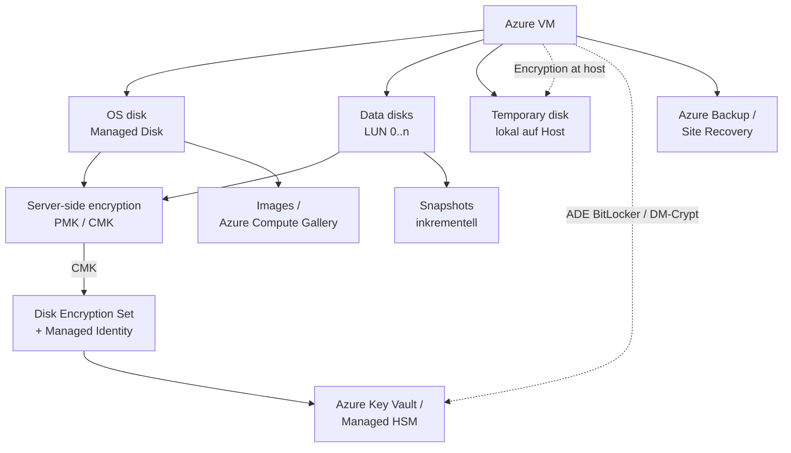

# 3.3 VM-Datenträger und Verschlüsselung

> **Domäne:** Deploy and manage Azure compute resources · **Gewichtung:** 20–25 %
> **Study-Guide-Punkte:** *Manage virtual machine disks* · *Configure Azure Disk Encryption*
> (VMs erstellen und verwalten → [Kapitel 3.2](02-virtuelle-maschinen.md))
> **Stand:** November 2026

## Lernziele

Nach diesem Kapitel kann ich …

- die Rollen **OS disk**, **Data disk** und **Temporary disk** unterscheiden und erklären, welche Daten wann verloren gehen.
- den passenden **Disk-Typ** (Ultra Disk, Premium SSD v2, Premium SSD, Standard SSD, Standard HDD) für ein Szenario auswählen.
- Data Disks im Portal, mit CLI und PowerShell **hinzufügen, vergrößern, den Typ ändern** und im Gastbetriebssystem initialisieren.
- **Snapshots**, **Images**, **Shared disks** und **Disk Export** einordnen.
- die Verschlüsselungsoptionen **Server-side encryption (PMK/CMK)**, **Encryption at host**, **Azure Disk Encryption (ADE)** und **Confidential disk encryption** abgrenzen und konfigurieren.

## Überblick

Jede Azure-VM speichert ihr Betriebssystem und ihre Daten auf **virtuellen Festplatten (VHDs)**, die heute praktisch immer als **Managed Disks** bereitgestellt werden. Bei Managed Disks verwaltet Azure das zugrunde liegende Speicherkonto; der Administrator wählt nur **Typ**, **Größe**, **Redundanz** und **Verschlüsselung**.

Datenträger sind eigenständige Azure-Ressourcen (`Microsoft.Compute/disks`): Sie haben einen eigenen Lebenszyklus, lassen sich von einer VM trennen, an eine andere VM anhängen, sichern und verschlüsseln. Für die Prüfung sind vor allem **Auswahl des Disk-Typs**, **Änderungen im laufenden Betrieb** (was geht ohne Neustart, was erfordert *Deallocate*) und die **Verschlüsselungsvarianten** wichtig.

## Kernkonzepte

### Disk-Rollen

| Rolle | Beschreibung | Persistent? |
|---|---|---|
| **OS disk** | Enthält das Betriebssystem (Windows `C:`, Linux `/dev/sda`). Genau eine pro VM. Standard-Caching: **ReadWrite** | ✅ |
| **Data disk** | Zusätzliche Datenträger für Anwendungsdaten, über eine **LUN** angebunden. Anzahl begrenzt durch die **VM-Größe** | ✅ |
| **Temporary disk** | Lokaler Speicher auf dem physischen Host (Windows meist **`D:`**, Linux meist **`/dev/sdb`**, gemountet unter `/mnt`). Für Auslagerungsdatei, Swap, Temp-Daten | ❌ |

⚠️ **Temporary disk:** Daten gehen verloren bei **Deallocate** (Stop im Portal), **Redeploy**, Größenänderung auf einen anderen Host oder Host-Wartung/-Ausfall. Ein normaler Neustart (*Restart*) behält die Daten in der Regel. Nicht jede VM-Größe hat eine Temp-Disk (z. B. v5-Größen ohne `d` im Namen wie `Standard_D2s_v5`).

### Managed vs. Unmanaged Disks

- **Managed Disks:** Azure verwaltet Speicherkonten, Skalierung und Verfügbarkeit. Integration in Availability Sets/Zones, RBAC pro Disk, Snapshots, Backup.
- **Unmanaged Disks:** VHD-Dateien als Page Blobs in einem eigenen Speicherkonto. ⚠️ **Eingestellt (retired)** – Unterstützung endete am **30. September 2025**. In der Prüfung: immer Managed Disks wählen.

### Disk-Typen

| Typ | Medium | Max. Größe | Einsatz | Einschränkungen |
|---|---|---|---|---|
| **Ultra Disk** | SSD | 64 TiB | IO-intensive Workloads (SAP HANA, Top-Tier-Datenbanken), IOPS/Durchsatz unabhängig von der Größe einstellbar | ⚠️ **nicht als OS disk**, **kein Host-Caching**, nur bestimmte VM-Größen/Regionen/Zonen, nur LRS |
| **Premium SSD v2** | SSD | 64 TiB | Produktive Datenbanken mit flexibel einstellbarer Leistung (IOPS, MB/s) zu günstigerem Preis als Ultra | ⚠️ **nicht als OS disk**, **kein Host-Caching**, nur LRS, regionale Verfügbarkeit beachten |
| **Premium SSD** | SSD | 32 TiB | Produktive, leistungskritische Workloads; Leistung an Größenstufe (P1–P80) gekoppelt | VM-Größe muss Premium Storage unterstützen (meist **`s`** im Namen, z. B. `D4s_v5`) |
| **Standard SSD** | SSD | 32 TiB | Webserver, wenig genutzte Anwendungen, Dev/Test mit konsistenter Latenz | geringere IOPS als Premium |
| **Standard HDD** | HDD | 32 TiB | Backup, unkritische Daten, selten genutzte Daten | höchste Latenz, schwankende Leistung |

**Größenstufen (Beispiele):** Premium SSD `P10` = 128 GiB, `P30` = 1 TiB; Standard SSD `E`-Stufen, Standard HDD `S`-Stufen. Abgerechnet wird bei Premium SSD/Standard SSD/Standard HDD die **bereitgestellte Stufe**, nicht der tatsächlich belegte Platz. Bei Ultra und Premium SSD v2 bezahlt man Kapazität, IOPS und Durchsatz getrennt.

### Performance Tiers und Bursting

- **Performance tier (Premium SSD):** Die Leistung kann unabhängig von der Größe auf eine höhere Stufe gesetzt werden (z. B. eine 128-GiB-Disk mit `P50`-Leistung) – etwa für eine Spitzenlast. Rückstufung ist nur mit zeitlichem Abstand möglich (Größenordnung: alle 12 Stunden).
- **Credit-based bursting:** Kleine Premium SSD (bis `P20`) und Standard SSD (bis `E30`) sammeln Credits und können kurzzeitig über ihre Basisleistung „bursten“ – kostenlos, automatisch aktiv.
- **On-demand bursting:** Für Premium SSD **größer als 512 GiB** zuschaltbar, gegen Zusatzkosten.
- **Leistung von Ultra/Premium SSD v2** wird direkt über IOPS- und MB/s-Werte angepasst – ohne Größenänderung und meist ohne Trennen der Disk.

⚠️ Die **VM-Größe** begrenzt ebenfalls IOPS und Durchsatz (VM-Level-Throttling). Eine schnelle Disk an einer kleinen VM bringt nicht die volle Leistung.

### Host-Caching

| Einstellung | Wirkung | Typischer Einsatz |
|---|---|---|
| **None** | kein Cache | Schreibintensive Daten, Log-Dateien von Datenbanken; Pflicht bei Ultra/Premium SSD v2 |
| **ReadOnly** | Lesezugriffe aus dem Host-Cache | Datendateien von Datenbanken, leseintensive Daten (Standard für Premium-Data-Disks) |
| **ReadWrite** | Lese- und Schreib-Cache | **OS disk** (Standard); für Data Disks nur, wenn die Anwendung Cache-Flushes korrekt behandelt |

Hinweis: Disks ab **4 TiB** unterstützen kein Host-Caching. Eine Änderung der Caching-Einstellung kann eine kurze Unterbrechung der betroffenen Disk verursachen.

### Data Disk hinzufügen und im Gast initialisieren

- Data Disks lassen sich an eine **laufende VM** anhängen (**Hot-Add**, kein Neustart nötig) – neu erstellen oder vorhandene Disk anhängen.
- Die maximale Anzahl Data Disks hängt von der **VM-Größe** ab (z. B. 4 bei kleinen Größen, bis 64 bei großen).
- Nach dem Anhängen ist die Disk im Gast **roh (RAW)** und muss initialisiert werden:
  - **Windows:** Datenträgerverwaltung (`diskmgmt.msc`) → Online → Initialisieren (GPT) → Volume erstellen, oder PowerShell (siehe unten).
  - **Linux:** `lsblk` → Partition (`parted`) → Dateisystem (`mkfs.xfs`/`mkfs.ext4`) → Mountpoint → Eintrag in `/etc/fstab` mit **UUID** und Option `nofail`.
- **Detach:** Data Disks können im laufenden Betrieb getrennt werden (vorher im Gast aushängen). Die Disk bleibt als Ressource erhalten und wird weiter berechnet.

### Disk vergrößern und Typ ändern

| Änderung | Ablauf |
|---|---|
| **Data Disk vergrößern** | Bei vielen Disks **online** möglich (ohne Deallocate); Ausnahmen bzw. Deallocate z. B. beim Überschreiten von 4 TiB oder bei älteren Konfigurationen |
| **OS Disk vergrößern** | VM **deallocaten**, Größe ändern, starten |
| **Verkleinern** | ⚠️ **nicht möglich** – nur neue, kleinere Disk anlegen und Daten kopieren |
| **Disk-Typ ändern** (z. B. Standard HDD → Premium SSD) | in der Regel **VM deallocaten** (oder Disk trennen), SKU ändern, starten |
| **Redundanz ändern** (LRS ↔ ZRS) | Je nach Disk-Typ direkte Konvertierung oder Umweg über **Snapshot → neue Disk** |

⚠️ Nach dem Vergrößern muss die **Partition im Gast-OS erweitert** werden (Windows: *Extend Volume*; Linux: `growpart` + `xfs_growfs`/`resize2fs`).

### Snapshots, Images, Shared Disks, Export

- **Snapshot:** schreibgeschützte, punktgenaue Kopie **einer** Disk. **Vollständig** oder **inkrementell** (nur Änderungen seit dem letzten Snapshot, günstiger, empfohlen). Snapshots sind unabhängig von der Quell-Disk; aus einem Snapshot lässt sich eine neue Disk erstellen. Für **anwendungskonsistente Sicherungen mehrerer Disks** → **Azure Backup** ([5.4](../05-monitoring-und-wartung/04-azure-backup.md)) oder **VM restore points**.
- **Image:** Vorlage für neue VMs (OS + optional Data Disks). Vorher **generalisieren** (Windows: `Sysprep`, Linux: `waagent -deprovision+user`). Empfohlen: **Azure Compute Gallery** (Versionen, Replikation in Regionen); Details in [3.2](02-virtuelle-maschinen.md).
- **Shared disks:** Eine Managed Disk wird an **mehrere VMs gleichzeitig** angehängt (Einstellung `maxShares`), für Cluster-Anwendungen wie **Windows Server Failover Cluster** oder SQL Server FCI. Verfügbar für Ultra Disk, Premium SSD v2, Premium SSD und Standard SSD. Die Clustersoftware regelt den Zugriff (SCSI Persistent Reservations) – kein normales Dateisystem für gleichzeitige Schreibzugriffe.
- **Disk Export:** Erzeugt eine zeitlich begrenzte **SAS-URL**, um die VHD herunterzuladen oder in eine andere Region/ein anderes Konto zu kopieren. Voraussetzung: Disk ist **nicht angehängt** bzw. die VM ist **deallocated**. Umgekehrt kann eine VHD (Format **VHD, feste Größe**, kein VHDX) direkt in eine Managed Disk hochgeladen werden.

### Disk-Redundanz

| Option | Beschreibung | Verfügbar für |
|---|---|---|
| **LRS** | 3 Kopien in einem Rechenzentrum | alle Disk-Typen |
| **ZRS** | synchron über 3 Verfügbarkeitszonen; Disk kann bei Zonenausfall an eine VM in einer anderen Zone angehängt werden | **Premium SSD**, **Standard SSD** |

Managed Disks bieten **keine** Geo-Redundanz (GRS). Regionsübergreifender Schutz → **Azure Site Recovery** ([5.5](../05-monitoring-und-wartung/05-azure-site-recovery.md)) oder Backup mit Cross Region Restore.

### Verschlüsselung

#### Server-side encryption (SSE) – Verschlüsselung im Ruhezustand

- **Immer aktiv** für alle Managed Disks, Snapshots und Images, **AES-256**, nicht abschaltbar.
- **Platform-managed keys (PMK):** Standard, Microsoft verwaltet die Schlüssel.
- **Customer-managed keys (CMK):** eigener Schlüssel in **Azure Key Vault** oder **Managed HSM**, eingebunden über ein **Disk Encryption Set (DES)**.
  - Das DES hat eine **Managed Identity**, die Zugriff auf den Schlüssel braucht (Rolle *Key Vault Crypto Service Encryption User* bzw. Access Policy mit `get`, `wrapKey`, `unwrapKey`).
  - Key Vault benötigt **Soft delete** und **Purge protection**.
  - Automatische Schlüsselrotation ist möglich.
  - **Double encryption at rest:** PMK **und** CMK kombiniert (DES-Typ *Double encryption with platform-managed and customer-managed keys*).
- SSE verschlüsselt **nicht** die Temp-Disk und **nicht** den Host-Cache – dafür Encryption at host.

#### Encryption at host

- Verschlüsselung beginnt bereits **auf dem VM-Host**: **Temp-Disk**, **Caches** von OS- und Data-Disks und der Datenfluss zum Storage werden verschlüsselt (mit PMK oder CMK).
- Voraussetzungen: Feature `EncryptionAtHost` im Abonnement **registrieren** (`Microsoft.Compute`), unterstützte VM-Größe; zum Aktivieren an einer bestehenden VM muss diese **deallocated** sein.
- Läuft vollständig auf Plattformebene – **keine** Agenten, keine CPU-Last in der VM, unterstützt alle Gast-OS und Custom Images.
- ⚠️ Nicht gleichzeitig mit **ADE** auf derselben VM nutzbar.
- Microsoft empfiehlt Encryption at host als Nachfolger von ADE für neue VMs.

#### Azure Disk Encryption (ADE)

- Verschlüsselung **im Gastbetriebssystem**: **BitLocker** (Windows) bzw. **DM-Crypt** (Linux), umgesetzt über eine VM-Extension.
- Schlüssel (Disk Encryption Keys, als Secrets) liegen in **Azure Key Vault**; optional zusätzlich mit einem **Key Encryption Key (KEK)** geschützt.
- Voraussetzungen für den Key Vault:
  - **gleiche Region** und **gleiches Abonnement** wie die VM,
  - Access Policy **„Azure Disk Encryption for volume encryption“** aktiviert (`enabledForDiskEncryption`),
  - bei Verwendung eines KEK zusätzlich *Soft delete*/*Purge protection* empfohlen.
- Verschlüsselbar: **OS**, **Data** oder **All** Volumes. Temp-Disk wird bei Windows mit „All“ ebenfalls verschlüsselt.
- Einschränkungen (Auswahl): nicht für Basic-VMs, nicht zusammen mit Encryption at host, Anforderungen an VM-Speicher bei Linux.
- ⚠️ **Status:** Microsoft hat die **Einstellung (Retirement) von ADE angekündigt** (Zieltermin nach aktuellem Stand **2028**) und empfiehlt für neue VMs Encryption at host. ADE ist dennoch weiterhin **Bestandteil des Study Guides** („Configure Azure Disk Encryption“) und prüfungsrelevant.

#### Confidential disk encryption

- Nur für **Confidential VMs** (AMD SEV-SNP / Intel TDX). Die OS-Disk wird verschlüsselt und der Schlüssel an das **vTPM** der VM gebunden – selbst der Host kann nicht auf die Daten zugreifen. Für AZ-104 nur zur Abgrenzung relevant.

## Zusammenhänge



- **Virtuelle Maschinen** ([3.2](02-virtuelle-maschinen.md)): Die VM-Größe bestimmt, welche Disk-Typen möglich sind (Premium-fähig, Ultra-fähig), wie viele Data Disks angehängt werden können und welche IOPS-Obergrenze gilt.
- **Verfügbarkeit** ([3.4](04-verfuegbarkeit-und-scale-sets.md)): Managed Disks in Availability Sets werden auf getrennte Storage-Fehlerdomänen verteilt; zonale VMs brauchen Disks in derselben Zone (oder ZRS-Disks).
- **Speicher-Verschlüsselung** ([2.2](../02-speicher/02-speicherzugriff-und-sicherheit.md)): SSE mit PMK/CMK funktioniert für Disks nach demselben Prinzip wie für Speicherkonten – bei Disks über ein Disk Encryption Set.
- **Backup** ([5.4](../05-monitoring-und-wartung/04-azure-backup.md)): Azure Backup sichert VMs inklusive ADE-verschlüsselter Disks (Backup benötigt Zugriff auf den Key Vault). Für einzelne Disks gibt es *Azure Disk Backup* (snapshotbasiert).
- **Kosten** ([1.7](../01-identitaeten-und-governance/07-kostenverwaltung-und-advisor.md)): Disks werden auch berechnet, wenn die VM gestoppt (deallocated) ist; nicht angehängte („verwaiste“) Disks meldet Azure Advisor als Einsparpotenzial.
- **RBAC** ([1.3](../01-identitaeten-und-governance/03-rbac-zugriffsverwaltung.md)): Rollen wie *Virtual Machine Contributor* oder *Disk Snapshot Contributor* steuern, wer Disks verwalten darf.

## Vergleichstabellen

### Disk-Typen auf einen Blick

| Kriterium | Ultra Disk | Premium SSD v2 | Premium SSD | Standard SSD | Standard HDD |
|---|---|---|---|---|---|
| Als OS disk | ❌ | ❌ | ✅ | ✅ | ✅ |
| Host-Caching | ❌ | ❌ | ✅ | ✅ | ✅ |
| Leistung unabhängig von Größe | ✅ | ✅ | über Performance tier | ❌ | ❌ |
| ZRS | ❌ | ❌ | ✅ | ✅ | ❌ |
| Max. Größe | 64 TiB | 64 TiB | 32 TiB | 32 TiB | 32 TiB |
| Typischer Einsatz | SAP HANA, Top-DBs | Produktiv-DBs | Produktion | Web, Dev/Test | Backup, Archiv |

### Verschlüsselungsoptionen

| Kriterium | SSE mit PMK | SSE mit CMK | Encryption at host | Azure Disk Encryption | Confidential disk encryption |
|---|---|---|---|---|---|
| Wo wird verschlüsselt? | Storage-Ebene | Storage-Ebene | VM-Host | **Im Gast-OS** | im Gast, an vTPM gebunden |
| Standardmäßig aktiv | ✅ | ❌ | ❌ | ❌ | ❌ |
| Schlüsselverwaltung | Microsoft | Kunde (Key Vault/HSM via DES) | Microsoft oder Kunde | Kunde (Key Vault) | Microsoft oder Kunde |
| Temp-Disk & Cache verschlüsselt | ❌ | ❌ | ✅ | teilweise (Temp-Disk bei Windows mit „All“) | – |
| Agent/Extension in VM | ❌ | ❌ | ❌ | ✅ (BitLocker/DM-Crypt) | ❌ |
| CPU-Last in der VM | ❌ | ❌ | ❌ | ✅ | gering |
| Kombinierbar mit ADE | ✅ | ✅ | ❌ | – | ❌ |
| Status | aktuell | aktuell | **empfohlen** | Retirement angekündigt | aktuell (nur Confidential VMs) |

### Snapshot vs. Image vs. Backup

| Kriterium | Snapshot | Image (Compute Gallery) | Azure Backup |
|---|---|---|---|
| Umfang | eine Disk | OS (+ Data Disks) als Vorlage | ganze VM (alle Disks) |
| Generalisierung nötig | ❌ | ✅ (für generalisierte Images) | ❌ |
| Konsistenz über mehrere Disks | ❌ | – | ✅ (anwendungskonsistent) |
| Aufbewahrung/Zeitplan | manuell | Versionen | Richtlinie mit Zeitplan & Retention |
| Typischer Einsatz | vor Änderungen, Disk kopieren | viele gleiche VMs ausrollen | Schutz vor Datenverlust |

## Azure Portal

| Aufgabe | Pfad |
|---|---|
| Disks einer VM anzeigen | **Portal > Virtual machines > VM > Disks** |
| Neue Data Disk anlegen und anhängen | **… > VM > Disks > + Create and attach a new disk** → Name, Storage type, Size → **Save** |
| Vorhandene Disk anhängen | **… > VM > Disks > Attach existing disks** |
| Host-Caching ändern | **… > VM > Disks** → Spalte *Host caching* → **Save** |
| Data Disk trennen | **… > VM > Disks** → Disk → **Detach** (X) → **Save** |
| OS-Disk tauschen | **… > VM > Disks > Swap OS disk** |
| Disk als eigene Ressource erstellen | **Portal > Disks > + Create** |
| Größe / Typ / Performance tier ändern | **Portal > Disks > Disk > Size + performance** |
| Redundanz / Zone / Netzwerkzugriff | **… > Disk > Configuration** bzw. **Networking** |
| Verschlüsselung (PMK/CMK, DES) einer Disk | **… > Disk > Encryption** |
| Snapshot erstellen | **… > Disk > Overview > Create snapshot** oder **Portal > Snapshots > + Create** |
| Disk aus Snapshot erstellen | **Portal > Disks > + Create** → *Source type: Snapshot* |
| Disk exportieren (SAS-URL) | **… > Disk > Disk Export** |
| Disk Encryption Set anlegen | **Portal > Disk Encryption Sets > + Create** |
| Encryption at host aktivieren | **… > VM > Disks > Additional settings > Encryption at host** (VM muss gestoppt/deallocated sein) bzw. bei Erstellung: **Create VM > Disks > Encryption at host** |
| ADE aktivieren | **… > VM > Disks > Additional settings > Disks to encrypt** (OS / OS and data) → Key Vault auswählen |
| Key Vault für ADE freigeben | **Portal > Key vaults > Vault > Access configuration > Azure Disk Encryption for volume encryption** |
| Disk-Optionen bei VM-Erstellung | **Create a virtual machine > Disks**: OS disk type, Delete with VM, Key management, Encryption at host, Data disks, Enable Ultra Disk compatibility |

⚠️ **Wichtige Hinweise zur Erstellung:**
- **Enable Ultra Disk compatibility** muss an der VM aktiviert sein, bevor Ultra Disks angehängt werden können (bei bestehenden VMs nur im deallocated-Zustand änderbar).
- *Delete with VM*: Legt fest, ob OS-/Data-Disks beim Löschen der VM mitgelöscht werden.
- Die **Zone** einer Disk ist nach dem Erstellen nicht änderbar (Umweg über Snapshot).
- **Verkleinern** ist nie möglich.

## Azure CLI & PowerShell

### Azure CLI

```bash
# Neue Premium-SSD-Data-Disk (128 GiB) erstellen und an laufende VM anhängen
az vm disk attach \
  --resource-group <resource-group> \
  --vm-name <vm-name> \
  --name <vm-name>-data01 \
  --new --size-gb 128 --sku Premium_LRS

# Eigenständige Disk erstellen (z. B. zonale Standard SSD)
az disk create -g <resource-group> -n data02 --size-gb 256 \
  --sku StandardSSD_LRS --zone 1

# OS-Disk vergrößern: VM deallocaten, Größe ändern, starten
az vm deallocate -g <resource-group> -n <vm-name>
az disk update -g <resource-group> -n <os-disk-name> --size-gb 256
az vm start -g <resource-group> -n <vm-name>

# Disk-Typ ändern (z. B. auf Premium SSD) – VM vorher deallocaten
az disk update -g <resource-group> -n <disk-name> --sku Premium_LRS

# Inkrementellen Snapshot erstellen und daraus eine neue Disk anlegen
az snapshot create -g <resource-group> -n snap-data01 \
  --source <disk-name> --incremental true
az disk create -g <resource-group> -n data01-restore --source snap-data01

# Disk exportieren (SAS-URL für 1 Stunde)
az disk grant-access -g <resource-group> -n <disk-name> \
  --duration-in-seconds 3600 --access-level Read

# --- Azure Disk Encryption (ADE) ---
az keyvault update -g <resource-group> -n <keyvault-name> \
  --enabled-for-disk-encryption true
az vm encryption enable -g <resource-group> -n <vm-name> \
  --disk-encryption-keyvault <keyvault-name> --volume-type All
az vm encryption show -g <resource-group> -n <vm-name>

# --- Customer-managed key über Disk Encryption Set ---
az disk-encryption-set create -g <resource-group> -n des-contoso \
  --key-url <key-identifier-url> --source-vault <keyvault-name>
# (Danach der Managed Identity des DES Zugriff auf den Key Vault geben)
az disk update -g <resource-group> -n <disk-name> \
  --encryption-type EncryptionAtRestWithCustomerKey --disk-encryption-set des-contoso

# --- Encryption at host ---
az feature register --namespace Microsoft.Compute --name EncryptionAtHost
az vm deallocate -g <resource-group> -n <vm-name>
az vm update -g <resource-group> -n <vm-name> \
  --set securityProfile.encryptionAtHost=true
az vm start -g <resource-group> -n <vm-name>
```

### Az PowerShell

```powershell
# Neue Data Disk erstellen und anhängen
$rg  = "<resource-group>"
$vm  = Get-AzVM -ResourceGroupName $rg -Name "<vm-name>"
$cfg = New-AzDiskConfig -Location $vm.Location -CreateOption Empty `
         -DiskSizeGB 128 -SkuName Premium_LRS
$disk = New-AzDisk -ResourceGroupName $rg -DiskName "<vm-name>-data01" -Disk $cfg
$vm = Add-AzVMDataDisk -VM $vm -Name $disk.Name -CreateOption Attach `
        -ManagedDiskId $disk.Id -Lun 1 -Caching ReadOnly
Update-AzVM -ResourceGroupName $rg -VM $vm

# Disk vergrößern bzw. Typ ändern (VM ggf. vorher stoppen: Stop-AzVM)
$disk = Get-AzDisk -ResourceGroupName $rg -DiskName "<disk-name>"
$disk.DiskSizeGB = 256
$disk.Sku = [Microsoft.Azure.Management.Compute.Models.DiskSku]::new("Premium_LRS")
Update-AzDisk -ResourceGroupName $rg -DiskName $disk.Name -Disk $disk

# Inkrementellen Snapshot erstellen
$snapCfg = New-AzSnapshotConfig -SourceUri $disk.Id -Location $disk.Location `
             -CreateOption Copy -Incremental
New-AzSnapshot -ResourceGroupName $rg -SnapshotName "snap-data01" -Snapshot $snapCfg

# Azure Disk Encryption aktivieren
$kv = Get-AzKeyVault -VaultName "<keyvault-name>" -ResourceGroupName $rg
Set-AzKeyVaultAccessPolicy -VaultName $kv.VaultName -ResourceGroupName $rg -EnabledForDiskEncryption
Set-AzVMDiskEncryptionExtension -ResourceGroupName $rg -VMName "<vm-name>" `
  -DiskEncryptionKeyVaultUrl $kv.VaultUri -DiskEncryptionKeyVaultId $kv.ResourceId `
  -VolumeType All
Get-AzVMDiskEncryptionStatus -ResourceGroupName $rg -VMName "<vm-name>"
```

### Im Gastbetriebssystem initialisieren

```powershell
# Windows: alle RAW-Disks initialisieren, partitionieren und formatieren
Get-Disk | Where-Object PartitionStyle -eq 'RAW' |
  Initialize-Disk -PartitionStyle GPT -PassThru |
  New-Partition -AssignDriveLetter -UseMaximumSize |
  Format-Volume -FileSystem NTFS -NewFileSystemLabel "Data" -Confirm:$false
```

```bash
# Linux: neue Disk (hier /dev/sdc) partitionieren, formatieren, dauerhaft mounten
lsblk -o NAME,HCTL,SIZE,MOUNTPOINT
sudo parted /dev/sdc --script mklabel gpt mkpart xfspart xfs 0% 100%
sudo mkfs.xfs /dev/sdc1
sudo mkdir /datadrive && sudo mount /dev/sdc1 /datadrive
# UUID ermitteln und in /etc/fstab eintragen (nofail verhindert Boot-Probleme)
sudo blkid /dev/sdc1
echo "UUID=<uuid>  /datadrive  xfs  defaults,nofail  0  2" | sudo tee -a /etc/fstab
```

| Ziel | CLI | PowerShell |
|---|---|---|
| Disk anhängen | `az vm disk attach` | `Add-AzVMDataDisk` + `Update-AzVM` |
| Disk erstellen | `az disk create` | `New-AzDiskConfig` + `New-AzDisk` |
| Größe/Typ ändern | `az disk update --size-gb / --sku` | `Update-AzDisk` |
| Snapshot | `az snapshot create` | `New-AzSnapshotConfig` + `New-AzSnapshot` |
| ADE aktivieren | `az vm encryption enable` | `Set-AzVMDiskEncryptionExtension` |
| ADE-Status | `az vm encryption show` | `Get-AzVMDiskEncryptionStatus` |
| Key Vault für ADE | `az keyvault update --enabled-for-disk-encryption` | `Set-AzKeyVaultAccessPolicy -EnabledForDiskEncryption` |

## Praxisbeispiel

**Szenario:** *Contoso* betreibt die VM `vm-sql01` (`Standard_D4s_v5`, Windows Server) mit einem SQL Server. Anforderungen:

1. Datenbankdateien und Logdateien sollen auf getrennten, schnellen Disks liegen.
2. Die bestehende Standard-HDD-Disk für Berichte soll auf Premium SSD umgestellt und auf 512 GiB vergrößert werden.
3. Vor dem Umbau soll ein Sicherungspunkt existieren.
4. Die Compliance verlangt, dass auch **Temp-Disk und Caches** verschlüsselt werden und Contoso die Schlüssel selbst verwaltet.

**Umsetzung:**

1. **Snapshot vor Änderungen:** *Disks > vm-sql01-reports > Create snapshot* → Typ **Incremental**.
2. **Neue Disks anhängen (Hot-Add):** *VM > Disks > + Create and attach a new disk*
   - `vm-sql01-data` – Premium SSD, 1 TiB (`P30`), Host caching **ReadOnly** (Datendateien)
   - `vm-sql01-log` – Premium SSD, 512 GiB (`P20`), Host caching **None** (Logdateien)
   - **Save** → im Gast per PowerShell initialisieren (siehe oben).
3. **Typ und Größe ändern:** VM **stoppen (deallocate)** → *Disks > vm-sql01-reports > Size + performance* → **Premium SSD**, 512 GiB → VM starten → im Gast *Extend Volume*.
4. **Verschlüsselung:**
   - Key Vault `kv-contoso-disks` mit *Soft delete* und *Purge protection*, RSA-Schlüssel anlegen.
   - **Disk Encryption Set** `des-contoso` mit diesem Schlüssel anlegen, der DES-Identity die Rolle *Key Vault Crypto Service Encryption User* geben.
   - Feature `EncryptionAtHost` registrieren, VM deallocaten, *Disks > Additional settings* → **Encryption at host = Yes** und **Key management: Customer-managed key** mit `des-contoso` → VM starten.
   - Ergebnis: OS-/Data-Disks mit CMK verschlüsselt, Temp-Disk und Caches durch Encryption at host geschützt – **ohne** ADE-Extension in der VM.

Wäre stattdessen **Verschlüsselung im Gast-OS mit BitLocker** gefordert (z. B. weil eine Richtlinie das verlangt), würde man **ADE** verwenden – dann aber **nicht** zusätzlich Encryption at host.

## Limits & wichtige Zahlen

| Wert | Grenze / Standard |
|---|---|
| Max. Größe Premium SSD / Standard SSD / Standard HDD | **32 TiB** |
| Max. Größe Ultra Disk / Premium SSD v2 | **64 TiB** |
| Max. Größe OS disk | 4 TiB (bei MBR-Partitionierung nur 2 TiB nutzbar) |
| Host-Caching | nur für Disks **< 4 TiB**; nicht für Ultra/Premium SSD v2 |
| Max. Anzahl Data Disks | abhängig von der **VM-Größe** (z. B. 4 bis 64) |
| Credit-based bursting | Premium SSD bis **P20**, Standard SSD bis **E30** |
| On-demand bursting | Premium SSD **> 512 GiB** |
| ZRS für Disks | nur **Premium SSD** und **Standard SSD** |
| Unmanaged Disks | **retired** seit 30.09.2025 |
| Upload/Export-Format | **VHD**, feste Größe (kein VHDX, kein dynamisches VHD) |
| Managed Disks pro Abo und Region | Standardkontingent im Bereich von zehntausenden (aktuellen Wert unter *Usage + quotas* prüfen) |
| ADE Key Vault | **gleiche Region** und **gleiches Abonnement** wie die VM |

Aktuelle Werte: [Azure managed disk types](https://learn.microsoft.com/azure/virtual-machines/disks-types) und [Scalability and performance targets for VM disks](https://learn.microsoft.com/azure/virtual-machines/disks-scalability-targets).

## Prüfungstipps & Fallstricke

- ⚠️ **Daten auf `D:` (Windows) bzw. `/dev/sdb` (Linux) nach Stop/Start verschwunden** → das ist die **Temporary disk**; nie für persistente Daten nutzen.
- ⚠️ **Ultra Disk oder Premium SSD v2 als OS disk** → **nicht möglich**.
- ⚠️ **Disk verkleinern** → **nicht möglich**.
- ⚠️ **OS-Disk vergrößern** oder **Disk-Typ ändern** → VM in der Regel **deallocaten**. Data Disks lassen sich dagegen oft **online** vergrößern und immer **online anhängen**.
- **„Höchste IOPS, unabhängig von der Größe einstellbar, für SAP HANA“** → **Ultra Disk**.
- **„Kostengünstig, für Backup/unkritische Daten“** → **Standard HDD**.
- **„Premium SSD lässt sich nicht auswählen“** → VM-Größe unterstützt kein Premium Storage (kein `s` im Namen) → VM-Größe ändern.
- **„Ultra Disk lässt sich nicht anhängen“** → *Ultra Disk compatibility* an der VM nicht aktiviert oder Region/Zone/VM-Größe nicht unterstützt.
- **„Disk soll bei Zonenausfall weiter nutzbar sein“** → **ZRS** (nur Premium SSD/Standard SSD).
- **„Mehrere VMs eines Failover-Clusters greifen auf dieselbe Disk zu“** → **Shared disk** (`maxShares` > 1).
- **„Verschlüsselung mit eigenem Schlüssel, ohne Agent in der VM“** → **SSE mit CMK über Disk Encryption Set**.
- **„Auch Temp-Disk und Cache verschlüsseln“** → **Encryption at host**.
- **„Verschlüsselung mit BitLocker/DM-Crypt im Gast“** → **Azure Disk Encryption**.
- ⚠️ **ADE schlägt fehl** → Key Vault in **anderer Region/anderem Abo** oder **„Azure Disk Encryption for volume encryption“** nicht aktiviert.
- ⚠️ **ADE und Encryption at host** schließen sich auf derselben VM aus.
- **Kosten:** Disks kosten auch bei gestoppter (deallocated) VM; nur VM-Compute entfällt.
- **Partition nach Vergrößerung** im Gast erweitern – sonst ist der neue Platz nicht nutzbar.

## Selbsttest

**1.** Ein Entwickler speichert Testdaten auf Laufwerk `D:` einer Windows-VM. Nach einem Stop (deallocate) und Start im Portal sind die Daten weg. Warum?

<details><summary>Lösung</summary>

`D:` ist die **Temporary disk** auf dem physischen Host. Bei Deallocation wird die VM ggf. auf einem anderen Host gestartet; die Temp-Disk ist **nicht persistent**. Persistente Daten gehören auf eine **Data disk**.
</details>

**2.** Sie möchten eine neue Data Disk an eine produktive VM anhängen, ohne Ausfallzeit. Ist ein Neustart nötig?

<details><summary>Lösung</summary>

**Nein.** Data Disks können im laufenden Betrieb angehängt werden (**Hot-Add**). Anschließend muss die Disk im Gast-OS initialisiert und formatiert werden.
</details>

**3.** Eine SAP-HANA-VM benötigt eine Data Disk mit 160.000 IOPS, die unabhängig von der Kapazität angepasst werden kann. Welcher Disk-Typ?

<details><summary>Lösung</summary>

**Ultra Disk** (alternativ je nach Anforderung Premium SSD v2, dessen Maximalwerte aber niedriger liegen). Die VM muss *Ultra Disk compatibility* aktiviert haben; Ultra Disks können nicht als OS-Disk verwendet werden.
</details>

**4.** Die OS-Disk einer VM soll von 128 GiB auf 256 GiB vergrößert werden. Welche Schritte sind nötig?

<details><summary>Lösung</summary>

VM **deallocaten** → Disk-Größe auf 256 GiB setzen (*Size + performance* oder `az disk update --size-gb 256`) → VM starten → im Gast-OS die **Partition erweitern**.
</details>

**5.** Eine 1-TiB-Disk wurde versehentlich zu groß angelegt. Kann sie auf 512 GiB verkleinert werden?

<details><summary>Lösung</summary>

**Nein.** Managed Disks können nicht verkleinert werden. Lösung: neue 512-GiB-Disk anlegen, Daten kopieren, alte Disk löschen.
</details>

**6.** Ihre Sicherheitsrichtlinie verlangt, dass Daten auf der Temp-Disk und im Host-Cache verschlüsselt sind. Es dürfen keine Agenten in der VM laufen. Welche Option wählen Sie?

<details><summary>Lösung</summary>

**Encryption at host** (Feature `EncryptionAtHost` registrieren, VM deallocaten, aktivieren). SSE allein verschlüsselt Temp-Disk und Cache nicht; ADE benötigt eine Extension im Gast.
</details>

**7.** Beim Aktivieren von Azure Disk Encryption erhalten Sie einen Fehler. Der Key Vault liegt in *West Europe*, die VM in *North Europe*. Was ist das Problem?

<details><summary>Lösung</summary>

Für ADE muss der Key Vault in **derselben Region** (und im selben Abonnement) wie die VM liegen. Außerdem muss **„Azure Disk Encryption for volume encryption“** am Key Vault aktiviert sein.
</details>

**8.** Sie möchten Managed Disks mit einem eigenen Schlüssel aus Azure Key Vault verschlüsseln. Welche Ressource verbindet Disk und Schlüssel?

<details><summary>Lösung</summary>

Ein **Disk Encryption Set (DES)**. Es verweist auf den Schlüssel im Key Vault; seine **Managed Identity** benötigt Zugriff auf den Schlüssel (`get`, `wrapKey`, `unwrapKey` bzw. Rolle *Key Vault Crypto Service Encryption User*).
</details>

**9.** Zwei VMs eines Windows Server Failover Clusters sollen gleichzeitig auf denselben Datenträger zugreifen. Welche Funktion nutzen Sie?

<details><summary>Lösung</summary>

**Shared disks** – eine Managed Disk (z. B. Premium SSD oder Ultra Disk) mit `maxShares` ≥ 2 an beide VMs anhängen. Die Clustersoftware koordiniert den Zugriff.
</details>

**10.** Eine VM vom Typ `Standard_D4_v5` soll eine Premium SSD erhalten, der Disk-Typ ist im Portal aber nicht wählbar. Warum?

<details><summary>Lösung</summary>

Die VM-Größe unterstützt **kein Premium Storage** (es fehlt das `s` im Namen). Lösung: auf eine Premium-fähige Größe wie `Standard_D4s_v5` wechseln.
</details>

## Weiterführende Links

- [AZ-104 Study Guide](https://learn.microsoft.com/credentials/certifications/resources/study-guides/az-104)
- [Introduction to Azure managed disks](https://learn.microsoft.com/azure/virtual-machines/managed-disks-overview)
- [Azure managed disk types](https://learn.microsoft.com/azure/virtual-machines/disks-types)
- [Managed disk bursting](https://learn.microsoft.com/azure/virtual-machines/disk-bursting)
- [Performance tiers for managed disks](https://learn.microsoft.com/azure/virtual-machines/disks-change-performance)
- [Attach a managed data disk to a Windows VM](https://learn.microsoft.com/azure/virtual-machines/windows/attach-managed-disk-portal)
- [Expand virtual hard disks on a Windows VM](https://learn.microsoft.com/azure/virtual-machines/windows/expand-os-disk)
- [Change the disk type of a managed disk](https://learn.microsoft.com/azure/virtual-machines/disks-convert-types)
- [Create an incremental snapshot](https://learn.microsoft.com/azure/virtual-machines/disks-incremental-snapshots)
- [Share an Azure managed disk](https://learn.microsoft.com/azure/virtual-machines/disks-shared)
- [Server-side encryption of Azure Disk Storage](https://learn.microsoft.com/azure/virtual-machines/disk-encryption)
- [Overview of managed disk encryption options](https://learn.microsoft.com/azure/virtual-machines/disk-encryption-overview)
- [Enable end-to-end encryption using encryption at host](https://learn.microsoft.com/azure/virtual-machines/disks-enable-host-based-encryption-portal)
- [Azure Disk Encryption for Windows VMs](https://learn.microsoft.com/azure/virtual-machines/windows/disk-encryption-overview)
- [Creating and configuring a key vault for Azure Disk Encryption](https://learn.microsoft.com/azure/virtual-machines/windows/disk-encryption-key-vault)
