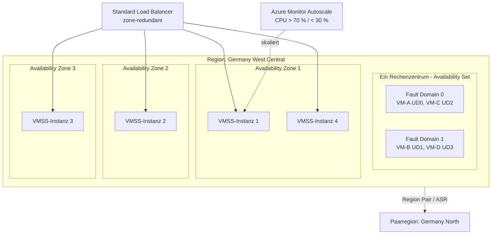

# 3.4 Verfügbarkeit und Virtual Machine Scale Sets

> **Domäne:** Deploy and manage Azure compute resources · **Gewichtung:** 20–25 %
> **Study-Guide-Punkte:** *Deploy virtual machines to availability zones and availability sets* · *Deploy and configure an Azure Virtual Machine Scale Sets*
> **Stand:** November 2026

## Lernziele

Nach diesem Kapitel kann ich …

- **Fault Domains** und **Update Domains** erklären und ihre Grenzwerte nennen.
- **Availability Sets** und **Availability Zones** unterscheiden, die passende Option für ein Szenario wählen und die jeweiligen SLAs zuordnen.
- erklären, welche Verfügbarkeitsentscheidungen **nur bei der Erstellung** einer VM getroffen werden können.
- ein **Virtual Machine Scale Set (VMSS)** im Orchestrierungsmodus **Flexible** oder **Uniform** bereitstellen und über mehrere Zonen verteilen.
- **Autoscale**-Regeln (Scale-out/Scale-in, zeitbasiert), **Scale-in Policy**, **Upgrade Policy** und **Automatic Instance Repairs** konfigurieren.

## Überblick

Eine einzelne VM läuft auf **einem** physischen Host in **einem** Rechenzentrum. Fällt der Host aus (Hardwaredefekt, Stromausfall im Rack) oder wird er gewartet (Host-Update mit Neustart), ist die VM nicht erreichbar. Für hochverfügbare Workloads verteilt man deshalb **mehrere VMs** so, dass sie nicht gemeinsam ausfallen:

- **Availability Set** – Verteilung innerhalb **eines** Rechenzentrums auf verschiedene Racks (Fault Domains) und Wartungsgruppen (Update Domains). Schützt vor Hardware- und Wartungsausfällen.
- **Availability Zone** – Verteilung auf **physisch getrennte Rechenzentren** innerhalb einer Region. Schützt zusätzlich vor dem Ausfall eines ganzen Rechenzentrums.
- **Region Pairs / mehrere Regionen** – Schutz vor dem Ausfall einer gesamten Region (Disaster Recovery, siehe [5.5 Azure Site Recovery](../05-monitoring-und-wartung/05-azure-site-recovery.md)).

**Virtual Machine Scale Sets** ergänzen das um **Elastizität**: Eine Gruppe gleichartiger VMs wird zentral verwaltet und kann sich je nach Last **automatisch vergrößern oder verkleinern** – verteilt über Zonen und Fault Domains.

## Kernkonzepte

### Fault Domains und Update Domains

| Begriff | Bedeutung | Werte |
|---|---|---|
| **Fault Domain (FD)** | Gruppe von Hardware mit gemeinsamer Stromversorgung und Netzwerk-Switch (vereinfacht: ein **Rack**). Fällt sie aus, sind alle VMs darin betroffen. | **max. 3** (regionsabhängig, manche Regionen nur 2) |
| **Update Domain (UD)** | Gruppe von VMs, die bei **geplanter Wartung** gemeinsam neu gestartet werden darf. Es wird immer nur **eine UD gleichzeitig** gewartet (mit Wartezeit dazwischen). | Standard **5**, **max. 20** |

VMs werden reihum auf FDs und UDs verteilt. Beispiel: Availability Set mit 2 FDs und 5 UDs, 6 VMs:

| VM | FD | UD |
|---|---|---|
| VM1 | 0 | 0 |
| VM2 | 1 | 1 |
| VM3 | 0 | 2 |
| VM4 | 1 | 3 |
| VM5 | 0 | 4 |
| VM6 | 1 | 0 |

→ Bei geplanter Wartung sind höchstens **2 von 6** VMs (UD 0) gleichzeitig betroffen; bei einem Rack-Ausfall höchstens **3 von 6**.

### Availability Sets

- Logische Gruppierung von VMs **innerhalb eines Rechenzentrums** zur Verteilung auf FDs/UDs.
- **Kostenlos** – bezahlt werden nur die VMs.
- ⚠️ Eine VM kann **nur bei der Erstellung** einem Availability Set zugeordnet werden. Nachträglich hinzufügen, entfernen oder wechseln geht nicht – die VM muss neu erstellt werden (z. B. aus den vorhandenen Datenträgern).
- VM und Availability Set müssen in derselben **Resource Group** und **Region** liegen.
- Für VMs mit **Managed Disks** wird die SKU **Aligned** verwendet (die Datenträger werden passend zu den Fault Domains auf Storage-Cluster verteilt).
- Eine VM kann **nicht gleichzeitig** in einem Availability Set und in einer Availability Zone sein.
- **SLA:** **99,95 %** bei mindestens **zwei VMs** im selben Availability Set.
- Typisch zusammen mit einem **Load Balancer** ([4.9](../04-netzwerk/09-load-balancer.md)), der den Verkehr auf die VMs verteilt.

### Availability Zones

- Eine **Availability Zone** ist ein oder mehrere physisch getrennte Rechenzentren mit **eigener Stromversorgung, Kühlung und Netzwerk** innerhalb einer Region.
- Regionen mit Zonenunterstützung haben **mindestens 3 Zonen** (Zonen „1", „2", „3").
- ⚠️ Die Zonennummer ist **logisch pro Abonnement** – Zone 1 in Abo A ist nicht zwingend dasselbe Rechenzentrum wie Zone 1 in Abo B.
- **SLA:** **99,99 %** bei mindestens **zwei VMs in mindestens zwei Zonen**.
- Die Zone einer VM wird **bei der Erstellung** festgelegt.

**Zonale vs. zonenredundante Ressourcen:**

| Typ | Bedeutung | Beispiele |
|---|---|---|
| **Zonal** | an **eine** bestimmte Zone gebunden | VM, Managed Disk, zonale Public IP |
| **Zone-redundant** | Plattform repliziert automatisch über **mehrere** Zonen | Standard Public IP (zone-redundant), Standard Load Balancer (Frontend zone-redundant), ZRS-Speicher ([2.1](../02-speicher/01-speicherkonten-und-redundanz.md)) |
| **Non-zonal / Regional** | keine Zonenzuordnung | VM ohne Zonenangabe |

⚠️ Für zonale Architekturen sind **Standard-SKUs** nötig: **Standard Public IP** ([4.3](../04-netzwerk/03-oeffentliche-ip-adressen.md)) und **Standard Load Balancer** ([4.9](../04-netzwerk/09-load-balancer.md)). Die Basic-SKUs sind abgekündigt und unterstützen keine Zonen.

### SLA für einzelne VMs

Auch eine einzelne VM hat ein SLA – abhängig vom **Datenträgertyp aller Disks** (OS- und Datenträger), siehe [3.3](03-vm-datentraeger-und-verschluesselung.md):

| Konfiguration | SLA (Konnektivität) |
|---|---|
| Single VM, alle Disks **Premium SSD / Premium SSD v2 / Ultra Disk** | **99,9 %** |
| Single VM, **Standard SSD** | **99,5 %** |
| Single VM, **Standard HDD** | **95 %** |
| ≥ 2 VMs im **Availability Set** (oder in derselben Dedicated Host Group) | **99,95 %** |
| ≥ 2 VMs in **≥ 2 Availability Zones** | **99,99 %** |

> Die genauen Werte stehen im jeweils aktuellen *SLA for Online Services*; für die Prüfung sind die Größenordnungen (99,9 / 99,95 / 99,99) entscheidend.

### Region Pairs

- Viele Azure-Regionen sind mit einer anderen Region derselben Geografie **gepaart** (z. B. *Germany West Central* ↔ *Germany North*, *West Europe* ↔ *North Europe*).
- Vorteile: Plattform-Updates werden nicht in beiden Regionen gleichzeitig ausgerollt; bei großflächigen Ausfällen wird eine Region des Paares bevorzugt wiederhergestellt; **GRS**-Speicher repliziert in die Paarregion.
- Neuere Regionen haben teilweise **kein** Paar und setzen stattdessen auf Availability Zones.

### Proximity Placement Groups (kurz)

- Logische Gruppierung, die Ressourcen **physisch nah beieinander** (gleiches Rechenzentrum) platziert → **minimale Latenz** zwischen VMs.
- Kombinierbar mit Availability Sets und VMSS. Zielkonflikt: maximale Nähe vs. maximale Verteilung.

### Virtual Machine Scale Sets (VMSS)

Ein **Scale Set** verwaltet eine Gruppe von VMs als Einheit: gemeinsame Konfiguration, automatische Verteilung über Zonen/Fault Domains, automatische Skalierung und gemeinsame Updates.

#### Orchestration Mode

| Merkmal | **Flexible** (empfohlen, Standard) | **Uniform** (klassisch) |
|---|---|---|
| Instanzen | normale `Microsoft.Compute/virtualMachines`-Ressourcen | spezielle Scale-Set-Instanzen (`virtualMachineScaleSets/virtualMachines`) |
| Unterschiedliche VM-Größen/Konfigurationen | möglich | nein, alle identisch nach Modell |
| Bestehende VMs hinzufügen | möglich (passende Konfiguration vorausgesetzt) | nein |
| Verteilung | über Zonen und **Fault Domains** (FD-Verteilung *max spreading* oder feste FD-Anzahl) | über Zonen und FDs/Placement Groups |
| Spot Priority Mix | ✅ | ❌ |
| Overprovisioning | ❌ | ✅ |
| Typischer Einsatz | neue Workloads, gemischte/hochverfügbare Architekturen | große, identische, zustandslose Farmen; ältere Bereitstellungen |

⚠️ Der Orchestration Mode wird **bei der Erstellung** festgelegt und kann danach nicht geändert werden.

Microsoft empfiehlt **Flexible** für neue Workloads; es ersetzt in vielen Szenarien auch das Availability Set (Verteilung auf FDs, zusätzlich zonenfähig).

#### Skalierung

- **Manuell:** Instanzanzahl (*Instance count*) direkt setzen.
- **Autoscale (Custom autoscale)** über Azure Monitor:
  - **Profile:** *Default*, **zeitplanbasiert** (*Recurrence*, z. B. werktags 8–18 Uhr) oder **festes Datum** (*Fixed date*, z. B. Black Friday).
  - Pro Profil **Instance limits:** **Minimum**, **Maximum**, **Default** (Default wird verwendet, wenn keine Metrikdaten vorliegen).
  - **Regeln (Rules):** Metrik (z. B. *Percentage CPU*, *Network In*, *Available Memory* über Gast-Metriken, Queue-Länge eines Storage Accounts/Service Bus), Operator, Schwellenwert, **Duration** (Zeitfenster, z. B. 10 Minuten), **Time aggregation** (Average, Max …), Aktion (*Increase/Decrease count by*, *Increase/Decrease percent by*, *Increase count to*), **Cool down** (Wartezeit nach einer Skalierung, Standard **5 Minuten**).
  - **Logik:** **Scale-out**, sobald **eine** Scale-out-Regel zutrifft; **Scale-in** nur, wenn **alle** Scale-in-Regeln zutreffen.
  - ⚠️ Immer **Scale-out- und Scale-in-Regeln paarweise** anlegen, sonst wächst das Scale Set nur. Schwellen mit Abstand wählen (z. B. > 70 % raus, < 30 % rein), um **Flapping** zu vermeiden.
- **Predictive Autoscale:** sagt die CPU-Last anhand historischer Muster voraus und skaliert **vorausschauend**; benötigt einige Tage Verlaufsdaten (mind. 7 Tage) und kann zunächst im Modus *Forecast only* getestet werden. Nur für die Metrik Percentage CPU.

Metriken und Warnungen → [5.1](../05-monitoring-und-wartung/01-azure-monitor-metriken-und-logs.md) / [5.2](../05-monitoring-und-wartung/02-warnungen-und-aktionsgruppen.md).

#### Scale-in Policy

Bestimmt, **welche** Instanzen beim Verkleinern entfernt werden:

| Policy | Verhalten |
|---|---|
| **Default** | Zuerst über **Zonen** und **Fault Domains** ausbalancieren, dann die Instanz mit der **höchsten Instance ID** löschen |
| **NewestVM** | Die **neueste** Instanz löschen (nach Ausbalancieren der Zonen) |
| **OldestVM** | Die **älteste** Instanz löschen (nach Ausbalancieren der Zonen) |

Zusätzlich: **Instance protection** – *Protect from scale-in* (Instanz wird beim Autoscale-Scale-in nie entfernt) bzw. *Protect from scale set actions* (auch Upgrades/Reimage auf Scale-Set-Ebene ausgeschlossen).

#### Upgrade Policy und Modell

Das Scale Set hat ein **Modell** (Image, Größe, Extensions, Netzwerk). Änderungen am Modell werden je nach **Upgrade Policy** auf die Instanzen übertragen:

| Upgrade Policy | Verhalten |
|---|---|
| **Manual** | Bestehende Instanzen bleiben unverändert, bis der Admin sie gezielt aktualisiert (*Instances > Upgrade* bzw. `az vmss update-instances`). Neue Instanzen erhalten das aktuelle Modell. |
| **Automatic** | Alle Instanzen werden **sofort** in zufälliger Reihenfolge aktualisiert → mögliche Ausfallzeit. |
| **Rolling** | Aktualisierung in **Batches** (z. B. 20 %) mit Pausen und optionaler Health-Prüfung → keine Gesamtausfallzeit. Benötigt Health Probe bzw. Application Health Extension. |

Im Portal zeigt die Spalte **Latest model** pro Instanz an, ob sie dem aktuellen Modell entspricht.

Zusätzlich gibt es **Automatic OS image upgrades**: Neue Plattform-Image-Versionen werden automatisch im Rolling-Verfahren eingespielt.

#### Weitere VMSS-Funktionen

- **Application Health Extension / Health Probe:** meldet den Zustand jeder Instanz (HTTP/HTTPS/TCP-Endpunkt).
- **Automatic instance repairs:** Instanzen, die dauerhaft als *unhealthy* gemeldet werden, werden automatisch **ersetzt** (bzw. je nach Einstellung neu gestartet/reimaged). Erfordert Health Extension oder Load-Balancer-Probe; **Grace period** (Standard 30 Minuten) nach Zustandsänderungen.
- **Overprovisioning** (nur Uniform, Standard aktiv): Es werden kurzzeitig mehr VMs erstellt als angefordert; überzählige werden nach erfolgreicher Bereitstellung gelöscht → schnellere, zuverlässigere Skalierung. Zusatz-VMs werden nicht berechnet.
- **Spot Priority Mix** (nur Flexible): Mischung aus regulären und **Spot**-VMs, z. B. *Base regular count* = 2, darüber 50 % regulär / 50 % Spot → Kostenersparnis ([1.7](../01-identitaeten-und-governance/07-kostenverwaltung-und-advisor.md)).
- **Konfiguration der Instanzen:** **Custom Script Extension** (Windows/Linux), **cloud-init** (Linux, *Custom data*), **Azure VM Applications** oder ein vorbereitetes **Custom Image** aus der **Azure Compute Gallery** ([3.2](02-virtuelle-maschinen.md)).
- **Lastverteilung:** Integration mit **Azure Load Balancer** (Layer 4, [4.9](../04-netzwerk/09-load-balancer.md)) oder **Application Gateway** (Layer 7) über Backend Pools – neue Instanzen werden automatisch aufgenommen.
- **Zonen:** Beim Erstellen werden die Zonen gewählt (z. B. 1, 2, 3). Option **Zone balance** (*Balance VMs across zones*) erzwingt eine gleichmäßige Verteilung (*strict*), sonst *best effort*.

## Zusammenhänge



- **VMs** ([3.2](02-virtuelle-maschinen.md)): Die Verfügbarkeitsoption ist Teil des Erstellungsassistenten (Tab *Basics > Availability options*).
- **Datenträger** ([3.3](03-vm-datentraeger-und-verschluesselung.md)): Disk-Typ bestimmt das Single-VM-SLA; zonale VMs brauchen zonale Disks (oder ZRS-Disks).
- **Netzwerk:** Load Balancer ([4.9](../04-netzwerk/09-load-balancer.md)) und Public IPs ([4.3](../04-netzwerk/03-oeffentliche-ip-adressen.md)) in **Standard-SKU** für Zonen.
- **Monitoring:** Autoscale nutzt **Azure-Monitor-Metriken** ([5.1](../05-monitoring-und-wartung/01-azure-monitor-metriken-und-logs.md)); Benachrichtigungen bei Skalierungsvorgängen über E-Mail/Webhook bzw. Aktionsgruppen ([5.2](../05-monitoring-und-wartung/02-warnungen-und-aktionsgruppen.md)).
- **Kosten** ([1.7](../01-identitaeten-und-governance/07-kostenverwaltung-und-advisor.md)): Autoscale senkt Kosten außerhalb von Lastspitzen; Spot Priority Mix und Reservations reduzieren sie weiter. Availability Sets/Zonen selbst kosten nichts – aber **Datenverkehr zwischen Zonen** kann berechnet werden.
- **Disaster Recovery:** Zonen schützen innerhalb einer Region, **Azure Site Recovery** ([5.5](../05-monitoring-und-wartung/05-azure-site-recovery.md)) und **Azure Backup** ([5.4](../05-monitoring-und-wartung/04-azure-backup.md)) über Regionen hinweg.

## Vergleichstabellen

### Availability Set vs. Availability Zone vs. VMSS

| Kriterium | Availability Set | Availability Zones | VMSS (Flexible) |
|---|---|---|---|
| Schutz vor | Rack-/Host-Ausfall, geplanter Wartung | zusätzlich Ausfall eines **Rechenzentrums** | je nach Konfiguration beides |
| Verteilung | FDs (max. 3) + UDs (max. 20) in **einem** Rechenzentrum | über **getrennte Rechenzentren** | über Zonen **und** FDs |
| SLA | **99,95 %** (≥ 2 VMs) | **99,99 %** (≥ 2 VMs in ≥ 2 Zonen) | wie Zonen bzw. FD-Verteilung |
| Automatische Skalierung | ❌ | ❌ | ✅ |
| Zuordnung | nur bei Erstellung | nur bei Erstellung | bei Erstellung der Instanz |
| Latenz zwischen VMs | sehr gering | etwas höher (zonenübergreifend) | abhängig |
| Kosten | kostenlos | kostenlos (ggf. Traffic zwischen Zonen) | kostenlos (nur VMs) |

### Uniform vs. Flexible (Kurzform)

| Frage im Szenario | Antwort |
|---|---|
| Unterschiedliche VM-Größen in einer Gruppe | **Flexible** |
| Spot- und reguläre VMs mischen | **Flexible** |
| Bestehende VM in das Scale Set aufnehmen | **Flexible** |
| Overprovisioning nutzen | **Uniform** |
| Microsoft-Empfehlung für neue Workloads | **Flexible** |

### Upgrade Policies

| Policy | Ausfallzeit-Risiko | Kontrolle |
|---|---|---|
| Manual | keines (bis zum manuellen Update) | maximal |
| Automatic | hoch (alle gleichzeitig möglich) | minimal |
| Rolling | gering (Batches) | mittel, automatisiert |

## Azure Portal

| Aufgabe | Pfad |
|---|---|
| Verfügbarkeitsoption einer neuen VM wählen | **Portal > Virtual machines > + Create > Azure virtual machine > Basics > Availability options** (*No infrastructure redundancy required* / *Availability zone* / *Virtual machine scale set* / *Availability set*) |
| Zone(n) für neue VM wählen | **… > Basics > Availability zone** (mehrere Zonen wählbar → je Zone eine VM) |
| Availability Set anlegen | **Portal > Availability sets > + Create** (Fault domains, Update domains, *Use managed disks: Yes (Aligned)*) |
| VMs eines Availability Sets anzeigen | **Portal > Availability sets > Set > Virtual machines** (mit FD/UD-Spalten) |
| Scale Set anlegen | **Portal > Virtual machine scale sets > + Create** (Basics: Availability zone, **Orchestration mode**, Scaling mode, Image, Size) |
| Instanzanzahl / Autoscale | **Portal > Virtual machine scale sets > VMSS > Availability + scale > Scaling** (*Manual scale* / *Custom autoscale*) |
| Scale-in Policy | **… > VMSS > Scaling > Scale-In Policy** (Registerkarte) |
| Predictive Autoscale | **… > VMSS > Scaling > Predictive autoscale** |
| Instanzen anzeigen, aktualisieren, reimagen | **… > VMSS > Instances** (*Latest model*-Spalte, *Upgrade*, *Reimage*, *Protection policy*) |
| Upgrade Policy ändern | **… > VMSS > Upgrade policy** |
| Health / Automatic repairs | **… > VMSS > Health and repair** |
| Spot Priority Mix | beim Erstellen: **Basics > Scaling / Spot**-Bereich (Flexible) |
| Netzwerk / Load Balancer | **… > VMSS > Networking** (bzw. beim Erstellen Tab *Networking > Load balancing*) |
| Extensions (Custom Script) | **… > VMSS > Extensions + applications** |
| Zonen einer Region | sichtbar im Erstellungsassistenten bei der Regionsauswahl |

⚠️ **Nach der Erstellung nicht mehr änderbar:**
- Availability Set einer VM (hinzufügen/entfernen/wechseln)
- Availability Zone einer VM
- **Orchestration Mode** eines Scale Sets
- Anzahl der Fault Domains eines Availability Sets (sobald VMs enthalten sind)

## Azure CLI & PowerShell

### Azure CLI

```bash
# Availability Set mit 2 Fault Domains und 5 Update Domains anlegen
az vm availability-set create \
  --resource-group <resource-group> \
  --name avset-web \
  --platform-fault-domain-count 2 \
  --platform-update-domain-count 5

# VM im Availability Set erstellen (nur bei Erstellung möglich!)
az vm create \
  --resource-group <resource-group> --name vm-web1 \
  --image Ubuntu2204 --size Standard_B2s \
  --availability-set avset-web \
  --admin-username azureuser --generate-ssh-keys

# VM in Availability Zone 1 erstellen
az vm create \
  --resource-group <resource-group> --name vm-app1 \
  --image Ubuntu2204 --zone 1 \
  --admin-username azureuser --generate-ssh-keys

# Zonenredundantes Scale Set (Flexible) über 3 Zonen
az vmss create \
  --resource-group <resource-group> --name vmss-web \
  --image Ubuntu2204 --vm-sku Standard_B2s \
  --orchestration-mode Flexible \
  --instance-count 3 \
  --zones 1 2 3 \
  --upgrade-policy-mode Rolling \
  --admin-username azureuser --generate-ssh-keys

# Manuell skalieren
az vmss scale --resource-group <resource-group> --name vmss-web --new-capacity 5

# Autoscale-Einstellung anlegen (min 2, max 10, default 2)
az monitor autoscale create \
  --resource-group <resource-group> \
  --resource vmss-web \
  --resource-type Microsoft.Compute/virtualMachineScaleSets \
  --name autoscale-web \
  --min-count 2 --max-count 10 --count 2

# Scale-out-Regel: CPU > 70 % (Durchschnitt 10 Min.) -> +2 Instanzen
az monitor autoscale rule create \
  --resource-group <resource-group> --autoscale-name autoscale-web \
  --condition "Percentage CPU > 70 avg 10m" --scale out 2

# Scale-in-Regel: CPU < 30 % (Durchschnitt 10 Min.) -> -1 Instanz
az monitor autoscale rule create \
  --resource-group <resource-group> --autoscale-name autoscale-web \
  --condition "Percentage CPU < 30 avg 10m" --scale in 1

# Scale-in Policy setzen
az vmss update --resource-group <resource-group> --name vmss-web \
  --scale-in-policy OldestVM

# Instanzen auf das neueste Modell aktualisieren (Upgrade Policy Manual, Uniform)
az vmss update-instances --resource-group <resource-group> --name vmss-web --instance-ids "*"

# Automatische Reparatur aktivieren (Health Probe/Extension vorausgesetzt)
az vmss update --resource-group <resource-group> --name vmss-web \
  --enable-automatic-repairs true --automatic-repairs-grace-period 30
```

### Azure PowerShell

```powershell
# Availability Set (Aligned = Managed Disks)
New-AzAvailabilitySet -ResourceGroupName "<resource-group>" -Name "avset-web" `
  -Location "germanywestcentral" -Sku Aligned `
  -PlatformFaultDomainCount 2 -PlatformUpdateDomainCount 5

# VM in Zone 1 (vereinfachter Parametersatz)
$cred = Get-Credential
New-AzVM -ResourceGroupName "<resource-group>" -Name "vm-app1" `
  -Location "germanywestcentral" -Image "Ubuntu2204" -Size "Standard_B2s" `
  -Zone 1 -Credential $cred

# Scale Set (vereinfachter Parametersatz)
New-AzVmss -ResourceGroupName "<resource-group>" -VMScaleSetName "vmss-web" `
  -Location "germanywestcentral" -ImageName "Ubuntu2204" `
  -OrchestrationMode "Flexible" -InstanceCount 3 -Zone "1","2","3" `
  -Credential $cred

# Kapazität ändern
$vmss = Get-AzVmss -ResourceGroupName "<resource-group>" -VMScaleSetName "vmss-web"
$vmss.Sku.Capacity = 5
Update-AzVmss -ResourceGroupName "<resource-group>" -VMScaleSetName "vmss-web" `
  -VirtualMachineScaleSet $vmss
```

Autoscale mit **Az.Monitor (ab Version 5)** – Parameternamen bei Bedarf mit `Get-Help` prüfen:

```powershell
$id = $vmss.Id
$out = New-AzAutoscaleScaleRuleObject -MetricTriggerMetricName "Percentage CPU" `
  -MetricTriggerMetricResourceUri $id -MetricTriggerTimeGrain ([TimeSpan]::FromMinutes(1)) `
  -MetricTriggerStatistic "Average" -MetricTriggerTimeWindow ([TimeSpan]::FromMinutes(10)) `
  -MetricTriggerTimeAggregation "Average" -MetricTriggerOperator "GreaterThan" `
  -MetricTriggerThreshold 70 -ScaleActionDirection "Increase" -ScaleActionType "ChangeCount" `
  -ScaleActionValue 2 -ScaleActionCooldown ([TimeSpan]::FromMinutes(5))

$in = New-AzAutoscaleScaleRuleObject -MetricTriggerMetricName "Percentage CPU" `
  -MetricTriggerMetricResourceUri $id -MetricTriggerTimeGrain ([TimeSpan]::FromMinutes(1)) `
  -MetricTriggerStatistic "Average" -MetricTriggerTimeWindow ([TimeSpan]::FromMinutes(10)) `
  -MetricTriggerTimeAggregation "Average" -MetricTriggerOperator "LessThan" `
  -MetricTriggerThreshold 30 -ScaleActionDirection "Decrease" -ScaleActionType "ChangeCount" `
  -ScaleActionValue 1 -ScaleActionCooldown ([TimeSpan]::FromMinutes(5))

$profile = New-AzAutoscaleProfileObject -Name "default" `
  -CapacityDefault 2 -CapacityMinimum 2 -CapacityMaximum 10 -Rule $out, $in

New-AzAutoscaleSetting -Name "autoscale-web" -ResourceGroupName "<resource-group>" `
  -Location "germanywestcentral" -Profile $profile -Enabled -TargetResourceUri $id
```

| Ziel | CLI | PowerShell |
|---|---|---|
| Availability Set | `az vm availability-set create` | `New-AzAvailabilitySet` |
| VM in Zone | `az vm create --zone` | `New-AzVM -Zone` |
| Scale Set | `az vmss create` | `New-AzVmss` / `New-AzVmssConfig` |
| Manuell skalieren | `az vmss scale` | `Update-AzVmss` (Sku.Capacity) |
| Autoscale | `az monitor autoscale create` / `rule create` | `New-AzAutoscaleSetting` |
| Instanzen aktualisieren | `az vmss update-instances` | `Update-AzVmssInstance` |

## Praxisbeispiel

**Szenario:** *Contoso* betreibt einen Webshop in *Germany West Central*. Anforderungen:

1. Der Shop muss auch den Ausfall eines **kompletten Rechenzentrums** überstehen.
2. Werktags zwischen 8 und 20 Uhr sollen mindestens 4 Instanzen laufen, nachts mindestens 2.
3. Bei hoher CPU-Last soll automatisch bis auf maximal 12 Instanzen skaliert werden.
4. Beim Verkleinern sollen die **ältesten** Instanzen zuerst entfernt werden.
5. Updates am Image sollen ohne Gesamtausfall eingespielt werden.

**Umsetzung:**

1. **Scale Set erstellen:** *Virtual machine scale sets > + Create*
   - Availability zone: **Zones 1, 2, 3**
   - Orchestration mode: **Flexible**
   - Image: Contoso-Webimage aus der **Azure Compute Gallery**
   - Networking: **Standard Load Balancer** (zone-redundant, [4.9](../04-netzwerk/09-load-balancer.md)) mit Health Probe auf `/health`
   - Health: **Application health monitoring** + **Automatic repairs** aktivieren
   - Upgrade policy: **Rolling** (Batchgröße 20 %)
2. **Autoscale:** *VMSS > Scaling > Custom autoscale*
   - **Default-Profil** (nachts): Min 2 / Max 12 / Default 2
   - **Recurrence-Profil** „Geschäftszeiten" Mo–Fr 08:00–20:00: Min 4 / Max 12 / Default 4
   - In beiden Profilen: Scale-out *Percentage CPU > 70 % (avg 10 min) → +2*, Scale-in *Percentage CPU < 30 % (avg 10 min) → −1*, Cool down 5 min
3. **Scale-in Policy:** *Scaling > Scale-In Policy* → **OldestVM**
4. **Ergebnis:** Fällt Zone 2 aus, bedienen die Instanzen in Zone 1 und 3 weiterhin den Verkehr; Autoscale ergänzt Kapazität in den verbleibenden Zonen. SLA-Ziel **99,99 %**.

Für eine **Legacy-Anwendung**, die zwei VMs mit sehr geringer Latenz zueinander benötigt und nur vor Rack-Ausfällen geschützt werden soll, wäre stattdessen ein **Availability Set** (ggf. mit Proximity Placement Group) die passende Wahl.

## Limits & wichtige Zahlen

| Wert | Grenze / Standard |
|---|---|
| Fault Domains pro Availability Set | **max. 3** (regionsabhängig, teils 2) |
| Update Domains pro Availability Set | Standard **5**, **max. 20** |
| SLA Availability Set (≥ 2 VMs) | **99,95 %** |
| SLA Availability Zones (≥ 2 VMs, ≥ 2 Zonen) | **99,99 %** |
| SLA Single VM Premium SSD/Ultra | **99,9 %** |
| SLA Single VM Standard SSD / Standard HDD | **99,5 %** / **95 %** |
| Zonen in einer zonenfähigen Region | **mind. 3** |
| Instanzen pro Scale Set | bis zu **1.000** (abhängig von Modus/Image; bei alten Managed Images im Uniform-Modus weniger) |
| Autoscale Cool down | Standard **5 Minuten** |
| Automatic repairs Grace period | Standard **30 Minuten** |
| Predictive Autoscale | nur **Percentage CPU**, benötigt ≥ **7 Tage** Verlaufsdaten |
| Kosten Availability Set / Zonen / VMSS | **keine** (nur die VMs, ggf. zonenübergreifender Traffic) |

Aktuelle Werte: [Azure subscription and service limits](https://learn.microsoft.com/azure/azure-resource-manager/management/azure-subscription-service-limits) sowie das aktuelle *SLA for Online Services* von Microsoft.

## Prüfungstipps & Fallstricke

- ⚠️ **Bestehende VM in ein Availability Set / eine Zone verschieben** → **nicht direkt möglich**; VM muss neu erstellt werden (z. B. aus den vorhandenen Datenträgern).
- ⚠️ **„Ausfall eines Rechenzentrums überstehen"** → **Availability Zones**, nicht Availability Set.
- **„Schutz vor Hardwareausfall und geplanter Wartung, minimale Latenz"** → **Availability Set**.
- ⚠️ **Wie viele VMs sind bei geplanter Wartung maximal gleichzeitig offline?** → Anzahl VMs ÷ Anzahl **Update Domains** (aufgerundet). Bei **Hardwareausfall** → Anzahl VMs ÷ Anzahl **Fault Domains** (aufgerundet).
  - Beispiel: 10 VMs, 2 FDs, 5 UDs → Wartung: max. **2** offline; Rack-Ausfall: max. **5** offline.
- **Höchste SLA für eine einzelne VM** → alle Disks **Premium SSD / Ultra** (99,9 %).
- **Zonenredundanter Load Balancer / Public IP** → **Standard-SKU**.
- ⚠️ **Scale Set wächst, schrumpft aber nie** → es fehlt eine **Scale-in-Regel** (oder Minimum zu hoch / nicht alle Scale-in-Regeln erfüllt).
- **Skalierung zu festen Zeiten** (Geschäftszeiten, Events) → **Recurrence-** bzw. **Fixed-date-Profil** im Autoscale.
- **Bestimmte Instanz darf beim Verkleinern nicht gelöscht werden** → **Instance protection: Protect from scale-in**.
- **Modelländerung kommt nicht bei den Instanzen an** → Upgrade Policy **Manual** → Instanzen über *Instances > Upgrade* aktualisieren.
- **Updates ohne Gesamtausfall** → Upgrade Policy **Rolling**.
- **Defekte Instanzen automatisch ersetzen** → **Automatic instance repairs** + Health Extension/Probe.
- **Software beim Bereitstellen jeder Instanz installieren** → **Custom Script Extension** oder **cloud-init**.
- **Unterschiedliche VM-Größen oder Spot + regulär in einer Gruppe** → **Flexible** Orchestration.
- Availability Set und Availability Zone **schließen sich für eine VM aus**.

## Selbsttest

**1.** Sie haben 12 VMs in einem Availability Set mit 3 Fault Domains und 6 Update Domains. Wie viele VMs sind bei einer geplanten Host-Wartung maximal gleichzeitig nicht verfügbar?

<details><summary>Lösung</summary>

**2.** Wartung erfolgt pro Update Domain: 12 VMs ÷ 6 UDs = 2 VMs pro UD. (Bei einem Rack-Ausfall wären es 12 ÷ 3 = 4 VMs.)
</details>

**2.** Eine Anwendung muss den Ausfall eines kompletten Azure-Rechenzentrums in der Region überstehen. Welche Option wählen Sie mit dem geringsten Aufwand?

<details><summary>Lösung</summary>

VMs (bzw. ein Scale Set) über **mindestens zwei Availability Zones** verteilen, davor ein **zone-redundanter Standard Load Balancer**. Ein Availability Set schützt nur innerhalb eines Rechenzentrums.
</details>

**3.** Eine bereits laufende VM soll einem Availability Set hinzugefügt werden. Wie gehen Sie vor?

<details><summary>Lösung</summary>

Direktes Hinzufügen ist **nicht möglich**. Die VM muss gelöscht (Disks behalten) und mit Zuordnung zum Availability Set **neu erstellt** werden, z. B. aus dem vorhandenen OS-Datenträger.
</details>

**4.** Welches SLA erhalten Sie für eine einzelne VM, deren OS- und Datenträger alle Premium SSDs sind?

<details><summary>Lösung</summary>

**99,9 %**.
</details>

**5.** Ein Scale Set hat eine Autoscale-Regel „CPU > 75 % → +1 Instanz". Nach einer Lastspitze laufen dauerhaft 10 Instanzen, obwohl die Last wieder niedrig ist. Warum?

<details><summary>Lösung</summary>

Es fehlt eine **Scale-in-Regel** (z. B. „CPU < 25 % → −1 Instanz"). Autoscale verkleinert nur, wenn eine passende Scale-in-Regel existiert und alle Scale-in-Regeln erfüllt sind.
</details>

**6.** Sie ändern im Modell eines Scale Sets die VM-Größe. Die bestehenden Instanzen behalten die alte Größe, neue Instanzen erhalten die neue. Welche Upgrade Policy ist eingestellt und wie aktualisieren Sie die bestehenden Instanzen?

<details><summary>Lösung</summary>

**Manual**. Bestehende Instanzen über **Instances > Upgrade** bzw. `az vmss update-instances --instance-ids "*"` auf das aktuelle Modell bringen.
</details>

**7.** Ein Scale Set soll reguläre VMs und kostengünstige Spot-VMs kombinieren. Welcher Orchestrierungsmodus ist erforderlich?

<details><summary>Lösung</summary>

**Flexible** (Funktion *Spot Priority Mix*).
</details>

**8.** Beim Scale-in sollen immer die zuletzt hinzugefügten Instanzen zuerst entfernt werden. Was konfigurieren Sie?

<details><summary>Lösung</summary>

**Scale-in Policy = NewestVM**.
</details>

**9.** Ein Scale Set soll werktags von 8 bis 18 Uhr mindestens 6 Instanzen haben, sonst mindestens 2. Was konfigurieren Sie?

<details><summary>Lösung</summary>

Ein **zusätzliches Autoscale-Profil** vom Typ **Recurrence** (Mo–Fr, 08:00–18:00) mit Minimum 6; das **Default-Profil** mit Minimum 2.
</details>

**10.** Sie möchten eine VM in Zone 2 bereitstellen und eine öffentliche IP zuweisen. Welche Public-IP-SKU benötigen Sie?

<details><summary>Lösung</summary>

**Standard** – nur die Standard-SKU unterstützt Zonen (zonal oder zone-redundant). Die Basic-SKU ist zudem abgekündigt.
</details>

## Weiterführende Links

- [AZ-104 Study Guide](https://learn.microsoft.com/credentials/certifications/resources/study-guides/az-104)
- [Availability options for Azure Virtual Machines](https://learn.microsoft.com/azure/virtual-machines/availability)
- [Availability sets overview](https://learn.microsoft.com/azure/virtual-machines/availability-set-overview)
- [What are availability zones?](https://learn.microsoft.com/azure/reliability/availability-zones-overview)
- [Azure region pairs and nonpaired regions](https://learn.microsoft.com/azure/reliability/cross-region-replication-azure)
- [Proximity placement groups](https://learn.microsoft.com/azure/virtual-machines/co-location)
- [What are Virtual Machine Scale Sets?](https://learn.microsoft.com/azure/virtual-machine-scale-sets/overview)
- [Orchestration modes for Virtual Machine Scale Sets](https://learn.microsoft.com/azure/virtual-machine-scale-sets/virtual-machine-scale-sets-orchestration-modes)
- [Overview of autoscale with Virtual Machine Scale Sets](https://learn.microsoft.com/azure/virtual-machine-scale-sets/virtual-machine-scale-sets-autoscale-overview)
- [Autoscale best practices](https://learn.microsoft.com/azure/azure-monitor/autoscale/autoscale-best-practices)
- [Use custom scale-in policies](https://learn.microsoft.com/azure/virtual-machine-scale-sets/virtual-machine-scale-sets-scale-in-policy)
- [Upgrade policies for Virtual Machine Scale Sets](https://learn.microsoft.com/azure/virtual-machine-scale-sets/virtual-machine-scale-sets-upgrade-policy)
- [Automatic instance repairs](https://learn.microsoft.com/azure/virtual-machine-scale-sets/virtual-machine-scale-sets-automatic-instance-repairs)
- [Spot Priority Mix](https://learn.microsoft.com/azure/virtual-machine-scale-sets/spot-priority-mix)
- [Predictive autoscale](https://learn.microsoft.com/azure/azure-monitor/autoscale/autoscale-predictive)
