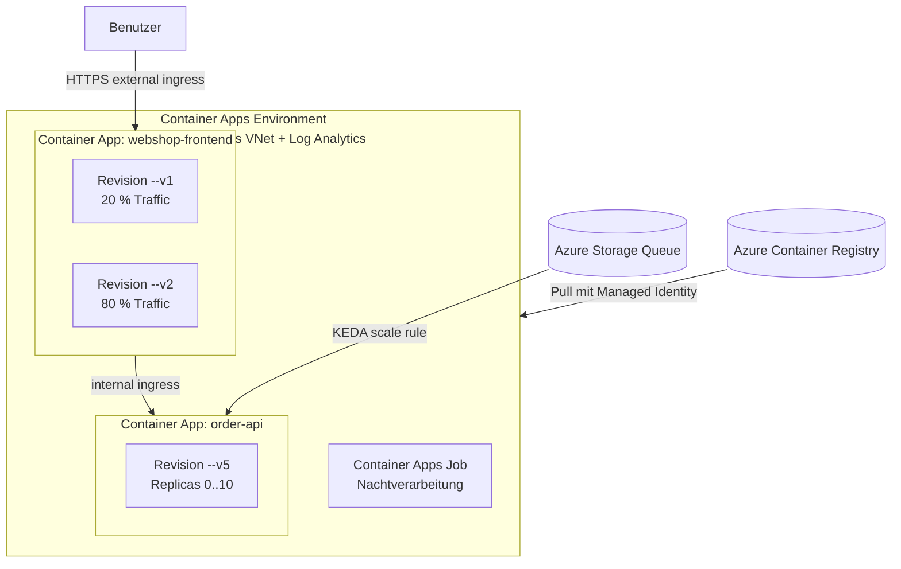
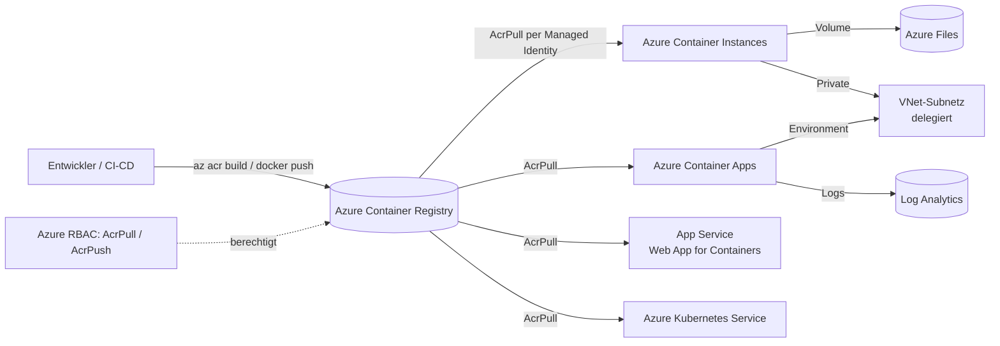

# 3.5 Container: Azure Container Registry, Container Instances und Container Apps

> **Domäne:** Deploy and manage Azure compute resources · **Gewichtung:** 20–25 %
> **Study-Guide-Punkte:** *Create and manage an Azure Container Registry* · *Provision a container by using Azure Container Instances* · *Provision a container by using Azure Container Apps* · *Manage sizing and scaling for containers, including Azure Container Instances and Azure Container Apps*
> **Stand:** November 2026

## Lernziele

Nach diesem Kapitel kann ich …

- die Begriffe **Image**, **Registry**, **Repository** und **Tag** erklären und Container von VMs abgrenzen.
- eine **Azure Container Registry (ACR)** mit passender SKU anlegen, Images bauen/importieren und den Zugriff sicher (Entra ID, Managed Identity, `AcrPull`) konfigurieren.
- einen Container mit **Azure Container Instances (ACI)** bereitstellen – inkl. CPU/Memory, Restart policy, DNS-Name, Volumes und Pull aus einer privaten ACR.
- eine **Azure Container App** in einem Environment bereitstellen, Ingress konfigurieren, Revisionen verwalten und **Skalierungsregeln** (inkl. Scale to zero) definieren.
- anhand eines Szenarios zwischen **ACI**, **Container Apps**, **AKS** und **App Service** entscheiden.

## Überblick

Ein **Container** verpackt eine Anwendung mit allen Abhängigkeiten (Bibliotheken, Laufzeit, Konfiguration) in ein portables **Image**. Anders als eine VM enthält ein Container **kein eigenes Betriebssystem**, sondern teilt sich den Kernel des Hosts. Dadurch starten Container in Sekunden und sind deutlich ressourcensparender.

Azure bietet für Container mehrere Dienste. Für AZ-104 sind drei relevant:

1. **Azure Container Registry (ACR)** – private, verwaltete Registry zum Speichern und Verteilen von Images.
2. **Azure Container Instances (ACI)** – der schnellste Weg, einen einzelnen Container (oder eine kleine Gruppe) ohne Cluster und ohne VM zu starten. Ideal für Batch-Jobs, Tests, einfache Tasks.
3. **Azure Container Apps (ACA)** – serverlose Plattform für Microservices und Web-APIs mit **automatischer Skalierung** (auch auf null), Revisionen und Ingress – basierend auf Kubernetes, KEDA und Envoy, aber ohne dass man Kubernetes verwalten muss.

## Kernkonzepte

### Container-Grundbegriffe

| Begriff | Bedeutung | Beispiel |
|---|---|---|
| **Image** | Unveränderliche Vorlage (Schichten/Layers) für einen Container | `nginx`, `contoso/webshop` |
| **Container** | Laufende Instanz eines Images | Prozess auf einem Host |
| **Registry** | Dienst, der Images speichert | `contosoacr.azurecr.io`, Docker Hub, `mcr.microsoft.com` |
| **Repository** | Sammlung von Images gleichen Namens in einer Registry | `contosoacr.azurecr.io/webshop` |
| **Tag** | Versionskennzeichnung eines Images | `:v1.2`, `:latest` |
| **Digest** | Eindeutiger SHA-256-Hash eines Manifests (unveränderlich) | `@sha256:4f1a…` |
| **Dockerfile** | Bauanleitung für ein Image | `FROM`, `COPY`, `RUN`, `CMD` |

**Container vs. VM:**

| Kriterium | Virtuelle Maschine | Container |
|---|---|---|
| Virtualisierung | Hardware (Hypervisor) | Betriebssystem (Kernel geteilt) |
| Eigenes OS | ✅ | ❌ |
| Startzeit | Minuten | Sekunden |
| Größe | GB | MB |
| Isolation | stark | Prozessebene (bei ACI zusätzlich Hypervisor-Isolation pro Container Group) |
| Typischer Einsatz | Lift & Shift, volle OS-Kontrolle | Microservices, Batch, CI/CD |

### Azure Container Registry (ACR)

**Name und Endpunkt:** 5–50 **alphanumerische** Zeichen (keine Bindestriche), **global eindeutig**. Login-Server: `<name>.azurecr.io`.

**SKUs (Service tiers):**

| Feature | Basic | Standard | Premium |
|---|---|---|---|
| Zielgruppe | Entwicklung, Lernen | die meisten Produktionsszenarien | hohes Volumen, Enterprise |
| Inklusiv-Speicher | ca. 10 GiB | ca. 100 GiB | ca. 500 GiB |
| Durchsatz (Read/Write-Ops, Bandbreite) | niedrig | mittel | hoch |
| Webhooks | wenige | mehr | viele |
| **Geo-Replikation** | ❌ | ❌ | ✅ |
| **Private Link / Private Endpoints** | ❌ | ❌ | ✅ |
| **Firewall-Regeln / dedizierte Daten-Endpunkte** | ❌ | ❌ | ✅ |
| **Customer-managed keys** | ❌ | ❌ | ✅ |
| Content trust / Image-Signierung | ❌ | ❌ | ✅ (Docker Content Trust wird zugunsten von Notary Project/Notation abgelöst) |
| **Repository-scoped tokens** | ✅ | ✅ | ✅ |
| Zonenredundanz | in unterstützten Regionen für alle SKUs (früher nur Premium) | | |

Die SKU kann jederzeit **hoch- und heruntergestuft** werden (`az acr update --sku`), sofern keine Premium-Funktionen genutzt werden, die die niedrigere SKU nicht unterstützt.

**Authentifizierung an der ACR:**

| Methode | Beschreibung | Einsatz |
|---|---|---|
| **Individuelle Entra-Identität** | `az acr login --name <acr>` – holt ein Token und meldet Docker an | Entwickler, Admins |
| **Managed Identity** | z. B. ACI, Container Apps, App Service, AKS ziehen Images mit ihrer Identität | ✅ **Best Practice** für Azure-Dienste |
| **Service Principal** | App-Identität mit Rolle `AcrPull`/`AcrPush` | CI/CD außerhalb von Azure, Headless |
| **Admin user** | Ein Konto mit Benutzername = Registry-Name und **zwei Passwörtern**; ⚠️ **standardmäßig deaktiviert**, voller Push/Pull-Zugriff | nur Tests / Dienste ohne Identitätsunterstützung |
| **Repository-scoped tokens** | Token mit Rechten nur auf bestimmte Repositories (Scope maps) | Zugriff für externe Partner/IoT-Geräte |

**Wichtige Azure-RBAC-Rollen für ACR** (→ [1.3](../01-identitaeten-und-governance/03-rbac-zugriffsverwaltung.md)):

| Rolle | Rechte |
|---|---|
| **AcrPull** | Images ziehen |
| **AcrPush** | Images ziehen **und** pushen |
| **AcrDelete** | Images/Repositories löschen |
| **Reader** | Registry sehen (Control plane), **kein** Pull |
| **Contributor / Owner** | Registry verwalten inkl. Push/Pull |

> Bei Registries mit aktivierter **ABAC-Repository-Berechtigung** gibt es zusätzlich feinere Rollen (z. B. *Container Registry Repository Reader/Writer*). Für die Prüfung sind vor allem **AcrPull** und **AcrPush** wichtig.

**ACR Tasks** – Images in Azure bauen, ohne lokal Docker zu installieren:

- **Quick task:** `az acr build` lädt den Build-Kontext hoch, baut das Image in Azure und pusht es in die Registry.
- **Automatisch ausgelöste Tasks** (`az acr task create`): bei **Source-Code-Commit** (GitHub/Azure DevOps), bei **Base-Image-Update** oder per **Timer** (Cron).
- **Multi-step tasks:** YAML-Datei mit mehreren Build-/Push-/Run-Schritten.

**Weitere Verwaltungsfunktionen:**

- **Import** (`az acr import`): Image aus Docker Hub, einer anderen ACR oder einer öffentlichen Registry direkt in die ACR kopieren – ohne lokalen `docker pull/push`.
- **Retention policy** für untagged Manifests (Premium) bzw. **`acr purge`** (als ACR Task, z. B. zeitgesteuert) zum Löschen alter Images.
- **Geo-Replikation** (Premium): eine Registry, mehrere Regionen; Images werden automatisch repliziert, Pulls erfolgen aus der nächstgelegenen Region.
- **Webhooks**: Benachrichtigung bei Push/Delete.

### Azure Container Instances (ACI)

**Container Group** = oberste Ressource in ACI. Alle Container einer Gruppe:

- laufen auf **demselben Host**,
- teilen **Lebenszyklus**, **Netzwerk** (eine IP-Adresse, Port-Namespace – Kommunikation über `localhost`) und **Volumes**,
- werden gemeinsam abgerechnet.

⚠️ **Multi-Container-Gruppen** werden nur für **Linux** unterstützt und per **YAML-Datei** oder **ARM/Bicep-Template** bereitgestellt (nicht über den einfachen Portal-Assistenten oder `az container create` mit einzelnen Parametern). Windows-Container-Gruppen enthalten genau einen Container.

**Wichtige Einstellungen:**

| Einstellung | Optionen / Hinweise |
|---|---|
| **Image source** | Quickstart images, Azure Container Registry, Other registry (Docker Hub, privat) |
| **OS type** | Linux oder Windows |
| **Size** | vCPU und Memory (GB) **pro Container**; Container Group = Summe. Maximalwerte hängen von Region und OS ab (typisch bis 4 vCPU / 16 GB pro Gruppe, regional mehr). Optional GPU (regional, eingeschränkt). |
| **Requests vs. Limits** | *Requests* = garantierte Ressourcen; *Limits* = Obergrenze, die ein Container nutzen darf (in YAML/ARM konfigurierbar) |
| **Networking type** | **Public** (öffentliche IP + optional **DNS name label** → `<label>.<region>.azurecontainer.io`), **Private** (Deployment in ein **VNet-Subnetz**, das an `Microsoft.ContainerInstance/containerGroups` delegiert ist → [4.1](../04-netzwerk/01-virtuelle-netzwerke-und-subnetze.md)), **None** |
| **Ports** | TCP/UDP-Ports, die nach außen geöffnet werden |
| **Restart policy** | **Always** (Standard – Container wird immer neu gestartet, für Dienste), **OnFailure** (nur bei Exit-Code ≠ 0, für Tasks), **Never** (genau einmal ausführen) |
| **Environment variables** | normal (im Klartext in den Eigenschaften sichtbar) oder **secure** (`--secure-environment-variables`, nicht in API-Antworten sichtbar) |
| **Command override** | Startbefehl des Images überschreiben |

**Volumes in ACI:**

| Volume-Typ | Zweck |
|---|---|
| **Azure Files share** | Persistente Daten über Neustarts hinweg (→ [2.4](../02-speicher/04-azure-files.md)); ⚠️ nur für **Linux**-Container, Zugriff mit Storage-Account-Schlüssel |
| **emptyDir** | Temporärer, geteilter Speicher zwischen Containern einer Gruppe (Lebensdauer = Gruppe) |
| **secret** | Geheimnisse als Dateien einbinden (im RAM, tmpfs) |
| **gitRepo** | ⚠️ veraltet (*deprecated*) – stattdessen Repo per Init-Container/Azure Files bereitstellen |

**Skalierung und Größe in ACI:**

- ⚠️ ACI hat **kein Autoscaling**. Mehr Leistung = **größere CPU/Memory-Werte** (Container Group neu bereitstellen bzw. mit geänderten Werten aktualisieren) oder **mehrere Container Groups** parallel starten (manuell/skriptgesteuert).
- CPU/Memory einer laufenden Gruppe ändern → Gruppe wird **neu erstellt/neu gestartet**.
- Für horizontale, automatische Skalierung → **Container Apps** (oder AKS).
- **Abrechnung pro Sekunde** für vCPU und Arbeitsspeicher – ab Start des Image-Pulls bis zum Stoppen.

**Private Images aus ACR:** entweder mit **Registry-Credentials** (Service Principal oder Admin user) oder mit einer **Managed Identity**, die auf der ACR die Rolle **AcrPull** besitzt (`--assign-identity` + `--acr-identity`).

### Azure Container Apps (ACA)



**Environment** – sichere Grenze um eine Gruppe von Container Apps:

- gemeinsames **virtuelles Netzwerk** (verwaltet oder eigenes VNet) und gemeinsames **Logging** (Log Analytics Workspace),
- Apps im selben Environment kommunizieren intern miteinander,
- Environment-Typen:
  - **Workload profiles** (Standard): enthält immer das **Consumption**-Profil (serverlos, Abrechnung nach Nutzung, Scale to zero) und optional **Dedicated**-Profile (feste VM-Größen, z. B. allgemeine, speicheroptimierte oder GPU-Profile; Abrechnung pro Knoten).
  - **Consumption only** (älterer Typ): nur serverlos.

**Container App** – die eigentliche Anwendung, enthält einen oder mehrere Container (z. B. Haupt- + Sidecar-Container). CPU/Memory pro Container im Consumption-Profil in festen Kombinationen (z. B. 0,25 vCPU/0,5 Gi bis 4 vCPU/8 Gi, Verhältnis 1:2).

**Revisions:**

- Eine **Revision** ist ein **unveränderlicher Snapshot** einer Version der Container App.
- Änderungen im **revision scope** (Image, Container-Einstellungen, Scale rules – Abschnitt `template`) erzeugen eine **neue Revision**.
- Änderungen im **application scope** (Secrets, Ingress, Revision mode, Registry-Credentials) erzeugen **keine** neue Revision.
- **Revision mode:**
  - **Single** (Standard): Nur eine Revision ist aktiv; eine neue Revision ersetzt die alte automatisch (nach erfolgreicher Bereitstellung).
  - **Multiple**: Mehrere Revisionen gleichzeitig aktiv → **Traffic splitting** (z. B. 80/20 für Blue-Green oder Canary-Releases), Revision **labels** für direkte URLs.

**Ingress:**

| Einstellung | Optionen |
|---|---|
| Aktiviert | ein/aus (ohne Ingress keine eingehenden Anfragen, z. B. reine Worker) |
| **Traffic** | **external** (aus dem Internet bzw. öffentlich erreichbar) oder **internal** (nur innerhalb des Environments/VNets) |
| **Transport** | Auto, HTTP/1, HTTP/2, **TCP** |
| **Target port** | Port, auf dem der Container lauscht |
| Weitere | Custom domains + verwaltete Zertifikate, IP-Restrictions, Session affinity, CORS |

FQDN: `<app>.<eindeutiger-env-name>.<region>.azurecontainerapps.io`

**Scaling (KEDA-basiert):**

- Skalierung erfolgt **horizontal** über **Replicas** zwischen **Min replicas** und **Max replicas**.
- Standard: **Min = 0**, Max = 10 (Max ist deutlich erhöhbar, mehrere hundert bis ca. 1.000 Replicas – aktuelle Grenze in der Doku prüfen).
- **Scale to zero:** bei Min = 0 und ohne Last laufen keine Replicas → **keine Kosten** für Compute im Consumption-Profil (Kaltstart beim nächsten Request).
- **Scale rules:**

| Regeltyp | Auslöser | Scale to zero? |
|---|---|---|
| **HTTP** | gleichzeitige HTTP-Anfragen pro Replica (Standard: 10) | ✅ |
| **TCP** | gleichzeitige TCP-Verbindungen | ✅ |
| **Custom (KEDA scaler)** | z. B. **Azure Storage Queue**-Länge, **Service Bus**, Event Hubs, Kafka, Cron | ✅ |
| **CPU / Memory** | Auslastung in % | ⚠️ **nein** – benötigt mindestens 1 Replica |

- Ohne explizite Regel gilt eine Standard-HTTP-Regel (bei aktiviertem Ingress).
- Vertikale Größe (CPU/Memory) wird pro Container in der Revision festgelegt – Änderung erzeugt eine **neue Revision**.

**Weitere Funktionen (kurz):**

- **Secrets:** auf App-Ebene gespeichert oder als Referenz auf **Azure Key Vault** (über Managed Identity); in Umgebungsvariablen per `secretref:` nutzbar.
- **Dapr** (Distributed Application Runtime): optionaler Sidecar für Service-Aufrufe, Pub/Sub, State Management.
- **Container Apps Jobs:** Container, die eine begrenzte Zeit laufen und dann enden; Auslöser **Manual**, **Schedule** (Cron) oder **Event** (KEDA-Scaler).
- **Managed Identity** (system- oder benutzerzugewiesen) für ACR-Pull, Key Vault, Storage.

## Zusammenhänge



- **Azure RBAC** ([1.3](../01-identitaeten-und-governance/03-rbac-zugriffsverwaltung.md)): Der Zugriff auf die ACR erfolgt über Data-Plane-ähnliche Rollen wie **AcrPull/AcrPush**. Managed Identities der Container-Dienste erhalten diese Rollen.
- **Azure App Service** ([3.6](06-azure-app-service.md)): *Web App for Containers* ist eine weitere Option, Container-Images aus der ACR zu betreiben – mit App-Service-Funktionen wie Deployment Slots und Autoscale über den App Service Plan.
- **Azure Files** ([2.4](../02-speicher/04-azure-files.md)): persistente Volumes für ACI (Linux) und Container Apps (Storage mounts im Environment).
- **Virtuelle Netzwerke** ([4.1](../04-netzwerk/01-virtuelle-netzwerke-und-subnetze.md)): ACI-Container-Gruppen und Container-Apps-Environments können in ein (delegiertes) Subnetz integriert werden; die ACR (Premium) kann über **Private Endpoints** angebunden werden ([4.7](../04-netzwerk/07-service-endpoints-und-private-endpoints.md)).
- **Monitoring** ([5.1](../05-monitoring-und-wartung/01-azure-monitor-metriken-und-logs.md)): Container Apps schreiben Konsolen- und Systemlogs in Log Analytics; ACI-Logs über `az container logs` bzw. Diagnose-Einstellungen.
- **ARM/Bicep** ([3.1](01-arm-templates-und-bicep.md)): Multi-Container-Gruppen in ACI werden per YAML oder ARM/Bicep bereitgestellt.

## Vergleichstabellen

### Entscheidungshilfe: Welcher Container-Dienst?

| Kriterium | **ACI** | **Container Apps** | **AKS** | **App Service (Container)** |
|---|---|---|---|---|
| Abstraktion | einzelner Container / Gruppe | serverlose Microservice-Plattform | voller Kubernetes-Cluster | PaaS für Web-Apps |
| Kubernetes-Wissen nötig | ❌ | ❌ | ✅ | ❌ |
| **Autoscaling** | ❌ | ✅ (KEDA, HTTP, Events) | ✅ (HPA, Cluster Autoscaler) | ✅ (Autoscale des App Service Plans) |
| **Scale to zero** | – (Gruppe stoppen) | ✅ | eingeschränkt (z. B. mit KEDA) | ❌ |
| Revisionen / Traffic split | ❌ | ✅ | über eigene Tools | Deployment Slots |
| Abrechnung | pro Sekunde (vCPU + RAM) | Consumption: pro Nutzung; Dedicated: pro Knoten | Knoten-VMs (+ optional Uptime SLA) | App Service Plan |
| Typischer Einsatz | Batch-Jobs, Tests, Build-Agents, einfache Tasks, „Burst“ | Microservices, APIs, Event-Verarbeitung, Hintergrund-Worker | komplexe Workloads mit voller Kontrolle | klassische Web-Apps/APIs, die bereits App Service nutzen |
| Verwaltungsaufwand | sehr gering | gering | hoch | gering |

**Faustregeln für die Prüfung:**

- „Einen Container **schnell und einfach** starten, kurzlebig, kein Orchestrator" → **ACI**
- „Microservices mit **automatischer Skalierung**, auch **auf null**, **Traffic splitting**, ohne Kubernetes zu verwalten" → **Container Apps**
- „Volle Kontrolle über Kubernetes-API/Cluster" → **AKS**

### ACI Restart policies

| Policy | Verhalten | Einsatz |
|---|---|---|
| **Always** (Standard) | Container wird bei Beendigung immer neu gestartet | dauerhaft laufende Dienste (Webserver) |
| **OnFailure** | Neustart nur bei Fehler (Exit-Code ≠ 0) | Tasks, die erfolgreich enden sollen |
| **Never** | kein Neustart; läuft genau einmal | einmalige Batch-Jobs |

### ACR-Authentifizierung

| Methode | Sicherheit | Granularität | Empfehlung |
|---|---|---|---|
| Entra-Benutzer (`az acr login`) | hoch | RBAC-Rolle | interaktiv |
| Managed Identity | hoch, keine Secrets | RBAC-Rolle (`AcrPull`) | ✅ Azure-Dienste |
| Service Principal | mittel (Secret/Zertifikat) | RBAC-Rolle | CI/CD extern |
| Repository-scoped token | mittel | einzelne Repositories | Partner, Geräte |
| Admin user | ⚠️ niedrig (geteiltes Passwort, volle Rechte) | ganze Registry | nur Tests |

## Azure Portal

| Aufgabe | Pfad |
|---|---|
| Registry anlegen | **Portal > Container registries > + Create** (Basics: Registry name, Location, **Pricing plan** = SKU) |
| SKU ändern | **… > Container registries > Registry > Settings > Properties** (bzw. *Overview > Pricing plan*) |
| Admin user aktivieren | **… > Registry > Settings > Access keys > Admin user** |
| RBAC-Rolle (AcrPull) vergeben | **… > Registry > Access control (IAM) > + Add role assignment** |
| Images/Repositories ansehen | **… > Registry > Services > Repositories** |
| ACR Tasks / Builds | **… > Registry > Services > Tasks** |
| Geo-Replikation (Premium) | **… > Registry > Services > Geo-replications** |
| Netzwerkzugriff / Private Endpoint (Premium) | **… > Registry > Settings > Networking** |
| Repository-scoped tokens | **… > Registry > Repository permissions > Tokens / Scope maps** |
| Webhooks | **… > Registry > Services > Webhooks** |
| Container Instance anlegen | **Portal > Container instances > + Create** (Tabs: Basics, Networking, Monitoring, Advanced, Tags) |
| Logs / Verbindung zum Container | **… > Container instances > Gruppe > Settings > Containers > Logs / Connect** |
| Container Group stoppen/neu starten | **… > Container instances > Gruppe > Overview > Stop / Restart** |
| Container App anlegen | **Portal > Container Apps > + Create** (Basics inkl. **Container Apps Environment**, Container, Bindings, Ingress, Tags) |
| Environment verwalten | **Portal > Container Apps Environments > Environment** (Workload profiles, Networking, Azure Files mounts) |
| Revisionen / Traffic split | **… > Container Apps > App > Application > Revisions and replicas** (Revision mode wählen, Traffic-%) |
| Skalierungsregeln | **… > Container Apps > App > Application > Scale** (Min/Max replicas, Scale rules) – erzeugt neue Revision |
| Ingress | **… > Container Apps > App > Settings > Ingress** |
| Secrets | **… > Container Apps > App > Settings > Secrets** |
| Identität | **… > Container Apps > App > Settings > Identity** |

**Wichtige Felder beim Anlegen einer Container Instance:**

1. **Basics:** Resource group, Container name, Region, Availability zones (optional), **Image source**, Image, **OS type**, **Size** (vCPU, Memory, GPU)
2. **Networking:** Networking type (Public/Private/None), **DNS name label**, Ports
3. **Advanced:** **Restart policy**, Environment variables (inkl. *Mark as secure*), Command override
4. **Review + create**

**Wichtige Felder beim Anlegen einer Container App:**

1. **Basics:** Container app name, Region, **Container Apps Environment** (neu oder vorhanden)
2. **Container:** Image source (ACR, Docker Hub, andere), Image + Tag, CPU und Memory, Umgebungsvariablen
3. **Ingress:** Enabled, Traffic (*Accepting traffic from anywhere* / *Limited to Container Apps Environment*), Ingress type (HTTP/TCP), Target port

⚠️ **Nach der Erstellung nicht änderbar / Neuerstellung nötig:**
- **ACR-Name** (und damit der Login-Server)
- **OS type**, **Networking type** und VNet-Subnetz einer **ACI**-Container-Group; Änderungen an Containern/Ressourcen führen zu einem Neustart der Gruppe
- **Environment** einer Container App (App kann nicht in ein anderes Environment verschoben werden); VNet-Konfiguration des Environments
- Eine **Revision** selbst ist unveränderlich – Änderungen erzeugen eine neue Revision

## Azure CLI & PowerShell

### Azure Container Registry

```bash
# Registry anlegen (SKU: Basic | Standard | Premium)
az acr create --resource-group <resource-group> --name contosoacr --sku Standard

# Bei der Registry anmelden (Entra ID, nutzt Docker)
az acr login --name contosoacr

# Image in Azure bauen und pushen (Quick task, Dockerfile im aktuellen Verzeichnis)
az acr build --registry contosoacr --image webshop:v1 .

# Image aus Docker Hub / MCR importieren
az acr import --name contosoacr \
  --source mcr.microsoft.com/azuredocs/aci-helloworld:latest \
  --image aci-helloworld:latest

# Repositories und Tags auflisten
az acr repository list --name contosoacr -o table
az acr repository show-tags --name contosoacr --repository webshop -o table

# SKU ändern
az acr update --name contosoacr --sku Premium

# Admin user (nur für Tests) aktivieren und Zugangsdaten anzeigen
az acr update --name contosoacr --admin-enabled true
az acr credential show --name contosoacr

# Automatischen Task bei Commit anlegen
az acr task create --registry contosoacr --name build-webshop \
  --image "webshop:{{.Run.ID}}" \
  --context https://github.com/<org>/<repo>.git --file Dockerfile \
  --git-access-token <pat>

# Geo-Replikation (Premium)
az acr replication create --registry contosoacr --location westeurope
```

### Azure Container Instances

```bash
# Öffentlichen Linux-Container mit DNS-Namen starten
az container create --resource-group <resource-group> --name webshop-aci \
  --image mcr.microsoft.com/azuredocs/aci-helloworld \
  --os-type Linux --cpu 1 --memory 1.5 \
  --ports 80 --ip-address Public --dns-name-label contoso-webshop \
  --restart-policy Always

# Batch-Task, der nur einmal laufen soll
az container create --resource-group <resource-group> --name batch-job \
  --image contosoacr.azurecr.io/batch:v1 --os-type Linux \
  --cpu 2 --memory 4 --restart-policy OnFailure \
  --environment-variables MODE=nightly \
  --secure-environment-variables DB_PASSWORD=<geheim> \
  --assign-identity <user-assigned-identity-resource-id> \
  --acr-identity <user-assigned-identity-resource-id>

# Pull aus privater ACR mit Service Principal / Admin-Credentials
az container create --resource-group <resource-group> --name webshop-aci2 \
  --image contosoacr.azurecr.io/webshop:v1 --os-type Linux \
  --registry-login-server contosoacr.azurecr.io \
  --registry-username <sp-app-id> --registry-password <sp-secret>

# Azure-Files-Share als Volume einbinden (nur Linux)
az container create --resource-group <resource-group> --name files-aci \
  --image contosoacr.azurecr.io/app:v1 --os-type Linux \
  --azure-file-volume-account-name <storage-account> \
  --azure-file-volume-account-key <storage-key> \
  --azure-file-volume-share-name appdata \
  --azure-file-volume-mount-path /mnt/appdata

# Status, Logs, Shell im Container
az container show --resource-group <resource-group> --name webshop-aci \
  --query "{FQDN:ipAddress.fqdn, State:instanceView.state}" -o table
az container logs --resource-group <resource-group> --name webshop-aci
az container exec --resource-group <resource-group> --name webshop-aci --exec-command "/bin/sh"

# Multi-Container-Gruppe aus YAML bereitstellen
az container create --resource-group <resource-group> --file container-group.yaml

# Stoppen / Starten (beim Stoppen keine Compute-Kosten)
az container stop  --resource-group <resource-group> --name webshop-aci
az container start --resource-group <resource-group> --name webshop-aci
```

### Azure Container Apps

```bash
# Erweiterung installieren/aktualisieren
az extension add --name containerapp --upgrade

# Environment anlegen
az containerapp env create --resource-group <resource-group> \
  --name contoso-env --location westeurope

# Container App mit externem Ingress und HTTP-Skalierung anlegen
az containerapp create --resource-group <resource-group> --name webshop \
  --environment contoso-env \
  --image contosoacr.azurecr.io/webshop:v1 \
  --registry-server contosoacr.azurecr.io --registry-identity system \
  --target-port 80 --ingress external \
  --cpu 0.5 --memory 1.0Gi \
  --min-replicas 0 --max-replicas 10 \
  --scale-rule-name http-rule --scale-rule-type http \
  --scale-rule-http-concurrency 50

# Neue Version ausrollen (erzeugt eine neue Revision)
az containerapp update --resource-group <resource-group> --name webshop \
  --image contosoacr.azurecr.io/webshop:v2

# Skalierung anpassen (ebenfalls neue Revision)
az containerapp update --resource-group <resource-group> --name webshop \
  --min-replicas 1 --max-replicas 20

# Revisionen anzeigen, Multiple-Mode aktivieren und Traffic aufteilen
az containerapp revision list --resource-group <resource-group> --name webshop -o table
az containerapp revision set-mode --resource-group <resource-group> --name webshop --mode multiple
az containerapp ingress traffic set --resource-group <resource-group> --name webshop \
  --revision-weight webshop--v1=80 webshop--v2=20

# Logs streamen
az containerapp logs show --resource-group <resource-group> --name webshop --follow
```

### PowerShell (Az-Module)

```powershell
# ACR anlegen (Az.ContainerRegistry)
New-AzContainerRegistry -ResourceGroupName "<resource-group>" -Name "contosoacr" `
  -Sku "Standard" -Location "westeurope"

# Admin-Zugangsdaten abrufen (nur wenn Admin user aktiviert ist)
Get-AzContainerRegistryCredential -ResourceGroupName "<resource-group>" -Name "contosoacr"

# ACI: Container-Objekt und Container Group anlegen (Az.ContainerInstance)
$port = New-AzContainerInstancePortObject -Port 80 -Protocol TCP
$container = New-AzContainerInstanceObject -Name "webshop" `
  -Image "mcr.microsoft.com/azuredocs/aci-helloworld" `
  -RequestCpu 1 -RequestMemoryInGb 1.5 -Port @($port)

$groupPort = New-AzContainerGroupPortObject -Port 80 -Protocol TCP
New-AzContainerGroup -ResourceGroupName "<resource-group>" -Name "webshop-aci" `
  -Location "westeurope" -Container $container -OsType "Linux" `
  -RestartPolicy "Always" -IPAddressType "Public" `
  -IPAddressPort @($groupPort) -IPAddressDnsNameLabel "contoso-webshop"

# Container Group anzeigen / Logs
Get-AzContainerGroup -ResourceGroupName "<resource-group>" -Name "webshop-aci"
Get-AzContainerInstanceLog -ResourceGroupName "<resource-group>" `
  -ContainerGroupName "webshop-aci" -ContainerName "webshop"
```

> Für Container Apps gibt es das Modul **Az.App** (`New-AzContainerApp` u. a.); in der Praxis und in Learn-Übungen wird meist die **Azure CLI** verwendet.

| Ziel | CLI | PowerShell |
|---|---|---|
| Registry anlegen | `az acr create` | `New-AzContainerRegistry` |
| Image bauen | `az acr build` | – (CLI) |
| Image importieren | `az acr import` | `Import-AzContainerRegistryImage` |
| ACI starten | `az container create` | `New-AzContainerGroup` |
| ACI-Logs | `az container logs` | `Get-AzContainerInstanceLog` |
| Container App anlegen | `az containerapp create` | `New-AzContainerApp` (Az.App) |

## Praxisbeispiel

**Szenario:** *Contoso* modernisiert seinen Webshop.

**Anforderungen:**

1. Eigene Images sollen privat gespeichert werden; die Registry soll später in eine zweite Region repliziert und nur über das Firmennetz erreichbar sein.
2. Ein nächtlicher Datenexport (Container) soll einmal laufen und bei Fehlern neu starten – ohne dauerhafte Kosten.
3. Das Frontend soll bei Last automatisch skalieren, nachts auf **null** herunterfahren und neue Versionen zunächst nur 10 % der Benutzer erreichen.
4. Keine Passwörter für den Registry-Zugriff.

**Umsetzung:**

1. **ACR (Premium)** wegen Geo-Replikation und Private Endpoint:
   ```bash
   az acr create -g rg-webshop -n contosoacr --sku Premium
   az acr build -r contosoacr -t webshop:v1 -t export:v1 .
   az acr replication create -r contosoacr -l northeurope
   ```
   Netzwerk: **Networking > Public network access = Disabled**, **Private endpoint** ins Hub-VNet ([4.7](../04-netzwerk/07-service-endpoints-und-private-endpoints.md)).
2. **Export mit ACI** – benutzerzugewiesene Managed Identity `id-export` erhält **AcrPull** auf der Registry; Container Group mit **Restart policy OnFailure**, gestartet per Zeitplan (z. B. Logic App/Automation):
   ```bash
   az container create -g rg-webshop -n export-job \
     --image contosoacr.azurecr.io/export:v1 --os-type Linux \
     --cpu 2 --memory 4 --restart-policy OnFailure \
     --assign-identity <id-export-resource-id> --acr-identity <id-export-resource-id> \
     --vnet vnet-webshop --subnet snet-aci
   ```
   Abrechnung nur für die Laufzeit (pro Sekunde). Alternative: **Container Apps Job** mit *Schedule*-Trigger.
3. **Frontend mit Container Apps** – Environment `contoso-env` im eigenen VNet; App `webshop` mit **system-assigned identity** (AcrPull auf der ACR), **external ingress**, **Min replicas 0**, **Max replicas 30**, HTTP-Regel mit 50 gleichzeitigen Anfragen.
4. **Canary-Release:** Revision mode **Multiple**, neue Revision `webshop--v2` mit **10 %** Traffic, nach erfolgreichen Tests auf 100 % umschalten:
   ```bash
   az containerapp revision set-mode -g rg-webshop -n webshop --mode multiple
   az containerapp update -g rg-webshop -n webshop --image contosoacr.azurecr.io/webshop:v2 --revision-suffix v2
   az containerapp ingress traffic set -g rg-webshop -n webshop \
     --revision-weight webshop--v1=90 webshop--v2=10
   ```

## Limits & wichtige Zahlen

| Wert | Grenze / Standard |
|---|---|
| ACR-Name | **5–50** alphanumerische Zeichen, global eindeutig, `<name>.azurecr.io` |
| ACR Inklusiv-Speicher | Basic ca. **10 GiB**, Standard ca. **100 GiB**, Premium ca. **500 GiB** (darüber hinaus gegen Aufpreis) |
| ACR-Funktionen nur Premium | **Geo-Replikation**, **Private Link**, Firewall-Regeln, Customer-managed keys |
| ACR Admin user | standardmäßig **deaktiviert**, **2** Passwörter |
| ACI Restart policy Standard | **Always** |
| ACI Ressourcen pro Container Group | regional unterschiedlich, typisch bis **4 vCPU / 16 GB** (Linux), Windows teils weniger |
| ACI Multi-Container | nur **Linux**, Bereitstellung per **YAML/ARM** |
| ACI Abrechnung | **pro Sekunde** (vCPU + GB) |
| ACI DNS-Name | `<label>.<region>.azurecontainer.io` |
| ACA Replicas Standard | Min **0**, Max **10** (erhöhbar) |
| ACA HTTP-Regel Standard | **10** gleichzeitige Anfragen pro Replica |
| ACA Consumption CPU/Memory | Kombinationen von **0,25 vCPU/0,5 Gi** bis **4 vCPU/8 Gi** pro Container (Verhältnis 1:2) |
| ACA Scale to zero | nicht mit **CPU/Memory**-Regeln |

Aktuelle Werte: [ACR service tiers](https://learn.microsoft.com/azure/container-registry/container-registry-skus), [ACI quotas and region availability](https://learn.microsoft.com/azure/container-instances/container-instances-resource-and-quota-limits), [Container Apps quotas](https://learn.microsoft.com/azure/container-apps/quotas).

## Prüfungstipps & Fallstricke

- ⚠️ **Geo-Replikation, Private Endpoint oder Firewall für die Registry gefordert** → **Premium**-SKU.
- ⚠️ **Container-Dienst soll Images aus der ACR ziehen, ohne Passwörter** → **Managed Identity** mit Rolle **AcrPull** (nicht *Reader* – Reader erlaubt keinen Pull; nicht *Contributor* – zu viele Rechte).
- **Pipeline soll Images pushen** → **AcrPush** (enthält Pull). **Images löschen** → **AcrDelete**.
- ⚠️ **Admin user** ist standardmäßig aus, gibt **vollen** Zugriff und ist ein geteiltes Konto → nur für Tests.
- **Image bauen, ohne Docker lokal zu installieren** → `az acr build` (ACR Tasks).
- **Image aus Docker Hub in die ACR übernehmen, ohne lokal zu pullen** → `az acr import`.
- **Images bei Änderung des Base-Images automatisch neu bauen** → **ACR Task** mit Base-Image-Trigger.
- ⚠️ **ACI skaliert nicht automatisch.** Fragen nach „automatisch je nach Last skalieren" → **Container Apps** (oder AKS/App Service).
- ⚠️ **Mehrere Container, die sich `localhost` und ein Volume teilen**, in ACI → **Container Group** per **YAML/ARM**, nur **Linux**.
- **Container soll nach erfolgreicher Ausführung nicht neu starten** → Restart policy **OnFailure** (oder **Never**).
- **ACI-Container soll Daten dauerhaft speichern** → **Azure Files**-Volume (nur Linux), nicht emptyDir.
- **Kennwort als Umgebungsvariable, nicht sichtbar in den Eigenschaften** → **secure environment variables**.
- **Container Apps auf null skalieren** → **Min replicas = 0** und eine HTTP-, TCP- oder ereignisbasierte Regel – ⚠️ **nicht** mit CPU/Memory-Regeln.
- **Nachrichten in einer Storage Queue sollen Skalierung auslösen** → **Custom (KEDA) scale rule** vom Typ *azure-queue*.
- ⚠️ **Neue Version nur für einen Teil der Benutzer** → Revision mode **Multiple** + **Traffic splitting**. Im Modus *Single* ersetzt eine neue Revision die alte vollständig.
- Ändern von **Image, CPU/Memory oder Scale rules** erzeugt eine **neue Revision**; Ändern von **Secrets oder Ingress** nicht.
- App soll **nur von anderen Apps im Environment** erreichbar sein → Ingress **internal**.

## Selbsttest

**1.** Ihr Unternehmen benötigt eine Container Registry, die Images automatisch nach *West Europe* und *East US* repliziert. Welche SKU ist mindestens erforderlich?

<details><summary>Lösung</summary>

**Premium.** Geo-Replikation ist nur in der Premium-SKU verfügbar.
</details>

**2.** Eine Azure Container App soll Images aus `contosoacr` ziehen. Sicherheitsvorgabe: keine gespeicherten Kennwörter, minimale Rechte. Was konfigurieren Sie?

<details><summary>Lösung</summary>

Eine **Managed Identity** (system- oder benutzerzugewiesen) für die Container App und auf der Registry die Rolle **AcrPull** für diese Identität. Admin user und Service-Principal-Secrets entfallen.
</details>

**3.** Ein Container in ACI verarbeitet einmalig eine Datei und beendet sich danach mit Exit-Code 0. Er wird jedoch immer wieder gestartet. Was ist die Ursache und wie beheben Sie sie?

<details><summary>Lösung</summary>

Die Restart policy steht auf dem Standard **Always**. Für einmalige Tasks **OnFailure** (Neustart nur bei Fehler) oder **Never** verwenden.
</details>

**4.** Sie möchten in ACI einen Web-Container und einen Logging-Sidecar bereitstellen, die über `localhost` kommunizieren und ein gemeinsames Volume nutzen. Wie gehen Sie vor?

<details><summary>Lösung</summary>

Eine **Multi-Container-Container-Group** (Linux) über eine **YAML-Datei** oder ein **ARM/Bicep-Template** bereitstellen, z. B. `az container create --file group.yaml`. Gemeinsames Volume z. B. **emptyDir** oder **Azure Files**.
</details>

**5.** Eine Web-API soll bei vielen gleichzeitigen HTTP-Anfragen automatisch auf mehrere Instanzen skalieren und nachts, ohne Anfragen, keine Compute-Kosten verursachen. Kubernetes soll nicht verwaltet werden. Welcher Dienst und welche Einstellungen?

<details><summary>Lösung</summary>

**Azure Container Apps** (Consumption) mit **Min replicas = 0**, passender **Max replicas** und einer **HTTP scale rule**. ACI kann nicht automatisch skalieren; AKS erfordert Clusterverwaltung.
</details>

**6.** Eine Container App hat eine CPU-Skalierungsregel und Min replicas = 0. Warum skaliert sie trotzdem nicht auf null?

<details><summary>Lösung</summary>

**CPU- und Memory-Regeln unterstützen kein Scale to zero** – es muss mindestens eine Replica laufen, um Auslastung messen zu können. Für Scale to zero eine **HTTP-, TCP- oder ereignisbasierte (KEDA) Regel** verwenden.
</details>

**7.** Sie ändern bei einer Container App ein Secret und das Ingress-Ziel-Port. Wird dadurch eine neue Revision erstellt?

<details><summary>Lösung</summary>

**Nein.** Secrets und Ingress gehören zum **application scope**. Neue Revisionen entstehen nur bei Änderungen im **revision scope** (z. B. Image, Container-Ressourcen, Scale rules). Hinweis: Damit eine laufende Revision ein geändertes Secret nutzt, muss sie ggf. neu gestartet werden.
</details>

**8.** Ein ACI-Container soll Daten so speichern, dass sie einen Neustart der Container Group überstehen. Der Container läuft unter Windows. Was ist zu beachten?

<details><summary>Lösung</summary>

Persistente Daten werden in ACI über ein **Azure-Files-Volume** gespeichert – das wird jedoch nur für **Linux-Container** unterstützt. Lösung: Linux-Image verwenden oder die Anwendung direkt (z. B. per SMB/REST/SDK) auf Speicher zugreifen lassen.
</details>

**9.** Ein Entwickler soll Images in die ACR pushen können, aber die Registry nicht löschen oder deren Einstellungen ändern dürfen. Welche Rolle?

<details><summary>Lösung</summary>

**AcrPush** (umfasst Push und Pull). *Contributor* wäre zu weitreichend.
</details>

**10.** Sie möchten das Image `nginx:latest` aus Docker Hub in Ihre ACR übernehmen, ohne Docker lokal zu installieren. Welcher Befehl?

<details><summary>Lösung</summary>

`az acr import --name contosoacr --source docker.io/library/nginx:latest --image nginx:latest`
</details>

## Weiterführende Links

- [AZ-104 Study Guide](https://learn.microsoft.com/credentials/certifications/resources/study-guides/az-104)
- [Introduction to Azure Container Registry](https://learn.microsoft.com/azure/container-registry/container-registry-intro)
- [Azure Container Registry service tiers](https://learn.microsoft.com/azure/container-registry/container-registry-skus)
- [Authenticate with an Azure container registry](https://learn.microsoft.com/azure/container-registry/container-registry-authentication)
- [Azure Container Registry roles and permissions](https://learn.microsoft.com/azure/container-registry/container-registry-roles)
- [Automate container image builds with ACR Tasks](https://learn.microsoft.com/azure/container-registry/container-registry-tasks-overview)
- [Import container images to a container registry](https://learn.microsoft.com/azure/container-registry/container-registry-import-images)
- [What is Azure Container Instances?](https://learn.microsoft.com/azure/container-instances/container-instances-overview)
- [Container groups in Azure Container Instances](https://learn.microsoft.com/azure/container-instances/container-instances-container-groups)
- [Restart policies in ACI](https://learn.microsoft.com/azure/container-instances/container-instances-restart-policy)
- [Mount an Azure file share in ACI](https://learn.microsoft.com/azure/container-instances/container-instances-volume-azure-files)
- [Deploy to ACI from ACR using a managed identity](https://learn.microsoft.com/azure/container-instances/using-azure-container-registry-mi)
- [Azure Container Apps overview](https://learn.microsoft.com/azure/container-apps/overview)
- [Container Apps environments](https://learn.microsoft.com/azure/container-apps/environment)
- [Revisions in Azure Container Apps](https://learn.microsoft.com/azure/container-apps/revisions)
- [Set scaling rules in Azure Container Apps](https://learn.microsoft.com/azure/container-apps/scale-app)
- [Ingress in Azure Container Apps](https://learn.microsoft.com/azure/container-apps/ingress-overview)
- [Comparing Container Apps with other Azure container options](https://learn.microsoft.com/azure/container-apps/compare-options)
