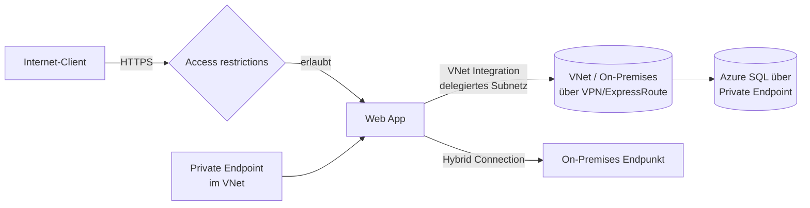
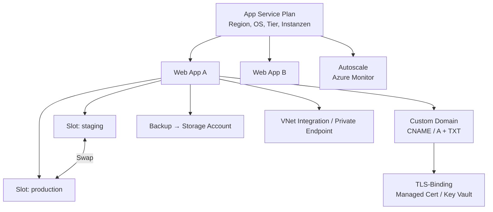

# 3.6 Azure App Service

> **Domäne:** Deploy and manage Azure compute resources · **Gewichtung:** 20–25 %
> **Study-Guide-Punkte:** *Provision an App Service plan* · *Configure scaling for an App Service plan* · *Create an App Service* · *Configure certificates and Transport Layer Security (TLS) for an App Service* · *Map an existing custom DNS name to an App Service* · *Configure backup for an App Service* · *Configure networking settings for an App Service* · *Configure deployment slots for an App Service*
> **Stand:** November 2026

## Lernziele

Nach diesem Kapitel kann ich …

- einen **App Service Plan** mit passendem **Pricing Tier** bereitstellen und die Feature-Unterschiede der Tiers benennen.
- **Scale up** und **Scale out** unterscheiden und **Autoscale** bzw. **Automatic scaling** konfigurieren.
- eine **Web App** erstellen, App Settings/Connection Strings pflegen und **Deployment Slots** inkl. Swap einsetzen.
- eine **Custom Domain** per CNAME oder A-Record + TXT-Verifizierung zuordnen und mit einem **TLS-Zertifikat** absichern.
- **Backups** einrichten und wiederherstellen.
- eingehenden (Access Restrictions, Private Endpoint) und ausgehenden Netzwerkverkehr (**VNet Integration**) steuern.

## Überblick

**Azure App Service** ist eine vollständig verwaltete **PaaS**-Plattform zum Hosten von Web-Apps, REST-APIs und mobilen Back-Ends. Microsoft kümmert sich um Betriebssystem, Patches, Lastverteilung und Infrastruktur; der Administrator konfiguriert nur Plan, App, Netzwerk und Bereitstellung.

Unterstützt werden u. a. .NET, Java, Node.js, Python und PHP – auf **Windows** oder **Linux** – sowie eigene **Container** (*Web App for Containers*).

Zwei Ressourcen sind immer beteiligt:

1. der **App Service Plan** – definiert Region, Betriebssystem, Größe und Anzahl der VMs (= Rechenleistung und Kosten),
2. die **App** (Web App) – der eigentliche Anwendungscode, der im Plan läuft.

Prüfungsrelevant sind vor allem die **Feature-Grenzen der Tiers**, **Slots & Swap**, **Custom Domains & TLS** sowie die **Netzwerkoptionen**.

## Kernkonzepte

### App Service Plan

- Ein Plan ist ein Satz von **Compute-Instanzen** (Worker) in **einer Region** mit **einem OS** (Windows oder Linux).
- **Mehrere Apps** können sich einen Plan teilen – sie teilen sich dann **CPU, RAM und Instanzanzahl**. Wird der Plan skaliert, skalieren alle Apps darin.
- **Abgerechnet wird der Plan**, nicht die App (Ausnahme: Free). Ein Plan ohne Apps kostet weiterhin Geld.
- Eine App kann in einen anderen Plan verschoben werden, sofern dieser in **derselben Ressourcengruppe, Region und demselben Webspace** liegt (und dasselbe OS hat).

### Pricing Tiers

| Tier | SKUs (Beispiele) | Infrastruktur | Max. Instanzen | Wichtige Features |
|---|---|---|---|---|
| **Free** | F1 | geteilt | – | 60 CPU-Minuten/Tag, **keine** Custom Domain, kein SLA |
| **Shared** | D1 (nur Windows) | geteilt | – | Custom Domain ✅, **kein** TLS-Binding, kein SLA |
| **Basic** | B1–B3 | dediziert | **3** (manuell) | Custom Domain + TLS, VNet Integration, **kein** Autoscale, **keine** Slots |
| **Standard** | S1–S3 | dediziert | **10** | **Autoscale**, **5 Slots**, Backups, Traffic Manager |
| **Premium v3** | P0v3–P5mv3 | dediziert, neuere Hardware | **30** | **20 Slots**, Zonenredundanz, **Automatic scaling**, mehr Speicher |
| **Isolated v2** | I1v2–I6v2 | **App Service Environment v3** (eigenes VNet, Single-Tenant) | **100** (pro ASE) | volle Netzwerkisolation, höchste Skalierung, 20 Slots |

> ⚠️ Einzelne Feature-Grenzen (z. B. Backups, Private Endpoints) wurden in den letzten Jahren auf niedrigere Tiers ausgeweitet. Für die Prüfung gilt als Faustregel: **Autoscale und Slots ab Standard**, **Zonenredundanz ab Premium v3**, **Isolation nur Isolated**.

### Skalierung

| Art | Bedeutung | Wie |
|---|---|---|
| **Scale up** (vertikal) | Größere/andere Instanzen, mehr Features | Pricing Tier ändern (z. B. S1 → P1v3) |
| **Scale out** (horizontal) | Mehr Instanzen | Instanzanzahl erhöhen – manuell, per **Autoscale** oder **Automatic scaling** |

**Autoscale** (Standard und höher, basiert auf Azure Monitor Autoscale):

- **Regeln** auf Metriken, z. B. *CPU Percentage > 70 % über 10 Minuten → +1 Instanz*.
- **Schedule-basierte** Profile, z. B. werktags 8–18 Uhr mindestens 4 Instanzen.
- **Instance limits:** Minimum, Maximum, Default.
- **Cool down** verhindert ständiges Hin- und Herskalieren.
- Best Practice: immer eine **Scale-out- und eine Scale-in-Regel** definieren.

**Automatic scaling** (Premium v2/v3): Plattform skaliert anhand des HTTP-Traffics selbst, ohne eigene Regeln. Einstellbar: *Maximum burst* (max. Instanzen für den Plan) und *Always ready instances* pro App.

### Web App erstellen

Wichtige Felder im Assistenten (*Create Web App*):

- **Basics:** Subscription, Resource Group, **Name** (global eindeutig → `<name>.azurewebsites.net`), **Publish** (*Code* / *Container*), **Runtime stack**, **Operating System**, **Region**, **App Service Plan** + Pricing plan, ggf. *Zone redundancy*
- **Deployment:** Continuous Deployment über GitHub Actions
- **Networking:** *Enable public access*, *Enable network injection* (VNet Integration / Private Endpoint)
- **Monitoring:** Application Insights
- **Tags**

### Konfiguration (*Configuration / Environment variables*)

- **App settings** – Schlüssel/Wert-Paare, werden der App als **Umgebungsvariablen** bereitgestellt und überschreiben z. B. Werte aus `appsettings.json`/`web.config`.
- **Connection strings** – ebenfalls Umgebungsvariablen (mit Präfix je Typ, z. B. `SQLAZURECONNSTR_`).
- **Deployment slot setting** (*sticky*) – Einstellung bleibt beim Swap **am Slot** (z. B. Verbindung zur Test-DB im Staging-Slot).
- Werte können als **Key Vault References** (`@Microsoft.KeyVault(...)`) hinterlegt werden – die App braucht dafür eine **Managed Identity** mit Lesezugriff auf den Key Vault.
- **General settings:** Stack-Version, Plattform (32/64 Bit), **Always On** (verhindert das Entladen der App nach Inaktivität; ab Basic, Voraussetzung für kontinuierliche WebJobs), **ARR affinity** (Sticky Sessions per Cookie – für zustandslose Apps deaktivieren), **HTTPS Only**, **Minimum TLS version**, FTP-Status, HTTP-Version.

### Deployment-Optionen

Im **Deployment Center**:

- **CI/CD:** GitHub Actions, Azure DevOps (Azure Pipelines), Bitbucket, Local Git
- **Manuell:** ZIP deploy (`az webapp deploy`), FTPS, Visual Studio/VS Code Publish
- **Container:** Image aus Azure Container Registry oder Docker Hub, optional mit Continuous Deployment per Webhook (→ [3.5](05-container-acr-aci-container-apps.md))

### Deployment Slots

- **Slots** sind eigenständige Live-Apps mit eigenem Hostnamen (`<app>-<slot>.azurewebsites.net`), z. B. `staging`, `test`.
- Verfügbar ab **Standard** (5 Slots inkl. Produktion), **Premium/Isolated: 20**.
- ⚠️ Slots laufen **im selben App Service Plan** und teilen sich dessen Ressourcen.
- **Swap:** Tauscht die Inhalte und Konfiguration von Quell- und Ziel-Slot. Vorher wird der Ziel-Slot-Konfig auf die Quellinstanzen angewendet und die App **aufgewärmt** → Swap **ohne Downtime**, und ein **Rollback** ist durch erneuten Swap möglich.
- **Swap with preview** (*Multi-phase swap*): Phase 1 wendet die Einstellungen des Ziel-Slots auf den Quell-Slot an – man kann testen, dann **Complete swap** oder **Cancel swap**.
- **Auto swap:** Nach jedem Deployment in einen Slot wird automatisch in die Produktion getauscht. ⚠️ Nicht verfügbar für **Linux** und Web App for Containers.
- **Traffic % / Testing in production:** Ein Prozentsatz des Produktions-Traffics wird auf einen Slot geleitet (Cookie `x-ms-routing-name`).

**Was wird beim Swap getauscht – und was nicht?**

| Wird getauscht (folgt dem Code) | Bleibt am Slot (sticky) |
|---|---|
| General settings (Stack-Version, 32/64 Bit, Web Sockets) | **Custom domain names** |
| **App settings** und **Connection strings** (sofern nicht als Slot setting markiert) | **Nicht-öffentliche Zertifikate und TLS/SSL-Bindings** |
| Handler mappings, Path mappings | **Scale settings** |
| Öffentliche Zertifikate | **Always On** |
| WebJobs-Inhalte | **IP-/Access restrictions** |
| Hybrid Connections, Service Endpoints, Azure CDN (in Preview-Hinweisen markiert) | **VNet Integration** |
| | **Managed Identities** |
| | Publishing endpoints, Diagnose-Log-Einstellungen, CORS, WebJobs-Scheduler |
| | App settings / Connection strings mit **Deployment slot setting** |

### Custom Domain

Standardmäßig ist die App unter `<app>.azurewebsites.net` erreichbar. Für eine eigene Domain (ab **Shared/Basic**):

| Domain-Art | DNS-Eintrag | Verifizierung |
|---|---|---|
| **Subdomain** (z. B. `www.contoso.com`) | **CNAME** `www` → `<app>.azurewebsites.net` | TXT `asuid.www` = *Custom Domain Verification ID* |
| **Apex/Root-Domain** (`contoso.com`) | **A-Record** `@` → **eingehende IP** der App | TXT `asuid` = *Custom Domain Verification ID* |
| **Wildcard** (`*.contoso.com`) | CNAME `*` → `<app>.azurewebsites.net` | TXT `asuid` |

- ⚠️ Für die **Apex-Domain** ist **kein CNAME** möglich (DNS-Standard) → **A-Record** + TXT. (Azure DNS bietet alternativ *Alias Records*, siehe [4.8](../04-netzwerk/08-azure-dns.md).)
- Die **Custom Domain Verification ID** findet man unter *Custom domains* der App; sie ist pro Abonnement gleich.
- Ablauf: DNS-Einträge beim Registrar/in Azure DNS anlegen → im Portal *Add custom domain* → *Validate* → *Add*.
- Ohne TLS-Binding zeigt der Browser für die Custom Domain eine Zertifikatswarnung.

### Zertifikate und TLS

| Zertifikatsquelle | Eigenschaften |
|---|---|
| **App Service Managed Certificate** | **kostenlos**, automatische Erneuerung, ab **Basic**; ⚠️ **keine Wildcards**, **nicht exportierbar** |
| **App Service Certificate** | kostenpflichtig, von Microsoft (über GoDaddy) ausgestellt, **Wildcard möglich**, wird in **Key Vault** gespeichert, exportierbar |
| **Upload eines eigenen Zertifikats** | **PFX** mit privatem Schlüssel und Kennwort (*Bring your own certificate*) |
| **Import aus Key Vault** | Zertifikat liegt zentral in Key Vault; App Service benötigt Zugriff darauf |

**TLS-Bindings** (Zertifikat ↔ Custom Domain):

- **SNI SSL** – mehrere Zertifikate/Domains über dieselbe IP (Server Name Indication); Standardfall, von allen modernen Browsern unterstützt.
- **IP-based SSL** – dedizierte IP für ein Zertifikat (z. B. für sehr alte Clients); ändert ggf. die eingehende IP → A-Records anpassen.

Weitere Sicherheitseinstellungen:

- **HTTPS Only** – leitet HTTP auf HTTPS um.
- **Minimum Inbound TLS Version** – Standard **1.2**; 1.3 auswählbar.
- **Client certificates** (mTLS) – optional *Require/Allow/Ignore*.

### Backup und Restore

- **Automatische Backups:** Bei unterstützten Tiers (Basic und höher) erstellt die Plattform regelmäßig Backups der App-Dateien und Konfiguration, die eine begrenzte Zeit aufbewahrt werden – ohne eigenes Storage-Konto, ohne Datenbanken.
- **Benutzerdefinierte Backups** (*Custom backups*):
  - Ziel: **Container in einem Azure Storage-Konto** (→ [2.3](../02-speicher/03-blob-storage.md))
  - **manuell** oder **geplant** (Intervall, Aufbewahrung, *Keep at least one backup*)
  - umfasst **App-Inhalte**, **Konfiguration** und optional **verbundene Datenbanken** (z. B. Azure SQL, MySQL)
  - ⚠️ Größenlimit: **10 GB** inkl. Datenbank
  - Dateien können per `_backup.filter` ausgeschlossen werden
- **Restore:** in dieselbe App, einen **anderen Slot** oder eine **andere App** (Overwrite oder neue App).
- Backups gehören nicht zu den Swap-Einstellungen, sie werden pro App/Slot konfiguriert.

### Netzwerk



**Eingehend (Inbound):**

| Feature | Zweck |
|---|---|
| **Access restrictions** | Allow/Deny-Regeln nach **IPv4/IPv6-Bereich**, **Virtual Network** (über Service Endpoint), **Service Tag** (z. B. `AzureFrontDoor.Backend`) und optional HTTP-Headern (z. B. `X-Azure-FDID`). Regeln werden nach **Priorität** (kleinste Zahl zuerst) ausgewertet; sobald eine Allow-Regel existiert, gilt ein implizites **Deny all**. Separate Regeln für die **SCM-Site** (Kudu) möglich. |
| **Service Endpoints** | Zugriff nur aus bestimmten Subnetzen (→ [4.7](../04-netzwerk/07-service-endpoints-und-private-endpoints.md)) |
| **Private Endpoint** | App erhält eine **private IP** im VNet; öffentlicher Zugriff kann deaktiviert werden (*Public network access: Disabled*) |
| **App-assigned address** | dedizierte eingehende IP (IP-based SSL) |

**Ausgehend (Outbound):**

| Feature | Zweck |
|---|---|
| **VNet Integration** | App kann auf Ressourcen **im/über das VNet** zugreifen (private IPs, Private Endpoints, On-Premises via VPN/ExpressRoute). Benötigt ein **leeres, an `Microsoft.Web/serverFarms` delegiertes Subnetz** (Empfehlung: mind. /26). Ab **Basic**. ⚠️ Macht die App **nicht** privat erreichbar – dafür Private Endpoint. |
| **Hybrid Connections** | Zugriff auf einzelne TCP-Endpunkte (Host:Port) On-Premises über ein Relay + Hybrid Connection Manager |
| **NAT Gateway** | feste ausgehende öffentliche IP (zusammen mit VNet Integration, *Route all*) |
| **Outbound IP addresses** | Liste der möglichen ausgehenden IPs (unter *Properties*), z. B. für Firewall-Freigaben |

**App Service Environment (ASE v3):** Single-Tenant-Bereitstellung von App Service **direkt in einem eigenen Subnetz** des Kunden-VNets → vollständige Netzwerkisolation, Isolated-v2-Tier, sehr hohe Skalierung.

### Monitoring (Kurzüberblick)

- **App Service logs:** Application Logging (Filesystem/Blob), Web server logging, Detailed error messages, Failed request tracing
- **Log stream** – Live-Ansicht der Logs
- **Diagnose and solve problems** – geführte Fehleranalyse
- **Application Insights** – APM, Request-/Dependency-Tracking (→ [5.1](../05-monitoring-und-wartung/01-azure-monitor-metriken-und-logs.md))
- **Health check** – Pfad, über den unhealthy Instanzen aus dem Load Balancing genommen werden

## Zusammenhänge



- **Container** ([3.5](05-container-acr-aci-container-apps.md)): Web App for Containers zieht Images aus **ACR**; Alternativen sind ACI und Container Apps.
- **DNS** ([4.8](../04-netzwerk/08-azure-dns.md)): Custom Domains erfordern CNAME/A/TXT-Einträge – in Azure DNS oder beim externen Registrar.
- **VNet & Subnetze** ([4.1](../04-netzwerk/01-virtuelle-netzwerke-und-subnetze.md)): VNet Integration benötigt ein delegiertes Subnetz; Private Endpoints liegen in einem Subnetz.
- **Service/Private Endpoints** ([4.7](../04-netzwerk/07-service-endpoints-und-private-endpoints.md)): eingehende Isolation und Zugriff der App auf private PaaS-Dienste.
- **Storage** ([2.3](../02-speicher/03-blob-storage.md)): Ziel für benutzerdefinierte Backups und Diagnose-Logs.
- **Monitoring** ([5.1](../05-monitoring-und-wartung/01-azure-monitor-metriken-und-logs.md), [5.2](../05-monitoring-und-wartung/02-warnungen-und-aktionsgruppen.md)): Autoscale basiert auf Azure-Monitor-Metriken; Alerts auf HTTP-5xx, Response Time usw.
- **Kosten** ([1.7](../01-identitaeten-und-governance/07-kostenverwaltung-und-advisor.md)): Kostenfaktor ist der Plan (Tier × Instanzen), nicht die Anzahl der Apps.
- **RBAC** ([1.3](../01-identitaeten-und-governance/03-rbac-zugriffsverwaltung.md)): Rolle *Website Contributor* verwaltet Web Apps, aber nicht den Plan.

## Vergleichstabellen

### Feature-Matrix der Tiers (Prüfungsfokus)

| Feature | Free | Shared | Basic | Standard | Premium v3 | Isolated v2 |
|---|---|---|---|---|---|---|
| Dedizierte VMs | ❌ | ❌ | ✅ | ✅ | ✅ | ✅ (ASE) |
| Custom Domain | ❌ | ✅ | ✅ | ✅ | ✅ | ✅ |
| TLS-Binding für Custom Domain | ❌ | ❌ | ✅ | ✅ | ✅ | ✅ |
| Max. Instanzen | – | – | 3 | 10 | 30 | 100 |
| Autoscale | ❌ | ❌ | ❌ | ✅ | ✅ (+ Automatic scaling) | ✅ |
| Deployment Slots | ❌ | ❌ | ❌ | 5 | 20 | 20 |
| VNet Integration | ❌ | ❌ | ✅ | ✅ | ✅ | ✅ (nativ im VNet) |
| Zonenredundanz | ❌ | ❌ | ❌ | ❌ | ✅ | ✅ |
| Netzwerkisolation (Single-Tenant) | ❌ | ❌ | ❌ | ❌ | ❌ | ✅ |

### VNet Integration vs. Private Endpoint

| Kriterium | VNet Integration | Private Endpoint |
|---|---|---|
| Richtung | **ausgehend** (App → VNet) | **eingehend** (VNet → App) |
| Ergebnis | App erreicht private Ressourcen | App ist über private IP erreichbar |
| Subnetz | delegiert an `Microsoft.Web/serverFarms`, exklusiv | normales Subnetz, keine Delegation |
| Öffentlicher Zugriff auf App | unverändert | kann deaktiviert werden |

### Zertifikatsoptionen

| Kriterium | Managed Certificate | App Service Certificate | Eigenes PFX / Key Vault |
|---|---|---|---|
| Kosten | kostenlos | kostenpflichtig | je nach CA |
| Wildcard | ❌ | ✅ | ✅ |
| Exportierbar | ❌ | ✅ | ✅ |
| Auto-Renewal | ✅ | ✅ (optional) | Key Vault: abhängig von CA-Integration |

### Scale up vs. Scale out

| Kriterium | Scale up | Scale out |
|---|---|---|
| Änderung | Tier/Instanzgröße | Instanzanzahl |
| Ergebnis | mehr CPU/RAM, mehr Features | mehr parallele Kapazität |
| Automatisierbar | ❌ (manuell / Skript) | ✅ Autoscale / Automatic scaling |

## Azure Portal

| Aufgabe | Pfad |
|---|---|
| Plan erstellen | **Portal > App Service plans > + Create** |
| Tier ändern (Scale up) | **Portal > App Service plans > Plan > Scale up (App Service plan)** bzw. **Web App > Scale up** |
| Instanzen / Autoscale (Scale out) | **… > Plan > Scale out (App Service plan)** → *Manual*, *Automatic* oder *Rules Based* |
| Web App erstellen | **Portal > App Services > + Create > Web App** |
| App Settings / Connection strings | **… > Web App > Settings > Environment variables** (*App settings* / *Connection strings*, Haken *Deployment slot setting*) |
| Always On, ARR affinity, HTTPS Only, TLS-Version | **… > Web App > Settings > Configuration > General settings** |
| Deployment einrichten | **… > Web App > Deployment > Deployment Center** |
| Slots anlegen | **… > Web App > Deployment > Deployment slots > + Add slot** |
| Swap | **… > Deployment slots > Swap** (Option *Perform swap with preview*) |
| Auto swap | **… > Slot > Configuration > General settings > Auto swap enabled** |
| Traffic auf Slot | **… > Deployment slots > Spalte Traffic %** |
| Custom Domain | **… > Web App > Settings > Custom domains > + Add custom domain** (dort auch *Custom Domain Verification ID*) |
| Zertifikate | **… > Web App > Settings > Certificates** (*Managed certificates*, *Bring your own certificates (.pfx)*, *Public key certificates*) |
| TLS-Binding | **… > Custom domains > Domain > Add binding** |
| Backups | **… > Web App > Settings > Backups** (*Configure custom backups*, *Backup now*, *Restore*) |
| Access restrictions / Public access | **… > Web App > Settings > Networking > Inbound traffic configuration > Public network access** |
| Private Endpoint | **… > Networking > Inbound traffic configuration > Private endpoints** |
| VNet Integration | **… > Networking > Outbound traffic configuration > Virtual network integration** |
| Hybrid Connections | **… > Networking > Outbound traffic configuration > Hybrid connections** |
| Ein-/ausgehende IPs | **… > Web App > Settings > Properties** |
| Logs | **… > Web App > Monitoring > App Service logs / Log stream** |

⚠️ **Nach der Erstellung nicht (direkt) änderbar:**
- **Region** und **Betriebssystem** eines Plans – neuen Plan erstellen und App ggf. neu bereitstellen
- **App-Name** (= Standard-Hostname `<name>.azurewebsites.net`)
- Wechsel einer App in einen Plan einer **anderen Region/Ressourcengruppe** ist nicht direkt möglich (Klonen/Neu-Deployment)

## Azure CLI & PowerShell

### Azure CLI

```bash
# App Service Plan (Linux, Standard S1, 2 Instanzen)
az appservice plan create -g <resource-group> -n plan-contoso \
  --sku S1 --is-linux --number-of-workers 2

# Scale up (Tier ändern) und Scale out (Instanzen)
az appservice plan update -g <resource-group> -n plan-contoso --sku P1V3
az appservice plan update -g <resource-group> -n plan-contoso --number-of-workers 4

# Autoscale-Einstellung für den Plan + Regel (Azure Monitor)
az monitor autoscale create -g <resource-group> \
  --resource plan-contoso --resource-type Microsoft.Web/serverfarms \
  --name autoscale-contoso --min-count 2 --max-count 10 --count 2
az monitor autoscale rule create -g <resource-group> --autoscale-name autoscale-contoso \
  --condition "CpuPercentage > 70 avg 10m" --scale out 1

# Web App erstellen (Runtime-Liste: az webapp list-runtimes)
az webapp create -g <resource-group> -p plan-contoso -n app-contoso-web \
  --runtime "DOTNETCORE:8.0"

# App Settings – normal und als Slot setting (sticky)
az webapp config appsettings set -g <resource-group> -n app-contoso-web \
  --settings FEATURE_X=on
az webapp config appsettings set -g <resource-group> -n app-contoso-web \
  --slot-settings ENVIRONMENT=Production

# Deployment Slot erstellen und tauschen
az webapp deployment slot create -g <resource-group> -n app-contoso-web --slot staging
az webapp deployment slot swap -g <resource-group> -n app-contoso-web \
  --slot staging --target-slot production

# Custom Domain hinzufügen (DNS-Einträge müssen vorher existieren)
az webapp config hostname add -g <resource-group> \
  --webapp-name app-contoso-web --hostname www.contoso.com

# Managed Certificate erstellen und per SNI binden
az webapp config ssl create -g <resource-group> -n app-contoso-web --hostname www.contoso.com
az webapp config ssl bind -g <resource-group> -n app-contoso-web \
  --certificate-thumbprint <thumbprint> --ssl-type SNI

# Eigenes PFX-Zertifikat hochladen
az webapp config ssl upload -g <resource-group> -n app-contoso-web \
  --certificate-file ./contoso.pfx --certificate-password <pfx-kennwort>

# HTTPS erzwingen und minimale TLS-Version
az webapp update -g <resource-group> -n app-contoso-web --https-only true
az webapp config set -g <resource-group> -n app-contoso-web --min-tls-version 1.2

# Benutzerdefiniertes Backup in einen Storage-Container (SAS-URL)
az webapp config backup create -g <resource-group> --webapp-name app-contoso-web \
  --container-url "<container-sas-url>" --backup-name backup-$(date +%Y%m%d)

# VNet Integration (Subnetz wird an Microsoft.Web/serverFarms delegiert)
az webapp vnet-integration add -g <resource-group> -n app-contoso-web \
  --vnet vnet-contoso --subnet snet-appservice

# Access restriction: nur Firmen-IP-Bereich erlauben
az webapp config access-restriction add -g <resource-group> -n app-contoso-web \
  --rule-name AllowHQ --action Allow --ip-address 203.0.113.0/24 --priority 100
```

### Az PowerShell

```powershell
# Plan erstellen (Windows, Standard, 2 Instanzen)
New-AzAppServicePlan -ResourceGroupName "<resource-group>" -Name "plan-contoso" `
  -Location "westeurope" -Tier "Standard" -WorkerSize "Small" -NumberofWorkers 2

# Scale up / Scale out
Set-AzAppServicePlan -ResourceGroupName "<resource-group>" -Name "plan-contoso" `
  -Tier "PremiumV3" -NumberofWorkers 3

# Web App erstellen
New-AzWebApp -ResourceGroupName "<resource-group>" -Name "app-contoso-web" `
  -Location "westeurope" -AppServicePlan "plan-contoso"

# Slot erstellen und tauschen
New-AzWebAppSlot -ResourceGroupName "<resource-group>" -Name "app-contoso-web" -Slot "staging"
Switch-AzWebAppSlot -ResourceGroupName "<resource-group>" -Name "app-contoso-web" `
  -SourceSlotName "staging" -DestinationSlotName "production"

# Custom Domain zuordnen (bestehende Hostnamen mit angeben)
Set-AzWebApp -ResourceGroupName "<resource-group>" -Name "app-contoso-web" `
  -HostNames @("www.contoso.com", "app-contoso-web.azurewebsites.net")

# TLS-Binding (SNI) mit vorhandenem Zertifikat
New-AzWebAppSSLBinding -ResourceGroupName "<resource-group>" -WebAppName "app-contoso-web" `
  -Name "www.contoso.com" -Thumbprint "<thumbprint>" -SslState SniEnabled

# Backup erstellen (SAS-URL des Containers)
New-AzWebAppBackup -ResourceGroupName "<resource-group>" -Name "app-contoso-web" `
  -StorageAccountUrl "<container-sas-url>" -BackupName "backup-manual"
```

| Ziel | CLI | PowerShell |
|---|---|---|
| Plan erstellen | `az appservice plan create` | `New-AzAppServicePlan` |
| Plan skalieren | `az appservice plan update` | `Set-AzAppServicePlan` |
| Web App erstellen | `az webapp create` | `New-AzWebApp` |
| Slot erstellen | `az webapp deployment slot create` | `New-AzWebAppSlot` |
| Swap | `az webapp deployment slot swap` | `Switch-AzWebAppSlot` |
| Custom Domain | `az webapp config hostname add` | `Set-AzWebApp -HostNames` |
| TLS-Binding | `az webapp config ssl bind` | `New-AzWebAppSSLBinding` |
| Backup | `az webapp config backup create` | `New-AzWebAppBackup` |

## Praxisbeispiel

**Szenario:** *Contoso* betreibt einen Kundenshop unter `shop.contoso.com`. Anforderungen:

1. Releases sollen **ohne Downtime** ausgerollt werden; ein schneller Rollback muss möglich sein.
2. Bei Lastspitzen (Black Friday) soll automatisch skaliert werden, maximal 10 Instanzen.
3. Der Shop muss per **HTTPS** mit eigener Domain erreichbar sein, möglichst ohne Zertifikatskosten.
4. Die App greift auf eine **Azure SQL-Datenbank** zu, die nur über einen Private Endpoint erreichbar ist.
5. Der Admin-Bereich (SCM/Kudu) darf nur aus dem Firmennetz erreichbar sein.
6. Tägliche Backups inkl. Datenbank.

**Umsetzung:**

1. **Plan:** *App Service plans > Create* → Linux, Region West Europe, **Standard S1** (Slots, Autoscale, Backups; max. 10 Instanzen genügt).
2. **Web App** `app-contoso-shop` im Plan erstellen, Runtime *.NET 8*.
3. **Slot** `staging` anlegen. App Setting `ConnectionStrings__Shop` im Staging-Slot auf die Test-DB setzen und als **Deployment slot setting** markieren. Deployments laufen per GitHub Actions in `staging` → Test → **Swap with preview** → *Complete swap*. Bei Problemen: erneut swappen (Rollback).
4. **Autoscale:** *Scale out > Rules Based* → Min 2, Max 10, Regel *CPU > 70 % (10 min) → +1*, Regel *CPU < 30 % (10 min) → −1*.
5. **Custom Domain:** Beim DNS-Anbieter `CNAME shop → app-contoso-shop.azurewebsites.net` und `TXT asuid.shop → <Verification ID>` anlegen → *Custom domains > Add custom domain* → validieren.
6. **TLS:** *Certificates > Managed certificates > Add certificate* für `shop.contoso.com` (kostenlos, keine Wildcard nötig) → **SNI SSL**-Binding. *HTTPS Only* = On, *Minimum TLS* = 1.2.
7. **Netzwerk:** VNet Integration in Subnetz `snet-appsvc` (delegiert, /26). Private DNS Zone für SQL ist mit dem VNet verknüpft → App erreicht die DB privat (→ [4.7](../04-netzwerk/07-service-endpoints-und-private-endpoints.md)).
8. **Access restrictions:** Für die **SCM-Site** eine Allow-Regel für `203.0.113.0/24` (Firmen-IP), Priorität 100 → alle anderen Zugriffe auf Kudu werden verweigert. Die Haupt-Site bleibt öffentlich.
9. **Backup:** *Backups > Configure custom backups* → Storage-Container `webapp-backups`, Zeitplan täglich, Aufbewahrung 30 Tage, Datenbank einschließen (Gesamtgröße < 10 GB).

## Limits & wichtige Zahlen

| Wert | Grenze |
|---|---|
| Max. Instanzen | Basic **3**, Standard **10**, Premium v3 **30**, Isolated v2 **100** |
| Deployment Slots (inkl. Produktion) | Standard **5**, Premium/Isolated **20** |
| Free-Tier CPU-Kontingent | **60 Minuten/Tag** |
| Custom Backup Größe | **10 GB** inkl. Datenbank |
| VNet Integration Subnetz | dediziert, delegiert; empfohlen mind. **/26** (mind. /28) |
| Standard-TLS-Version | **1.2** |
| Standard-Hostname | `<app>.azurewebsites.net` (Slot: `<app>-<slot>.azurewebsites.net`) |

Aktuelle Werte: [App Service limits](https://learn.microsoft.com/azure/azure-resource-manager/management/azure-subscription-service-limits#azure-app-service-limits).

## Prüfungstipps & Fallstricke

- ⚠️ **Autoscale oder Deployment Slots benötigt** → mindestens **Standard**. Basic kann nur manuell bis 3 Instanzen skalieren.
- ⚠️ **„Mehr als 10 Instanzen" / „mehr als 5 Slots"** → **Premium v3**; **„mehr als 30 Instanzen" oder vollständige Isolation** → **Isolated v2 / ASE**.
- ⚠️ **Custom Domain im Free-Tier** nicht möglich → mindestens Shared/Basic; **TLS-Binding** ab **Basic**.
- ⚠️ **Apex-Domain (`contoso.com`)** → **A-Record** + **TXT asuid**; CNAME nur für Subdomains.
- ⚠️ **Wildcard-Zertifikat kostenlos?** → Nein, **Managed Certificates unterstützen keine Wildcards** → App Service Certificate oder eigenes PFX.
- **Staging-Slot soll eigene DB-Verbindung behalten** → App Setting/Connection String als **Deployment slot setting** markieren.
- **Custom Domains, TLS-Bindings, Scale-Einstellungen, VNet Integration, Access restrictions, Managed Identity** werden **nicht** geswappt.
- **Release ohne Downtime + Rollback** → **Deployment Slots + Swap**. **Erst testen, dann abschließen** → **Swap with preview**.
- **Auto swap auf Linux** → nicht unterstützt.
- **App soll auf DB im VNet zugreifen** → **VNet Integration** (ausgehend). **App selbst soll nur privat erreichbar sein** → **Private Endpoint** (eingehend) + Public access deaktivieren.
- **Zugriff nur von Azure Front Door** → Access restriction mit **Service Tag `AzureFrontDoor.Backend`** + Header-Filter `X-Azure-FDID`.
- **Kosten senken bei mehreren kleinen Apps** → Apps in **einem gemeinsamen Plan** konsolidieren.
- **App wird nach Inaktivität langsam / WebJob stoppt** → **Always On** aktivieren (ab Basic).
- **Mehrere Apps im Plan, eine braucht mehr Leistung** → in eigenen Plan verschieben, sonst teilen sich alle Apps die Ressourcen.

## Selbsttest

**1.** Eine Web App läuft im Tier Basic B2. Sie sollen einen Staging-Slot für Zero-Downtime-Deployments einrichten. Was müssen Sie zuerst tun?

<details><summary>Lösung</summary>

Den Plan auf **Standard** (oder höher) hochskalieren (**Scale up**). Deployment Slots sind in Basic nicht verfügbar.
</details>

**2.** Sie möchten `contoso.com` (ohne `www`) auf Ihre Web App zeigen lassen. Welche DNS-Einträge legen Sie an?

<details><summary>Lösung</summary>

Einen **A-Record** `@` auf die **eingehende IP-Adresse** der App und einen **TXT-Record** `asuid` mit der **Custom Domain Verification ID**. Ein CNAME ist für die Apex-Domain nicht zulässig.
</details>

**3.** Nach einem Swap von `staging` nach `production` zeigt die Produktion plötzlich auf die Test-Datenbank. Was wurde versäumt?

<details><summary>Lösung</summary>

Die Connection Strings wurden **nicht als Deployment slot setting** (sticky) markiert und sind deshalb mit dem Code mitgewandert.
</details>

**4.** Sie benötigen ein kostenloses Zertifikat für `*.contoso.com`. Ist ein App Service Managed Certificate geeignet?

<details><summary>Lösung</summary>

**Nein.** Managed Certificates unterstützen **keine Wildcard-Domains**. Verwenden Sie ein **App Service Certificate** (Wildcard möglich) oder laden Sie ein eigenes PFX hoch.
</details>

**5.** Ihre Web App soll auf einen SQL Server zugreifen, der nur über eine private IP in einem VNet erreichbar ist. Welche Funktion konfigurieren Sie?

<details><summary>Lösung</summary>

**VNet Integration** (ausgehend) in ein an `Microsoft.Web/serverFarms` delegiertes Subnetz. Ein Private Endpoint für die App würde nur den **eingehenden** Zugriff privat machen.
</details>

**6.** Ein Unternehmen benötigt für eine Web App bis zu 25 Instanzen und Zonenredundanz. Welches Tier ist das günstigste passende?

<details><summary>Lösung</summary>

**Premium v3** (bis 30 Instanzen, Zonenredundanz). Standard ist auf 10 Instanzen begrenzt und bietet keine Zonenredundanz.
</details>

**7.** Welche der folgenden Einstellungen werden beim Slot-Swap **nicht** getauscht? a) App Settings ohne Slot-Markierung · b) Custom domain names · c) Stack-Version · d) Scale settings · e) VNet Integration

<details><summary>Lösung</summary>

**b, d, e** bleiben am Slot. App Settings ohne Slot-Markierung (a) und General settings wie die Stack-Version (c) werden mitgetauscht.
</details>

**8.** Ein Backup einer Web App mit 7 GB Inhalten und einer 5 GB großen Datenbank schlägt fehl. Warum?

<details><summary>Lösung</summary>

Benutzerdefinierte Backups sind auf **10 GB inkl. Datenbank** begrenzt. Abhilfe: Dateien per `_backup.filter` ausschließen oder die Datenbank separat sichern (z. B. mit den Backup-Funktionen von Azure SQL).
</details>

**9.** Sie haben drei Access-Restriction-Regeln: Priorität 100 *Allow 10.0.0.0/8*, Priorität 200 *Deny 10.1.0.0/16*, Priorität 300 *Allow Any*. Darf ein Client mit IP 10.1.2.3 zugreifen?

<details><summary>Lösung</summary>

**Ja.** Regeln werden in aufsteigender Priorität ausgewertet; die erste passende Regel (100, *Allow 10.0.0.0/8*) greift. Die Deny-Regel 200 wird nicht mehr erreicht.
</details>

**10.** Fünf kleine interne Web Apps laufen jeweils in einem eigenen Standard-S1-Plan und sind kaum ausgelastet. Wie senken Sie die Kosten mit minimalem Aufwand?

<details><summary>Lösung</summary>

Die Apps in **einen gemeinsamen App Service Plan** verschieben (gleiche Region, Ressourcengruppe und OS) und die leeren Pläne löschen – abgerechnet wird pro Plan, nicht pro App.
</details>

## Weiterführende Links

- [AZ-104 Study Guide](https://learn.microsoft.com/credentials/certifications/resources/study-guides/az-104)
- [App Service overview](https://learn.microsoft.com/azure/app-service/overview)
- [Azure App Service plan overview](https://learn.microsoft.com/azure/app-service/overview-hosting-plans)
- [Scale up an app](https://learn.microsoft.com/azure/app-service/manage-scale-up)
- [Get started with autoscale](https://learn.microsoft.com/azure/azure-monitor/autoscale/autoscale-get-started)
- [Automatic scaling in App Service](https://learn.microsoft.com/azure/app-service/manage-automatic-scaling)
- [Configure an App Service app](https://learn.microsoft.com/azure/app-service/configure-common)
- [Set up staging environments (deployment slots)](https://learn.microsoft.com/azure/app-service/deploy-staging-slots)
- [Map an existing custom DNS name](https://learn.microsoft.com/azure/app-service/app-service-web-tutorial-custom-domain)
- [Add and manage TLS/SSL certificates](https://learn.microsoft.com/azure/app-service/configure-ssl-certificate)
- [Secure a custom DNS name with a TLS/SSL binding](https://learn.microsoft.com/azure/app-service/configure-ssl-bindings)
- [Back up and restore your app](https://learn.microsoft.com/azure/app-service/manage-backup)
- [App Service networking features](https://learn.microsoft.com/azure/app-service/networking-features)
- [Integrate your app with an Azure virtual network](https://learn.microsoft.com/azure/app-service/overview-vnet-integration)
- [Set up access restrictions](https://learn.microsoft.com/azure/app-service/app-service-ip-restrictions)
- [App Service Environment overview](https://learn.microsoft.com/azure/app-service/environment/overview)
