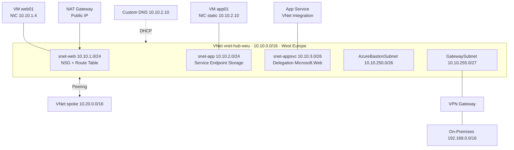

# 4.1 Virtuelle Netzwerke und Subnetze

> **Domäne:** Implement and manage virtual networking · **Gewichtung:** 15–20 %
> **Study-Guide-Punkte:** *Create and configure virtual networks and subnets*
> (Peering → [4.2](02-vnet-peering.md), Public IPs → [4.3](03-oeffentliche-ip-adressen.md), Routen → [4.4](04-benutzerdefinierte-routen.md), NSG → [4.5](05-nsg-und-asg.md))
> **Stand:** November 2026

## Lernziele

Nach diesem Kapitel kann ich …

- ein **Virtual Network (VNet)** mit passendem Adressraum planen, anlegen und nachträglich erweitern.
- Subnetze dimensionieren und die **5 reservierten IP-Adressen** pro Subnetz berücksichtigen.
- die **speziellen Subnetze** (GatewaySubnet, AzureBastionSubnet, AzureFirewallSubnet, RouteServerSubnet) mit Mindestgröße benennen.
- **Subnet delegation**, Service Endpoints, NSGs, Route Tables und NAT Gateway einem Subnetz zuordnen.
- private IP-Adressen **dynamisch** oder **statisch** an einer NIC konfigurieren und benutzerdefinierte **DNS-Server** am VNet setzen.
- das Thema **Default outbound access** bzw. **private Subnetze** einordnen.

## Überblick

Ein **Virtual Network (VNet)** ist das private, logisch isolierte Netzwerk eines Kunden in Azure – vergleichbar mit einem eigenen Netzwerk im Rechenzentrum. VMs, interne Load Balancer, Private Endpoints, App-Service-VNet-Integration, Container und viele PaaS-Dienste werden in VNets bzw. deren **Subnetze** eingebunden.

Ein VNet gehört zu **genau einer Region** und **einem Abonnement**. Es wird durch einen oder mehrere **Adressräume** in CIDR-Notation definiert (z. B. `10.10.0.0/16`) und in Subnetze aufgeteilt. Innerhalb eines VNets können alle Ressourcen standardmäßig miteinander kommunizieren – auch über Subnetzgrenzen hinweg. Gesteuert wird der Verkehr anschließend über NSGs ([4.5](05-nsg-und-asg.md)) und Routen ([4.4](04-benutzerdefinierte-routen.md)); verbunden werden VNets über Peering ([4.2](02-vnet-peering.md)).

Gute **Adressplanung** ist der wichtigste Schritt: Überlappende Adressräume verhindern später Peering und Hybridverbindungen.

## Kernkonzepte

### Virtual Network (VNet)

- **Regional:** Ein VNet existiert in genau einer Region, kann sich aber über alle **Availability Zones** dieser Region erstrecken (Subnetze sind **nicht** zonengebunden).
- **Adressraum (*Address space*):** ein oder mehrere CIDR-Blöcke. Empfohlen sind private Bereiche nach **RFC 1918**:
  - `10.0.0.0/8`
  - `172.16.0.0/12`
  - `192.168.0.0/16`
  - (zusätzlich möglich: `100.64.0.0/10` Shared Address Space, auch öffentliche Bereiche – dann aber nicht aus dem Internet erreichbar und nicht empfohlen)
- **Nicht erlaubt** als Adressraum: `224.0.0.0/4` (Multicast), `255.255.255.255/32` (Broadcast), `127.0.0.0/8` (Loopback), `169.254.0.0/16` (Link-local), `168.63.129.16/32` (interne Azure-Plattform-IP für DNS, Health Probes, DHCP).
- **Erweitern:** Adressräume können **nachträglich hinzugefügt** oder vergrößert werden, solange kein Subnetz außerhalb des neuen Bereichs liegt und keine Überlappung mit gepeerten Netzen entsteht. Bei bestehendem Peering muss die Peering-Verbindung danach **synchronisiert** werden (*Sync* im Peering-Blade).
- **Kosten:** VNets und Subnetze selbst sind kostenlos; Kosten entstehen z. B. durch Peering-Traffic, Gateways, Public IPs, NAT Gateway.

### Subnetze

- Ein Subnetz ist ein Bereich **innerhalb** des VNet-Adressraums; Subnetze dürfen sich **nicht überlappen**.
- **Kleinste Größe:** `/29` (IPv4). **IPv6-Subnetze** sind immer `/64`.
- Ressourcen in einem Subnetz erhalten private IPs aus dessen Bereich (per DHCP durch Azure).
- Ein Subnetz kann nur verkleinert/geändert oder gelöscht werden, wenn keine Ressourcen im betroffenen Bereich liegen.

#### Die 5 reservierten IP-Adressen

Azure reserviert in **jedem** Subnetz die ersten vier und die letzte Adresse. Beispiel `10.10.1.0/24`:

| Adresse | Zweck |
|---|---|
| `10.10.1.0` | Netzwerkadresse |
| `10.10.1.1` | Standard-Gateway (von Azure reserviert) |
| `10.10.1.2` | Azure DNS (Zuordnung der DNS-IPs zum VNet-Bereich) |
| `10.10.1.3` | Azure DNS (Zuordnung der DNS-IPs zum VNet-Bereich) |
| `10.10.1.255` | Broadcast-Adresse |

→ Erste nutzbare Adresse: **`10.10.1.4`**.

#### Nutzbare IP-Adressen pro Präfix

| Präfix | Adressen gesamt | Nutzbar in Azure (−5) |
|---|---|---|
| /29 | 8 | **3** |
| /28 | 16 | **11** |
| /27 | 32 | **27** |
| /26 | 64 | **59** |
| /25 | 128 | **123** |
| /24 | 256 | **251** |
| /23 | 512 | **507** |
| /22 | 1.024 | **1.019** |
| /16 | 65.536 | **65.531** |

Formel: **2^(32 − Präfix) − 5**.

### Spezielle Subnetze

Einige Dienste verlangen ein Subnetz mit **festem Namen** und Mindestgröße:

| Subnetzname | Dienst | Größe | Hinweise |
|---|---|---|---|
| **GatewaySubnet** | VPN Gateway / ExpressRoute Gateway | `/27` oder größer empfohlen (technisch min. `/29`) | keine NSG empfohlen, keine anderen Ressourcen |
| **AzureBastionSubnet** | Azure Bastion ([4.6](06-azure-bastion.md)) | **min. `/26`** | nur Bastion, eigene NSG-Regeln nötig, falls NSG zugeordnet |
| **AzureFirewallSubnet** | Azure Firewall | **`/26`** | (Forced Tunneling zusätzlich *AzureFirewallManagementSubnet* `/26`) |
| **RouteServerSubnet** | Azure Route Server | `/26` oder größer empfohlen | – |

⚠️ Der Name muss **exakt** stimmen – ein Subnetz „BastionSubnet" wird von Bastion nicht akzeptiert.

### Einstellungen am Subnetz

| Einstellung | Zweck | Kapitel |
|---|---|---|
| **Network security group** | Filtert ein-/ausgehenden Verkehr (eine NSG pro Subnetz) | [4.5](05-nsg-und-asg.md) |
| **Route table** | Benutzerdefinierte Routen (UDR), z. B. über eine Firewall | [4.4](04-benutzerdefinierte-routen.md) |
| **Service endpoints** | Optimierter Weg zu PaaS-Diensten (Storage, SQL …) über das Azure-Backbone | [4.7](07-service-endpoints-und-private-endpoints.md) |
| **Subnet delegation** | Subnetz exklusiv für einen PaaS-Dienst reservieren | s. u. |
| **NAT gateway** | Feste öffentliche IP(s) für ausgehenden Verkehr | s. u. |
| **Private subnet** (*Enable private subnet*) | Kein Default outbound access | s. u. |
| **Private endpoint network policy** | NSG/UDR auch für Private Endpoints anwenden | [4.7](07-service-endpoints-und-private-endpoints.md) |

#### Subnet delegation

- Delegiert ein Subnetz an einen bestimmten Azure-Dienst, der dort eigene Ressourcen bereitstellt und dienstspezifische Richtlinien setzt.
- Beispiele: `Microsoft.Web/serverFarms` (App Service VNet Integration, [3.6](../03-compute/06-azure-app-service.md)), `Microsoft.ContainerInstance/containerGroups` (ACI, [3.5](../03-compute/05-container-acr-aci-container-apps.md)), `Microsoft.Sql/managedInstances`, `Microsoft.Netapp/volumes`.
- Ein Subnetz kann in der Regel nur an **einen** Dienst delegiert werden; andere Ressourcen (z. B. VMs) sind dort dann nicht möglich.

#### NAT Gateway

- Stellt **ausgehende** Internetverbindungen über eine oder mehrere **statische Public IPs** (Standard SKU) bzw. ein Public IP Prefix bereit.
- Wird einem oder mehreren **Subnetzen** zugeordnet und hat für ausgehenden Verkehr Vorrang vor Load-Balancer-Outbound-Regeln und Instance-Level-Public-IPs.
- Kein eingehender Verkehr über das NAT Gateway.

### Default outbound access und private Subnetze

- Historisch erhielten VMs **ohne** explizite Outbound-Methode (Public IP, NAT Gateway, Load Balancer Outbound Rule, Firewall) automatisch Internetzugang über eine von Azure gewählte, **nicht kontrollierbare** öffentliche IP (*Default outbound access*).
- Microsoft hat angekündigt, diesen impliziten Zugang zurückzufahren: Für **neu erstellte VNets** (abhängig von Zeitpunkt und API-Version) sind Subnetze standardmäßig **private Subnetze** ohne Default outbound access. Bestehende VNets sind davon nicht betroffen.
- Mit der Subnetzoption **Private subnet** (`defaultOutboundAccess = false`) kann man das Verhalten explizit erzwingen.
- **Empfehlung (und Prüfungsantwort):** Ausgehenden Zugriff immer **explizit** bereitstellen – bevorzugt per **NAT Gateway**.

### Private IP-Adressen (NIC)

- Private IPs werden einer **Network Interface (NIC)** über eine **IP-Konfiguration** zugewiesen – **nicht** im Gastbetriebssystem.
- **Dynamic** (Standard): Azure vergibt die nächste freie Adresse; sie bleibt erhalten, bis die NIC gelöscht oder die VM in ein anderes Subnetz verschoben wird (auch bei Neustart; bei *Deallocate* in der Praxis meist ebenfalls).
- **Static:** Admin legt eine feste Adresse aus dem Subnetzbereich fest (z. B. für DNS-Server, Domain Controller).
- ⚠️ Die IP im Gast-OS **nicht manuell** konfigurieren – immer per DHCP beziehen lassen und die statische Zuweisung in Azure vornehmen. Sonst droht Verbindungsverlust.
- Eine NIC kann mehrere IP-Konfigurationen (sekundäre IPs) haben.

### Network Interfaces (NIC)

- Jede VM hat mindestens eine NIC (*primary NIC*); die maximale Anzahl hängt von der **VM-Größe** ab ([3.2](../03-compute/02-virtuelle-maschinen.md)).
- Alle NICs einer VM müssen im **selben VNet** liegen (können aber in verschiedenen Subnetzen sein).
- **IP forwarding:** Erlaubt der NIC, Pakete weiterzuleiten, die nicht an ihre eigene IP adressiert sind – nötig für **Network Virtual Appliances (NVA)** in Kombination mit UDRs ([4.4](04-benutzerdefinierte-routen.md)). Zusätzlich muss Forwarding im Gast-OS aktiv sein.
- **Accelerated networking:** SR-IOV, umgeht den virtuellen Switch des Hosts → niedrigere Latenz, höherer Durchsatz, weniger CPU-Last. Nur bei unterstützten VM-Größen/Images; Änderung in der Regel bei **gestoppter (deallocated)** VM.
- An eine NIC (bzw. ihr Subnetz) kann je eine **NSG** gebunden werden.

### DNS-Einstellungen am VNet

| Option | Beschreibung |
|---|---|
| **Default (Azure-provided)** | Azure-DNS über `168.63.129.16`; Namensauflösung von VMs im **selben VNet** per Hostname, Auflösung öffentlicher Namen |
| **Custom** | Eigene DNS-Server (z. B. Domain Controller, DNS-Forwarder, Azure DNS Private Resolver) – IPs werden per DHCP an die VMs verteilt |

- ⚠️ Nach Änderung der DNS-Server müssen VMs **neu gestartet** werden (oder DHCP-Lease erneuern), damit die neuen Einstellungen greifen.
- DNS-Server können auch pro NIC überschrieben werden (NIC-Einstellung hat Vorrang).
- Private DNS-Zonen und Namensauflösung über VNet-Grenzen → [4.8](08-azure-dns.md).

### Kommunikation und Grenzen

- **Innerhalb eines VNets:** alle Subnetze können standardmäßig miteinander kommunizieren (Systemrouten, NSG-Standardregel *AllowVnetInBound*).
- **Zwischen VNets:** nur per **Peering** ([4.2](02-vnet-peering.md)) oder VPN Gateway – sonst vollständig isoliert, auch im selben Abo.
- **Ins Internet ausgehend:** über Public IP, NAT Gateway, LB-Outbound oder (Legacy) Default outbound access.
- **Aus dem Internet eingehend:** nur über Public IP ([4.3](03-oeffentliche-ip-adressen.md)), Load Balancer ([4.9](09-load-balancer.md)) oder Bastion ([4.6](06-azure-bastion.md)) – und nur, wenn die NSG es erlaubt.

### Ressourcen verschieben

- **VM in ein anderes Subnetz desselben VNets:** möglich – Subnetz in der IP-Konfiguration der NIC ändern (VM wird dabei neu gestartet; statische IP muss zum neuen Subnetz passen).
- **VM in ein anderes VNet:** ⚠️ **nicht direkt möglich** – die NIC kann das VNet nicht wechseln. Lösung: VM aus der vorhandenen OS-Disk neu erstellen bzw. NIC neu anlegen.
- **VNet in andere RG/Abo:** möglich (inkl. aller enthaltenen Ressourcen, siehe [1.6](../01-identitaeten-und-governance/06-ressourcengruppen-abonnements-verwaltungsgruppen.md)); **in andere Region:** nicht direkt – neu anlegen (z. B. per exportiertem Template oder Azure Resource Mover).

### IPv6 (Dual-Stack)

- VNets und Subnetze können zusätzlich einen **IPv6-Adressraum** erhalten (Dual-Stack); IPv6-Subnetze sind **/64**.
- VMs erhalten dann IPv4- **und** IPv6-Konfigurationen; für Internetzugriff per IPv6 werden Standard-SKU-Public-IPv6-Adressen bzw. ein Standard Load Balancer genutzt.
- Reines IPv6-only-VNet ist nicht vorgesehen – IPv4 ist immer erforderlich.

## Zusammenhänge



- **Peering** ([4.2](02-vnet-peering.md)) erfordert **nicht überlappende** Adressräume – deshalb ist die Planung in diesem Kapitel die Basis für jede Hub-and-Spoke-Topologie.
- **Public IPs** ([4.3](03-oeffentliche-ip-adressen.md)) werden an NICs, Load Balancer, NAT Gateway, Bastion oder Gateways gebunden – nie direkt an ein Subnetz.
- **UDRs** ([4.4](04-benutzerdefinierte-routen.md)) und **NSGs** ([4.5](05-nsg-und-asg.md)) werden an **Subnetze** (NSG auch an NICs) gebunden.
- **Bastion** ([4.6](06-azure-bastion.md)) braucht ein eigenes `AzureBastionSubnet`.
- **Service/Private Endpoints** ([4.7](07-service-endpoints-und-private-endpoints.md)) werden pro Subnetz konfiguriert; Speicherkonten erlauben Zugriff aus bestimmten Subnetzen ([2.2](../02-speicher/02-speicherzugriff-und-sicherheit.md)).
- **DNS** ([4.8](08-azure-dns.md)): Private DNS Zones werden mit VNets verknüpft (*Virtual network links*).
- **Load Balancer** ([4.9](09-load-balancer.md)): Interne LBs erhalten eine private Frontend-IP aus einem Subnetz.
- **Troubleshooting** ([4.10](10-netzwerk-troubleshooting.md)): *Effective routes* und *Effective security rules* werden an der NIC angezeigt.
- **VMs** ([3.2](../03-compute/02-virtuelle-maschinen.md)) werden bei der Erstellung einem VNet/Subnetz zugeordnet – das VNet ist danach nicht mehr änderbar.

## Vergleichstabellen

### Dynamic vs. Static private IP

| Kriterium | Dynamic | Static |
|---|---|---|
| Vergabe | nächste freie Adresse durch Azure | vom Admin festgelegt |
| Bleibt bei Neustart erhalten | ✅ | ✅ |
| Typischer Einsatz | normale Workloads | DNS-Server, DCs, NVAs, Ziele in Firewall-Regeln |
| Konfiguration | Standard | NIC > IP configurations > Assignment **Static** |
| Konfiguration im Gast-OS | DHCP | **trotzdem DHCP** |

### Optionen für ausgehenden Internetzugriff

| Option | Feste IP | Skalierung (SNAT) | Empfehlung |
|---|---|---|---|
| **NAT Gateway** | ✅ (Public IP/Prefix) | sehr hoch | ✅ bevorzugt |
| **Public IP an der NIC** | ✅ | pro VM | für einzelne VMs mit eingehendem Zugriff |
| **Load Balancer Outbound Rules** | ✅ | begrenzt durch Ports | bei vorhandenem Standard LB |
| **Azure Firewall / NVA** (per UDR) | ✅ | hoch | wenn Inspektion nötig |
| **Default outbound access** | ❌ (nicht kontrollierbar) | gering | ❌ wird zurückgefahren, nicht verwenden |

### Spezielle Subnetze im Überblick

| Dienst | Name | Mindest-/Empfohlene Größe |
|---|---|---|
| VPN/ExpressRoute Gateway | `GatewaySubnet` | `/27` empfohlen |
| Azure Bastion | `AzureBastionSubnet` | `/26` |
| Azure Firewall | `AzureFirewallSubnet` | `/26` |
| Azure Route Server | `RouteServerSubnet` | `/26` empfohlen |

## Azure Portal

| Aufgabe | Pfad |
|---|---|
| VNet erstellen | **Portal > Virtual networks > + Create** (Tabs: *Basics*, *Security*, *IP addresses*, *Tags*) |
| Adressraum hinzufügen/ändern | **Portal > Virtual networks > VNet > Address space** |
| Subnetz hinzufügen | **… > VNet > Subnets > + Subnet** (Subnet purpose wählen, z. B. *Azure Bastion*, *Virtual Network Gateway*) |
| NSG / Route table / NAT gateway / Service endpoints / Delegation am Subnetz | **… > VNet > Subnets > Subnetz** (Felder im Bearbeitungsdialog) |
| Private subnet aktivieren | **… > VNet > Subnets > Subnetz > Enable private subnet (no default outbound access)** |
| DNS-Server ändern | **… > VNet > DNS servers > Custom** |
| Verbundene Geräte anzeigen | **… > VNet > Connected devices** |
| Peering | **… > VNet > Peerings** ([4.2](02-vnet-peering.md)) |
| Topologie anzeigen | **… > VNet > Diagram** bzw. **Network Watcher > Topology** |
| Private IP statisch setzen | **Portal > Network interfaces > NIC > Settings > IP configurations > ipconfig1 > Allocation: Static** |
| Subnetz einer VM-NIC wechseln | **… > NIC > IP configurations > ipconfig1 > Subnet** |
| IP forwarding | **… > NIC > IP configurations > Enable IP forwarding** |
| Accelerated networking | **… > NIC > Overview > Accelerated networking** (VM vorher stoppen) |
| DNS-Server pro NIC | **… > NIC > DNS servers** |
| Effektive Routen / Regeln | **… > NIC > Help > Effective routes / Effective security rules** |

**Wichtige Felder bei *Create virtual network*:**

1. **Basics:** Subscription, Resource group, **Name**, **Region**
2. **Security:** Azure Bastion, Azure Firewall, Azure DDoS Network Protection (optional direkt mit anlegen)
3. **IP addresses:** IPv4-Adressraum (Standard `10.0.0.0/16`), optional IPv6, Subnetze mit Name, Bereich, NAT Gateway, NSG, Private subnet
4. **Tags**

⚠️ **Nicht änderbar nach der Erstellung:**
- **Region** des VNets
- **Abonnement-/Tenant-Zuordnung** nur per Move, nicht per Bearbeitung
- Das **VNet einer bestehenden NIC/VM** (nur das Subnetz innerhalb desselben VNets)

## Azure CLI & PowerShell

### Azure CLI

```bash
# VNet mit erstem Subnetz anlegen
az network vnet create \
  --resource-group rg-network \
  --name vnet-hub-weu \
  --location westeurope \
  --address-prefixes 10.10.0.0/16 \
  --subnet-name snet-web \
  --subnet-prefixes 10.10.1.0/24

# Weiteres Subnetz als privates Subnetz (kein Default outbound access)
az network vnet subnet create \
  --resource-group rg-network \
  --vnet-name vnet-hub-weu \
  --name snet-app \
  --address-prefixes 10.10.2.0/24 \
  --default-outbound-access false

# Subnetz an App Service delegieren
az network vnet subnet create \
  --resource-group rg-network \
  --vnet-name vnet-hub-weu \
  --name snet-appsvc \
  --address-prefixes 10.10.3.0/26 \
  --delegations Microsoft.Web/serverFarms

# Bastion-Subnetz (Name muss exakt stimmen, min. /26)
az network vnet subnet create -g rg-network --vnet-name vnet-hub-weu \
  --name AzureBastionSubnet --address-prefixes 10.10.250.0/26

# NSG und Route Table an ein Subnetz binden
az network vnet subnet update -g rg-network --vnet-name vnet-hub-weu \
  --name snet-web --network-security-group nsg-web --route-table rt-web

# Adressraum erweitern (alle Präfixe angeben – die Liste wird ersetzt!)
az network vnet update -g rg-network --name vnet-hub-weu \
  --address-prefixes 10.10.0.0/16 10.11.0.0/16

# Benutzerdefinierte DNS-Server setzen
az network vnet update -g rg-network --name vnet-hub-weu \
  --dns-servers 10.10.2.10 10.10.2.11

# Statische private IP an einer NIC
az network nic ip-config update -g rg-network \
  --nic-name app01-nic --name ipconfig1 \
  --private-ip-address 10.10.2.10

# IP forwarding und Accelerated Networking aktivieren
az network nic update -g rg-network --name nva01-nic \
  --ip-forwarding true --accelerated-networking true

# Subnetze eines VNets auflisten
az network vnet subnet list -g rg-network --vnet-name vnet-hub-weu -o table
```

### Azure PowerShell

```powershell
# VNet mit zwei Subnetzen anlegen
$web = New-AzVirtualNetworkSubnetConfig -Name "snet-web" -AddressPrefix "10.10.1.0/24"
$app = New-AzVirtualNetworkSubnetConfig -Name "snet-app" -AddressPrefix "10.10.2.0/24"
$vnet = New-AzVirtualNetwork -Name "vnet-hub-weu" -ResourceGroupName "rg-network" `
  -Location "westeurope" -AddressPrefix "10.10.0.0/16" -Subnet $web, $app

# Subnetz nachträglich hinzufügen (erst lokal, dann mit Set-AzVirtualNetwork speichern)
$vnet = Get-AzVirtualNetwork -Name "vnet-hub-weu" -ResourceGroupName "rg-network"
Add-AzVirtualNetworkSubnetConfig -Name "AzureBastionSubnet" `
  -AddressPrefix "10.10.250.0/26" -VirtualNetwork $vnet
$vnet | Set-AzVirtualNetwork

# Subnetz mit Delegation
$deleg = New-AzDelegation -Name "appsvc" -ServiceName "Microsoft.Web/serverFarms"
$vnet = Get-AzVirtualNetwork -Name "vnet-hub-weu" -ResourceGroupName "rg-network"
Add-AzVirtualNetworkSubnetConfig -Name "snet-appsvc" -AddressPrefix "10.10.3.0/26" `
  -VirtualNetwork $vnet -Delegation $deleg
$vnet | Set-AzVirtualNetwork

# Adressraum erweitern
$vnet = Get-AzVirtualNetwork -Name "vnet-hub-weu" -ResourceGroupName "rg-network"
$vnet.AddressSpace.AddressPrefixes.Add("10.11.0.0/16")
$vnet | Set-AzVirtualNetwork

# Statische private IP an einer NIC
$nic = Get-AzNetworkInterface -Name "app01-nic" -ResourceGroupName "rg-network"
$nic.IpConfigurations[0].PrivateIpAllocationMethod = "Static"
$nic.IpConfigurations[0].PrivateIpAddress = "10.10.2.10"
Set-AzNetworkInterface -NetworkInterface $nic

# IP forwarding aktivieren
$nic = Get-AzNetworkInterface -Name "nva01-nic" -ResourceGroupName "rg-network"
$nic.EnableIPForwarding = $true
$nic | Set-AzNetworkInterface
```

> **Muster in PowerShell:** Bei VNets und NICs werden Änderungen zuerst am lokalen Objekt vorgenommen (`Add-…Config`, Eigenschaften setzen) und erst mit **`Set-AzVirtualNetwork`** bzw. **`Set-AzNetworkInterface`** nach Azure geschrieben. Ohne diesen Schritt passiert nichts – ein beliebter Prüfungs-Distraktor.

## Praxisbeispiel

**Szenario:** *Contoso* baut in **West Europe** eine Hub-and-Spoke-Umgebung auf. On-Premises nutzt `192.168.0.0/16`. Anforderungen:

1. Hub-VNet mit Platz für VPN Gateway, Azure Bastion und Azure Firewall.
2. Spoke-VNet für eine dreistufige Anwendung (Web, App, DB) mit je max. 50 VMs, Erweiterungsreserve.
3. App Service soll per VNet Integration auf das Spoke zugreifen.
4. Der interne DNS-Server (VM `dns01`) braucht eine feste IP; alle VMs sollen ihn nutzen.
5. Ausgehender Internetverkehr der Web-VMs soll über eine feste IP laufen.

**Adressplan:**

| VNet / Subnetz | Bereich | Nutzbar | Begründung |
|---|---|---|---|
| **vnet-hub-weu** | `10.10.0.0/16` | – | überlappt nicht mit On-Prem |
| └ GatewaySubnet | `10.10.255.0/27` | 27 | empfohlene Größe |
| └ AzureBastionSubnet | `10.10.250.0/26` | 59 | Mindestgröße |
| └ AzureFirewallSubnet | `10.10.251.0/26` | 59 | feste Größe |
| └ snet-shared | `10.10.1.0/24` | 251 | DNS-Server, Management |
| **vnet-spoke-app-weu** | `10.20.0.0/16` | – | eigener Block, Peering-fähig |
| └ snet-web | `10.20.1.0/26` | 59 | ≥ 50 VMs |
| └ snet-app | `10.20.2.0/26` | 59 | ≥ 50 VMs |
| └ snet-db | `10.20.3.0/26` | 59 | ≥ 50 VMs |
| └ snet-appsvc | `10.20.4.0/26` | 59 | delegiert an `Microsoft.Web/serverFarms` |

**Umsetzung:**

1. **Portal > Virtual networks > + Create** → `vnet-hub-weu`, Adressraum `10.10.0.0/16`, Subnetze wie oben (beim Hinzufügen *Subnet purpose* = *Virtual Network Gateway*, *Azure Bastion*, *Azure Firewall* wählen – dann werden Name und Größe vorbelegt).
2. Spoke-VNet analog anlegen, `snet-appsvc` mit **Delegation** `Microsoft.Web/serverFarms`.
3. VM `dns01` in `snet-shared` bereitstellen, danach **NIC > IP configurations > Static** `10.10.1.10`.
4. In **beiden** VNets **DNS servers > Custom** `10.10.1.10` eintragen → bestehende VMs **neu starten**.
5. **NAT Gateway** mit Standard-Public-IP erstellen und `snet-web` zuordnen; zusätzlich `snet-app` und `snet-db` als **Private subnet** markieren (kein impliziter Internetzugang).
6. Hub und Spoke per **Peering** verbinden ([4.2](02-vnet-peering.md)), NSGs je Subnetz ([4.5](05-nsg-und-asg.md)), UDR über die Firewall ([4.4](04-benutzerdefinierte-routen.md)).

## Limits & wichtige Zahlen

| Wert | Grenze / Standard |
|---|---|
| Reservierte IPs pro Subnetz | **5** (erste 4 + letzte) |
| Kleinstes IPv4-Subnetz | **/29** (3 nutzbare IPs) |
| IPv6-Subnetzgröße | **/64** |
| AzureBastionSubnet | **min. /26** |
| AzureFirewallSubnet | **/26** |
| GatewaySubnet | **/27** oder größer empfohlen |
| Azure-Plattform-IP (DNS, Health Probe) | **168.63.129.16** |
| VNets pro Abo und Region | ca. **1.000** |
| Subnetze pro VNet | ca. **3.000** |
| Private IPs pro VNet | ca. **65.536** |
| Peerings pro VNet | ca. **500** (Standard) |
| NICs pro VM | abhängig von der **VM-Größe** |

Limits ändern sich gelegentlich – aktuelle Werte: [Networking limits](https://learn.microsoft.com/azure/azure-resource-manager/management/azure-subscription-service-limits#networking-limits).

## Prüfungstipps & Fallstricke

- ⚠️ **„Wie viele VMs passen in ein /27?"** → 32 − 5 = **27** (nicht 30 wie im klassischen Netzwerk mit nur Netz- und Broadcast-Adresse).
- ⚠️ **Erste nutzbare IP** in `10.0.1.0/24` ist **`10.0.1.4`** – `.1` bis `.3` sind von Azure reserviert.
- ⚠️ **Bastion lässt sich nicht bereitstellen** → Subnetz heißt nicht exakt `AzureBastionSubnet` oder ist kleiner als **/26**.
- ⚠️ **VM in ein anderes VNet verschieben** → nicht möglich; nur das **Subnetz innerhalb desselben VNets** kann geändert werden.
- ⚠️ **Statische IP im Gast-OS eintragen** → falsch; statische Zuweisung an der **NIC in Azure**, Gast-OS bleibt auf DHCP.
- **Neue DNS-Server wirken nicht** → VMs **neu starten** (DHCP-Lease erneuern).
- **Peering scheitert** → **überlappende Adressräume**; Adressraum eines VNets ändern bzw. neu planen.
- **Adressraum eines gepeerten VNets erweitert, Partner sieht ihn nicht** → Peering **synchronisieren**.
- **„VNet in einer anderen Region nutzen"** → VNets sind regional; neues VNet in der Zielregion + Peering (Global VNet Peering).
- **Subnetz für App Service VNet Integration / ACI / SQL MI** → **Subnet delegation** an den jeweiligen Dienst.
- **NVA leitet keinen Verkehr weiter** → **IP forwarding** an der NIC (und im Gast-OS) aktivieren + UDR.
- **Feste ausgehende IP für ein ganzes Subnetz** → **NAT Gateway**.
- **Neue VMs haben keinen Internetzugang**, obwohl keine NSG blockiert → privates Subnetz / kein Default outbound access → NAT Gateway oder Public IP bereitstellen.
- PowerShell: Änderungen erst mit **`Set-AzVirtualNetwork`** bzw. **`Set-AzNetworkInterface`** wirksam.

## Selbsttest

**1.** Sie planen ein Subnetz für 25 VMs und möchten so wenig Adressraum wie möglich verbrauchen. Welche Präfixlänge wählen Sie?

<details><summary>Lösung</summary>

**/27** – 32 Adressen − 5 reservierte = **27 nutzbare** IPs. Ein /28 hätte nur 11 nutzbare Adressen.
</details>

**2.** Welche IP-Adresse erhält die erste VM in einem neuen Subnetz `172.16.5.0/24`?

<details><summary>Lösung</summary>

**`172.16.5.4`**. `.0` (Netz), `.1` (Gateway), `.2`/`.3` (Azure DNS) und `.255` (Broadcast) sind reserviert.
</details>

**3.** Sie möchten Azure Bastion im VNet `vnet-prod` bereitstellen und legen ein Subnetz `Bastion` mit `10.1.250.0/27` an. Die Bereitstellung schlägt fehl. Nennen Sie beide Ursachen.

<details><summary>Lösung</summary>

Das Subnetz muss exakt **`AzureBastionSubnet`** heißen und mindestens **/26** groß sein.
</details>

**4.** Eine VM `vm01` befindet sich in `vnet-a/snet1`. Sie soll in `vnet-b/snet1` verschoben werden. Wie gehen Sie vor?

<details><summary>Lösung</summary>

Ein direkter Wechsel des VNets ist **nicht möglich**. Die VM muss neu erstellt werden (z. B. aus ihrer vorhandenen OS-Disk bzw. einem Snapshot) mit einer NIC in `vnet-b`. Ein Wechsel des **Subnetzes innerhalb desselben VNets** wäre dagegen über die IP-Konfiguration der NIC möglich.
</details>

**5.** Sie haben die DNS-Server von `vnet-hub` auf `10.10.1.10` umgestellt. Bestehende VMs lösen weiterhin über Azure-DNS auf. Was ist zu tun?

<details><summary>Lösung</summary>

Die VMs **neu starten** (bzw. DHCP-Lease erneuern), damit sie die neuen DNS-Einstellungen beziehen.
</details>

**6.** Ein Domain Controller soll immer die IP `10.0.0.4` behalten. Wo konfigurieren Sie das?

<details><summary>Lösung</summary>

In Azure an der **NIC > IP configurations > ipconfig1 > Allocation: Static**, IP `10.0.0.4`. Im Gast-OS bleibt die Netzwerkkarte auf **DHCP**.
</details>

**7.** Sie wollen App Service per VNet Integration mit einem VNet verbinden. Was muss für das Zielsubnetz gelten?

<details><summary>Lösung</summary>

Das Subnetz muss an **`Microsoft.Web/serverFarms` delegiert** sein (und sollte ausreichend groß und ansonsten leer sein).
</details>

**8.** VNet `vnet-a` (`10.0.0.0/16`) soll mit `vnet-b` (`10.0.128.0/17`) gepeert werden. Funktioniert das?

<details><summary>Lösung</summary>

**Nein.** `10.0.128.0/17` liegt innerhalb von `10.0.0.0/16` – die Adressräume **überlappen**, Peering ist nicht möglich.
</details>

**9.** Alle VMs im Subnetz `snet-web` sollen das Internet ausgehend über **dieselbe feste öffentliche IP** erreichen. Welche Lösung erfordert den geringsten Aufwand?

<details><summary>Lösung</summary>

Ein **NAT Gateway** mit einer Standard-Public-IP erstellen und dem Subnetz `snet-web` zuordnen.
</details>

**10.** Sie führen in PowerShell `Add-AzVirtualNetworkSubnetConfig` aus, im Portal erscheint das neue Subnetz aber nicht. Warum?

<details><summary>Lösung</summary>

Die Änderung wurde nur am lokalen Objekt vorgenommen. Sie muss mit **`$vnet | Set-AzVirtualNetwork`** nach Azure geschrieben werden.
</details>

## Weiterführende Links

- [AZ-104 Study Guide](https://learn.microsoft.com/credentials/certifications/resources/study-guides/az-104)
- [What is Azure Virtual Network?](https://learn.microsoft.com/azure/virtual-network/virtual-networks-overview)
- [Azure Virtual Network FAQ (reservierte Adressen, Adressbereiche)](https://learn.microsoft.com/azure/virtual-network/virtual-networks-faq)
- [Add, change, or delete a virtual network subnet](https://learn.microsoft.com/azure/virtual-network/virtual-network-manage-subnet)
- [Create, change, or delete a virtual network](https://learn.microsoft.com/azure/virtual-network/manage-virtual-network)
- [What is subnet delegation?](https://learn.microsoft.com/azure/virtual-network/subnet-delegation-overview)
- [Default outbound access in Azure](https://learn.microsoft.com/azure/virtual-network/ip-services/default-outbound-access)
- [What is Azure NAT Gateway?](https://learn.microsoft.com/azure/nat-gateway/nat-overview)
- [Configure IP addresses for an Azure network interface](https://learn.microsoft.com/azure/virtual-network/ip-services/virtual-network-network-interface-addresses)
- [Create, change, or delete a network interface](https://learn.microsoft.com/azure/virtual-network/virtual-network-network-interface)
- [Accelerated Networking overview](https://learn.microsoft.com/azure/virtual-network/accelerated-networking-overview)
- [Name resolution for resources in Azure virtual networks](https://learn.microsoft.com/azure/virtual-network/virtual-networks-name-resolution-for-vms-and-role-instances)
- [Networking limits](https://learn.microsoft.com/azure/azure-resource-manager/management/azure-subscription-service-limits#networking-limits)
