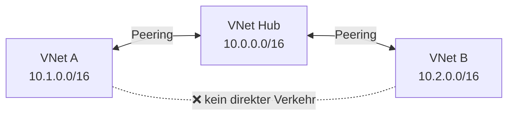
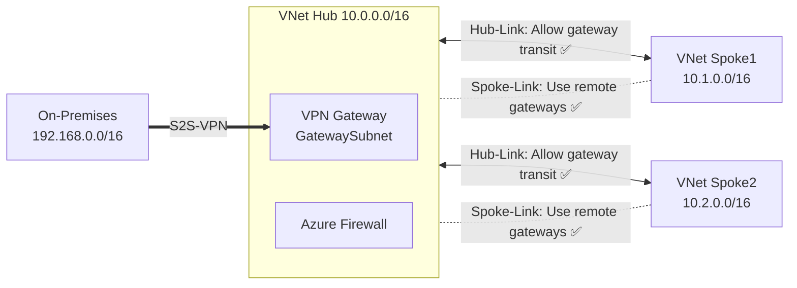
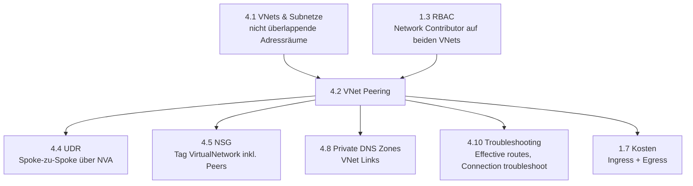

# 4.2 Virtual Network Peering

> **Domäne:** Implement and manage virtual networking · **Gewichtung:** 15–20 %
> **Study-Guide-Punkte:** *Create and configure virtual network peering*
> (VNets und Subnetze → [Kapitel 4.1](01-virtuelle-netzwerke-und-subnetze.md), Routing → [Kapitel 4.4](04-benutzerdefinierte-routen.md))
> **Stand:** November 2026

## Lernziele

Nach diesem Kapitel kann ich …

- **Regional** und **Global VNet Peering** unterscheiden und die Voraussetzungen (keine überlappenden Adressräume) benennen.
- ein Peering im Portal, mit Azure CLI und Azure PowerShell anlegen – auch über Abonnement- und Tenant-Grenzen hinweg.
- die vier **Peering-Einstellungen** (Remote-Zugriff, Forwarded traffic, Gateway transit, Use remote gateways) erklären und richtig kombinieren.
- erklären, warum Peering **nicht transitiv** ist, und eine **Hub-and-Spoke**-Topologie mit NVA/Azure Firewall und UDRs entwerfen.
- den **Peering-Status** interpretieren und nach Änderungen am Adressraum ein Peering **synchronisieren**.
- VNet Peering gegen **VPN Gateway (VNet-to-VNet)** abgrenzen.

## Überblick

Ein virtuelles Netzwerk (VNet) ist standardmäßig isoliert: Ressourcen in VNet A können Ressourcen in VNet B nicht über private IP-Adressen erreichen. **VNet Peering** verbindet zwei VNets direkt miteinander, sodass sich die Ressourcen so verhalten, als lägen sie in **einem** Netzwerk.

Der Datenverkehr läuft dabei ausschließlich über das **Microsoft-Backbone** – nicht über das öffentliche Internet, ohne Gateway, ohne Verschlüsselungs-Overhead und mit der geringen Latenz und hohen Bandbreite des Azure-Netzwerks. Peering ist damit die **Standardlösung**, um VNets innerhalb von Azure zu verbinden, etwa in einer Hub-and-Spoke-Architektur mit zentralen Diensten (Firewall, Gateway, DNS) im Hub.

Für AZ-104 wichtig sind vor allem die **Einstellungen pro Peering-Link**, die **fehlende Transitivität** und das **Gateway-Transit**-Szenario.

## Kernkonzepte

### Regional vs. Global VNet Peering

| Typ | Beschreibung |
|---|---|
| **Regional VNet Peering** (*Virtual network peering*) | Verbindet VNets in **derselben** Azure-Region |
| **Global VNet Peering** | Verbindet VNets in **unterschiedlichen** Azure-Regionen |

Beide Varianten nutzen das Microsoft-Backbone und werden technisch gleich konfiguriert. Unterschiede liegen v. a. bei den **Kosten** (Global teurer) und bei historischen Einschränkungen (früher konnten Ressourcen hinter einem **Basic Load Balancer** nicht über Global Peering erreicht werden – Basic LB ist ohnehin abgekündigt, siehe [4.9](09-load-balancer.md)).

### Voraussetzungen

- ⚠️ Die **Adressräume** der beiden VNets dürfen sich **nicht überlappen**.
- Die VNets können in **derselben oder unterschiedlichen Abonnements** und sogar in **unterschiedlichen Entra-Tenants** liegen.
- Der Benutzer benötigt auf **beiden** VNets Berechtigungen, mindestens die Aktionen `Microsoft.Network/virtualNetworks/virtualNetworkPeerings/write` bzw. `…/peer/action` – in der Praxis die Rolle **Network Contributor** (→ [1.3](../01-identitaeten-und-governance/03-rbac-zugriffsverwaltung.md)).

### Peering besteht aus zwei Links

Ein Peering ist immer **zweiseitig**: Es gibt einen Link von VNet A → B **und** einen Link von VNet B → A. Erst wenn **beide** existieren, fließt Datenverkehr.

- Im **Azure Portal** werden beim Anlegen standardmäßig **beide Links in einem Schritt** erstellt (Abschnitte *Remote virtual network summary* und *Local virtual network summary*), sofern man auf beiden VNets Berechtigungen hat.
- Mit **CLI/PowerShell/ARM** muss jeder Link **einzeln** angelegt werden.

**Peering-Status (*Peering status*):**

| Status | Bedeutung |
|---|---|
| **Initiated** | Nur ein Link wurde erstellt – die Gegenseite fehlt. Noch **kein** Datenverkehr möglich. |
| **Connected** | Beide Links existieren – Peering ist aktiv. |
| **Disconnected** | Ein Link wurde gelöscht. Der verbleibende Link muss gelöscht und das Peering neu angelegt werden. |

Zusätzlich zeigt das Portal den **Peering sync status** (*Fully synchronized* / *Remote sync required* / *Local sync required*) – relevant nach Adressraumänderungen.

### Peering-Einstellungen (pro Link)

Jeder der beiden Links hat eigene Einstellungen. Die Bezeichnungen im aktuellen Portal:

| Einstellung (Portal) | CLI-Parameter | Bedeutung |
|---|---|---|
| **Allow '<lokales VNet>' to access '<Remote-VNet>'** | `--allow-vnet-access` | Grundsätzlicher Zugriff auf das Remote-VNet (Standard: **an**). Aus = Peering existiert, aber Datenverkehr wird blockiert. |
| **Allow '<lokales VNet>' to receive forwarded traffic from '<Remote-VNet>'** | `--allow-forwarded-traffic` | Akzeptiert Datenverkehr, der **nicht im Remote-VNet entstanden** ist, sondern von dort **weitergeleitet** wird (z. B. über eine NVA/Azure Firewall im Hub). Nötig für Hub-and-Spoke mit NVA. |
| **Allow gateway or route server in '<lokales VNet>' to forward traffic to '<Remote-VNet>'** | `--allow-gateway-transit` | **Gateway transit**: Das VNet stellt sein **VPN-/ExpressRoute-Gateway** (oder Route Server) dem gepeerten VNet zur Verfügung. Wird am **Hub** gesetzt. |
| **Enable '<lokales VNet>' to use '<Remote-VNet>'s remote gateway or route server** | `--use-remote-gateways` | Das VNet **nutzt das Gateway des Remote-VNets**. Wird am **Spoke** gesetzt. ⚠️ Das Spoke darf dann **kein eigenes Gateway** haben, und am Remote-Link muss *Gateway transit* aktiv sein. |

> ⚠️ *Use remote gateways* kann pro VNet nur für **ein** Peering aktiviert werden.

### Peering ist nicht transitiv



Ist VNet A mit dem Hub und der Hub mit VNet B gepeert, können **A und B trotzdem nicht miteinander kommunizieren**. Peering-Routen werden nicht weitergereicht.

**Lösungen:**

1. **Direktes Peering** zwischen A und B (Full Mesh – bei vielen VNets aufwendig: *n·(n−1)/2* Peerings).
2. **Hub-and-Spoke mit NVA/Azure Firewall:** Im Hub läuft eine Network Virtual Appliance oder **Azure Firewall**. In den Spokes leiten **benutzerdefinierte Routen (UDR)** den Verkehr zum anderen Spoke auf die private IP der Firewall (*Next hop type: Virtual appliance*, → [4.4](04-benutzerdefinierte-routen.md)). Auf den Spoke-Links muss **Allow forwarded traffic** aktiv sein. Auf der NVA-VM muss **IP forwarding** aktiviert sein.
3. **Azure Virtual Network Manager (AVNM):** Erstellt und verwaltet Konnektivitätskonfigurationen zentral, z. B. Hub-and-Spoke mit Option *Direct connectivity* zwischen Spokes oder **Mesh**.
4. **Azure Virtual WAN:** Microsoft-verwalteter Hub mit transitivem Routing zwischen allen angeschlossenen VNets und Standorten.
5. **VPN Gateway im Hub** mit Gateway transit – Spokes erreichen darüber On-Premises; für Spoke-zu-Spoke-Verkehr über das Gateway sind ebenfalls UDRs nötig.

### Gateway transit (Hub-and-Spoke mit On-Premises)



- Nur **ein** Gateway (im Hub) für alle Spokes → geringere Kosten und zentrale Verwaltung.
- Die Spokes lernen die On-Premises-Routen über das Hub-Gateway (BGP bzw. lokale Netzwerkgateways).

### Adressraum eines gepeerten VNets ändern

- Der Adressraum eines VNets kann geändert (erweitert/verkleinert) werden, **ohne das Peering zu löschen**.
- Danach müssen die Peerings **synchronisiert** werden: Portal → **Peerings > Sync** (bzw. `az network vnet peering sync` / `Sync-AzVirtualNetworkPeering`), damit die Gegenseite den neuen Adressraum kennt.
- Status bis dahin: *Remote sync required* bzw. *Local sync required*.

### Weitere Aspekte

- **Namensauflösung:** Azure-bereitgestelltes DNS (168.63.129.16) löst Namen **nicht** über Peerings hinweg auf. Lösung: **Azure Private DNS Zone** mit **Virtual network links** zu allen beteiligten VNets oder eigener DNS-Server/Private DNS Resolver (→ [4.8](08-azure-dns.md)).
- **NSGs** gelten weiterhin: Die Standardregel `AllowVnetInBound` umfasst über das Service-Tag `VirtualNetwork` auch die Adressräume **gepeerter VNets** (→ [4.5](05-nsg-und-asg.md)).
- **Kein Downtime:** Das Anlegen oder Löschen eines Peerings unterbricht bestehende Ressourcen im VNet nicht.
- **Service Chaining:** Über UDRs mit *Next hop* = NVA oder Gateway in einem gepeerten VNet lässt sich Datenverkehr gezielt durch zentrale Dienste leiten.
- **Subnet peering:** Neuere Funktion, bei der nur ausgewählte **Subnetze** statt der gesamten Adressräume gepeert werden (u. a. für überlappende Adressräume in anderen Subnetzen). Zum Stand dieses Dokuments nur eingeschränkt (CLI/API) verfügbar – für die Prüfung gilt weiterhin: **VNet Peering verbindet ganze Adressräume, die sich nicht überlappen dürfen**.
- **Verschieben:** Ein VNet mit aktiven Peerings kann in der Regel erst verschoben werden, nachdem die Peerings entfernt wurden – vor einem Move die Einschränkungen in der Dokumentation prüfen (→ [1.6](../01-identitaeten-und-governance/06-ressourcengruppen-abonnements-verwaltungsgruppen.md)).

## Zusammenhänge



- **[4.1 VNets und Subnetze](01-virtuelle-netzwerke-und-subnetze.md):** Adressplanung ist die Grundlage – überlappende Bereiche verhindern späteres Peering.
- **[4.4 Benutzerdefinierte Routen](04-benutzerdefinierte-routen.md):** Peering erzeugt automatisch Systemrouten (*Next hop type: VNet peering*). Für transitiven Verkehr über eine NVA sind UDRs nötig.
- **[4.5 NSG und ASG](05-nsg-und-asg.md):** Peering öffnet die Netzwerkverbindung, NSGs filtern weiterhin.
- **[4.8 Azure DNS](08-azure-dns.md):** Private DNS Zones mit VNet-Links für Namensauflösung über Peerings.
- **[4.10 Netzwerk-Troubleshooting](10-netzwerk-troubleshooting.md):** *Effective routes* zeigen Peering-Routen; Network Watcher prüft die Erreichbarkeit.
- **[1.3 RBAC](../01-identitaeten-und-governance/03-rbac-zugriffsverwaltung.md):** Berechtigungen auf beiden VNets, auch abo-/tenantübergreifend.
- **[1.7 Kosten](../01-identitaeten-und-governance/07-kostenverwaltung-und-advisor.md):** Peering-Traffic wird pro GB abgerechnet.

## Vergleichstabellen

### VNet Peering vs. VPN Gateway (VNet-to-VNet)

| Kriterium | VNet Peering | VPN Gateway VNet-to-VNet |
|---|---|---|
| Transport | Microsoft-Backbone, privat | IPsec/IKE-Tunnel (über Azure-Backbone) |
| Verschlüsselung | keine zusätzliche (Backbone) | ✅ IPsec |
| Bandbreite | sehr hoch, keine Gateway-Grenze | begrenzt durch Gateway-SKU |
| Latenz | sehr niedrig | höher (Gateway-Hop) |
| Gateway nötig | ❌ | ✅ auf beiden Seiten |
| Einrichtungszeit | Sekunden/Minuten | Gateway-Bereitstellung oft 30–45 Minuten |
| Kosten | pro GB (ein- und ausgehend) | Gateway-Stundenpreis + Egress |
| Transitiv | ❌ | mit BGP möglich |
| Typischer Einsatz | VNet-Verbindung innerhalb Azure | Verschlüsselungspflicht, transitives Routing mit BGP |

### Regional vs. Global Peering

| Kriterium | Regional | Global |
|---|---|---|
| Regionen | gleiche Region | unterschiedliche Regionen |
| Backbone | Microsoft | Microsoft |
| Kosten | niedriger | höher (regionsübergreifend) |
| Gateway transit | ✅ | ✅ |

### Welche Einstellung wo? (Hub-and-Spoke)

| Ziel | Am Hub-Link (Hub → Spoke) | Am Spoke-Link (Spoke → Hub) |
|---|---|---|
| Spoke nutzt VPN-Gateway des Hubs | **Allow gateway transit** | **Use remote gateways** |
| Verkehr über NVA/Firewall im Hub zum Spoke | **Allow forwarded traffic** (falls Hub weitergeleiteten Verkehr empfängt) | **Allow forwarded traffic** |
| Peering vorübergehend sperren, ohne zu löschen | Remote-Zugriff **aus** | Remote-Zugriff **aus** |

## Azure Portal

| Aufgabe | Pfad |
|---|---|
| Peering anlegen | **Portal > Virtual networks > VNet > Settings > Peerings > + Add** |
| Peering-Status / Sync-Status prüfen | **… > VNet > Peerings** (Spalten *Peering status*, *Peering sync status*) |
| Peering-Einstellungen ändern | **… > VNet > Peerings > Peering auswählen** → Einstellungen anpassen > *Save* |
| Peering nach Adressraumänderung synchronisieren | **… > VNet > Peerings > Peering auswählen > Sync** |
| Adressraum ändern | **… > VNet > Settings > Address space** |
| Peering-Routen ansehen | **Portal > Network interfaces > NIC > Help > Effective routes** (Next hop type *VNet peering* / *VNetGlobalPeering*) |
| Konnektivität testen | **Portal > Network Watcher > Connection troubleshoot** |
| Zentral verwaltete Topologien | **Portal > Network managers > Configurations > Connectivity configuration** |

**Dialog *Add peering* (beide Seiten in einem Schritt):**

1. **Remote virtual network summary:** *Peering link name* (Name des Links Remote → Lokal), *Virtual network deployment model* (Resource manager), ggf. *I know my resource ID* (für andere Tenants), **Subscription**, **Virtual network**
2. **Remote virtual network peering settings:** die vier Checkboxen für den Remote-Link
3. **Local virtual network summary:** *Peering link name* (Lokal → Remote)
4. **Local virtual network peering settings:** die vier Checkboxen für den lokalen Link
5. **Add**

⚠️ **Nicht änderbar bzw. zu beachten:**
- Der **Name** eines Peering-Links kann nachträglich nicht geändert werden.
- Ein Peering im Status **Disconnected** lässt sich nicht reparieren – löschen und neu anlegen.
- Für tenantübergreifendes Peering wird die **Resource ID** des Remote-VNets benötigt; der Benutzer muss im Remote-Tenant (z. B. als Gast) Berechtigungen haben.

## Azure CLI & PowerShell

### Azure CLI

```bash
# Resource IDs der beiden VNets ermitteln
HUB_ID=$(az network vnet show -g rg-hub -n vnet-hub --query id -o tsv)
SPOKE_ID=$(az network vnet show -g rg-spoke1 -n vnet-spoke1 --query id -o tsv)

# Link Hub -> Spoke (Hub stellt Gateway bereit)
az network vnet peering create \
  --resource-group rg-hub --vnet-name vnet-hub \
  --name hub-to-spoke1 \
  --remote-vnet $SPOKE_ID \
  --allow-vnet-access \
  --allow-forwarded-traffic \
  --allow-gateway-transit

# Link Spoke -> Hub (Spoke nutzt das Gateway des Hubs)
az network vnet peering create \
  --resource-group rg-spoke1 --vnet-name vnet-spoke1 \
  --name spoke1-to-hub \
  --remote-vnet $HUB_ID \
  --allow-vnet-access \
  --allow-forwarded-traffic \
  --use-remote-gateways

# Status prüfen (peeringState: Initiated / Connected / Disconnected)
az network vnet peering list -g rg-hub --vnet-name vnet-hub \
  --query "[].{Name:name, State:peeringState, Sync:peeringSyncLevel}" -o table
az network vnet peering show -g rg-hub --vnet-name vnet-hub -n hub-to-spoke1

# Einstellung nachträglich ändern
az network vnet peering update -g rg-spoke1 --vnet-name vnet-spoke1 \
  -n spoke1-to-hub --set allowForwardedTraffic=true

# Nach Adressraumänderung synchronisieren
az network vnet peering sync -g rg-spoke1 --vnet-name vnet-spoke1 -n spoke1-to-hub

# Peering löschen
az network vnet peering delete -g rg-hub --vnet-name vnet-hub -n hub-to-spoke1
```

### Azure PowerShell

```powershell
$hub   = Get-AzVirtualNetwork -Name "vnet-hub"    -ResourceGroupName "rg-hub"
$spoke = Get-AzVirtualNetwork -Name "vnet-spoke1" -ResourceGroupName "rg-spoke1"

# Link Hub -> Spoke mit Gateway transit
Add-AzVirtualNetworkPeering -Name "hub-to-spoke1" `
  -VirtualNetwork $hub -RemoteVirtualNetworkId $spoke.Id `
  -AllowForwardedTraffic -AllowGatewayTransit

# Link Spoke -> Hub mit Use remote gateways
Add-AzVirtualNetworkPeering -Name "spoke1-to-hub" `
  -VirtualNetwork $spoke -RemoteVirtualNetworkId $hub.Id `
  -AllowForwardedTraffic -UseRemoteGateways

# Status prüfen
Get-AzVirtualNetworkPeering -VirtualNetworkName "vnet-hub" -ResourceGroupName "rg-hub" |
  Select-Object Name, PeeringState, PeeringSyncLevel

# Einstellung ändern
$p = Get-AzVirtualNetworkPeering -VirtualNetworkName "vnet-hub" `
  -ResourceGroupName "rg-hub" -Name "hub-to-spoke1"
$p.AllowVirtualNetworkAccess = $false
Set-AzVirtualNetworkPeering -VirtualNetworkPeering $p

# Nach Adressraumänderung synchronisieren
Sync-AzVirtualNetworkPeering -VirtualNetworkName "vnet-spoke1" `
  -ResourceGroupName "rg-spoke1" -Name "spoke1-to-hub"

# Peering entfernen
Remove-AzVirtualNetworkPeering -VirtualNetworkName "vnet-hub" `
  -ResourceGroupName "rg-hub" -Name "hub-to-spoke1" -Force
```

| Ziel | CLI | PowerShell |
|---|---|---|
| Peering-Link anlegen | `az network vnet peering create` | `Add-AzVirtualNetworkPeering` |
| Anzeigen | `az network vnet peering list/show` | `Get-AzVirtualNetworkPeering` |
| Ändern | `az network vnet peering update` | `Set-AzVirtualNetworkPeering` |
| Synchronisieren | `az network vnet peering sync` | `Sync-AzVirtualNetworkPeering` |
| Löschen | `az network vnet peering delete` | `Remove-AzVirtualNetworkPeering` |

> Hinweis: `--use-remote-gateways` schlägt fehl, solange im Remote-VNet kein Gateway existiert oder dort *Gateway transit* nicht erlaubt ist.

## Praxisbeispiel

**Szenario:** *Contoso* betreibt in *Germany West Central* ein Hub-VNet `vnet-hub` (10.0.0.0/16) mit **VPN Gateway** (Site-to-Site zur Zentrale) und **Azure Firewall**. Hinzu kommen:

- `vnet-prod` (10.1.0.0/16) in *Germany West Central*
- `vnet-dev` (10.2.0.0/16) in *West Europe*, in einem **anderen Abonnement**

**Anforderungen:**

1. Beide Spokes sollen die Zentrale (On-Premises) über das VPN-Gateway im Hub erreichen.
2. `vnet-prod` und `vnet-dev` sollen miteinander kommunizieren – aber nur über die Azure Firewall.
3. VMs sollen sich gegenseitig per Namen auflösen können.

**Umsetzung:**

1. **Berechtigungen:** Der Administrator erhält **Network Contributor** auf `vnet-hub` und auf `vnet-dev` (anderes Abo).
2. **Peering Hub ↔ Prod (regional):** *vnet-hub > Peerings > + Add*
   - Remote: `vnet-prod`, Remote-Link: Zugriff ✅, Forwarded traffic ✅, **Use remote gateways ✅**
   - Lokal (Hub): Zugriff ✅, Forwarded traffic ✅, **Allow gateway transit ✅**
3. **Peering Hub ↔ Dev (global, abo-übergreifend):** wie Schritt 2, Subscription des Dev-Abos auswählen. Da `vnet-dev` in *West Europe* liegt, entsteht ein **Global VNet Peering**.
4. **Spoke-zu-Spoke über Firewall** (Peering ist nicht transitiv):
   - Route Table `rt-prod` an den Subnetzen von `vnet-prod`: Route `10.2.0.0/16` → *Virtual appliance* → private IP der Azure Firewall (z. B. 10.0.1.4).
   - Route Table `rt-dev` an den Subnetzen von `vnet-dev`: Route `10.1.0.0/16` → *Virtual appliance* → 10.0.1.4.
   - In der Azure Firewall eine **Network rule** erstellen, die Verkehr zwischen 10.1.0.0/16 und 10.2.0.0/16 erlaubt.
   - Details zu UDRs → [4.4](04-benutzerdefinierte-routen.md).
5. **Namensauflösung:** Private DNS Zone `contoso.internal` anlegen und **Virtual network links** zu `vnet-hub`, `vnet-prod` und `vnet-dev` mit *Auto registration* erstellen (→ [4.8](08-azure-dns.md)).
6. **Prüfen:** Peering-Status überall **Connected**; an einer Prod-VM *Effective routes* ansehen (Peering-Route zum Hub, UDR zum Dev-Netz, Gateway-Routen für On-Premises); mit **Network Watcher > Connection troubleshoot** von Prod nach Dev testen.

**Später:** Das Dev-VNet wird um 10.3.0.0/16 erweitert → *vnet-dev > Address space* ergänzen → in den Peerings auf **Sync** klicken, bis der Status *Fully synchronized* ist.

## Limits & wichtige Zahlen

| Wert | Grenze / Standard |
|---|---|
| Peerings pro VNet | standardmäßig **500** (mit AVNM-Konnektivitätskonfiguration höher möglich – aktuelle Werte prüfen) |
| *Use remote gateways* | nur für **ein** Peering pro VNet |
| Gateway im Spoke | ❌ nicht erlaubt, wenn *Use remote gateways* aktiv ist |
| Adressräume | dürfen sich **nicht überlappen** |
| Transitivität | ❌ keine |
| Kosten | ein- **und** ausgehender Traffic pro GB; Global Peering teurer als Regional |
| Status für Datenverkehr | nur **Connected** |
| Full Mesh mit *n* VNets | *n·(n−1)/2* Peerings |

Aktuelle Limits: [Azure networking limits](https://learn.microsoft.com/azure/azure-resource-manager/management/azure-subscription-service-limits#azure-networking-limits).

## Prüfungstipps & Fallstricke

- ⚠️ **Peering lässt sich nicht anlegen** → Adressräume **überlappen**. Lösung: Adressraum eines VNets ändern (vor dem Peering).
- ⚠️ **VNet A ↔ Hub ↔ VNet B, aber A erreicht B nicht** → Peering ist **nicht transitiv**. Lösung: direktes Peering A ↔ B **oder** NVA/Azure Firewall im Hub + UDRs + *Allow forwarded traffic*.
- ⚠️ **Status „Initiated"** → Nur ein Link wurde angelegt (typisch bei CLI/PowerShell) – Gegenrichtung fehlt.
- ⚠️ **Status „Disconnected"** → Ein Link wurde gelöscht; den anderen Link löschen und Peering neu erstellen.
- **„Spoke soll das VPN-Gateway des Hubs nutzen"** → Hub: **Allow gateway transit**, Spoke: **Use remote gateways**. Das Spoke darf **kein eigenes Gateway** haben.
- **„Mit minimalen Kosten“ mehrere VNets an On-Premises anbinden** → ein Gateway im Hub + Gateway transit statt Gateway pro VNet.
- **„Verkehr zwischen VNets muss verschlüsselt sein“** → VPN Gateway VNet-to-VNet (Peering bietet keine zusätzliche Verschlüsselung).
- **„VNets in unterschiedlichen Regionen verbinden, geringste Latenz/kein Gateway“** → **Global VNet Peering**.
- **„VNets in unterschiedlichen Abonnements/Tenants“** → Peering ist möglich; Berechtigungen auf beiden Seiten nötig.
- **Adressraum eines gepeerten VNets erweitert, Gegenseite erreicht neue Subnetze nicht** → Peering **synchronisieren** (Sync).
- **VMs in gepeerten VNets lösen Namen nicht auf** → Azure-DNS funktioniert nicht über Peerings → **Private DNS Zone** mit VNet-Links.
- **NSG blockiert trotz Peering?** → Peering ersetzt keine NSG-Regeln; `VirtualNetwork`-Service-Tag umfasst gepeerte Adressräume.
- **Kosten-Fangfrage:** Peering ist nicht kostenlos – abgerechnet wird ein- **und** ausgehender Datenverkehr.

## Selbsttest

**1.** VNet1 (10.0.0.0/16) soll mit VNet2 (10.0.128.0/17) gepeert werden. Die Erstellung schlägt fehl. Warum?

<details><summary>Lösung</summary>

Die Adressräume **überlappen** (10.0.128.0/17 liegt innerhalb von 10.0.0.0/16). VNet Peering setzt nicht überlappende Adressräume voraus.
</details>

**2.** VNet-A ist mit VNet-Hub gepeert, VNet-Hub mit VNet-B. Eine VM in VNet-A kann eine VM in VNet-B nicht erreichen. Nennen Sie zwei Lösungen.

<details><summary>Lösung</summary>

Peering ist **nicht transitiv**. Lösungen: (1) direktes Peering VNet-A ↔ VNet-B, (2) NVA/Azure Firewall im Hub mit **UDRs** in A und B, die den Verkehr auf die Firewall leiten, plus **Allow forwarded traffic** auf den Peering-Links (alternativ Azure Virtual Network Manager oder Virtual WAN).
</details>

**3.** Ein Administrator legt mit `az network vnet peering create` ein Peering von VNet1 zu VNet2 an. Der Status lautet *Initiated*. Was fehlt?

<details><summary>Lösung</summary>

Der **Gegen-Link** von VNet2 zu VNet1. Erst wenn beide Links existieren, wechselt der Status auf **Connected**.
</details>

**4.** Drei Spoke-VNets sollen über ein bestehendes VPN-Gateway im Hub-VNet mit On-Premises kommunizieren. Welche Peering-Einstellungen sind erforderlich?

<details><summary>Lösung</summary>

Auf den Links **Hub → Spoke**: **Allow gateway transit**. Auf den Links **Spoke → Hub**: **Use remote gateways**. Die Spokes dürfen kein eigenes VPN-Gateway besitzen.
</details>

**5.** Sie möchten VNets in *Germany West Central* und *East US* mit möglichst geringer Latenz und ohne Gateways verbinden. Welche Lösung wählen Sie?

<details><summary>Lösung</summary>

**Global VNet Peering**.
</details>

**6.** Die Sicherheitsrichtlinie verlangt, dass der gesamte Datenverkehr zwischen zwei VNets **IPsec-verschlüsselt** ist. Ist VNet Peering geeignet?

<details><summary>Lösung</summary>

**Nein.** Peering nutzt das Microsoft-Backbone ohne IPsec. Für eine IPsec-Pflicht: **VPN Gateway VNet-to-VNet** (oder Verschlüsselung auf Anwendungsebene).
</details>

**7.** Nach dem Hinzufügen des Adressbereichs 10.5.0.0/16 zu einem gepeerten VNet erreichen VMs im Partner-VNet die neuen Subnetze nicht. Der Peering-Status zeigt *Remote sync required*. Was tun Sie?

<details><summary>Lösung</summary>

Das Peering **synchronisieren**: im Portal unter *Peerings > Sync* bzw. `az network vnet peering sync` / `Sync-AzVirtualNetworkPeering`.
</details>

**8.** Ein Peering zeigt den Status *Disconnected*, weil ein Kollege den Link auf der Gegenseite gelöscht hat. Wie stellen Sie die Verbindung wieder her?

<details><summary>Lösung</summary>

Den verbleibenden Link **löschen** und das Peering (beide Links) **neu anlegen**. Ein Disconnected-Peering lässt sich nicht reparieren.
</details>

**9.** VMs in zwei gepeerten VNets können sich per IP-Adresse erreichen, aber nicht über ihre Hostnamen. Was ist die empfohlene Lösung?

<details><summary>Lösung</summary>

Eine **Azure Private DNS Zone** erstellen und mit **beiden VNets verlinken** (Virtual network links, ggf. mit Auto registration). Die Azure-bereitgestellte Namensauflösung funktioniert nicht über Peerings hinweg.
</details>

**10.** Ein Spoke-VNet besitzt bereits ein eigenes VPN-Gateway. Sie versuchen, *Use remote gateways* auf dem Peering zum Hub zu aktivieren. Was passiert?

<details><summary>Lösung</summary>

Die Einstellung kann **nicht aktiviert** werden – ein VNet mit eigenem Gateway kann kein Remote-Gateway nutzen. Entweder das lokale Gateway entfernen oder auf Gateway transit verzichten.
</details>

## Weiterführende Links

- [AZ-104 Study Guide](https://learn.microsoft.com/credentials/certifications/resources/study-guides/az-104)
- [Virtual network peering](https://learn.microsoft.com/azure/virtual-network/virtual-network-peering-overview)
- [Create, change, or delete a virtual network peering](https://learn.microsoft.com/azure/virtual-network/virtual-network-manage-peering)
- [Connect virtual networks with virtual network peering (Tutorial)](https://learn.microsoft.com/azure/virtual-network/tutorial-connect-virtual-networks-portal)
- [Create a virtual network peering – different subscriptions and tenants](https://learn.microsoft.com/azure/virtual-network/create-peering-different-subscriptions)
- [Configure VPN gateway transit for virtual network peering](https://learn.microsoft.com/azure/vpn-gateway/vpn-gateway-peering-gateway-transit)
- [Hub-spoke network topology in Azure](https://learn.microsoft.com/azure/architecture/networking/architecture/hub-spoke)
- [What is Azure Virtual Network Manager?](https://learn.microsoft.com/azure/virtual-network-manager/overview)
- [Update the address space for a peered virtual network](https://learn.microsoft.com/azure/virtual-network/update-virtual-network-peering-address-space)
- [Azure networking limits](https://learn.microsoft.com/azure/azure-resource-manager/management/azure-subscription-service-limits#azure-networking-limits)