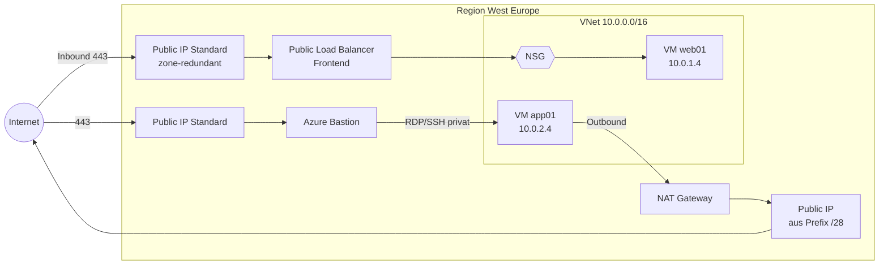

# 4.3 Öffentliche IP-Adressen

> **Domäne:** Implement and manage virtual networking · **Gewichtung:** 15–20 %
> **Study-Guide-Punkte:** *Configure public IP addresses*
> **Stand:** November 2026

## Lernziele

Nach diesem Kapitel kann ich …

- die SKUs **Basic** und **Standard** unterscheiden und erklären, warum heute praktisch nur noch **Standard** verwendet wird.
- **Allocation method** (Static/Dynamic), **Tier** (Regional/Global), **Zonen-Optionen** und **Routing preference** einer öffentlichen IP richtig wählen.
- eine öffentliche IP einer **VM-NIC**, einem **Load Balancer**, einem **NAT Gateway**, **Azure Bastion** oder anderen Diensten zuordnen und wieder trennen.
- **Public IP prefixes** einsetzen, um zusammenhängende, planbare Adressbereiche zu reservieren.
- die Reihenfolge der **Outbound-Konnektivität** (NAT Gateway, Instance-level Public IP, LB Outbound Rules, Default outbound access) erklären.

## Überblick

Eine **öffentliche IP-Adresse** (*Public IP address*) ist in Azure eine **eigenständige Ressource** (`Microsoft.Network/publicIPAddresses`) mit eigenem Lebenszyklus. Sie wird nicht direkt einer VM „gegeben“, sondern einer **IP-Konfiguration** einer Ressource zugeordnet – z. B. der NIC einer VM oder dem Frontend eines Load Balancers.

Öffentliche IPs ermöglichen:

- **Inbound**: Erreichbarkeit aus dem Internet (z. B. Webserver, RDP/SSH – besser über [Azure Bastion](06-azure-bastion.md)).
- **Outbound**: eine feste, bekannte Absenderadresse für Verbindungen ins Internet (z. B. für Firewall-Freigaben beim Partner).

Private IPs aus dem VNet ([4.1](01-virtuelle-netzwerke-und-subnetze.md)) sind davon unabhängig – eine VM hat immer eine private IP, eine öffentliche nur optional.

## Kernkonzepte

### SKUs: Basic vs. Standard

| Eigenschaft | Basic | Standard |
|---|---|---|
| Status | ⚠️ **Retired seit 30.09.2025** – keine Neuerstellung, bestehende IPs migrieren | **Aktueller Standard** |
| Allocation | Static oder Dynamic | **immer Static** |
| Sicherheit | standardmäßig **offen** (Inbound erlaubt, NSG optional) | **Secure by default**: Inbound **geschlossen**, bis eine **NSG** es erlaubt |
| Availability Zones | ❌ | ✅ zonenredundant, zonal oder *No zone* |
| Routing preference | ❌ | ✅ |
| Global tier | ❌ | ✅ |
| Kompatibilität | Basic Load Balancer (ebenfalls retired) | Standard Load Balancer, NAT Gateway, Bastion, App Gateway v2, Azure Firewall, VPN Gateway |
| SLA | keine | 99,99 % |

> ⚠️ **SKUs müssen zusammenpassen:** Eine Standard-IP kann nicht an einen Basic Load Balancer gebunden werden und umgekehrt. Ein Upgrade Basic → Standard ist **nicht umkehrbar**.

In älteren Prüfungsfragen tauchen Basic-IPs noch auf – das Verhalten (dynamisch, offen, keine Zonen) sollte man deshalb kennen.

### Allocation method: Static vs. Dynamic

| Methode | Verhalten |
|---|---|
| **Static** | Adresse wird bei Erstellung zugewiesen und bleibt, bis die Ressource **gelöscht** wird. |
| **Dynamic** (nur Basic) | Adresse wird erst bei Zuordnung zu einer laufenden Ressource vergeben und **geht beim Deallocate der VM verloren** – nach dem Start kann es eine andere sein. |

Bei Standard ist die Adresse immer statisch. Wer eine feste Adresse braucht (DNS-A-Record, Firewall-Whitelist, TLS-Zertifikat), braucht also eine Standard-IP.

### IP-Version

- **IPv4** oder **IPv6** – pro Ressource eine Version.
- **Dual-Stack**: Eine NIC bzw. ein Load Balancer kann eine IPv4- **und** eine IPv6-Konfiguration haben. Dafür muss auch das VNet/Subnetz einen IPv6-Adressraum besitzen.

### Tier: Regional vs. Global

| Tier | Beschreibung |
|---|---|
| **Regional** | Standard. Adresse gehört zu einer Region. |
| **Global** | **Anycast**-Adresse, die von mehreren Microsoft-Edge-Standorten angekündigt wird. Nur für das Frontend eines **Cross-region (Global) Load Balancers**. Nur **Standard**, nur **Static**, nicht direkt an VMs zuordenbar. |

### Availability Zones

Bei Standard-IPs in Regionen mit Zonen:

- **Zone-redundant** (Zonen 1, 2, 3): Die Adresse überlebt den Ausfall einer Zone – empfohlen.
- **Zonal** (z. B. nur Zone 2): an eine Zone gebunden; passt zu zonalen VMs.
- **No zone**: keine Zonengarantie.

⚠️ Die Zonen-Einstellung ist **nach der Erstellung nicht änderbar**. Details zu Zonen → [3.4](../03-compute/04-verfuegbarkeit-und-scale-sets.md).

### DNS name label

- Optionaler DNS-Name: `<label>.<region>.cloudapp.azure.com`, z. B. `contoso-web.westeurope.cloudapp.azure.com`.
- Das Label muss in der Region eindeutig sein. Mit *Domain name label scope* (Tenant, Subscription, Resource group, No reuse) lässt sich verhindern, dass nach dem Löschen jemand anderes denselben Namen übernimmt.
- Eigene Domains (z. B. `www.contoso.com`) zeigen per **CNAME** auf dieses Label oder per **A-Record** (bzw. Alias-Record in Azure DNS) auf die IP → [4.8 Azure DNS](08-azure-dns.md).

### Routing preference

Nur Standard, nur bei Erstellung wählbar:

| Option | Verhalten | Kosten |
|---|---|---|
| **Microsoft network** (Standard) | Datenverkehr läuft so lange wie möglich über das **Microsoft-Backbone** und verlässt es nahe am Nutzer (*cold potato*) | Standardpreis |
| **Internet** | Datenverkehr verlässt das Microsoft-Netz früh und läuft über das **ISP-Netz** (*hot potato*) | **günstiger** bei Egress |

### Idle timeout

Zeit, nach der eine **inaktive TCP-Verbindung** getrennt wird: **4 bis 30 Minuten**, Standard **4 Minuten**. Bei langlaufenden Verbindungen erhöhen oder TCP-Keepalives verwenden.

### Wem kann man eine öffentliche IP zuordnen?

| Ressource | Hinweise |
|---|---|
| **NIC-IP-Konfiguration einer VM** | *Instance-level public IP* (ILPIP); pro IP-Konfiguration eine öffentliche IP |
| **VM Scale Set** | Öffentliche IP pro Instanz über die Netzwerkkonfiguration des Scale Sets |
| **Load Balancer (Public)** | Frontend-IP-Konfiguration → [4.9](09-load-balancer.md) |
| **NAT Gateway** | bis zu 16 IPs bzw. ein Prefix für Outbound-SNAT |
| **Azure Bastion** | erfordert **Standard, Static** → [4.6](06-azure-bastion.md) |
| **Application Gateway v2** | Standard, Static |
| **VPN Gateway / ExpressRoute Gateway** | Standard |
| **Azure Firewall** | Standard, mehrere IPs möglich |

### Associate / Dissociate

- Eine öffentliche IP kann **nur einer Ressource gleichzeitig** zugeordnet sein.
- Sie kann von einer Ressource **getrennt** (*Dissociate*) und einer anderen **zugeordnet** (*Associate*) werden – die Adresse bleibt dabei erhalten (Static).
- **Upgrade Basic → Standard:** IP muss zuerst **getrennt** und auf **Static** gestellt sein. Danach Upgrade (nicht umkehrbar) und erneut zuordnen. Wichtig: nach dem Upgrade eine **NSG** mit den benötigten Inbound-Regeln sicherstellen, da Standard *secure by default* ist.
- ⚠️ Beim Löschen einer VM wird die zugeordnete Public IP standardmäßig **nicht** gelöscht (außer bei *Delete with VM*-Option) – sie verursacht weiter Kosten.

### Public IP prefixes

Ein **Public IP prefix** reserviert einen **zusammenhängenden Block** öffentlicher Adressen:

- Größen IPv4: **/28 (16 Adressen) bis /31 (2 Adressen)**; IPv6: /124 bis /127.
- Aus dem Prefix erzeugt man einzelne Standard-IPs (*+ Add IP address*), die man wie normale IPs zuordnet.
- Vorteil: Partner können **einen Bereich** freigeben statt einzelner Adressen; neue IPs aus dem Prefix sind sofort „bekannt“.
- Ein Prefix kann direkt einem **NAT Gateway** oder einem **Load Balancer** (Outbound rules) zugeordnet werden.
- ⚠️ Die Größe ist nach der Erstellung **nicht änderbar**; Zonen-Einstellung ebenfalls fest.

**Custom IP prefix (BYOIP):** Eigene, bei einer Registrierungsstelle registrierte öffentliche Adressbereiche können nach Validierung nach Azure gebracht und daraus Public IP prefixes erstellt werden.

### Outbound-Konnektivität – wer gewinnt?

Hat eine VM mehrere mögliche Wege ins Internet, gilt diese **Priorität** (höchste zuerst):

1. **NAT Gateway** am Subnetz
2. **Instance-level Public IP** an der NIC
3. **Load Balancer Outbound Rules** (bzw. implizites SNAT des Public LB)
4. **Default outbound access** (implizite, nicht kontrollierbare Adresse von Microsoft)

> **Default outbound access** wird abgekündigt: Für **neu erstellte VNets** sind Subnetze künftig standardmäßig **privat** (*Default outbound access* deaktiviert). VMs brauchen dann eine explizite Methode (NAT Gateway, Public IP, LB Outbound Rule, Firewall). Bestehende VNets sind nicht betroffen. Den genauen Stichtag in der aktuellen Doku prüfen.

Empfehlung von Microsoft: **NAT Gateway** für skalierbaren, festen Outbound-Zugang ohne eingehende Erreichbarkeit.

### Kosten

- Standard-IPs werden **stündlich** abgerechnet – **auch wenn sie keiner Ressource zugeordnet sind**.
- Global-Tier und Public IP prefixes haben eigene Preise.
- Zusätzlich fallen Kosten für ausgehenden Datenverkehr an (abhängig von der Routing preference) → [1.7](../01-identitaeten-und-governance/07-kostenverwaltung-und-advisor.md).

## Zusammenhänge



- **VNets & Subnetze** ([4.1](01-virtuelle-netzwerke-und-subnetze.md)): Öffentliche IPs werden immer an Ressourcen im bzw. am VNet gebunden; die private IP bleibt bestehen.
- **NSGs** ([4.5](05-nsg-und-asg.md)): Standard-IPs sind *secure by default* – ohne NSG-Regel kommt kein Inbound-Verkehr an.
- **Azure Bastion** ([4.6](06-azure-bastion.md)): ersetzt öffentliche IPs an VMs für RDP/SSH; benötigt selbst eine Standard-IP.
- **Load Balancer** ([4.9](09-load-balancer.md)): Public LB nutzt Public IPs als Frontend; SKU von LB und IP muss übereinstimmen; Outbound rules für SNAT.
- **VMs & Scale Sets** ([3.2](../03-compute/02-virtuelle-maschinen.md), [3.4](../03-compute/04-verfuegbarkeit-und-scale-sets.md)): Zonale VMs brauchen passende zonale oder zonenredundante IPs.
- **Azure DNS** ([4.8](08-azure-dns.md)): Alias-Records zeigen direkt auf eine Public-IP-Ressource und folgen Änderungen automatisch.

## Vergleichstabellen

### Outbound-Optionen

| Option | Feste Absender-IP | Inbound möglich | Skalierung (SNAT-Ports) | Einsatz |
|---|---|---|---|---|
| **NAT Gateway** | ✅ (IPs oder Prefix) | ❌ | sehr hoch (64.512 Ports pro IP) | empfohlener Standard für Outbound |
| **Instance-level Public IP** | ✅ | ✅ | pro VM | einzelne VMs mit direkter Erreichbarkeit |
| **LB Outbound Rules** | ✅ | ✅ (über LB-Regeln) | manuell zuzuweisende Ports | Backend-Pools hinter Public LB |
| **Default outbound access** | ❌ (kann sich ändern) | ❌ | begrenzt | nur Legacy; wird abgelöst |

### Zonen-Optionen

| Option | Ausfall einer Zone | Passend zu |
|---|---|---|
| Zone-redundant | IP bleibt erreichbar | zonenredundanter LB, NAT Gateway, Bastion |
| Zonal | IP fällt mit der Zone aus | zonale VM in derselben Zone |
| No zone | keine Garantie | Regionen ohne Zonen / Legacy |

### Regional vs. Global Tier

| Kriterium | Regional | Global |
|---|---|---|
| Reichweite | eine Region | weltweit per Anycast |
| Zuordenbar an | VM, LB, NAT GW, Bastion … | nur Cross-region Load Balancer |
| SKU | Standard | Standard |

## Azure Portal

| Aufgabe | Pfad |
|---|---|
| Öffentliche IP erstellen | **Portal > Public IP addresses > + Create** |
| Allocation, Idle timeout, DNS name label ändern | **Portal > Public IP addresses > IP > Settings > Configuration** |
| IP einer Ressource zuordnen | **Portal > Public IP addresses > IP > Overview > Associate** |
| IP von Ressource trennen | **Portal > Public IP addresses > IP > Overview > Dissociate** |
| Basic → Standard upgraden | **Portal > Public IP addresses > Basic-IP > Overview > Upgrade** (Banner; IP vorher trennen) |
| IP an VM-NIC zuordnen | **Portal > Virtual machines > VM > Networking > Network settings > NIC > Settings > IP configurations > ipconfig1 > Public IP address: Associate** |
| Public IP prefix erstellen | **Portal > Public IP prefixes > + Create** |
| IP aus Prefix erzeugen | **Portal > Public IP prefixes > Prefix > Overview > + Add IP address** |
| Quota/Verbrauch prüfen | **Portal > Subscriptions > Abo > Settings > Usage + quotas** (Provider *Networking*) |
| NAT Gateway mit IP/Prefix | **Portal > NAT gateways > + Create > Outbound IP** |

**Wichtige Felder beim Erstellen (*Create public IP address*):**

1. **Subscription, Resource group, Region**
2. **Name**
3. **IP Version**: IPv4 / IPv6 (/ Both, erzeugt zwei Ressourcen)
4. **SKU**: Standard
5. **Availability zone**: Zone-redundant / 1 / 2 / 3 / No Zone
6. **Tier**: Regional / Global
7. **IP address assignment**: Static (bei Standard fest)
8. **Routing preference**: Microsoft network / Internet
9. **Idle timeout (minutes)**
10. **DNS name label** (optional) und *Domain name label scope*

⚠️ **Nach der Erstellung nicht mehr änderbar:** SKU (außer Upgrade Basic → Standard), IP-Version, Tier, Availability zone, Routing preference, Prefix-Größe.
**Änderbar:** DNS name label, Idle timeout, (bei Basic) Static ↔ Dynamic, Zuordnung.

## Azure CLI & PowerShell

### Azure CLI

```bash
# Zonenredundante Standard-IP mit DNS-Label erstellen
az network public-ip create \
  --resource-group rg-net \
  --name pip-web01 \
  --sku Standard \
  --allocation-method Static \
  --zone 1 2 3 \
  --dns-name contoso-web01 \
  --version IPv4

# Global-Tier-IP für einen Cross-region Load Balancer
az network public-ip create \
  --resource-group rg-net --name pip-global-lb \
  --sku Standard --tier Global --allocation-method Static

# IP mit Routing preference "Internet"
az network public-ip create \
  --resource-group rg-net --name pip-egress \
  --sku Standard --ip-tags RoutingPreference=Internet

# Öffentliche IP einer VM-NIC zuordnen
az network nic ip-config update \
  --resource-group rg-net \
  --nic-name web01-nic \
  --name ipconfig1 \
  --public-ip-address pip-web01

# Öffentliche IP von der NIC trennen
az network nic ip-config update \
  --resource-group rg-net --nic-name web01-nic --name ipconfig1 \
  --remove publicIpAddress

# Public IP prefix (/28 = 16 Adressen) erstellen und IP daraus ableiten
az network public-ip prefix create \
  --resource-group rg-net --name pipp-contoso --length 28 --zone 1 2 3
az network public-ip create \
  --resource-group rg-net --name pip-from-prefix \
  --sku Standard --public-ip-prefix pipp-contoso

# Adresse anzeigen
az network public-ip show --resource-group rg-net --name pip-web01 \
  --query "{IP:ipAddress, FQDN:dnsSettings.fqdn}" -o table
```

### Azure PowerShell

```powershell
# Zonenredundante Standard-IP erstellen
$pip = New-AzPublicIpAddress -ResourceGroupName "rg-net" -Name "pip-web01" `
  -Location "westeurope" -Sku "Standard" -AllocationMethod "Static" `
  -Zone 1,2,3 -DomainNameLabel "contoso-web01" -IpAddressVersion IPv4

# Öffentliche IP einer bestehenden NIC zuordnen
$nic = Get-AzNetworkInterface -ResourceGroupName "rg-net" -Name "web01-nic"
Set-AzNetworkInterfaceIpConfig -NetworkInterface $nic -Name "ipconfig1" `
  -PublicIpAddress $pip -Subnet $nic.IpConfigurations[0].Subnet
Set-AzNetworkInterface -NetworkInterface $nic

# Öffentliche IP von der NIC trennen
$nic.IpConfigurations[0].PublicIpAddress = $null
Set-AzNetworkInterface -NetworkInterface $nic

# Public IP prefix erstellen und IP daraus ableiten
$prefix = New-AzPublicIpPrefix -ResourceGroupName "rg-net" -Name "pipp-contoso" `
  -Location "westeurope" -PrefixLength 28 -Sku Standard -Zone 1,2,3
New-AzPublicIpAddress -ResourceGroupName "rg-net" -Name "pip-from-prefix" `
  -Location "westeurope" -Sku Standard -AllocationMethod Static `
  -PublicIpPrefix $prefix -Zone 1,2,3
```

| Ziel | CLI | PowerShell |
|---|---|---|
| IP erstellen | `az network public-ip create` | `New-AzPublicIpAddress` |
| IP an NIC zuordnen | `az network nic ip-config update --public-ip-address` | `Set-AzNetworkInterfaceIpConfig` + `Set-AzNetworkInterface` |
| Prefix erstellen | `az network public-ip prefix create` | `New-AzPublicIpPrefix` |
| IP anzeigen | `az network public-ip show` | `Get-AzPublicIpAddress` |

## Praxisbeispiel

**Szenario:** *Contoso* betreibt in *West Europe* einen Webshop mit zwei Webservern in den Zonen 1 und 2 sowie mehreren Backend-VMs. Anforderungen:

1. Der Shop soll unter einer festen Adresse erreichbar sein, auch wenn eine Zone ausfällt.
2. Ein Zahlungsdienstleister lässt nur Anfragen von **bekannten Absender-IPs** zu – der Bereich soll später ohne neue Freigabe wachsen können.
3. Administratoren sollen per RDP/SSH zugreifen, ohne dass VMs eine öffentliche IP haben.

**Umsetzung:**

1. **Frontend:** Standard-IP `pip-shop` mit **Zone-redundant**, Static, DNS-Label `contoso-shop` erstellen → als Frontend eines **Standard Public Load Balancers** ([4.9](09-load-balancer.md)) verwenden. In der NSG der Web-Subnetze **443 inbound** erlauben (sonst blockt *secure by default*). `www.contoso.com` per Alias-Record auf `pip-shop` ([4.8](08-azure-dns.md)).
2. **Outbound:** **Public IP prefix /29** (8 Adressen) `pipp-contoso-egress` zonenredundant erstellen und einem **NAT Gateway** zuordnen; NAT Gateway an die Backend-Subnetze binden. Der Zahlungsdienstleister gibt den kompletten /29-Bereich frei. Da NAT Gateway höchste Priorität hat, nutzen alle Backend-VMs garantiert diese Adressen.
3. **Admin-Zugriff:** **Azure Bastion** mit eigener Standard-IP im `AzureBastionSubnet` ([4.6](06-azure-bastion.md)); VMs bekommen **keine** Instance-level Public IP.
4. **Aufräumen:** Alte Basic-IPs der Testumgebung trennen, auf Static stellen und auf **Standard upgraden** bzw. löschen, wenn sie nicht mehr gebraucht werden (laufende Kosten!).

## Limits & wichtige Zahlen

| Wert | Grenze / Standard |
|---|---|
| Basic SKU | **retired 30.09.2025** |
| Allocation bei Standard | immer **Static** |
| Idle timeout | **4–30 Minuten**, Standard **4** |
| Public IP prefix IPv4 | **/28 (16)** bis **/31 (2)** |
| Public IP prefix IPv6 | /124 bis /127 |
| IPs pro NAT Gateway | bis zu **16** (oder Prefixe) |
| SNAT-Ports pro IP am NAT Gateway | **64.512** |
| Öffentliche IPs pro Abo und Region | per **Quota** begrenzt (Standardwerte je nach Abo-Typ, z. B. im Bereich von 1.000) – unter *Usage + quotas* prüfen und ggf. erhöhen |
| DNS-Label-Format | `<label>.<region>.cloudapp.azure.com` |
| SLA Standard-IP | 99,99 % |

Aktuelle Werte: [Azure networking limits](https://learn.microsoft.com/azure/azure-resource-manager/management/azure-subscription-service-limits#azure-networking-limits).

## Prüfungstipps & Fallstricke

- ⚠️ **VM ist trotz öffentlicher IP nicht erreichbar** → Standard-IP ist *secure by default*; es fehlt eine **NSG-Regel**, die den Port erlaubt.
- ⚠️ **IP hat sich nach Stop/Start der VM geändert** → **Dynamic** Basic-IP; beim **Deallocate** wird sie freigegeben. Lösung: Static bzw. Standard.
- ⚠️ **Standard-IP kann nicht an Basic Load Balancer** gebunden werden – SKUs müssen übereinstimmen.
- ⚠️ **Upgrade Basic → Standard** → IP vorher **trennen** und auf **Static** setzen; Upgrade ist **nicht umkehrbar**; NSG nicht vergessen.
- **Azure Bastion / App Gateway v2 / NAT Gateway** → benötigen **Standard, Static**.
- **„IP soll Zonenausfall überstehen“** → **Zone-redundant**; die Zone ist nachträglich nicht änderbar → neue IP erstellen.
- **„Partner soll einen festen Bereich freigeben“** → **Public IP prefix**.
- **„Mehrere Outbound-Wege konfiguriert – welche IP nutzt die VM?“** → **NAT Gateway** > Instance-level Public IP > LB Outbound Rules > Default outbound access.
- **„Ausgehende Verbindungen mit fester IP, aber keine eingehende Erreichbarkeit“** → **NAT Gateway**.
- **„Egress-Kosten senken“** → Routing preference **Internet** (nur bei Erstellung wählbar).
- **„Global Anycast-Frontend für mehrere Regionen“** → **Global Tier** + **Cross-region Load Balancer**.
- **Nicht zugeordnete Standard-IPs kosten Geld** → nach Löschen einer VM verwaiste IPs prüfen (Advisor-Empfehlung).
- **RDP/SSH über öffentliche IP** ist in Szenarien „mit höchster Sicherheit“ fast nie die richtige Antwort → **Bastion** oder **JIT**.

## Selbsttest

**1.** Sie haben einer VM eine neue Standard-Public-IP zugewiesen. RDP über diese IP funktioniert nicht. Die VM läuft, Windows-Firewall erlaubt RDP. Was ist die wahrscheinlichste Ursache?

<details><summary>Lösung</summary>

Standard-IPs sind **secure by default**: Ohne **NSG** mit einer Inbound-Regel für TCP 3389 wird der Verkehr blockiert. (Besser wäre ohnehin Azure Bastion.)
</details>

**2.** Eine VM verwendet eine Basic-IP mit Allocation *Dynamic*. Nach einer Wartung (VM gestoppt/deallocated, dann gestartet) ist die IP eine andere. Warum, und wie verhindern Sie das?

<details><summary>Lösung</summary>

Dynamische IPs werden beim **Deallocate** freigegeben. Lösung: Allocation auf **Static** stellen bzw. eine **Standard**-IP verwenden (immer statisch).
</details>

**3.** Sie wollen eine Basic-IP, die an einer VM-NIC hängt, auf Standard upgraden. Welche Schritte sind nötig?

<details><summary>Lösung</summary>

1) IP von der NIC **trennen** (*Dissociate*), 2) Allocation auf **Static** setzen, 3) **Upgrade** auf Standard (nicht umkehrbar), 4) wieder zuordnen und sicherstellen, dass eine **NSG** die benötigten Ports erlaubt.
</details>

**4.** Ein Partner verlangt, dass alle ausgehenden Verbindungen Ihrer Backend-VMs aus einem festen Adressbereich kommen, der später erweitert werden kann, ohne die Freigabe anzupassen. Was setzen Sie ein?

<details><summary>Lösung</summary>

Ein **Public IP prefix** (z. B. /28), zugeordnet an ein **NAT Gateway**, das an die Backend-Subnetze gebunden ist.
</details>

**5.** Eine VM hat eine Instance-level Public IP, sitzt im Backend-Pool eines Public Load Balancers mit Outbound Rule, und ihr Subnetz ist mit einem NAT Gateway verbunden. Welche Absender-IP sieht ein Server im Internet?

<details><summary>Lösung</summary>

Die IP des **NAT Gateways** – es hat die höchste Priorität für Outbound-Verkehr.
</details>

**6.** Sie möchten eine bestehende zonale Public IP (Zone 1) zonenredundant machen. Wie gehen Sie vor?

<details><summary>Lösung</summary>

Die Zonen-Einstellung ist **nicht änderbar**. Sie müssen eine **neue** zonenredundante Standard-IP erstellen und die Ressource darauf umstellen (die Adresse ändert sich dabei).
</details>

**7.** Welche Public-IP-Konfiguration benötigt Azure Bastion?

<details><summary>Lösung</summary>

**SKU Standard**, **Allocation Static**, Tier Regional, in derselben Region wie das VNet.
</details>

**8.** Sie benötigen eine einzige Anycast-IP, die Benutzer weltweit auf Load Balancer in mehreren Regionen verteilt. Welche Einstellung wählen Sie?

<details><summary>Lösung</summary>

Standard-IP mit **Tier: Global** als Frontend eines **Cross-region Load Balancers**.
</details>

**9.** Ihr Kostenbericht zeigt Gebühren für öffentliche IPs, obwohl die zugehörigen VMs schon gelöscht sind. Warum?

<details><summary>Lösung</summary>

Öffentliche IPs sind **eigenständige Ressourcen** und werden beim Löschen der VM standardmäßig nicht mitgelöscht. Standard-IPs werden auch **ohne Zuordnung** stündlich abgerechnet → verwaiste IPs löschen.
</details>

## Weiterführende Links

- [AZ-104 Study Guide](https://learn.microsoft.com/credentials/certifications/resources/study-guides/az-104)
- [Public IP addresses in Azure](https://learn.microsoft.com/azure/virtual-network/ip-services/public-ip-addresses)
- [Create, change, or delete a public IP address](https://learn.microsoft.com/azure/virtual-network/ip-services/virtual-network-public-ip-address)
- [Upgrade a Basic public IP address to Standard SKU](https://learn.microsoft.com/azure/virtual-network/ip-services/public-ip-upgrade-portal)
- [Public IP address prefix](https://learn.microsoft.com/azure/virtual-network/ip-services/public-ip-address-prefix)
- [Custom IP address prefix (BYOIP)](https://learn.microsoft.com/azure/virtual-network/ip-services/custom-ip-address-prefix)
- [Routing preference](https://learn.microsoft.com/azure/virtual-network/ip-services/routing-preference-overview)
- [Cross-region (Global) Load Balancer](https://learn.microsoft.com/azure/load-balancer/cross-region-overview)
- [Default outbound access in Azure](https://learn.microsoft.com/azure/virtual-network/ip-services/default-outbound-access)
- [What is Azure NAT Gateway?](https://learn.microsoft.com/azure/nat-gateway/nat-overview)
- [Azure networking limits](https://learn.microsoft.com/azure/azure-resource-manager/management/azure-subscription-service-limits#azure-networking-limits)
