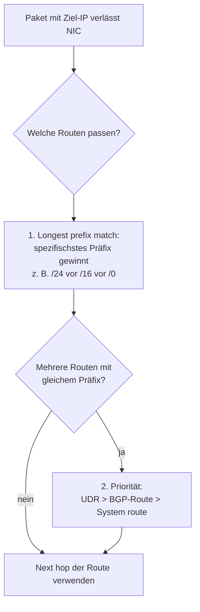
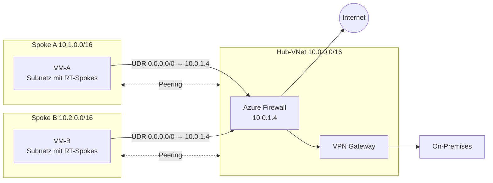

# 4.4 Benutzerdefinierte Routen (UDR)

> **Domäne:** Implement and manage virtual networking · **Gewichtung:** 15–20 %
> **Study-Guide-Punkte:** *Configure user-defined network routes*
> **Stand:** November 2026

## Lernziele

Nach diesem Kapitel kann ich …

- die **System routes** von Azure benennen und erklären, wie Datenverkehr ohne eigene Konfiguration geroutet wird.
- eine **Route Table** erstellen, Routen mit dem passenden **Next hop type** anlegen und sie einem **Subnetz** zuordnen.
- die **Routenauswahl** (Longest prefix match, dann UDR > BGP > System route) auf konkrete Szenarien anwenden.
- ein **NVA-/Azure-Firewall-Szenario** (Hub-and-Spoke, Forced tunneling) mit UDRs und **IP forwarding** umsetzen.
- mit **Effective routes** und **Network Watcher Next hop** Routingprobleme analysieren.

## Überblick

Azure routet Datenverkehr innerhalb eines VNets, zwischen gepeerten VNets, zu On-Premises (über Gateways) und ins Internet **automatisch** über **System routes**. Für viele Szenarien reicht das. Sobald aber Datenverkehr **über eine bestimmte Instanz geleitet** werden soll – etwa eine **Azure Firewall** oder eine **Network Virtual Appliance (NVA)** zur Inspektion – oder bestimmte Ziele **blockiert** werden sollen, braucht man **User-defined routes (UDR)**.

UDRs werden in einer **Route Table** (Ressource `Microsoft.Network/routeTables`) gesammelt und einem oder mehreren **Subnetzen** zugeordnet. Sie wirken auf den **ausgehenden** Verkehr aller NICs in diesem Subnetz und überschreiben bei gleichem Präfix die System routes.

## Kernkonzepte

### System routes (Standardrouten)

Jedes Subnetz erhält automatisch folgende **Default routes**:

| Address prefix | Next hop type | Bedeutung |
|---|---|---|
| Adressraum des VNets (z. B. `10.1.0.0/16`) | **Virtual network** | Verkehr innerhalb des VNets – auch zwischen Subnetzen – wird direkt zugestellt |
| `0.0.0.0/0` | **Internet** | Alles, was keiner anderen Route entspricht, geht ins Internet (Azure-Dienste über das Microsoft-Backbone) |
| `10.0.0.0/8`, `172.16.0.0/12`, `192.168.0.0/16`, `100.64.0.0/10` | **None** | Private/reservierte Bereiche werden **verworfen**, sofern sie nicht zum VNet-Adressraum gehören |

Zusätzlich fügt Azure je nach Konfiguration **optionale System routes** hinzu:

| Auslöser | Next hop type | Hinweis |
|---|---|---|
| **VNet Peering** | **VNet peering** | eine Route pro Adressraum des gepeerten VNets ([4.2](02-vnet-peering.md)) |
| **Virtual network gateway** (VPN/ExpressRoute) | **Virtual network gateway** | per BGP gelernte oder im Local Network Gateway definierte On-Premises-Präfixe |
| **Service Endpoint** am Subnetz | **VirtualNetworkServiceEndpoint** | öffentliche IP-Bereiche des Dienstes ([4.7](07-service-endpoints-und-private-endpoints.md)) |

> System routes können **nicht gelöscht** werden – man kann sie nur durch UDRs (oder BGP-Routen) **überschreiben**.

### Route Table

- Eigenständige Azure-Ressource mit einer Liste von **Routes** (Name, **Address prefix**, **Next hop type**, ggf. **Next hop IP address**).
- Muss in **derselben Region** und **demselben Abonnement** wie das VNet liegen, dessen Subnetzen sie zugeordnet wird.
- **Zuordnung:**
  - Ein Subnetz hat **höchstens eine** Route Table.
  - Eine Route Table kann **mehreren Subnetzen** (auch in verschiedenen VNets derselben Region/desselben Abos) zugeordnet werden.
  - Ein Subnetz ohne Route Table nutzt nur System routes (und BGP-Routen).
- UDRs wirken **pro Subnetz** auf den **ausgehenden** Verkehr – nicht auf einzelne VMs, nicht eingehend.
- **Einschränkungen spezieller Subnetze:**
  - **AzureBastionSubnet:** UDRs werden **nicht unterstützt** ([4.6](06-azure-bastion.md)).
  - **GatewaySubnet:** Eine UDR mit `0.0.0.0/0` und das Deaktivieren der Gateway-Routenweitergabe werden für das GatewaySubnet **nicht unterstützt**; UDRs dort nur mit Bedacht einsetzen.
  - **AzureFirewallSubnet:** Wird dort eine Route Table zugeordnet, muss `0.0.0.0/0` mit Next hop **Internet** erhalten bleiben (Ausnahme: Forced-Tunneling-Konfiguration mit separatem Management-Subnetz).

### Next hop types für UDRs

| Next hop type | Wirkung | Typischer Einsatz |
|---|---|---|
| **Virtual appliance** | Weiterleitung an eine **private IP** (NIC einer NVA, Azure Firewall, oder Frontend-IP eines internen Load Balancers) – **Next hop IP address** erforderlich | Firewall-/Inspektionsszenarien, Hub-and-Spoke |
| **Virtual network gateway** | Weiterleitung an das **VPN-Gateway** des VNets | **Forced tunneling** zu On-Premises |
| **Virtual network** | Überschreibt Routing innerhalb des VNet-Adressraums | z. B. Ausnahme für ein Teilnetz von einer weiter gefassten UDR |
| **Internet** | Explizit ins Internet | Ausnahme von Forced tunneling (z. B. für bestimmte Azure-Präfixe/Service Tags) |
| **None** | Verkehr wird **verworfen** (Blackhole) | Ziele gezielt blockieren |

⚠️ **Nicht** als Next hop in einer UDR wählbar: *VNet peering* und *VirtualNetworkServiceEndpoint* – diese Typen gibt es nur als System route. Ein **ExpressRoute-Gateway** kann nicht als Next hop *Virtual network gateway* einer UDR verwendet werden (nur VPN-Gateways).

**Next hop IP address (Virtual appliance):**
- Muss eine private IP sein, die im **selben VNet** oder in einem **gepeerten VNet** erreichbar ist.
- Bei hochverfügbaren NVAs: Frontend-IP eines **internen Standard Load Balancers** (HA Ports) statt der IP einer einzelnen VM.

### Service Tags als Address prefix

Statt einer CIDR-Adresse kann als *Address prefix* ein **Service Tag** angegeben werden (z. B. `Storage`, `Storage.WestEurope`, `AzureMonitor`, `AzureCloud`). Microsoft pflegt die zugehörigen IP-Bereiche automatisch.
Beispiel: Forced tunneling für alles, aber `AzureMonitor` direkt mit Next hop **Internet**.
Bei gleichem Präfix gilt eine Route mit **explizitem IP-Präfix** vor einer Route mit Service Tag.

### Routenauswahl



1. **Longest prefix match:** Die Route mit dem **spezifischsten** passenden Präfix gewinnt – unabhängig von ihrer Herkunft. Eine System route `10.1.0.0/16` (Virtual network) schlägt also eine UDR `10.0.0.0/8` für Ziele in `10.1.x.x`.
2. **Bei identischem Präfix:** **User-defined route** > **BGP route** > **System route**.

> Sonderfall: System routes für **VNet, VNet Peering und Service Endpoints** werden gegenüber **BGP**-Routen bevorzugt, selbst wenn die BGP-Route spezifischer ist. Gegen UDRs mit gleichem oder spezifischerem Präfix setzen sie sich dagegen nicht durch.

### Propagate gateway routes (BGP route propagation)

- Einstellung an der **Route Table**: *Propagate gateway routes* = **Yes** (Standard) / **No**.
- **No** verhindert, dass vom Virtual network gateway gelernte On-Premises-Routen (BGP oder statisch über Local Network Gateway) in die Subnetze dieser Route Table übernommen werden.
- Typischer Einsatz: Spoke-Subnetze sollen On-Premises **nur über die Firewall im Hub** erreichen – die direkte Gateway-Route würde die Firewall sonst umgehen.

### Forced tunneling

Gesamter Internetverkehr wird **nicht direkt** ins Internet geleitet, sondern zur Inspektion über eine Firewall/NVA oder nach **On-Premises**:

- UDR `0.0.0.0/0` → **Virtual appliance** (z. B. Azure Firewall, die selbst weiter zum Internet oder On-Premises leitet), oder
- UDR `0.0.0.0/0` → **Virtual network gateway** (VPN) bzw. per BGP angekündigte Default-Route von On-Premises.

Folge: VMs mit Public IP sind ggf. nicht mehr wie erwartet erreichbar (asymmetrisches Routing); Azure-Dienste, die direkte Internetverbindung brauchen, benötigen Ausnahmen (Service Tags mit Next hop Internet, Private/Service Endpoints).

### NVA-Szenario und IP forwarding

Damit eine VM als Router/Firewall Pakete weiterleiten darf, die **nicht an ihre eigene IP adressiert** sind:

1. **IP forwarding** an der **NIC** der NVA aktivieren (Azure-Ebene) – sonst verwirft Azure solche Pakete.
2. **IP forwarding im Gast-Betriebssystem** aktivieren (z. B. Linux `net.ipv4.ip_forward=1`, Windows RRAS) bzw. in der NVA-Software konfigurieren.
3. UDRs in den Quell-Subnetzen mit Next hop **Virtual appliance** → IP der NVA.
4. NSGs ([4.5](05-nsg-und-asg.md)) so gestalten, dass der weitergeleitete Verkehr an der NVA erlaubt ist.

Bei der **Azure Firewall** (PaaS) entfällt Schritt 1/2 – Next hop ist die **private IP der Firewall**.

### Hub-and-Spoke

VNet Peering ist **nicht transitiv** ([4.2](02-vnet-peering.md)): Spoke A kann Spoke B über den Hub nicht automatisch erreichen. Lösung:

- In beiden Spokes UDR: Präfix des jeweils anderen Spokes (oder `0.0.0.0/0`) → **Virtual appliance** = private IP der Firewall/NVA im Hub.
- Am Peering *Spoke → Hub* bzw. *Hub → Spoke* **Allow forwarded traffic** aktivieren.
- Optional *Propagate gateway routes = No* in den Spokes, damit On-Premises-Verkehr ebenfalls über die Firewall läuft.

## Zusammenhänge



- **Virtuelle Netzwerke und Subnetze** ([4.1](01-virtuelle-netzwerke-und-subnetze.md)): Route Tables werden Subnetzen zugeordnet; der VNet-Adressraum bestimmt die System route *Virtual network*.
- **VNet Peering** ([4.2](02-vnet-peering.md)): Peering erzeugt System routes; für Transit über einen Hub braucht man UDRs + *Allow forwarded traffic*.
- **NSG/ASG** ([4.5](05-nsg-und-asg.md)): UDRs entscheiden, **wohin** ein Paket geht; NSGs entscheiden, **ob** es erlaubt ist. Beides wird zusammen ausgewertet.
- **Service/Private Endpoints** ([4.7](07-service-endpoints-und-private-endpoints.md)): Service Endpoints erzeugen eigene System routes; bei Forced tunneling helfen Endpoints, Azure-PaaS-Verkehr nicht über On-Premises zu schicken.
- **Load Balancer** ([4.9](09-load-balancer.md)): Interner Standard Load Balancer als Next hop für hochverfügbare NVAs.
- **Troubleshooting** ([4.10](10-netzwerk-troubleshooting.md)): *Effective routes* und **Network Watcher > Next hop** zeigen, welche Route tatsächlich greift.

## Vergleichstabellen

### System route vs. UDR vs. BGP-Route

| Kriterium | System route | User-defined route | BGP-Route |
|---|---|---|---|
| Herkunft | automatisch durch Azure | manuell in Route Table | vom VPN-/ExpressRoute-Gateway gelernt |
| Löschbar | ❌ (nur überschreibbar) | ✅ | über Gateway/On-Premises bzw. *Propagate gateway routes = No* |
| Priorität bei gleichem Präfix | niedrigste | **höchste** | mittel |
| Gültigkeitsbereich | jedes Subnetz | Subnetze mit zugeordneter Route Table | Subnetze mit aktivierter Gateway-Routenweitergabe |

### Next hop types im Überblick

| Next hop type | Als UDR wählbar | Benötigt IP | Verwirft Verkehr |
|---|---|---|---|
| Virtual appliance | ✅ | ✅ | ❌ |
| Virtual network gateway | ✅ (nur VPN-Gateway) | ❌ | ❌ |
| Virtual network | ✅ | ❌ | ❌ |
| Internet | ✅ | ❌ | ❌ |
| None | ✅ | ❌ | ✅ |
| VNet peering | ❌ (nur System route) | – | – |
| VirtualNetworkServiceEndpoint | ❌ (nur System route) | – | – |

### NVA vs. Azure Firewall als Next hop

| Kriterium | NVA (VM eines Drittanbieters) | Azure Firewall |
|---|---|---|
| IP forwarding an NIC nötig | ✅ | ❌ (PaaS) |
| IP forwarding im Gast-OS | ✅ | ❌ |
| Hochverfügbarkeit | selbst (z. B. ILB mit HA Ports) | integriert, zonenredundant möglich |
| Next hop IP | NIC-IP bzw. ILB-Frontend-IP | private IP der Firewall |
| Eigenes Subnetz | frei wählbar | **AzureFirewallSubnet** (mind. /26) |

## Azure Portal

| Aufgabe | Pfad |
|---|---|
| Route Table erstellen | **Portal > Route tables > + Create** (Subscription, RG, Region, Name, **Propagate gateway routes**) |
| Route hinzufügen | **Portal > Route tables > Route Table > Settings > Routes > + Add** |
| Route Table einem Subnetz zuordnen (aus Route Table) | **… > Route Table > Settings > Subnets > + Associate** (VNet + Subnetz wählen) |
| Route Table einem Subnetz zuordnen (aus VNet) | **Portal > Virtual networks > VNet > Settings > Subnets > Subnetz > Route table** |
| Gateway-Routenweitergabe ändern | **… > Route Table > Settings > Configuration > Propagate gateway routes** |
| IP forwarding an NVA-NIC aktivieren | **Portal > Network interfaces > NIC > Settings > IP configurations > Enable IP forwarding** |
| Effektive Routen anzeigen | **Portal > Network interfaces > NIC > Help > Effective routes** (VM muss laufen) |
| Next hop prüfen | **Portal > Network Watcher > Network diagnostic tools > Next hop** (VM, NIC, Quell- und Ziel-IP) |
| *Allow forwarded traffic* am Peering | **Portal > Virtual networks > VNet > Settings > Peerings > Peering > Allow forwarded traffic** |

**Felder beim Anlegen einer Route (*Add route*):**
1. **Route name**
2. **Destination type:** *IP Addresses* oder *Service Tag*
3. **Destination IP addresses/CIDR ranges** bzw. **Destination service tag**
4. **Next hop type:** Virtual network gateway / Virtual network / Internet / Virtual appliance / None
5. **Next hop address** (nur bei *Virtual appliance*)

⚠️ **Nicht änderbar nach Erstellung:** **Region** der Route Table (und damit die Zuordnung nur zu VNets dieser Region). Routen selbst und *Propagate gateway routes* sind jederzeit änderbar.

## Azure CLI & PowerShell

### Azure CLI

```bash
# Route Table ohne Übernahme von Gateway-Routen anlegen
az network route-table create \
  --resource-group <resource-group> \
  --name rt-spokes \
  --location westeurope \
  --disable-bgp-route-propagation true

# Default-Route über die Azure Firewall / NVA
az network route-table route create \
  --resource-group <resource-group> \
  --route-table-name rt-spokes \
  --name default-via-fw \
  --address-prefix 0.0.0.0/0 \
  --next-hop-type VirtualAppliance \
  --next-hop-ip-address 10.0.1.4

# Ziel blockieren (Blackhole)
az network route-table route create \
  --resource-group <resource-group> \
  --route-table-name rt-spokes \
  --name block-legacy \
  --address-prefix 192.168.50.0/24 \
  --next-hop-type None

# Ausnahme per Service Tag direkt ins Internet
az network route-table route create \
  --resource-group <resource-group> \
  --route-table-name rt-spokes \
  --name azuremonitor-direct \
  --address-prefix AzureMonitor \
  --next-hop-type Internet

# Route Table einem Subnetz zuordnen
az network vnet subnet update \
  --resource-group <resource-group> \
  --vnet-name vnet-spoke-a \
  --name snet-app \
  --route-table rt-spokes

# IP forwarding an der NIC einer NVA aktivieren
az network nic update \
  --resource-group <resource-group> \
  --name nic-nva01 \
  --ip-forwarding true

# Effektive Routen einer NIC anzeigen (VM muss laufen)
az network nic show-effective-route-table \
  --resource-group <resource-group> \
  --name nic-vm-a \
  -o table

# Next hop mit Network Watcher prüfen
az network watcher show-next-hop \
  --resource-group <resource-group> \
  --vm vm-a \
  --source-ip 10.1.1.4 \
  --dest-ip 10.2.1.4
```

### Az PowerShell

```powershell
# Route Table anlegen (Gateway-Routen nicht übernehmen)
$rt = New-AzRouteTable -Name "rt-spokes" -ResourceGroupName "<resource-group>" `
  -Location "westeurope" -DisableBgpRoutePropagation

# Route hinzufügen und speichern
Add-AzRouteConfig -RouteTable $rt -Name "default-via-fw" `
  -AddressPrefix "0.0.0.0/0" -NextHopType "VirtualAppliance" -NextHopIpAddress "10.0.1.4" |
  Set-AzRouteTable

# Route Table einem Subnetz zuordnen
$vnet = Get-AzVirtualNetwork -Name "vnet-spoke-a" -ResourceGroupName "<resource-group>"
$rt   = Get-AzRouteTable -Name "rt-spokes" -ResourceGroupName "<resource-group>"
Set-AzVirtualNetworkSubnetConfig -VirtualNetwork $vnet -Name "snet-app" `
  -AddressPrefix "10.1.1.0/24" -RouteTable $rt | Set-AzVirtualNetwork

# IP forwarding an der NVA-NIC aktivieren
$nic = Get-AzNetworkInterface -Name "nic-nva01" -ResourceGroupName "<resource-group>"
$nic.EnableIPForwarding = $true
$nic | Set-AzNetworkInterface

# Effektive Routen anzeigen
Get-AzEffectiveRouteTable -NetworkInterfaceName "nic-vm-a" -ResourceGroupName "<resource-group>" |
  Format-Table AddressPrefix, NextHopType, NextHopIpAddress, Source, State
```

> Hinweis: `Set-AzVirtualNetworkSubnetConfig` erwartet das bestehende **AddressPrefix** des Subnetzes – sonst schlägt der Befehl fehl bzw. würde das Präfix ändern.

| Ziel | CLI | PowerShell |
|---|---|---|
| Route Table anlegen | `az network route-table create` | `New-AzRouteTable` |
| Route anlegen | `az network route-table route create` | `Add-AzRouteConfig` + `Set-AzRouteTable` |
| Subnetz zuordnen | `az network vnet subnet update --route-table` | `Set-AzVirtualNetworkSubnetConfig -RouteTable` + `Set-AzVirtualNetwork` |
| IP forwarding | `az network nic update --ip-forwarding true` | `$nic.EnableIPForwarding = $true` + `Set-AzNetworkInterface` |
| Effektive Routen | `az network nic show-effective-route-table` | `Get-AzEffectiveRouteTable` |

## Praxisbeispiel

**Szenario:** *Contoso* betreibt ein Hub-and-Spoke-Netz in *West Europe*:

- Hub `vnet-hub` (`10.0.0.0/16`) mit **Azure Firewall** (private IP `10.0.1.4`) und **VPN-Gateway** zu On-Premises (`192.168.0.0/16`)
- Spoke A `vnet-spoke-a` (`10.1.0.0/16`), Spoke B `vnet-spoke-b` (`10.2.0.0/16`), jeweils mit dem Hub gepeert

**Anforderungen:**
1. Spoke A und Spoke B sollen miteinander kommunizieren – kontrolliert durch die Firewall.
2. Internetverkehr aus den Spokes soll über die Firewall laufen.
3. Verkehr nach On-Premises soll ebenfalls die Firewall passieren, nicht direkt das Gateway.

**Umsetzung:**

1. **Route Table** `rt-spokes` in *West Europe* erstellen, **Propagate gateway routes = No** (Anforderung 3 – sonst würden Spokes die On-Premises-Präfixe direkt mit Next hop *Virtual network gateway* lernen, vorausgesetzt *Use remote gateways* ist am Peering aktiv).
2. Routen in `rt-spokes` anlegen, alle mit Next hop **Virtual appliance** `10.0.1.4`:
   - `default-via-fw`: `0.0.0.0/0` (Internet, Anforderung 2)
   - `to-spoke-a`: `10.1.0.0/16` und `to-spoke-b`: `10.2.0.0/16` (Spoke-zu-Spoke, Anforderung 1 – im jeweils eigenen Spoke greift für den eigenen Adressraum weiterhin die spezifischere System route *Virtual network*)
   - `to-onprem`: `192.168.0.0/16` (Anforderung 3)
   Explizite Präfixe machen das Routing eindeutig und unabhängig davon, welche weniger spezifischen System routes (z. B. die reservierten Präfixe mit *None*) sonst greifen würden.
3. `rt-spokes` den Workload-Subnetzen beider Spokes **zuordnen** (*Subnets > + Associate*).
4. An den Peerings **Allow forwarded traffic** aktivieren.
5. Im Hub: Route Table für das **GatewaySubnet** mit Routen `10.1.0.0/16` und `10.2.0.0/16` → `10.0.1.4`, damit Antwortverkehr von On-Premises ebenfalls die Firewall passiert (symmetrisches Routing).
6. In der **Azure Firewall** Netzwerk- und Anwendungsregeln für die erlaubten Flüsse anlegen.
7. **Prüfen:** VM in Spoke A → *Network interface > Effective routes*: `0.0.0.0/0` → *Virtual appliance 10.0.1.4*, Quelle *User*. Zusätzlich **Network Watcher > Next hop** von `10.1.1.4` nach `10.2.1.4` → Ergebnis *VirtualAppliance 10.0.1.4*.

## Limits & wichtige Zahlen

| Wert | Grenze / Standard |
|---|---|
| Routes pro Route Table | **400** |
| Route Tables pro Region und Abonnement | ca. **200** (aktuelle Werte prüfen) |
| Route Tables pro Subnetz | **1** |
| Subnetze pro Route Table | mehrere (gleiche Region + gleiches Abo) |
| Priorität bei gleichem Präfix | **UDR > BGP > System route** |
| Reservierte Präfixe mit Next hop *None* | `10.0.0.0/8`, `172.16.0.0/12`, `192.168.0.0/16`, `100.64.0.0/10` |
| AzureFirewallSubnet | mind. **/26** |

Aktuelle Werte: [Azure subscription and service limits – Networking](https://learn.microsoft.com/azure/azure-resource-manager/management/azure-subscription-service-limits#azure-networking-limits).

## Prüfungstipps & Fallstricke

- ⚠️ **Longest prefix match zuerst!** Eine UDR gewinnt nur bei **gleichem oder spezifischerem** Präfix. Eine UDR `0.0.0.0/0` überschreibt **nicht** die System route für den eigenen VNet-Adressraum – Verkehr zwischen Subnetzen desselben VNets geht weiter direkt, außer man legt UDRs mit den Subnetzpräfixen an.
- ⚠️ **NVA leitet nicht weiter** → **IP forwarding** an der **NIC** fehlt (und/oder im Gast-OS).
- ⚠️ **Spoke-zu-Spoke über den Hub** funktioniert nicht → Peering ist nicht transitiv; UDRs mit Next hop *Virtual appliance* + **Allow forwarded traffic** nötig.
- **„Gesamter Internetverkehr soll über On-Premises / Firewall laufen"** → **Forced tunneling** mit UDR `0.0.0.0/0` → *Virtual network gateway* bzw. *Virtual appliance*.
- **„Verkehr zu einem Präfix soll verworfen werden"** → Next hop **None**.
- **„Spokes sollen On-Premises-Routen vom Gateway nicht lernen"** → *Propagate gateway routes* = **No** an der Route Table.
- ⚠️ **AzureBastionSubnet** unterstützt **keine** UDRs; **GatewaySubnet** keine `0.0.0.0/0`-UDR.
- ⚠️ Route Table und VNet müssen in **derselben Region** und im **selben Abonnement** liegen.
- **Welche Route greift tatsächlich?** → **Effective routes** an der NIC (VM muss laufen) bzw. **Network Watcher > Next hop**.
- UDRs wirken auf **ausgehenden** Verkehr eines **Subnetzes** – nicht pro VM und nicht eingehend. Für Rückwege (symmetrisches Routing) braucht man ggf. Route Tables auf der Gegenseite (z. B. GatewaySubnet).
- *VNet peering* und *VirtualNetworkServiceEndpoint* sind **keine** wählbaren Next hop types für UDRs.

## Selbsttest

**1.** Ein Subnetz hat eine UDR `0.0.0.0/0` → Virtual appliance `10.0.1.4`. Eine VM in `10.1.1.0/24` sendet an eine VM in `10.1.2.0/24` (gleiches VNet `10.1.0.0/16`). Über welchen Next hop läuft der Verkehr?

<details><summary>Lösung</summary>

**Virtual network** (direkt). Die System route `10.1.0.0/16` ist spezifischer als `0.0.0.0/0` und gewinnt per **Longest prefix match**. Soll der Verkehr über die NVA, braucht man eine UDR z. B. `10.1.2.0/24` → Virtual appliance.
</details>

**2.** Für das Präfix `10.5.0.0/16` existieren eine System route (VNet peering), eine BGP-Route und eine UDR (Virtual appliance). Welche wird verwendet?

<details><summary>Lösung</summary>

Die **UDR** – bei identischem Präfix gilt UDR > BGP > System route.
</details>

**3.** Sie haben eine Linux-VM als Firewall eingerichtet und UDRs angelegt, die Verkehr an ihre IP schicken. Pakete kommen an der VM an, werden aber nicht weitergeleitet. Was fehlt in Azure?

<details><summary>Lösung</summary>

**IP forwarding** an der **Netzwerkschnittstelle (NIC)** der VM aktivieren (zusätzlich `net.ipv4.ip_forward=1` im Gast-OS).
</details>

**4.** Sie wollen einer Route Table zwei Subnetze aus verschiedenen VNets zuordnen. Ein VNet liegt in *West Europe*, das andere in *North Europe*. Ist das möglich?

<details><summary>Lösung</summary>

**Nein.** Route Table und VNet müssen in **derselben Region** (und im selben Abonnement) liegen. Für North Europe ist eine eigene Route Table nötig.
</details>

**5.** Spoke-VNets sind mit einem Hub gepeert, der ein VPN-Gateway hat (*Use remote gateways* aktiv). On-Premises-Verkehr aus den Spokes soll über die Azure Firewall im Hub laufen, geht aber direkt über das Gateway. Was ändern Sie?

<details><summary>Lösung</summary>

An der Route Table der Spoke-Subnetze **Propagate gateway routes = No** setzen und eine UDR für die On-Premises-Präfixe → **Virtual appliance** (Firewall-IP) anlegen.
</details>

**6.** Der Zugriff auf das Netz `172.20.0.0/16` soll aus einem Subnetz vollständig unterbunden werden, ohne eine NVA einzusetzen. Welche Lösung (ohne NSG) ist möglich?

<details><summary>Lösung</summary>

UDR `172.20.0.0/16` mit Next hop **None** – der Verkehr wird verworfen.
</details>

**7.** Sie möchten Ihrer Route Table eine Route mit Next hop *VNet peering* hinzufügen. Warum ist die Option nicht verfügbar?

<details><summary>Lösung</summary>

*VNet peering* (ebenso *VirtualNetworkServiceEndpoint*) existiert nur als **System route**. Für UDRs stehen nur *Virtual network gateway, Virtual network, Internet, Virtual appliance* und *None* zur Verfügung.
</details>

**8.** Ein Administrator will prüfen, welche Route für den Verkehr von einer VM zu `8.8.8.8` tatsächlich greift. Welche zwei Werkzeuge eignen sich?

<details><summary>Lösung</summary>

**Effective routes** an der NIC der (laufenden) VM und **Network Watcher > Next hop** ([4.10](10-netzwerk-troubleshooting.md)).
</details>

**9.** Sie ordnen dem **AzureBastionSubnet** eine Route Table mit `0.0.0.0/0` → Firewall zu. Was ist das Problem?

<details><summary>Lösung</summary>

UDRs werden im **AzureBastionSubnet nicht unterstützt** – Azure Bastion benötigt direkte Verbindungen; die Zuordnung ist nicht zulässig bzw. bricht Bastion.
</details>

## Weiterführende Links

- [AZ-104 Study Guide](https://learn.microsoft.com/credentials/certifications/resources/study-guides/az-104)
- [Virtual network traffic routing](https://learn.microsoft.com/azure/virtual-network/virtual-networks-udr-overview)
- [Create, change, or delete a route table](https://learn.microsoft.com/azure/virtual-network/manage-route-table)
- [Tutorial: Route network traffic with a route table](https://learn.microsoft.com/azure/virtual-network/tutorial-create-route-table-portal)
- [Enable or disable IP forwarding](https://learn.microsoft.com/azure/virtual-network/virtual-network-network-interface#enable-or-disable-ip-forwarding)
- [Diagnose a VM routing problem (effective routes)](https://learn.microsoft.com/azure/virtual-network/diagnose-network-routing-problem)
- [Network Watcher next hop](https://learn.microsoft.com/azure/network-watcher/network-watcher-next-hop-overview)
- [Hub-spoke network topology in Azure](https://learn.microsoft.com/azure/architecture/networking/architecture/hub-spoke)
- [Azure Firewall forced tunneling](https://learn.microsoft.com/azure/firewall/forced-tunneling)
- [Azure networking limits](https://learn.microsoft.com/azure/azure-resource-manager/management/azure-subscription-service-limits#azure-networking-limits)
