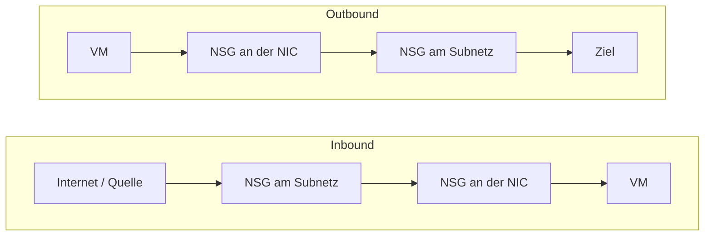
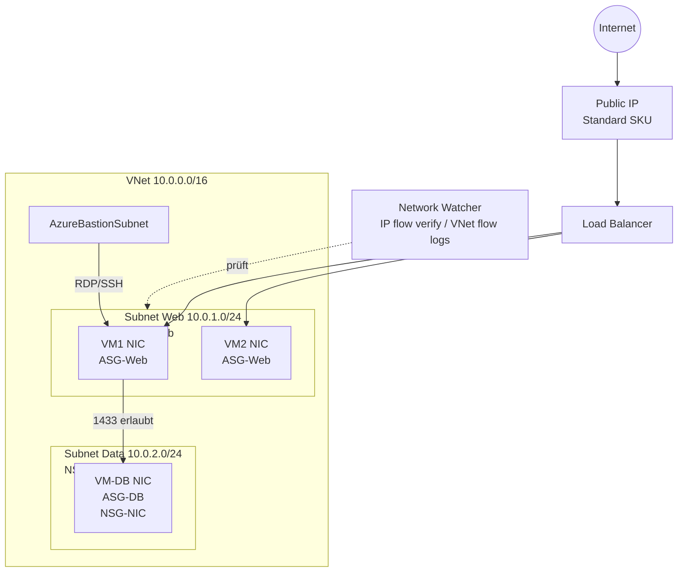

# 4.5 Network Security Groups und Application Security Groups

> **Domäne:** Implement and manage virtual networking · **Gewichtung:** 15–20 %
> **Study-Guide-Punkte:** *Create and configure network security groups (NSGs) and application security groups* · *Evaluate effective security rules in NSGs*
> **Stand:** November 2026

## Lernziele

Nach diesem Kapitel kann ich …

- eine **Network Security Group (NSG)** anlegen, Regeln mit Priorität, Quelle/Ziel, Ports, Protokoll und Aktion konfigurieren und die NSG einem **Subnetz** und/oder einer **NIC** zuordnen.
- die **Default rules** benennen und erklären, warum sie nicht gelöscht, aber überschrieben werden können.
- die **Auswertungsreihenfolge** von Subnetz- und NIC-NSG für eingehenden und ausgehenden Verkehr anwenden und das Ergebnis für ein konkretes Szenario bestimmen.
- **Service Tags** und **Application Security Groups (ASGs)** sinnvoll einsetzen, um Regeln einfach und wartbar zu halten.
- die **effektiven Sicherheitsregeln** einer NIC auswerten und Verbindungsprobleme mit **IP flow verify** eingrenzen.
- NSG gegen **Azure Firewall** und **Security admin rules** von Azure Virtual Network Manager abgrenzen.

## Überblick

Eine **Network Security Group (NSG)** ist eine verteilte, zustandsbehaftete (*stateful*) Paketfilter-Firewall auf **Layer 3/4**. Sie enthält eine Liste von Sicherheitsregeln, die eingehenden (*Inbound*) und ausgehenden (*Outbound*) Verkehr anhand von **5-Tupel-Informationen** (Quell-IP, Quellport, Ziel-IP, Zielport, Protokoll) erlauben oder verweigern.

NSGs werden an **Subnetze** und/oder **Netzwerkschnittstellen (NICs)** gebunden und filtern Verkehr zwischen Azure-Ressourcen in einem VNet, zwischen VNets und zum/vom Internet. Sie kosten **nichts** extra und sind das wichtigste Werkzeug der Netzwerksegmentierung in Azure.

**Application Security Groups (ASGs)** ergänzen NSGs: Statt IP-Adressen in Regeln zu pflegen, gruppiert man NICs logisch nach ihrer Rolle (z. B. „Web", „App", „DB") und verwendet diese Gruppen als Quelle oder Ziel einer Regel.

## Kernkonzepte

### Aufbau einer Sicherheitsregel

| Eigenschaft | Bedeutung |
|---|---|
| **Name** | Eindeutig innerhalb der NSG |
| **Priority** | **100–4096**. ⚠️ **Niedrigere Zahl = höhere Priorität.** Die Auswertung stoppt bei der **ersten** passenden Regel. Jede Priorität darf pro Richtung nur einmal vorkommen. |
| **Source / Destination** | **Any**, **IP Addresses** (einzelne IP oder CIDR, auch mehrere), **Service Tag**, **Application security group**; bei Inbound als Ziel auch *My IP address* im Portal |
| **Source port ranges / Destination port ranges** | Einzelner Port (`443`), Bereich (`1024-65535`), Liste (`80,443`) oder `*` |
| **Protocol** | **TCP**, **UDP**, **ICMP**, **Any** (im Portal zusätzlich ESP/AH je nach Version) |
| **Action** | **Allow** oder **Deny** |
| **Direction** | **Inbound** oder **Outbound** |

**Augmented security rules:** Eine Regel kann **mehrere IP-Adressen/Präfixe, mehrere Ports und Portbereiche** sowie Service Tags/ASGs enthalten. Das reduziert die Anzahl der Regeln erheblich.

### Zustandsbehaftet (*stateful*)

Erlaubt eine Inbound-Regel eine Verbindung (z. B. TCP 443 aus dem Internet), wird der **Rückverkehr automatisch erlaubt** – es ist **keine** passende Outbound-Regel nötig. Dasselbe gilt umgekehrt für ausgehend initiierte Verbindungen.

⚠️ Eine Änderung an einer Regel wirkt nur auf **neue** Verbindungen; bestehende Flows werden nicht sofort unterbrochen.

### Default rules

Jede NSG enthält automatisch sechs Standardregeln mit den Prioritäten 65000–65500. Sie **können nicht gelöscht oder geändert**, aber durch eigene Regeln mit **niedrigerer Prioritätszahl überschrieben** werden.

**Inbound:**

| Priorität | Name | Quelle | Ziel | Aktion |
|---|---|---|---|---|
| 65000 | **AllowVnetInBound** | VirtualNetwork | VirtualNetwork | Allow |
| 65001 | **AllowAzureLoadBalancerInBound** | AzureLoadBalancer | Any | Allow |
| 65500 | **DenyAllInBound** | Any | Any | Deny |

**Outbound:**

| Priorität | Name | Quelle | Ziel | Aktion |
|---|---|---|---|---|
| 65000 | **AllowVnetOutBound** | VirtualNetwork | VirtualNetwork | Allow |
| 65001 | **AllowInternetOutBound** | Any | Internet | Allow |
| 65500 | **DenyAllOutBound** | Any | Any | Deny |

Konsequenzen:

- Innerhalb des VNets (und zu gepeerten VNets / über VPN verbundenen Netzen – alles im Tag `VirtualNetwork`) ist Verkehr standardmäßig **erlaubt**.
- Aus dem Internet ist eingehender Verkehr standardmäßig **verboten**.
- Ausgehend ins Internet ist standardmäßig **erlaubt**.
- Health Probes des Azure Load Balancers sind erlaubt ([4.9](09-load-balancer.md)).

### Zuordnung: Subnetz und NIC

- Eine NSG kann an **Subnetze** und/oder **NICs** gebunden werden.
- ⚠️ Jedes Subnetz und jede NIC hat **höchstens eine** NSG. Eine NSG kann aber an **viele** Subnetze/NICs gebunden sein.
- Die NSG muss in **derselben Region** wie das Subnetz/die NIC liegen (Ressourcengruppe darf abweichen).
- **Ohne NSG** (weder am Subnetz noch an der NIC) ist **jeglicher Verkehr erlaubt** – sofern nicht andere Mechanismen greifen (z. B. ist eine **Standard-SKU Public IP** „secure by default" und lässt eingehenden Verkehr nur zu, wenn eine NSG ihn erlaubt → [4.3](03-oeffentliche-ip-adressen.md)).
- Manche Subnetze unterliegen Sonderregeln, z. B. erfordert **AzureBastionSubnet** bei zugeordneter NSG bestimmte Pflichtregeln ([4.6](06-azure-bastion.md)); das **GatewaySubnet** sollte keine NSG erhalten.

### Auswertungsreihenfolge



- **Inbound:** erst **Subnetz-NSG**, dann **NIC-NSG**.
- **Outbound:** erst **NIC-NSG**, dann **Subnetz-NSG**.
- ⚠️ **Beide** NSGs müssen den Verkehr **erlauben**. Ein **Deny** in einer der beiden NSGs blockiert. Fehlt eine der beiden NSGs, entscheidet nur die vorhandene.
- **Intra-subnet traffic:** Auch Verkehr zwischen zwei VMs **im selben Subnetz** wird von der Subnetz-NSG gefiltert. Eine Deny-Regel am Subnetz kann also die Kommunikation zwischen Nachbar-VMs blockieren.

#### Rechenbeispiel

Ausgangslage: `VM1` (10.0.1.4) in `Subnet1`. NSG `NSG-Subnet1` am Subnetz, NSG `NSG-VM1` an der NIC von VM1.

| NSG | Regel | Priorität | Quelle | Port | Aktion |
|---|---|---|---|---|---|
| NSG-Subnet1 | Allow-HTTP | 100 | Internet | 80 | Allow |
| NSG-Subnet1 | Allow-RDP-Admin | 110 | 203.0.113.10 | 3389 | Allow |
| NSG-Subnet1 | Deny-RDP | 200 | Any | 3389 | Deny |
| NSG-VM1 | Allow-HTTPS | 100 | Internet | 443 | Allow |
| NSG-VM1 | Allow-RDP | 120 | Any | 3389 | Allow |
| NSG-VM1 | Deny-HTTP | 150 | Internet | 80 | Deny |

Ergebnis für eingehende Verbindungen zu VM1:

| Verbindung | NSG-Subnet1 (zuerst) | NSG-VM1 (danach) | **Ergebnis** |
|---|---|---|---|
| Internet → TCP 80 | Allow (100) | **Deny** (150) | ❌ blockiert |
| Internet → TCP 443 | keine eigene Regel → DenyAllInBound (65500) | (wird nicht mehr erreicht) | ❌ blockiert |
| 203.0.113.10 → TCP 3389 | Allow (110 – vor 200) | Allow (120) | ✅ erlaubt |
| 198.51.100.7 → TCP 3389 | **Deny** (200) | – | ❌ blockiert |
| VM2 (10.0.1.5, gleiches Subnetz) → TCP 3389 | **Deny** (200, Any umfasst auch VNet-Adressen; greift vor AllowVnetInBound 65000) | – | ❌ blockiert |
| VM2 → TCP 1433 | AllowVnetInBound (65000) | AllowVnetInBound (65000) | ✅ erlaubt |

Lehre: Für HTTPS fehlt eine Allow-Regel in der **Subnetz**-NSG; für HTTP blockiert die **NIC**-NSG.

### Service Tags

Ein **Service Tag** ist eine von Microsoft gepflegte Gruppe von IP-Präfixen eines Azure-Dienstes. Man verwendet ihn als Quelle oder Ziel; Microsoft aktualisiert die Adressen automatisch.

| Service Tag | Umfasst |
|---|---|
| **VirtualNetwork** | Adressraum des VNets, gepeerte VNets, über VPN/ExpressRoute verbundene Netze, UDR-Präfixe bestimmter Konfigurationen |
| **Internet** | Öffentliche IP-Adressen außerhalb des VNets (inkl. öffentlicher Azure-Adressen) |
| **AzureLoadBalancer** | Infrastruktur-Adresse des Azure Load Balancers (Health Probes, `168.63.129.16`) |
| **Storage** | Azure Storage (global) |
| **Storage.WestEurope** | Azure Storage nur in West Europe (**regionaler Tag**) |
| **Sql** / **Sql.GermanyWestCentral** | Azure SQL Database (global bzw. regional) |
| **AzureCloud** | Alle öffentlichen IP-Adressen von Azure-Rechenzentren (optional regional) |
| **AzureMonitor**, **AzureKeyVault**, **AzureActiveDirectory**, **AppService** … | weitere Dienste |

Typische Verwendung: Outbound nur zu `Storage.WestEurope` erlauben und `Internet` verbieten.

### Application Security Groups (ASGs)

- Eine **ASG** ist eine logische Gruppierung von **NICs** (genauer: IP-Konfigurationen von NICs).
- ASGs werden in NSG-Regeln als **Source** und/oder **Destination** verwendet.
- Neue VMs werden durch Zuordnung zur ASG automatisch von den passenden Regeln erfasst – **keine IP-Pflege**.
- ⚠️ Alle NICs einer ASG müssen sich im **selben VNet** befinden. Werden in einer Regel ASGs als Quelle **und** Ziel verwendet, müssen alle beteiligten NICs im selben VNet liegen.
- ASGs filtern selbst nichts – sie wirken nur über NSG-Regeln.
- Eine NIC kann Mitglied **mehrerer** ASGs sein.

**Beispiel 3-Tier-Anwendung:**

| Priorität | Quelle | Ziel | Port | Aktion |
|---|---|---|---|---|
| 100 | Internet | **ASG-Web** | 443 | Allow |
| 110 | **ASG-Web** | **ASG-App** | 8080 | Allow |
| 120 | **ASG-App** | **ASG-DB** | 1433 | Allow |
| 4000 | VirtualNetwork | VirtualNetwork | Any | Deny |

Alle VMs können im **selben Subnetz** liegen – die Segmentierung erfolgt über ASGs statt über Subnetze.

### Effective security rules

Wenn eine NIC von zwei NSGs (Subnetz + NIC) betroffen ist, zeigt **Effective security rules** die **zusammengeführte, aufgelöste** Sicht inklusive aufgelöster Service Tags und ASGs.

- Pfad: **VM > Networking > Network settings > Effective security rules** bzw. **NIC > Effective security rules**
- ⚠️ Die VM muss **laufen**, damit effektive Regeln angezeigt werden können.
- Ergänzend: **Network Watcher > IP flow verify** prüft für ein konkretes 5-Tupel, ob Verkehr erlaubt oder verweigert wird und **welche Regel** greift; **NSG diagnostics** analysiert alle NSGs auf dem Pfad ([4.10](10-netzwerk-troubleshooting.md), [5.3](../05-monitoring-und-wartung/03-insights-und-network-watcher.md)).

### Protokollierung: NSG Flow Logs → VNet Flow Logs

- **NSG flow logs** protokollierten den Verkehr pro NSG in ein Speicherkonto. Sie sind **abgekündigt**: Neue NSG Flow Logs können seit Mitte 2025 nicht mehr erstellt werden, die Einstellung erfolgt bis **September 2027**.
- Nachfolger sind **VNet flow logs** (Ebene VNet/Subnetz/NIC), konfiguriert über **Network Watcher**, optional mit **Traffic analytics** in Log Analytics.

### Weitere Hinweise

- Ausgehender SMTP-Verkehr auf **TCP 25** wird von Azure für die meisten Abonnementtypen plattformseitig blockiert – unabhängig von NSG-Regeln.
- Die Plattformadresse `168.63.129.16` (DHCP, DNS, Health Probes, VM-Agent) ist für die Funktion der VM wichtig; die Default rule für `AzureLoadBalancer` erlaubt Health Probes. Eigene Deny-Regeln sollten diesen Verkehr nicht versehentlich blockieren.

## Zusammenhänge



- **VNets und Subnetze** ([4.1](01-virtuelle-netzwerke-und-subnetze.md)): NSGs werden an Subnetze gebunden; die Subnetzplanung bestimmt die Segmentierung.
- **Öffentliche IP-Adressen** ([4.3](03-oeffentliche-ip-adressen.md)): Standard-SKU-IPs sind ohne erlaubende NSG-Regel eingehend geschlossen.
- **Azure Bastion** ([4.6](06-azure-bastion.md)): Bastion ersetzt öffentliche RDP/SSH-Regeln; das AzureBastionSubnet hat eigene NSG-Anforderungen.
- **Service Endpoints und Private Endpoints** ([4.7](07-service-endpoints-und-private-endpoints.md)): Service Tags (z. B. `Storage`) in Outbound-Regeln; für Private Endpoints können NSG-Regeln über die Subnetz-Einstellung *Private endpoint network policies* wirksam gemacht werden.
- **Load Balancer** ([4.9](09-load-balancer.md)): Die Default rule `AllowAzureLoadBalancerInBound` erlaubt Health Probes; Client-Verkehr muss explizit erlaubt werden.
- **Troubleshooting** ([4.10](10-netzwerk-troubleshooting.md)): IP flow verify, NSG diagnostics, Effective security rules.
- **Virtuelle Maschinen** ([3.2](../03-compute/02-virtuelle-maschinen.md)): Beim Erstellen einer VM legt der Assistent optional eine NIC-NSG an (*NIC network security group: Basic/Advanced*, *Public inbound ports*).
- **RBAC** ([1.3](../01-identitaeten-und-governance/03-rbac-zugriffsverwaltung.md)): Rolle **Network Contributor** zum Verwalten von NSGs.
- **Azure Policy** ([1.4](../01-identitaeten-und-governance/04-azure-policy.md)): z. B. erzwingen, dass jedes Subnetz eine NSG hat.

## Vergleichstabellen

### NSG vs. ASG vs. Azure Firewall vs. Security admin rules

| Option | Eigenschaft | Einsatzzweck | Einschränkungen |
|---|---|---|---|
| **NSG** | Verteilter L3/L4-Filter, stateful, kostenlos, an Subnetz/NIC | Segmentierung innerhalb/zwischen Subnetzen, Grundschutz | Kein FQDN-Filter, keine Anwendungs­erkennung, keine zentrale Verwaltung über viele VNets |
| **ASG** | Logische Gruppe von NICs | Regeln nach Anwendungsrolle statt IP | Filtert nicht selbst; nur innerhalb eines VNets |
| **Azure Firewall** | Verwalteter, zentraler Firewall-Dienst (L3–L7), stateful, hochverfügbar | Zentrale Hub-Firewall, FQDN-Filter, Threat Intelligence, DNAT/SNAT, TLS-Inspektion (Premium) | Kostenpflichtig; Verkehr muss per **UDR** hingeleitet werden ([4.4](04-benutzerdefinierte-routen.md)) |
| **Security admin rules** (Azure Virtual Network Manager) | Zentrale Regeln für viele VNets, werden **vor** NSGs ausgewertet | Organisationsweite Leitplanken (z. B. „RDP aus dem Internet immer verbieten") | Erfordert AVNM; Aktionen *Allow*, *Deny*, *Always Allow* |

### Subnetz-NSG vs. NIC-NSG

| Kriterium | NSG am Subnetz | NSG an der NIC |
|---|---|---|
| Wirkungsbereich | alle Ressourcen im Subnetz | nur diese NIC |
| Inbound-Reihenfolge | **zuerst** | danach |
| Outbound-Reihenfolge | danach | **zuerst** |
| Verwaltungsaufwand | gering | hoch bei vielen VMs |
| Empfehlung | Standard (Best Practice) | nur für Ausnahmen einzelner VMs |

### Default rules – was ist ohne eigene Regeln erlaubt?

| Verkehr | Ohne eigene Regeln |
|---|---|
| VNet ↔ VNet (inkl. Peering/VPN) | ✅ erlaubt |
| Load-Balancer-Health-Probes eingehend | ✅ erlaubt |
| Internet → VM | ❌ verboten |
| VM → Internet | ✅ erlaubt |

## Azure Portal

| Aufgabe | Pfad |
|---|---|
| NSG erstellen | **Portal > Network security groups > + Create** (Subscription, RG, Name, Region) |
| Inbound-Regel hinzufügen | **Portal > Network security groups > NSG > Settings > Inbound security rules > + Add** |
| Outbound-Regel hinzufügen | **… > NSG > Settings > Outbound security rules > + Add** |
| Default rules anzeigen | **… > Inbound/Outbound security rules** (Schalter *Hide default rules*) |
| NSG einem Subnetz zuordnen | **… > NSG > Settings > Subnets > + Associate** oder **Virtual networks > VNet > Subnets > Subnetz > Network security group** |
| NSG einer NIC zuordnen | **… > NSG > Settings > Network interfaces > + Associate** oder **Network interfaces > NIC > Network security group** |
| NSG beim VM-Erstellen | **Virtual machines > Create > Networking > NIC network security group: None / Basic / Advanced** |
| ASG erstellen | **Portal > Application security groups > + Create** |
| NIC einer ASG zuordnen | **Virtual machines > VM > Networking > Network settings > Application security groups** bzw. **NIC > Application security groups > + Add application security groups** |
| ASG in Regel nutzen | Regel-Dialog: **Source / Destination = Application security group** |
| Effektive Regeln | **Virtual machines > VM > Networking > Network settings > Effective security rules** bzw. **Network interfaces > NIC > Help > Effective security rules** |
| IP flow verify | **Portal > Network Watcher > Network diagnostic tools > IP flow verify** |
| NSG diagnostics | **Portal > Network Watcher > Network diagnostic tools > NSG diagnostics** |
| VNet flow logs | **Portal > Network Watcher > Logs > Flow logs > + Create** |

**Felder im Dialog *Add inbound security rule*:** Source (Any / IP Addresses / My IP address / Service Tag / Application security group), Source port ranges, Destination (Any / IP Addresses / Service Tag / Application security group), Service (Vorlage wie HTTP, HTTPS, RDP, SSH, MS SQL …), Destination port ranges, Protocol, Action, Priority, Name, Description.

⚠️ **Nicht änderbar nach der Erstellung:** **Region** der NSG/ASG. Regelnamen sind ebenfalls fix (Regel löschen und neu anlegen). Alle anderen Regeleigenschaften inkl. Priorität sind änderbar.

## Azure CLI & PowerShell

### Azure CLI

```bash
# NSG erstellen
az network nsg create --resource-group <resource-group> --name NSG-Web --location westeurope

# Inbound-Regel: HTTPS aus dem Internet erlauben
az network nsg rule create --resource-group <resource-group> --nsg-name NSG-Web \
  --name Allow-HTTPS --priority 100 --direction Inbound --access Allow \
  --protocol Tcp --source-address-prefixes Internet --source-port-ranges '*' \
  --destination-address-prefixes '*' --destination-port-ranges 443

# Augmented Rule: RDP nur von zwei Admin-Netzen
az network nsg rule create --resource-group <resource-group> --nsg-name NSG-Web \
  --name Allow-RDP-Admins --priority 110 --direction Inbound --access Allow \
  --protocol Tcp --source-address-prefixes 203.0.113.0/28 198.51.100.10 \
  --destination-port-ranges 3389

# Outbound: Internet verbieten, nur Storage in West Europe erlauben
az network nsg rule create --resource-group <resource-group> --nsg-name NSG-Web \
  --name Allow-Storage-WE --priority 100 --direction Outbound --access Allow \
  --protocol Tcp --destination-address-prefixes Storage.WestEurope --destination-port-ranges 443
az network nsg rule create --resource-group <resource-group> --nsg-name NSG-Web \
  --name Deny-Internet --priority 200 --direction Outbound --access Deny \
  --protocol '*' --destination-address-prefixes Internet --destination-port-ranges '*'

# NSG einem Subnetz zuordnen
az network vnet subnet update --resource-group <resource-group> --vnet-name VNet-Prod \
  --name Subnet-Web --network-security-group NSG-Web

# NSG einer NIC zuordnen
az network nic update --resource-group <resource-group> --name vm1-nic \
  --network-security-group NSG-VM1

# ASGs erstellen
az network asg create --resource-group <resource-group> --name ASG-Web --location westeurope
az network asg create --resource-group <resource-group> --name ASG-DB --location westeurope

# NIC-IP-Konfiguration einer ASG zuordnen
az network nic ip-config update --resource-group <resource-group> --nic-name vm1-nic \
  --name ipconfig1 --application-security-groups ASG-Web

# Regel mit ASGs als Quelle und Ziel
az network nsg rule create --resource-group <resource-group> --nsg-name NSG-Web \
  --name Allow-Web-to-DB --priority 120 --direction Inbound --access Allow \
  --protocol Tcp --source-asgs ASG-Web --destination-asgs ASG-DB --destination-port-ranges 1433

# Effektive Regeln einer NIC (VM muss laufen)
az network nic list-effective-nsg --resource-group <resource-group> --name vm1-nic

# Regeln einer NSG auflisten (inkl. Default rules)
az network nsg rule list --resource-group <resource-group> --nsg-name NSG-Web --include-default -o table
```

### Azure PowerShell

```powershell
# Regeln definieren
$https = New-AzNetworkSecurityRuleConfig -Name "Allow-HTTPS" -Priority 100 `
  -Direction Inbound -Access Allow -Protocol Tcp `
  -SourceAddressPrefix Internet -SourcePortRange * `
  -DestinationAddressPrefix * -DestinationPortRange 443

# NSG mit Regel erstellen
$nsg = New-AzNetworkSecurityGroup -ResourceGroupName "<resource-group>" `
  -Location "westeurope" -Name "NSG-Web" -SecurityRules $https

# Weitere Regel zu bestehender NSG hinzufügen und speichern
$nsg = Get-AzNetworkSecurityGroup -ResourceGroupName "<resource-group>" -Name "NSG-Web"
Add-AzNetworkSecurityRuleConfig -NetworkSecurityGroup $nsg -Name "Allow-RDP-Admin" `
  -Priority 110 -Direction Inbound -Access Allow -Protocol Tcp `
  -SourceAddressPrefix "203.0.113.10" -SourcePortRange * `
  -DestinationAddressPrefix * -DestinationPortRange 3389
$nsg | Set-AzNetworkSecurityGroup

# NSG einem Subnetz zuordnen
$vnet = Get-AzVirtualNetwork -ResourceGroupName "<resource-group>" -Name "VNet-Prod"
Set-AzVirtualNetworkSubnetConfig -VirtualNetwork $vnet -Name "Subnet-Web" `
  -AddressPrefix "10.0.1.0/24" -NetworkSecurityGroup $nsg
$vnet | Set-AzVirtualNetwork

# ASGs erstellen und in einer Regel verwenden
$asgWeb = New-AzApplicationSecurityGroup -ResourceGroupName "<resource-group>" -Name "ASG-Web" -Location "westeurope"
$asgDb  = New-AzApplicationSecurityGroup -ResourceGroupName "<resource-group>" -Name "ASG-DB"  -Location "westeurope"
$rule = New-AzNetworkSecurityRuleConfig -Name "Allow-Web-to-DB" -Priority 120 `
  -Direction Inbound -Access Allow -Protocol Tcp `
  -SourceApplicationSecurityGroup $asgWeb -SourcePortRange * `
  -DestinationApplicationSecurityGroup $asgDb -DestinationPortRange 1433

# NIC einer ASG zuordnen
$nic = Get-AzNetworkInterface -ResourceGroupName "<resource-group>" -Name "vm1-nic"
$nic.IpConfigurations[0].ApplicationSecurityGroups = @($asgWeb)
$nic | Set-AzNetworkInterface

# Effektive Regeln einer NIC
Get-AzEffectiveNetworkSecurityGroup -NetworkInterfaceName "vm1-nic" -ResourceGroupName "<resource-group>"
```

| Ziel | CLI | PowerShell |
|---|---|---|
| NSG anlegen | `az network nsg create` | `New-AzNetworkSecurityGroup` |
| Regel anlegen | `az network nsg rule create` | `New-AzNetworkSecurityRuleConfig` / `Add-AzNetworkSecurityRuleConfig` + `Set-AzNetworkSecurityGroup` |
| Subnetz zuordnen | `az network vnet subnet update --network-security-group` | `Set-AzVirtualNetworkSubnetConfig -NetworkSecurityGroup` + `Set-AzVirtualNetwork` |
| NIC zuordnen | `az network nic update --network-security-group` | `$nic.NetworkSecurityGroup = $nsg` + `Set-AzNetworkInterface` |
| ASG anlegen | `az network asg create` | `New-AzApplicationSecurityGroup` |
| Effektive Regeln | `az network nic list-effective-nsg` | `Get-AzEffectiveNetworkSecurityGroup` |

## Praxisbeispiel

**Szenario:** *Contoso* betreibt einen Webshop mit drei Schichten in `VNet-Shop` (10.10.0.0/16). Anforderungen:

1. Webserver sind aus dem Internet nur per **HTTPS (443)** erreichbar.
2. Nur Webserver dürfen den App-Tier auf **TCP 8080** ansprechen, nur App-Server die Datenbank auf **TCP 1433**.
3. Administratoren verbinden sich ausschließlich über **Azure Bastion** – kein RDP/SSH aus dem Internet.
4. Neue Server sollen ohne Regeländerung automatisch korrekt berechtigt werden.
5. Die Datenbank darf nicht ins Internet kommunizieren.

**Umsetzung:**

1. **ASGs anlegen:** `ASG-Web`, `ASG-App`, `ASG-DB` (Region West Europe, gleiches VNet für alle NICs).
2. **Subnetz:** Alle Tier-VMs in `Subnet-Shop` (10.10.1.0/24), dazu `AzureBastionSubnet` (10.10.250.0/26).
3. **NSG `NSG-Shop`** am `Subnet-Shop`:

   | Prio | Richtung | Quelle | Ziel | Port | Aktion |
   |---|---|---|---|---|---|
   | 100 | Inbound | Internet | ASG-Web | 443 | Allow |
   | 110 | Inbound | ASG-Web | ASG-App | 8080 | Allow |
   | 120 | Inbound | ASG-App | ASG-DB | 1433 | Allow |
   | 130 | Inbound | 10.10.250.0/26 (Bastion) | VirtualNetwork | 3389, 22 | Allow |
   | 4000 | Inbound | VirtualNetwork | VirtualNetwork | Any | Deny |
   | 100 | Outbound | ASG-DB | Internet | Any | Deny |

   Regel 4000 überschreibt `AllowVnetInBound` (65000), sodass Tiers nur über die expliziten Regeln kommunizieren. `AllowAzureLoadBalancerInBound` (65001) wird durch Regel 4000 nicht berührt, da die Quelle `AzureLoadBalancer` nicht im Tag `VirtualNetwork` enthalten ist.
4. **NICs zuordnen:** Jede neue VM wird beim Erstellen unter *Networking* der passenden ASG hinzugefügt (Anforderung 4).
5. **Prüfen:** *VM-Web1 > Networking > Effective security rules* kontrollieren; mit **Network Watcher > IP flow verify** testen: `VM-Web1 → VM-DB1:1433` muss **Deny** (Regel 4000) liefern, `VM-App1 → VM-DB1:1433` **Allow** (Regel 120).
6. **Protokollierung:** **VNet flow log** für `VNet-Shop` mit Traffic analytics aktivieren.

## Limits & wichtige Zahlen

| Wert | Grenze / Standard |
|---|---|
| Priorität eigener Regeln | **100–4096** (niedriger = wichtiger) |
| Priorität Default rules | **65000, 65001, 65500** |
| NSGs pro Subnetz / pro NIC | **1** |
| Regeln pro NSG | **1.000** (Standardlimit) |
| NSGs pro Abonnement und Region | **5.000** (Standardlimit, aktuelle Werte prüfen) |
| ASGs pro Abonnement und Region | ca. **3.000** (aktuelle Werte prüfen) |
| ASG-Mitglieder | nur NICs im **selben VNet** |
| Kosten | NSGs und ASGs **kostenlos** (Flow Logs/Traffic analytics kostenpflichtig) |
| NSG Flow Logs | keine Neuanlage mehr seit Mitte 2025, Einstellung **September 2027** → VNet flow logs |

Aktuelle Werte: [Azure networking limits](https://learn.microsoft.com/azure/azure-resource-manager/management/azure-subscription-service-limits#networking-limits).

## Prüfungstipps & Fallstricke

- ⚠️ **Niedrigere Prioritätszahl gewinnt.** Eine Deny-Regel mit 200 wird von einer Allow-Regel mit 150 „überholt" – die Auswertung endet bei der ersten Übereinstimmung.
- ⚠️ **Subnetz- und NIC-NSG müssen beide erlauben.** In Szenariofragen immer beide NSGs in der richtigen Reihenfolge durchgehen (Inbound: Subnetz → NIC; Outbound: NIC → Subnetz).
- ⚠️ **Rückverkehr braucht keine Regel** (stateful). Antworten mit „Outbound-Regel für Port 443 hinzufügen", damit Webantworten zurückgehen, sind falsch.
- ⚠️ **Default rules** sind nicht löschbar – sie werden durch Regeln mit niedrigerer Zahl überschrieben.
- **„VMs im selben Subnetz können nicht miteinander kommunizieren"** → Subnetz-NSG mit Deny-Regel (z. B. Any → Any), die vor `AllowVnetInBound` greift.
- **„Minimaler Verwaltungsaufwand, Regeln nach Serverrolle"** → **ASG**.
- **ASG-Fehler** beim Zuordnen → NIC liegt in einem **anderen VNet** als die übrigen ASG-Mitglieder.
- **„Zugriff nur auf Azure Storage in einer Region"** → Outbound-Regel mit Service Tag **`Storage.<Region>`**, danach Deny `Internet`.
- **„Welche Regel blockiert den Verkehr?"** → **IP flow verify** (Network Watcher) oder **Effective security rules**.
- Effektive Regeln werden nur bei **laufender VM** angezeigt.
- **Standard Public IP** ohne NSG → eingehend **geschlossen**; NSG mit Allow-Regel erforderlich.
- **NSG in anderer Region** als das VNet kann nicht zugeordnet werden.
- **Load Balancer Health Probe schlägt fehl** → prüfen, ob eine eigene Deny-Regel mit niedriger Zahl `AzureLoadBalancer` blockiert.
- **Zentrale, nicht überschreibbare Regeln über viele VNets/Abos** → **Security admin rules** in Azure Virtual Network Manager, nicht NSG.
- **FQDN-basierte Filterung** (z. B. nur `*.windowsupdate.com`) → **Azure Firewall**, nicht NSG.

## Selbsttest

**1.** Eine NSG enthält: Prio 200 *Deny* TCP 3389 von Any und Prio 300 *Allow* TCP 3389 von 203.0.113.10. Kann sich ein Admin von 203.0.113.10 per RDP verbinden?

<details><summary>Lösung</summary>

**Nein.** Regel 200 wird zuerst ausgewertet (niedrigere Zahl) und passt, daher wird der Verkehr verweigert. Lösung: Allow-Regel auf eine Priorität **< 200** setzen.
</details>

**2.** `NSG-Subnet` erlaubt eingehend TCP 80 aus dem Internet. An der NIC der VM hängt `NSG-NIC` ohne eigene Regeln. Ist die Webseite aus dem Internet erreichbar?

<details><summary>Lösung</summary>

**Nein.** `NSG-NIC` enthält nur die Default rules; Internetverkehr trifft dort auf **DenyAllInBound (65500)**. Beide NSGs müssen erlauben. Entweder Allow-Regel in `NSG-NIC` ergänzen oder `NSG-NIC` entfernen.
</details>

**3.** Eine Inbound-Regel erlaubt TCP 443 aus dem Internet. Muss zusätzlich eine Outbound-Regel erstellt werden, damit Antworten den Client erreichen?

<details><summary>Lösung</summary>

**Nein.** NSGs sind **stateful**; Rückverkehr bestehender Verbindungen wird automatisch erlaubt.
</details>

**4.** Sie möchten Regeln so gestalten, dass neue Webserver automatisch Zugriff auf die Datenbankserver erhalten, ohne IP-Adressen zu pflegen. Was verwenden Sie?

<details><summary>Lösung</summary>

**Application Security Groups**: `ASG-Web` als Quelle, `ASG-DB` als Ziel in einer NSG-Regel; neue Webserver-NICs werden `ASG-Web` zugeordnet.
</details>

**5.** Sie versuchen, die NIC einer VM aus `VNet2` der ASG `ASG-App` zuzuordnen, deren bisherige Mitglieder in `VNet1` liegen. Der Vorgang schlägt fehl. Warum?

<details><summary>Lösung</summary>

Alle NICs einer ASG müssen im **selben VNet** liegen. Für `VNet2` muss eine eigene ASG verwendet werden.
</details>

**6.** Welche Standardregel sorgt dafür, dass VMs ohne eigene Regeln ins Internet kommunizieren können, und wie unterbinden Sie das?

<details><summary>Lösung</summary>

**AllowInternetOutBound (65001)**. Eigene Outbound-Regel mit Ziel **Service Tag `Internet`**, Aktion **Deny** und einer Priorität ≤ 4096 anlegen. Die Default rule selbst kann nicht gelöscht werden.
</details>

**7.** Zwei VMs im selben Subnetz können sich nicht anpingen. Am Subnetz hängt eine NSG mit Prio 1000 *Deny* Any → Any (Inbound). Ist das die Ursache?

<details><summary>Lösung</summary>

**Ja.** Die Subnetz-NSG filtert auch **Intra-Subnetz-Verkehr**. Regel 1000 greift vor **AllowVnetInBound (65000)** und verweigert den Verkehr (ICMP eingeschlossen).
</details>

**8.** Mit welchem Werkzeug stellen Sie am schnellsten fest, welche NSG-Regel eine Verbindung von VM1 zu 10.0.2.5:1433 blockiert?

<details><summary>Lösung</summary>

**Network Watcher > IP flow verify** (zeigt Allow/Deny und den Namen der greifenden Regel). Alternativ **Effective security rules** der NIC oder **NSG diagnostics**.
</details>

**9.** Ihr Sicherheitsteam verlangt, dass RDP aus dem Internet in **allen** VNets aller Abonnements verboten ist – und Anwendungsteams dürfen das mit eigenen NSGs nicht aufheben können. Welche Lösung?

<details><summary>Lösung</summary>

**Azure Virtual Network Manager** mit **Security admin rules** (Aktion *Deny*). Diese werden **vor** NSG-Regeln ausgewertet und können von NSGs nicht überschrieben werden.
</details>

**10.** Eine VM soll ausschließlich Azure Storage in West Europe erreichen dürfen. Welche Outbound-Regeln setzen Sie?

<details><summary>Lösung</summary>

1. Prio 100 **Allow** TCP 443 → Service Tag **`Storage.WestEurope`**
2. Prio 200 **Deny** Any → Service Tag **`Internet`**

(Je nach Anforderung zusätzlich `VirtualNetwork` einschränken.)
</details>

## Weiterführende Links

- [AZ-104 Study Guide](https://learn.microsoft.com/credentials/certifications/resources/study-guides/az-104)
- [Network security groups overview](https://learn.microsoft.com/azure/virtual-network/network-security-groups-overview)
- [How network security groups filter network traffic](https://learn.microsoft.com/azure/virtual-network/network-security-group-how-it-works)
- [Create, change, or delete a network security group](https://learn.microsoft.com/azure/virtual-network/manage-network-security-group)
- [Application security groups](https://learn.microsoft.com/azure/virtual-network/application-security-groups)
- [Virtual network service tags](https://learn.microsoft.com/azure/virtual-network/service-tags-overview)
- [Diagnose a VM network traffic filter problem](https://learn.microsoft.com/azure/virtual-network/diagnose-network-traffic-filter-problem)
- [IP flow verify overview](https://learn.microsoft.com/azure/network-watcher/ip-flow-verify-overview)
- [Virtual network flow logs](https://learn.microsoft.com/azure/network-watcher/vnet-flow-logs-overview)
- [Security admin rules in Azure Virtual Network Manager](https://learn.microsoft.com/azure/virtual-network-manager/concept-security-admins)
- [Azure Firewall overview](https://learn.microsoft.com/azure/firewall/overview)
- [Azure networking limits](https://learn.microsoft.com/azure/azure-resource-manager/management/azure-subscription-service-limits#networking-limits)
