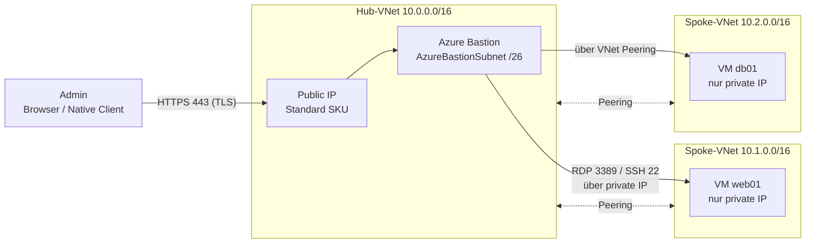

# 4.6 Azure Bastion

> **Domäne:** Implement and manage virtual networking · **Gewichtung:** 15–20 %
> **Study-Guide-Punkte:** *Implement Azure Bastion*
> **Stand:** November 2026

## Lernziele

Nach diesem Kapitel kann ich …

- erklären, wie **Azure Bastion** RDP/SSH-Zugriff auf VMs **ohne öffentliche IP-Adressen** an den VMs ermöglicht.
- die SKUs **Developer**, **Basic**, **Standard** und **Premium** unterscheiden und je nach Anforderung die passende wählen.
- Bastion korrekt bereitstellen: **AzureBastionSubnet** (mind. **/26**), **Standard Public IP**, passende NSG-Regeln.
- Verbindungen über das Azure Portal und über den **Native Client** (`az network bastion ssh/rdp`) herstellen.
- die erforderlichen **RBAC-Rollen** für Bastion-Benutzer benennen.
- Bastion von **Just-in-time VM Access**, **VPN** und **Public IP + NSG** abgrenzen.

## Überblick

Klassisch verbindet man sich mit einer VM über RDP (Port 3389) oder SSH (Port 22) – dafür braucht die VM eine **öffentliche IP-Adresse** und eine NSG-Regel, die diese Ports aus dem Internet öffnet. Genau diese offenen Management-Ports sind ein beliebtes Angriffsziel (Brute Force, Port Scans).

**Azure Bastion** ist ein vollständig verwalteter **PaaS-Dienst**, der als „Sprungserver" (Jump Host) im eigenen VNet bereitgestellt wird. Der Benutzer verbindet sich per **HTTPS (TLS, Port 443)** mit Bastion – im Browser über das Azure Portal oder per Native Client – und Bastion baut die RDP/SSH-Verbindung zur VM über deren **private IP-Adresse** auf.

Ergebnis: Die VMs benötigen **keine öffentliche IP**, keinen Agent und keine eigene Jump-Box. Microsoft kümmert sich um Patching, Härtung und Skalierung des Bastion-Hosts.

## Kernkonzepte

### Funktionsweise

1. Der Benutzer meldet sich am **Azure Portal** an (Entra ID, ggf. MFA/Conditional Access) und wählt bei der VM **Connect > Bastion**.
2. Die Sitzung läuft per **TLS über Port 443** vom Browser zur **öffentlichen IP des Bastion-Hosts**.
3. Bastion verbindet sich aus dem **AzureBastionSubnet** per RDP/SSH mit der **privaten IP** der Ziel-VM.
4. Die Darstellung erfolgt im Browser (HTML5) bzw. im lokalen RDP-/SSH-Client (Native Client).

### Bereitstellung und Voraussetzungen

- **Subnetz:** Bastion (außer Developer-SKU) benötigt ein dediziertes Subnetz mit dem exakten Namen **`AzureBastionSubnet`**.
  - Größe: mindestens **/26** (für Host Scaling ggf. größer).
  - Im Subnetz dürfen keine anderen Ressourcen liegen.
- **Öffentliche IP:** **Standard-SKU**, **statisch**, in derselben Region wie Bastion (entfällt bei Developer-SKU und bei **Private-only deployment** der Premium-SKU).
- **Ein Bastion pro VNet** genügt; über **VNet Peering** ([4.2](02-vnet-peering.md)) erreicht Bastion auch VMs in **gepeerten VNets** (auch regionsübergreifend). Typisch: Bastion zentral im **Hub-VNet** einer Hub-and-Spoke-Topologie.
- **Ziel-VMs:** brauchen **keine** Public IP und **keinen** Agent; nur eine private IP, die von Bastion erreichbar ist.

### SKUs

| Feature | Developer | Basic | Standard | Premium |
|---|:---:|:---:|:---:|:---:|
| Kosten | **kostenlos** | ✓ stündlich | ✓ stündlich | ✓ stündlich |
| Eigenes `AzureBastionSubnet` / eigene Public IP | ❌ (geteilte Infrastruktur) | ✅ | ✅ | ✅ (Public IP optional bei Private-only) |
| Verbindung über Azure Portal (Browser) | ✅ | ✅ | ✅ | ✅ |
| VMs in **gepeerten VNets** | ❌ | ✅ | ✅ | ✅ |
| Gleichzeitige Verbindungen | **eine VM zur Zeit** | feste Kapazität (2 Instanzen) | skalierbar | skalierbar |
| **Host scaling** (Scale units **2–50**) | ❌ | ❌ | ✅ | ✅ |
| **Native client support** (`az network bastion ssh/rdp`, Tunnel) | ❌ | ❌ | ✅ | ✅ |
| **Upload/Download von Dateien** (über Native Client) | ❌ | ❌ | ✅ | ✅ |
| **IP-based connection** (Verbindung per privater IP, z. B. zu On-Premises-Servern über VPN/ExpressRoute) | ❌ | ❌ | ✅ | ✅ |
| **Shareable link** (Zugriff ohne Azure-Portal-Konto) | ❌ | ❌ | ✅ | ✅ |
| **Custom inbound port** (anderer Port als 3389/22) | ❌ | ❌ | ✅ | ✅ |
| **Kerberos-Authentifizierung** | ❌ | ✅ | ✅ | ✅ |
| **Session recording** (grafische Aufzeichnung) | ❌ | ❌ | ❌ | ✅ |
| **Private-only deployment** (keine Public IP am Bastion) | ❌ | ❌ | ❌ | ✅ |

> Die Feature-Matrix ändert sich regelmäßig (z. B. Kerberos, Regionen der Developer-SKU). Vor der Prüfung mit der aktuellen [SKU-Vergleichstabelle](https://learn.microsoft.com/azure/bastion/configuration-settings#skus) abgleichen.

**SKU-Wechsel:**

- **Upgrade** (Developer → Basic → Standard → Premium) ist im Portal unter **Configuration** möglich.
- ⚠️ **Downgrade** wird **nicht** unterstützt → Bastion löschen und mit der kleineren SKU neu erstellen.

**Developer-SKU im Detail:** Kostenlose, geteilte Bastion-Infrastruktur für Dev/Test. Es wird **kein** `AzureBastionSubnet` und **keine** öffentliche IP benötigt. Nur in ausgewählten Regionen verfügbar, nur eine Verbindung gleichzeitig, kein Peering, keine Premium-Funktionen.

### Host Scaling (Standard/Premium)

- Kapazität wird über **Scale units / Instance count** gesteuert: **2 bis 50** Instanzen.
- Jede Instanz unterstützt eine bestimmte Zahl gleichzeitiger RDP- und SSH-Sitzungen (abhängig von der Arbeitslast; RDP-Sitzungen sind „teurer" als SSH).
- Mehr Instanzen = mehr gleichzeitige Benutzer = höhere Kosten (Abrechnung pro Instanz und Stunde + ausgehender Datenverkehr).

### Native Client (Standard/Premium)

- Option **Native client support** (*enable tunneling*) muss am Bastion aktiviert sein.
- Benötigt die **Azure CLI** (mit Bastion-Erweiterung) auf dem Client.
- `az network bastion ssh` – SSH von Windows, Linux oder macOS (auch mit SSH-Key oder Entra-ID-Anmeldung).
- `az network bastion rdp` – startet den lokalen **Windows**-RDP-Client (`mstsc`).
- `az network bastion tunnel` – öffnet einen lokalen Tunnel-Port für beliebige Clients.
- Ermöglicht **Datei-Upload/-Download** und eine bessere Benutzererfahrung (Multi-Monitor, lokale Tastaturbelegung).

### NSG auf dem AzureBastionSubnet

Eine NSG auf `AzureBastionSubnet` ist **optional**. Wird eine verwendet, muss sie die von Bastion benötigten Flüsse erlauben – sonst schlägt die Bereitstellung bzw. Verbindung fehl (laut Microsoft-Dokumentation, Details prüfen):

| Richtung | Quelle → Ziel | Port | Zweck |
|---|---|---|---|
| Inbound | **Internet** → Any | 443 | Benutzerverbindungen (TLS) |
| Inbound | **GatewayManager** → Any | 443 | Steuerungsebene (Control plane) |
| Inbound | **AzureLoadBalancer** → Any | 443 | Health Probes |
| Inbound | **VirtualNetwork** → **VirtualNetwork** | 8080, 5701 | Kommunikation zwischen Bastion-Instanzen (Data plane) |
| Outbound | Any → **VirtualNetwork** | 3389, 22 | RDP/SSH zu den Ziel-VMs |
| Outbound | Any → **AzureCloud** | 443 | Diagnose/Logging, Azure-Endpunkte |
| Outbound | **VirtualNetwork** → **VirtualNetwork** | 8080, 5701 | Data plane |
| Outbound | Any → **Internet** | 80 | Sitzungs- und Zertifikatsvalidierung |

Auf dem **Subnetz der Ziel-VMs** muss die NSG **RDP (3389) bzw. SSH (22) aus dem Adressbereich des `AzureBastionSubnet`** (oder aus `VirtualNetwork`) erlauben. Eingehender RDP/SSH-Zugriff aus dem **Internet** kann vollständig gesperrt werden. NSG-Grundlagen → [4.5](05-nsg-und-asg.md).

### Berechtigungen für Benutzer

Damit ein Benutzer sich über Bastion im Portal verbinden kann, benötigt er mindestens (Azure RBAC, [1.3](../01-identitaeten-und-governance/03-rbac-zugriffsverwaltung.md)):

- **Reader** auf der **virtuellen Maschine**,
- **Reader** auf der **Netzwerkkarte (NIC)** mit der privaten IP der VM,
- **Reader** auf der **Azure-Bastion-Ressource**,
- **Reader** auf dem **VNet** der Ziel-VM (relevant bei gepeerten VNets).

Zusätzlich braucht der Benutzer natürlich gültige **Anmeldedaten für das Gastbetriebssystem** (lokales Konto, Domänenkonto oder SSH-Key) – bzw. bei Entra-ID-Login die Rollen *Virtual Machine User Login* / *Virtual Machine Administrator Login*.

## Zusammenhänge



- **Virtuelle Netzwerke & Subnetze** ([4.1](01-virtuelle-netzwerke-und-subnetze.md)): `AzureBastionSubnet` ist ein reserviertes Subnetz mit festem Namen.
- **VNet Peering** ([4.2](02-vnet-peering.md)): Ein zentraler Bastion im Hub bedient alle gepeerten Spokes (nicht mit Developer-SKU).
- **Öffentliche IP-Adressen** ([4.3](03-oeffentliche-ip-adressen.md)): Bastion braucht eine **Standard Static Public IP**; die VMs selbst brauchen keine.
- **NSG** ([4.5](05-nsg-und-asg.md)): Regeln auf dem Bastion-Subnetz und auf den VM-Subnetzen.
- **Virtuelle Maschinen** ([3.2](../03-compute/02-virtuelle-maschinen.md)): *Connect > Bastion* ist eine der Verbindungsoptionen der VM.
- **RBAC** ([1.3](../01-identitaeten-und-governance/03-rbac-zugriffsverwaltung.md)): Reader-Rollen auf VM, NIC, Bastion (und VNet) erforderlich.
- **Monitoring:** Diagnoseeinstellungen von Bastion (*BastionAuditLogs*) zeigen, wer sich wann mit welcher VM verbunden hat → [5.1](../05-monitoring-und-wartung/01-azure-monitor-metriken-und-logs.md).

## Vergleichstabellen

### Möglichkeiten für Admin-Zugriff auf VMs

| Option | Public IP an der VM | Offene Ports im Internet | Zusatzkosten | Typischer Einsatz |
|---|---|---|---|---|
| **Public IP + NSG** | ✅ | 3389/22 (ggf. auf Quell-IP beschränkt) | Public IP | Tests, sehr kleine Umgebungen – unsicher |
| **Just-in-time VM Access** (Microsoft Defender for Cloud) | ✅ | **nur temporär** für eine Quell-IP freigegeben | Defender for Servers | Public IP soll bleiben, Ports aber standardmäßig zu |
| **Azure Bastion** | ❌ | keine an den VMs (nur 443 am Bastion) | Bastion pro Stunde (Developer kostenlos) | sicherer Browser-/Client-Zugriff ohne VPN |
| **VPN Gateway (P2S/S2S) / ExpressRoute** | ❌ | keine | Gateway | Zugriff aus dem Firmennetz; viele Protokolle, nicht nur RDP/SSH |
| **Eigene Jump-Box-VM** | Jump-Box ja | 3389/22 an der Jump-Box | VM-Kosten + Pflege | Legacy – durch Bastion ersetzt |

### Bastion-SKU nach Anforderung

| Anforderung | Mindest-SKU |
|---|---|
| Kostenlos testen, eine VM, kein Peering | **Developer** |
| Browserzugriff, VMs in gepeerten VNets, feste Kapazität | **Basic** |
| `az network bastion ssh/rdp`, Datei-Transfer, Shareable link, IP-based connection, Host scaling, Custom port | **Standard** |
| Session recording, Bastion ohne öffentliche IP (Private-only) | **Premium** |

## Azure Portal

| Aufgabe | Pfad |
|---|---|
| Bastion erstellen | **Portal > Bastions > + Create** (oder Marketplace „Bastion") |
| Bastion direkt aus einem VNet bereitstellen | **Portal > Virtual networks > VNet > Bastion > Deploy Bastion** (Schnellbereitstellung mit Standardwerten) |
| Bastion aus einer VM heraus bereitstellen / verbinden | **Portal > Virtual machines > VM > Connect > Bastion** |
| `AzureBastionSubnet` anlegen | **Portal > Virtual networks > VNet > Subnets > + Subnet** → Subnet purpose **Azure Bastion** (Name wird gesetzt) |
| SKU upgraden, Instanzzahl, Features (Native client, IP-based connection, Shareable link, Kerberos, Session recording) | **Portal > Bastions > Bastion > Configuration** |
| Shareable links verwalten | **Portal > Bastions > Bastion > Shareable links** |
| Session-Aufzeichnungen | **Portal > Bastions > Bastion > Session recordings** (Premium, Storage-Container mit SAS nötig) |
| Aktive Sitzungen anzeigen/beenden | **Portal > Bastions > Bastion > Sessions** |
| Diagnoseeinstellungen (Audit Logs) | **Portal > Bastions > Bastion > Diagnostic settings** |

**Wichtige Felder beim Erstellen (*Create a Bastion*):**

1. **Basics:** Subscription, Resource group, **Name**, **Region**, **Tier** (Developer/Basic/Standard/Premium), **Instance count** (ab Standard), **Virtual network** (in derselben Region), **Subnet** (`AzureBastionSubnet`, mind. /26), **Public IP address** (neu oder vorhanden, Standard SKU)
2. **Advanced:** Copy/Paste, IP-based connection, Kerberos, Native client support, Shareable link, Session recording, Private-only (je nach SKU)
3. **Tags**, **Review + create**

⚠️ **Nicht nachträglich änderbar bzw. nur mit Neuerstellung:**
- **Downgrade** der SKU
- **VNet** des Bastion-Hosts (Bastion ist an das VNet gebunden)
- **Region**

## Azure CLI & PowerShell

### Azure CLI

```bash
# 1) Subnetz für Bastion anlegen (Name ist fest vorgegeben, mind. /26)
az network vnet subnet create \
  --resource-group rg-hub \
  --vnet-name vnet-hub \
  --name AzureBastionSubnet \
  --address-prefixes 10.0.1.0/26

# 2) Öffentliche IP (Standard, statisch)
az network public-ip create \
  --resource-group rg-hub \
  --name pip-bastion \
  --sku Standard \
  --allocation-method Static \
  --location westeurope

# 3) Bastion mit Standard-SKU, Native Client und 2 Instanzen
az network bastion create \
  --resource-group rg-hub \
  --name bas-hub \
  --vnet-name vnet-hub \
  --public-ip-address pip-bastion \
  --location westeurope \
  --sku Standard \
  --enable-tunneling true \
  --scale-units 2

# SKU upgraden bzw. Instanzen erhöhen
az network bastion update \
  --resource-group rg-hub --name bas-hub \
  --sku Premium --scale-units 4

# SSH per Native Client (SSH-Key)
az network bastion ssh \
  --resource-group rg-hub --name bas-hub \
  --target-resource-id "/subscriptions/<sub-id>/resourceGroups/rg-spoke1/providers/Microsoft.Compute/virtualMachines/web01" \
  --auth-type ssh-key --username azureuser --ssh-key ~/.ssh/id_rsa

# RDP per Native Client (startet mstsc, nur Windows-Client)
az network bastion rdp \
  --resource-group rg-hub --name bas-hub \
  --target-resource-id "<vm-resource-id>"

# Tunnel auf lokalen Port öffnen (z. B. für eigenen SSH/SCP-Client)
az network bastion tunnel \
  --resource-group rg-hub --name bas-hub \
  --target-resource-id "<vm-resource-id>" \
  --resource-port 22 --port 50022
```

> `az network bastion ssh/rdp/tunnel` benötigen die CLI-Erweiterung `bastion` (wird bei Bedarf automatisch installiert) und am Bastion **Native client support**.

### Azure PowerShell

```powershell
# Subnetz hinzufügen
$vnet = Get-AzVirtualNetwork -ResourceGroupName "rg-hub" -Name "vnet-hub"
Add-AzVirtualNetworkSubnetConfig -Name "AzureBastionSubnet" `
  -VirtualNetwork $vnet -AddressPrefix "10.0.1.0/26" | Set-AzVirtualNetwork

# Öffentliche IP
$pip = New-AzPublicIpAddress -ResourceGroupName "rg-hub" -Name "pip-bastion" `
  -Location "westeurope" -Sku Standard -AllocationMethod Static

# Bastion erstellen (Standard, 2 Instanzen)
New-AzBastion -ResourceGroupName "rg-hub" -Name "bas-hub" `
  -PublicIpAddressRgName "rg-hub" -PublicIpAddressName "pip-bastion" `
  -VirtualNetworkRgName "rg-hub" -VirtualNetworkName "vnet-hub" `
  -Sku "Standard" -ScaleUnit 2

# Bastion anzeigen
Get-AzBastion -ResourceGroupName "rg-hub" -Name "bas-hub"

# SKU / Skalierung ändern
$bas = Get-AzBastion -ResourceGroupName "rg-hub" -Name "bas-hub"
Set-AzBastion -InputObject $bas -Sku "Premium" -ScaleUnit 4 -Force
```

| Ziel | CLI | PowerShell |
|---|---|---|
| Bastion erstellen | `az network bastion create` | `New-AzBastion` |
| Bastion anzeigen | `az network bastion show` | `Get-AzBastion` |
| SKU/Skalierung ändern | `az network bastion update` | `Set-AzBastion` |
| Verbinden (Native Client) | `az network bastion ssh` / `rdp` / `tunnel` | – |
| Bastion löschen | `az network bastion delete` | `Remove-AzBastion` |

## Praxisbeispiel

**Szenario:** *Contoso* betreibt eine Hub-and-Spoke-Topologie in *West Europe*: `vnet-hub` (10.0.0.0/16) sowie zwei Spokes mit Web- und Datenbank-VMs. Ein Sicherheitsaudit fordert:

1. Keine VM darf eine öffentliche IP besitzen; RDP/SSH aus dem Internet ist verboten.
2. Admins sollen sich weiterhin per Browser verbinden können; das Linux-Team will den eigenen SSH-Client und SCP-Dateitransfer nutzen.
3. Externe Dienstleister ohne Azure-Konto sollen für einzelne Wartungsfenster Zugriff auf genau eine VM erhalten.
4. Bis zu 60 gleichzeitige Sitzungen zu Spitzenzeiten.

**Umsetzung:**

1. **Subnetz:** In `vnet-hub` das Subnetz `AzureBastionSubnet` mit `10.0.1.0/26` anlegen.
2. **Bastion:** *Bastions > + Create* → Tier **Standard** (wegen Native Client, Shareable link und Skalierung), VNet `vnet-hub`, neue Public IP `pip-bastion` (Standard, statisch), **Instance count** passend zur Last (z. B. 4).
3. **Features:** Unter **Configuration** aktivieren: **Native client support**, **Shareable link**.
4. **Peering:** `vnet-hub` ↔ Spokes sind gepeert ([4.2](02-vnet-peering.md)) – Bastion erreicht alle Spoke-VMs.
5. **Public IPs entfernen:** An allen VMs die Public IP von der NIC trennen und löschen.
6. **NSGs:** Auf den Spoke-Subnetzen Inbound-Regel *Allow 3389,22 from 10.0.1.0/26*; alle Internet-Regeln für 3389/22 entfernen ([4.5](05-nsg-und-asg.md)).
7. **RBAC:** Gruppe `SG-VM-Admins` erhält **Reader** auf `bas-hub`, auf die VMs, deren NICs und die VNets ([1.3](../01-identitaeten-und-governance/03-rbac-zugriffsverwaltung.md)).
8. **Linux-Team:** `az network bastion ssh …` bzw. `az network bastion tunnel` für SCP.
9. **Dienstleister:** Unter **Shareable links** einen Link für die betreffende VM erzeugen und nach dem Wartungsfenster wieder löschen.
10. **Audit:** Diagnoseeinstellung *BastionAuditLogs* → Log Analytics Workspace.

## Limits & wichtige Zahlen

| Wert | Grenze / Standard |
|---|---|
| Subnetzname | exakt **`AzureBastionSubnet`** |
| Subnetzgröße | mindestens **/26** |
| Public IP | **Standard**-SKU, **statisch**, gleiche Region |
| Benutzer-Port zum Bastion | **443** (TLS) |
| Ports Bastion → VM | **3389** (RDP), **22** (SSH); Custom Port ab Standard |
| Instanzen (Scale units) | **2–50** (Standard/Premium); Basic fest 2 |
| Developer-SKU | kostenlos, **eine** Verbindung gleichzeitig, kein Peering, eingeschränkte Regionen |
| Bastion pro VNet | ein Bastion pro VNet; versorgt auch gepeerte VNets |
| SKU-Wechsel | nur **Upgrade**, kein Downgrade |

Gleichzeitige Sitzungen pro Instanz hängen von der Arbeitslast ab – aktuelle Richtwerte: [Azure Bastion configuration settings](https://learn.microsoft.com/azure/bastion/configuration-settings).

## Prüfungstipps & Fallstricke

- ⚠️ **Bereitstellung schlägt fehl** → Subnetz heißt nicht exakt `AzureBastionSubnet` oder ist kleiner als **/26**.
- ⚠️ **Public IP mit Basic-SKU oder dynamisch** → nicht zulässig, Bastion braucht **Standard/Static**.
- **„VMs ohne Public IP per RDP/SSH im Browser erreichbar machen"** → **Azure Bastion**.
- **„Mit möglichst wenigen Bastion-Hosts alle VNets abdecken"** → ein Bastion im **Hub** + **VNet Peering** (nicht Developer-SKU).
- **„Admins wollen ihren lokalen SSH-/RDP-Client verwenden" / „Dateien hochladen"** → **Standard** (oder Premium) + **Native client support**.
- **„Zugriff für Benutzer ohne Azure-Portal-Zugang"** → **Shareable link** (Standard+).
- **„Sitzungen aufzeichnen"** oder **„Bastion ohne öffentliche IP"** → **Premium**.
- **„Kostenlos, nur zum Testen einer einzelnen VM"** → **Developer**.
- ⚠️ **Von Standard auf Basic zurück** → nicht möglich; neu erstellen.
- ⚠️ **NSG auf `AzureBastionSubnet`** blockiert GatewayManager/AzureLoadBalancer 443 oder Outbound zu 3389/22 → Bastion funktioniert nicht.
- ⚠️ **NSG des VM-Subnetzes** muss RDP/SSH **vom Bastion-Subnetz** erlauben – nicht aus dem Internet.
- **Benutzer sieht im Portal keine Bastion-Verbindungsoption** → fehlende **Reader**-Rollen auf VM, NIC oder Bastion.
- **Bastion vs. JIT:** Bei JIT behält die VM ihre Public IP; Ports werden nur zeitweise geöffnet. Bei Bastion braucht die VM gar keine Public IP.

## Selbsttest

**1.** Sie wollen Azure Bastion in `vnet-prod` bereitstellen und legen ein Subnetz `BastionSubnet` mit /27 an. Die Bereitstellung schlägt fehl. Nennen Sie beide Ursachen.

<details><summary>Lösung</summary>

Das Subnetz muss exakt **`AzureBastionSubnet`** heißen und mindestens **/26** groß sein.
</details>

**2.** Contoso hat ein Hub-VNet und fünf gepeerte Spoke-VNets. Wie viele Bastion-Hosts benötigen Sie mindestens, um alle VMs zu erreichen?

<details><summary>Lösung</summary>

**Einen** Bastion (Basic oder höher) im Hub-VNet. Über VNet Peering erreicht er die VMs in allen gepeerten VNets.
</details>

**3.** Das Linux-Team möchte sich mit dem lokalen SSH-Client über Bastion verbinden und Dateien kopieren. Bastion ist mit der Basic-SKU bereitgestellt. Was müssen Sie tun?

<details><summary>Lösung</summary>

Auf **Standard** (oder Premium) **upgraden** und **Native client support** aktivieren. Danach `az network bastion ssh` bzw. `az network bastion tunnel` verwenden.
</details>

**4.** Ein externer Dienstleister ohne Konto in Ihrem Tenant soll sich für eine Wartung mit einer bestimmten VM verbinden. Welche Bastion-Funktion und welche Mindest-SKU?

<details><summary>Lösung</summary>

**Shareable link**, verfügbar ab der **Standard**-SKU.
</details>

**5.** Die Compliance verlangt, dass alle Bastion-Sitzungen aufgezeichnet werden und der Bastion-Host keine öffentliche IP besitzt. Welche SKU?

<details><summary>Lösung</summary>

**Premium** (Session recording und Private-only deployment).
</details>

**6.** Ein Benutzer mit der Rolle *Reader* auf der VM sieht unter *Connect > Bastion* eine Fehlermeldung. Welche weiteren Berechtigungen fehlen typischerweise?

<details><summary>Lösung</summary>

**Reader** auf der **NIC** der VM und auf der **Bastion-Ressource** (bei gepeerten VNets zusätzlich auf dem **VNet** der Ziel-VM).
</details>

**7.** Nach dem Bereitstellen von Bastion können sich Admins nicht mit den VMs verbinden. Auf dem VM-Subnetz gibt es eine NSG, die nur 443 eingehend erlaubt. Was ist zu ändern?

<details><summary>Lösung</summary>

Inbound-Regel auf der VM-Subnetz-NSG für **3389 (RDP) bzw. 22 (SSH)** mit Quelle **Adressbereich des `AzureBastionSubnet`** (oder `VirtualNetwork`) hinzufügen.
</details>

**8.** Sie haben Bastion mit der Standard-SKU bereitgestellt und möchten aus Kostengründen auf Basic wechseln. Wie gehen Sie vor?

<details><summary>Lösung</summary>

Ein Downgrade ist **nicht möglich**. Bastion löschen und mit der **Basic**-SKU neu erstellen (das `AzureBastionSubnet` und die Public IP können wiederverwendet werden).
</details>

**9.** Ein Entwickler möchte für ein kurzes Experiment kostenlos per Browser auf eine einzelne VM zugreifen, ohne ein zusätzliches Subnetz anzulegen. Welche Option?

<details><summary>Lösung</summary>

**Bastion Developer**-SKU (kostenlos, keine eigene Public IP und kein `AzureBastionSubnet`, eine Verbindung gleichzeitig, sofern in der Region verfügbar).
</details>

**10.** Ihre Sicherheitsabteilung fragt: Welcher Port muss für Benutzer zur Bastion-Public-IP erreichbar sein, und welche Ports nutzt Bastion zu den VMs?

<details><summary>Lösung</summary>

Benutzer → Bastion: **TCP 443** (TLS). Bastion → VM: **3389** (RDP) bzw. **22** (SSH) über die **private IP**.
</details>

## Weiterführende Links

- [AZ-104 Study Guide](https://learn.microsoft.com/credentials/certifications/resources/study-guides/az-104)
- [What is Azure Bastion?](https://learn.microsoft.com/azure/bastion/bastion-overview)
- [Azure Bastion configuration settings (SKUs, Instanzen)](https://learn.microsoft.com/azure/bastion/configuration-settings)
- [Deploy Bastion using specified settings](https://learn.microsoft.com/azure/bastion/tutorial-create-host-portal)
- [Quickstart: Deploy Bastion Developer](https://learn.microsoft.com/azure/bastion/quickstart-developer)
- [Working with NSG access and Azure Bastion](https://learn.microsoft.com/azure/bastion/bastion-nsg)
- [VNet peering and Azure Bastion](https://learn.microsoft.com/azure/bastion/vnet-peering)
- [Connect to a VM using the native client](https://learn.microsoft.com/azure/bastion/connect-vm-native-client-windows)
- [Create a shareable link](https://learn.microsoft.com/azure/bastion/shareable-link)
- [Configure session recording](https://learn.microsoft.com/azure/bastion/session-recording)
- [Upgrade a SKU](https://learn.microsoft.com/azure/bastion/upgrade-sku)
- [Azure Bastion FAQ (Rollen/Berechtigungen)](https://learn.microsoft.com/azure/bastion/bastion-faq)
