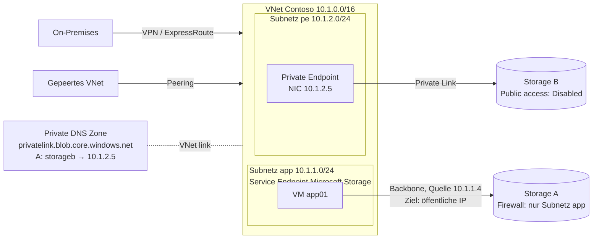

# 4.7 Service Endpoints und Private Endpoints

> **Domäne:** Implement and manage virtual networking · **Gewichtung:** 15–20 %
> **Study-Guide-Punkte:** *Configure service endpoints for Azure platform as a service (PaaS)* · *Configure private endpoints for Azure PaaS*
> **Stand:** November 2026

## Lernziele

Nach diesem Kapitel kann ich …

- erklären, wie **Service Endpoints** den Datenverkehr eines Subnetzes über den Azure-Backbone zu einem PaaS-Dienst leiten und warum der Dienst dabei einen **öffentlichen** Endpunkt behält.
- einen **Private Endpoint** für einen PaaS-Dienst (z. B. Blob Storage, SQL Database, Key Vault) erstellen und die passende **Sub-Resource** (*groupId*) wählen.
- die **DNS-Integration** von Private Endpoints über **Private DNS Zones** (`privatelink.*`) konfigurieren und die Namensauflösung nachvollziehen.
- Service Endpoints und Private Endpoints anhand von Kosten, Erreichbarkeit (On-Premises, Peering) und Sicherheit gegeneinander abgrenzen.
- **Service Endpoint Policies** und **Network Policies für Private Endpoints** (NSG/UDR) einordnen.

## Überblick

Viele Azure-Dienste – Storage, SQL Database, Key Vault, App Service, Container Registry – sind **PaaS-Dienste** mit einem öffentlichen Endpunkt (z. B. `contoso.blob.core.windows.net`). Standardmäßig ist dieser Endpunkt aus dem Internet erreichbar.

Unternehmen wollen den Zugriff meist **auf das eigene Netzwerk beschränken**. Azure bietet dafür zwei Mechanismen:

1. **Service Endpoints** – das Subnetz erhält eine „optimierte Route" zum Dienst; der Dienst sieht den Zugriff als aus diesem **Subnetz** kommend und kann per Firewall alles andere blockieren. Der Dienst behält seine **öffentliche IP-Adresse**.
2. **Private Endpoints** (Azure **Private Link**) – der Dienst bekommt eine **private IP-Adresse im eigenen VNet**. Der Zugriff erfolgt vollständig privat, auch aus gepeerten VNets und aus dem lokalen Netz; der öffentliche Zugriff kann komplett abgeschaltet werden.

Faustregel: **Service Endpoint = kostenlos und einfach, aber nur aus dem VNet. Private Endpoint = private IP, überall im verbundenen Netz nutzbar, kostet Geld und braucht DNS.**

## Kernkonzepte

### Service Endpoints

**Funktionsweise:**

- Wird am **Subnetz** aktiviert, **pro Dienst** (z. B. `Microsoft.Storage`, `Microsoft.Sql`, `Microsoft.KeyVault`, `Microsoft.Web`, `Microsoft.ContainerRegistry`, `Microsoft.ServiceBus`, `Microsoft.EventHub`, `Microsoft.AzureCosmosDB`).
- Azure fügt in der Routingtabelle des Subnetzes eine **Systemroute** mit Next hop type **VirtualNetworkServiceEndpoint** für die öffentlichen IP-Bereiche des Dienstes hinzu.
- Der Verkehr bleibt im **Microsoft-Backbone**, und als **Quell-IP** sieht der Dienst die **private IP** der VM im Subnetz statt einer öffentlichen IP.
- Der PaaS-Dienst behält seinen **öffentlichen Endpunkt und seine öffentliche IP** – DNS ändert sich nicht.

**Zwei Schritte sind nötig:**

1. **Service Endpoint am Subnetz aktivieren** (*Virtual network > Subnets > Subnetz > Service endpoints*).
2. **Firewall des PaaS-Dienstes** auf dieses VNet/Subnetz beschränken (z. B. Storage: *Networking > Enabled from selected virtual networks and IP addresses > + Add existing virtual network*, siehe [2.2](../02-speicher/02-speicherzugriff-und-sicherheit.md)).

> ⚠️ Nur Schritt 1 ohne Schritt 2 bringt **keine** Zugriffsbeschränkung – der Dienst ist weiterhin öffentlich erreichbar.

**Eigenschaften und Einschränkungen:**

- **Kostenlos.**
- Funktioniert nur für Ressourcen **im jeweiligen Subnetz** – **nicht aus On-Premises** (VPN/ExpressRoute) und **nicht aus gepeerten VNets**, sofern dort nicht ebenfalls ein Service Endpoint aktiviert und in der Firewall eingetragen ist. Für On-Premises-Zugriff muss man die öffentlichen NAT-IPs per **IP-Regel** freigeben oder einen Private Endpoint verwenden.
- Bei **Storage** gilt der Service Endpoint `Microsoft.Storage` für Konten in der **gleichen Region** und der **gepaarten Region**; für regionsübergreifenden Zugriff gibt es `Microsoft.Storage.Global`.
- Beim Aktivieren wechselt die Quell-IP von öffentlich auf privat – **bestehende Verbindungen** (z. B. zu einem Dienst mit IP-Firewall-Regel auf die öffentliche IP) können kurz unterbrochen werden bzw. die IP-Regel greift nicht mehr.
- Der Endpunkt bleibt öffentlich; **Datenexfiltration** zu beliebigen *anderen* Storage-Konten desselben Dienstes ist weiterhin möglich – dagegen helfen Service Endpoint Policies.

### Service Endpoint Policies

- Nur für **Azure Storage** (`Microsoft.Storage`).
- Werden einem Subnetz zugeordnet und erlauben ausgehenden Zugriff über den Service Endpoint **nur auf bestimmte Storage-Konten** (oder alle Konten einer RG/eines Abos).
- Zweck: **Schutz vor Datenexfiltration** – eine kompromittierte VM kann Daten nicht in ein fremdes Storage-Konto kopieren.

### Private Endpoints und Azure Private Link

**Begriffe:**

| Begriff | Bedeutung |
|---|---|
| **Azure Private Link** | Plattformtechnologie für privaten Zugriff auf Dienste über das Microsoft-Backbone |
| **Private Endpoint** | **Netzwerkschnittstelle (NIC)** mit **privater IP** aus einem Subnetz Ihres VNets, die auf **eine** Ressource zeigt |
| **Private Link Resource** | Zielressource (z. B. Storage-Konto, SQL Server, Key Vault) |
| **Target sub-resource (groupId)** | Teilendpunkt der Ressource, z. B. `blob`, `file`, `queue`, `table`, `dfs`, `web` (Storage), `sqlServer` (SQL), `vault` (Key Vault), `registry` (ACR), `sites` (App Service) |
| **Private Link Service** | Eigener Dienst (hinter einem **Standard Load Balancer**), den Sie anderen per Private Endpoint bereitstellen |

**Eigenschaften:**

- Pro Private Endpoint genau **eine Ressource** und **eine Sub-Resource**. Für Blob **und** File eines Storage-Kontos braucht man **zwei** Private Endpoints.
- Der Private Endpoint muss in **derselben Region wie das VNet** liegen; die Zielressource darf in einer **anderen Region** liegen.
- Erreichbar aus dem eigenen VNet, aus **gepeerten VNets** (auch global) und aus **On-Premises** über **VPN Gateway oder ExpressRoute**.
- Der Zugriff ist auf **genau diese Ressource** beschränkt – nicht auf den ganzen Dienst. Das schützt **inhärent vor Datenexfiltration**.
- Verkehr ist **unidirektional**: Clients verbinden sich zum Private Endpoint; der Dienst kann darüber keine Verbindung in Ihr VNet aufbauen.
- **Kosten:** Gebühr **pro Stunde** je Private Endpoint plus **pro GB** ein- und ausgehender Daten.
- Nach dem Einrichten sollte man den **öffentlichen Netzwerkzugriff** auf der Ressource **deaktivieren** (*Public network access: Disabled*), sonst bleibt der öffentliche Weg zusätzlich offen.

**Verbindungsgenehmigung (*Connection approval*):**

| Methode | Wann |
|---|---|
| **Automatic** | Der Ersteller hat auf der Zielressource die Berechtigung zur Genehmigung (z. B. Owner/Contributor bzw. `…/privateEndpointConnectionsApproval/action`) |
| **Manual** | Der Ersteller hat keine Rechte auf der Zielressource (z. B. anderes Team/anderer Tenant) → Verbindung steht auf **Pending**, der Ressourcenbesitzer genehmigt oder lehnt unter *Networking > Private endpoint connections* ab |

Verbindungsstatus: **Pending**, **Approved**, **Rejected**, **Disconnected**.

### DNS-Integration von Private Endpoints

Clients verbinden sich weiterhin mit dem **normalen FQDN** (z. B. `contosodata.blob.core.windows.net`) – TLS-Zertifikate und Connection Strings bleiben gleich. Damit dieser Name auf die **private IP** auflöst, nutzt Azure eine **CNAME-Kette**:

```text
contosodata.blob.core.windows.net
  └─ CNAME → contosodata.privatelink.blob.core.windows.net
       ├─ aus dem VNet (Private DNS Zone verknüpft): A → 10.1.2.5   (privat)
       └─ aus dem Internet:                          → öffentliche IP (bzw. gesperrt)
```

**Bausteine:**

- **Private DNS Zone** mit dem `privatelink`-Namen des Dienstes, z. B.:

| Dienst / Sub-Resource | Private DNS Zone |
|---|---|
| Blob Storage | `privatelink.blob.core.windows.net` |
| Azure Files | `privatelink.file.core.windows.net` |
| Data Lake Gen2 (dfs) | `privatelink.dfs.core.windows.net` |
| Azure SQL Database | `privatelink.database.windows.net` |
| Key Vault | `privatelink.vaultcore.azure.net` |
| App Service | `privatelink.azurewebsites.net` |
| Container Registry | `privatelink.azurecr.io` |

- **Virtual network link** der Private DNS Zone zu jedem VNet, dessen Clients den Namen privat auflösen sollen (bei Hub-Spoke typischerweise zum Hub bzw. zu allen Spokes, siehe [4.8](08-azure-dns.md)).
- **DNS zone group** am Private Endpoint – sorgt dafür, dass der **A-Record automatisch** in der Private DNS Zone angelegt, aktualisiert und beim Löschen entfernt wird. Im Portal-Assistenten: *Integrate with private DNS zone = Yes*.
- **On-Premises:** Lokale DNS-Server müssen Anfragen für die Zone (z. B. `blob.core.windows.net`) per **Conditional Forwarder** an einen DNS-Dienst in Azure weiterleiten – an den **Azure DNS Private Resolver** (Inbound endpoint) oder eine DNS-Forwarder-VM. Die Azure-DNS-IP **168.63.129.16** ist nur aus Azure-VNets erreichbar.

> ⚠️ Häufigster Fehler: Private Endpoint funktioniert per IP, aber der FQDN löst auf die **öffentliche** IP auf → Private DNS Zone fehlt, ist nicht mit dem VNet verknüpft, oder On-Prem-DNS leitet nicht weiter.

### Network Policies für Private Endpoints (NSG und UDR)

- Standardmäßig werden **NSGs und UDRs** auf den Verkehr **zu** Private Endpoints **nicht** angewendet (Subnetz-Eigenschaft `privateEndpointNetworkPolicies = Disabled`).
- Durch Aktivieren der **Network policies** am Subnetz (Werte `Enabled`, `NetworkSecurityGroupEnabled`, `RouteTableEnabled`) greifen NSG-Regeln ([4.5](05-nsg-und-asg.md)) bzw. UDRs ([4.4](04-benutzerdefinierte-routen.md)) – z. B. um Verkehr zum Private Endpoint über eine Azure Firewall zu leiten.
- Portal: *Virtual network > Subnets > Subnetz > Private endpoint network policy*.

### Private Link Service (kurz)

- Macht einen **eigenen Dienst**, der hinter einem **Standard Load Balancer** läuft, für andere VNets/Tenants per Private Endpoint verfügbar.
- Typisch für ISVs/Dienstanbieter; Kunden erstellen einen Private Endpoint auf den Private Link Service (Genehmigung meist manuell).
- NAT: Der Anbieter sieht Verbindungen von einer NAT-IP aus seinem eigenen Subnetz.

## Zusammenhänge



- **Speichersicherheit** ([2.2](../02-speicher/02-speicherzugriff-und-sicherheit.md)): Die Storage-Firewall (*selected virtual networks*) ist die Gegenseite des Service Endpoints; *Public network access: Disabled* ist die Ergänzung zum Private Endpoint.
- **VNets und Subnetze** ([4.1](01-virtuelle-netzwerke-und-subnetze.md)): Service Endpoints und Network Policies sind Subnetz-Eigenschaften; Private Endpoints belegen IP-Adressen im Subnetz.
- **VNet Peering** ([4.2](02-vnet-peering.md)): Private Endpoints sind über Peering erreichbar, Service Endpoints nicht automatisch.
- **NSG/ASG** ([4.5](05-nsg-und-asg.md)) und **UDR** ([4.4](04-benutzerdefinierte-routen.md)): wirken auf Private Endpoints nur mit aktivierten Network policies; Service Tags (z. B. `Storage.WestEurope`) ergänzen Service Endpoints in NSG-Regeln.
- **Azure DNS** ([4.8](08-azure-dns.md)): Private DNS Zones und VNet links sind Voraussetzung für die Namensauflösung von Private Endpoints.
- **App Service** ([3.6](../03-compute/06-azure-app-service.md)): Private Endpoint = **eingehender** privater Zugriff auf die Web App; **VNet Integration** = **ausgehender** Zugriff der App in ein VNet. Häufige Verwechslung!

## Vergleichstabellen

### Service Endpoint vs. Private Endpoint

| Kriterium | Service Endpoint | Private Endpoint |
|---|---|---|
| Technik | Optimierte Route + Subnetz-Identität | NIC mit privater IP (Private Link) |
| IP des Dienstes | bleibt **öffentlich** | **private IP** im VNet |
| Konfigurationsort | Subnetz (+ Firewall des Dienstes) | eigene Ressource in einem Subnetz (+ DNS) |
| Granularität | ganzer Dienst (z. B. alle Storage-Konten der Region) | **eine Ressource + Sub-Resource** |
| Zugriff aus On-Premises | ❌ | ✅ (VPN/ExpressRoute) |
| Zugriff aus gepeerten VNets | ❌ (nur mit eigenem Service Endpoint) | ✅ |
| Exfiltrationsschutz | nur mit Service Endpoint Policy (Storage) | ✅ inhärent |
| Öffentlichen Zugriff komplett abschalten | ❌ Endpunkt bleibt öffentlich | ✅ *Public network access: Disabled* |
| DNS-Anpassung nötig | ❌ | ✅ Private DNS Zone |
| Kosten | **kostenlos** | pro Stunde + pro GB |
| NSG/UDR | normale Subnetzregeln | nur mit aktivierten Network policies |
| Typischer Einsatz | einfache Absicherung, VMs im selben VNet | Zero-Trust, Hybrid, Compliance, Hub-Spoke |

### Entscheidungshilfe

| Anforderung in der Frage | Lösung |
|---|---|
| „Kostenlos / ohne zusätzliche Kosten", Zugriff nur aus einem Subnetz | **Service Endpoint** + Firewall |
| Zugriff **aus dem lokalen Rechenzentrum** über VPN/ExpressRoute | **Private Endpoint** |
| Dienst soll **eine private IP-Adresse** im VNet erhalten | **Private Endpoint** |
| Öffentlicher Endpunkt soll **vollständig deaktiviert** werden | **Private Endpoint** + Public network access Disabled |
| VMs sollen nur auf **bestimmte Storage-Konten** schreiben dürfen (Exfiltration) | **Service Endpoint Policy** (oder Private Endpoints) |
| Eigenen Dienst hinter Load Balancer an Kunden anbieten | **Private Link Service** |

### Service Endpoint Policy vs. Network Policies für Private Endpoints

| Kriterium | Service Endpoint Policy | Private Endpoint Network Policies |
|---|---|---|
| Zweck | erlaubte Ziel-Storage-Konten einschränken | NSG/UDR auf Private-Endpoint-Verkehr anwenden |
| Dienst | nur Azure Storage | alle Private Endpoints im Subnetz |
| Ort | Subnetz (Policy-Ressource zuordnen) | Subnetz-Eigenschaft |

## Azure Portal

| Aufgabe | Pfad |
|---|---|
| Service Endpoint am Subnetz aktivieren | **Portal > Virtual networks > VNet > Subnets > Subnetz > Service endpoints > Services** (z. B. `Microsoft.Storage`) |
| Service Endpoints des VNets anzeigen | **Portal > Virtual networks > VNet > Service endpoints** |
| Storage-Firewall auf Subnetz beschränken | **Portal > Storage accounts > Konto > Security + networking > Networking > Firewalls and virtual networks > Enabled from selected virtual networks and IP addresses > + Add existing virtual network** |
| Service Endpoint Policy erstellen | **Portal > Service endpoint policies > + Create** (Ressourcen festlegen, dann Subnetz zuordnen) |
| Private Endpoint erstellen (zentral) | **Portal > Private Link Center > Private endpoints > + Create** bzw. **Portal > Private endpoints > + Create** |
| Private Endpoint aus der Ressource | **Portal > Storage accounts > Konto > Networking > Private endpoint connections > + Private endpoint** |
| Verbindung genehmigen/ablehnen | **… > Ressource > Networking > Private endpoint connections > Approve / Reject** bzw. **Private Link Center > Pending connections** |
| Öffentlichen Zugriff deaktivieren | **… > Ressource > Networking > Public network access > Disabled** |
| DNS-Konfiguration des Private Endpoints | **Portal > Private endpoints > PE > Settings > DNS configuration** |
| Private DNS Zone & VNet links | **Portal > Private DNS zones > Zone > Virtual network links > + Add** |
| Network policies für Private Endpoints | **Portal > Virtual networks > VNet > Subnets > Subnetz > Private endpoint network policy** |
| Effektive Routen prüfen | **Portal > Network interfaces > NIC > Effective routes** (Next hop *VirtualNetworkServiceEndpoint*) |
| Private Link Service | **Portal > Private Link Center > Private link services > + Create** |

**Tabs beim Erstellen eines Private Endpoints:**

1. **Basics:** Abonnement, RG, Name, Name der NIC, **Region** (= Region des VNets)
2. **Resource:** Connection method (*Connect to an Azure resource in my directory* / *… by resource ID or alias*), Resource type, Resource, **Target sub-resource**
3. **Virtual Network:** VNet, Subnetz, IP-Zuweisung (dynamisch/statisch), ASG
4. **DNS:** *Integrate with private DNS zone* (Ja/Nein), Zone
5. **Tags**, **Review + create**

⚠️ **Nicht nachträglich änderbar:** Zielressource und Sub-Resource eines Private Endpoints sowie das Subnetz – bei Änderungsbedarf neuen Private Endpoint erstellen.

## Azure CLI & PowerShell

### Service Endpoints – Azure CLI

```bash
# Service Endpoint für Storage am Subnetz aktivieren
az network vnet subnet update \
  --resource-group rg-net --vnet-name vnet-contoso --name snet-app \
  --service-endpoints Microsoft.Storage

# Storage-Firewall: Zugriff nur aus diesem Subnetz erlauben, sonst verweigern
SUBNET_ID=$(az network vnet subnet show -g rg-net --vnet-name vnet-contoso -n snet-app --query id -o tsv)
az storage account network-rule add \
  --resource-group rg-data --account-name contosodata --subnet $SUBNET_ID
az storage account update \
  --resource-group rg-data --name contosodata --default-action Deny
```

### Private Endpoint – Azure CLI

```bash
# Ziel-Ressource ermitteln
ST_ID=$(az storage account show -g rg-data -n contosodata --query id -o tsv)

# Private Endpoint für die Sub-Resource "blob" anlegen
az network private-endpoint create \
  --resource-group rg-net --name pe-contosodata-blob \
  --vnet-name vnet-contoso --subnet snet-pe \
  --private-connection-resource-id $ST_ID \
  --group-id blob \
  --connection-name conn-contosodata-blob

# Private DNS Zone anlegen und mit dem VNet verknüpfen
az network private-dns zone create \
  --resource-group rg-net --name privatelink.blob.core.windows.net
az network private-dns link vnet create \
  --resource-group rg-net --zone-name privatelink.blob.core.windows.net \
  --name link-vnet-contoso --virtual-network vnet-contoso --registration-enabled false

# DNS zone group: A-Record automatisch pflegen
az network private-endpoint dns-zone-group create \
  --resource-group rg-net --endpoint-name pe-contosodata-blob \
  --name default --private-dns-zone privatelink.blob.core.windows.net \
  --zone-name blob

# Öffentlichen Zugriff auf das Konto abschalten
az storage account update -g rg-data -n contosodata --public-network-access Disabled

# Network policies (NSG + UDR) für Private Endpoints im Subnetz aktivieren
az network vnet subnet update -g rg-net --vnet-name vnet-contoso -n snet-pe \
  --private-endpoint-network-policies Enabled
```

### PowerShell

```powershell
# Service Endpoint am Subnetz aktivieren
$vnet = Get-AzVirtualNetwork -ResourceGroupName "rg-net" -Name "vnet-contoso"
Set-AzVirtualNetworkSubnetConfig -VirtualNetwork $vnet -Name "snet-app" `
  -AddressPrefix "10.1.1.0/24" -ServiceEndpoint "Microsoft.Storage"
$vnet | Set-AzVirtualNetwork

# Private Endpoint für Blob anlegen
$st     = Get-AzStorageAccount -ResourceGroupName "rg-data" -Name "contosodata"
$vnet   = Get-AzVirtualNetwork -ResourceGroupName "rg-net" -Name "vnet-contoso"
$subnet = $vnet.Subnets | Where-Object Name -eq "snet-pe"

$conn = New-AzPrivateLinkServiceConnection -Name "conn-contosodata-blob" `
  -PrivateLinkServiceId $st.Id -GroupId "blob"

$pe = New-AzPrivateEndpoint -ResourceGroupName "rg-net" -Name "pe-contosodata-blob" `
  -Location "westeurope" -Subnet $subnet -PrivateLinkServiceConnection $conn

# Private DNS Zone + VNet link
$zone = New-AzPrivateDnsZone -ResourceGroupName "rg-net" -Name "privatelink.blob.core.windows.net"
New-AzPrivateDnsVirtualNetworkLink -ResourceGroupName "rg-net" `
  -ZoneName "privatelink.blob.core.windows.net" -Name "link-vnet-contoso" `
  -VirtualNetworkId $vnet.Id

# DNS zone group am Private Endpoint
$cfg = New-AzPrivateDnsZoneConfig -Name "blob" -PrivateDnsZoneId $zone.ResourceId
New-AzPrivateDnsZoneGroup -ResourceGroupName "rg-net" -PrivateEndpointName "pe-contosodata-blob" `
  -Name "default" -PrivateDnsZoneConfig $cfg
```

| Ziel | CLI | PowerShell |
|---|---|---|
| Service Endpoint aktivieren | `az network vnet subnet update --service-endpoints` | `Set-AzVirtualNetworkSubnetConfig -ServiceEndpoint` |
| Private Endpoint erstellen | `az network private-endpoint create` | `New-AzPrivateLinkServiceConnection` + `New-AzPrivateEndpoint` |
| Private DNS Zone | `az network private-dns zone create` | `New-AzPrivateDnsZone` |
| VNet link | `az network private-dns link vnet create` | `New-AzPrivateDnsVirtualNetworkLink` |
| DNS zone group | `az network private-endpoint dns-zone-group create` | `New-AzPrivateDnsZoneGroup` |

## Praxisbeispiel

**Szenario:** *Contoso* betreibt ein Hub-Spoke-Netz in *West Europe* mit Site-to-Site-VPN ins Rechenzentrum Frankfurt.

**Anforderungen:**

1. Die Web-VMs im Subnetz `snet-web` sollen Log-Dateien in das Storage-Konto `contosologs` schreiben – ohne zusätzliche Kosten. Andere Netze brauchen keinen Zugriff.
2. Das Storage-Konto `contosofinance` (Blob) mit Finanzdaten soll **nur privat** erreichbar sein – aus Azure **und** aus dem Rechenzentrum. Kein öffentlicher Zugriff.
3. Lokale Clients sollen den normalen Namen `contosofinance.blob.core.windows.net` verwenden.

**Umsetzung:**

1. **Service Endpoint für `contosologs`:**
   - *vnet-spoke-web > Subnets > snet-web > Service endpoints* → `Microsoft.Storage`
   - *contosologs > Networking* → **Enabled from selected virtual networks and IP addresses** → `vnet-spoke-web/snet-web` hinzufügen → Speichern.
   - Ergebnis: kostenlos; Zugriffe aus anderen Netzen und dem Internet werden mit **403** abgelehnt.
2. **Private Endpoint für `contosofinance`:**
   - *contosofinance > Networking > Private endpoint connections > + Private endpoint*
   - Target sub-resource: **blob**, VNet: `vnet-hub`, Subnetz: `snet-pe`
   - DNS: **Integrate with private DNS zone = Yes** → `privatelink.blob.core.windows.net`
   - Danach *Public network access* → **Disabled**.
3. **DNS:**
   - Private DNS Zone `privatelink.blob.core.windows.net` per **Virtual network link** mit Hub **und** allen Spokes verknüpfen.
   - Im Hub einen **Azure DNS Private Resolver** mit Inbound endpoint (z. B. `10.0.10.4`) bereitstellen.
   - Auf den lokalen DNS-Servern einen **Conditional Forwarder** für `blob.core.windows.net` auf `10.0.10.4` einrichten.
4. **Test:** Von einer lokalen Maschine `nslookup contosofinance.blob.core.windows.net` → Antwort mit CNAME `contosofinance.privatelink.blob.core.windows.net` und **privater IP** `10.0.2.5`.

## Limits & wichtige Zahlen

| Wert | Grenze / Hinweis |
|---|---|
| Kosten Service Endpoint | **keine** |
| Kosten Private Endpoint | pro **Stunde** + pro **GB** verarbeitete Daten |
| Ressourcen pro Private Endpoint | **1** Ressource, **1** Sub-Resource |
| Region Private Endpoint | = Region des **VNets** (Zielressource darf woanders liegen) |
| Private Endpoints pro VNet | ca. **1.000** (aktuelle Werte prüfen) |
| Azure-DNS-IP (nur aus VNets) | **168.63.129.16** |
| Service Endpoint `Microsoft.Storage` | gleiche Region + gepaarte Region (`Microsoft.Storage.Global` für alle Regionen) |
| Service Endpoint Policies | nur **Azure Storage** |
| Network policies für Private Endpoints | standardmäßig **deaktiviert** |

Aktuelle Werte: [Azure networking limits](https://learn.microsoft.com/azure/azure-resource-manager/management/azure-subscription-service-limits#networking-limits).

## Prüfungstipps & Fallstricke

- ⚠️ **„Zugriff aus dem lokalen Netzwerk über VPN/ExpressRoute"** → **Private Endpoint**. Service Endpoints funktionieren **nicht** aus On-Premises.
- ⚠️ **Service Endpoint aktiviert, aber Zugriff weiterhin aus dem Internet möglich** → Firewall des PaaS-Dienstes wurde nicht auf *selected networks* umgestellt.
- ⚠️ **Private Endpoint erstellt, Name löst aber auf öffentliche IP auf** → Private DNS Zone / VNet link / DNS-Weiterleitung fehlt.
- **„Ohne zusätzliche Kosten"** → **Service Endpoint**.
- **„Dienst soll eine private IP-Adresse aus dem VNet haben"** → **Private Endpoint**.
- **Blob und File** eines Kontos privat → **zwei** Private Endpoints (je Sub-Resource) und zwei DNS-Zonen.
- **Private Endpoint in einer anderen Region als das VNet** → nicht möglich; Region des PE = Region des VNets. Die Zielressource darf aber in einer anderen Region sein.
- **Verbindung bleibt „Pending"** → Ersteller hatte keine Rechte auf der Zielressource; Besitzer muss unter *Private endpoint connections* **genehmigen**.
- **NSG-Regel auf Private Endpoint greift nicht** → **Network policies** am Subnetz aktivieren.
- **Datenexfiltration verhindern** mit Service Endpoints → **Service Endpoint Policy** (nur Storage).
- **App Service:** eingehend privat = **Private Endpoint**; ausgehend ins VNet = **VNet Integration**.
- Nach dem Aktivieren eines Service Endpoints greifen **IP-Firewall-Regeln** mit der öffentlichen IP der VM nicht mehr – die VM erscheint nun mit privater Quell-IP.
- Service Endpoints brauchen **keine** DNS-Änderung; Private Endpoints **immer**.

## Selbsttest

**1.** Ein Unternehmen möchte, dass VMs in einem Subnetz auf ein Storage-Konto zugreifen können und alle anderen Zugriffe blockiert werden. Es sollen keine zusätzlichen Kosten entstehen. Welche Lösung?

<details><summary>Lösung</summary>

**Service Endpoint** `Microsoft.Storage` am Subnetz aktivieren und in der Storage-Firewall nur dieses VNet/Subnetz zulassen (*Enabled from selected virtual networks*). Service Endpoints sind kostenlos.
</details>

**2.** Lokale Server sollen über ein Site-to-Site-VPN auf eine Azure SQL Database zugreifen. Der öffentliche Endpunkt der Datenbank soll deaktiviert werden. Was konfigurieren Sie?

<details><summary>Lösung</summary>

Einen **Private Endpoint** (Sub-Resource `sqlServer`) im VNet, die Private DNS Zone `privatelink.database.windows.net` mit DNS-Weiterleitung von On-Premises (z. B. über Azure DNS Private Resolver) und *Public network access: Disabled*. Service Endpoints funktionieren nicht aus On-Premises.
</details>

**3.** Sie haben einen Private Endpoint für ein Storage-Konto erstellt. Von einer VM im VNet funktioniert der Zugriff per IP, aber `contosodata.blob.core.windows.net` löst auf eine öffentliche IP auf. Was fehlt am wahrscheinlichsten?

<details><summary>Lösung</summary>

Die **Private DNS Zone** `privatelink.blob.core.windows.net` ist nicht vorhanden, enthält keinen A-Record oder ist **nicht per Virtual network link** mit dem VNet der VM verknüpft.
</details>

**4.** Sie benötigen privaten Zugriff auf Blob Storage **und** Azure Files desselben Storage-Kontos. Wie viele Private Endpoints brauchen Sie mindestens?

<details><summary>Lösung</summary>

**Zwei** – einen pro Sub-Resource (`blob` und `file`), jeweils mit eigener Private DNS Zone.
</details>

**5.** Ein Entwickler ohne Rechte auf dem Key Vault des Security-Teams erstellt einen Private Endpoint dafür. Die Verbindung funktioniert nicht. Warum?

<details><summary>Lösung</summary>

Die Verbindung steht auf **Pending** (manuelle Genehmigung). Der Besitzer des Key Vaults muss sie unter *Networking > Private endpoint connections* **genehmigen**.
</details>

**6.** Das VNet liegt in *West Europe*, das Storage-Konto in *North Europe*. Wo muss der Private Endpoint erstellt werden?

<details><summary>Lösung</summary>

In **West Europe** (Region des VNets). Die Zielressource darf in einer anderen Region liegen.
</details>

**7.** Sie wollen verhindern, dass VMs über den Service Endpoint Daten in **fremde** Storage-Konten kopieren. Welche Funktion nutzen Sie?

<details><summary>Lösung</summary>

Eine **Service Endpoint Policy**, die nur die erlaubten Storage-Konten freigibt, und dem Subnetz zuordnen. (Alternativ: Private Endpoints, die per Design nur auf eine Ressource zeigen.)
</details>

**8.** Eine NSG am Subnetz eines Private Endpoints soll eingehenden Verkehr auf Port 443 nur von einem bestimmten Subnetz erlauben. Die Regel hat keine Wirkung. Was ist zu tun?

<details><summary>Lösung</summary>

Die **Network policies für Private Endpoints** am Subnetz aktivieren (`privateEndpointNetworkPolicies` auf `Enabled` bzw. `NetworkSecurityGroupEnabled`). Standardmäßig sind sie deaktiviert.
</details>

**9.** Eine VM greift über ihre öffentliche IP auf ein Storage-Konto zu, das per IP-Regel diese öffentliche IP erlaubt. Nach dem Aktivieren eines Service Endpoints für `Microsoft.Storage` schlägt der Zugriff fehl. Warum?

<details><summary>Lösung</summary>

Mit Service Endpoint nutzt die VM ihre **private IP** als Quelle. Die IP-Regel passt nicht mehr – stattdessen muss das **VNet/Subnetz** in der Storage-Firewall eingetragen werden.
</details>

## Weiterführende Links

- [AZ-104 Study Guide](https://learn.microsoft.com/credentials/certifications/resources/study-guides/az-104)
- [Virtual network service endpoints](https://learn.microsoft.com/azure/virtual-network/virtual-network-service-endpoints-overview)
- [Service endpoint policies for Azure Storage](https://learn.microsoft.com/azure/virtual-network/virtual-network-service-endpoint-policies-overview)
- [What is a private endpoint?](https://learn.microsoft.com/azure/private-link/private-endpoint-overview)
- [What is Azure Private Link?](https://learn.microsoft.com/azure/private-link/private-link-overview)
- [Azure Private Endpoint DNS configuration](https://learn.microsoft.com/azure/private-link/private-endpoint-dns)
- [Azure Private Endpoint private DNS zone values](https://learn.microsoft.com/azure/private-link/private-endpoint-dns#azure-services-dns-zone-configuration)
- [Manage network policies for private endpoints](https://learn.microsoft.com/azure/private-link/disable-private-endpoint-network-policy)
- [What is Azure Private Link service?](https://learn.microsoft.com/azure/private-link/private-link-service-overview)
- [Use private endpoints for Azure Storage](https://learn.microsoft.com/azure/storage/common/storage-private-endpoints)
- [Configure Azure Storage firewalls and virtual networks](https://learn.microsoft.com/azure/storage/common/storage-network-security)
- [What is Azure DNS Private Resolver?](https://learn.microsoft.com/azure/dns/dns-private-resolver-overview)
