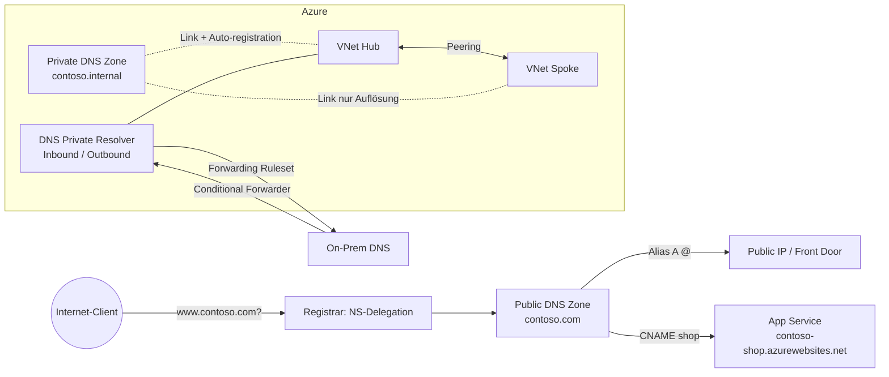

# 4.8 Azure DNS

> **Domäne:** Implement and manage virtual networking · **Gewichtung:** 15–20 %
> **Study-Guide-Punkte:** *Configure Azure DNS*
> **Stand:** November 2026

## Lernziele

Nach diesem Kapitel kann ich …

- die **Azure-provided DNS**-Namensauflösung (168.63.129.16) erklären und ihre Grenzen benennen.
- **Custom DNS servers** auf VNet- und NIC-Ebene konfigurieren und wissen, wann VMs die Änderung übernehmen.
- eine **Public DNS Zone** anlegen, beim Registrar **delegieren** und Record Sets (A, CNAME, MX, TXT …) pflegen.
- **Alias Records** einsetzen, um z. B. die Zonen-Apex auf eine Public IP oder Front Door zeigen zu lassen.
- **Private DNS Zones** mit **Virtual network links** und **Auto-registration** konfigurieren.
- den Einsatz des **Azure DNS Private Resolver** für hybride Namensauflösung einordnen.

## Überblick

DNS übersetzt Namen wie `www.contoso.com` in IP-Adressen. In Azure gibt es dafür drei Bausteine:

1. **Azure-provided DNS** – die automatische, kostenlose Namensauflösung in jedem VNet. Funktioniert ohne Konfiguration, aber nur innerhalb eines VNets und ohne eigene Zonen.
2. **Azure DNS (Public Zones)** – Hosting öffentlicher DNS-Zonen auf der weltweit verteilten Anycast-Infrastruktur von Microsoft. Azure DNS ist ein **Hosting-Dienst**, kein Registrar – die Domain selbst kauft man woanders (oder über *App Service Domains*).
3. **Azure Private DNS (Private Zones)** – eigene Zonen (z. B. `contoso.internal`), die nur in verknüpften VNets auflösbar sind. Damit lösen VMs in verschiedenen und gepeerten VNets einander per Namen auf.

Für hybride Szenarien (On-Premises ↔ Azure) ergänzt der **Azure DNS Private Resolver** das Bild, ohne dass eigene DNS-Server-VMs betrieben werden müssen.

## Kernkonzepte

### Azure-provided DNS (168.63.129.16)

- Jedes VNet nutzt standardmäßig **Default (Azure-provided)** DNS. VMs erhalten per DHCP die virtuelle IP **168.63.129.16** als DNS-Server.
- VMs **im selben VNet** lösen sich gegenseitig per Hostname auf (DNS-Suffix `*.internal.cloudapp.net`), öffentliche Namen werden ebenfalls aufgelöst.
- ⚠️ **Keine** Namensauflösung **zwischen VNets** – auch nicht über **VNet Peering** ([4.2](02-vnet-peering.md)). Dafür braucht man eine **Private DNS Zone** (mit Links zu beiden VNets) oder eigene DNS-Server.
- Keine eigenen Records, keine Zonen, keine Steuerung von TTLs.
- 168.63.129.16 ist außerdem die Quelle für Health Probes des Load Balancers und für den VM Agent – sie darf durch NSGs nicht blockiert werden (wird über das Service Tag *AzureLoadBalancer* bzw. Plattformregeln ohnehin erlaubt).

### Custom DNS servers

- Unter **VNet > DNS servers > Custom** können eigene DNS-Server eingetragen werden (z. B. Domain Controller, eigene DNS-VMs, Private-Resolver-Inbound-Endpoint).
- Zusätzlich kann auf **NIC-Ebene** ein DNS-Server gesetzt werden – die **NIC-Einstellung überschreibt** die VNet-Einstellung.
- ⚠️ Änderungen greifen erst, wenn die VM ihre DHCP-Lease erneuert: **VM neu starten** oder im Gast `ipconfig /renew` (Windows) bzw. Netzwerkdienst neu starten (Linux).
- Eigene DNS-Server sollten unbekannte Anfragen an **168.63.129.16** weiterleiten (*Forwarder*), damit Azure-Namen und Private DNS Zones weiterhin auflösbar bleiben.

### Public DNS Zones

- Eine **DNS Zone** ist der Container für alle Records einer Domain (z. B. `contoso.com`). Die Ressource ist **global**, die Ressourcengruppe nur Metadaten-Container.
- Beim Anlegen werden automatisch der **SOA**-Record und ein **NS**-Record-Set an der Apex (`@`) mit **vier Azure-Nameservern** erzeugt, z. B.:
  - `ns1-01.azure-dns.com`
  - `ns2-01.azure-dns.net`
  - `ns3-01.azure-dns.org`
  - `ns4-01.azure-dns.info`
- **Delegation:** Damit die Zone im Internet wirkt, müssen diese vier Nameserver **beim Domain-Registrar** als NS-Einträge der Domain hinterlegt werden. Erst dann ist Azure DNS autoritativ.
- **Child zone delegation:** Eine Subdomain (z. B. `partner.contoso.com`) kann als eigene Zone angelegt werden. In der **Parent-Zone** wird ein **NS-Record-Set** mit dem Namen `partner` und den Nameservern der Child-Zone angelegt. Im Portal erledigt das die Option *This zone is a child of an existing zone already hosted in Azure DNS* automatisch.
- **Domain kaufen:** Nicht über Azure DNS selbst. Über **App Service Domains** lassen sich Domains in Azure erwerben; deren DNS wird dann in Azure DNS gehostet.

### Record Sets und Record-Typen

- Azure DNS verwaltet **Record Sets**: alle Records mit **gleichem Namen und gleichem Typ** (z. B. zwei A-Records für `www`). Die **TTL** wird pro Record Set festgelegt.
- `@` steht für die Zonen-Apex (`contoso.com` selbst).

| Typ | Zweck | Besonderheit |
|---|---|---|
| **A** | Name → IPv4 | mehrere IPs pro Record Set möglich (Round Robin) |
| **AAAA** | Name → IPv6 | |
| **CNAME** | Name → anderer Name (Alias) | ⚠️ **nicht an der Apex**; nur **ein** Record pro Set; kein anderer Typ mit gleichem Namen |
| **MX** | Mailserver mit Priorität | zeigt auf einen Namen, nicht auf eine IP |
| **TXT** | Freitext | Domain-Verifizierung (z. B. `asuid` für App Service, M365), SPF |
| **NS** | Nameserver / Delegation | Apex-NS wird automatisch angelegt |
| **SOA** | Zonen-Metadaten | automatisch, nicht löschbar |
| **SRV** | Dienst + Port (z. B. `_sip._tcp`) | |
| **CAA** | Welche CAs Zertifikate ausstellen dürfen | |
| **PTR** | Reverse Lookup (IP → Name) | in Reverse-Zonen (`*.in-addr.arpa`); für Azure Public IPs wird der Reverse-FQDN an der Public IP gesetzt |

### Alias Records

**Alias Record Sets** (Typ A, AAAA oder CNAME) zeigen nicht auf einen festen Wert, sondern auf eine **Azure-Ressource**:

- **Public IP address** ([4.3](03-oeffentliche-ip-adressen.md))
- **Traffic Manager profile**
- **Azure Front Door** / **Azure CDN endpoint**
- ein **anderes Record Set** in derselben Zone

Vorteile:
- Ändert sich die IP der Ressource, aktualisiert sich der Record **automatisch**.
- Wird die Ressource gelöscht, wird der Record leer – **kein „Dangling DNS"** (Schutz vor Subdomain-Übernahme).
- ⚠️ Lösung für die **Apex-Domain**: Ein CNAME ist an der Apex verboten, ein **Alias A-Record** auf Traffic Manager/Front Door dagegen erlaubt.

### Private DNS Zones

- Eine **Private DNS Zone** (z. B. `contoso.internal` oder `privatelink.blob.core.windows.net`) ist ebenfalls eine **globale** Ressource und nur aus **verknüpften VNets** auflösbar.
- **Virtual network link:** verbindet eine Zone mit einem VNet. Eine Zone kann mit **vielen VNets** verknüpft sein – auch aus anderen Regionen und Abonnements (gleicher Tenant).
- **Auto-registration:** Optional pro Link. VMs im verknüpften VNet registrieren ihren **A-Record automatisch** (und entfernen ihn beim Löschen).
  - ⚠️ Ein VNet kann mit **nur einer** Private Zone **mit** Auto-registration verknüpft sein – aber mit beliebig vielen Zonen **ohne** Auto-registration (nur Auflösung).
  - Auto-registration gilt für **VMs** (NICs). Private Endpoints werden nicht so registriert, sondern über **DNS zone groups** ([4.7](07-service-endpoints-und-private-endpoints.md)).
- ⚠️ **Gepeerte VNets** lösen eine Private Zone **nur** auf, wenn sie **selbst** einen Link zur Zone haben – Peering allein reicht nicht.
- **Split-horizon:** Eine Public und eine Private Zone können denselben Namen haben (`contoso.com`). Verknüpfte VNets erhalten die privaten Antworten, das Internet die öffentlichen. Ist ein Name nur in der Public Zone vorhanden, wird er aus dem VNet heraus **nicht** gefunden (die Private Zone ist für den Namensraum autoritativ).
- Funktioniert mit Azure-provided DNS. Bei Custom DNS servers müssen diese an **168.63.129.16** weiterleiten.

### Azure DNS Private Resolver

Verwalteter Dienst für **hybride Namensauflösung** ohne eigene DNS-VMs:

- **Inbound endpoint:** private IP im VNet; On-Premises-DNS-Server leiten Anfragen für Azure-Zonen (z. B. `privatelink.*`, `contoso.internal`) per Conditional Forwarder hierhin.
- **Outbound endpoint + DNS forwarding ruleset:** Azure-VMs lösen On-Premises-Namen auf (z. B. `corp.contoso.local` → On-Prem-DNS 192.168.1.10). Das Ruleset wird mit VNets verknüpft.
- Benötigt **dedizierte Subnetze** (delegiert an `Microsoft.Network/dnsResolvers`) für Inbound- und Outbound-Endpoints.

### DNSSEC und Schutz

- **DNSSEC** für Public Zones wird von Azure DNS unterstützt (zunächst als Preview eingeführt – aktuellen Status prüfen). Dabei muss beim Registrar zusätzlich ein **DS-Record** hinterlegt werden.
- Zonen sollten mit einem **Resource Lock** (*CanNotDelete*, [1.5](../01-identitaeten-und-governance/05-ressourcensperren-und-tags.md)) geschützt werden – das Löschen einer Zone löscht alle Records.
- RBAC-Rollen: **DNS Zone Contributor** (Public Zones) und **Private DNS Zone Contributor** ([1.3](../01-identitaeten-und-governance/03-rbac-zugriffsverwaltung.md)).

## Zusammenhänge



- **VNets** ([4.1](01-virtuelle-netzwerke-und-subnetze.md)): DNS-Server werden pro VNet (oder NIC) festgelegt.
- **VNet Peering** ([4.2](02-vnet-peering.md)): stellt Konnektivität her, aber **keine** Namensauflösung – dafür Private DNS Zone mit Links zu allen VNets.
- **Public IPs** ([4.3](03-oeffentliche-ip-adressen.md)): haben ein optionales **DNS name label** (`<label>.<region>.cloudapp.azure.com`) und können Ziel eines Alias Records sein.
- **Private Endpoints** ([4.7](07-service-endpoints-und-private-endpoints.md)): benötigen Private DNS Zones wie `privatelink.blob.core.windows.net`, damit der öffentliche FQDN auf die private IP auflöst.
- **App Service** ([3.6](../03-compute/06-azure-app-service.md)): Custom Domains brauchen einen CNAME (Subdomain) bzw. A-Record (Apex) **plus** TXT-Record `asuid.<name>` zur Verifizierung.

## Vergleichstabellen

### Public vs. Private DNS Zone

| Kriterium | Public DNS Zone | Private DNS Zone |
|---|---|---|
| Auflösbar von | Internet (nach Delegation) | nur verknüpfte VNets (und per Resolver/Forwarder von On-Prem) |
| Delegation beim Registrar | ✅ erforderlich | ❌ |
| Virtual network links | ❌ | ✅ |
| Auto-registration von VMs | ❌ | ✅ (pro Link) |
| Alias Records | ✅ | ✅ (auf Record Sets in derselben Zone) |
| Typische Namen | `contoso.com` | `contoso.internal`, `privatelink.*` |

### Optionen für Namensauflösung

| Option | Zwischen VNets | Von On-Prem | Eigene Records | Betriebsaufwand |
|---|---|---|---|---|
| **Azure-provided DNS** | ❌ | ❌ | ❌ | keiner |
| **Private DNS Zone** | ✅ (per Link) | nur mit Resolver/Forwarder | ✅ | gering |
| **Eigene DNS-Server (VMs/DCs)** | ✅ | ✅ | ✅ | hoch (Patchen, HA) |
| **Private DNS Zone + Private Resolver** | ✅ | ✅ | ✅ | gering (PaaS) |

### CNAME vs. Alias Record

| Kriterium | CNAME | Alias Record |
|---|---|---|
| An der Apex (`@`) | ❌ | ✅ |
| Ziel | beliebiger DNS-Name | Azure-Ressource oder Record Set |
| Folgt IP-Änderungen automatisch | indirekt (über Namen) | ✅ |
| Schutz vor Dangling DNS | ❌ | ✅ |

## Azure Portal

| Aufgabe | Pfad |
|---|---|
| Public Zone anlegen | **Portal > DNS zones > + Create** (Name, RG; optional *This zone is a child of an existing zone*) |
| Nameserver für Registrar ablesen | **Portal > DNS zones > Zone > Overview** (*Name server 1–4*) |
| Record Set anlegen | **Portal > DNS zones > Zone > DNS Management > Recordsets > + Add** |
| Alias Record anlegen | im Dialog *Add record set*: **Alias record set = Yes**, *Alias type = Azure resource*, Ressource wählen |
| Private Zone anlegen | **Portal > Private DNS zones > + Create** |
| VNet verknüpfen / Auto-registration | **Portal > Private DNS zones > Zone > DNS Management > Virtual Network Links > + Add** (*Enable auto registration*) |
| Records in Private Zone | **Portal > Private DNS zones > Zone > DNS Management > Recordsets > + Add** |
| DNS-Server eines VNets | **Portal > Virtual networks > VNet > Settings > DNS servers** (*Default (Azure-provided)* / *Custom*) |
| DNS-Server einer NIC | **Portal > Network interfaces > NIC > Settings > DNS servers** |
| DNS name label einer Public IP | **Portal > Public IP addresses > PIP > Settings > Configuration > DNS name label** |
| Private Resolver anlegen | **Portal > DNS private resolvers > + Create** (Inbound/Outbound endpoints, Rulesets) |
| Forwarding Rules | **Portal > DNS forwarding rulesets > Ruleset > Forwarding rules / Virtual network links** |

⚠️ **Nicht änderbar nach Erstellung:** der **Zonenname** (Public und Private) – neue Zone anlegen und Records übernehmen. Der **Typ** eines Record Sets lässt sich ebenfalls nicht ändern.

## Azure CLI & PowerShell

### Azure CLI

```bash
# Public Zone anlegen und Nameserver für den Registrar anzeigen
az network dns zone create --resource-group rg-dns --name contoso.com
az network dns zone show --resource-group rg-dns --name contoso.com --query nameServers -o tsv

# A-Record (www) und CNAME (shop) anlegen
az network dns record-set a add-record --resource-group rg-dns --zone-name contoso.com \
  --record-set-name www --ipv4-address 20.50.10.4
az network dns record-set cname set-record --resource-group rg-dns --zone-name contoso.com \
  --record-set-name shop --cname contoso-shop.azurewebsites.net

# TXT-Record zur Domain-Verifizierung (z. B. App Service)
az network dns record-set txt add-record --resource-group rg-dns --zone-name contoso.com \
  --record-set-name asuid.shop --value "<verification-id>"

# Alias A-Record an der Apex auf eine Public IP
PIP_ID=$(az network public-ip show -g rg-web -n pip-web --query id -o tsv)
az network dns record-set a create --resource-group rg-dns --zone-name contoso.com \
  --name "@" --target-resource $PIP_ID

# Child-Zone delegieren: NS-Record in der Parent-Zone
az network dns record-set ns add-record --resource-group rg-dns --zone-name contoso.com \
  --record-set-name partner --nsdname ns1-02.azure-dns.com

# Private Zone + VNet-Link mit Auto-registration
az network private-dns zone create --resource-group rg-dns --name contoso.internal
az network private-dns link vnet create --resource-group rg-dns --zone-name contoso.internal \
  --name link-hub --virtual-network vnet-hub --registration-enabled true
az network private-dns link vnet create --resource-group rg-dns --zone-name contoso.internal \
  --name link-spoke --virtual-network <vnet-spoke-resource-id> --registration-enabled false

# Manueller Record in der Private Zone
az network private-dns record-set a add-record --resource-group rg-dns \
  --zone-name contoso.internal --record-set-name db01 --ipv4-address 10.1.2.4

# Custom DNS-Server am VNet setzen (danach VMs neu starten / Lease erneuern)
az network vnet update --resource-group rg-net --name vnet-hub --dns-servers 10.0.0.4 10.0.0.5
```

### Az PowerShell

```powershell
# Public Zone und A-Record
New-AzDnsZone -Name "contoso.com" -ResourceGroupName "rg-dns"
(Get-AzDnsZone -Name "contoso.com" -ResourceGroupName "rg-dns").NameServers

New-AzDnsRecordSet -Name "www" -RecordType A -ZoneName "contoso.com" `
  -ResourceGroupName "rg-dns" -Ttl 3600 `
  -DnsRecords (New-AzDnsRecordConfig -IPv4Address "20.50.10.4")

# CNAME
New-AzDnsRecordSet -Name "shop" -RecordType CNAME -ZoneName "contoso.com" `
  -ResourceGroupName "rg-dns" -Ttl 3600 `
  -DnsRecords (New-AzDnsRecordConfig -Cname "contoso-shop.azurewebsites.net")

# Alias A-Record an der Apex auf eine Public IP
$pip = Get-AzPublicIpAddress -Name "pip-web" -ResourceGroupName "rg-web"
New-AzDnsRecordSet -Name "@" -RecordType A -ZoneName "contoso.com" `
  -ResourceGroupName "rg-dns" -Ttl 3600 -TargetResourceId $pip.Id

# Private Zone, VNet-Link mit Auto-registration, manueller Record
New-AzPrivateDnsZone -Name "contoso.internal" -ResourceGroupName "rg-dns"
$vnet = Get-AzVirtualNetwork -Name "vnet-hub" -ResourceGroupName "rg-net"
New-AzPrivateDnsVirtualNetworkLink -ZoneName "contoso.internal" -ResourceGroupName "rg-dns" `
  -Name "link-hub" -VirtualNetworkId $vnet.Id -EnableRegistration

New-AzPrivateDnsRecordSet -Name "db01" -RecordType A -ZoneName "contoso.internal" `
  -ResourceGroupName "rg-dns" -Ttl 3600 `
  -PrivateDnsRecords (New-AzPrivateDnsRecordConfig -IPv4Address "10.1.2.4")
```

### Auflösung prüfen

```bash
# Direkt beim Azure-Nameserver fragen (funktioniert schon vor der Delegation)
nslookup www.contoso.com ns1-01.azure-dns.com
dig @ns1-01.azure-dns.com contoso.com NS
```

```powershell
Resolve-DnsName -Name "www.contoso.com" -Server "ns1-01.azure-dns.com"
```

## Praxisbeispiel

**Szenario:** *Contoso* hat die Domain `contoso.com` bei einem externen Registrar gekauft und betreibt in Azure ein Hub-and-Spoke-Netz. Anforderungen:

1. `contoso.com` und `www.contoso.com` sollen auf den Webserver hinter der Public IP `pip-web` zeigen – auch wenn sich die IP ändert.
2. `shop.contoso.com` zeigt auf eine App-Service-App.
3. VMs in Hub und Spoke sollen sich gegenseitig unter `*.contoso.internal` auflösen; neue VMs im Hub sollen automatisch eingetragen werden.
4. On-Premises-Clients sollen `*.contoso.internal` auflösen können.

**Umsetzung:**

1. **Public Zone:** *DNS zones > + Create* → `contoso.com`. Unter *Overview* die vier Nameserver ablesen und **beim Registrar** als NS-Einträge eintragen (Delegation). Mit `nslookup contoso.com` prüfen, ob die Delegation greift.
2. **Apex + www:** Record Set `@`, Typ A, **Alias record set = Yes** → Public IP `pip-web`. Record Set `www`, Typ CNAME, **Alias** auf das Record Set `@` (oder ebenfalls Alias A auf die Public IP).
3. **Shop:** CNAME `shop` → `contoso-shop.azurewebsites.net` und TXT `asuid.shop` mit der Verifizierungs-ID aus dem App Service ([3.6](../03-compute/06-azure-app-service.md)).
4. **Private Zone:** *Private DNS zones > + Create* → `contoso.internal`. Virtual network links:
   - `link-hub` → `vnet-hub`, **Enable auto registration = Yes**
   - `link-spoke` → `vnet-spoke`, ohne Auto-registration (die Spoke-VMs werden bei Bedarf manuell eingetragen oder über einen eigenen Link mit Auto-registration – das Spoke-VNet hat noch keine andere Zone mit Auto-registration).
5. **Hybrid:** *DNS private resolvers > + Create* im Hub mit einem **Inbound endpoint** (eigenes Subnetz). Auf den On-Prem-DNS-Servern einen **Conditional Forwarder** für `contoso.internal` auf die IP des Inbound endpoints einrichten.
6. **Schutz:** Auf beiden Zonen einen **CanNotDelete-Lock** setzen.

## Limits & wichtige Zahlen

| Wert | Grenze (Standard) |
|---|---|
| Azure-provided DNS (virtuelle IP) | **168.63.129.16** |
| Azure-Nameserver pro Public Zone | **4** |
| Public DNS Zones pro Abonnement | **250** (erhöhbar) |
| Record Sets pro Public Zone | **10.000** (erhöhbar) |
| Records pro Record Set (Public) | **20** |
| Private DNS Zones pro Abonnement | **1.000** |
| Record Sets pro Private Zone | **25.000** |
| VNet Links pro Private Zone | **1.000** |
| VNet Links mit Auto-registration pro Private Zone | **100** |
| Private Zones mit Auto-registration pro VNet | **1** |
| Private Zones (ohne Auto-registration) pro VNet | **1.000** |

Limits ändern sich gelegentlich – aktuelle Werte: [Azure DNS limits](https://learn.microsoft.com/azure/azure-resource-manager/management/azure-subscription-service-limits#azure-dns-limits).

## Prüfungstipps & Fallstricke

- ⚠️ **VMs in gepeerten VNets lösen sich nicht per Namen auf** → Azure-provided DNS wirkt nur im eigenen VNet. Lösung: **Private DNS Zone** mit **Links zu beiden VNets**.
- ⚠️ **Ein VNet – zwei Zonen mit Auto-registration?** Geht nicht. Pro VNet nur **eine** Zone mit Auto-registration, beliebig viele zur reinen Auflösung.
- ⚠️ **CNAME an der Apex** (`contoso.com`) ist nicht erlaubt → **Alias A-Record** (auf Public IP, Traffic Manager, Front Door) verwenden.
- ⚠️ **Custom DNS am VNet gesetzt, VMs nutzen weiter den alten Server** → VMs **neu starten** bzw. DHCP-Lease erneuern.
- **Zone angelegt, aber im Internet nicht auflösbar** → **NS-Delegation beim Registrar** fehlt (die vier Azure-Nameserver eintragen).
- **Subdomain an anderes Team delegieren** → eigene Child-Zone + **NS-Record-Set** in der Parent-Zone.
- **„Kein Dangling DNS, wenn die Public IP gelöscht wird"** → **Alias Record**.
- **„Domain in Azure kaufen"** → **App Service Domains**, nicht Azure DNS.
- **Private Endpoint löst noch auf die öffentliche IP auf** → Private DNS Zone `privatelink.*` fehlt oder ist nicht mit dem VNet verknüpft ([4.7](07-service-endpoints-und-private-endpoints.md)).
- **Eigene DNS-Server + Private DNS Zone funktioniert nicht** → Die DNS-Server müssen an **168.63.129.16** weiterleiten.
- **On-Prem soll Private Zones auflösen, ohne DNS-VMs zu betreiben** → **Azure DNS Private Resolver** (Inbound endpoint).
- **Mehrere IPs für einen Namen** → mehrere A-Records im **selben Record Set**.
- NIC-DNS-Einstellung **überschreibt** die VNet-Einstellung.

## Selbsttest

**1.** VM1 in `vnet-a` und VM2 in `vnet-b` sind über VNet Peering verbunden. Ping auf die IP funktioniert, `ping vm2` schlägt fehl. Beide VNets nutzen Azure-provided DNS. Was ist die Lösung mit dem geringsten Aufwand?

<details><summary>Lösung</summary>

Eine **Private DNS Zone** anlegen und mit **beiden VNets verknüpfen** (mit Auto-registration für die VMs). Azure-provided DNS löst nicht über VNet-Grenzen hinweg auf, auch nicht bei Peering.
</details>

**2.** Sie haben die Zone `contoso.com` in Azure DNS angelegt und Records erstellt. Aus dem Internet ist `www.contoso.com` nicht auflösbar. Was fehlt?

<details><summary>Lösung</summary>

Die **Delegation**: Die vier Azure-Nameserver (aus *Overview* der Zone) müssen **beim Domain-Registrar** als NS-Records der Domain eingetragen werden.
</details>

**3.** `contoso.com` (Apex) soll auf ein Azure-Front-Door-Profil zeigen. Welchen Record-Typ verwenden Sie?

<details><summary>Lösung</summary>

Einen **Alias Record Set** vom Typ **A** (oder AAAA) mit Ziel Front Door. Ein CNAME ist an der Zonen-Apex nicht zulässig.
</details>

**4.** `vnet-hub` ist bereits mit der Private Zone `corp.internal` (Auto-registration aktiv) verknüpft. Sie möchten `vnet-hub` zusätzlich mit `apps.internal` **mit** Auto-registration verknüpfen. Ist das möglich?

<details><summary>Lösung</summary>

**Nein.** Ein VNet kann nur mit **einer** Private DNS Zone mit Auto-registration verknüpft werden. `apps.internal` kann nur als **Resolution-Link** (ohne Auto-registration) verknüpft werden.
</details>

**5.** Sie ändern am VNet die DNS-Server auf `10.0.0.4`. Die bestehenden VMs nutzen weiterhin 168.63.129.16. Warum?

<details><summary>Lösung</summary>

Die DNS-Einstellung wird per **DHCP** verteilt. Die VMs übernehmen sie erst nach einem **Neustart** bzw. Erneuern der DHCP-Lease (`ipconfig /renew`). Alternativ prüfen, ob auf der NIC ein eigener DNS-Server gesetzt ist (NIC überschreibt VNet).
</details>

**6.** Das Team „Partner" soll die Subdomain `partner.contoso.com` selbst verwalten, ohne Zugriff auf `contoso.com` zu haben. Wie gehen Sie vor?

<details><summary>Lösung</summary>

Eine eigene **Child-Zone** `partner.contoso.com` anlegen (eigene RG, RBAC **DNS Zone Contributor** für das Team) und in der Parent-Zone `contoso.com` ein **NS-Record-Set** `partner` mit den Nameservern der Child-Zone anlegen (Delegation).
</details>

**7.** Welche IP-Adresse verwenden Azure-VMs standardmäßig als DNS-Server, und an welche Adresse sollten eigene DNS-Server unbekannte Anfragen weiterleiten?

<details><summary>Lösung</summary>

In beiden Fällen **168.63.129.16** (Azure-provided DNS / virtuelle Plattform-IP).
</details>

**8.** On-Premises-Clients (per VPN verbunden) sollen Namen aus der Private DNS Zone `contoso.internal` auflösen. Sie möchten keine DNS-Server-VMs betreiben. Welche Lösung?

<details><summary>Lösung</summary>

**Azure DNS Private Resolver** mit einem **Inbound endpoint** in einem mit der Zone verknüpften VNet. Die On-Prem-DNS-Server erhalten einen **Conditional Forwarder** für `contoso.internal` auf die IP des Inbound endpoints.
</details>

**9.** Ein Web-Record `app.contoso.com` zeigt per A-Record fest auf `20.1.2.3`. Die Public IP wird gelöscht und die Adresse später einem fremden Kunden zugeteilt. Wie hätte man das Risiko vermeiden können?

<details><summary>Lösung</summary>

Mit einem **Alias Record** auf die Public-IP-Ressource. Wird die Ressource gelöscht, wird der Alias-Record leer – es entsteht kein „Dangling DNS"-Eintrag, der auf eine fremde IP zeigt.
</details>

## Weiterführende Links

- [AZ-104 Study Guide](https://learn.microsoft.com/credentials/certifications/resources/study-guides/az-104)
- [What is Azure DNS?](https://learn.microsoft.com/azure/dns/dns-overview)
- [Delegate a domain to Azure DNS](https://learn.microsoft.com/azure/dns/dns-delegate-domain-azure-dns)
- [Delegate a subdomain (child zone)](https://learn.microsoft.com/azure/dns/delegate-subdomain)
- [DNS zones and records overview](https://learn.microsoft.com/azure/dns/dns-zones-records)
- [Azure DNS alias records](https://learn.microsoft.com/azure/dns/dns-alias)
- [What is Azure Private DNS?](https://learn.microsoft.com/azure/dns/private-dns-overview)
- [Private DNS virtual network links](https://learn.microsoft.com/azure/dns/private-dns-virtual-network-links)
- [Private DNS auto registration](https://learn.microsoft.com/azure/dns/private-dns-autoregistration)
- [Name resolution for resources in Azure virtual networks](https://learn.microsoft.com/azure/virtual-network/virtual-networks-name-resolution-for-vms-and-role-instances)
- [What is IP address 168.63.129.16?](https://learn.microsoft.com/azure/virtual-network/what-is-ip-address-168-63-129-16)
- [What is Azure DNS Private Resolver?](https://learn.microsoft.com/azure/dns/dns-private-resolver-overview)
- [Azure DNS limits](https://learn.microsoft.com/azure/azure-resource-manager/management/azure-subscription-service-limits#azure-dns-limits)
