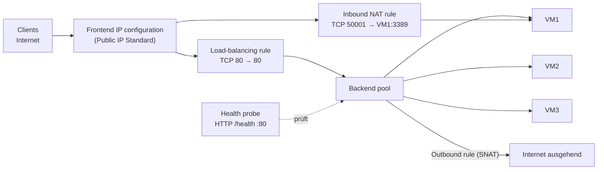
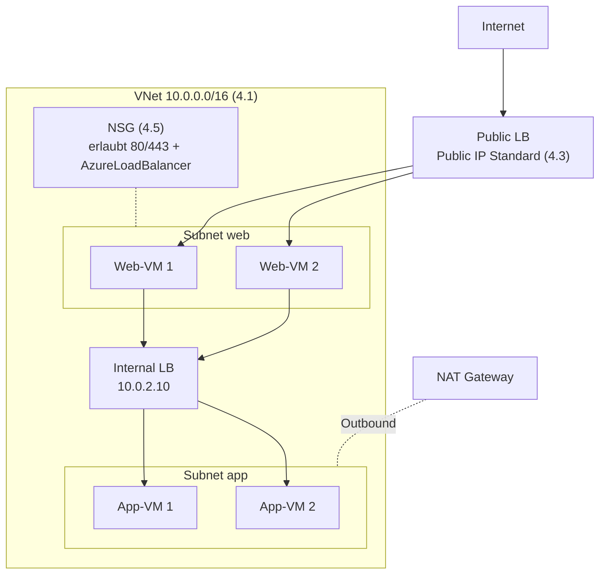

# 4.9 Azure Load Balancer

> **Domäne:** Implement and manage virtual networking · **Gewichtung:** 15–20 %
> **Study-Guide-Punkte:** *Configure an internal or public load balancer* · *Troubleshoot load balancing*
> **Stand:** November 2026

## Lernziele

Nach diesem Kapitel kann ich …

- erklären, wie **Azure Load Balancer** auf **Layer 4** (TCP/UDP) Datenverkehr verteilt und wann ein **Public** bzw. **Internal Load Balancer** passt.
- die Unterschiede zwischen **Basic** (eingestellt), **Standard** und **Gateway** SKU benennen.
- einen Load Balancer mit **Frontend IP configuration**, **Backend pool**, **Health probe**, **Load-balancing rule** und **Inbound NAT rule** im Portal, per CLI und PowerShell konfigurieren.
- **Session persistence**, **Floating IP**, **HA ports**, **Idle timeout/TCP reset** und **Outbound rules (SNAT)** richtig einsetzen.
- Azure Load Balancer von **Application Gateway**, **Front Door** und **Traffic Manager** abgrenzen.
- typische Fehler (Health probe schlägt fehl, keine Outbound-Konnektivität, SKU-Mismatch) systematisch beheben.

## Überblick

**Azure Load Balancer** verteilt eingehenden Netzwerkverkehr auf mehrere Backend-Instanzen (VMs, VM Scale Sets, IP-Adressen) und ist damit ein Grundbaustein für **Hochverfügbarkeit** und **Skalierung**. Er arbeitet auf **OSI-Layer 4**: Er sieht nur IP-Adressen, Ports und Protokoll (TCP/UDP), **nicht** den Inhalt (keine URLs, keine HTTP-Header, keine TLS-Terminierung).

Ein **Public Load Balancer** hat eine öffentliche IP als Frontend und verteilt Internet-Verkehr auf VMs; er kann zusätzlich **ausgehende** Verbindungen (SNAT) für die Backend-VMs bereitstellen. Ein **Internal Load Balancer** (ILB) hat eine private IP aus einem Subnetz und verteilt Verkehr innerhalb eines VNets bzw. aus verbundenen Netzen (Peering, VPN, ExpressRoute) – typisch für mehrschichtige Anwendungen (Web → App → DB).

Seit der Einstellung von **Basic** (30.09.2025) ist **Standard** die maßgebliche SKU: zonenredundant, „secure by default" und mit SLA.

## Kernkonzepte

### Arbeitsweise

- **Pass-through:** Der Load Balancer ist kein Proxy. Die TCP-Verbindung läuft direkt zwischen Client und Backend-VM; die Quell-IP des Clients bleibt erhalten.
- **Verteilung:** Standardmäßig per **5-Tupel-Hash** (Quell-IP, Quell-Port, Ziel-IP, Ziel-Port, Protokoll). Pakete einer Verbindung landen immer auf derselben Instanz, neue Verbindungen können woanders landen.
- **Nur gesunde Instanzen** erhalten neue Verbindungen – entschieden durch die **Health probe**.

### SKUs

| Eigenschaft | Basic (⚠️ eingestellt) | **Standard** | Gateway |
|---|---|---|---|
| Status | Retired **30.09.2025** | aktuelle Standard-SKU | Spezialfall |
| Backend-Pool-Größe | bis 300 Instanzen | bis **1.000** Instanzen | – |
| Backend-Mitglieder | VMs eines Availability Sets / VMSS | beliebige VMs/VMSS **in einem VNet** | NVAs |
| Verfügbarkeitszonen | ❌ | ✅ zonenredundant oder zonal | ✅ |
| Sicherheit | offen by default | **secure by default** – Verkehr nur, wenn eine **NSG** ihn erlaubt | – |
| Health probes | TCP, HTTP | **TCP, HTTP, HTTPS** | TCP, HTTP, HTTPS |
| HA ports | ❌ | ✅ (nur intern) | ✅ |
| Outbound rules | ❌ | ✅ | – |
| SLA | keine | **99,99 %** (≥ 2 gesunde Instanzen) | – |
| Public IP SKU | Basic | **Standard** | – |

**Gateway Load Balancer:** Wird einem Public-LB-Frontend oder einer VM-Public-IP vorgeschaltet (*chaining*) und leitet Verkehr transparent („bump-in-the-wire") durch **Network Virtual Appliances** (Firewalls, DDoS-/Paketinspektion) von Drittanbietern. Für AZ-104 genügt das Grundprinzip.

### Komponenten



#### Frontend IP configuration

- **Public LB:** eine oder mehrere **Public IP Addresses** (Standard SKU, siehe [4.3](03-oeffentliche-ip-adressen.md)) oder Public IP Prefixes.
- **Internal LB:** eine **private IP** aus einem Subnetz (statisch oder dynamisch). Zonenredundant, zonal oder *no zone* wählbar.
- Mehrere Frontends sind möglich (z. B. mehrere Websites mit eigener IP).

#### Backend pool

- Enthält die Ziele: **NIC-basiert** (IP-Konfiguration einer VM-NIC) oder **IP-basiert** (IP-Adressen im VNet).
- ⚠️ Alle Mitglieder müssen sich im **selben VNet** befinden wie der Backend Pool.
- VM Scale Sets können direkt als Backend Pool eingetragen werden ([3.4](../03-compute/04-verfuegbarkeit-und-scale-sets.md)); neue Instanzen werden automatisch Mitglied.

#### Health probes

| Protokoll | Gesund, wenn … |
|---|---|
| **TCP** | der TCP-Handshake auf dem Port erfolgreich ist |
| **HTTP** | der Pfad (z. B. `/health`) mit **HTTP 200** antwortet |
| **HTTPS** | wie HTTP, zusätzlich mit TLS (nur Standard); das Zertifikat wird nicht validiert |

- **Interval** (Standard **5 Sekunden**) und **Schwellenwert** (Anzahl aufeinanderfolgender Fehlschläge/Erfolge, bis eine Instanz als *down*/*up* gilt) sind konfigurierbar.
- Probes stammen von der IP **168.63.129.16** (Service Tag **AzureLoadBalancer**). Die Standard-NSG-Regel *AllowAzureLoadBalancerInBound* (Priorität 65001) erlaubt sie – eine eigene Deny-Regel mit niedrigerer Prioritätsnummer kann sie blockieren.
- Fallen **alle** Instanzen aus, verhält sich der Load Balancer je nach Einstellung unterschiedlich; neue Verbindungen werden aber nicht mehr erfolgreich zugestellt.

#### Load-balancing rules

Verknüpfen **Frontend IP + Port** mit **Backend Pool + Port** und **Health probe**.

| Einstellung | Bedeutung |
|---|---|
| **Protocol** | TCP, UDP oder **All** (nur bei HA ports) |
| **Frontend port / Backend port** | z. B. 443 → 443 oder 80 → 8080 |
| **Session persistence** | **None** (5-Tupel, Standard) · **Client IP** (2-Tupel: Quell- + Ziel-IP) · **Client IP and protocol** (3-Tupel) |
| **Idle timeout** | Standard **4 Minuten**, konfigurierbar (mind. 4, typischer Bereich bis 30 Minuten) – danach wird eine inaktive Verbindung verworfen |
| **Enable TCP reset** | Sendet bei Idle-Timeout ein TCP-RST an Client und Server, statt die Verbindung still zu verwerfen |
| **Floating IP** (*Direct Server Return*) | Backend erhält die Frontend-IP als Ziel-IP; nötig z. B. für **SQL Server Always On Availability Group Listener** oder mehrere Regeln auf denselben Backend-Port |
| **Outbound source network address translation (SNAT)** | Ob die Regel auch für ausgehenden Verkehr SNAT bereitstellt – empfohlen: **explizite Outbound rules** oder **NAT Gateway** verwenden |

#### HA ports

- Eine Regel mit **Protocol = All, Port = 0** auf einem **Internal Standard LB** verteilt **alle Ports und Protokolle**.
- Typischer Einsatz: **hochverfügbare NVAs** (Firewalls) im Hub-VNet, auf die per UDR ([4.4](04-benutzerdefinierte-routen.md)) geroutet wird.

#### Inbound NAT rules

- **Port-Forwarding** von einem Frontend-Port auf **eine bestimmte** Backend-Instanz, z. B. `50001 → VM1:3389`, `50002 → VM2:3389` (RDP) oder `50022 → VM1:22` (SSH).
- Neuere Variante: Regel für einen **ganzen Backend Pool** mit Frontend-Portbereich – jede Instanz erhält automatisch einen eigenen Port.
- Sicherer für Administrationszugriff ist [Azure Bastion](06-azure-bastion.md) oder JIT-Zugriff.

#### Outbound-Konnektivität (SNAT)

- Backend-VMs ohne eigene Public IP benötigen einen Weg ins Internet. Optionen (Priorität von oben nach unten):
  1. **NAT Gateway** am Subnetz (empfohlen)
  2. **Public IP** direkt an der VM-NIC
  3. **Outbound rules** eines **Public Standard LB** (explizite Zuweisung von SNAT-Ports pro Instanz)
  4. *Default outbound access* – implizit, wird von Microsoft abgekündigt; neue Subnetze sollen ohne ihn auskommen
- ⚠️ Ein **Internal Standard LB** stellt **keine** Outbound-Konnektivität bereit. VMs, die nur hinter einem ILB stehen, brauchen NAT Gateway, eine Public IP oder zusätzlich einen Public LB mit Outbound rule.
- **SNAT port exhaustion:** Zu viele gleichzeitige ausgehende Verbindungen → Verbindungsfehler. Abhilfe: mehr Frontend-IPs, Ports in Outbound rules erhöhen, NAT Gateway.

### Cross-region Load Balancer (Global tier)

- Ein Load Balancer im **Global tier** mit einer **globalen Public IP** verteilt Verkehr auf **regionale Public Standard LBs** in mehreren Regionen.
- Ermöglicht regionsübergreifende Hochverfügbarkeit auf Layer 4 mit statischer Anycast-IP; leitet zur nächstgelegenen gesunden Region.
- Wird nur in bestimmten *Home regions* erstellt; Backends sind Load Balancer, keine VMs.

## Zusammenhänge



- **VNets & Subnetze** ([4.1](01-virtuelle-netzwerke-und-subnetze.md)): Backend Pool und ILB-Frontend liegen in einem VNet.
- **Public IP** ([4.3](03-oeffentliche-ip-adressen.md)): Standard LB erfordert **Standard SKU** Public IPs; Zonenoptionen müssen zusammenpassen.
- **NSG** ([4.5](05-nsg-und-asg.md)): Standard LB ist *secure by default* – ohne NSG-Allow-Regel kommt kein Verkehr an. Die NSG muss auch die Health probes (AzureLoadBalancer) erlauben.
- **UDR** ([4.4](04-benutzerdefinierte-routen.md)): Bei NVA-Szenarien zeigt die UDR auf die Frontend-IP eines ILB mit HA ports.
- **VM Scale Sets & Availability Zones** ([3.4](../03-compute/04-verfuegbarkeit-und-scale-sets.md)): VMSS werden als Backend Pool eingetragen; zonenredundanter LB + VMs in mehreren Zonen = 99,99 % SLA.
- **Monitoring** ([5.1](../05-monitoring-und-wartung/01-azure-monitor-metriken-und-logs.md)) und **Network Watcher** ([4.10](10-netzwerk-troubleshooting.md)) für Troubleshooting.
- **App Service** ([3.6](../03-compute/06-azure-app-service.md)) bringt eigenen Lastausgleich mit – dort ist kein Azure Load Balancer nötig.

## Vergleichstabellen

### Public vs. Internal Load Balancer

| Kriterium | Public LB | Internal LB |
|---|---|---|
| Frontend | Public IP (Standard) | private IP aus einem Subnetz |
| Clients | Internet | VNet, gepeerte VNets, On-Premises (VPN/ExpressRoute) |
| Outbound SNAT | ✅ (Outbound rules) | ❌ |
| HA ports | ❌ | ✅ |
| Typischer Einsatz | Web-Frontend | App-/DB-Schicht, NVAs, SQL AG Listener |

### Load-Balancing-Dienste in Azure

| Dienst | Layer | Reichweite | Besonderheiten | Typischer Einsatz |
|---|---|---|---|---|
| **Azure Load Balancer** | **4** (TCP/UDP) | regional (Global tier: global) | sehr hohe Leistung, kein TLS, keine URL | VMs/VMSS, Nicht-HTTP-Protokolle, interner Verkehr |
| **Application Gateway** | **7** (HTTP/S) | regional | **URL-/pfadbasiertes Routing**, TLS-Terminierung, Cookie-Affinität, **WAF** | Webanwendungen in einer Region |
| **Azure Front Door** | **7** (HTTP/S) | **global** | Anycast-Edge, CDN-Caching, WAF, globales Failover | globale Webanwendungen |
| **Traffic Manager** | **DNS** | **global** | Routing per DNS-Antwort (Priority, Weighted, Performance, Geographic …), kein Datenpfad | globales Failover für beliebige Endpunkte |

**Entscheidungshilfe:**

- Nicht-HTTP oder reiner TCP/UDP-Verkehr → **Load Balancer**
- HTTP(S) in einer Region, URL-Routing oder WAF → **Application Gateway**
- HTTP(S) global, Performance/Caching → **Front Door**
- Globales Failover per DNS, beliebiges Protokoll → **Traffic Manager**

### Session persistence

| Modus | Hash | Effekt |
|---|---|---|
| **None** | 5-Tupel | beste Verteilung, Folgeverbindungen evtl. auf anderer VM |
| **Client IP** | 2-Tupel (Quell-IP, Ziel-IP) | gleicher Client → gleiche VM |
| **Client IP and protocol** | 3-Tupel (+ Protokoll) | wie oben, getrennt nach TCP/UDP |

## Azure Portal

| Aufgabe | Pfad |
|---|---|
| Load Balancer erstellen | **Portal > Load balancers > + Create** (bzw. **Portal > Load balancing – help me choose**) |
| Frontend-IPs | **… > Load balancer > Settings > Frontend IP configuration** |
| Backend Pool / VMs hinzufügen | **… > Load balancer > Settings > Backend pools > + Add** |
| Health probe | **… > Load balancer > Settings > Health probes > + Add** |
| Load-balancing rule | **… > Load balancer > Settings > Load balancing rules > + Add** |
| Inbound NAT rule | **… > Load balancer > Settings > Inbound NAT rules > + Add** |
| Outbound rule | **… > Load balancer > Settings > Outbound rules > + Add** |
| Metriken (Data path availability, Health probe status, SNAT) | **… > Load balancer > Monitoring > Metrics** |
| Topologie/Gesundheit | **… > Load balancer > Monitoring > Insights** |
| Resource Health | **… > Load balancer > Help > Resource health** |
| Diagnostik-Assistent | **… > Load balancer > Diagnose and solve problems** |

**Wichtige Felder im Assistenten *Create load balancer*:**

1. **Basics:** Subscription, Resource group, Name, Region, **SKU** (Standard / Gateway), **Type** (Public / Internal), **Tier** (Regional / Global)
2. **Frontend IP configuration:** Public IP (neu/vorhanden) bzw. VNet, Subnetz, Zuweisung statisch/dynamisch, Availability zone
3. **Backend pools:** VNet, Konfiguration NIC- oder IP-basiert, VMs/VMSS
4. **Inbound rules:** Load-balancing rules und Inbound NAT rules
5. **Outbound rules** (nur Public)
6. **Tags → Review + create**

⚠️ **Nach der Erstellung nicht mehr änderbar:**
- **SKU** (Basic → Standard nur per Migration/Upgrade-Skript)
- **Type** Public ↔ Internal
- **Tier** Regional ↔ Global
- VNet eines Backend Pools (Pool mit anderem VNet neu anlegen)

## Azure CLI & PowerShell

### Azure CLI – Public Load Balancer

```bash
# Public IP (Standard, zonenredundant) anlegen
az network public-ip create -g rg-web -n pip-lb-web --sku Standard --zone 1 2 3

# Load Balancer mit Frontend und Backend Pool
az network lb create -g rg-web -n lb-web --sku Standard \
  --public-ip-address pip-lb-web \
  --frontend-ip-name fe-web --backend-pool-name be-web

# Health probe (HTTP)
az network lb probe create -g rg-web --lb-name lb-web -n hp-http \
  --protocol Http --port 80 --path /health --interval 5

# Load-balancing rule mit Session persistence "Client IP"
az network lb rule create -g rg-web --lb-name lb-web -n rule-http \
  --protocol Tcp --frontend-port 80 --backend-port 80 \
  --frontend-ip-name fe-web --backend-pool-name be-web \
  --probe-name hp-http --load-distribution SourceIP \
  --idle-timeout 15 --enable-tcp-reset true --disable-outbound-snat true

# VM-NIC in den Backend Pool aufnehmen
az network nic ip-config address-pool add -g rg-web \
  --nic-name vm1-nic --ip-config-name ipconfig1 \
  --lb-name lb-web --address-pool be-web

# Inbound NAT rule: RDP über Port 50001 auf VM1
az network lb inbound-nat-rule create -g rg-web --lb-name lb-web -n nat-rdp-vm1 \
  --protocol Tcp --frontend-port 50001 --backend-port 3389 --frontend-ip-name fe-web
az network nic ip-config inbound-nat-rule add -g rg-web \
  --nic-name vm1-nic --ip-config-name ipconfig1 \
  --lb-name lb-web --inbound-nat-rule nat-rdp-vm1

# Outbound rule (explizites SNAT)
az network lb outbound-rule create -g rg-web --lb-name lb-web -n out-all \
  --frontend-ip-configs fe-web --protocol All \
  --address-pool be-web --outbound-ports 10000
```

`--load-distribution`: `Default` (5-Tupel), `SourceIP` (Client IP), `SourceIPProtocol` (Client IP and protocol).

### Azure CLI – Internal Load Balancer mit HA ports

```bash
az network lb create -g rg-app -n ilb-app --sku Standard \
  --vnet-name vnet-prod --subnet snet-app \
  --private-ip-address 10.0.2.10 \
  --frontend-ip-name fe-app --backend-pool-name be-app

az network lb probe create -g rg-app --lb-name ilb-app -n hp-tcp --protocol Tcp --port 8080

# HA ports: alle Protokolle, Port 0
az network lb rule create -g rg-app --lb-name ilb-app -n rule-haports \
  --protocol All --frontend-port 0 --backend-port 0 \
  --frontend-ip-name fe-app --backend-pool-name be-app --probe-name hp-tcp
```

### Azure PowerShell

```powershell
$rg  = "rg-web"; $loc = "germanywestcentral"
$pip = Get-AzPublicIpAddress -ResourceGroupName $rg -Name "pip-lb-web"

$fe    = New-AzLoadBalancerFrontendIpConfig -Name "fe-web" -PublicIpAddress $pip
$be    = New-AzLoadBalancerBackendAddressPoolConfig -Name "be-web"
$probe = New-AzLoadBalancerProbeConfig -Name "hp-http" -Protocol Http -Port 80 `
           -RequestPath "/health" -IntervalInSeconds 5 -ProbeCount 2
$rule  = New-AzLoadBalancerRuleConfig -Name "rule-http" -FrontendIpConfiguration $fe `
           -BackendAddressPool $be -Probe $probe -Protocol Tcp `
           -FrontendPort 80 -BackendPort 80 -LoadDistribution SourceIP `
           -IdleTimeoutInMinutes 15 -EnableTcpReset -DisableOutboundSNAT
$nat   = New-AzLoadBalancerInboundNatRuleConfig -Name "nat-rdp-vm1" `
           -FrontendIpConfiguration $fe -Protocol Tcp -FrontendPort 50001 -BackendPort 3389

New-AzLoadBalancer -ResourceGroupName $rg -Name "lb-web" -Location $loc -Sku Standard `
  -FrontendIpConfiguration $fe -BackendAddressPool $be -Probe $probe `
  -LoadBalancingRule $rule -InboundNatRule $nat

# Internes Frontend (statt Public IP)
$vnet   = Get-AzVirtualNetwork -ResourceGroupName "rg-app" -Name "vnet-prod"
$subnet = Get-AzVirtualNetworkSubnetConfig -VirtualNetwork $vnet -Name "snet-app"
$feInt  = New-AzLoadBalancerFrontendIpConfig -Name "fe-app" -SubnetId $subnet.Id `
            -PrivateIpAddress "10.0.2.10"
```

| Ziel | CLI | PowerShell |
|---|---|---|
| LB anlegen | `az network lb create` | `New-AzLoadBalancer` |
| Frontend | `--frontend-ip-name` / `az network lb frontend-ip create` | `New-AzLoadBalancerFrontendIpConfig` |
| Backend Pool | `--backend-pool-name` / `az network lb address-pool create` | `New-AzLoadBalancerBackendAddressPoolConfig` |
| Health probe | `az network lb probe create` | `New-AzLoadBalancerProbeConfig` |
| Regel | `az network lb rule create` | `New-AzLoadBalancerRuleConfig` |
| NAT rule | `az network lb inbound-nat-rule create` | `New-AzLoadBalancerInboundNatRuleConfig` |
| Outbound rule | `az network lb outbound-rule create` | `New-AzLoadBalancerOutboundRuleConfig` |

## Praxisbeispiel

**Szenario:** *Contoso* betreibt einen Webshop auf drei Windows-VMs (IIS) in den Zonen 1–3 von *Germany West Central* sowie eine App-Schicht aus zwei VMs. Anforderungen:

1. Der Shop soll aus dem Internet über **eine** IP auf Port 443 erreichbar sein, mit 99,99 % SLA.
2. Ein Warenkorb ist serverseitig gespeichert – ein Kunde soll immer auf derselben VM landen.
3. Admins sollen jede Web-VM einzeln per RDP erreichen können (Übergangslösung).
4. Die App-Schicht soll nur intern über eine feste IP erreichbar sein.
5. Die App-VMs brauchen ausgehenden Internetzugriff für Updates.

**Umsetzung:**

1. **Public IP** `pip-shop` (Standard, zonenredundant) anlegen → **Public Standard LB** `lb-shop` mit Frontend `fe-shop`.
2. **Backend Pool** `be-web` mit den NICs der drei Web-VMs.
3. **Health probe** `hp-https`: HTTPS, Port 443, Pfad `/health`, Interval 5 s.
4. **Load-balancing rule** `rule-https`: TCP 443 → 443, Probe `hp-https`, **Session persistence: Client IP**.
5. **Inbound NAT rules:** `50001 → web1:3389`, `50002 → web2:3389`, `50003 → web3:3389` (später durch **Azure Bastion** ersetzen, [4.6](06-azure-bastion.md)).
6. **NSG** am Web-Subnetz: Allow TCP 443 von *Internet*, Allow TCP 3389 nur von der Admin-IP; die Standardregel für *AzureLoadBalancer* nicht überschreiben.
7. **Internal Standard LB** `ilb-app` mit statischer Frontend-IP `10.0.2.10` im Subnetz `snet-app`, Regel TCP 8080, TCP-Probe auf 8080.
8. **NAT Gateway** am Subnetz `snet-app`, da der ILB keine Outbound-Konnektivität bietet.
9. Test: Shop über `pip-shop` aufrufen, unter **Monitoring > Metrics** *Health probe status* = 100 % prüfen; eine Web-VM stoppen und beobachten, dass der Verkehr auf die anderen umgeleitet wird.

## Limits & wichtige Zahlen

| Wert | Grenze / Standard |
|---|---|
| Backend-Pool-Größe Standard | bis **1.000** Instanzen (Basic: 300) |
| Load-balancing rules pro LB | ca. **1.500** (aktuelle Werte prüfen) |
| Health probe Interval | Standard **5 s** |
| Idle timeout | Standard **4 Min.**, konfigurierbar (typisch bis 30 Min.) |
| SLA Standard LB | **99,99 %** |
| Health-Probe-Quell-IP | **168.63.129.16** (Service Tag *AzureLoadBalancer*) |
| Basic SKU | eingestellt am **30.09.2025** |
| Backend-Mitglieder | alle im **selben VNet** |

Aktuelle Limits: [Azure subscription and service limits – Load Balancer](https://learn.microsoft.com/azure/azure-resource-manager/management/azure-subscription-service-limits#load-balancer).

## Prüfungstipps & Fallstricke

- ⚠️ **Standard LB, VMs nicht erreichbar, obwohl alles konfiguriert ist** → Es fehlt eine **NSG-Allow-Regel** (*secure by default*).
- ⚠️ **Health probe zeigt alle Instanzen als down** → Dienst lauscht nicht auf dem Probe-Port/-Pfad, **Gast-Firewall** blockiert, HTTP-Pfad liefert nicht **200**, oder eine NSG-Regel blockiert **AzureLoadBalancer / 168.63.129.16**.
- ⚠️ **VMs hinter einem Internal Standard LB kommen nicht ins Internet** → ILB liefert kein SNAT; **NAT Gateway** oder Public IP/Public LB mit Outbound rule nötig.
- ⚠️ **Public IP lässt sich nicht als Frontend wählen** → SKU-Mismatch: Standard LB braucht **Standard Public IP**.
- ⚠️ **VM lässt sich nicht in den Backend Pool aufnehmen** → VM liegt in einem **anderen VNet** als der Backend Pool.
- **„Benutzer sollen auf derselben VM bleiben"** → **Session persistence: Client IP** (bzw. *Client IP and protocol*).
- **„RDP auf einzelne VMs über die LB-IP"** → **Inbound NAT rule**, nicht Load-balancing rule.
- **„Alle Ports/Protokolle an hochverfügbare Firewall-NVAs"** → **Internal Standard LB** mit **HA ports**.
- **„SQL Always On Listener"** → **Floating IP** aktivieren.
- **„URL-basiertes Routing / WAF / TLS-Terminierung"** → nicht Load Balancer, sondern **Application Gateway** (regional) bzw. **Front Door** (global).
- **„Globales Failover per DNS"** → **Traffic Manager**.
- **Verbindungen brechen nach einigen Minuten Inaktivität ab** → **Idle timeout** erhöhen bzw. TCP-Keepalives; **TCP reset** sorgt für saubere Abbrüche.
- **Sporadische ausgehende Verbindungsfehler bei viel Last** → **SNAT port exhaustion** → NAT Gateway oder mehr Frontend-IPs/Ports.
- Metriken: **Data path availability** = Erreichbarkeit des Frontends; **Health probe status** = Gesundheit der Backend-Instanzen.

## Selbsttest

**1.** Sie haben einen Standard Public Load Balancer mit zwei Web-VMs konfiguriert. Die Health probes sind erfolgreich, aber Clients erreichen die Website nicht. An den NICs und am Subnetz ist keine NSG zugeordnet. Was ist die Ursache?

<details><summary>Lösung</summary>

Der Standard Load Balancer ist **secure by default**: Eingehender Verkehr wird nur zugelassen, wenn eine **NSG** ihn explizit erlaubt. Lösung: NSG mit Allow-Regel für TCP 80/443 am Subnetz oder an den NICs zuordnen.
</details>

**2.** Alle Backend-VMs werden in den Metriken als *unhealthy* angezeigt. Die Website läuft auf Port 80, die HTTP-Probe prüft `/status.html`. Nennen Sie drei mögliche Ursachen.

<details><summary>Lösung</summary>

- `/status.html` existiert nicht oder liefert keinen **HTTP 200** (z. B. 404 oder Redirect 301/302).
- Die **Windows-Firewall/iptables** in der VM blockiert Port 80.
- Eine **NSG-Regel** mit höherer Priorität blockiert den Verkehr von **AzureLoadBalancer (168.63.129.16)**.
</details>

**3.** Die App-VMs stehen hinter einem internen Standard Load Balancer und haben keine Public IP. Updates aus dem Internet schlagen fehl. Welche Lösung empfiehlt Microsoft?

<details><summary>Lösung</summary>

Ein **NAT Gateway** am Subnetz der App-VMs. Ein interner Load Balancer stellt kein SNAT für ausgehenden Verkehr bereit.
</details>

**4.** Sie möchten per RDP auf jede von drei VMs hinter einem Public Load Balancer zugreifen, ohne den VMs eigene Public IPs zu geben. Was konfigurieren Sie?

<details><summary>Lösung</summary>

**Inbound NAT rules**, z. B. Frontend-Port 50001 → VM1:3389, 50002 → VM2:3389, 50003 → VM3:3389. (Sicherer wäre Azure Bastion.)
</details>

**5.** Eine Webanwendung speichert Sitzungsdaten lokal auf der VM. Benutzer verlieren gelegentlich ihren Warenkorb. Welche Einstellung der Load-balancing rule ändern Sie?

<details><summary>Lösung</summary>

**Session persistence** von *None* auf **Client IP** (oder *Client IP and protocol*) stellen. Dann landet derselbe Client immer auf derselben VM.
</details>

**6.** Sie benötigen Lastausgleich mit pfadbasiertem Routing (`/images` → Pool A, `/api` → Pool B) und einer Web Application Firewall in einer Region. Welcher Dienst?

<details><summary>Lösung</summary>

**Azure Application Gateway** (Layer 7) mit **WAF**-SKU. Azure Load Balancer arbeitet auf Layer 4 und kennt keine URL-Pfade.
</details>

**7.** Zwei Firewall-NVAs im Hub-VNet sollen hochverfügbar den gesamten Verkehr (alle Ports, TCP und UDP) verarbeiten. Wie konfigurieren Sie den Load Balancer?

<details><summary>Lösung</summary>

**Internal Standard Load Balancer** mit einer **HA ports**-Regel (Protocol *All*, Port 0). Die UDRs der Spoke-Subnetze zeigen als Next hop auf die Frontend-IP des ILB.
</details>

**8.** Sie wollen eine vorhandene Basic-SKU-Public-IP als Frontend eines neuen Standard Load Balancers verwenden. Was passiert?

<details><summary>Lösung</summary>

Das ist nicht möglich: Ein Standard Load Balancer erfordert **Standard-SKU** Public IPs. Die Public IP muss auf Standard aktualisiert oder neu erstellt werden.
</details>

**9.** Welche zwei Metriken prüfen Sie zuerst, um zwischen einem Problem am Frontend und einem Problem bei den Backend-Instanzen zu unterscheiden?

<details><summary>Lösung</summary>

**Data path availability** (Erreichbarkeit des Frontends/Datenpfads) und **Health probe status** (Gesundheit der Backend-Instanzen).
</details>

## Weiterführende Links

- [AZ-104 Study Guide](https://learn.microsoft.com/credentials/certifications/resources/study-guides/az-104)
- [What is Azure Load Balancer?](https://learn.microsoft.com/azure/load-balancer/load-balancer-overview)
- [Azure Load Balancer components](https://learn.microsoft.com/azure/load-balancer/components)
- [Azure Load Balancer SKUs](https://learn.microsoft.com/azure/load-balancer/skus)
- [Health probes](https://learn.microsoft.com/azure/load-balancer/load-balancer-custom-probe-overview)
- [Distribution modes (session persistence)](https://learn.microsoft.com/azure/load-balancer/distribution-mode-concepts)
- [High availability ports overview](https://learn.microsoft.com/azure/load-balancer/load-balancer-ha-ports-overview)
- [Inbound NAT rules](https://learn.microsoft.com/azure/load-balancer/inbound-nat-rules)
- [Outbound rules](https://learn.microsoft.com/azure/load-balancer/outbound-rules)
- [Source NAT for outbound connections](https://learn.microsoft.com/azure/load-balancer/load-balancer-outbound-connections)
- [Cross-region load balancer](https://learn.microsoft.com/azure/load-balancer/cross-region-overview)
- [Gateway Load Balancer](https://learn.microsoft.com/azure/load-balancer/gateway-overview)
- [Troubleshoot Azure Load Balancer](https://learn.microsoft.com/azure/load-balancer/load-balancer-troubleshoot)
- [Troubleshoot health probe status](https://learn.microsoft.com/azure/load-balancer/load-balancer-troubleshoot-health-probe-status)
- [Load-balancing options in Azure](https://learn.microsoft.com/azure/architecture/guide/technology-choices/load-balancing-overview)
