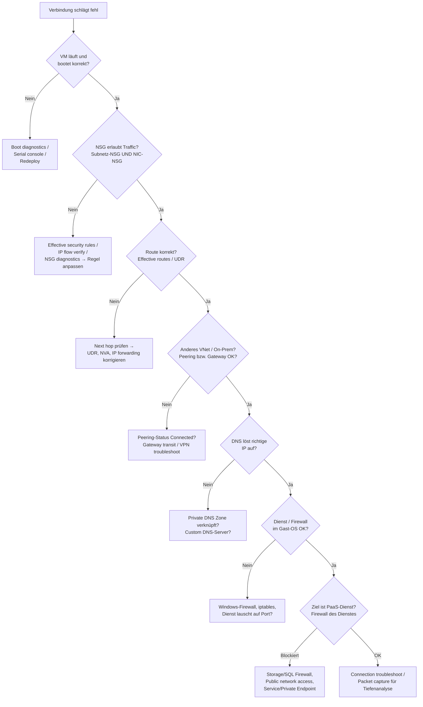
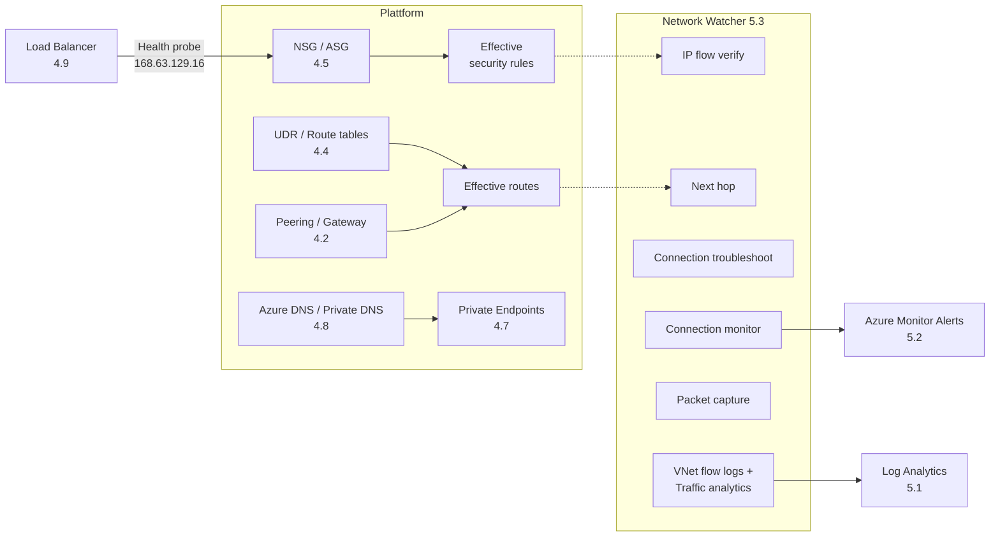

# 4.10 Netzwerk-Troubleshooting

> **Domäne:** Implement and manage virtual networking · **Gewichtung:** 15–20 %
> **Study-Guide-Punkte:** *Troubleshoot network connectivity* · Bezug: *Evaluate effective security rules in NSGs* · *Troubleshoot load balancing*
> (Funktionsweise von Network Watcher und Network Insights im Detail → [Kapitel 5.3](../05-monitoring-und-wartung/03-insights-und-network-watcher.md))
> **Stand:** November 2026

## Lernziele

Nach diesem Kapitel kann ich …

- Konnektivitätsprobleme in Azure **systematisch** eingrenzen (Schicht für Schicht statt Raten).
- **Effective security rules** und **Effective routes** einer NIC lesen und interpretieren.
- für jede Fragestellung das passende **Network-Watcher-Werkzeug** wählen (IP flow verify, NSG diagnostics, Next hop, Connection troubleshoot, Connection monitor, Packet capture, VNet flow logs).
- typische Fehlerbilder (Peering, UDR/NVA, DNS bei Private Endpoints, Health probes, SKU-Mismatch, Outbound-Zugriff) erkennen und beheben.
- VM-seitige Probleme mit **Boot diagnostics**, **Serial console**, **Reset RDP/SSH**, **Redeploy** und Werkzeugen im Gast-OS analysieren.

## Überblick

Netzwerkprobleme in Azure haben fast immer eine von wenigen Ursachen: eine **NSG-Regel blockiert**, eine **Route schickt den Verkehr falsch**, ein **Peering oder Gateway ist nicht korrekt konfiguriert**, **DNS löst falsch auf** oder der **Dienst im Gast-OS bzw. die PaaS-Firewall** lehnt ab.

Weil man in Azure keinen Zugriff auf Switches und Router hat, liefert die Plattform eigene Diagnosewerkzeuge: die NIC-Ansichten **Effective security rules** und **Effective routes** sowie den regionalen Dienst **Azure Network Watcher**. Diese Werkzeuge zeigen, was die Plattform *tatsächlich* auswertet – nicht, was man glaubt konfiguriert zu haben.

In der Prüfung lautet die typische Aufgabe: „VM1 kann VM2 auf Port X nicht erreichen – welches Tool zeigt die Ursache?" oder „Welche Regel greift?". Dieses Kapitel liefert dafür ein Vorgehensmodell und eine Frage→Tool-Zuordnung.

## Kernkonzepte

### Systematisches Vorgehen (Entscheidungsbaum)



Merkregel: **Von außen nach innen** – erst Plattform (VM-Status, NSG, Routen, Peering, DNS), dann Gast-OS, dann Ziel-Dienst.

### Effective security rules (NIC)

- Zeigt die **zusammengeführten** Regeln aus der **NSG am Subnetz** und der **NSG an der NIC**, inklusive der **Default rules** und der Auflösung von **Service Tags** und **Application Security Groups** in IP-Präfixe.
- Auswertungsreihenfolge: **Inbound** = erst Subnetz-NSG, dann NIC-NSG. **Outbound** = erst NIC-NSG, dann Subnetz-NSG. Der Verkehr muss **beide** passieren (sofern beide existieren).
- Nur verfügbar, wenn die VM **läuft** (*Running*).
- Pfad: **VM > Networking > Network settings > NIC > Effective security rules** (bzw. **Network interface > Help > Effective security rules**).
- Admin-Regeln von **Azure Virtual Network Manager** (Security admin rules) werden vor NSG-Regeln ausgewertet und können Verkehr unabhängig von NSGs erlauben/verweigern.

Details zu NSGs → [Kapitel 4.5](05-nsg-und-asg.md).

### Effective routes (NIC)

- Zeigt alle **wirksamen Routen** der NIC: **System routes** (Default), Routen aus **Peering**, **Virtual network gateway** (BGP) und **User-defined routes** (UDR).
- Spalten: *Source* (Default / User / Virtual network gateway), *State* (Active / Invalid), *Address prefixes*, *Next hop type* (VirtualNetwork, Internet, VirtualAppliance, VirtualNetworkGateway, VNetPeering, None), *Next hop IP address*.
- Auswahl der Route: **Longest prefix match**; bei gleichem Präfix gilt **UDR > BGP > System route**.
- Nur bei laufender VM verfügbar.

Details zu UDR → [Kapitel 4.4](04-benutzerdefinierte-routen.md).

### Azure Network Watcher – Werkzeuge

**Network Watcher** ist ein **regionaler** Dienst. Er wird **automatisch aktiviert**, sobald in einer Region ein VNet erstellt wird (Ressource `NetworkWatcher_<region>` in der Ressourcengruppe **NetworkWatcherRG**). Pro Abonnement und Region gibt es genau eine Instanz.

| Werkzeug | Was es tut | Hinweise |
|---|---|---|
| **IP flow verify** | Prüft, ob ein bestimmtes Paket (5-Tupel: Quelle/Ziel-IP, Ports, Protokoll, Richtung) zu/von einer VM **erlaubt oder verweigert** wird, und nennt die **verantwortliche NSG-Regel** | Prüft nur NSG-Regeln (bzw. Admin-Regeln), **nicht** Routen, Gast-Firewall oder Dienst |
| **NSG diagnostics** | Detaillierte Auswertung aller NSGs auf dem Pfad (Subnetz und NIC) für VM, VMSS oder Application Gateway; Quelle kann IP, CIDR oder **Service Tag** sein; kann eine Regel vorschlagen, die den Verkehr erlaubt | Neuerer, ausführlicherer Nachfolger für Regelanalysen |
| **Next hop** | Zeigt für Quell-VM + Ziel-IP den **Next hop type**, die Next-hop-IP und die **Route table**, die die Entscheidung trifft | Erkennt falsche UDRs, Black-hole-Routen (*None*) |
| **Connection troubleshoot** | Einmaliger End-to-End-Test von einer VM (oder App Gateway, Bastion) zu einer VM/FQDN/URI/IP:Port; zeigt Hops, Latenz und erkannte Probleme (NSG, Route, CPU/Speicher, DNS) | Benötigt **Network Watcher Agent Extension** auf Quell-VM |
| **Connection monitor** | **Dauerhaftes** Monitoring von Erreichbarkeit und Latenz (Azure ↔ Azure, Azure ↔ On-Prem, Internet) mit Alarmen über Azure Monitor | Agent: Network Watcher Extension (Azure-VMs) bzw. Azure Monitor Agent (On-Prem); Log Analytics |
| **Packet capture** | Zeichnet Pakete auf einer VM/VMSS-Instanz auf (Filter nach IP/Port/Protokoll), Speicherung als `.cap` in Storage Account und/oder lokal | Benötigt **Network Watcher Agent Extension**; begrenzte Laufzeit (max. 5 Stunden); Analyse z. B. mit Wireshark |
| **Topology** | Visualisiert Ressourcen und ihre Beziehungen über Abos/Regionen/RGs hinweg | Nur Lesesicht |
| **VPN troubleshoot** | Diagnostiziert Virtual Network Gateways und Verbindungen (Site-to-Site), schreibt Logs in Storage | Dauer einige Minuten |
| **Effective security rules** | Wirksame NSG-Regeln einer NIC (auch unter Network Watcher erreichbar) | VM muss laufen |
| **VNet flow logs** | Protokollieren IP-Flows (erlaubt/verweigert) auf **VNet-, Subnetz- oder NIC-Ebene** in einen Storage Account; Auswertung mit **Traffic analytics** (Log Analytics) | Nachfolger der **NSG flow logs** – neue NSG flow logs können nicht mehr erstellt werden, vorhandene werden eingestellt |

### Frage → Tool (Prüfungs-Zuordnung)

| Fragestellung | Werkzeug |
|---|---|
| „Wird TCP 3389 von IP 203.0.113.10 zu VM1 erlaubt?" | **IP flow verify** |
| „Welche NSG-Regel blockiert den Verkehr?" | **IP flow verify** (nennt Regel) / **NSG diagnostics** / Effective security rules |
| „Welche Regeln gelten auf der NIC insgesamt (Subnetz + NIC zusammen)?" | **Effective security rules** |
| „Wohin wird ein Paket von VM1 an 10.2.0.4 geroutet? Welche Route-Tabelle greift?" | **Next hop** |
| „Welche Routen sind auf der NIC aktiv?" | **Effective routes** |
| „Kann VM1 einmalig `sql01:1433` erreichen, und wo hakt es?" | **Connection troubleshoot** |
| „Erreichbarkeit und Latenz zwischen Azure und On-Prem dauerhaft überwachen und alarmieren" | **Connection monitor** |
| „Pakete mitschneiden, um ein Protokollproblem zu analysieren" | **Packet capture** |
| „Welche IPs kommunizieren mit dem Subnetz, wie viel Verkehr wurde verweigert?" | **VNet flow logs** + **Traffic analytics** |
| „Site-to-Site-VPN ist down" | **VPN troubleshoot** |
| „Wie hängen die Ressourcen im VNet zusammen?" | **Topology** |
| „VM bootet nicht / hängt beim Start" | **Boot diagnostics** / **Serial console** |

### Werkzeuge auf VM-Ebene

| Werkzeug | Zweck |
|---|---|
| **Boot diagnostics** | Screenshot und serielles Log des Startvorgangs (z. B. Bluescreen, Kernel Panic, hängende Updates). Managed Storage Account (empfohlen) oder eigener. |
| **Serial console** | Textkonsole zur VM **ohne Netzwerkzugriff** (z. B. bei falsch konfigurierter Firewall/IP im Gast). Voraussetzung: Boot diagnostics aktiviert, Benutzer mit Kennwort im Gast, Rolle mind. *Virtual Machine Contributor*. |
| **Reset password** (Modus *Reset configuration only*) | Setzt **RDP-Konfiguration** (Windows) bzw. **SSH-Konfiguration** (Linux) zurück, z. B. wenn RDP deaktiviert oder der Port geändert wurde. Nutzt die VMAccess-Extension. |
| **Netzwerkschnittstelle zurücksetzen** | Bei falscher Netzwerkkonfiguration im Gast: private IP der NIC auf eine andere **statische** IP ändern (VM startet neu, NIC wird neu initialisiert), danach ggf. zurück auf Dynamic. |
| **Redeploy** | Verschiebt die VM auf einen **neuen Host** im Azure-Rechenzentrum und startet sie neu. Temp-Disk-Daten gehen verloren; dynamische Public IPs können sich ändern. |
| **Reapply** | Wendet den VM-Zustand (Konfiguration) erneut an, z. B. bei VM im Status *Failed*. |
| **Run command** | Skripte im Gast ausführen ohne RDP/SSH (z. B. `Set-NetFirewallProfile`, `ipconfig`). |
| **az vm repair** | Erstellt eine Reparatur-VM, hängt eine Kopie der OS-Disk an, ermöglicht Offline-Reparatur und tauscht die Disk danach zurück. |

### Werkzeuge im Gast-OS

| Tool | Plattform | Einsatz |
|---|---|---|
| `Test-NetConnection <ziel> -Port 443` | Windows PowerShell | TCP-Port erreichbar? DNS-Auflösung, Quell-IP |
| `nslookup <fqdn>` / `Resolve-DnsName` | Windows | DNS-Auflösung prüfen (z. B. Private Endpoint → private IP?) |
| `dig <fqdn>` / `nslookup` | Linux | DNS-Auflösung |
| `tracert` / `traceroute` / `pathping` | Windows / Linux | Pfad verfolgen (ICMP wird in Azure oft nicht beantwortet → nur eingeschränkt aussagekräftig) |
| `psping <ziel>:<port>` | Windows (Sysinternals) | TCP-Erreichbarkeit und Latenz ohne ICMP |
| `curl -v https://<ziel>` | Windows/Linux | HTTP(S)-Erreichbarkeit, TLS, Antwortcodes |
| `netstat -an` / `ss -tulpn` | Windows / Linux | Lauscht der Dienst auf dem erwarteten Port? |

⚠️ **ICMP (Ping)** ist kein zuverlässiger Test: Viele Ziele (z. B. Load-Balancer-Frontends, Internet-Ziele) beantworten keine Pings, und NSGs erlauben ICMP nur, wenn eine Regel dies zulässt. Besser TCP-basierte Tests (`Test-NetConnection`, `psping`, `curl`).

### Die Plattform-IP 168.63.129.16

- **Virtuelle öffentliche IP** der Azure-Plattform, erreichbar aus jedem VNet.
- Wird genutzt für: **Health probes** des Azure Load Balancers, **Azure-DNS** (rekursiver Resolver), **DHCP**, VM-Agent-Kommunikation (Heartbeat, Extensions).
- In NSGs über das Service Tag **AzureLoadBalancer** abgebildet (Default rule *AllowAzureLoadBalancerInBound*).
- ⚠️ Wird diese IP bzw. das Tag durch eine eigene Deny-Regel blockiert, schlagen **Health probes fehl** und der Load Balancer schickt keinen Traffic mehr an die Backends.

### Typische Fehlerbilder

| Symptom | Ursache | Lösung |
|---|---|---|
| Peering lässt sich nicht erstellen | **Überlappende Adressräume** der VNets | Adressraum eines VNets ändern (ggf. neu planen) – überlappende VNets können nicht gepeert werden |
| Peering-Status **Initiated** oder **Disconnected**, kein Verkehr | Peering nur auf **einer Seite** angelegt oder Gegenseite gelöscht | Peering auf **beiden** Seiten anlegen; bei *Disconnected* Peering löschen und neu erstellen |
| Spoke erreicht On-Prem über das Hub-Gateway nicht | **Gateway transit** fehlt | Im Hub-Peering **Allow gateway transit**, im Spoke-Peering **Use remote gateways** aktivieren |
| Spoke A erreicht Spoke B nicht (beide mit Hub gepeert) | Peering ist **nicht transitiv** | Direktes Peering Spoke↔Spoke oder UDR über NVA/Azure Firewall im Hub (mit *Allow forwarded traffic*) |
| Verkehr verschwindet nach Einführung einer UDR | UDR schickt Traffic an **ausgefallene/falsche NVA** oder Next hop *None* | **Next hop** prüfen, NVA-IP/Status korrigieren, Route anpassen |
| NVA leitet Pakete nicht weiter | **IP forwarding** an der NIC der NVA (und im Gast-OS) fehlt | NIC > *IP configurations* > **Enable IP forwarding**; im Gast-OS Routing aktivieren |
| Load Balancer verteilt nicht, Backends *unhealthy* | NSG blockiert **Health probe** (168.63.129.16 / AzureLoadBalancer) oder Dienst lauscht nicht auf Probe-Port | NSG-Regel für AzureLoadBalancer erlauben, Probe-Port/-Pfad prüfen |
| Standard Load Balancer: Backends nicht erreichbar | Standard LB/Public IP ist **secure by default** – ohne NSG-Allow kein Inbound | NSG mit Allow-Regel an Subnetz/NIC der Backends |
| Private Endpoint wird nicht genutzt, Zugriff geht öffentlich/wird abgelehnt | **DNS** löst den FQDN (z. B. `contosodata.blob.core.windows.net`) auf die **öffentliche IP** auf | **Private DNS Zone** (z. B. `privatelink.blob.core.windows.net`) mit dem VNet **verknüpfen**; bei Custom DNS Forwarder auf 168.63.129.16 |
| VM in neuem Subnetz hat keinen Internetzugang | Subnetz ist **privat** (*Default outbound access* deaktiviert) | Expliziten Outbound-Weg schaffen: **NAT Gateway**, Public IP an VM, Load-Balancer-Outbound-Regeln oder Azure Firewall |
| Ressourcen lassen sich nicht kombinieren | **SKU-Mismatch** Basic/Standard (Public IP und Load Balancer müssen gleiche SKU haben) | Einheitlich **Standard** verwenden (Basic-SKUs sind eingestellt) |
| VM mit Standard Public IP per RDP nicht erreichbar | **Standard Public IP ist standardmäßig geschlossen** – keine NSG oder keine Allow-Regel | NSG mit Allow-Regel (besser: Bastion/JIT statt offener 3389) |
| Zugriff auf Storage/SQL von VM verweigert | **Firewall des PaaS-Dienstes** (Selected networks) erlaubt das Subnetz nicht | Service Endpoint + VNet-Regel oder Private Endpoint; IP-Regel greift nicht für private IPs |
| Interner Load Balancer: Backend-VM erreicht eigenes Frontend nicht | Kein **Hairpinning** beim internen Load Balancer | Architektur anpassen (Client nicht im selben Backend-Pool) |
| Ausgehende Verbindungen brechen sporadisch ab | **SNAT-Port-Erschöpfung** | NAT Gateway, mehr Frontend-IPs/Outbound-Regeln |

## Zusammenhänge



- **NSG/ASG** ([4.5](05-nsg-und-asg.md)) → Analyse mit Effective security rules, IP flow verify, NSG diagnostics.
- **UDR** ([4.4](04-benutzerdefinierte-routen.md)) und **Peering** ([4.2](02-vnet-peering.md)) → Analyse mit Effective routes und Next hop.
- **VNets/Subnetze** ([4.1](01-virtuelle-netzwerke-und-subnetze.md)): Adressräume, private Subnetze, Default outbound access.
- **Public IPs** ([4.3](03-oeffentliche-ip-adressen.md)): SKU, *secure by default*.
- **Bastion** ([4.6](06-azure-bastion.md)): Zugriff ohne Public IP; benötigt bestimmte NSG-Regeln im AzureBastionSubnet.
- **Service/Private Endpoints** ([4.7](07-service-endpoints-und-private-endpoints.md)) und **DNS** ([4.8](08-azure-dns.md)): häufigste Ursache für „Private Endpoint funktioniert nicht".
- **Load Balancer** ([4.9](09-load-balancer.md)): Health probes, Backend-Pool, NSG.
- **Monitoring** ([5.1](../05-monitoring-und-wartung/01-azure-monitor-metriken-und-logs.md), [5.2](../05-monitoring-und-wartung/02-warnungen-und-aktionsgruppen.md), [5.3](../05-monitoring-und-wartung/03-insights-und-network-watcher.md)): Connection monitor, Flow logs und Alerts.
- **Speicher-Firewall** ([2.2](../02-speicher/02-speicherzugriff-und-sicherheit.md)): PaaS-seitige Blockade.

## Vergleichstabellen

### Diagnose-Werkzeuge im Vergleich

| Werkzeug | Prüft | Einmalig / dauerhaft | Agent nötig? |
|---|---|---|---|
| Effective security rules | NSG-Konfiguration (Subnetz + NIC) | Momentaufnahme | nein (VM muss laufen) |
| IP flow verify | NSG-Entscheidung für ein Paket | einmalig | nein |
| NSG diagnostics | alle NSGs auf dem Pfad, Service Tags als Quelle | einmalig | nein |
| Effective routes | wirksame Routen | Momentaufnahme | nein (VM muss laufen) |
| Next hop | Routing-Entscheidung für Ziel-IP | einmalig | nein |
| Connection troubleshoot | End-to-End (NSG, Route, DNS, Ziel) | einmalig | **ja** (Network Watcher Extension) |
| Connection monitor | Erreichbarkeit/Latenz | **dauerhaft**, mit Alerts | **ja** |
| Packet capture | Paketinhalt | zeitlich begrenzt | **ja** |
| VNet flow logs | alle Flows (Metadaten) | **dauerhaft** | nein |

### IP flow verify vs. Connection troubleshoot

| Kriterium | IP flow verify | Connection troubleshoot |
|---|---|---|
| Prüft | nur NSG-/Admin-Regeln | gesamten Pfad inkl. Routen, NSG, DNS, Erreichbarkeit des Ziels |
| Ergebnis | Allow/Deny + Regelname | Reachable/Unreachable, Hops, Latenz, Probleme |
| Echtes Paket gesendet? | nein (Simulation) | ja (Testverbindung) |
| Typische Frage | „Welche Regel blockiert?" | „Warum erreicht VM1 Ziel X nicht?" |

### NSG flow logs vs. VNet flow logs

| Kriterium | NSG flow logs | VNet flow logs |
|---|---|---|
| Ebene | NSG | VNet, Subnetz, NIC |
| Status | ausgelaufen – keine Neuanlage mehr | **empfohlen** |
| Erfasst | Flows, die eine NSG auswertet | alle Flows im VNet (auch ohne NSG), inkl. Verschlüsselungsstatus |
| Auswertung | Traffic analytics | Traffic analytics |

## Azure Portal

| Aufgabe | Pfad |
|---|---|
| Network Watcher öffnen | **Portal > Network Watcher** |
| Network Watcher pro Region aktivieren/prüfen | **Portal > Network Watcher > Overview** (Regionen-Liste) |
| IP flow verify | **Portal > Network Watcher > Network diagnostic tools > IP flow verify** |
| NSG diagnostics | **Portal > Network Watcher > Network diagnostic tools > NSG diagnostics** |
| Next hop | **Portal > Network Watcher > Network diagnostic tools > Next hop** |
| Connection troubleshoot | **Portal > Network Watcher > Network diagnostic tools > Connection troubleshoot** |
| VPN troubleshoot | **Portal > Network Watcher > Network diagnostic tools > VPN troubleshoot** |
| Effective security rules | **Portal > Network Watcher > Network diagnostic tools > Effective security rules** oder **Network interface > Help > Effective security rules** |
| Effective routes | **Portal > Network interfaces > NIC > Help > Effective routes** |
| Packet capture | **Portal > Network Watcher > Network diagnostic tools > Packet capture > + Start packet capture** |
| Connection monitor | **Portal > Network Watcher > Monitoring > Connection monitor > + Create** |
| Topology | **Portal > Network Watcher > Monitoring > Topology** |
| Flow logs | **Portal > Network Watcher > Logs > Flow logs > + Create** (Flow log type: *Virtual network*) |
| Traffic analytics | **Portal > Network Watcher > Logs > Traffic analytics** |
| Peering-Status | **Portal > Virtual networks > VNet > Peerings** (Spalte *Peering status*) |
| IP forwarding | **Portal > Network interfaces > NIC > IP configurations > Enable IP forwarding** |
| Boot diagnostics | **Portal > Virtual machines > VM > Help > Boot diagnostics** |
| Serial console | **Portal > Virtual machines > VM > Help > Serial console** |
| RDP/SSH-Konfiguration zurücksetzen | **Portal > Virtual machines > VM > Help > Reset password > Mode: Reset configuration only** |
| Redeploy / Reapply | **Portal > Virtual machines > VM > Help > Redeploy + reapply** |
| Run command | **Portal > Virtual machines > VM > Operations > Run command** |
| Load Balancer Health | **Portal > Load balancers > LB > Monitoring > Insights** bzw. **Metrics > Health Probe Status** |

Die Menügruppen im Network-Watcher-Blade (*Network diagnostic tools*, *Monitoring*, *Logs*) können sich leicht unterscheiden – Werkzeugnamen bleiben gleich.

## Azure CLI & PowerShell

### Azure CLI

```bash
# Network Watcher in einer Region aktivieren (falls deaktiviert)
az network watcher configure --resource-group NetworkWatcherRG \
  --locations westeurope --enabled true

# Effective security rules und Effective routes einer NIC (VM muss laufen)
az network nic list-effective-nsg -g rg-app -n vm-web01-nic
az network nic show-effective-route-table -g rg-app -n vm-web01-nic -o table

# IP flow verify: Ist eingehendes RDP von 203.0.113.10 auf VM erlaubt?
az network watcher test-ip-flow -g rg-app --vm vm-web01 \
  --direction Inbound --protocol TCP \
  --local 10.1.1.4:3389 --remote 203.0.113.10:60000

# Next hop: Wohin geht Verkehr von der VM zu 10.2.0.4?
az network watcher show-next-hop -g rg-app --vm vm-web01 \
  --source-ip 10.1.1.4 --dest-ip 10.2.0.4

# Connection troubleshoot: einmaliger End-to-End-Test
az network watcher test-connectivity -g rg-app --source-resource vm-web01 \
  --dest-address sql01.contoso.internal --dest-port 1433

# Packet capture starten (Network Watcher Agent Extension erforderlich)
az vm extension set -g rg-app --vm-name vm-web01 \
  --name NetworkWatcherAgentWindows --publisher Microsoft.Azure.NetworkWatcher
az network watcher packet-capture create -g rg-app --vm vm-web01 \
  -n cap-web01 --storage-account stcontosodiag --time-limit 600
az network watcher packet-capture show-status -n cap-web01 --location westeurope
az network watcher packet-capture stop -n cap-web01 --location westeurope

# Reparatur-VM für Offline-Analyse einer defekten OS-Disk (Extension vm-repair)
az vm repair create -g rg-app -n vm-web01 --verbose
az vm repair restore -g rg-app -n vm-web01 --verbose
```

### Azure PowerShell

```powershell
# Network Watcher der Region holen
$nw = Get-AzNetworkWatcher -Location "westeurope"
$vm = Get-AzVM -ResourceGroupName "rg-app" -Name "vm-web01"

# Effective security rules und Effective routes
Get-AzEffectiveNetworkSecurityGroup -NetworkInterfaceName "vm-web01-nic" -ResourceGroupName "rg-app"
Get-AzEffectiveRouteTable -NetworkInterfaceName "vm-web01-nic" -ResourceGroupName "rg-app" |
  Format-Table AddressPrefix, NextHopType, NextHopIpAddress, Source, State

# IP flow verify
Test-AzNetworkWatcherIPFlow -NetworkWatcher $nw -TargetVirtualMachineId $vm.Id `
  -Direction Inbound -Protocol TCP `
  -LocalIPAddress "10.1.1.4" -LocalPort "3389" `
  -RemoteIPAddress "203.0.113.10" -RemotePort "60000"

# Next hop
Get-AzNetworkWatcherNextHop -NetworkWatcher $nw -TargetVirtualMachineId $vm.Id `
  -SourceIPAddress "10.1.1.4" -DestinationIPAddress "10.2.0.4"

# Connection troubleshoot
Test-AzNetworkWatcherConnectivity -NetworkWatcher $nw -SourceId $vm.Id `
  -DestinationAddress "sql01.contoso.internal" -DestinationPort 1433

# Packet capture (Speicherung im Storage Account)
$st = Get-AzStorageAccount -ResourceGroupName "rg-diag" -Name "stcontosodiag"
New-AzNetworkWatcherPacketCapture -NetworkWatcher $nw -TargetVirtualMachineId $vm.Id `
  -PacketCaptureName "cap-web01" -StorageAccountId $st.Id -TimeLimitInSeconds 600
```

| Ziel | CLI | PowerShell |
|---|---|---|
| IP flow verify | `az network watcher test-ip-flow` | `Test-AzNetworkWatcherIPFlow` |
| Next hop | `az network watcher show-next-hop` | `Get-AzNetworkWatcherNextHop` |
| Connection troubleshoot | `az network watcher test-connectivity` | `Test-AzNetworkWatcherConnectivity` |
| Packet capture | `az network watcher packet-capture create` | `New-AzNetworkWatcherPacketCapture` |
| Effective routes | `az network nic show-effective-route-table` | `Get-AzEffectiveRouteTable` |
| Effective NSG | `az network nic list-effective-nsg` | `Get-AzEffectiveNetworkSecurityGroup` |

## Praxisbeispiel

**Szenario:** Bei *Contoso* gibt es eine Hub-and-Spoke-Topologie:

- `vnet-hub` (10.0.0.0/16) mit Azure Firewall (10.0.1.4) und VPN Gateway nach On-Prem
- `vnet-spoke-app` (10.1.0.0/16) mit `vm-web01` (10.1.1.4)
- `vnet-spoke-data` (10.2.0.0/16) mit `vm-sql01` (10.2.0.4) und einem **Private Endpoint** für das Speicherkonto `stcontosodata`

**Problem 1:** `vm-web01` erreicht `vm-sql01` auf Port 1433 nicht.

1. **VM-Status:** Beide VMs *Running*, Boot diagnostics unauffällig.
2. **Effective routes** an `vm-web01-nic`: Route `10.2.0.0/16 → VirtualAppliance 10.0.1.4` (UDR, *Active*) ✅ – Spokes sind nicht direkt gepeert, Verkehr läuft über die Firewall.
3. **Next hop** von 10.1.1.4 nach 10.2.0.4: *VirtualAppliance 10.0.1.4*, Route table `rt-spoke-app` ✅.
4. **Peering:** Beide Spoke-Peerings zum Hub *Connected*, **Allow forwarded traffic** im Spoke-Data-Peering ist jedoch **deaktiviert** ❌ → von der Firewall weitergeleiteter Verkehr wird verworfen.
5. Nach Aktivierung: **IP flow verify** für `vm-sql01` (Inbound TCP 1433 von 10.1.1.4) → *Access denied*, Regel `DenyAllInBound` ❌. Die NSG an `snet-data` hat keine Allow-Regel für 1433.
6. NSG-Regel *Allow TCP 1433 from 10.1.0.0/16* (Priorität 200) ergänzen → **Connection troubleshoot** von `vm-web01` zu `10.2.0.4:1433` meldet *Reachable* ✅.

**Problem 2:** `vm-sql01` kann Backups nicht nach `stcontosodata` schreiben („This request is not authorized").

1. Im Gast: `Resolve-DnsName stcontosodata.blob.core.windows.net` → liefert eine **öffentliche** IP ❌.
2. Ursache: Die Private DNS Zone `privatelink.blob.core.windows.net` ist nur mit `vnet-hub`, nicht mit `vnet-spoke-data` verknüpft, und die VMs nutzen Azure-DNS.
3. **Virtual network link** für `vnet-spoke-data` an der Private DNS Zone hinzufügen → DNS liefert `10.2.1.5` (Private Endpoint) ✅, Zugriff funktioniert (Storage-Firewall: *Public network access disabled*).

**Problem 3 (dauerhaft absichern):** Ein **Connection monitor** prüft künftig alle 60 Sekunden `vm-web01 → vm-sql01:1433` und `vm-web01 → On-Prem 192.168.10.10:443`; bei Fehlern löst ein Azure-Monitor-Alert eine E-Mail an das Netzwerkteam aus ([5.2](../05-monitoring-und-wartung/02-warnungen-und-aktionsgruppen.md)).

## Limits & wichtige Zahlen

| Wert | Grenze / Standard |
|---|---|
| Network Watcher | **1 Instanz pro Abonnement und Region**, automatisch in `NetworkWatcherRG` |
| Plattform-IP für Health probes, DNS, DHCP | **168.63.129.16** (Service Tag *AzureLoadBalancer* für Probes) |
| Packet capture – maximale Laufzeit | **5 Stunden** (18.000 Sekunden) |
| Effective routes / Effective security rules | nur bei VM-Status **Running** |
| Flow logs – Aufbewahrung im Storage | konfigurierbar (bis **365 Tage**, `0` = unbegrenzt) |
| NSG flow logs | keine Neuanlage mehr; vollständige Einstellung angekündigt – **VNet flow logs** verwenden |
| Peering-Status | **Initiated** → **Connected**; **Disconnected** nach Löschen der Gegenseite |
| Routenauswahl | Longest prefix match, dann **UDR > BGP > System route** |

Aktuelle Limits: [Network Watcher limits](https://learn.microsoft.com/azure/azure-resource-manager/management/azure-subscription-service-limits#network-watcher-limits).

## Prüfungstipps & Fallstricke

- ⚠️ **„Welche NSG-Regel blockiert Port X?"** → **IP flow verify** (nennt die Regel). Nicht Next hop, nicht Connection monitor.
- ⚠️ **„Wohin wird Verkehr geroutet / welche Route-Tabelle greift?"** → **Next hop**.
- ⚠️ **„Dauerhaft überwachen + Alarm"** → **Connection monitor**. „Einmalig testen" → **Connection troubleshoot**.
- ⚠️ **Packet capture / Connection troubleshoot / Connection monitor** benötigen die **Network Watcher Agent VM Extension** auf der VM.
- ⚠️ Effective routes und Effective security rules sind **leer/nicht verfügbar**, wenn die VM **gestoppt** ist.
- **Zwei NSGs** (Subnetz + NIC): Verkehr muss **beide** passieren. Ein Allow in der NIC-NSG hilft nicht, wenn die Subnetz-NSG verweigert.
- **Peering ist nicht transitiv** → Spoke↔Spoke über Hub braucht NVA/Firewall + UDR + *Allow forwarded traffic* (oder direktes Peering).
- **Überlappende Adressräume** → Peering unmöglich.
- **Gateway transit**: *Allow gateway transit* am **Hub**, *Use remote gateways* am **Spoke**.
- **NVA leitet nicht weiter** → **IP forwarding** an der NIC aktivieren.
- **Private Endpoint funktioniert nicht** → fast immer **DNS** (Private DNS Zone nicht mit VNet verknüpft).
- **Load-Balancer-Backends unhealthy** → NSG blockiert **AzureLoadBalancer / 168.63.129.16** oder Probe-Port falsch.
- **Standard Public IP / Standard LB** sind *secure by default* → ohne NSG-Allow-Regel kein eingehender Verkehr.
- **Kein Internet in neuem Subnetz** → privates Subnetz ohne Default outbound access → **NAT Gateway** o. ä.
- **VM nach Firewall-Fehlkonfiguration im Gast nicht erreichbar** → **Serial console** oder **Run command**, nicht Redeploy.
- **RDP deaktiviert/Port verstellt** → **Reset password > Reset configuration only**.
- **Unerklärliches Hostproblem** → **Redeploy** (neuer Host, Temp-Disk geht verloren).
- **Ping schlägt fehl ≠ Verbindung kaputt** – ICMP wird häufig nicht beantwortet; mit TCP testen.

## Selbsttest

**1.** VM1 ist per RDP nicht erreichbar. Sie möchten herausfinden, ob eine NSG-Regel eingehenden Verkehr auf TCP 3389 von Ihrer öffentlichen IP verweigert und welche Regel das ist. Welches Tool?

<details><summary>Lösung</summary>

**IP flow verify** (Network Watcher). Es liefert *Allow/Deny* und den Namen der verantwortlichen NSG-Regel. Alternativ zeigt **NSG diagnostics** eine detaillierte Auswertung.
</details>

**2.** Nach Einführung einer Route-Tabelle erreicht VM1 das Internet nicht mehr. Mit welchem Tool sehen Sie, welcher Next hop und welche Route-Tabelle verwendet werden?

<details><summary>Lösung</summary>

**Next hop**. Es zeigt Next hop type (z. B. *VirtualAppliance* oder *None*), Next-hop-IP und die verantwortliche Route-Tabelle. Ergänzend: **Effective routes** an der NIC.
</details>

**3.** Das Netzwerkteam möchte die Latenz und Erreichbarkeit zwischen einer Azure-VM und einem On-Premises-Server dauerhaft überwachen und bei Ausfall benachrichtigt werden. Welche Lösung?

<details><summary>Lösung</summary>

**Connection monitor** in Network Watcher mit Alert-Regel in Azure Monitor (Aktionsgruppe). Connection troubleshoot ist nur ein einmaliger Test.
</details>

**4.** Sie wollen auf VM1 einen Packet capture starten, die Option schlägt fehl. Was fehlt wahrscheinlich?

<details><summary>Lösung</summary>

Die **Network Watcher Agent VM Extension** (`NetworkWatcherAgentWindows` bzw. `NetworkWatcherAgentLinux`). Außerdem muss die VM laufen.
</details>

**5.** VNet-A und VNet-B sind gepeert. Im Portal zeigt das Peering in VNet-A den Status *Initiated*. Was ist die Ursache?

<details><summary>Lösung</summary>

Das Peering wurde nur **auf einer Seite** angelegt. Erst wenn auch in VNet-B das Peering zu VNet-A existiert, wechselt der Status auf **Connected**.
</details>

**6.** Hinter einem Standard Load Balancer sind alle Backend-VMs als *unhealthy* markiert, obwohl der Webdienst auf Port 80 läuft. Die Subnetz-NSG enthält als erste Regel *Deny All Inbound* mit Priorität 100. Was ist die Ursache?

<details><summary>Lösung</summary>

Die Deny-Regel mit Priorität 100 überschreibt die Default rule *AllowAzureLoadBalancerInBound* (65001) und blockiert damit die **Health probes** von **168.63.129.16**. Lösung: eine Allow-Regel für das Service Tag **AzureLoadBalancer** (und für den Client-Verkehr auf Port 80) mit niedrigerer Prioritätsnummer als die Deny-Regel.
</details>

**7.** Eine VM greift über einen Private Endpoint auf ein Speicherkonto zu. `nslookup` zeigt die öffentliche IP des Speicherkontos. Was ist zu tun?

<details><summary>Lösung</summary>

Die **Private DNS Zone** `privatelink.blob.core.windows.net` mit dem VNet der VM **verknüpfen** (Virtual network link) bzw. bei eigenen DNS-Servern eine Weiterleitung an 168.63.129.16 einrichten, damit der FQDN auf die private IP des Private Endpoints aufgelöst wird.
</details>

**8.** Ein Administrator hat im Gast-OS einer Windows-VM versehentlich die Windows-Firewall so konfiguriert, dass jeglicher eingehender Verkehr blockiert wird. RDP und Bastion funktionieren nicht mehr. Wie stellen Sie den Zugriff mit dem geringsten Aufwand wieder her?

<details><summary>Lösung</summary>

Über **Run command** (z. B. Firewall-Profil per PowerShell zurücksetzen) oder die **Serial console** (benötigt Boot diagnostics). Beide Wege funktionieren ohne Netzwerkzugriff auf die VM. Redeploy hilft nicht, da das Problem im Gast-OS liegt.
</details>

**9.** Spoke1 und Spoke2 sind jeweils mit dem Hub gepeert. VMs in Spoke1 erreichen VMs in Spoke2 nicht. Warum, und welche Lösungen gibt es?

<details><summary>Lösung</summary>

**VNet Peering ist nicht transitiv.** Lösungen: direktes Peering Spoke1↔Spoke2, oder Routing über eine NVA/Azure Firewall im Hub mit **UDRs** in den Spokes, **Allow forwarded traffic** in den Peerings und **IP forwarding** an der NVA (bei Azure Firewall automatisch).
</details>

**10.** Sie möchten auswerten, welche externen IP-Adressen in den letzten 7 Tagen versucht haben, Verbindungen zu einem Subnetz aufzubauen, und wie viel davon verweigert wurde. Welche Lösung?

<details><summary>Lösung</summary>

**VNet flow logs** (in einen Storage Account) mit **Traffic analytics** in einem Log Analytics Workspace. (NSG flow logs sind ausgelaufen und können nicht mehr neu erstellt werden.)
</details>

## Weiterführende Links

- [AZ-104 Study Guide](https://learn.microsoft.com/credentials/certifications/resources/study-guides/az-104)
- [What is Azure Network Watcher?](https://learn.microsoft.com/azure/network-watcher/network-watcher-overview)
- [IP flow verify overview](https://learn.microsoft.com/azure/network-watcher/ip-flow-verify-overview)
- [NSG diagnostics overview](https://learn.microsoft.com/azure/network-watcher/network-watcher-network-configuration-diagnostics-overview)
- [Next hop overview](https://learn.microsoft.com/azure/network-watcher/network-watcher-next-hop-overview)
- [Connection troubleshoot overview](https://learn.microsoft.com/azure/network-watcher/connection-troubleshoot-overview)
- [Connection monitor overview](https://learn.microsoft.com/azure/network-watcher/connection-monitor-overview)
- [Packet capture overview](https://learn.microsoft.com/azure/network-watcher/packet-capture-overview)
- [Virtual network flow logs](https://learn.microsoft.com/azure/network-watcher/vnet-flow-logs-overview)
- [Diagnose a virtual machine routing problem](https://learn.microsoft.com/azure/virtual-network/diagnose-network-routing-problem)
- [Diagnose a virtual machine network traffic filter problem](https://learn.microsoft.com/azure/virtual-network/diagnose-network-traffic-filter-problem)
- [What is IP address 168.63.129.16?](https://learn.microsoft.com/azure/virtual-network/what-is-ip-address-168-63-129-16)
- [Troubleshoot Azure Load Balancer health probe status](https://learn.microsoft.com/azure/load-balancer/load-balancer-troubleshoot-health-probe-status)
- [Troubleshoot Azure Private Endpoint connectivity](https://learn.microsoft.com/azure/private-link/troubleshoot-private-endpoint-connectivity)
- [Default outbound access in Azure](https://learn.microsoft.com/azure/virtual-network/ip-services/default-outbound-access)
- [Azure Serial Console](https://learn.microsoft.com/troubleshoot/azure/virtual-machines/windows/serial-console-windows)
