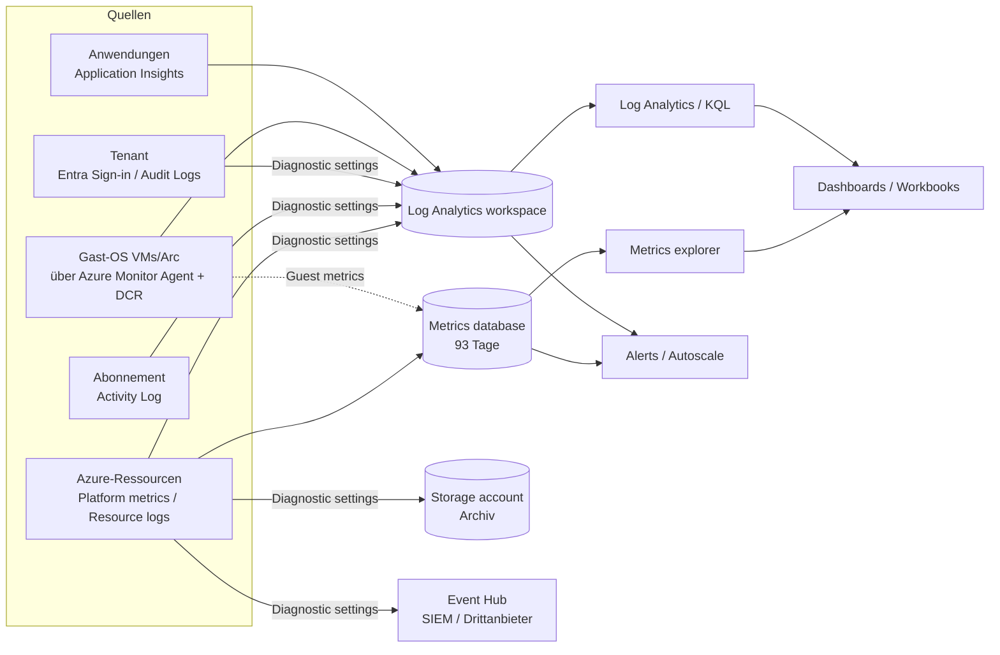

# 5.1 Azure Monitor – Metriken und Logs

> **Domäne:** Monitor and maintain Azure resources · **Gewichtung:** 10–15 %
> **Study-Guide-Punkte:** *Interpret metrics in Azure Monitor* · *Configure log settings in Azure Monitor* · *Query and analyze logs in Azure Monitor*
> (Warnungen und Aktionsgruppen → [Kapitel 5.2](02-warnungen-und-aktionsgruppen.md), Insights und Network Watcher → [Kapitel 5.3](03-insights-und-network-watcher.md))
> **Stand:** November 2026

## Lernziele

Nach diesem Kapitel kann ich …

- die Architektur von **Azure Monitor** erklären und **Metriken** von **Logs** abgrenzen.
- Metriken im **Metrics explorer** mit passender Aggregation, Granularität, Filter und Splitting interpretieren.
- **Activity Log**, **Resource Logs** und **Entra-Logs** unterscheiden und per **Diagnostic settings** an die richtigen Ziele senden.
- einen **Log Analytics workspace** anlegen und Aufbewahrung, Zugriffsmodus und Kosten (Daily cap, Commitment tiers) konfigurieren.
- Gastbetriebssystem-Daten über den **Azure Monitor Agent (AMA)** und **Data Collection Rules (DCR)** sammeln.
- einfache bis mittlere **KQL**-Abfragen schreiben und lesen (`where`, `summarize`, `bin`, `render`).

## Überblick

**Azure Monitor** ist die zentrale Plattform für Überwachung in Azure. Sie sammelt Telemetrie aus Azure-Ressourcen, Gastbetriebssystemen, Anwendungen und dem Tenant, speichert sie in zwei Datenspeichern – der **Metrics database** (Zeitreihen) und **Azure Monitor Logs** (Log Analytics workspaces) – und stellt Werkzeuge zur Analyse (Metrics explorer, Log Analytics), Visualisierung (Dashboards, Workbooks, Grafana), Alarmierung ([5.2](02-warnungen-und-aktionsgruppen.md)) und Automatisierung (Autoscale, Logic Apps) bereit.

Für den Administrator heißt das: Viele Daten fallen **automatisch** an (Platform metrics, Activity Log), andere müssen **aktiv eingeschaltet** werden (Resource Logs über Diagnostic settings, Gastdaten über AMA + DCR). In der Prüfung wird genau diese Unterscheidung häufig abgefragt – ebenso das Lesen von KQL-Abfragen und Metrikdiagrammen.

## Kernkonzepte

### Architektur



### Metriken (*Metrics*)

- **Numerische Werte** in regelmäßigen Abständen (meist minütlich) als **Zeitreihe**, sehr leichtgewichtig und nahezu in Echtzeit.
- **Platform metrics** werden für die meisten Azure-Ressourcen **automatisch und kostenlos** gesammelt – ohne Konfiguration (z. B. *Percentage CPU* einer VM, *Transactions* eines Speicherkontos).
- **Aufbewahrung:** **93 Tage** in der Metrics database. Für längere Aufbewahrung Metriken per Diagnostic setting in einen Log Analytics workspace senden (Tabelle `AzureMetrics`).
- **Dimensionen:** Name-Wert-Paare zur Aufschlüsselung, z. B. *API name* oder *Response type* bei Storage, *LUN* bei Disks.
- **Aggregationen:** **Average**, **Minimum**, **Maximum**, **Sum**, **Count** – nicht jede Metrik unterstützt jede Aggregation.
- **Guest OS metrics** (z. B. freier Arbeitsspeicher, Plattenbelegung im Gast) sind **nicht** Teil der Platform metrics – sie erfordern den **Azure Monitor Agent** mit einer DCR (Ziel: *Azure Monitor Metrics* und/oder Log Analytics).
- **Custom metrics** können per API oder Agent gesendet werden.

### Logs

- **Strukturierte oder halbstrukturierte Ereignisdatensätze** mit Zeitstempel, gespeichert in **Tabellen** eines **Log Analytics workspace**.
- Abfrage mit **Kusto Query Language (KQL)**.
- Geeignet für komplexe Analysen, Korrelation über Ressourcen hinweg und lange Aufbewahrung.

### Activity Log

- Protokolliert **Control-Plane-Vorgänge** (Wer hat **wann was** an einer Ressource **erstellt, geändert, gelöscht**?) auf **Abonnementebene** – also Schreibvorgänge über Azure Resource Manager (PUT, POST, DELETE), keine Lesevorgänge (GET) und keine Datenzugriffe.
- **Automatisch** vorhanden, kostenlos, **90 Tage** Aufbewahrung.
- **Kategorien:**

| Kategorie | Inhalt |
|---|---|
| **Administrative** | Erstellen/Ändern/Löschen von Ressourcen, RBAC-Zuweisungen |
| **Service Health** | Störungen und Wartungen der Azure-Plattform |
| **Resource Health** | Integritätsstatus einzelner Ressourcen (Available, Degraded, Unavailable) |
| **Alert** | Auslösen von Azure-Warnungen |
| **Autoscale** | Scale-out/in-Ereignisse der Autoscale-Engine |
| **Security** | Warnungen aus Microsoft Defender for Cloud |
| **Policy** | Auswertungen von Azure Policy (z. B. Deny, Audit) |
| **Recommendation** | Empfehlungen von Azure Advisor |

- **Längere Aufbewahrung / Analyse:** über **Diagnostic settings** des Activity Logs (auf Abo-Ebene) an Log Analytics (Tabelle `AzureActivity`), Storage oder Event Hub senden.

### Resource Logs (früher *Diagnostic logs*)

- Protokollieren **Data-Plane-Vorgänge innerhalb** einer Ressource (z. B. Lese-/Schreibzugriffe auf Blobs, Abfragen an Key Vault, NSG-Regeltreffer, Firewall-Logs).
- ⚠️ Werden **nicht automatisch gesammelt** – sie müssen pro Ressource über eine **Diagnostic setting** aktiviert werden.
- Kategorien sind ressourcenspezifisch (z. B. bei Storage *StorageRead*, *StorageWrite*, *StorageDelete*; bei Key Vault *AuditEvent*). Gruppen wie **allLogs** und **audit** erleichtern die Auswahl.

### Diagnostic settings – Ziele

| Ziel | Einsatz |
|---|---|
| **Log Analytics workspace** | Abfragen mit KQL, Log-Alerts, Workbooks, Korrelation |
| **Storage account** | Günstige Langzeitarchivierung, Compliance, Audit |
| **Event Hub** | Streaming an externe Systeme (SIEM wie Splunk, QRadar) |
| **Partner solution** | Integrierte Partnerlösungen (z. B. Datadog, Elastic) |

- Pro Ressource sind **mehrere Diagnostic settings** möglich (Microsoft dokumentiert bis zu **5**), z. B. eine an Log Analytics und eine an ein Archiv-Speicherkonto.
- Jedes Ziel darf pro Ressource nur in **einer** Diagnostic setting vorkommen.
- Bei Log Analytics: Zieltabellen **Azure diagnostics** (alles in `AzureDiagnostics`, Legacy) oder **Resource specific** (eigene Tabellen je Kategorie, empfohlen).
- Ziel-Speicherkonto bzw. Event Hub sollten in derselben **Region** wie die Ressource liegen (für Storage zwingend bei regionalen Ressourcen).

### Entra-Logs

- **Sign-in logs** (Anmeldungen, `SigninLogs`) und **Audit logs** (Änderungen im Verzeichnis, `AuditLogs`) werden im Entra ID gespeichert (Aufbewahrung je nach Lizenz, Free 7 Tage, P1/P2 30 Tage).
- Für Analyse und Alerting über **Microsoft Entra ID > Diagnostic settings** in einen Log Analytics workspace senden (Sign-in logs erfordern P1/P2).

### Log Analytics workspace

| Eigenschaft | Beschreibung |
|---|---|
| **Region** | Datenstandort; bei Erstellung festgelegt |
| **Access control mode** | *Require workspace permissions* oder *Use resource or workspace permissions* (Standard bei neuen Workspaces) |
| **Zugriffsmodus** | **Workspace-context** (Abfrage über den Workspace, alle Daten mit Workspace-Berechtigung) vs. **Resource-context** (Abfrage über *Logs* auf der Ressource; nur Daten dieser Ressource, Berechtigung über Azure RBAC auf der Ressource) |
| **Rollen** | **Log Analytics Reader** (lesen/abfragen), **Log Analytics Contributor** (konfigurieren, Diagnostic settings), **Monitoring Reader/Contributor** |
| **Tabellenpläne** | **Analytics** (voller Funktionsumfang, Alerts), **Basic** (günstiger, eingeschränkte Abfragen), **Auxiliary** (sehr günstig für selten genutzte, umfangreiche Logs) |
| **Retention** | Standard **30 Tage** interaktiv (bis 2 Jahre einstellbar); zusätzlich **Long-term retention** (Archiv) bis zu **12 Jahre** pro Tabelle; Zugriff auf Archiv per Search job oder Restore |
| **Daily cap** | Obergrenze der täglichen Datenaufnahme (GB/Tag); danach Sammlung bis zum Reset gestoppt (Ausnahme: einige Sicherheitsdaten) |
| **Pricing** | **Pay-as-you-go** pro GB oder **Commitment tiers** (ab 100 GB/Tag mit Rabatt) |

> Empfehlung von Microsoft: so **wenige Workspaces wie möglich** – meist einer pro Region/Umgebung – und Zugriff per Resource-context steuern.

### Azure Monitor Agent (AMA) und Data Collection Rules (DCR)

- Der **Azure Monitor Agent** ist der einzige unterstützte Agent zum Sammeln von Daten aus dem **Gastbetriebssystem** von Azure-VMs, VM Scale Sets und Arc-fähigen Servern (Windows und Linux).
- ⚠️ Der **Log Analytics Agent (MMA/OMS)** und die **Diagnostics extension** (WAD/LAD für Logs) sind abgelöst; der MMA wurde im **August 2024** eingestellt.
- **Data Collection Rule (DCR):** definiert **was** gesammelt wird (Windows-Ereignisprotokolle mit XPath-Filter, Syslog-Facilities, Performance counters, Textlogs) und **wohin** (Log Analytics workspace, Azure Monitor Metrics).
- Eine DCR kann vielen Maschinen zugeordnet werden, eine Maschine kann mehrere DCRs haben (**DCR association**).
- Der AMA nutzt eine **Managed Identity** der VM zur Authentifizierung.
- VM Insights ([5.3](03-insights-und-network-watcher.md)) richtet AMA und DCR automatisch ein.

### Metrics explorer

1. **Scope** wählen (Ressource, mehrere Ressourcen desselben Typs in derselben Region, Ressourcengruppe oder Abo).
2. **Metric namespace** (z. B. *Virtual Machine Host*, *Guest (classic)*, *Blob*) und **Metric** wählen.
3. **Aggregation** wählen (Avg, Min, Max, Sum, Count).
4. **Time range** und **Time granularity** (z. B. letzte 24 h, 5-Minuten-Granularität) einstellen.
5. **Add filter** (nur bestimmte Dimensionswerte) bzw. **Apply splitting** (eine Linie pro Dimensionswert, z. B. pro Disk oder Instanz).
6. Diagramm-Typ ändern, **Pin to dashboard**, **New alert rule** direkt aus dem Diagramm, **Share** (Excel-Export, Link).

**Interpretationshilfe:**

| Frage | Passende Aggregation |
|---|---|
| Durchschnittliche CPU-Last über die Zeit | **Average** |
| Spitzenlast erkennen | **Maximum** |
| Gesamtzahl der Transaktionen/Requests | **Sum** |
| Anzahl der Messwerte (z. B. Instanzen) | **Count** |

⚠️ Eine grobe Granularität (z. B. 1 Tag) mit *Average* glättet Spitzen weg – für kurze Lastspitzen kleine Granularität + *Maximum* verwenden.

### KQL-Grundlagen

Eine KQL-Abfrage beginnt mit einer **Tabelle**, gefolgt von Operatoren, die mit `|` verkettet werden.

**Wichtige Tabellen:**

| Tabelle | Inhalt |
|---|---|
| `AzureActivity` | Activity Log |
| `AzureDiagnostics` | Resource Logs im Legacy-Modus |
| `AzureMetrics` | Platform metrics (per Diagnostic setting) |
| `Heartbeat` | Agent-Lebenszeichen (ca. jede Minute) |
| `Perf` | Performance counters (CPU, Memory, Disk) |
| `Event` | Windows-Ereignisprotokolle |
| `Syslog` | Linux-Syslog |
| `SigninLogs` / `AuditLogs` | Entra-Anmeldungen / Verzeichnisänderungen |
| `InsightsMetrics` | VM Insights-Leistungsdaten |

**Wichtige Operatoren:**

| Operator | Zweck |
|---|---|
| `where` | Zeilen filtern |
| `project` | Spalten auswählen/umbenennen |
| `extend` | berechnete Spalte hinzufügen |
| `summarize … by …` | aggregieren (`count()`, `avg()`, `max()`, `dcount()`) |
| `bin(TimeGenerated, 5m)` | Zeitstempel in Intervalle gruppieren |
| `sort by` / `order by` | sortieren (Standard absteigend) |
| `top N by` | die N obersten Zeilen |
| `take` / `limit` | beliebige N Zeilen |
| `join` | zwei Tabellen verknüpfen |
| `render timechart` | Ergebnis als Diagramm |
| `ago(1h)` | relativer Zeitpunkt |

**Beispiele:**

```kusto
// Wer hat in den letzten 24 Stunden Ressourcen gelöscht?
AzureActivity
| where TimeGenerated > ago(24h)
| where OperationNameValue endswith "DELETE" and ActivityStatusValue == "Success"
| project TimeGenerated, Caller, OperationNameValue, ResourceGroup, _ResourceId
| order by TimeGenerated desc
```

```kusto
// VMs, die seit mehr als 15 Minuten keinen Heartbeat gesendet haben
Heartbeat
| summarize LastHeartbeat = max(TimeGenerated) by Computer
| where LastHeartbeat < ago(15m)
```

```kusto
// Durchschnittliche CPU-Last pro Computer in 5-Minuten-Intervallen als Diagramm
Perf
| where TimeGenerated > ago(1d)
| where ObjectName == "Processor" and CounterName == "% Processor Time" and InstanceName == "_Total"
| summarize AvgCPU = avg(CounterValue) by bin(TimeGenerated, 5m), Computer
| render timechart
```

```kusto
// Top 10 Windows-Fehlerereignisse der letzten 7 Tage
Event
| where TimeGenerated > ago(7d) and EventLevelName == "Error"
| summarize Anzahl = count() by Source, EventID
| top 10 by Anzahl
```

```kusto
// Fehlgeschlagene Anmeldungen pro Benutzer (Entra)
SigninLogs
| where TimeGenerated > ago(1d) and ResultType != "0"
| summarize Fehlversuche = count() by UserPrincipalName
| sort by Fehlversuche desc
```

```kusto
// Linux-Syslog-Einträge mit Schweregrad "err" oder schlimmer
Syslog
| where SeverityLevel in ("err", "crit", "alert", "emerg")
| project TimeGenerated, Computer, Facility, SyslogMessage
| take 50
```

```kusto
// Freier Speicherplatz unter 10 % (berechnete Spalte)
Perf
| where CounterName == "% Free Space" and InstanceName != "_Total"
| summarize FreePct = avg(CounterValue) by Computer, InstanceName
| extend Kritisch = FreePct < 10
| where Kritisch
```

```kusto
// Join: Computer mit Heartbeat, ergänzt um die letzte CPU-Messung
Heartbeat
| summarize arg_max(TimeGenerated, *) by Computer
| join kind=inner (
    Perf
    | where CounterName == "% Processor Time" and InstanceName == "_Total"
    | summarize LastCPU = arg_max(TimeGenerated, CounterValue) by Computer
  ) on Computer
| project Computer, OSType, LastCPU = CounterValue
```

### Log-Abfragen: Workspace vs. Ressource

- **Log Analytics workspace > Logs** – Workspace-context: Abfragen über alle Tabellen und Ressourcen im Workspace.
- **Ressource > Monitoring > Logs** – Resource-context: Abfrage automatisch auf die Daten dieser Ressource beschränkt (`_ResourceId`).
- Abfragen lassen sich speichern (**Query packs**), als **Log search alert** ([5.2](02-warnungen-und-aktionsgruppen.md)) verwenden oder an Dashboards/Workbooks anheften.
- Die Oberfläche bietet einen **Simple mode** (ohne KQL, Filter per Klick) und einen **KQL mode**.

### Visualisierung (Kurzüberblick)

- **Azure Dashboards:** Kacheln aus Metrikdiagrammen und Log-Abfragen, teilbar über RBAC.
- **Workbooks:** interaktive Berichte mit Parametern, Text, Abfragen und Diagrammen – Grundlage der **Insights** ([5.3](03-insights-und-network-watcher.md)).
- **Azure Managed Grafana** und **Power BI** für erweiterte Szenarien.

### Kosten

- **Kostenlos:** Platform metrics, Activity Log (90 Tage), Abfragen im Metrics explorer.
- **Kostenpflichtig:** Datenaufnahme (*Ingestion*) und Aufbewahrung über das Inklusivvolumen hinaus in Log Analytics, Custom metrics, Metric- und Log-Alerts, Export an Storage/Event Hub (Speicher-/Event-Hub-Kosten).
- Steuerung über Daily cap, Commitment tiers, Tabellenpläne (Basic/Auxiliary), Filter in DCRs (nur benötigte Ereignisse sammeln) und Kostenanalyse ([1.7](../01-identitaeten-und-governance/07-kostenverwaltung-und-advisor.md)).

## Zusammenhänge

- **Warnungen** ([5.2](02-warnungen-und-aktionsgruppen.md)) basieren auf den hier beschriebenen Datenquellen: *Metric alerts* auf Metriken, *Log search alerts* auf KQL-Abfragen, *Activity log alerts* auf dem Activity Log.
- **Insights** ([5.3](03-insights-und-network-watcher.md)) – VM Insights, Storage Insights, Network Insights – sind vorgefertigte Workbooks auf Basis von Metriken und Logs.
- **Network Watcher / VNet flow logs** ([4.10](../04-netzwerk/10-netzwerk-troubleshooting.md)): Flow Logs landen in Storage und optional (Traffic analytics) in Log Analytics.
- **Virtuelle Maschinen** ([3.2](../03-compute/02-virtuelle-maschinen.md)): Boot diagnostics, AMA als Extension, Managed Identity für den Agent.
- **VM Scale Sets / App Service Autoscale** ([3.4](../03-compute/04-verfuegbarkeit-und-scale-sets.md), [3.6](../03-compute/06-azure-app-service.md)) nutzen Metriken als Skalierungsgrundlage.
- **Azure Policy** ([1.4](../01-identitaeten-und-governance/04-azure-policy.md)): Built-in-Policies (*DeployIfNotExists*) können Diagnostic settings und den AMA automatisch auf alle Ressourcen ausrollen.
- **RBAC** ([1.3](../01-identitaeten-und-governance/03-rbac-zugriffsverwaltung.md)): Rollen *Monitoring Reader/Contributor*, *Log Analytics Reader/Contributor*.
- **Kosten** ([1.7](../01-identitaeten-und-governance/07-kostenverwaltung-und-advisor.md)): Log Analytics ist häufig ein relevanter Kostenblock.

## Vergleichstabellen

### Metriken vs. Logs

| Kriterium | Metriken | Logs |
|---|---|---|
| Datenform | numerische Zeitreihen | Ereignisdatensätze mit Eigenschaften |
| Speicher | Metrics database | Log Analytics workspace |
| Sammlung | Platform metrics automatisch | meist per Diagnostic setting / Agent |
| Latenz | nahezu Echtzeit (≈ 1 Min.) | wenige Minuten |
| Aufbewahrung | 93 Tage (fest) | 30 Tage Standard, konfigurierbar bis 12 Jahre |
| Analyse | Metrics explorer | Log Analytics (KQL) |
| Kosten | Platform metrics kostenlos | Ingestion + Retention kostenpflichtig |
| Typische Alerts | Metric alert | Log search alert |

### Activity Log vs. Resource Logs

| Kriterium | Activity Log | Resource Logs |
|---|---|---|
| Ebene | Abonnement (Control Plane) | einzelne Ressource (Data Plane) |
| Beispiel | „Wer hat die VM gelöscht?" | „Wer hat Blob X gelesen?" |
| Standardmäßig vorhanden | ✅ (90 Tage) | ❌ – Diagnostic setting nötig |
| Konfiguration | Diagnostic settings auf Abo-Ebene | Diagnostic settings pro Ressource |
| Tabelle in Log Analytics | `AzureActivity` | `AzureDiagnostics` oder ressourcenspezifisch |

### Ziele einer Diagnostic setting

| Anforderung | Ziel |
|---|---|
| Mit KQL abfragen, Log-Alerts | **Log Analytics workspace** |
| Mehrjährige, günstige Archivierung (Compliance) | **Storage account** |
| An ein externes SIEM streamen | **Event Hub** |
| Integrierte Partner-Observability | **Partner solution** |

### Agents

| Agent | Status | Einsatz |
|---|---|---|
| **Azure Monitor Agent (AMA)** | aktuell, empfohlen | Gastlogs und -metriken über DCR |
| Log Analytics Agent (MMA/OMS) | eingestellt (Aug 2024) | – |
| Diagnostics extension (WAD/LAD) | Legacy | nur noch Sonderfälle |
| Dependency agent | ergänzend | VM Insights Map (Prozesse/Verbindungen) |

## Azure Portal

| Aufgabe | Pfad |
|---|---|
| Azure Monitor Startseite | **Portal > Monitor > Overview** |
| Metriken einer Ressource | **Portal > Ressource > Monitoring > Metrics** |
| Metriken ressourcenübergreifend | **Portal > Monitor > Metrics** (Scope wählen) |
| Activity Log anzeigen/filtern | **Portal > Monitor > Activity log** bzw. **Ressource > Activity log** |
| Activity Log exportieren | **Portal > Monitor > Activity log > Export Activity Logs** (Diagnostic settings des Abos) |
| Resource Logs aktivieren | **Portal > Ressource > Monitoring > Diagnostic settings > + Add diagnostic setting** |
| Alle Diagnostic settings im Überblick | **Portal > Monitor > Settings > Diagnostic settings** |
| Entra-Logs exportieren | **Portal > Microsoft Entra ID > Monitoring > Diagnostic settings** |
| Log Analytics workspace anlegen | **Portal > Log Analytics workspaces > + Create** |
| Retention / Tabellen | **… > Log Analytics workspace > Settings > Tables** (pro Tabelle *Manage table*) bzw. **Usage and estimated costs > Data retention** |
| Daily cap / Commitment tier | **… > Log Analytics workspace > Usage and estimated costs > Daily cap / Pricing tier** |
| Access control mode | **… > Log Analytics workspace > Overview > Access control mode** (bzw. *Properties*) |
| Log-Abfragen | **Portal > Monitor > Logs** · **Log Analytics workspace > Logs** · **Ressource > Monitoring > Logs** |
| Data Collection Rules | **Portal > Monitor > Settings > Data Collection Rules > + Create** |
| AMA-Extension einer VM prüfen | **Portal > Virtual machines > VM > Settings > Extensions + applications** |
| Dashboards / Workbooks | **Portal > Dashboard** · **Portal > Monitor > Workbooks** |

**Felder bei *Add diagnostic setting*:** Diagnostic setting name, **Logs** (Kategorien bzw. Kategoriegruppen *allLogs*/*audit*), **Metrics** (*AllMetrics*), **Destination details** (Send to Log Analytics workspace / Archive to a storage account / Stream to an event hub / Send to partner solution), bei Log Analytics *Destination table*.

**Felder bei *Create Data Collection Rule*:** Rule name, Region, **Platform type** (Windows/Linux/All), **Resources** (VMs, die zugeordnet werden – AMA wird dabei installiert), **Collect and deliver** (Data source + Destination).

## Azure CLI & PowerShell

### Azure CLI

```bash
# Verfügbare Metriken einer VM anzeigen
az monitor metrics list-definitions --resource <vm-resource-id> -o table

# CPU-Metrik der letzten Stunde, Maximum pro 5 Minuten
az monitor metrics list \
  --resource <vm-resource-id> \
  --metric "Percentage CPU" \
  --aggregation Maximum \
  --interval PT5M \
  --offset 1h -o table

# Log Analytics workspace anlegen und Retention auf 90 Tage setzen
az monitor log-analytics workspace create \
  --resource-group <resource-group> \
  --workspace-name law-contoso-prod \
  --location westeurope
az monitor log-analytics workspace update \
  --resource-group <resource-group> \
  --workspace-name law-contoso-prod \
  --retention-time 90

# Diagnostic setting für ein Key Vault: alle Logs + Metriken an Log Analytics
WS_ID=$(az monitor log-analytics workspace show -g <resource-group> -n law-contoso-prod --query id -o tsv)
az monitor diagnostic-settings create \
  --name diag-to-law \
  --resource <keyvault-resource-id> \
  --workspace $WS_ID \
  --logs '[{"categoryGroup":"allLogs","enabled":true}]' \
  --metrics '[{"category":"AllMetrics","enabled":true}]'

# Activity Log der letzten 7 Tage für eine Ressourcengruppe
az monitor activity-log list --resource-group <resource-group> --offset 7d \
  --query "[].{Zeit:eventTimestamp, Wer:caller, Vorgang:operationName.localizedValue}" -o table

# KQL-Abfrage gegen einen Workspace (benötigt die Workspace-/Customer-ID)
az monitor log-analytics query \
  --workspace <workspace-customer-id> \
  --analytics-query "Heartbeat | summarize max(TimeGenerated) by Computer" \
  -o table

# Data Collection Rule aus JSON-Datei anlegen und einer VM zuordnen
az monitor data-collection rule create \
  --resource-group <resource-group> --name dcr-windows-events \
  --location westeurope --rule-file dcr.json
az monitor data-collection rule association create \
  --name dcra-vm01 --resource <vm-resource-id> \
  --rule-id <dcr-resource-id>
```

### Azure PowerShell

```powershell
# Metrikdefinitionen und Werte abrufen
Get-AzMetricDefinition -ResourceId "<vm-resource-id>"
Get-AzMetric -ResourceId "<vm-resource-id>" -MetricName "Percentage CPU" `
  -AggregationType Maximum -TimeGrain 00:05:00 `
  -StartTime (Get-Date).AddHours(-1) -EndTime (Get-Date)

# Log Analytics workspace anlegen
New-AzOperationalInsightsWorkspace -ResourceGroupName "<resource-group>" `
  -Name "law-contoso-prod" -Location "westeurope" -Sku "PerGB2018" -RetentionInDays 90

# Diagnostic setting (Az.Monitor 4.x+): Logs und Metriken an Log Analytics
$ws  = Get-AzOperationalInsightsWorkspace -ResourceGroupName "<resource-group>" -Name "law-contoso-prod"
$log = New-AzDiagnosticSettingLogSettingsObject -CategoryGroup "allLogs" -Enabled $true
$met = New-AzDiagnosticSettingMetricSettingsObject -Category "AllMetrics" -Enabled $true
New-AzDiagnosticSetting -Name "diag-to-law" -ResourceId "<keyvault-resource-id>" `
  -WorkspaceId $ws.ResourceId -Log $log -Metric $met

# KQL-Abfrage ausführen (WorkspaceId = Customer ID/GUID des Workspace)
$q = 'AzureActivity | where TimeGenerated > ago(1d) | summarize count() by Caller'
(Invoke-AzOperationalInsightsQuery -WorkspaceId $ws.CustomerId -Query $q).Results

# Activity Log abfragen
Get-AzActivityLog -ResourceGroupName "<resource-group>" -StartTime (Get-Date).AddDays(-7) |
  Select-Object EventTimestamp, Caller, @{n="Operation";e={$_.OperationName.LocalizedValue}}
```

| Ziel | CLI | PowerShell |
|---|---|---|
| Metriken abfragen | `az monitor metrics list` | `Get-AzMetric` |
| Diagnostic setting | `az monitor diagnostic-settings create` | `New-AzDiagnosticSetting` |
| Workspace anlegen | `az monitor log-analytics workspace create` | `New-AzOperationalInsightsWorkspace` |
| KQL ausführen | `az monitor log-analytics query` | `Invoke-AzOperationalInsightsQuery` |
| Activity Log | `az monitor activity-log list` | `Get-AzActivityLog` |

## Praxisbeispiel

**Szenario:** *Contoso* betreibt eine Webanwendung auf zwei Windows-VMs mit einem Key Vault. Anforderungen:

1. Alle Zugriffe auf den Key Vault sollen **zwei Jahre** abfragbar und **sieben Jahre** archiviert sein.
2. Das Betriebsteam möchte CPU-Spitzen der VMs erkennen.
3. Windows-Fehlerereignisse der VMs sollen zentral ausgewertet werden.
4. Löschvorgänge im Abonnement sollen länger als 90 Tage nachvollziehbar sein.

**Umsetzung:**

1. **Workspace:** *Log Analytics workspaces > + Create* → `law-contoso-prod` in *West Europe*.
2. **Key Vault:** *Key Vault > Diagnostic settings > + Add diagnostic setting*
   - Logs: Kategoriegruppe **audit** (bzw. *AuditEvent*), Metrics: *AllMetrics*
   - **Send to Log Analytics workspace** (`law-contoso-prod`, *Resource specific*)
   - **Archive to a storage account** (`stcontosoarchive`, gleiche Region) – Lifecycle-Regel im Speicherkonto löscht nach 7 Jahren ([2.3](../02-speicher/03-blob-storage.md)).
   - Im Workspace für die Key-Vault-Tabelle unter **Tables > Manage table** die interaktive Retention auf **730 Tage** setzen.
3. **CPU-Spitzen:** *VM > Metrics* → Metric *Percentage CPU*, Aggregation **Maximum**, Granularität **5 Minuten**, Scope beide VMs, **Apply splitting** nach *VM name* → **Pin to dashboard**. Optional direkt **New alert rule** ([5.2](02-warnungen-und-aktionsgruppen.md)).
4. **Windows-Ereignisse:** *Monitor > Data Collection Rules > + Create* → Platform *Windows*, Resources: beide VMs (AMA wird installiert), Data source **Windows Event Logs** (*System* und *Application*, Level *Critical* und *Error*), Destination `law-contoso-prod`. Auswertung:

   ```kusto
   Event
   | where TimeGenerated > ago(24h) and EventLevelName in ("Error", "Critical")
   | summarize count() by Computer, Source
   | order by count_ desc
   ```

5. **Activity Log:** *Monitor > Activity log > Export Activity Logs > + Add diagnostic setting* → Kategorien *Administrative*, *Policy*, *Security* → `law-contoso-prod`. Abfrage der Löschvorgänge mit der `AzureActivity`-Abfrage aus den Kernkonzepten.
6. **Kostenkontrolle:** *Usage and estimated costs > Daily cap* auf einen sinnvollen Wert setzen und Budget-Alert einrichten ([1.7](../01-identitaeten-und-governance/07-kostenverwaltung-und-advisor.md)).

## Limits & wichtige Zahlen

| Wert | Grenze / Standard |
|---|---|
| Aufbewahrung Platform metrics | **93 Tage** |
| Aufbewahrung Activity Log (ohne Export) | **90 Tage** |
| Log Analytics – Standard-Retention (interaktiv) | **30 Tage** (Analytics-Tabellen; einstellbar bis **2 Jahre**) |
| Log Analytics – Long-term retention | bis **12 Jahre** pro Tabelle |
| Diagnostic settings pro Ressource | bis zu **5** |
| Heartbeat des Agents | ca. **1× pro Minute** |
| Metrik-Granularität | typischerweise **1 Minute** |
| Commitment tiers | ab **100 GB/Tag** |
| Entra Sign-in/Audit Logs im Portal | **7 Tage** (Free) / **30 Tage** (P1/P2) |
| Log-Analytics-Agent (MMA) | eingestellt **August 2024** |

Werte ändern sich gelegentlich – aktuelle Angaben: [Azure Monitor service limits](https://learn.microsoft.com/azure/azure-monitor/fundamentals/service-limits).

## Prüfungstipps & Fallstricke

- ⚠️ **Resource Logs fehlen im Workspace** → es wurde keine **Diagnostic setting** auf der Ressource angelegt. Resource Logs werden nie automatisch gesammelt.
- ⚠️ **Freier Arbeitsspeicher/Plattenplatz im Gast nicht als Metrik verfügbar** → Platform metrics sehen nur den Host; **Azure Monitor Agent + DCR** (oder VM Insights) nötig.
- ⚠️ **Log Analytics Agent (MMA) installieren?** → Nein, eingestellt. Antwort ist immer **AMA + DCR**.
- **„Wer hat die Ressource gelöscht/geändert?"** → **Activity Log** (Kategorie *Administrative*).
- **„Wer hat auf Daten im Speicherkonto/Key Vault zugegriffen?"** → **Resource Logs** per Diagnostic setting.
- **Activity Log älter als 90 Tage benötigt** → per Diagnostic setting an Log Analytics oder Storage exportieren.
- **Metriken länger als 93 Tage aufbewahren** → per Diagnostic setting (*AllMetrics*) in einen Log Analytics workspace (oder Storage) senden.
- **Logs an Splunk/QRadar** → **Event Hub**. **Günstige Langzeitarchivierung** → **Storage account**. **KQL & Log-Alerts** → **Log Analytics**.
- **Benutzer sollen nur Logs „ihrer" Ressourcen sehen** → Access control mode *Use resource or workspace permissions* + **Resource-context**-Abfragen mit RBAC auf den Ressourcen.
- **Kosten für Log Analytics begrenzen** → **Daily cap**, Commitment tier, Basic/Auxiliary-Tabellenpläne, DCR-Filter.
- **KQL lesen:** `summarize … by bin(TimeGenerated, 5m)` = Aggregation pro 5-Minuten-Intervall; `ago(1h)` = letzte Stunde; `project` = Spaltenauswahl; `extend` = neue Spalte; `top 5 by X` = fünf größte Werte.
- **Kurze Spitzen im Metrikdiagramm unsichtbar** → Granularität verkleinern und **Maximum** statt *Average* verwenden.
- **Mehrere Diagnostic settings** auf einer Ressource sind erlaubt – aber jedes Ziel nur einmal.

## Selbsttest

**1.** Ein Administrator möchte herausfinden, welcher Benutzer gestern eine VM gelöscht hat. Welche Datenquelle nutzt er?

<details><summary>Lösung</summary>

Das **Activity Log** (Kategorie *Administrative*). Es protokolliert alle Control-Plane-Schreibvorgänge inkl. *Caller* und ist 90 Tage ohne Konfiguration verfügbar.
</details>

**2.** Im Log Analytics workspace finden Sie keine Daten zu Lesezugriffen auf Blobs in `stcontoso`. Was ist die wahrscheinlichste Ursache?

<details><summary>Lösung</summary>

Für den Blob-Dienst des Speicherkontos wurde **keine Diagnostic setting** angelegt (Kategorie *StorageRead*). Resource Logs werden nicht automatisch gesammelt.
</details>

**3.** Sie möchten den verfügbaren Arbeitsspeicher innerhalb einer Linux-VM überwachen. Was ist erforderlich?

<details><summary>Lösung</summary>

Der **Azure Monitor Agent** auf der VM und eine **Data Collection Rule** mit dem entsprechenden Performance counter (Ziel Log Analytics und/oder Azure Monitor Metrics) – alternativ **VM Insights**, das AMA und DCR einrichtet. Platform metrics enthalten keine Gast-Speicherwerte.
</details>

**4.** Logs müssen in Echtzeit an ein externes SIEM gestreamt und zusätzlich fünf Jahre kostengünstig archiviert werden. Welche Ziele konfigurieren Sie?

<details><summary>Lösung</summary>

**Event Hub** für das Streaming und **Storage account** für die Archivierung – entweder in einer oder in zwei Diagnostic settings.
</details>

**5.** Was liefert folgende Abfrage?

```kusto
Perf
| where CounterName == "% Processor Time" and InstanceName == "_Total"
| summarize avg(CounterValue) by bin(TimeGenerated, 1h), Computer
| render timechart
```

<details><summary>Lösung</summary>

Ein **Zeitdiagramm** der **durchschnittlichen Gesamt-CPU-Auslastung** pro Computer, aggregiert in **Stundenintervallen**.
</details>

**6.** Platform metrics einer VM sollen für einen Jahresbericht 12 Monate verfügbar sein. Wie gehen Sie vor?

<details><summary>Lösung</summary>

Metriken werden nur **93 Tage** gespeichert. Per **Diagnostic setting** (*AllMetrics*) an einen **Log Analytics workspace** senden (Tabelle `AzureMetrics`) und die Retention auf mindestens 365 Tage setzen – oder an ein Speicherkonto archivieren.
</details>

**7.** Ein Team soll nur die Logs seiner eigenen Ressourcengruppe abfragen können, obwohl alle Daten in einem zentralen Workspace liegen. Welche Konfiguration ist richtig?

<details><summary>Lösung</summary>

Workspace mit Access control mode **Use resource or workspace permissions**; das Team erhält z. B. **Reader** (bzw. Log Analytics Reader) auf seiner **Ressourcengruppe**, aber keine Workspace-Rechte, und fragt im **Resource-context** ab (Ressource/RG > *Logs*).
</details>

**8.** Ein Kollege schlägt vor, den Log Analytics Agent (MMA) auf neuen VMs zu installieren, um Windows-Ereignisse zu sammeln. Was antworten Sie?

<details><summary>Lösung</summary>

Der MMA ist seit **August 2024** eingestellt. Stattdessen den **Azure Monitor Agent** verwenden und die Ereignisse per **Data Collection Rule** (Windows Event Logs) sammeln.
</details>

**9.** Im Metrics explorer zeigt *Percentage CPU* mit Aggregation *Average* über 30 Tage maximal 40 %, Benutzer berichten aber von kurzzeitigen Hängern. Wie prüfen Sie das?

<details><summary>Lösung</summary>

Zeitraum verkleinern, **Granularität** auf z. B. 1–5 Minuten reduzieren und Aggregation **Maximum** wählen; ggf. **Splitting** nach Instanz. Der Durchschnitt über große Intervalle glättet Spitzen.
</details>

**10.** Die Log-Analytics-Kosten steigen unerwartet stark. Nennen Sie drei Maßnahmen.

<details><summary>Lösung</summary>

Z. B. **Daily cap** setzen, nicht benötigte Kategorien in Diagnostic settings bzw. DCRs **filtern**, selten genutzte Tabellen auf **Basic/Auxiliary**-Plan umstellen, Retention prüfen, bei hohem Volumen **Commitment tier** wählen.
</details>

## Weiterführende Links

- [AZ-104 Study Guide](https://learn.microsoft.com/credentials/certifications/resources/study-guides/az-104)
- [Azure Monitor overview](https://learn.microsoft.com/azure/azure-monitor/fundamentals/overview)
- [Azure Monitor Metrics overview](https://learn.microsoft.com/azure/azure-monitor/metrics/data-platform-metrics)
- [Analyze metrics with Metrics explorer](https://learn.microsoft.com/azure/azure-monitor/metrics/analyze-metrics)
- [Azure Monitor Logs overview](https://learn.microsoft.com/azure/azure-monitor/logs/data-platform-logs)
- [Azure activity log](https://learn.microsoft.com/azure/azure-monitor/platform/activity-log)
- [Azure resource logs](https://learn.microsoft.com/azure/azure-monitor/platform/resource-logs)
- [Diagnostic settings in Azure Monitor](https://learn.microsoft.com/azure/azure-monitor/platform/diagnostic-settings)
- [Manage access to Log Analytics workspaces](https://learn.microsoft.com/azure/azure-monitor/logs/manage-access)
- [Manage data retention in a Log Analytics workspace](https://learn.microsoft.com/azure/azure-monitor/logs/data-retention-configure)
- [Azure Monitor Agent overview](https://learn.microsoft.com/azure/azure-monitor/agents/azure-monitor-agent-overview)
- [Data collection rules in Azure Monitor](https://learn.microsoft.com/azure/azure-monitor/data-collection/data-collection-rule-overview)
- [Log queries in Azure Monitor (KQL tutorial)](https://learn.microsoft.com/azure/azure-monitor/logs/get-started-queries)
- [Kusto Query Language overview](https://learn.microsoft.com/kusto/query/)
- [Azure Monitor service limits](https://learn.microsoft.com/azure/azure-monitor/fundamentals/service-limits)
