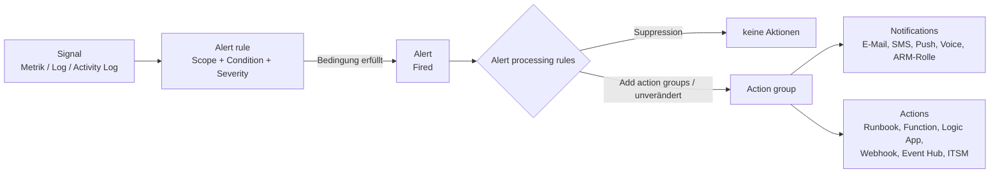
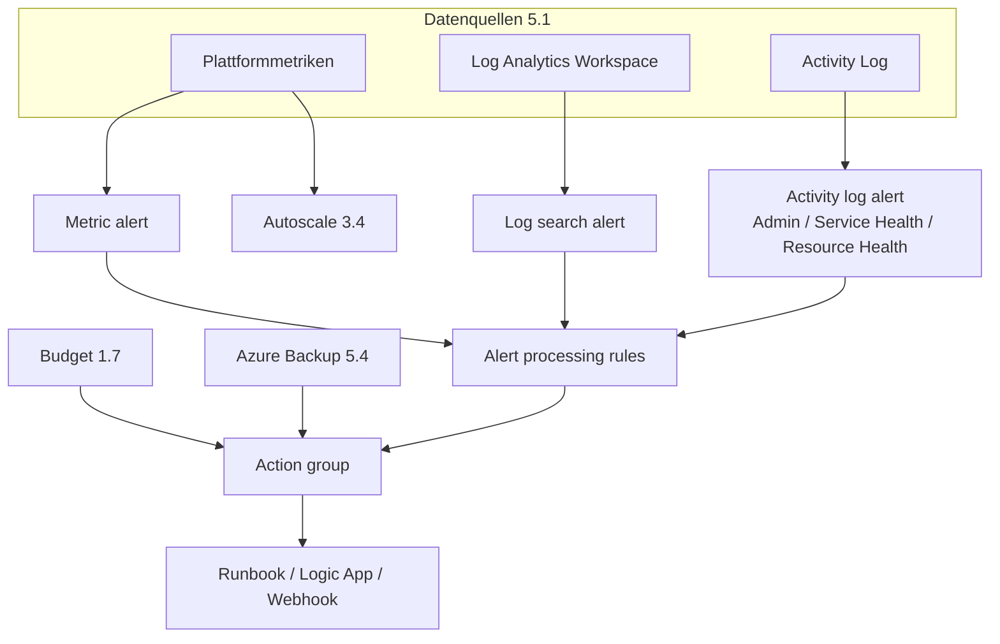

# 5.2 Warnungen und Aktionsgruppen

> **Domäne:** Monitor and maintain Azure resources · **Gewichtung:** 10–15 %
> **Study-Guide-Punkte:** *Set up alert rules, action groups, and alert processing rules in Azure Monitor*
> (Metriken und Logs als Datenquelle → [Kapitel 5.1](01-azure-monitor-metriken-und-logs.md))
> **Stand:** November 2026

## Lernziele

Nach diesem Kapitel kann ich …

- den Weg vom **Signal** über die **Alert rule** und den **Alert** bis zur **Action group** erklären.
- den passenden Alert-Typ wählen: **Metric**, **Log search** oder **Activity log** (inkl. Service Health und Resource Health).
- statische und **dynamische Schwellenwerte** konfigurieren und die Parameter *Aggregation granularity* und *Frequency of evaluation* richtig setzen.
- **Action groups** mit Benachrichtigungen (E-Mail, SMS, Push, Voice) und Aktionen (Runbook, Function, Logic App, Webhook, ITSM …) anlegen und wiederverwenden.
- mit **Alert processing rules** Benachrichtigungen in Wartungsfenstern unterdrücken oder Action groups zentral hinzufügen.
- Severity, Alert-Status (*Fired/Resolved*) und Benutzerreaktion (*New/Acknowledged/Closed*) unterscheiden.

## Überblick

Monitoring ohne Benachrichtigung ist passiv: Metriken und Logs ([5.1](01-azure-monitor-metriken-und-logs.md)) zeigen Probleme erst, wenn jemand hinsieht. **Azure Monitor Alerts** drehen das um: Eine **Alert rule** überwacht ein Signal (z. B. CPU-Auslastung, eine KQL-Abfrage oder ein Activity-Log-Ereignis) und erzeugt bei erfüllter Bedingung einen **Alert**.

Was danach passiert, regelt eine **Action group** – eine wiederverwendbare Sammlung von Empfängern und Aktionen. Zwischen Alert und Action group können **Alert processing rules** eingreifen, um Aktionen zeitweise zu unterdrücken (Wartung) oder zentral weitere Action groups anzuhängen.

Diese Trennung (Regel ↔ Reaktion) ist der Kern des Kapitels und eine häufige Grundlage für Prüfungsfragen: *Wer* wird *wann* *wie* benachrichtigt – und mit welchem Minimum an Konfigurationsaufwand?

## Kernkonzepte

### Architektur eines Alerts



Eine **Alert rule** besteht aus:

| Bestandteil | Bedeutung |
|---|---|
| **Scope** | Zu überwachende Ressource(n), Ressourcengruppe oder Abonnement |
| **Condition** | Signal + Logik (Schwellenwert, Abfrage, Ereignis) |
| **Actions** | Bis zu **5 Action groups** pro Alert rule |
| **Details** | Name, **Severity**, Beschreibung, Ressourcengruppe der Regel, ggf. *Automatically resolve alerts* |

### Alert-Typen

#### Metric alerts

- Werten **Plattformmetriken** oder benutzerdefinierte Metriken in kurzen Intervallen aus – nahezu in Echtzeit.
- **Static threshold:** fester Wert, z. B. `Percentage CPU > 80`.
- **Dynamic threshold:** Machine Learning lernt das historische Verhalten (inkl. saisonaler Muster) und erkennt Abweichungen.
  - **Threshold sensitivity:** *High* (mehr Alerts), *Medium*, *Low* (weniger Alerts)
  - **Number of violations**: z. B. „2 von 4 Auswertungen" – reduziert Fehlalarme
  - Sinnvoll, wenn kein fester „richtiger" Schwellenwert bekannt ist.
- **Aggregation type:** Average, Minimum, Maximum, Total, Count.
- **Aggregation granularity (Period / Lookback):** Zeitfenster, über das aggregiert wird (z. B. 5 Minuten).
- **Frequency of evaluation:** wie oft die Regel prüft (z. B. jede Minute). Die Frequenz darf nicht größer als die Granularität sein.
- **Dimensionen:** Aufteilung einer Metrik (z. B. pro Instanz, pro API-Name) – jede Kombination ist eine eigene **Zeitreihe**.
- **Multi-resource metric alerts:** Eine Regel überwacht mehrere Ressourcen **desselben Typs in derselben Region** (z. B. alle VMs eines Abonnements in *West Europe*) – nur für bestimmte Ressourcentypen unterstützt (u. a. VMs).
- Metric alerts sind standardmäßig **stateful**: Ein Alert wird nicht erneut ausgelöst, solange er aktiv ist, und löst sich automatisch auf (*Resolved*), wenn die Bedingung nicht mehr zutrifft.

#### Log search alerts

- Führen eine **KQL-Abfrage** gegen einen **Log Analytics Workspace** oder Application Insights aus ([5.1](01-azure-monitor-metriken-und-logs.md)).
- **Measurement:** *Table rows* (Anzahl Ergebnisse) oder eine numerische Spalte mit Aggregation (Average, Count, Total …).
- **Split by dimensions:** ein Alert pro Ressource/Wert (z. B. pro Computer).
- **Evaluation:** *Frequency of evaluation* und *Lookback period* (Zeitraum der Abfrage).
- **Number of violations to trigger the alert:** z. B. „3 von 5 Auswertungen".
- **Automatically resolve alerts** optional → stateful; ohne diese Option stateless.
- Typisch für Dinge, die es nicht als Metrik gibt: Ereignisse im Windows Event Log, fehlende **Heartbeats**, bestimmte Fehlermeldungen, Korrelation über mehrere Tabellen.
- Log-Daten haben eine gewisse **Latenz** (Ingestion) – nicht so „schnell" wie Metric alerts.

#### Activity log alerts

- Reagieren auf Einträge im **Activity Log** (Steuerungsebene des Abonnements).
- **Kategorien:**
  - **Administrative** – z. B. *Delete Virtual Machine*, *Create or Update Network Security Group*, Rollenzuweisungen
  - **Service Health** – Azure-Störungen, geplante Wartung, Health advisories, Security advisories
  - **Resource Health** – Zustand einzelner Ressourcen (*Available, Unavailable, Degraded, Unknown*)
  - weitere: Autoscale, Policy, Recommendation, Security
- Scope ist i. d. R. das **Abonnement** (Filter auf RG/Ressource/Ressourcentyp möglich).
- **Stateless** – jeder passende Eintrag löst einen eigenen Alert aus.
- ⚠️ Activity log alerts sind **kostenlos**.

#### Service Health vs. Resource Health

| | **Service Health** | **Resource Health** |
|---|---|---|
| Betrachtung | Azure-**Dienste** in **Regionen** (plattformweit) | **Einzelne Ressource** (z. B. meine VM) |
| Beispiele | Störung von *Azure SQL Database in West Europe*, geplante Wartung | VM `vm-web01` ist *Unavailable* |
| Portal | **Service Health > Health alerts** | **Ressource > Help > Resource health > Add resource health alert** |
| Alert-Typ | Activity log alert (Kategorie Service Health) | Activity log alert (Kategorie Resource Health) |

#### Weitere Alert-Arten (kurz)

- **Smart detection (Application Insights):** erkennt automatisch Anomalien in Web-Apps (z. B. ungewöhnlich viele fehlgeschlagene Requests).
- **Prometheus alerts:** für Azure Monitor managed service for Prometheus (z. B. AKS) mit PromQL-Regeln.
- **Budget-Alerts** gehören zu Cost Management, nicht zu Azure Monitor Alerts → [1.7](../01-identitaeten-und-governance/07-kostenverwaltung-und-advisor.md). Sie können aber ebenfalls **Action groups** auslösen.

### Severity

| Severity | Bedeutung |
|---|---|
| **Sev 0** | Critical |
| **Sev 1** | Error |
| **Sev 2** | Warning |
| **Sev 3** | Informational |
| **Sev 4** | Verbose |

⚠️ **Niedrigere Zahl = schwerwiegender.**

### Alert-Zustände

| Eigenschaft | Werte | Wer setzt sie? |
|---|---|---|
| **Monitor condition** | **Fired** → **Resolved** | das System (bei stateful Alerts automatisch) |
| **User response** (*Alert state*) | **New** → **Acknowledged** → **Closed** | der Bearbeiter im Portal / per API |

- Die *User response* ist unabhängig von der *Monitor condition*: Ein Alert kann *Resolved* und trotzdem noch *New* sein.
- Alerts werden **30 Tage** lang in **Monitor > Alerts** aufbewahrt.

### Action groups

Eine **Action group** ist eine eigenständige Ressource, die von **beliebig vielen Alert rules** (auch Budgets, Service Health usw.) wiederverwendet werden kann.

**Notifications:**

| Typ | Hinweis |
|---|---|
| **Email** | beliebige Adresse |
| **Email Azure Resource Manager Role** | an alle Benutzer mit einer RBAC-Rolle (z. B. *Owner*, *Contributor*) auf dem Abonnement |
| **SMS** | Telefonnummer mit Ländervorwahl |
| **Azure app Push Notification** | Azure-Mobile-App, Konto per E-Mail-Adresse |
| **Voice** | Sprachanruf |

**Actions:**

| Typ | Einsatz |
|---|---|
| **Automation Runbook** | automatische Behebung (z. B. VM neu starten, Dienst skalieren) |
| **Azure Function** | eigene Code-Logik |
| **Event Hub** | Weiterleitung an SIEM/Streaming |
| **ITSM** | Ticket in ServiceNow & Co. (über ITSM-Connector) |
| **Logic App** | Workflows, z. B. Nachricht in Teams |
| **Webhook** / **Secure Webhook** | HTTP-POST an beliebigen Endpunkt; *Secure* authentifiziert per Entra ID |

**Weitere Eigenschaften:**

- **Short name** (max. 12 Zeichen) erscheint in SMS/E-Mails.
- **Region:** standardmäßig **Global**; optional regional (Datenresidenz).
- **Common alert schema:** einheitliches JSON-Format für alle Alert-Typen – pro E-Mail/Webhook/Function/Logic App/Runbook aktivierbar. Erleichtert die Weiterverarbeitung.
- **Rate limiting** (Schutz vor Benachrichtigungsflut, Werte laut Doku – ggf. prüfen): ca. **1 SMS** und **1 Voice-Anruf alle 5 Minuten** pro Nummer, **max. ca. 100 E-Mails pro Stunde** pro Adresse. Darüber hinaus werden Benachrichtigungen verworfen.
- Empfänger werden beim Hinzufügen per E-Mail/SMS informiert, dass sie Teil der Action group sind.
- **Test action group:** Im Portal kann eine Testbenachrichtigung gesendet werden.

### Alert processing rules

Früher **Action rules** genannt. Sie greifen auf **ausgelöste Alerts** und verändern die zugehörigen Aktionen – **ohne die Alert rules selbst anzufassen**.

| Rule type | Wirkung |
|---|---|
| **Suppress notifications** (*RemoveAllActionGroups*) | Entfernt alle Action groups – es werden **keine Benachrichtigungen/Aktionen** ausgeführt |
| **Apply action group** (*AddActionGroups*) | Fügt Action groups hinzu, z. B. „alle Sev-0-Alerts im Abonnement zusätzlich an die Rufbereitschaft" |

- **Scope:** Abonnement, Ressourcengruppe oder einzelne Ressource.
- **Filter:** Severity, Resource type, Resource, Resource group, Alert rule name/ID, Monitor service, Monitor condition, Description, Alert context …
- **Schedule:** **Always**, **At a specific time** (einmaliges Fenster) oder **Recurring** (Daily/Weekly/Monthly mit Uhrzeit und Zeitzone).
- ⚠️ Der **Alert wird trotzdem ausgelöst** und ist in *Monitor > Alerts* sichtbar – nur die Aktionen werden unterdrückt.
- **Suppression hat Vorrang** vor *Apply action group*, wenn beide auf denselben Alert zutreffen.
- Wirken auf Alerts aller Typen – auch auf Alerts von Regeln, die erst später angelegt werden.

### Kosten (kurz)

| Typ | Abrechnung |
|---|---|
| Metric alerts | pro überwachter **Zeitreihe** (Dimensionen und Multi-resource erhöhen die Anzahl) |
| Log search alerts | pro Regel abhängig von der **Auswertungsfrequenz** (häufiger = teurer) |
| Activity log alerts | **kostenlos** |
| Action groups | E-Mail/Push meist inklusive Kontingent, **SMS/Voice/Webhooks** kostenpflichtig nach Volumen |

## Zusammenhänge



- **Datenquellen** ([5.1](01-azure-monitor-metriken-und-logs.md)): Ohne Diagnoseeinstellungen bzw. Azure Monitor Agent gibt es keine Logs – und damit keine Log search alerts. Gastmetriken einer VM (z. B. freier Arbeitsspeicher im OS) erfordern den Agent.
- **Insights & Network Watcher** ([5.3](03-insights-und-network-watcher.md)): VM Insights liefert Daten und empfohlene Alert rules; Connection Monitor kann ebenfalls Alerts erzeugen.
- **Autoscale** ([3.4](../03-compute/04-verfuegbarkeit-und-scale-sets.md)): nutzt dieselben Metriken, ist aber **kein** Alert – Autoscale skaliert selbst und kann zusätzlich benachrichtigen.
- **Kosten** ([1.7](../01-identitaeten-und-governance/07-kostenverwaltung-und-advisor.md)): Budgets und Kostenanomalien nutzen ebenfalls Action groups.
- **Azure Backup / Site Recovery** ([5.4](04-azure-backup.md), [5.5](05-azure-site-recovery.md)): Backup-Fehler werden über Azure Monitor-basierte Alerts gemeldet und können an Action groups gehen.
- **RBAC** ([1.3](../01-identitaeten-und-governance/03-rbac-zugriffsverwaltung.md)): Zum Anlegen von Alert rules und Action groups genügt **Monitoring Contributor**; zum Lesen **Monitoring Reader**. Die Notification *Email ARM Role* nutzt RBAC-Rollen als Empfängerliste.

## Vergleichstabellen

### Metric vs. Log search vs. Activity log alert

| Kriterium | Metric alert | Log search alert | Activity log alert |
|---|---|---|---|
| Signal | Metriken | KQL über Log Analytics / App Insights | Activity Log |
| Latenz | sehr gering (≈ 1 Min.) | höher (Ingestion + Frequenz) | gering |
| Schwellenwert dynamisch | ✅ | ❌ (Logik in KQL) | ❌ |
| Mehrere Ressourcen | ✅ (gleicher Typ + Region) | ✅ (über Query/Split) | ✅ (Abo-Scope + Filter) |
| Zustand | stateful (Standard) | wahlweise stateful | stateless |
| Kosten | pro Zeitreihe | nach Frequenz | **kostenlos** |
| Typisches Beispiel | CPU > 80 % | „Event ID 7036 im System-Log" / fehlender Heartbeat | „VM wurde gelöscht", Azure-Störung |

### Static vs. Dynamic threshold

| | Static | Dynamic |
|---|---|---|
| Schwellenwert | manuell festgelegt | per ML gelernt |
| Einstellung | Operator + Wert | Sensitivity + Number of violations |
| Gut für | klare Grenzwerte (Disk > 90 %) | schwankende Lasten, saisonale Muster |
| Anlaufzeit | sofort | benötigt Historie |

### Action group vs. Alert processing rule

| | Action group | Alert processing rule |
|---|---|---|
| Frage | **Was** passiert bei einem Alert? | **Ob/welche** Action groups für ausgelöste Alerts gelten |
| Zuordnung | direkt an Alert rules | über Scope + Filter auf viele Alerts |
| Zeitsteuerung | ❌ | ✅ (Schedule) |
| Typischer Einsatz | E-Mail an Ops-Team, Runbook | Wartungsfenster, zentrale Eskalation |

## Azure Portal

| Aufgabe | Pfad |
|---|---|
| Ausgelöste Alerts anzeigen / User response ändern | **Portal > Monitor > Alerts** → Alert öffnen → **Change user response** |
| Alert rule erstellen (zentral) | **Portal > Monitor > Alerts > + Create > Alert rule** |
| Alert rule an einer Ressource erstellen | **Portal > Ressource > Monitoring > Alerts > + Create > Alert rule** |
| Alle Alert rules verwalten | **Portal > Monitor > Alerts > Alert rules** |
| Action group anlegen | **Portal > Monitor > Alerts > Action groups > + Create** |
| Action group testen | **… > Action groups > Gruppe > Test action group** |
| Alert processing rule anlegen | **Portal > Monitor > Alerts > Alert processing rules > + Create** |
| Service-Health-Alert | **Portal > Service Health > Health alerts > + Add service health alert** |
| Resource-Health-Alert | **Portal > Ressource > Help > Resource health > Add resource health alert** |
| Activity-Log-Alert aus Ereignis | **Portal > Monitor > Activity log** → Ereignis auswählen → **New alert rule** |
| Log search alert aus Abfrage | **Portal > Log Analytics workspace > Logs** → KQL ausführen → **+ New alert rule** |

**Assistent *Create an alert rule* – Tabs:**

1. **Scope:** Ressource(n) auswählen (Filter nach Abonnement, Ressourcentyp, Region)
2. **Condition:** Signal auswählen → Threshold *Static/Dynamic*, Aggregation type, Operator, Wert, *Check every* (Frequenz), *Lookback period* (Granularität), Dimensionen
3. **Actions:** bestehende Action group auswählen oder neu erstellen (max. 5)
4. **Details:** Abonnement/Ressourcengruppe der Regel, **Severity**, Name, Beschreibung, *Enable upon creation*, *Automatically resolve alerts* (Log), ggf. Custom properties
5. **Tags** → **Review + create**

**Assistent *Create action group*:** Basics (Abonnement, RG, **Region**, Name, **Display name/Short name**) → **Notifications** → **Actions** → Tags.

**Assistent *Create alert processing rule*:** Scope → **Filter** → **Rule settings** (*Suppress notifications* oder *Apply action group*) → **Scheduling** (*Always / At a specific time / Recurring*) → Details.

⚠️ **Nicht änderbar nach Erstellung:** der **Signaltyp** einer Alert rule (Metric ↔ Log) – dafür eine neue Regel anlegen. Die Ressourcengruppe, in der die Alert rule liegt, ist ebenfalls fix.

## Azure CLI & PowerShell

### Azure CLI

```bash
# Action group mit E-Mail-Empfänger (Common alert schema aktiviert)
az monitor action-group create \
  --resource-group rg-monitoring \
  --name ag-ops \
  --short-name opsteam \
  --action email ops-mail ops@contoso.com usecommonalertschema

# Weitere Empfänger: SMS (Ländervorwahl, Nummer)
az monitor action-group update -g rg-monitoring -n ag-ops \
  --add-action sms oncall 49 1701234567

# Metric alert: CPU > 80 % über 5 Min., Prüfung jede Minute
VM_ID=$(az vm show -g rg-prod -n vm-web01 --query id -o tsv)
AG_ID=$(az monitor action-group show -g rg-monitoring -n ag-ops --query id -o tsv)
az monitor metrics alert create \
  --name alert-cpu-vm-web01 \
  --resource-group rg-monitoring \
  --scopes $VM_ID \
  --condition "avg Percentage CPU > 80" \
  --window-size 5m \
  --evaluation-frequency 1m \
  --severity 2 \
  --action $AG_ID \
  --description "CPU über 80 Prozent"

# Metric alert mit dynamischem Schwellenwert (Sensitivity medium, 2 von 4 Verletzungen)
az monitor metrics alert create -n alert-cpu-dyn -g rg-monitoring \
  --scopes $VM_ID \
  --condition "avg Percentage CPU > dynamic medium 2 of 4" \
  --window-size 5m --evaluation-frequency 5m --action $AG_ID

# Log search alert: kein Heartbeat in den letzten 5 Minuten
WS_ID=$(az monitor log-analytics workspace show -g rg-monitoring -n law-contoso --query id -o tsv)
az monitor scheduled-query create \
  --name alert-heartbeat-missing \
  --resource-group rg-monitoring \
  --scopes $WS_ID \
  --condition "count 'hb' < 1" \
  --condition-query hb="Heartbeat | where Computer == 'vm-web01'" \
  --evaluation-frequency 5m --window-size 5m \
  --severity 1 \
  --action-groups $AG_ID

# Activity log alert: VM wurde gelöscht
az monitor activity-log alert create \
  --name alert-vm-deleted \
  --resource-group rg-monitoring \
  --scope /subscriptions/<subscription-id> \
  --condition "category=Administrative and operationName=Microsoft.Compute/virtualMachines/delete" \
  --action-group $AG_ID

# Alert processing rule: jeden Samstag 22:00–04:00 alle Benachrichtigungen für rg-prod unterdrücken
az monitor alert-processing-rule create \
  --name apr-maintenance-weekend \
  --resource-group rg-monitoring \
  --scopes /subscriptions/<subscription-id>/resourceGroups/rg-prod \
  --rule-type RemoveAllActionGroups \
  --schedule-recurrence-type Weekly \
  --schedule-recurrence Saturday \
  --schedule-recurrence-start-time 22:00:00 \
  --schedule-recurrence-end-time 04:00:00 \
  --schedule-time-zone "W. Europe Standard Time"

# Vorhandene Alert rules und Alert processing rules auflisten
az monitor metrics alert list -g rg-monitoring -o table
az monitor alert-processing-rule list -o table
```

> Die genauen Parameternamen der Schedule-Optionen von `az monitor alert-processing-rule create` können je nach CLI-Version variieren – im Zweifel mit `--help` prüfen.

### Azure PowerShell (Az.Monitor ab Version 5, Az.AlertsManagement)

```powershell
# Action group mit E-Mail-Empfänger
$email = New-AzActionGroupEmailReceiverObject -Name "ops-mail" `
  -EmailAddress "ops@contoso.com" -UseCommonAlertSchema $true
$ag = New-AzActionGroup -Name "ag-ops" -ResourceGroupName "rg-monitoring" `
  -Location "Global" -GroupShortName "opsteam" -EmailReceiver $email

# Metric alert (Static threshold)
$vm   = Get-AzVM -ResourceGroupName "rg-prod" -Name "vm-web01"
$crit = New-AzMetricAlertRuleV2Criteria -MetricName "Percentage CPU" `
  -TimeAggregation Average -Operator GreaterThan -Threshold 80
New-AzMetricAlertRuleV2 -Name "alert-cpu-vm-web01" -ResourceGroupName "rg-monitoring" `
  -TargetResourceId $vm.Id -Condition $crit `
  -WindowSize (New-TimeSpan -Minutes 5) -Frequency (New-TimeSpan -Minutes 1) `
  -Severity 2 -ActionGroupId $ag.Id

# Metric alert (Dynamic threshold)
$dyn = New-AzMetricAlertRuleV2Criteria -Dynamic -MetricName "Percentage CPU" `
  -TimeAggregation Average -Operator GreaterThan -ThresholdSensitivity Medium `
  -ViolationCount 2 -ExaminedAggregatedPointCount 4

# Activity log alert: VM gelöscht (Bedingungsobjekte aus Az.Monitor 5)
$c1 = New-AzActivityLogAlertAlertRuleAnyOfOrLeafConditionObject -Field "category" -Equal "Administrative"
$c2 = New-AzActivityLogAlertAlertRuleAnyOfOrLeafConditionObject -Field "operationName" `
  -Equal "Microsoft.Compute/virtualMachines/delete"
$act = New-AzActivityLogAlertActionGroupObject -Id $ag.Id
New-AzActivityLogAlert -Name "alert-vm-deleted" -ResourceGroupName "rg-monitoring" `
  -Location "Global" -Scope "/subscriptions/<subscription-id>" `
  -Condition @($c1, $c2) -Action $act

# Alert processing rule: Benachrichtigungen für rg-prod unterdrücken (immer)
New-AzAlertProcessingRule -ResourceGroupName "rg-monitoring" -Name "apr-suppress-prod" `
  -Scope "/subscriptions/<subscription-id>/resourceGroups/rg-prod" `
  -AlertProcessingRuleType "RemoveAllActionGroups"
```

> `New-AzScheduledQueryRule` (Log search alerts) arbeitet mit Bedingungsobjekten aus `New-AzScheduledQueryRuleConditionObject`; Log search alerts werden in der Praxis meist im Portal oder per CLI/Bicep angelegt.

| Ziel | CLI | PowerShell |
|---|---|---|
| Action group | `az monitor action-group create` | `New-AzActionGroup` |
| Metric alert | `az monitor metrics alert create` | `New-AzMetricAlertRuleV2` |
| Log search alert | `az monitor scheduled-query create` | `New-AzScheduledQueryRule` |
| Activity log alert | `az monitor activity-log alert create` | `New-AzActivityLogAlert` |
| Alert processing rule | `az monitor alert-processing-rule create` | `New-AzAlertProcessingRule` |

## Praxisbeispiel

**Szenario:** *Contoso* betreibt eine Webanwendung auf drei VMs in `rg-prod`. Anforderungen:

1. Das Ops-Team soll per E-Mail informiert werden, wenn die CPU einer VM über längere Zeit hoch ist. Die Rufbereitschaft soll zusätzlich eine SMS erhalten, aber nur bei kritischen Alerts.
2. Wird eine VM gelöscht, sollen alle **Owner** des Abonnements benachrichtigt werden.
3. Ist die VM selbst nicht verfügbar (Plattformproblem), soll ein Ticket im ITSM-System entstehen.
4. Jeden Samstag von 22:00 bis 04:00 läuft ein Patch-Fenster – in dieser Zeit sollen keine Benachrichtigungen verschickt werden.

**Umsetzung:**

1. **Action groups anlegen** (*Monitor > Alerts > Action groups*):
   - `ag-ops`: Email → `ops@contoso.com` (Common alert schema an)
   - `ag-oncall`: SMS → Rufbereitschaftsnummer
   - `ag-owners`: **Email Azure Resource Manager Role** → *Owner*
   - `ag-itsm`: Action **ITSM** (über vorhandenen ITSM-Connector)
2. **Metric alert** (*Monitor > Alerts > + Create > Alert rule*):
   - Scope: Abonnement, Ressourcentyp *Virtual machines*, Region *West Europe* → **Multi-resource** für alle VMs
   - Condition: *Percentage CPU*, **Dynamic**, Sensitivity *Medium*, 2 von 4 Verletzungen, Lookback 5 Min.
   - Action group: `ag-ops`, Severity **Sev 2**
   - Zweite Regel mit Static `> 95` über 15 Min. → Severity **Sev 0**
3. **Zentrale Eskalation:** Alert processing rule `apr-sev0-oncall`, Scope Abonnement, Filter **Severity = Sev0**, Rule type **Apply action group** → `ag-oncall`. So erhält die Rufbereitschaft automatisch eine SMS für jeden Sev-0-Alert – auch aus künftigen Regeln.
4. **Activity log alert:** *Monitor > Activity log* → Filter *Delete Virtual Machine* → **New alert rule** → Action group `ag-owners`.
5. **Resource-Health-Alert:** *Service Health > Resource health > Add resource health alert* → Ressourcentyp *Virtual machine*, RG `rg-prod`, Status *Unavailable* → `ag-itsm`.
6. **Wartungsfenster:** Alert processing rule `apr-patch-weekend`, Scope `rg-prod`, **Suppress notifications**, Schedule **Recurring > Weekly > Saturday 22:00–04:00** (Zeitzone *W. Europe*). Alerts werden während des Fensters weiterhin erzeugt und sind im Portal sichtbar, aber niemand wird geweckt.

## Limits & wichtige Zahlen

| Wert | Grenze / Standard |
|---|---|
| Action groups pro Alert rule | **5** |
| Aufbewahrung ausgelöster Alerts | **30 Tage** |
| Short name einer Action group | max. **12 Zeichen** |
| SMS / Voice Rate limit | ca. **1 pro 5 Minuten** pro Nummer |
| E-Mail Rate limit | ca. **100 pro Stunde** pro Adresse |
| Severity | **Sev 0** (Critical) bis **Sev 4** (Verbose) |
| Metric alert rules | mehrere Tausend pro Abonnement (Standard ca. 5.000 pro Region – aktuelle Werte prüfen) |
| Activity log alerts | **kostenlos** |
| Multi-resource metric alert | gleicher Ressourcentyp, **gleiche Region** |

Aktuelle Werte: [Azure Monitor service limits](https://learn.microsoft.com/azure/azure-monitor/service-limits).

## Prüfungstipps & Fallstricke

- ⚠️ **„Benachrichtigung bei Löschen einer Ressource / Änderung einer NSG"** → **Activity log alert** (Kategorie Administrative), nicht Metric alert.
- ⚠️ **„Benachrichtigung bei Azure-Störungen in der Region"** → **Service Health alert**. **„Meine VM ist nicht verfügbar"** → **Resource Health alert**.
- ⚠️ **Wartungsfenster ohne Benachrichtigungen** → **Alert processing rule** mit *Suppress notifications* + Schedule. **Nicht** die Alert rules deaktivieren (Aufwand, Gefahr des Vergessens).
- ⚠️ Eine Alert processing rule unterdrückt nur **Aktionen** – der Alert selbst erscheint weiterhin unter *Monitor > Alerts*.
- **„Mehreren Regeln dieselben Empfänger zuweisen, minimaler Aufwand"** → **eine Action group** wiederverwenden.
- **„Alle Benutzer mit der Rolle Owner benachrichtigen"** → Notification **Email Azure Resource Manager Role**, nicht einzelne Adressen pflegen.
- **„Automatisch beheben (z. B. VM neu starten)"** → Action **Automation Runbook** (oder Function/Logic App).
- **„Schwellenwert unbekannt / Last schwankt"** → **Dynamic threshold**.
- **„Ereignis aus dem Windows-Event-Log / Text in Logdatei"** → **Log search alert** (Daten müssen per Azure Monitor Agent + DCR im Workspace landen, siehe [5.1](01-azure-monitor-metriken-und-logs.md)).
- **„Arbeitsspeicher im Gast-OS überwachen"** → Gastmetrik → Azure Monitor Agent nötig; die Plattformmetrik *Available Memory Bytes* gibt es inzwischen für viele VMs, Detail-Gastdaten aber nur mit Agent.
- **Severity:** Sev 0 ist **am schwersten**, Sev 4 am leichtesten.
- **Zu viele SMS kommen nicht an** → **Rate limiting** der Action group (1 SMS pro 5 Min. pro Nummer).
- **Multi-resource metric alert** über mehrere Regionen → nicht möglich; pro Region eine Regel.
- **Budgets** lösen keine Azure-Monitor-Alert-Rules aus, können aber **Action groups** nutzen – Budgets stoppen Ressourcen nicht selbst ([1.7](../01-identitaeten-und-governance/07-kostenverwaltung-und-advisor.md)).
- **Benötigte Rolle** zum Erstellen von Alerts/Action groups ohne weitere Rechte → **Monitoring Contributor**.

## Selbsttest

**1.** Ihr Sicherheitsteam möchte sofort per E-Mail informiert werden, wenn in einem Abonnement eine virtuelle Maschine gelöscht wird. Welche Lösung verursacht keine zusätzlichen Kosten für die Regel?

<details><summary>Lösung</summary>

Ein **Activity log alert** (Kategorie *Administrative*, Operation *Delete Virtual Machine*) mit einer Action group (E-Mail). Activity log alerts sind kostenlos.
</details>

**2.** Während eines monatlichen Wartungsfensters (jeden ersten Sonntag, 01:00–05:00) sollen für eine Ressourcengruppe keine Benachrichtigungen verschickt werden. Die Alert rules sollen unverändert bleiben. Was konfigurieren Sie?

<details><summary>Lösung</summary>

Eine **Alert processing rule** mit Scope auf die Ressourcengruppe, Rule type **Suppress notifications** und Schedule **Recurring** (Monthly) für das Zeitfenster. Die Alerts werden weiterhin erzeugt, nur Aktionen entfallen.
</details>

**3.** Sie haben 20 Alert rules, die alle dasselbe Team per E-Mail und SMS benachrichtigen sollen. Wie minimieren Sie den Verwaltungsaufwand?

<details><summary>Lösung</summary>

Eine einzige **Action group** mit E-Mail- und SMS-Empfängern erstellen und sie allen 20 Regeln zuweisen. Änderungen an Empfängern erfolgen dann nur an einer Stelle.
</details>

**4.** Die CPU-Last einer Anwendung schwankt stark je nach Tageszeit; ein fester Schwellenwert führt zu vielen Fehlalarmen. Welche Option wählen Sie?

<details><summary>Lösung</summary>

Einen **Metric alert mit Dynamic threshold** (Sensitivity z. B. *Medium* oder *Low*, ggf. „Number of violations" erhöhen). Das Modell lernt die saisonalen Muster.
</details>

**5.** Ein Administrator soll bei Fehlern mit Event-ID 1000 im Anwendungsprotokoll mehrerer Windows-VMs benachrichtigt werden. Welcher Alert-Typ und welche Voraussetzung?

<details><summary>Lösung</summary>

**Log search alert** mit KQL-Abfrage auf die Tabelle `Event`. Voraussetzung: **Azure Monitor Agent** auf den VMs mit einer **Data Collection Rule**, die Windows-Ereignisse in einen **Log Analytics Workspace** sendet.
</details>

**6.** Sie erhalten bei einem kritischen Problem nur eine SMS, obwohl die Bedingung im Minutentakt erneut auftritt. Warum?

<details><summary>Lösung</summary>

Zum einen sind Metric alerts **stateful** – solange der Alert aktiv ist, wird er nicht erneut ausgelöst. Zum anderen gilt für SMS ein **Rate limit** (ca. 1 SMS pro 5 Minuten pro Nummer).
</details>

**7.** Welche Severity ist die kritischste: Sev 0, Sev 2 oder Sev 4?

<details><summary>Lösung</summary>

**Sev 0** (Critical). Sev 4 ist *Verbose*.
</details>

**8.** Sie möchten benachrichtigt werden, wenn Microsoft in Ihrer Region eine geplante Wartung für Azure SQL Database ankündigt. Welcher Alert?

<details><summary>Lösung</summary>

Ein **Service Health alert** (*Service Health > Health alerts*), Ereignistyp *Planned maintenance*, Dienst *SQL Database*, Region auswählen.
</details>

**9.** Alle Alerts mit Severity Sev 0 im gesamten Abonnement sollen zusätzlich an die Rufbereitschaft gehen – auch für Alert rules, die künftig angelegt werden. Wie lösen Sie das mit minimalem Aufwand?

<details><summary>Lösung</summary>

Eine **Alert processing rule** mit Scope Abonnement, Filter **Severity = Sev0** und Rule type **Apply action group** (Action group der Rufbereitschaft).
</details>

**10.** Ein Kollege setzt einen Alert im Portal auf *Closed*. Die Bedingung besteht aber weiterhin. Welche Eigenschaft beschreibt den technischen Zustand?

<details><summary>Lösung</summary>

Die **Monitor condition** (*Fired/Resolved*) wird vom System gesetzt. *Closed* ist die **User response** und unabhängig vom technischen Zustand.
</details>

## Weiterführende Links

- [AZ-104 Study Guide](https://learn.microsoft.com/credentials/certifications/resources/study-guides/az-104)
- [Overview of Azure Monitor alerts](https://learn.microsoft.com/azure/azure-monitor/alerts/alerts-overview)
- [Types of Azure Monitor alerts](https://learn.microsoft.com/azure/azure-monitor/alerts/alerts-types)
- [Create or edit a metric alert rule](https://learn.microsoft.com/azure/azure-monitor/alerts/alerts-create-metric-alert-rule)
- [Dynamic thresholds in metric alerts](https://learn.microsoft.com/azure/azure-monitor/alerts/alerts-dynamic-thresholds)
- [Create or edit a log search alert rule](https://learn.microsoft.com/azure/azure-monitor/alerts/alerts-create-log-alert-rule)
- [Create or edit an activity log, service health, or resource health alert rule](https://learn.microsoft.com/azure/azure-monitor/alerts/alerts-create-activity-log-alert-rule)
- [Action groups](https://learn.microsoft.com/azure/azure-monitor/alerts/action-groups)
- [Rate limiting for SMS, voice, push, and email](https://learn.microsoft.com/azure/azure-monitor/alerts/alerts-rate-limiting)
- [Common alert schema](https://learn.microsoft.com/azure/azure-monitor/alerts/alerts-common-schema)
- [Alert processing rules](https://learn.microsoft.com/azure/azure-monitor/alerts/alerts-processing-rules)
- [Create Service Health alerts](https://learn.microsoft.com/azure/service-health/alerts-activity-log-service-notifications-portal)
- [Configure Resource Health alerts](https://learn.microsoft.com/azure/service-health/resource-health-alert-monitor-guide)
- [Azure Monitor service limits](https://learn.microsoft.com/azure/azure-monitor/service-limits)
