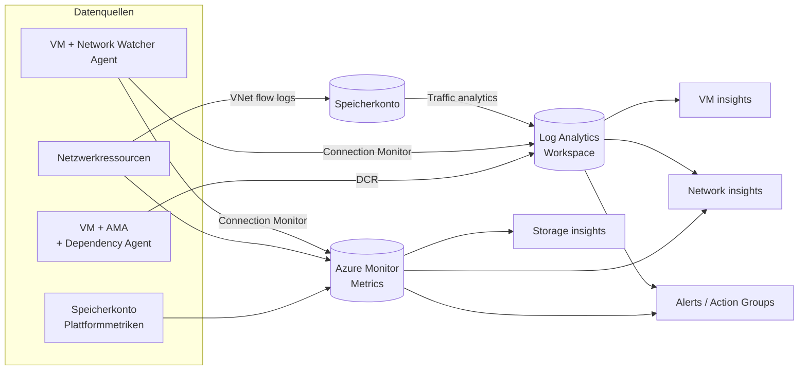

# 5.3 Insights und Network Watcher

> **Domäne:** Monitor and maintain Azure resources · **Gewichtung:** 10–15 %
> **Study-Guide-Punkte:** *Configure and interpret monitoring of virtual machines, storage accounts, and networks by using Azure Monitor Insights* · *Use Azure Network Watcher and Connection Monitor*
> (Metriken & Logs → [5.1](01-azure-monitor-metriken-und-logs.md) · Warnungen → [5.2](02-warnungen-und-aktionsgruppen.md) · Troubleshooting-Praxis → [4.10](../04-netzwerk/10-netzwerk-troubleshooting.md))
> **Stand:** November 2026

## Lernziele

Nach diesem Kapitel kann ich …

- erklären, was **Azure Monitor Insights** sind und welche Insights es für VMs, Storage und Netzwerke gibt.
- **VM insights** mit dem **Azure Monitor Agent (AMA)** und einer **Data Collection Rule (DCR)** aktivieren und die Ansichten *Performance* und *Map* interpretieren.
- **Storage insights** zur Analyse von Verfügbarkeit, Latenz, Fehlern und Kapazität nutzen.
- die Rolle von **Network Watcher** (regionale Ressource, automatische Aktivierung) beschreiben und seine Werkzeuge einordnen.
- einen **Connection Monitor** mit Testgruppen, Quellen, Zielen und Testkonfigurationen einrichten und auswerten.
- **VNet flow logs** und **Traffic analytics** konfigurieren und vom Vorgänger NSG flow logs abgrenzen.

## Überblick

Azure Monitor sammelt Metriken und Logs ([5.1](01-azure-monitor-metriken-und-logs.md)). Rohdaten allein beantworten aber selten die Frage „Geht es meinem Dienst gut?". Dafür gibt es **Insights**: von Microsoft kuratierte, vorkonfigurierte Überwachungsoberflächen (meist auf Basis von **Workbooks**) für einen bestimmten Ressourcentyp – z. B. VM insights, Storage insights, Network insights, Container insights.

Für Netzwerke stellt **Azure Network Watcher** zusätzlich Werkzeuge bereit, um Verbindungen **dauerhaft zu überwachen** (Connection Monitor), **Verkehrsflüsse zu protokollieren** (VNet flow logs, Traffic analytics) und **Probleme gezielt zu diagnostizieren** (IP flow verify, Next hop, Packet capture …). Die Diagnose-Werkzeuge werden in [4.10](../04-netzwerk/10-netzwerk-troubleshooting.md) praxisnah behandelt; dieses Kapitel fokussiert auf **Monitoring und Konfiguration**.

## Kernkonzepte

### Azure Monitor Insights – Überblick

| Insight | Datenquelle | Agent nötig? | Typische Fragen |
|---|---|---|---|
| **VM insights** | Gast-Performance-Daten + Verbindungsdaten in Log Analytics | ✅ AMA (+ optional Dependency Agent für *Map*) | Wie ausgelastet sind CPU/RAM/Disk im Gast? Mit welchen Systemen spricht die VM? |
| **Storage insights** | Plattformmetriken der Speicherkonten | ❌ | Ist das Konto verfügbar? Wo entsteht Latenz? Welche Fehler treten auf? |
| **Network insights** | Ressourcen-Health, Metriken, Topologie | ❌ | Sind meine Netzwerkressourcen gesund? Wie hängen sie zusammen? |
| **Container insights** | AKS/Arc-Kubernetes-Logs und -Metriken | ✅ (Add-on/Agent) | Pod- und Node-Auslastung |
| **Application Insights** | Telemetrie der Anwendung (SDK/Auto-Instrumentierung) | ✅ SDK bzw. Instrumentierung | Antwortzeiten, Ausnahmen, Abhängigkeiten von Apps |
| **Key Vault insights** u. a. | Plattformmetriken/-logs | ❌ | Anfragen, Latenz, Fehler |

Einstieg: **Portal > Monitor > Insights** (bzw. *Insights Hub*) oder direkt an der Ressource unter **Monitoring > Insights**.

### VM insights

**Aktivierung:**

- VM insights nutzt den **Azure Monitor Agent (AMA)** und eine **Data Collection Rule (DCR)**, die die Performance-Zähler in einen **Log Analytics Workspace** schreibt. Der frühere Log Analytics Agent (MMA/OMS) ist **eingestellt** (August 2024).
- Beim Aktivieren über **Monitoring > Insights > Enable** wählt man den Workspace und ob **Processes and dependencies (Map)** gesammelt werden sollen. Für *Map* wird zusätzlich der **Dependency Agent** installiert.
- Für viele VMs: Aktivierung **at scale** über *Monitor > Virtual Machines* oder per **Azure Policy**-Initiative (→ [1.4](../01-identitaeten-und-governance/04-azure-policy.md)).

**Ansichten:**

| Ansicht | Inhalt |
|---|---|
| **Performance** | Gast-Metriken: CPU-Auslastung, **verfügbarer Arbeitsspeicher**, logische Datenträger (IOPS, Durchsatz, belegter Speicher), Netzwerk; Top-N-Liste über viele VMs |
| **Map** | Prozesse in der VM, **eingehende und ausgehende Verbindungen**, abhängige Server/Ports, fehlgeschlagene Verbindungen (nur mit Dependency Agent) |
| **At scale** (*Monitor > Virtual Machines*) | Übersicht über alle VMs eines Abos/einer Ressourcengruppe, inkl. nicht überwachter VMs |

**Gespeicherte Daten (Log Analytics):** u. a. Tabelle **InsightsMetrics** (Performance-Daten) sowie bei aktivierter Map **VMConnection**, **VMComputer**, **VMProcess**, **VMBoundPort**. Auf diese Tabellen lässt sich mit KQL abfragen und alarmieren (→ [5.1](01-azure-monitor-metriken-und-logs.md), [5.2](02-warnungen-und-aktionsgruppen.md)).

> ⚠️ **Host-Metriken vs. Gast-Metriken:** Ohne Agent liefert Azure nur **Host-Metriken** (z. B. *Percentage CPU*, Disk- und Netzwerk-Bytes aus Sicht des Hypervisors). **Arbeitsspeicher-Auslastung im Gast**, Belegung der Dateisysteme oder Prozessdaten gibt es nur **mit Agent** (VM insights bzw. eigene DCR).

### Storage insights

- Funktioniert **ohne Agent und ohne Konfiguration** – basiert auf den Plattformmetriken der Speicherkonten.
- Einstieg: **Monitor > Insights > Storage accounts** (Übersicht über viele Konten) oder **Speicherkonto > Monitoring > Insights**.
- Registerkarten/Workbooks:

| Bereich | Aussage |
|---|---|
| **Overview** | Transaktionen, Verfügbarkeit, Latenz pro Konto |
| **Failures** | Fehlertypen (z. B. *AuthorizationError*, *ClientOtherError*, *ServerTimeoutError*, *ThrottlingError*) |
| **Performance** | **E2E latency** vs. **Server latency** |
| **Availability** | Verfügbarkeit in % pro Dienst (Blob, File, Queue, Table) |
| **Capacity** | Belegter Speicher pro Dienst, Anzahl Blobs/Container/Shares |

> **E2E latency** = gesamte Zeit von der ersten empfangenen Byte bis zur letzten gesendeten Byte inkl. Netzwerk zum Client.
> **Server latency** = reine Verarbeitungszeit im Storage-Dienst.
> **Hohe E2E-, aber niedrige Server-Latenz** → Problem liegt **beim Client oder im Netzwerk**, nicht im Speicherkonto.

Für detaillierte Einzelanfragen (wer hat welchen Blob gelesen?) sind **Diagnostic settings / Resource logs** nötig (→ [5.1](01-azure-monitor-metriken-und-logs.md)); Insights selbst zeigen aggregierte Metriken.

### Network insights

Einstieg: **Monitor > Insights > Networks**.

- **Network health:** Ressourcen-Health und Metrik-Alerts aller Netzwerkressourcen (VNets, NSGs, Load Balancer, VPN-/App-Gateways, Firewalls, Private Endpoints …) auf einen Blick, filterbar nach Abo/RG/Typ.
- **Topology:** grafische Darstellung von VNets, Subnetzen, NICs, VMs und deren Verbindungen – auch über Regionen und Abos hinweg.
- **Connectivity:** Übersicht der **Connection Monitor**-Tests und deren Status.
- **Traffic:** Auswertung von **Flow logs / Traffic analytics**.
- **Diagnostic toolkit:** Schnellzugriff auf die Network-Watcher-Werkzeuge (Packet capture, VPN troubleshoot, Connection troubleshoot, Next hop, IP flow verify).

### Workbooks, Dashboards, Grafana

| Werkzeug | Zweck |
|---|---|
| **Workbooks** | Interaktive Berichte aus Metriken, Logs (KQL), Resource Graph u. a.; **Parameter** (Abo, Zeitbereich, Ressource), Text, Diagramme, Grids. Alle Insights sind Workbooks; eigene Workbooks können aus **Vorlagen** erstellt, gespeichert und mit RBAC geteilt werden. |
| **Azure Dashboards** | Kacheln im Portal, angeheftete Metrikdiagramme/Abfragen; einfache Übersichtsseiten, als Ressource teilbar |
| **Azure Managed Grafana** | Grafana-Dashboards als Managed Service, gut für Multi-Cloud/Teams mit Grafana-Erfahrung |

### Network Watcher – Grundlagen

- **Regionaler Dienst:** Pro Abo und Region gibt es eine Instanz `NetworkWatcher_<region>` in der Ressourcengruppe **NetworkWatcherRG**.
- Wird **automatisch aktiviert**, sobald in einer Region ein VNet erstellt oder aktualisiert wird. Manuelle Aktivierung: `az network watcher configure`.
- Wird die Ressourcengruppe *NetworkWatcherRG* gelöscht, ist Network Watcher in den Regionen deaktiviert (wird bei Bedarf neu erstellt).
- **Rollen:** Für die Nutzung genügt in der Regel **Network Contributor** (bzw. eine Custom Role mit `Microsoft.Network/networkWatchers/*` und Leserechten auf die beteiligten Ressourcen). Für Flow Logs zusätzlich Schreibrechte auf das Speicherkonto/den Workspace.

**Werkzeuge im Überblick:**

| Kategorie | Werkzeug | Kurzbeschreibung |
|---|---|---|
| **Monitoring** | **Connection Monitor** | Dauerhafte End-to-End-Überwachung von Erreichbarkeit und Latenz |
| | **Topology** | Grafische Darstellung der Netzwerkressourcen |
| **Network diagnostic tools** | IP flow verify | Wird ein 5-Tupel durch NSGs erlaubt/blockiert? |
| | NSG diagnostics | Welche NSG-Regel greift für einen Datenfluss? |
| | Next hop | Wohin wird ein Paket geroutet (UDR/System route)? |
| | Effective security rules | Wirksame NSG-Regeln an einer NIC |
| | Connection troubleshoot | Einmaliger Verbindungstest Quelle → Ziel |
| | Packet capture | Paketmitschnitt auf VM/VMSS (Agent nötig) |
| | VPN troubleshoot | Diagnose von VPN-Gateways/Verbindungen |
| **Traffic** | **Flow logs** (VNet / NSG) | Protokollierung der IP-Flüsse |
| | **Traffic analytics** | Auswertung und Visualisierung der Flow Logs |

Anwendung der Diagnose-Werkzeuge → [4.10 Netzwerk-Troubleshooting](../04-netzwerk/10-netzwerk-troubleshooting.md).

### Connection Monitor

Connection Monitor überwacht **kontinuierlich** die Verbindung zwischen Quellen und Zielen und misst **Erreichbarkeit** und **Round-trip time (RTT)**.

**Bausteine:**

| Baustein | Beschreibung |
|---|---|
| **Connection monitor** | Regionale Ressource (in der Region der Quellen), enthält eine oder mehrere Testgruppen |
| **Test group** | Kombination aus Quellen, Zielen und Testkonfigurationen; kann deaktiviert werden |
| **Sources** | Azure-VMs und VMSS (mit **Network Watcher Agent**-Extension) oder **On-Premises-/Arc-Maschinen** (mit **Azure Monitor Agent** bzw. Arc) |
| **Destinations** | Azure-VMs, beliebige **URLs/FQDNs/IP-Adressen**, Microsoft-365-Endpunkte, Log-Analytics-Workspace-Endpunkte |
| **Test configuration** | Protokoll **TCP** (Port), **HTTP/HTTPS** (Methode, Pfad, gültige Statuscodes) oder **ICMP**; **Test frequency** (z. B. 30 s, 1 min, 5 min … oder eigene); **Success threshold**: *Checks failed (%)* und *Round-trip time (ms)* |

**Ergebnisse:**

- Status pro Test: **Pass / Warning / Fail**; Drill-down bis auf Hop-Ebene (Topologie des Pfades, Hop-Latenzen, Probleme wie hohe Latenz oder blockierende NSG/UDR).
- Metriken **ChecksFailedPercent** und **RoundTripTimeMs** in Azure Monitor → **Metric alerts** (→ [5.2](02-warnungen-und-aktionsgruppen.md)).
- Detaildaten im **Log Analytics Workspace** (Tabellen z. B. `NWConnectionMonitorTestResult`, `NWConnectionMonitorPathResult`).

**Historie:** *Connection Monitor (classic)* und *Network Performance Monitor (NPM)* sind **eingestellt**; Funktionen wurden in den aktuellen Connection Monitor überführt.

### VNet flow logs und Traffic analytics

**Flow logs** protokollieren IP-Datenflüsse (Quelle/Ziel-IP, Ports, Protokoll, Richtung, erlaubt/verweigert, Bytes/Pakete).

| Merkmal | **VNet flow logs** (aktuell) | NSG flow logs (Legacy) |
|---|---|---|
| Geltungsbereich | VNet, Subnetz oder NIC | NSG |
| Erfasst | gesamten Verkehr inkl. Verkehr ohne NSG, Azure Virtual Network Manager Security admin rules, Verschlüsselungsstatus | nur Verkehr, den NSG-Regeln auswerten |
| Status | empfohlen | **Neuanlage seit 30.06.2025 nicht mehr möglich**, Einstellung **30.09.2027** |

**Konfiguration:**

- Ziel ist ein **Speicherkonto** (JSON-Dateien im Container `insights-logs-flowlogflowevent`), das sich **in derselben Region** wie das überwachte VNet befinden muss.
- **Retention** in Tagen (0 = unbegrenzt) – Aufbewahrung über das Speicherkonto bzw. die Flow-Log-Einstellung.
- Optional **Traffic analytics**: verarbeitet die Flow Logs und schreibt angereicherte Daten in einen **Log Analytics Workspace**; Verarbeitungsintervall **10 Minuten** oder **60 Minuten**.

**Traffic analytics** zeigt u. a.: Top-Talker, offene Ports, Verkehr aus dem Internet, blockierten Verkehr, Verkehr nach Regionen/Ländern, bösartige IPs, Auslastung von Gateways. Einstieg: **Network Watcher > Traffic analytics**.

## Zusammenhänge



- **Metriken & Logs** ([5.1](01-azure-monitor-metriken-und-logs.md)): Insights sind Sichten auf dieselben Daten – Metrics (Storage, Network) bzw. Log Analytics (VM insights, Connection Monitor, Traffic analytics).
- **Warnungen** ([5.2](02-warnungen-und-aktionsgruppen.md)): Aus Insights heraus lassen sich Metrik- und Log-Alerts erstellen; VM insights bietet **empfohlene Alert-Regeln**.
- **NSG & ASG** ([4.5](../04-netzwerk/05-nsg-und-asg.md)): Flow Logs und Traffic analytics zeigen, welche Regeln Verkehr erlauben oder blockieren.
- **Troubleshooting** ([4.10](../04-netzwerk/10-netzwerk-troubleshooting.md)): Connection Monitor erkennt ein Problem, die Diagnose-Tools finden die Ursache.
- **VMs** ([3.2](../03-compute/02-virtuelle-maschinen.md)): AMA, Dependency Agent und Network Watcher Agent sind **VM-Extensions**.
- **Speicherkonten** ([2.1](../02-speicher/01-speicherkonten-und-redundanz.md)): Ziel für Flow Logs; selbst über Storage insights überwacht.
- **Azure Policy** ([1.4](../01-identitaeten-und-governance/04-azure-policy.md)): Built-in-Initiativen aktivieren VM insights und Flow Logs flächendeckend (DeployIfNotExists).

## Vergleichstabellen

### Connection troubleshoot vs. Connection Monitor

| Kriterium | Connection troubleshoot | Connection Monitor |
|---|---|---|
| Art | **einmaliger** Test (Ad-hoc) | **kontinuierliche** Überwachung |
| Ergebnis | Erreichbar ja/nein, Latenz, Hops, Ursache (NSG/UDR) zum Zeitpunkt des Tests | Zeitreihen für Erreichbarkeit und RTT, Status Pass/Warning/Fail |
| Alarmierung | ❌ | ✅ über Azure-Monitor-Metriken |
| Quellen | Azure-VM, VMSS, App Gateway, Bastion | Azure-VMs/VMSS, On-Premises-/Arc-Maschinen |
| Typischer Einsatz | „Warum kommt VM A gerade nicht an Port 1433 von B?" | „Benachrichtige mich, wenn die Verbindung zum Rechenzentrum ausfällt oder die Latenz > 100 ms ist" |

### Host-Metriken vs. VM insights

| Kriterium | Host-Metriken (Plattform) | VM insights |
|---|---|---|
| Agent | keiner | AMA (+ Dependency Agent) |
| Speicherung | Azure Monitor Metrics (93 Tage) | Log Analytics Workspace |
| Arbeitsspeicher im Gast | ❌ (nur *Available Memory Bytes* bei manchen Größen/Preview – nicht verlassen) | ✅ |
| Dateisystem-Belegung | ❌ | ✅ |
| Prozesse & Verbindungen | ❌ | ✅ (Map) |
| Kosten | kostenlos | Log-Analytics-Ingestion |

### Monitoring-Werkzeuge für Netzwerke

| Frage | Werkzeug |
|---|---|
| Ist die Verbindung VM → Datenbank **dauerhaft** verfügbar? | **Connection Monitor** |
| Welche IPs kommunizieren am meisten / welcher Verkehr wird blockiert? | **Traffic analytics** (auf VNet flow logs) |
| Wie sieht mein Netzwerk aus? | **Topology** |
| Sind meine Netzwerkressourcen gesund? | **Network insights > Network health** |
| Warum ist **jetzt** eine bestimmte Verbindung blockiert? | **IP flow verify / NSG diagnostics / Connection troubleshoot** (→ 4.10) |

## Azure Portal

| Aufgabe | Pfad |
|---|---|
| Alle Insights | **Portal > Monitor > Insights** |
| VM insights für eine VM aktivieren | **Portal > Virtual machines > VM > Monitoring > Insights > Enable** |
| VM insights at scale | **Portal > Monitor > Virtual Machines** (bzw. *Insights > Virtual Machines*) |
| Performance / Map einer VM | **… > VM > Monitoring > Insights > Performance / Map** |
| Data Collection Rules | **Portal > Monitor > Settings > Data Collection Rules** |
| Storage insights (mehrere Konten) | **Portal > Monitor > Insights > Storage accounts** |
| Storage insights (ein Konto) | **Portal > Storage accounts > Konto > Monitoring > Insights** |
| Network insights | **Portal > Monitor > Insights > Networks** |
| Workbooks | **Portal > Monitor > Workbooks** (oder an der Ressource *Monitoring > Workbooks*) |
| Network Watcher | **Portal > Network Watcher** |
| Network Watcher pro Region aktivieren | **… > Network Watcher > Overview** (Region/Abo, *Enable*) |
| Connection Monitor erstellen | **… > Network Watcher > Monitoring > Connection monitor > + Create** |
| Topologie | **… > Network Watcher > Monitoring > Topology** |
| Flow Logs | **… > Network Watcher > Logs > Flow logs > + Create** (Flow log type: *Virtual network*) |
| Traffic analytics | **… > Network Watcher > Logs > Traffic analytics** |
| Diagnose-Tools | **… > Network Watcher > Network diagnostic tools > …** |

**Wichtige Felder beim Erstellen eines Connection Monitors:**

1. **Basics:** Name, Abo, **Region** (der Quellen), Workspace-Konfiguration (Standard- oder eigener Log Analytics Workspace)
2. **Test groups:** Name → **Add sources** (VMs/VMSS, On-Prem-Agents), **Add test configurations** (Protokoll, Port, Frequenz, Schwellenwerte), **Add destinations**
3. **Create alert:** Metrik-Alert inkl. Action Group direkt mit anlegen
4. **Review + create** – fehlt der Network Watcher Agent auf den Quell-VMs, wird er automatisch installiert.

**Wichtige Felder bei VNet flow logs:** Abo, **Flow log type = Virtual network**, Zielressource (VNet/Subnetz/NIC), **Storage account** (gleiche Region), **Retention (days)**, Analytics: **Enable traffic analytics**, *Traffic analytics processing interval* (10 / 60 min), **Log Analytics Workspace**.

## Azure CLI & PowerShell

### Azure CLI

```bash
# Azure Monitor Agent auf einer Linux-VM installieren (Windows: AzureMonitorWindowsAgent)
az vm extension set \
  --resource-group rg-prod --vm-name vm-web01 \
  --name AzureMonitorLinuxAgent \
  --publisher Microsoft.Azure.Monitor \
  --enable-auto-upgrade true

# Data Collection Rule aus JSON-Definition erstellen und der VM zuordnen
az monitor data-collection rule create \
  --resource-group rg-monitoring --name dcr-vm-perf \
  --location westeurope --rule-file dcr-vm-perf.json
az monitor data-collection rule association create \
  --name dcra-vm-web01 \
  --rule-id "/subscriptions/<sub-id>/resourceGroups/rg-monitoring/providers/Microsoft.Insights/dataCollectionRules/dcr-vm-perf" \
  --resource "/subscriptions/<sub-id>/resourceGroups/rg-prod/providers/Microsoft.Compute/virtualMachines/vm-web01"

# Network Watcher Agent installieren (Linux: NetworkWatcherAgentLinux)
az vm extension set \
  --resource-group rg-prod --vm-name vm-web01 \
  --name NetworkWatcherAgentWindows \
  --publisher Microsoft.Azure.NetworkWatcher

# Network Watcher in einer Region aktivieren
az network watcher configure \
  --resource-group NetworkWatcherRG --locations westeurope --enabled true

# Connection Monitor: TCP-Test von einer VM zu einem SQL-Server auf Port 1433
az network watcher connection-monitor create \
  --name cm-web-to-sql --location westeurope \
  --endpoint-source-name vm-web01 \
  --endpoint-source-resource-id "/subscriptions/<sub-id>/resourceGroups/rg-prod/providers/Microsoft.Compute/virtualMachines/vm-web01" \
  --endpoint-dest-name sql01 \
  --endpoint-dest-address sql01.contoso.local \
  --test-config-name tcp1433 \
  --test-config-protocol Tcp --tcp-port 1433 \
  --test-config-frequency 30 \
  --test-group-name tg-sql

# Status/Liste der Connection Monitors
az network watcher connection-monitor list --location westeurope -o table

# VNet flow log mit Traffic analytics anlegen
az network watcher flow-log create \
  --name fl-vnet-prod --location westeurope \
  --resource-group rg-prod \
  --vnet vnet-prod \
  --storage-account stflowlogsweu \
  --retention 30 \
  --traffic-analytics true \
  --workspace law-network \
  --interval 10
```

### Azure PowerShell

```powershell
# Azure Monitor Agent auf einer Windows-VM
Set-AzVMExtension -ResourceGroupName "rg-prod" -VMName "vm-web01" `
  -Name "AzureMonitorWindowsAgent" -Publisher "Microsoft.Azure.Monitor" `
  -ExtensionType "AzureMonitorWindowsAgent" -TypeHandlerVersion "1.0" `
  -EnableAutomaticUpgrade $true -Location "westeurope"

# Network Watcher Agent
Set-AzVMExtension -ResourceGroupName "rg-prod" -VMName "vm-web01" `
  -Name "NetworkWatcherAgentWindows" -Publisher "Microsoft.Azure.NetworkWatcher" `
  -ExtensionType "NetworkWatcherAgentWindows" -TypeHandlerVersion "1.4" -Location "westeurope"

# Connection Monitor (Objekte für Quelle, Ziel, Testkonfiguration, Testgruppe)
$vm  = Get-AzVM -ResourceGroupName "rg-prod" -Name "vm-web01"
$src = New-AzNetworkWatcherConnectionMonitorEndpointObject -Name "vm-web01" -ResourceId $vm.Id
$dst = New-AzNetworkWatcherConnectionMonitorEndpointObject -Name "sql01" -Address "sql01.contoso.local"
$tcp = New-AzNetworkWatcherConnectionMonitorProtocolConfigurationObject -TcpProtocol -Port 1433
$cfg = New-AzNetworkWatcherConnectionMonitorTestConfigurationObject -Name "tcp1433" `
  -TestFrequencySec 30 -ProtocolConfiguration $tcp -SuccessThresholdChecksFailedPercent 5 `
  -SuccessThresholdRoundTripTimeMs 100
$tg  = New-AzNetworkWatcherConnectionMonitorTestGroupObject -Name "tg-sql" `
  -TestConfiguration $cfg -Source $src -Destination $dst
New-AzNetworkWatcherConnectionMonitor -NetworkWatcherName "NetworkWatcher_westeurope" `
  -ResourceGroupName "NetworkWatcherRG" -Name "cm-web-to-sql" -TestGroup $tg

# VNet flow log mit Traffic analytics
$vnet = Get-AzVirtualNetwork -ResourceGroupName "rg-prod" -Name "vnet-prod"
$sa   = Get-AzStorageAccount -ResourceGroupName "rg-monitoring" -Name "stflowlogsweu"
$law  = Get-AzOperationalInsightsWorkspace -ResourceGroupName "rg-monitoring" -Name "law-network"
New-AzNetworkWatcherFlowLog -Location "westeurope" -Name "fl-vnet-prod" `
  -TargetResourceId $vnet.Id -StorageId $sa.Id -Enabled $true `
  -EnableRetention $true -RetentionPolicyDays 30 `
  -EnableTrafficAnalytics -TrafficAnalyticsInterval 10 `
  -WorkspaceResourceId $law.ResourceId
```

> Hinweis: Die Parameter der Connection-Monitor-Cmdlets (Az.Network) sind umfangreich; im Zweifel `Get-Help New-AzNetworkWatcherConnectionMonitorTestConfigurationObject -Full` prüfen. In der Prüfung reicht es, die Bausteine (Endpoint, Test configuration, Test group) zu kennen.

## Praxisbeispiel

**Szenario:** *Contoso* betreibt in *West Europe* einen Webshop (VMSS `vmss-web`) mit einer SQL-VM `vm-sql01` und einem Speicherkonto `stcontososhop` für Produktbilder. Anforderungen:

1. Das Betriebsteam will **Arbeitsspeicher- und Festplattenauslastung** der VMs sehen und wissen, **welche Server mit der SQL-VM kommunizieren**.
2. Kunden melden langsame Bildladezeiten – es soll geklärt werden, ob das Speicherkonto die Ursache ist.
3. Fällt die Verbindung Web → SQL (Port 1433) aus oder steigt die Latenz über 50 ms, soll das Team per E-Mail informiert werden.
4. Die Security-Abteilung möchte sehen, welcher Verkehr aus dem Internet auf das VNet trifft und was blockiert wird.

**Umsetzung:**

1. **VM insights:** *Monitor > Virtual Machines > Not monitored* → VMSS und SQL-VM auswählen → **Enable** mit Workspace `law-contoso` und **Processes and dependencies (Map)** aktiviert. AMA, DCR und Dependency Agent werden installiert. Anschließend unter *Performance* (Speicher, logische Datenträger) und *Map* (Verbindungen zu `vm-sql01`) auswerten.
2. **Storage insights:** *Monitor > Insights > Storage accounts > stcontososhop > Performance*. Ergebnis: **E2E latency hoch, Server latency niedrig** → Speicherkonto arbeitet schnell, die Verzögerung entsteht im Netzwerk/beim Client (z. B. weit entfernte Kunden → CDN/Front Door prüfen).
3. **Connection Monitor:** *Network Watcher > Connection monitor > + Create* → Region *West Europe*, Testgruppe `tg-web-sql`: Quelle `vmss-web`, Ziel `vm-sql01`, Testkonfiguration **TCP 1433**, Frequenz 30 s, Schwellen *Checks failed 5 %*, *RTT 50 ms*. Unter **Create alert** eine Action Group mit E-Mail an das Betriebsteam auswählen (→ [5.2](02-warnungen-und-aktionsgruppen.md)).
4. **VNet flow logs + Traffic analytics:** *Network Watcher > Flow logs > + Create* → Typ *Virtual network*, `vnet-shop`, Speicherkonto `stflowlogsweu` (gleiche Region), Retention 90 Tage, **Traffic analytics** mit Intervall 10 Minuten in `law-security`. Nach einiger Zeit zeigt *Traffic analytics* Verkehr aus dem Internet, blockierte Flüsse und Top-Talker.

## Limits & wichtige Zahlen

| Wert | Grenze / Standard |
|---|---|
| Network-Watcher-Instanzen | **eine pro Region und Abo** (`NetworkWatcher_<region>` in `NetworkWatcherRG`) |
| Speicherkonto für Flow Logs | **gleiche Region** wie das überwachte VNet/NSG |
| Traffic-analytics-Intervall | **10** oder **60** Minuten |
| Flow-Log-Retention | in Tagen konfigurierbar, **0 = unbegrenzt** |
| NSG flow logs | keine Neuanlage seit **30.06.2025**, Einstellung **30.09.2027** |
| Log Analytics Agent (MMA) | eingestellt seit **August 2024** → AMA verwenden |
| Plattformmetriken (Host-Metriken) | **93 Tage** Aufbewahrung in Azure Monitor Metrics |
| Packet capture | max. **5 Stunden** pro Sitzung |
| Connection-Monitor-Limits (Monitore, Testgruppen, Quellen/Ziele) | Kontingente pro Region/Abo – aktuelle Werte unter [Network Watcher limits](https://learn.microsoft.com/azure/azure-resource-manager/management/azure-subscription-service-limits#network-watcher-limits) prüfen |

## Prüfungstipps & Fallstricke

- ⚠️ **Arbeitsspeicher- oder Dateisystem-Auslastung einer VM** → nur mit **Agent** (VM insights/AMA + DCR). Host-Metriken reichen nicht.
- ⚠️ **„Welche Prozesse/Server kommunizieren mit der VM?"** → **VM insights Map** (benötigt **Dependency Agent**).
- **Storage: E2E-Latenz hoch, Server-Latenz niedrig** → Ursache im Netzwerk/Client. **Beide hoch** → Problem im Speicherdienst bzw. Throttling.
- **Storage insights** benötigt **keinen Agent** und keine Konfiguration.
- ⚠️ **Dauerhafte Überwachung + Alarm** einer Verbindung → **Connection Monitor**, nicht *Connection troubleshoot* (einmalig) und nicht *IP flow verify*.
- **Connection Monitor** benötigt auf Azure-VMs die **Network Watcher Agent**-Extension (wird bei Erstellung automatisch installiert); On-Premises-Quellen über **AMA/Arc**.
- **Hybrid-Monitoring zwischen Rechenzentrum und Azure** → Connection Monitor (Nachfolger von Network Performance Monitor).
- ⚠️ **Flow Logs: Speicherkonto muss in derselben Region** liegen wie die überwachte Ressource.
- **Neue Flow-Log-Konfiguration** → **VNet flow logs** (NSG flow logs können nicht mehr neu erstellt werden).
- **Visualisierung/Auswertung von Flow Logs** (Top-Talker, bösartige IPs) → **Traffic analytics** mit **Log Analytics Workspace**.
- **Network Watcher „fehlt" in einer Region** → wird automatisch beim Erstellen eines VNets aktiviert oder manuell per `az network watcher configure`.
- Insights sind **Workbooks** – eigene Berichte daher als **Workbook** (aus Vorlage) erstellen und teilen.

## Selbsttest

**1.** Sie müssen die Arbeitsspeicherauslastung im Gastbetriebssystem von 50 Windows-VMs überwachen. Was ist erforderlich?

<details><summary>Lösung</summary>

**VM insights** (bzw. eine eigene DCR) mit dem **Azure Monitor Agent** und einem **Log Analytics Workspace**. Host-Metriken ohne Agent liefern keine verlässliche Gast-Speicherauslastung. Für 50 VMs am besten **at scale** oder per **Azure Policy** aktivieren.
</details>

**2.** In VM insights ist die Registerkarte *Map* leer, *Performance* funktioniert. Was fehlt?

<details><summary>Lösung</summary>

Der **Dependency Agent** bzw. die Option **Processes and dependencies (Map)** wurde bei der Aktivierung nicht ausgewählt.
</details>

**3.** Storage insights zeigt für ein Konto eine hohe *E2E latency*, die *Server latency* ist jedoch niedrig. Wo liegt die Ursache wahrscheinlich?

<details><summary>Lösung</summary>

**Außerhalb des Speicherdienstes** – im Netzwerk zwischen Client und Azure oder beim Client selbst (z. B. langsame Verbindung, große Entfernung, Client-Verarbeitung).
</details>

**4.** Sie wollen benachrichtigt werden, wenn eine Azure-VM den lokalen Fileserver (TCP 445) nicht mehr erreicht oder die Latenz 80 ms übersteigt. Welches Werkzeug verwenden Sie?

<details><summary>Lösung</summary>

**Connection Monitor** mit einer TCP-Testkonfiguration (Port 445), Erfolgsschwellen *Checks failed %* und *Round-trip time = 80 ms* sowie einem **Metric alert** mit Action Group.
</details>

**5.** Sie erstellen einen Flow Log für ein VNet in *West Europe* und wählen ein Speicherkonto in *North Europe*. Was passiert?

<details><summary>Lösung</summary>

Die Konfiguration ist **nicht möglich** – das Speicherkonto muss sich **in derselben Region** wie das überwachte VNet befinden.
</details>

**6.** Die Security-Abteilung möchte grafisch sehen, welche externen IP-Adressen am häufigsten mit dem VNet kommunizieren und welche Flüsse blockiert werden. Was konfigurieren Sie?

<details><summary>Lösung</summary>

**VNet flow logs** mit aktivierter **Traffic analytics** (Log Analytics Workspace, Intervall 10 oder 60 Minuten).
</details>

**7.** Ein Kollege möchte einen neuen **NSG flow log** anlegen. Was empfehlen Sie?

<details><summary>Lösung</summary>

**VNet flow logs** verwenden. NSG flow logs können seit dem **30.06.2025** nicht mehr neu erstellt werden und werden am **30.09.2027** eingestellt.
</details>

**8.** In welcher Ressourcengruppe und unter welchem Namen finden Sie die Network-Watcher-Instanz für die Region *Germany West Central*?

<details><summary>Lösung</summary>

Ressourcengruppe **NetworkWatcherRG**, Ressource **NetworkWatcher_germanywestcentral** – eine Instanz pro Abo und Region, automatisch beim Anlegen eines VNets erstellt.
</details>

**9.** Was unterscheidet *Connection troubleshoot* von *Connection Monitor*?

<details><summary>Lösung</summary>

**Connection troubleshoot** ist ein **einmaliger** Test zum aktuellen Zeitpunkt (z. B. zur Fehlersuche). **Connection Monitor** überwacht **kontinuierlich**, speichert Zeitreihen in Azure Monitor/Log Analytics und kann **Alarme** auslösen.
</details>

**10.** Sie möchten einen eigenen, interaktiven Monitoring-Bericht mit Parametern (Abo, Zeitraum) aus Metriken und KQL-Abfragen erstellen und mit Kollegen teilen. Welches Werkzeug?

<details><summary>Lösung</summary>

Ein **Azure Monitor Workbook** (optional aus einer Vorlage) – Insights selbst basieren ebenfalls auf Workbooks.
</details>

## Weiterführende Links

- [AZ-104 Study Guide](https://learn.microsoft.com/credentials/certifications/resources/study-guides/az-104)
- [Azure Monitor Insights overview](https://learn.microsoft.com/azure/azure-monitor/insights/insights-overview)
- [Overview of VM insights](https://learn.microsoft.com/azure/azure-monitor/vm/vminsights-overview)
- [Enable VM insights](https://learn.microsoft.com/azure/azure-monitor/vm/vminsights-enable-overview)
- [Monitor your storage service with Azure Monitor Storage insights](https://learn.microsoft.com/azure/storage/common/storage-insights-overview)
- [Azure Monitor network insights](https://learn.microsoft.com/azure/network-watcher/network-insights-overview)
- [Azure Workbooks overview](https://learn.microsoft.com/azure/azure-monitor/visualize/workbooks-overview)
- [What is Azure Network Watcher?](https://learn.microsoft.com/azure/network-watcher/network-watcher-overview)
- [Enable or disable Azure Network Watcher](https://learn.microsoft.com/azure/network-watcher/network-watcher-create)
- [Connection monitor overview](https://learn.microsoft.com/azure/network-watcher/connection-monitor-overview)
- [Virtual network flow logs](https://learn.microsoft.com/azure/network-watcher/vnet-flow-logs-overview)
- [Traffic analytics](https://learn.microsoft.com/azure/network-watcher/traffic-analytics)
- [NSG flow logs retirement / migration](https://learn.microsoft.com/azure/network-watcher/nsg-flow-logs-migrate)
