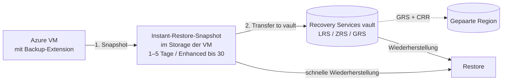
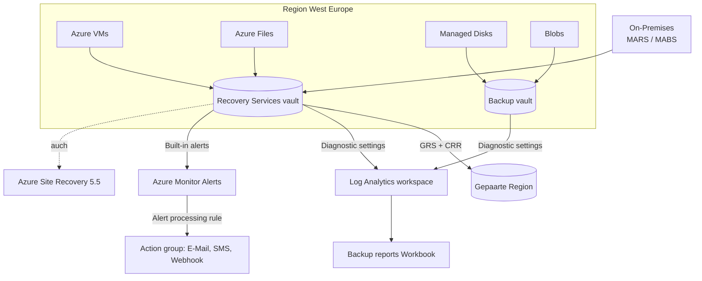

# 5.4 Azure Backup

> **Domäne:** Monitor and maintain Azure resources · **Gewichtung:** 10–15 %
> **Study-Guide-Punkte:** *Create a Recovery Services vault* · *Create an Azure Backup vault* · *Create and configure a backup policy* · *Perform backup and restore operations by using Azure Backup* · *Configure reports and alerts for backups*
> (Disaster Recovery mit Replikation → [Kapitel 5.5 Azure Site Recovery](05-azure-site-recovery.md))
> **Stand:** November 2026

## Lernziele

Nach diesem Kapitel kann ich …

- **Recovery Services vault** und **Backup vault** unterscheiden und für einen Workload den richtigen Tresor wählen.
- einen Tresor anlegen und seine **Storage redundancy**, **Soft delete**, **Immutability** und **Cross Region Restore** konfigurieren.
- eine **Backup policy** für Azure-VMs (Standard und Enhanced) mit Zeitplan, Instant-Restore- und Aufbewahrungsregeln erstellen.
- Backups auslösen (geplant und **Backup now**) und VMs, Datenträger und einzelne Dateien **wiederherstellen**.
- Backup-Jobs überwachen, **Alerts** über Azure Monitor und Action Groups einrichten und **Backup reports** über Log Analytics bereitstellen.

## Überblick

**Azure Backup** ist der integrierte, verwaltete Sicherungsdienst von Azure. Er sichert Azure-Ressourcen (VMs, Datenträger, Azure Files, Blobs, Datenbanken in VMs, …) und auch lokale Server, ohne dass eine eigene Backup-Infrastruktur betrieben werden muss.

Sicherungsdaten landen in einem **Tresor** (*Vault*). Es gibt zwei Tresortypen: den älteren, breit einsetzbaren **Recovery Services vault** und den neueren **Backup vault** für neuere Workloads. Was wann und wie lange gesichert wird, steuert eine **Backup policy**.

Abgrenzung: **Backup** schützt vor Datenverlust (versehentliches Löschen, Ransomware, Beschädigung) und ermöglicht die Rückkehr zu einem früheren Zeitpunkt. **Azure Site Recovery** ([5.5](05-azure-site-recovery.md)) repliziert dagegen laufend, um bei einem Regionsausfall mit minimaler Ausfallzeit umzuschalten (Disaster Recovery).

## Kernkonzepte

### Tresortypen: Recovery Services vault vs. Backup vault

| Workload | Recovery Services vault | Backup vault |
|---|---|---|
| **Azure VMs** | ✅ | ❌ |
| SQL Server / SAP HANA in Azure-VMs | ✅ | ❌ |
| **Azure Files** | ✅ | ❌ (vaulted Backup für Files je nach Stand – Doku prüfen) |
| Lokale Dateien/Ordner/System State (**MARS-Agent**) | ✅ | ❌ |
| MABS / System Center DPM | ✅ | ❌ |
| **Azure Site Recovery** (Replikation) | ✅ | ❌ |
| **Azure Managed Disks** | ❌ | ✅ |
| **Azure Blobs** | ❌ | ✅ |
| Azure Database for PostgreSQL (Single/Flexible Server) | ❌ | ✅ |
| Azure Kubernetes Service (AKS) | ❌ | ✅ |
| Azure Data Lake Storage | ❌ | ✅ |

> Merkhilfe: **VMs, Files, SQL in VM, On-Premises, ASR → Recovery Services vault**. **Disks, Blobs, PostgreSQL, AKS → Backup vault**.

Gemeinsame Eigenschaften beider Tresore:

- Ein Tresor ist eine Azure-Ressource in einer **Region** und einer Ressourcengruppe.
- ⚠️ Für **Azure-VMs** muss der Recovery Services vault in **derselben Region** wie die VM liegen (und im selben Abonnement).
- Ein Tresor kann viele Ressourcen sichern; eine Ressource wird aber immer nur von **einem** Tresor gesichert.

### Storage redundancy des Tresors

| Option | Beschreibung |
|---|---|
| **LRS** | 3 Kopien in einem Rechenzentrum – günstig, kein Schutz vor Regionsausfall |
| **ZRS** | 3 Kopien über Availability Zones der Region |
| **GRS** (Standard) | zusätzlich asynchrone Kopie in die **gepaarte Region** |

- ⚠️ Die Redundanz kann nur geändert werden, **bevor** Elemente im Tresor geschützt werden. Danach: neuen Tresor anlegen oder Schutz entfernen.
- **Cross Region Restore (CRR):** Bei **GRS** kann zusätzlich aktiviert werden, dass Wiederherstellungen auch in der **sekundären (gepaarten) Region** möglich sind – z. B. bei einem Ausfall der primären Region oder für Tests. CRR lässt sich einschalten, aber nicht mehr ausschalten.

### Sicherheitsfunktionen

| Funktion | Wirkung |
|---|---|
| **Soft delete** | Gelöschte Backup-Daten werden **14 Tage** (Standard) zusätzlich aufbewahrt und können wiederhergestellt werden – ohne Zusatzkosten in diesem Zeitraum. **Enhanced soft delete** erlaubt längere Aufbewahrung (bis 180 Tage) und kann **always-on** (nicht mehr deaktivierbar) gesetzt werden. |
| **Immutability** (*Immutable vault*) | Verhindert Operationen, die Recovery Points vorzeitig entfernen würden (z. B. Aufbewahrung in der Policy verkürzen, Backup mit *Delete data* stoppen). Kann **gesperrt** (*locked*) werden – dann irreversibel. |
| **Multi-user authorization (MUA)** | Kritische Operationen (z. B. Soft delete deaktivieren, Policy-Aufbewahrung verringern, Schutz entfernen) erfordern eine zusätzliche Berechtigung auf einer **Resource Guard**-Ressource, die idealerweise in einem anderen Abo/Tenant von einem anderen Team verwaltet wird. |
| **Verschlüsselung** | Backup-Daten werden immer verschlüsselt (Platform-managed keys); optional **Customer-managed keys** aus Key Vault (muss vor dem ersten geschützten Element konfiguriert werden). |
| **Private Endpoints** | Zugriff auf den Tresor über Private Link (Verweis [4.7](../04-netzwerk/07-service-endpoints-und-private-endpoints.md)). |
| **RBAC** | Rollen **Backup Contributor**, **Backup Operator** (kein Löschen von Backups/Policies), **Backup Reader** ([1.3](../01-identitaeten-und-governance/03-rbac-zugriffsverwaltung.md)). |

### Zentrale Verwaltung: Business Continuity Center

Das **Azure Business Continuity Center** ist die zentrale Oberfläche für Backup und Site Recovery über viele Tresore, Abos und Regionen hinweg und löst das frühere **Backup center** ab. Dort sieht man geschützte Elemente, Jobs, Alerts, Policies und den Schutzstatus (auch ungeschützte Ressourcen). Für die Prüfung genügt: zentrale Übersicht = Business Continuity Center (bzw. in älteren Fragen „Backup center“).

### Azure-VM-Backup: Funktionsweise



1. **Snapshot-Phase:** Die **Backup-Extension** (*VMSnapshot* unter Windows, *VMSnapshotLinux* unter Linux) wird beim ersten Backup automatisch installiert und erstellt einen Snapshot der Datenträger.
2. **Transfer to vault:** Die Daten werden **inkrementell** in den Tresor übertragen.
3. **Instant Restore:** Die Snapshots bleiben zusätzlich für eine konfigurierbare Zeit lokal erhalten und ermöglichen sehr schnelle Wiederherstellungen (Recovery Point Typ *Snapshot* bzw. *Snapshot and Vault*).

**Konsistenzstufen:**

| Typ | Wann | Bedeutung |
|---|---|---|
| **Application-consistent** | Windows mit **VSS**; Linux mit **Pre-/Post-Scripts** | Anwendungen (z. B. Datenbanken) befinden sich in konsistentem Zustand – bester Fall |
| **File-system-consistent** | Linux ohne Scripts bzw. wenn VSS fehlschlägt | Dateisystem konsistent, Anwendungsdaten evtl. nicht |
| **Crash-consistent** | VM ausgeschaltet/deallocated oder Snapshot ohne Gastkoordination | Zustand wie nach einem Stromausfall |

### Backup policy für VMs

| Bestandteil | Inhalt |
|---|---|
| **Policy subtype** | **Standard** (1 Backup pro Tag) oder **Enhanced** (mehrere Backups pro Tag, z. B. alle 4 h) |
| **Backup schedule** | Standard: *Daily* / *Weekly*; Enhanced: zusätzlich *Hourly* (Intervall 4/6/8/12 h) |
| **Instant restore** | Aufbewahrung der Snapshots: Standard **1–5 Tage**, Enhanced bis **30 Tage** |
| **Retention range** | Aufbewahrung im Tresor für *daily*, *weekly*, *monthly*, *yearly* Backup Points (GFS-Prinzip) |
| **Zeitzone / Uhrzeit** | Startzeitpunkt des Backup-Fensters |

- **Enhanced policy** ist für VMs mit **Trusted Launch** sowie für Premium SSD v2 / Ultra Disks erforderlich (Details je nach aktuellem Stand prüfen). Eine VM kann von Standard auf Enhanced umgestellt werden, aber nicht zurück.
- Beim Aktivieren des Backups im Portal wird standardmäßig die **DefaultPolicy** (täglich, 30 Tage Aufbewahrung) vorgeschlagen.
- Eine Policy kann vielen VMs zugewiesen werden; Änderungen an der Policy gelten für alle zugeordneten Elemente.

### Backup ausführen

- **Geplantes Backup** gemäß Policy.
- **On-demand backup (*Backup now*)**: zusätzliches Backup außerhalb des Zeitplans mit **eigener Aufbewahrungsdauer** (*Retain backup till*). Das erste Backup nach dem Aktivieren startet erst zum nächsten geplanten Zeitpunkt – für ein sofortiges Backup *Backup now* verwenden.
- **Stop backup:**
  - **Retain backup data** – keine neuen Backups, vorhandene Recovery Points bleiben (Kosten für Speicher laufen weiter). Fortsetzen jederzeit möglich (*Resume backup*).
  - **Delete backup data** – Recovery Points werden gelöscht (unterliegt Soft delete).

### Restore-Optionen für Azure-VMs

| Option | Beschreibung |
|---|---|
| **Create new virtual machine** | Neue VM aus dem Recovery Point; Name, RG, VNet/Subnetz wählbar |
| **Restore disks** | Nur die Datenträger werden wiederhergestellt (in ein Staging-Storage-Konto bzw. als Managed Disks) – plus Template, um daraus eine angepasste VM zu erstellen |
| **Replace existing** | Ersetzt die Datenträger der bestehenden VM (die aktuellen Disks werden vorher als Snapshot gesichert) |
| **Cross Region Restore** | Wiederherstellung in der gepaarten Region (nur bei GRS + CRR) |
| **File Recovery** (*Item-level restore*) | Skript herunterladen, auf einer Maschine ausführen → Recovery Point wird per **iSCSI** als Laufwerk eingebunden → einzelne Dateien kopieren → *Unmount disks* |

Recovery-Point-Typen: **Snapshot** (nur Instant Restore), **Snapshot and Vault**, **Vault** (nur Tresor). Aus Snapshots erfolgt die Wiederherstellung am schnellsten.

### Weitere Workloads (kurz)

| Workload | Tresor | Funktionsweise |
|---|---|---|
| **Azure Files** | Recovery Services vault | basiert auf **Share Snapshots** im Speicherkonto (Snapshot-Backup); Wiederherstellung ganzer Shares oder einzelner Dateien, Original- oder alternativer Speicherort ([2.4](../02-speicher/04-azure-files.md)). Zusätzlich gibt es eine **vaulted**-Variante mit Kopie in den Tresor (Verfügbarkeit prüfen). |
| **Azure Blobs** | Backup vault | **Operational backup** (lokal im Speicherkonto über Soft delete, Versioning, Change feed, Point-in-time restore – kontinuierlich) und **Vaulted backup** (geplante Kopien in den Tresor, Schutz auch bei Löschung des Kontos) |
| **Azure Managed Disks** | Backup vault | **inkrementelle Snapshots** in einer Ressourcengruppe, mehrere Backups pro Tag möglich, kein Agent; Backup vault benötigt per Managed Identity Rechte (z. B. *Disk Backup Reader*, *Disk Snapshot Contributor*) |
| **Dateien/Ordner on-premises** | Recovery Services vault | **MARS-Agent** (Microsoft Azure Recovery Services) auf Windows; sichert Dateien, Ordner und System State, **bis zu 3× täglich**, kein Bare-Metal-Restore |
| **Ganze Server on-premises / Hyper-V / VMware** | Recovery Services vault | **MABS** (Microsoft Azure Backup Server) oder **System Center DPM** |
| **SQL Server / SAP HANA in Azure-VMs** | Recovery Services vault | Workload-bewusstes Backup inkl. Log-Backups (z. B. alle 15 Minuten) |

### Monitoring, Alerts und Reports

- **Backup jobs** und **Backup items** im Tresor bzw. im Business Continuity Center: Status, Dauer, Fehlermeldungen.
- **Built-in Azure Monitor alerts:** Azure Backup erzeugt automatisch Alerts für z. B. **Job failures** und **Security events** (Löschen von Backup-Daten, Deaktivieren von Soft delete). Für Benachrichtigungen per E-Mail/SMS/Webhook wird eine **Alert processing rule** mit **Action group** angelegt ([5.2](02-warnungen-und-aktionsgruppen.md)).
- ⚠️ Die **klassischen Backup-Alerts** (im Tresor unter *Backup Alerts*) sind veraltet; Microsoft empfiehlt die Azure-Monitor-basierten Alerts.
- **Backup reports:** Über die **Diagnostic settings** des Tresors werden Backup-Ereignisse in einen **Log Analytics workspace** geschickt (Ziel-Tabellen *resource-specific*). Die vordefinierte **Backup reports**-Arbeitsmappe (Workbook) zeigt anschließend Jobs, Elemente, Speicherverbrauch, Policy-Einhaltung über mehrere Tresore/Abos hinweg ([5.1](01-azure-monitor-metriken-und-logs.md)).
- Eigene Log-Abfragen (KQL) auf diesen Daten sind als **Log search alerts** nutzbar.

## Zusammenhänge



- **Azure Site Recovery** ([5.5](05-azure-site-recovery.md)) nutzt ebenfalls den **Recovery Services vault** – aber für Replikation und Failover, nicht für zeitpunktbezogene Sicherungen. Beides ergänzt sich.
- **Azure Monitor** ([5.1](01-azure-monitor-metriken-und-logs.md), [5.2](02-warnungen-und-aktionsgruppen.md)): Alerts, Action Groups, Log Analytics und Workbooks bilden die Grundlage für Backup-Überwachung und -Reports.
- **VMs und Datenträger** ([3.2](../03-compute/02-virtuelle-maschinen.md), [3.3](../03-compute/03-vm-datentraeger-und-verschluesselung.md)): Disk-Typ und Security type (Trusted Launch) beeinflussen die Policy-Wahl; VMs mit **Azure Disk Encryption** werden unterstützt, der Tresor benötigt Zugriff auf den Key Vault.
- **Azure Files** ([2.4](../02-speicher/04-azure-files.md)): Backup basiert auf Share Snapshots; Soft delete des Shares schützt zusätzlich.
- **Kosten** ([1.7](../01-identitaeten-und-governance/07-kostenverwaltung-und-advisor.md)): Abrechnung pro geschützter Instanz (nach Größe) + belegter Backup-Speicher (LRS günstiger als GRS) + Snapshot-Speicher für Instant Restore.
- **Ressourcensperren** ([1.5](../01-identitaeten-und-governance/05-ressourcensperren-und-tags.md)): Ein Lock auf der Restore-Point-Collection-Ressourcengruppe kann das Bereinigen von Snapshots und damit Backups blockieren.

## Vergleichstabellen

### Recovery Services vault vs. Backup vault

| Kriterium | Recovery Services vault | Backup vault |
|---|---|---|
| Typische Workloads | Azure VMs, Azure Files, SQL/SAP HANA in VM, MARS, MABS/DPM | Disks, Blobs, PostgreSQL, AKS |
| Site Recovery | ✅ | ❌ |
| Redundanz | LRS / ZRS / GRS | LRS / ZRS / GRS |
| Cross Region Restore | ✅ (bei GRS) | für einige Workloads (prüfen) |
| Soft delete / Immutability / MUA | ✅ | ✅ |
| CLI | `az backup …` | `az dataprotection …` |
| PowerShell-Modul | `Az.RecoveryServices` | `Az.DataProtection` |

### Standard- vs. Enhanced-Policy (VMs)

| Kriterium | Standard | Enhanced |
|---|---|---|
| Backups pro Tag | 1 | mehrere (Intervall 4–12 h) |
| Instant-Restore-Aufbewahrung | 1–5 Tage | bis 30 Tage |
| Trusted Launch VMs | nicht unterstützt (prüfen) | ✅ |
| Wechsel | → Enhanced möglich | ❌ zurück zu Standard |

### Azure Backup vs. Azure Site Recovery vs. Snapshots

| Kriterium | Azure Backup | Azure Site Recovery | Manuelle Disk-Snapshots |
|---|---|---|---|
| Ziel | Wiederherstellung früherer Zustände | Failover bei Ausfall (DR) | ad-hoc Sicherung |
| RPO | Stunden (Policy) | Sekunden bis Minuten | manuell |
| Langzeitaufbewahrung | ✅ bis zu Jahre | ❌ (nur kurze Recovery-Point-Historie) | manuell verwaltet |
| Schutz vor versehentlichem Löschen/Ransomware | ✅ (Soft delete, Immutability) | eingeschränkt (repliziert Fehler mit) | eingeschränkt |
| Automatisierung | Policy | Replikationsrichtlinie | Skript/Automation |

## Azure Portal

| Aufgabe | Pfad |
|---|---|
| Recovery Services vault anlegen | **Portal > Recovery Services vaults > + Create** |
| Backup vault anlegen | **Portal > Backup vaults > + Create** (bzw. **Business Continuity Center > + Create > Vault**) |
| Storage redundancy / Cross Region Restore | **… > Recovery Services vault > Properties > Backup Configuration > Update** |
| Soft delete / Immutability / MUA | **… > Recovery Services vault > Properties > Security Settings** |
| Backup für eine VM aktivieren | **Portal > Virtual machines > VM > Backup** (Operations) **oder** **… > Recovery Services vault > + Backup > Azure Virtual machine** |
| Policy erstellen / bearbeiten | **… > Recovery Services vault > Backup policies > + Add** |
| Backup sofort auslösen | **… > Recovery Services vault > Backup items > Azure Virtual Machine > VM > Backup now** |
| VM wiederherstellen | **… > Backup items > VM > Restore VM** |
| Einzelne Dateien wiederherstellen | **… > Backup items > VM > File Recovery** (Skript herunterladen) |
| Backup stoppen | **… > Backup items > VM > Stop backup** (*Retain* / *Delete backup data*) |
| Jobs anzeigen | **… > Recovery Services vault > Backup jobs** |
| Zentrale Übersicht | **Portal > Business Continuity Center** (Protected items, Jobs, Alerts, Policies) |
| Alerts und Benachrichtigungen | **Business Continuity Center > Alerts** bzw. **Azure Monitor > Alerts > Alert processing rules** |
| Diagnoseeinstellungen für Reports | **… > Recovery Services vault > Diagnostic settings > + Add diagnostic setting** |
| Backup reports | **Business Continuity Center > Reports** (bzw. Workbook *Backup reports*) |
| Azure Files sichern | **Speicherkonto > File shares > Share > Backup** oder **Vault > + Backup > Azure FileShare** |
| Disk-Backup | **… > Backup vault > + Backup > Azure Disks** |

**Wichtige Felder beim Anlegen eines Recovery Services vault:** Subscription, Resource group, Vault name, **Region** (muss zur VM-Region passen); unter *Redundancy* GRS (Standard), LRS oder ZRS und **Cross Region Restore**; *Vault properties* (z. B. Immutability), *Networking* (Public access / Private endpoint).

⚠️ **Nach dem ersten geschützten Element nicht mehr änderbar:**
- **Storage redundancy** (LRS/ZRS/GRS)
- **Customer-managed key** als Verschlüsselungsart (muss vorher aktiviert werden)
- Region des Tresors (Tresore lassen sich nicht in eine andere Region verschieben)
- Eingeschaltetes **Cross Region Restore** lässt sich nicht mehr deaktivieren; **gesperrte Immutability** und **always-on Soft delete** sind irreversibel.

## Azure CLI & PowerShell

### Azure CLI (Recovery Services vault)

```bash
# Recovery Services vault anlegen
az backup vault create \
  --resource-group rg-backup \
  --name rsv-contoso-weu \
  --location westeurope

# Redundanz auf LRS setzen (nur bevor Elemente geschützt werden)
az backup vault backup-properties set \
  --resource-group rg-backup \
  --name rsv-contoso-weu \
  --backup-storage-redundancy LocallyRedundant

# Vorhandene Policies anzeigen
az backup policy list --resource-group rg-backup --vault-name rsv-contoso-weu -o table

# Policy aus JSON aktualisieren (vorher mit "az backup policy show" exportieren und anpassen)
az backup policy set --resource-group rg-backup --vault-name rsv-contoso-weu \
  --policy @policy.json

# Backup für eine VM aktivieren
az backup protection enable-for-vm \
  --resource-group rg-backup \
  --vault-name rsv-contoso-weu \
  --vm vm-web01 \
  --policy-name DefaultPolicy

# Sofortiges Backup mit eigener Aufbewahrung (Datum im Format dd-mm-yyyy)
az backup protection backup-now \
  --resource-group rg-backup \
  --vault-name rsv-contoso-weu \
  --container-name vm-web01 \
  --item-name vm-web01 \
  --backup-management-type AzureIaasVM \
  --retain-until 31-12-2026

# Recovery Points auflisten
az backup recoverypoint list \
  --resource-group rg-backup \
  --vault-name rsv-contoso-weu \
  --container-name vm-web01 \
  --item-name vm-web01 \
  --backup-management-type AzureIaasVM -o table

# Datenträger aus einem Recovery Point wiederherstellen
az backup restore restore-disks \
  --resource-group rg-backup \
  --vault-name rsv-contoso-weu \
  --container-name vm-web01 \
  --item-name vm-web01 \
  --rp-name <recovery-point-name> \
  --storage-account <staging-storage-account> \
  --target-resource-group rg-restore

# Jobs prüfen
az backup job list --resource-group rg-backup --vault-name rsv-contoso-weu -o table
```

### Azure CLI (Backup vault)

```bash
# Backup vault anlegen (Erweiterung "dataprotection" wird bei Bedarf installiert)
az dataprotection backup-vault create \
  --resource-group rg-backup \
  --vault-name bv-contoso-weu \
  --location westeurope \
  --storage-setting "[{type:'LocallyRedundant',datastore-type:'VaultStore'}]" \
  --type SystemAssigned
```

### Azure PowerShell

```powershell
# Recovery Services vault anlegen und als Kontext setzen
$vault = New-AzRecoveryServicesVault -Name "rsv-contoso-weu" `
  -ResourceGroupName "rg-backup" -Location "westeurope"

# Redundanz setzen (vor dem ersten geschützten Element)
Set-AzRecoveryServicesBackupProperty -Vault $vault -BackupStorageRedundancy LocallyRedundant

# Policy abrufen
$policy = Get-AzRecoveryServicesBackupProtectionPolicy -Name "DefaultPolicy" `
  -VaultId $vault.ID

# Backup für eine VM aktivieren
Enable-AzRecoveryServicesBackupProtection -ResourceGroupName "rg-app" `
  -Name "vm-web01" -Policy $policy -VaultId $vault.ID

# Backup-Element ermitteln und sofort sichern (Aufbewahrung bis Datum)
$container = Get-AzRecoveryServicesBackupContainer -ContainerType AzureVM `
  -FriendlyName "vm-web01" -VaultId $vault.ID
$item = Get-AzRecoveryServicesBackupItem -Container $container `
  -WorkloadType AzureVM -VaultId $vault.ID
Backup-AzRecoveryServicesBackupItem -Item $item -VaultId $vault.ID `
  -ExpiryDateTimeUTC (Get-Date).AddDays(30).ToUniversalTime()

# Recovery Points der letzten 7 Tage
$rp = Get-AzRecoveryServicesBackupRecoveryPoint -Item $item -VaultId $vault.ID `
  -StartDate (Get-Date).AddDays(-7).ToUniversalTime() -EndDate (Get-Date).ToUniversalTime()

# Datenträger aus dem neuesten Recovery Point wiederherstellen
Restore-AzRecoveryServicesBackupItem -RecoveryPoint $rp[0] `
  -StorageAccountName "<staging-storage-account>" `
  -StorageAccountResourceGroupName "rg-backup" `
  -TargetResourceGroupName "rg-restore" -VaultId $vault.ID
```

| Ziel | CLI | PowerShell |
|---|---|---|
| Tresor anlegen | `az backup vault create` | `New-AzRecoveryServicesVault` |
| Redundanz setzen | `az backup vault backup-properties set` | `Set-AzRecoveryServicesBackupProperty` |
| VM schützen | `az backup protection enable-for-vm` | `Enable-AzRecoveryServicesBackupProtection` |
| Backup now | `az backup protection backup-now` | `Backup-AzRecoveryServicesBackupItem` |
| Recovery Points | `az backup recoverypoint list` | `Get-AzRecoveryServicesBackupRecoveryPoint` |
| Restore | `az backup restore restore-disks` | `Restore-AzRecoveryServicesBackupItem` |
| Backup vault | `az dataprotection backup-vault create` | `New-AzDataProtectionBackupVault` |

## Praxisbeispiel

**Szenario:** *Contoso* betreibt in **West Europe** drei Produktions-VMs (eine davon mit Trusted Launch), einen Azure-Files-Share mit Abteilungsdaten und mehrere Premium-SSD-Datenträger für eine Analyseanwendung. Anforderungen:

1. VMs: tägliches Backup, 30 Tage tägliche, 12 Wochen wöchentliche und 12 Monate monatliche Aufbewahrung; bei einem Regionsausfall sollen Wiederherstellungen in der gepaarten Region möglich sein.
2. Die Trusted-Launch-VM soll alle 4 Stunden gesichert werden.
3. Datenträger der Analyse-App sollen mehrmals täglich ohne Agent gesichert werden.
4. Backup-Daten sollen vor böswilligem Löschen geschützt sein.
5. Das Betriebsteam erhält bei fehlgeschlagenen Backups eine E-Mail; das Management bekommt monatliche Reports.

**Umsetzung:**

1. **Recovery Services vault** `rsv-contoso-weu` in **West Europe** anlegen, Redundanz **GRS** belassen und **Cross Region Restore** aktivieren – **bevor** VMs geschützt werden.
2. **Security Settings:** Soft delete auf **enhanced** mit 30 Tagen und *always-on*; **Immutability** aktivieren (nach Testphase sperren); **MUA** mit einer **Resource Guard** im Security-Abo verknüpfen.
3. **Policies:**
   - `pol-vm-daily` (Standard): täglich 22:00, Instant restore 2 Tage, Retention 30 Tage daily / 12 weekly / 12 monthly.
   - `pol-vm-4h` (Enhanced): Hourly alle 4 h, Instant restore 7 Tage, gleiche Langzeitaufbewahrung – für die Trusted-Launch-VM.
4. **Backup aktivieren:** VMs den Policies zuweisen; anschließend einmalig **Backup now**, damit sofort ein Recovery Point existiert.
5. **Azure Files:** im selben Tresor *+ Backup > Azure FileShare* mit täglicher Snapshot-Policy ([2.4](../02-speicher/04-azure-files.md)).
6. **Disks:** **Backup vault** `bv-contoso-weu` anlegen, der Managed Identity des Tresors die Rollen *Disk Backup Reader* (auf die Disks) und *Disk Snapshot Contributor* (auf die Snapshot-RG) geben, Disk-Backup-Policy alle 4 h.
7. **Alerts:** In **Azure Monitor > Alert processing rules** eine Regel für den Tresor-Scope anlegen, die die Built-in-Alerts (*Job failure*) an die Action Group `ag-ops-mail` weiterleitet ([5.2](02-warnungen-und-aktionsgruppen.md)).
8. **Reports:** Für beide Tresore **Diagnostic settings** an den Log Analytics workspace `law-contoso` senden; im **Business Continuity Center > Reports** den Workspace auswählen.

**Test der Wiederherstellung:** Eine gelöschte Datei auf `vm-web01` über **File Recovery** zurückholen (Skript ausführen, Datei kopieren, **Unmount disks**).

## Limits & wichtige Zahlen

| Wert | Grenze / Standard |
|---|---|
| Soft delete (Standard) | **14 Tage** (enhanced: bis 180 Tage) |
| Instant-Restore-Snapshots | Standard-Policy **1–5 Tage** (Standard 2), Enhanced bis **30 Tage** |
| Backups pro Tag (VM) | Standard **1**, Enhanced alle **4/6/8/12 h** |
| On-demand-Backup-Aufbewahrung | frei wählbar (max. ca. 99 Jahre) |
| Langzeitaufbewahrung | bis zu **99 Jahre** (yearly) |
| MARS-Agent | bis zu **3 Backups pro Tag** |
| Recovery Services vaults pro Abo und Region | ca. **500** |
| Geschützte VMs pro Tresor | ca. **1.000** (Azure-VMs) |
| Datenträger pro gesicherter VM | bis zu **32** (größere Konfigurationen je nach Stand prüfen) |
| Tresor-Region | für VM-Backup **gleiche Region** wie die VM |

Aktuelle Werte: [Azure Backup support matrix](https://learn.microsoft.com/azure/backup/backup-support-matrix) und [Support matrix for Azure VM backup](https://learn.microsoft.com/azure/backup/backup-support-matrix-iaas).

## Prüfungstipps & Fallstricke

- ⚠️ **VM erscheint beim Aktivieren des Backups nicht in der Liste** → Tresor liegt in einer **anderen Region** (oder anderem Abo) als die VM.
- ⚠️ **Redundanz des Tresors von GRS auf LRS ändern geht nicht** → es sind bereits Elemente geschützt; nur vor dem ersten Schutz änderbar.
- **„Wiederherstellung in der gepaarten Region bei Regionsausfall"** → **GRS + Cross Region Restore**.
- **„Kostengünstigste Redundanz"** → **LRS**.
- **Disks, Blobs, PostgreSQL, AKS sichern** → **Backup vault**. **VMs, Files, SQL in VM, MARS, ASR** → **Recovery Services vault**.
- **Einzelne Dateien aus einem VM-Backup** → **File Recovery** (Skript, iSCSI-Mount) – nicht die ganze VM wiederherstellen.
- **Sofort nach Aktivierung ein Backup benötigen** → **Backup now** (das erste geplante Backup läuft erst zur Policy-Zeit).
- **Mehrere Backups pro Tag / Trusted Launch VM** → **Enhanced policy**.
- **Schnellste Wiederherstellung** → Recovery Point vom Typ **Snapshot** (Instant Restore).
- **„Backups sollen nicht vorzeitig gelöscht werden können, auch nicht von Admins"** → **Immutable vault (locked)** + **MUA/Resource Guard** + **Soft delete always-on**.
- **Backup wurde gelöscht** → innerhalb von **14 Tagen** über **Soft delete** wiederherstellen (*Undelete*).
- **Backup einer VM beenden, aber vorhandene Sicherungen behalten** → **Stop backup > Retain backup data**.
- ⚠️ **Lokale Dateien und Ordner ohne Backup-Server sichern** → **MARS-Agent**; ganze Hyper-V-/VMware-VMs lokal → **MABS/DPM**.
- **Backup-Status über viele Tresore/Abos** → **Business Continuity Center** (früher *Backup center*), **Reports** benötigen **Diagnostic settings → Log Analytics**.
- **E-Mail bei Backup-Fehlern** → Built-in Azure-Monitor-Alerts + **Alert processing rule** mit **Action group** (nicht die veralteten klassischen Alerts).
- **Application-consistent unter Linux** → **Pre-/Post-Scripts**; ausgeschaltete VM → nur **crash-consistent**.

## Selbsttest

**1.** Sie möchten Azure Managed Disks und Azure-VMs sichern. Wie viele und welche Tresortypen benötigen Sie mindestens?

<details><summary>Lösung</summary>

**Zwei:** einen **Recovery Services vault** für die VMs und einen **Backup vault** für die Managed Disks (Disk Backup ist nur im Backup vault verfügbar).
</details>

**2.** Ein Recovery Services vault in *North Europe* existiert. Sie wollen eine VM in *West Europe* sichern, die VM erscheint aber nicht im Assistenten. Warum?

<details><summary>Lösung</summary>

Für Azure-VM-Backup muss der Tresor in **derselben Region** wie die VM liegen. Lösung: einen Recovery Services vault in *West Europe* anlegen.
</details>

**3.** Ein Tresor sichert bereits 20 VMs mit GRS. Um Kosten zu sparen, soll er auf LRS umgestellt werden. Ist das möglich?

<details><summary>Lösung</summary>

**Nein**, die Storage redundancy kann nur geändert werden, solange keine Elemente geschützt sind. Optionen: Schutz stoppen und Daten löschen (aufwendig) oder einen **neuen Tresor mit LRS** für neue Backups anlegen.
</details>

**4.** Ein Benutzer hat eine Excel-Datei auf einer gesicherten Windows-VM gelöscht. Wie stellen Sie nur diese Datei mit minimalem Aufwand wieder her?

<details><summary>Lösung</summary>

**Backup items > VM > File Recovery** → Recovery Point wählen → Skript herunterladen und ausführen → Volumes werden per **iSCSI** eingebunden → Datei kopieren → **Unmount disks**.
</details>

**5.** Eine VM mit Security type *Trusted Launch* soll alle 4 Stunden gesichert werden. Welche Policy benötigen Sie?

<details><summary>Lösung</summary>

Eine **Enhanced policy** mit *Hourly*-Zeitplan (Intervall 4 h). Die Standard-Policy erlaubt nur ein Backup pro Tag.
</details>

**6.** Ein Angreifer mit Contributor-Rechten hat das Backup einer VM mit *Delete backup data* gestoppt. Können die Daten zurückgeholt werden?

<details><summary>Lösung</summary>

**Ja**, sofern **Soft delete** aktiv ist: Die Daten bleiben standardmäßig **14 Tage** erhalten und können per *Undelete* wiederhergestellt werden. Zusätzlich hätten **Immutability** und **MUA** die Aktion verhindern können.
</details>

**7.** Sie haben das Backup für eine neue VM aktiviert (Policy: täglich 23:00). Es ist 10:00, und vor einem Update um 12:00 soll ein Backup existieren. Was tun Sie?

<details><summary>Lösung</summary>

**Backup now** ausführen (On-demand backup) und eine Aufbewahrungsdauer festlegen (*Retain backup till*).
</details>

**8.** Das Betriebsteam soll bei jedem fehlgeschlagenen Backup-Job eine E-Mail erhalten. Was konfigurieren Sie?

<details><summary>Lösung</summary>

Die **Built-in Azure Monitor alerts** von Azure Backup nutzen und über eine **Alert processing rule** an eine **Action group** mit E-Mail-Empfängern weiterleiten.
</details>

**9.** Das Management möchte einen Bericht über Speicherverbrauch und Backup-Erfolgsquote aller Tresore in drei Abonnements. Was ist nötig?

<details><summary>Lösung</summary>

Für jeden Tresor **Diagnostic settings** an einen (gemeinsamen) **Log Analytics workspace** senden und anschließend **Backup reports** im Business Continuity Center bzw. das Workbook *Backup reports* nutzen.
</details>

**10.** Sie wollen lokale Dateiserver-Ordner (ohne System Center) direkt in Azure sichern. Welche Komponente installieren Sie, und welchen Tresor brauchen Sie?

<details><summary>Lösung</summary>

Den **MARS-Agent** (Microsoft Azure Recovery Services Agent) auf dem Server; Ziel ist ein **Recovery Services vault**. Bis zu drei Backups pro Tag sind möglich.
</details>

## Weiterführende Links

- [AZ-104 Study Guide](https://learn.microsoft.com/credentials/certifications/resources/study-guides/az-104)
- [What is Azure Backup?](https://learn.microsoft.com/azure/backup/backup-overview)
- [Backup vaults overview](https://learn.microsoft.com/azure/backup/backup-vault-overview)
- [Create and configure a Recovery Services vault](https://learn.microsoft.com/azure/backup/backup-create-recovery-services-vault)
- [About Azure VM backup](https://learn.microsoft.com/azure/backup/backup-azure-vms-introduction)
- [Back up an Azure VM using Enhanced policy](https://learn.microsoft.com/azure/backup/backup-azure-vms-enhanced-policy)
- [Restore Azure VM data in the Azure portal](https://learn.microsoft.com/azure/backup/backup-azure-arm-restore-vms)
- [Recover files from Azure VM backup](https://learn.microsoft.com/azure/backup/backup-azure-restore-files-from-vm)
- [Cross Region Restore](https://learn.microsoft.com/azure/backup/backup-create-recovery-services-vault#set-cross-region-restore)
- [Soft delete for Azure Backup](https://learn.microsoft.com/azure/backup/backup-azure-security-feature-cloud)
- [Immutable vault for Azure Backup](https://learn.microsoft.com/azure/backup/backup-azure-immutable-vault-concept)
- [Multi-user authorization using Resource Guard](https://learn.microsoft.com/azure/backup/multi-user-authorization-concept)
- [Azure Monitor based alerts for Azure Backup](https://learn.microsoft.com/azure/backup/backup-azure-monitoring-built-in-monitor)
- [Configure Azure Backup reports](https://learn.microsoft.com/azure/backup/configure-reports)
- [Azure Disk Backup overview](https://learn.microsoft.com/azure/backup/disk-backup-overview)
- [Overview of Azure Blob backup](https://learn.microsoft.com/azure/backup/blob-backup-overview)
- [About Azure file share backup](https://learn.microsoft.com/azure/backup/azure-file-share-backup-overview)
- [Azure Backup support matrix](https://learn.microsoft.com/azure/backup/backup-support-matrix)
