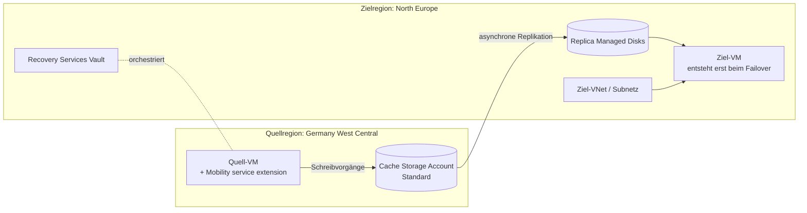
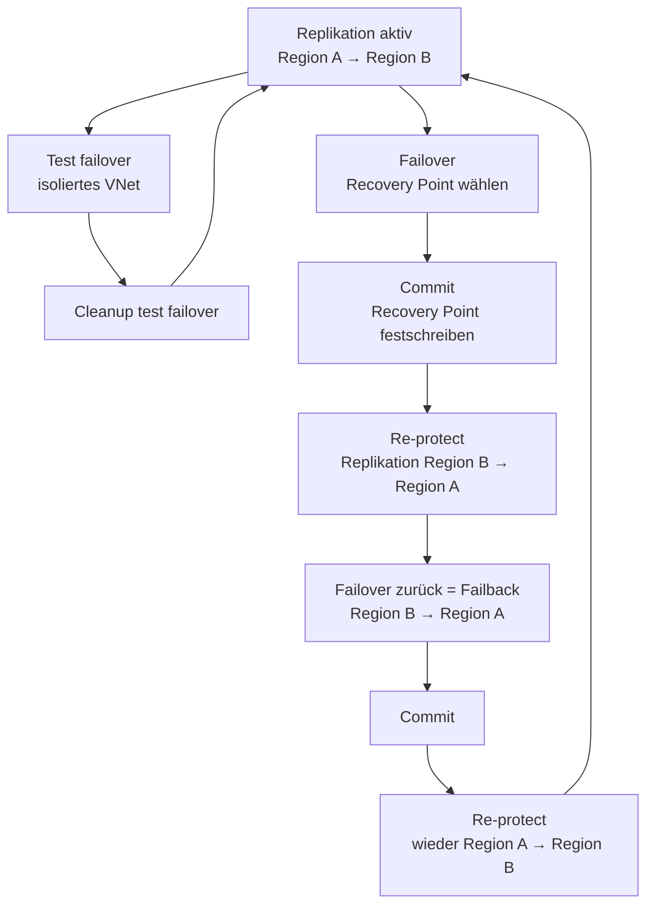

# 5.5 Azure Site Recovery

> **Domäne:** Monitor and maintain Azure resources · **Gewichtung:** 10–15 %
> **Study-Guide-Punkte:** *Configure Azure Site Recovery for Azure resources* · *Perform a failover to a secondary region by using Site Recovery*
> (Datensicherung mit Azure Backup → [Kapitel 5.4](04-azure-backup.md))
> **Stand:** November 2026

## Lernziele

Nach diesem Kapitel kann ich …

- den Unterschied zwischen **Disaster Recovery** (Azure Site Recovery) und **Datensicherung** (Azure Backup) anhand von **RPO** und **RTO** erklären.
- die Replikation einer Azure-VM in eine **andere Region** (oder Zone) einrichten und die beteiligten Komponenten benennen (Vault, Cache Storage Account, Mobility Service, Ziel-Ressourcen).
- eine **Replication policy** konfigurieren (Aufbewahrung der Recovery Points, App-konsistente Snapshots) und **Multi-VM-Konsistenz** einsetzen.
- einen **Test failover** gefahrlos durchführen und wieder bereinigen.
- einen **Failover** mit passendem Recovery Point ausführen, ihn **committen**, die VM **erneut schützen** (*Re-protect*) und ein **Failback** durchführen.
- **Recovery plans** für die geordnete Wiederherstellung mehrstufiger Anwendungen erstellen.

## Überblick

**Azure Site Recovery (ASR)** ist der Disaster-Recovery-Dienst von Azure. Er **repliziert** VMs fortlaufend von einem primären Standort an einen sekundären Standort. Fällt der primäre Standort aus (z. B. Ausfall einer ganzen Azure-Region), startet man per **Failover** die replizierten VMs am sekundären Standort und betreibt die Anwendung dort weiter. Ist der primäre Standort wieder verfügbar, kehrt man per **Failback** zurück.

ASR ersetzt **kein Backup**: Es hält nur eine begrenzte Anzahl aktueller Wiederherstellungspunkte vor (Tage, nicht Monate). Ein versehentlich gelöschter Ordner oder eine Ransomware-Verschlüsselung wird ebenfalls repliziert. Für langfristige Aufbewahrung und Wiederherstellung einzelner Dateien ist **Azure Backup** ([5.4](04-azure-backup.md)) zuständig.

Unterstützte Szenarien:

| Szenario | Beschreibung | AZ-104-Fokus |
|---|---|---|
| **Azure → Azure** (*Azure-to-Azure*, A2A) | Azure-VM von Region A nach Region B | ✅ **Schwerpunkt** |
| **Zone → Zone** | Azure-VM zwischen Availability Zones derselben Region | ✅ kennen |
| **VMware / physische Server → Azure** | On-Premises-Server per Replication Appliance nach Azure | kurz |
| **Hyper-V → Azure** | On-Premises-Hyper-V-VMs nach Azure | kurz |

## Kernkonzepte

### RPO und RTO

- **RPO** (*Recovery Point Objective*): Wie viel **Datenverlust** (gemessen in Zeit) ist maximal akzeptabel? Bei ASR typischerweise **Sekunden bis wenige Minuten**, da kontinuierlich repliziert wird.
- **RTO** (*Recovery Time Objective*): Wie lange darf die **Wiederherstellung** dauern, bis der Dienst wieder läuft? Bei ASR typischerweise **Minuten** (VM-Start in der Zielregion), mit Recovery Plans automatisierbar.

### Recovery Services Vault

- ASR nutzt denselben Tresortyp wie Azure Backup: den **Recovery Services vault**.
- ⚠️ Der Vault darf **nicht in der Quellregion** der zu schützenden VMs liegen. Empfohlen und üblich ist die **Zielregion** (DR-Region) – so bleibt der Vault bei einem Ausfall der Quellregion erreichbar.
- Ein Vault kann viele VMs schützen; Backup und Site Recovery können im selben Vault verwaltet werden.

### Komponenten bei Azure-zu-Azure



| Komponente | Rolle |
|---|---|
| **Mobility service extension** | Wird beim Aktivieren der Replikation **automatisch** als VM-Extension installiert (*SiteRecovery-Windows* / *SiteRecovery-Linux*). Erfasst Schreibvorgänge auf den Datenträgern. |
| **Cache storage account** | Standard-Speicherkonto in der **Quellregion**. Änderungen werden hier zwischengespeichert, bevor sie in die Zielregion übertragen werden. Wird von ASR angelegt oder kann vorgegeben werden. |
| **Replica managed disks** | Zielseitige Kopien der Datenträger; auf sie werden die Änderungen angewendet. |
| **Ziel-Ressourcen** | Ziel-**Resource Group**, Ziel-**VNet/Subnetz**, ggf. **Availability set** oder **Availability zone**, Ziel-VM-Größe. Standardwerte erzeugt ASR mit dem Suffix `-asr`, man kann sie aber anpassen. |
| **Recovery Services vault** | Steuert Replikation, Richtlinien, Failover und Monitoring. |

> Die **Ziel-VM existiert vor dem Failover nicht** und verursacht bis dahin keine Compute-Kosten. Kosten entstehen für Lizenz pro geschützter Instanz, Speicher (Replica Disks, Cache) und ausgehende Replikationsdaten.

### Replication policy

| Einstellung | Bedeutung |
|---|---|
| **Recovery point retention** | Wie lange Recovery Points aufbewahrt werden – bis zu **15 Tage** (Standardwerte variieren, typisch 1 Tag). |
| **App-consistent snapshot frequency** | Wie oft **app-konsistente** Recovery Points erstellt werden (z. B. alle 4 Stunden; auch deaktivierbar). Nutzen VSS (Windows) bzw. Pre-/Post-Skripte (Linux). |
| **Crash-consistent recovery points** | Werden automatisch etwa **alle 5 Minuten** erzeugt – nicht konfigurierbar. |

**Konsistenzarten:**

- **Crash-consistent**: entspricht dem Zustand nach einem Stromausfall – Datenträgerinhalt konsistent, aber Daten im Arbeitsspeicher fehlen.
- **App-consistent**: zusätzlich sind Anwendungsdaten (z. B. SQL-Transaktionen) sauber auf den Datenträger geschrieben. Wichtig für Datenbanken.

### Multi-VM-Konsistenz (*Replication groups*)

- Mehrere VMs (z. B. Applikations- und Datenbankserver) werden zu einer **Replication group** zusammengefasst und erhalten **gemeinsame**, zeitgleich konsistente Recovery Points.
- Bis zu **16 VMs** pro Replication group.
- Die VMs kommunizieren dafür untereinander (Port **20004**) – das kostet Leistung, daher nur aktivieren, wenn die Anwendung es braucht.

### Netzwerk

- **Network mapping**: ordnet Quell-VNet → Ziel-VNet zu. Wird beim ersten Aktivieren der Replikation automatisch angelegt (Ziel-VNet mit Suffix `-asr`) oder manuell festgelegt.
- **IP-Adressen**: Liegt das Ziel-Subnetz im selben Adressbereich, versucht ASR, die gleiche private IP zu vergeben; sonst wird die nächste freie IP verwendet. Statische IP im Ziel kann in den Netzwerkeinstellungen des replizierten Elements festgelegt werden.
- **Ausgehende Konnektivität der Quell-VM**: Die VM muss die ASR-Endpunkte erreichen. Bei NSGs/Firewalls entweder **Service Tags** (z. B. `AzureSiteRecovery`, `Storage.<Region>`, `AzureActiveDirectory`, `EventHub`, `GuestAndHybridManagement`) oder die erforderlichen URLs (u. a. `*.blob.core.windows.net`, `login.microsoftonline.com`, `*.hypervrecoverymanager.windowsazure.com`, `*.servicebus.windows.net`) erlauben. Authentifizierende Proxys werden nicht unterstützt.
- **Public IPs, NSGs, Load Balancer** im Ziel: In den Einstellungen des replizierten Elements (*Network*) kann man festlegen, welche Ziel-NSG, Public IP ([4.3](../04-netzwerk/03-oeffentliche-ip-adressen.md)) oder welcher Load Balancer nach dem Failover verwendet wird.

### Zone-to-Zone Disaster Recovery

- Replikation zwischen **Availability Zones derselben Region** – schützt vor dem Ausfall eines Rechenzentrums, nicht vor einem Regionsausfall.
- Vorteil: gleiche Region → geringere Latenz, keine regionsübergreifenden Datenkosten, Netzwerk kann gleich bleiben.
- Nur in Regionen mit Availability Zones; Quell-VM muss zonal bereitgestellt sein. Vgl. [3.4](../03-compute/04-verfuegbarkeit-und-scale-sets.md).

### Recovery Plans

Ein **Recovery Plan** fasst mehrere replizierte VMs zu einer Wiederherstellungseinheit zusammen:

- **Gruppen** (*Group 1, Group 2, …*) legen die **Startreihenfolge** fest – z. B. erst Datenbank, dann App-Server, dann Webserver.
- **Pre-/Post-Aktionen** pro Gruppe: **Azure Automation Runbooks** (z. B. DNS umstellen, Load Balancer konfigurieren) oder **manuelle Aktionen** (Failover pausiert, bis jemand bestätigt).
- Failover, Test failover und Commit können für den **ganzen Plan** auf einmal ausgeführt werden.
- Bis zu **100** geschützte Instanzen pro Recovery Plan (vorsichtig – aktuelle Grenzen prüfen).

### Failover-Typen

| Typ | Zweck | Auswirkungen | Szenario |
|---|---|---|---|
| **Test failover** | DR-Probe | Startet Ziel-VMs in einem **separaten (isolierten) VNet**; Replikation läuft weiter, Produktion unberührt; danach **Cleanup test failover** | alle |
| **Failover** (ungeplant, *Unplanned failover*) | echter Notfall | Ziel-VMs werden aus einem gewählten Recovery Point erstellt; möglicher Datenverlust bis zum Recovery Point | alle (bei A2A der normale Failover) |
| **Planned failover** | geplante Migration ohne Datenverlust | Quell-VMs werden heruntergefahren, letzte Änderungen synchronisiert, dann Failover | v. a. Hyper-V/On-Prem → Azure und Failback-Szenarien |

**Recovery-Point-Auswahl beim Failover:**

| Option | Bedeutung |
|---|---|
| **Latest processed** | Letzter bereits **verarbeiteter** Punkt → **niedrigstes RTO** (schnellster Start) |
| **Latest** | Verarbeitet erst alle noch ausstehenden Daten → **niedrigstes RPO**, dauert länger |
| **Latest app-consistent** | Letzter app-konsistenter Punkt |
| **Latest multi-VM processed / app-consistent** | Gemeinsamer Punkt aller VMs einer Replication group |
| **Custom** | Beliebigen vorhandenen Recovery Point wählen (z. B. vor einer Fehlkonfiguration) |

Optional: **Shut down machine before beginning failover** – versucht, die Quell-VM vorher herunterzufahren (bei Regionsausfall nicht möglich; Failover läuft trotzdem weiter).

### Ablauf: Failover, Commit, Re-protect, Failback



1. **Failover** – Ziel-VMs starten in Region B.
2. **Commit** – legt den gewählten Recovery Point fest; danach kann kein anderer Recovery Point mehr gewählt werden. (Vor dem Commit kann man mit *Change recovery point* noch wechseln.)
3. **Re-protect** – startet die Replikation in **Gegenrichtung** (B → A). Die ursprünglichen Ressourcen in Region A werden dabei wiederverwendet, sofern vorhanden.
4. **Failback** – nochmals Failover, diesmal von B nach A, danach Commit und erneut Re-protect in die ursprüngliche Richtung.

### Monitoring

- **Replicated items**: Status *Protected*, **Replication health** (Healthy/Warning/Critical), aktueller **RPO**, letzte Recovery Points, Test-failover-Status (Warnung, wenn lange kein Test erfolgt ist).
- **Site Recovery jobs**: Protokoll aller Vorgänge (Enable replication, Failover, Commit …) mit Fehlerdetails.
- **Alerts**: integrierte Warnungen über **Azure Monitor** (z. B. RPO-Überschreitung, Replikationsfehler), Benachrichtigung über **Action Groups** ([5.2](02-warnungen-und-aktionsgruppen.md)). Übergreifende Übersicht im **Azure Business Continuity Center** (Nachfolger des Backup center).
- Diagnose-Logs in einen Log Analytics Workspace senden ([5.1](01-azure-monitor-metriken-und-logs.md)).

### Kosten

- Abrechnung **pro geschützter Instanz** und Monat; die **ersten 31 Tage** pro Instanz sind für die ASR-Lizenz kostenlos.
- Dazu Speicher in der Zielregion (Replica Disks, Snapshots), Cache Storage Account und Datenübertragung zwischen Regionen.
- **Compute** im Ziel fällt erst nach einem (Test-)Failover an.
- Kostenplanung → [1.7](../01-identitaeten-und-governance/07-kostenverwaltung-und-advisor.md).

### Einschränkungen (Auswahl)

- Nicht jede Regionskombination und jedes Betriebssystem/jeder Kernel wird unterstützt – **Support matrix** prüfen.
- Nicht alle Datenträgertypen bzw. Features werden repliziert (z. B. **Ephemeral OS disks** nicht); Grenzwerte für die **Datenänderungsrate** (*Churn*) pro Disk und VM beachten.
- Neu hinzugefügte Datenträger müssen bei geschützten VMs zur Replikation hinzugefügt werden.
- Ressourcen wie Load Balancer, Public IPs, NSGs werden nicht „mitrepliziert“, sondern im Ziel zugeordnet bzw. vorab erstellt.

## Zusammenhänge

- **Azure Backup** ([5.4](04-azure-backup.md)) und ASR teilen sich den **Recovery Services vault**, verfolgen aber unterschiedliche Ziele (Wiederherstellung von Daten vs. Weiterbetrieb nach Ausfall). In der Praxis werden beide kombiniert.
- **VMs** ([3.2](../03-compute/02-virtuelle-maschinen.md)): ASR ist eine Option, um VMs in eine andere Region zu bringen. Für eine **geplante, dauerhafte Verlagerung** ist **Azure Resource Mover** gedacht (nutzt für VMs intern ASR-Technik und verschiebt zusätzlich abhängige Ressourcen).
- **Verfügbarkeit** ([3.4](../03-compute/04-verfuegbarkeit-und-scale-sets.md)): Availability Sets/Zones schützen **innerhalb** einer Region; ASR schützt **regionsübergreifend** (bzw. zonenübergreifend). Ziel-VMs können in einem Availability Set oder einer Zone landen.
- **Netzwerk** ([4.1](../04-netzwerk/01-virtuelle-netzwerke-und-subnetze.md)): Ziel-VNet, Network mapping und isoliertes Test-VNet müssen geplant werden; NSGs der Quell-VM müssen ausgehenden ASR-Verkehr erlauben ([4.5](../04-netzwerk/05-nsg-und-asg.md)).
- **Public IPs** ([4.3](../04-netzwerk/03-oeffentliche-ip-adressen.md)) und DNS ([4.8](../04-netzwerk/08-azure-dns.md)) ändern sich beim Failover – per Recovery-Plan-Runbook automatisierbar.
- **Monitoring** ([5.1](01-azure-monitor-metriken-und-logs.md), [5.2](02-warnungen-und-aktionsgruppen.md)): ASR-Warnungen laufen über Azure Monitor und Action Groups.

## Vergleichstabellen

### Azure Site Recovery vs. Azure Backup

| Kriterium | Azure Site Recovery | Azure Backup |
|---|---|---|
| Ziel | **Weiterbetrieb** nach Ausfall (Business Continuity) | **Wiederherstellung von Daten** |
| Mechanismus | kontinuierliche Replikation | geplante Sicherungen (z. B. täglich) |
| Typisches RPO | Sekunden bis Minuten | Stunden (Backup-Intervall) |
| Typisches RTO | Minuten | Stunden |
| Aufbewahrung | bis zu 15 Tage | Tage bis Jahre (bis zu 99 Jahre) |
| Granularität | ganze VM / Anwendung | VM, Disk, Dateien/Ordner, Datenbanken |
| Schutz vor Löschung/Ransomware | begrenzt (Fehler werden repliziert) | ✅ (Soft delete, Immutability) |
| Tresor | Recovery Services vault | Recovery Services vault / Backup vault |

### Azure Site Recovery vs. Azure Resource Mover

| Kriterium | Site Recovery | Resource Mover |
|---|---|---|
| Zweck | Disaster Recovery (temporärer Failover, Failback) | dauerhafte Verlagerung in eine andere Region |
| Ressourcen | VMs (und deren Disks) | VMs, VNets, NSGs, Public IPs, LBs, SQL u. a. inkl. Abhängigkeiten |
| Rückkehr | Failback vorgesehen | nicht vorgesehen (Quelle wird gelöscht) |

### Test failover vs. Failover

| Kriterium | Test failover | Failover |
|---|---|---|
| Auswirkung auf Produktion | keine | Quell-VM wird (optional) heruntergefahren |
| Ziel-VNet | isoliertes Test-VNet (empfohlen) | produktives Ziel-VNet (Network mapping) |
| Replikation | läuft weiter | endet; danach Commit + Re-protect |
| Abschluss | **Cleanup test failover** | **Commit** |

## Azure Portal

| Aufgabe | Pfad |
|---|---|
| Recovery Services Vault anlegen | **Portal > Recovery Services vaults > + Create** (Region: **Zielregion**) |
| Replikation direkt an der VM aktivieren | **Portal > Virtual machines > VM > Backup + disaster recovery > Disaster recovery** |
| Replikation aus dem Vault aktivieren | **Portal > Recovery Services vaults > Vault > Site Recovery > Azure virtual machines > Enable replication** |
| Replizierte VMs, Health, RPO | **… > Vault > Protected items > Replicated items** |
| Test failover / Failover / Commit / Re-protect | **… > Replicated items > VM > Test failover / Failover / Commit / Re-protect** |
| Test failover bereinigen | **… > Replicated items > VM > Cleanup test failover** |
| Ziel-Netzwerk, Public IP, NSG der Ziel-VM | **… > Replicated items > VM > Compute and Network** (bzw. *Network*) |
| Replication policies | **… > Vault > Manage > Site Recovery infrastructure > For Azure virtual machines > Replication policies** |
| Network mapping | **… > Site Recovery infrastructure > For Azure virtual machines > Network mapping** |
| Recovery Plans | **… > Vault > Manage > Recovery Plans (Site Recovery) > + Recovery plan** |
| Jobs | **… > Vault > Monitoring > Site Recovery jobs** |
| Warnungen | **… > Vault > Monitoring > Alerts** bzw. **Azure Business Continuity Center** |

**Assistent *Enable replication* (Azure-to-Azure):**

1. **Source:** Quellregion, Abo, Resource Group, Deployment-Modell, ggf. Disaster-Recovery zwischen Zonen
2. **Virtual machines:** zu schützende VMs auswählen
3. **Replication settings:** Zielregion/-standort, Ziel-Abo, Ziel-**Resource Group**, Ziel-**VNet/Subnetz**, Availability (Set/Zone), Speicher (Replica-Disk-Typ, **Cache storage account**), **Replication policy**, **Multi-VM consistency** (Replication group), Extension-Update-Einstellungen (*Allow ASR to manage*)
4. **Manage / Review** → *Enable replication*

## Azure CLI & PowerShell

> Site Recovery wird überwiegend im **Portal** konfiguriert. Für die Azure CLI gibt es die Erweiterung `site-recovery` (`az extension add --name site-recovery`), deren Befehlsstruktur jedoch umfangreich und wenig prüfungsrelevant ist. Den Vault selbst legt man mit `az backup vault create` an.

### Azure CLI

```bash
# Recovery Services Vault in der Zielregion anlegen
az backup vault create \
  --resource-group rg-dr-neu \
  --name rsv-contoso-dr \
  --location northeurope

# Erweiterung für Site Recovery installieren
az extension add --name site-recovery

# Fabrics bzw. geschützte Elemente des Vaults auflisten (Syntax der Erweiterung prüfen)
az site-recovery fabric list --resource-group rg-dr-neu --vault-name rsv-contoso-dr
```

### Az PowerShell (vereinfacht, Azure-to-Azure)

```powershell
# 1. Vault anlegen und als Kontext setzen
$vault = New-AzRecoveryServicesVault -Name "rsv-contoso-dr" `
  -ResourceGroupName "rg-dr-neu" -Location "northeurope"
Set-AzRecoveryServicesAsrVaultContext -Vault $vault

# 2. Fabrics (= Regionen) für Quelle und Ziel anlegen
$job = New-AzRecoveryServicesAsrFabric -Azure -Location "germanywestcentral" -Name "fabric-gwc"
$job = New-AzRecoveryServicesAsrFabric -Azure -Location "northeurope"        -Name "fabric-neu"
$srcFabric = Get-AzRecoveryServicesAsrFabric -Name "fabric-gwc"
$tgtFabric = Get-AzRecoveryServicesAsrFabric -Name "fabric-neu"

# 3. Protection Container je Fabric
New-AzRecoveryServicesAsrProtectionContainer -InputObject $srcFabric -Name "pc-gwc"
New-AzRecoveryServicesAsrProtectionContainer -InputObject $tgtFabric -Name "pc-neu"
$srcPc = Get-AzRecoveryServicesAsrProtectionContainer -Fabric $srcFabric -Name "pc-gwc"
$tgtPc = Get-AzRecoveryServicesAsrProtectionContainer -Fabric $tgtFabric -Name "pc-neu"

# 4. Replication Policy (24 h Aufbewahrung, app-konsistent alle 4 h)
New-AzRecoveryServicesAsrPolicy -AzureToAzure -Name "pol-a2a" `
  -RecoveryPointRetentionInHours 24 -ApplicationConsistentSnapshotFrequencyInHours 4
$policy = Get-AzRecoveryServicesAsrPolicy -Name "pol-a2a"

# 5. Container Mapping Quelle -> Ziel
New-AzRecoveryServicesAsrProtectionContainerMapping -Name "map-gwc-neu" -Policy $policy `
  -PrimaryProtectionContainer $srcPc -RecoveryProtectionContainer $tgtPc
$mapping = Get-AzRecoveryServicesAsrProtectionContainerMapping -ProtectionContainer $srcPc -Name "map-gwc-neu"

# 6. Replikation für eine VM aktivieren (Disk-Konfiguration vorher mit
#    New-AzRecoveryServicesAsrAzureToAzureDiskReplicationConfig erstellen)
New-AzRecoveryServicesAsrReplicationProtectedItem -AzureToAzure `
  -AzureVmId "<vm-resource-id>" -Name "vm-app01" `
  -ProtectionContainerMapping $mapping `
  -AzureToAzureDiskReplicationConfiguration $diskConfigs `
  -RecoveryResourceGroupId "<ziel-rg-resource-id>"

# 7. Test failover in ein isoliertes VNet und anschließend bereinigen
$rpi = Get-AzRecoveryServicesAsrReplicationProtectedItem -ProtectionContainer $srcPc -FriendlyName "vm-app01"
Start-AzRecoveryServicesAsrTestFailoverJob -ReplicationProtectedItem $rpi `
  -Direction PrimaryToRecovery -AzureVMNetworkId "<test-vnet-resource-id>"
Start-AzRecoveryServicesAsrTestFailoverCleanupJob -ReplicationProtectedItem $rpi

# 8. Echter Failover, Commit und Re-protect (Gegenrichtung)
Start-AzRecoveryServicesAsrUnplannedFailoverJob -ReplicationProtectedItem $rpi -Direction PrimaryToRecovery
Start-AzRecoveryServicesAsrCommitFailoverJob -ReplicationProtectedItem $rpi
Update-AzRecoveryServicesAsrProtectionDirection -AzureToAzure -ReplicationProtectedItem $rpi `
  -ProtectionContainerMapping $reverseMapping -LogStorageAccountId "<cache-sa-in-neuer-quellregion>"
```

| Ziel | PowerShell |
|---|---|
| Vault anlegen / Kontext setzen | `New-AzRecoveryServicesVault`, `Set-AzRecoveryServicesAsrVaultContext` |
| Region (Fabric) / Container | `New-AzRecoveryServicesAsrFabric`, `New-AzRecoveryServicesAsrProtectionContainer` |
| Richtlinie | `New-AzRecoveryServicesAsrPolicy -AzureToAzure` |
| Replikation aktivieren | `New-AzRecoveryServicesAsrReplicationProtectedItem` |
| Test failover / Cleanup | `Start-AzRecoveryServicesAsrTestFailoverJob`, `Start-AzRecoveryServicesAsrTestFailoverCleanupJob` |
| Failover / Commit | `Start-AzRecoveryServicesAsrUnplannedFailoverJob`, `Start-AzRecoveryServicesAsrCommitFailoverJob` |
| Re-protect | `Update-AzRecoveryServicesAsrProtectionDirection` |

## Praxisbeispiel

**Szenario:** *Contoso* betreibt eine dreistufige Bestellanwendung (Web-VM, App-VM, SQL-VM) in **Germany West Central**. Anforderungen der Geschäftsleitung: **RPO ≤ 15 Minuten**, **RTO ≤ 2 Stunden** bei Regionsausfall, jährliche DR-Übung ohne Auswirkung auf den Betrieb.

**Umsetzung:**

1. **Vault:** Recovery Services vault `rsv-contoso-dr` in der Zielregion **North Europe** (nicht in der Quellregion!) in der Resource Group `rg-dr-neu`.
2. **Netzwerk vorbereiten:**
   - Ziel-VNet `vnet-orders-neu` mit gleichem Adressbereich wie in der Quellregion (damit die privaten IPs gleich bleiben können).
   - Separates, **nicht verbundenes** Test-VNet `vnet-orders-test` für DR-Übungen.
   - NSGs der Quell-VMs erlauben ausgehend die Service Tags `AzureSiteRecovery`, `Storage.GermanyWestCentral`, `AzureActiveDirectory`, `EventHub`, `GuestAndHybridManagement`.
3. **Replikation aktivieren:** *Vault > Site Recovery > Azure virtual machines > Enable replication* → alle drei VMs, Ziel-RG `rg-orders-neu`, Ziel-VNet `vnet-orders-neu`, Replication policy mit **24 h** Aufbewahrung und **app-konsistenten Snapshots alle 1 h** (SQL), **Multi-VM consistency** für App- und SQL-VM in einer Replication group.
4. **Recovery Plan** `rp-orders`:
   - Group 1: SQL-VM
   - Group 2: App-VM
   - Group 3: Web-VM + Post-Aktion **Azure Automation Runbook**, das den DNS-Eintrag `orders.contoso.com` auf die neue Public IP umstellt.
5. **DR-Übung:** *Recovery Plans > rp-orders > Test failover* → Recovery Point **Latest processed**, VNet `vnet-orders-test`. Anwendung testen → **Cleanup test failover** mit Notiz zum Ergebnis.
6. **Ernstfall:** *Recovery Plans > rp-orders > Failover* → Richtung Germany West Central → North Europe, Recovery Point **Latest multi-VM processed** (schnell, konsistent über App- und SQL-VM). Nach Prüfung **Commit**.
7. **Rückkehr:** Wenn Germany West Central wieder verfügbar ist → **Re-protect** (North Europe → Germany West Central), später erneut **Failover** (Failback) zum Wartungsfenster, **Commit** und **Re-protect** in die Ursprungsrichtung.
8. **Monitoring:** Alert-Regel für *RPO critical* und *Replication health critical* mit Action Group an das Betriebsteam ([5.2](02-warnungen-und-aktionsgruppen.md)).

## Limits & wichtige Zahlen

| Wert | Grenze / Standard |
|---|---|
| Crash-konsistente Recovery Points | etwa **alle 5 Minuten** (automatisch) |
| Recovery point retention | bis zu **15 Tage** |
| VMs pro Replication group (Multi-VM-Konsistenz) | **16** |
| Port für Multi-VM-Konsistenz | **20004** |
| Kostenlose Nutzung der ASR-Lizenz | erste **31 Tage** pro geschützter Instanz |
| Vault-Standort | **nicht** in der Quellregion (empfohlen: Zielregion) |
| Cache Storage Account | Standard, in der **Quellregion** |
| Instanzen pro Recovery Plan | ca. **100** (aktuelle Werte prüfen) |

Grenzwerte und unterstützte Konfigurationen: [Support matrix for Azure VM disaster recovery](https://learn.microsoft.com/azure/site-recovery/azure-to-azure-support-matrix).

## Prüfungstipps & Fallstricke

- ⚠️ **Vault in der Quellregion** → nicht zulässig für A2A-Replikation. Vault in einer **anderen** Region (typisch: Zielregion) anlegen.
- ⚠️ **ASR ist kein Backup**: Für „Datei von vor 3 Monaten wiederherstellen“ oder „Schutz vor versehentlichem Löschen“ → **Azure Backup**. Für „Anwendung bei Regionsausfall in Minuten weiterbetreiben“ → **Site Recovery**.
- **„DR testen, ohne Produktion zu beeinträchtigen“** → **Test failover** in ein **isoliertes VNet**, danach **Cleanup test failover**.
- ⚠️ **Reihenfolge nach Failover:** **Commit** → **Re-protect** → (Failback) Failover → Commit → Re-protect. Ohne Re-protect sind die VMs in der Zielregion **ungeschützt**.
- **Schnellster Wiederanlauf (niedrigstes RTO)** → Recovery Point **Latest processed**. **Geringster Datenverlust (niedrigstes RPO)** → **Latest**.
- **Mehrere VMs müssen zeitgleich konsistent sein** (App + DB) → **Multi-VM consistency** / Replication group (max. 16 VMs) und beim Failover *Latest multi-VM …* wählen.
- **Startreihenfolge und Automatisierung** (DB vor App, DNS umstellen) → **Recovery Plan** mit Gruppen und Runbooks bzw. manuellen Aktionen.
- **Datenbank-VM soll konsistent wiederhergestellt werden** → **app-konsistente** Snapshots in der Replication policy aktivieren.
- **Replikation schlägt fehl / Extension kann nicht kommunizieren** → ausgehende Verbindungen der Quell-VM prüfen (NSG/Firewall: Service Tags/URLs; kein authentifizierender Proxy).
- **Schutz vor Ausfall eines Rechenzentrums in derselben Region** mit gleicher IP-Planung → **Zone-to-Zone** DR.
- **Dauerhafter Umzug in eine andere Region** inkl. VNets, NSGs etc. → eher **Azure Resource Mover** als ASR.
- **Planned failover** gibt es v. a. für Szenarien von On-Premises nach Azure bzw. Failback; bei Azure-zu-Azure heißt die Aktion einfach **Failover**.
- Ziel-VMs entstehen erst beim Failover → vorher **keine Compute-Kosten** im Ziel.

## Selbsttest

**1.** Sie möchten VMs aus *West Europe* nach *North Europe* replizieren. In welcher Region legen Sie den Recovery Services Vault an?

<details><summary>Lösung</summary>

In einer anderen Region als der Quellregion – sinnvollerweise in der **Zielregion North Europe**. Ein Vault in West Europe ist für diese VMs nicht zulässig.
</details>

**2.** Die Geschäftsleitung verlangt eine jährliche DR-Übung, die den Produktionsbetrieb nicht beeinflusst. Welche Funktion verwenden Sie, und wie schließen Sie die Übung ab?

<details><summary>Lösung</summary>

**Test failover** in ein **isoliertes VNet**. Die Replikation läuft während des Tests weiter. Abschluss mit **Cleanup test failover**, wodurch die Test-VMs gelöscht werden.
</details>

**3.** Nach einem echten Failover laufen die VMs in der Zielregion. Was müssen Sie tun, damit sie wieder gegen einen Ausfall geschützt sind?

<details><summary>Lösung</summary>

Den Failover **committen** und anschließend **Re-protect** ausführen. Dadurch wird die Replikation in Gegenrichtung (Zielregion → ursprüngliche Region) gestartet.
</details>

**4.** Eine Anwendung besteht aus einem App-Server und einem Datenbankserver. Beim Failover müssen beide Server auf denselben Zeitpunkt zurückgesetzt werden. Was konfigurieren Sie?

<details><summary>Lösung</summary>

**Multi-VM consistency**: beide VMs in dieselbe **Replication group** aufnehmen. Beim Failover einen *Latest multi-VM processed*- bzw. *Latest multi-VM app-consistent*-Recovery-Point wählen.
</details>

**5.** Bei einem Regionsausfall soll die Anwendung so schnell wie möglich wieder laufen; geringer zusätzlicher Datenverlust ist akzeptabel. Welchen Recovery Point wählen Sie?

<details><summary>Lösung</summary>

**Latest processed** – bereits verarbeitete Daten, dadurch das **niedrigste RTO**. *Latest* hätte das niedrigste RPO, dauert aber länger.
</details>

**6.** Ein Mitarbeiter hat vor zwei Wochen versehentlich eine Konfigurationsdatei auf einer replizierten VM gelöscht. Kann ASR helfen?

<details><summary>Lösung</summary>

In der Regel **nein**. ASR hält Recovery Points höchstens 15 Tage vor (oft weniger) und stellt ganze VMs wieder her, nicht einzelne Dateien. Dafür ist **Azure Backup** (Dateiwiederherstellung) das richtige Werkzeug.
</details>

**7.** Beim Failover soll zuerst die Datenbank, dann der App-Server und zuletzt der Webserver starten. Anschließend soll automatisch ein DNS-Eintrag angepasst werden. Was verwenden Sie?

<details><summary>Lösung</summary>

Einen **Recovery Plan** mit drei **Gruppen** in dieser Reihenfolge und einem **Azure Automation Runbook** als Post-Aktion der letzten Gruppe.
</details>

**8.** Die Replikation einer VM bleibt im Status „Enabling protection“ hängen. Die VM liegt in einem Subnetz mit einer NSG, die ausgehend nur Port 443 ins Internet sperrt. Was ist die wahrscheinlichste Ursache?

<details><summary>Lösung</summary>

Die **Mobility service extension** erreicht die ASR-Endpunkte nicht. Ausgehender HTTPS-Verkehr zu den erforderlichen Service Tags (z. B. `AzureSiteRecovery`, `Storage.<Region>`, `AzureActiveDirectory`, `EventHub`) oder URLs muss erlaubt werden.
</details>

**9.** Ihr Unternehmen will VMs vor dem Ausfall eines einzelnen Rechenzentrums schützen, aber in derselben Region bleiben (Datenresidenz). Welche ASR-Option passt?

<details><summary>Lösung</summary>

**Zone-to-Zone Disaster Recovery** – Replikation zwischen Availability Zones derselben Region (Quell-VM muss zonal bereitgestellt sein).
</details>

**10.** Fallen vor einem Failover Compute-Kosten für die Ziel-VMs an?

<details><summary>Lösung</summary>

**Nein.** Die Ziel-VMs werden erst beim (Test-)Failover erstellt. Vorher fallen nur ASR-Lizenz (nach den ersten 31 Tagen), Speicher und Datenübertragung an.
</details>

## Weiterführende Links

- [AZ-104 Study Guide](https://learn.microsoft.com/credentials/certifications/resources/study-guides/az-104)
- [About Site Recovery](https://learn.microsoft.com/azure/site-recovery/site-recovery-overview)
- [Azure to Azure disaster recovery architecture](https://learn.microsoft.com/azure/site-recovery/azure-to-azure-architecture)
- [Tutorial: Set up disaster recovery for Azure VMs](https://learn.microsoft.com/azure/site-recovery/azure-to-azure-tutorial-enable-replication)
- [Run a disaster recovery drill (test failover)](https://learn.microsoft.com/azure/site-recovery/azure-to-azure-tutorial-dr-drill)
- [Fail over and reprotect Azure VMs between regions](https://learn.microsoft.com/azure/site-recovery/azure-to-azure-tutorial-failover-failback)
- [About recovery plans](https://learn.microsoft.com/azure/site-recovery/recovery-plan-overview)
- [Multi-VM consistency / Replication groups](https://learn.microsoft.com/azure/site-recovery/azure-to-azure-common-questions#multi-vm-consistency)
- [Networking for Azure VM disaster recovery](https://learn.microsoft.com/azure/site-recovery/azure-to-azure-about-networking)
- [Zone-to-zone disaster recovery](https://learn.microsoft.com/azure/site-recovery/azure-to-azure-how-to-enable-zone-to-zone-disaster-recovery)
- [Support matrix for Azure VM disaster recovery](https://learn.microsoft.com/azure/site-recovery/azure-to-azure-support-matrix)
